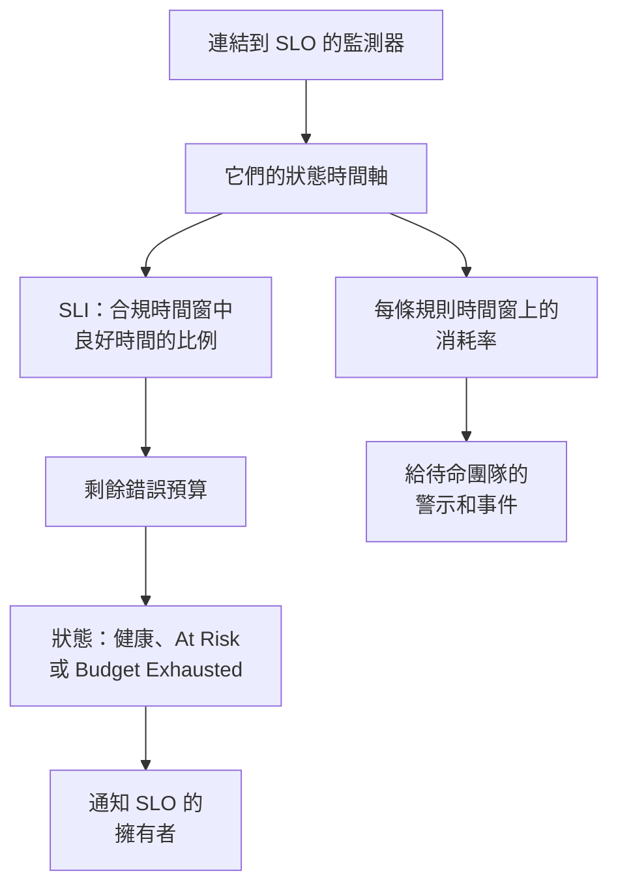

# SLO 概觀

服務等級目標（SLO）是您為所監控對象設定的可靠性目標，例如「在滾動的 30 天內 99.9% 的時間可用」。OneUptime 每 5 分鐘將每個 SLO 與其目標比對測量一次，因此您回答的不再是「它現在能用嗎？」，而是「在對使用者重要的時間範圍內，我們是否足夠可靠，還剩多少出錯的餘地？」。

:::cards
- [建立 SLO](#建立-slo): 一個名稱和一個目標，其餘一切都從預設值開始。
- [監測器與監測器規則](/docs/slo/monitor-rules): 選擇 SLO 要測量的監測器。
- [錯誤預算](/docs/slo/error-budget): 目標允許多少停機時間，以及預算如何恢復。
- [消耗率警示與事件](/docs/slo/burn-rate-alerts): 當預算消耗過快時提醒您的團隊。
:::

## 運作方式

SLO 會讀取連結到它的監測器的狀態時間軸，也就是您的狀態頁所顯示的同一份資料。OneUptime 據此計算合規時間窗中良好時間所占的比例、錯誤預算還剩多少，以及預算消耗的速度。

## 重要概念

| 術語 | 意義 |
| --- | --- |
| **SLI**（服務等級指標） | 測量值：SLO 的監測器在合規時間窗中處於可用狀態的時間百分比。 |
| **SLO**（服務等級目標） | SLI 的目標，例如「過去 30 天至少 99.9%」。 |
| **錯誤預算** | 目標允許的停機時間：`(100% − target) × window`。30 天內 99.9% 即 43 分 12 秒。 |
| **消耗率** | 與等速相比，預算被花掉的速度。消耗率為 1 時，預算恰好在時間窗結束時用完。 |

錯誤預算把可靠性變成了可以花用的東西。剩得多，就加快發布、勇於冒險；剩得少，就放慢腳步、投入穩定性。SLO 為這場討論提供一個所有人都看得到的數字。

## 建立 SLO

您需要一個可以建立 SLO 的角色：Project Owner、Project Admin，或具有 Create Service Level Objective 權限的自訂角色。

:::steps
### 開啟 SLO

從頂部列的 **產品** 選單開啟 **SLOs**。它位於第一組，與監測器和事件放在一起。按一下 **建立Service Level Objective**。

### 命名並設定目標

輸入 **名稱**（例如「API Availability」）和 **Target (%)**：監測器必須保持可用的時間比例。目標初始值為 `99.9`。它必須大於 0 且不超過 99.999，因為 100% 的目標不會留下任何可追蹤的錯誤預算。

### 在更多欄位中檢查預設值

**更多欄位** 預設為摺疊，並有一行說明其預設值的作用：SLO 以 30 天的滾動時間窗測量，當剩餘錯誤預算低於 20% 時進入風險狀態。展開它即可修改下表中的任一欄位。

### 儲存 SLO

按一下 **建立Service Level Objective**。OneUptime 會開啟新的 SLO。由於新 SLO 還沒有監測器，它的 **概覽** 會顯示 **Choose what this SLO measures**。

### 連結監測器

按一下 **Create a monitor rule** 可連結所有符合的監測器（包括現在和未來的），或按一下 **Add monitors** 手動選擇。請參閱[監測器與監測器規則](/docs/slo/monitor-rules)。

### 等待第一批數字

OneUptime 每 5 分鐘評估一次已啟用的 SLO。SLI、錯誤預算和燃盡圖會在第一次有監測器可測量的評估之後出現。
:::

**更多欄位** 中的欄位：

| 欄位 | 設定內容 | 預設值 |
| --- | --- | --- |
| **描述** | SLO 的用途。 | 空白 |
| **風險臨界值（%）** | 剩餘錯誤預算降到多少比例時 SLO 會變為 **At Risk**。0 到 100 之間的整數。 | 20 |
| **Window Type** | **Rolling**：最近 N 天，隨著舊的停機時間移出時間窗而恢復。**Calendar Month**：每個月獨立計算，在 1 日重設。 | **Rolling** |
| **Window (Days)** | 僅限滾動時間窗：回看多少天，1 到 366。通常為 28 或 30。 | 30 |
| **時區** | 僅限日曆月：每個月開始和結束所用的時區。 | UTC |
| **標籤** | 用於整理和篩選 SLO 的標籤。 | 無 |

決定 SLO 如何測量的一切都從預設值開始，之後可以修改：

| 設定 | 新 SLO 的初始值 | 修改位置 |
| --- | --- | --- |
| 監測器 | 無 | **監測器** 或 **Monitor Rules** |
| 停機狀態 | 專案中所有非運作中的狀態 | **設定** → **Downtime Calculation** |
| 多監測器模式 | **Any Monitor Down** | **設定** → **Downtime Calculation** |
| 評估 | 開啟 | **設定** → **評估** |
| 消耗率規則 | 一條 **Fast burn** 規則和一條 **Slow burn** 規則，依時間窗調整 | **Burn Rate Rules** |

## SLO 的組成

| 組成部分 | 決定什麼 |
| --- | --- |
| 監測器 | SLI 的來源。可手動連結，也可用監測器規則連結：請參閱[監測器與監測器規則](/docs/slo/monitor-rules)。 |
| 目標 | SLO 承諾的良好時間比例，大於 0 且不超過 99.999。 |
| 合規時間窗 | 測量 SLI 和預算的時間範圍：1 到 366 天的滾動時間窗，或日曆月。 |
| 風險臨界值 | 剩餘預算降到多少比例時 SLO 會變為 **At Risk**。 |
| 停機狀態 | 哪些監測器狀態計為停機。 |
| 多監測器模式 | 如何合併多個監測器的停機時間。 |

### 哪些狀態計為停機

每個 SLO 都有自己的一份計為停機的監測器狀態清單。新 SLO 從專案中所有未標示為運作中的狀態開始（例如 Degraded 和 Offline），與狀態頁的做法相同。在 **設定** → **Downtime Calculation** 中修改這份清單。留空則計入所有非運作中的狀態，包括之後新增到專案的狀態。

> [!TIP]
> 用兩個 SLO 以兩種方式測量同一組監測器：一個嚴格的可用性 SLO，Degraded 和 Offline 都計入；一個較寬鬆的完全中斷 SLO，只計入 Offline。

### 合規時間窗

| 時間窗類型 | 行為 |
| --- | --- |
| **Rolling** | 從現在起回看固定的天數。舊的停機時間會移出時間窗，因此預算會逐漸回來。 |
| **Calendar Month** | 從當月 1 日開始測量，使用 SLO 的時區（預設為 UTC）。每月月初全部預算都會回來。 |

### 一個 SLO 包含多個監測器

當 SLO 測量多個監測器時，它的 **Multi Monitor Mode** 決定如何合併這些監測器的停機時間。新 SLO 使用 **Any Monitor Down**。

| 模式 | 停機時間的計算方式 | 適用情境 |
| --- | --- | --- |
| **Any Monitor Down** | 只要至少有一個監測器停機，該時刻就計為整個 SLO 的停機時間。重疊的中斷只計一次。 | 這些監測器共同組成一個服務：任何一個停機，使用者都會察覺。 |
| **Monitor Seconds Average** | 每個監測器的停機時間分別計算，並在全部監控時間上取平均：SLI = 1 − (所有監測器的停機秒數 ÷ 所有監測器的監控秒數)。 | 這些監測器是一組相似的資源，部分影響應按部分計入。 |

例如，監測器 A 在 10:00 到 11:00 停機，而監測器 B 一直可用。**Any Monitor Down** 記錄 60 分鐘停機；**Monitor Seconds Average** 記錄相當於 30 分鐘的停機，因為兩個監測器中有一個停機了一小時。在此模式下，預算也以監測器秒計算：請參閱[錯誤預算](/docs/slo/error-budget)。

## SLO 狀態

OneUptime 為每個已評估的 SLO 指定一個狀態：

| 狀態 | 意義 |
| --- | --- |
| **健康** | 剩餘預算多於風險臨界值。 |
| **At Risk** | 剩餘預算已降至風險臨界值或以下：預設為 20%。 |
| **Budget Exhausted** | 預算已全部用完或已超支。 |
| **Misconfigured** | 無法測量此 SLO：它沒有監測器，或其監測器已不存在、尚未在時間窗內記錄任何狀態，或其目標超出範圍。 |
| **已暫停** | 它測量的每個監測器都已封存，或因手動操作、手動事件或排定的維護而關閉了主動監控。只要其中任一監測器恢復監控，它就會自動恢復。 |

已關閉或已封存的 SLO 不會被評估，因此其狀態維持不變；SLO 清單會改為顯示 **已停用** 或 **已封存** 徽章。當狀態變為 **At Risk** 或 **Budget Exhausted** 時，會通知 SLO 的擁有者：請參閱[錯誤預算](/docs/slo/error-budget)。

## SLO 清單

**SLOs** 頁面列出所有未封存的 SLO，以及它們的狀態、SLI、剩餘預算、消耗率、目標、時間窗、監測器、標籤和擁有者。

- 清單上方的圖塊依狀態統計 SLO：**健康**、**At Risk**、**Budget Exhausted**、**Misconfigured**、**已暫停** 和 **已停用**。按一下圖塊只顯示這些 SLO，再按一下則顯示全部。
- 選取多個 SLO，即可一次新增或移除標籤和擁有者、封存或刪除它們。
- 側邊選單的 **設定** 區段包含 **標籤規則** 和 **擁有者規則**，用於為新 SLO 加上標籤和擁有者：請參閱[標籤與擁有者規則](/docs/slo/label-and-owner-rules)。
- 側邊選單的 **進階** 區段包含 **已封存**，也就是已封存 SLO 的清單。

## SLO 的頁面

開啟一個 SLO，即可在側邊選單中看到它的頁面：

| 頁面 | 顯示內容 |
| --- | --- |
| **概覽** | 狀態、主要數字、錯誤預算燃盡、近期活動、未關閉的警示和事件，以及消耗率規則。 |
| **指標** | SLO 的 `oneuptime.slo.*` 指標、它的長期錯誤預算歷史，以及影響它的事件和警示的指標。請參閱 [SLO 指標與儀表板](/docs/slo/metrics)。 |
| **事件** | 其消耗率規則宣告的事件。徽章統計未關閉的數量。 |
| **警示** | 其消耗率規則觸發的警示。徽章統計未關閉的數量。 |
| **Feed** | SLO 發生過的事情，以時間軸呈現。請參閱 [SLO 動態與稽核日誌](/docs/slo/feed-and-audit-logs)。 |
| **監測器** | 它測量的監測器，以及每個監測器是由人還是由規則連結的。 |
| **Monitor Rules** | 連結符合監測器的規則。 |
| **Burn Rate Rules** | 在預算消耗過快時觸發警示、宣告事件的規則。 |
| **擁有者** | 會收到其狀態變化通知的使用者和團隊。 |
| **設定** | 目標、合規期間、停機計算、評估開關和封存卡片。 |
| **稽核日誌** | 誰在何時變更了 SLO、其規則和其擁有者。 |
| **Delete SLO** | 永久刪除 SLO，並解決它未關閉的消耗率警示和事件。 |

**監測器**、**Monitor Rules** 和 **Burn Rate Rules** 位於 **設定** 區段，**擁有者**、**設定**、**稽核日誌** 和 **Delete SLO** 位於 **Management** 區段。這兩個區段預設都是摺疊的，用於從程式碼管理 SLO 的 **開發者** 區段也是如此：按一下區段標題即可展開。

當有問題阻止 SLO 測量時，它每個頁面頂端的橫幅會說明問題所在，並連結到可以修正它的頁面：請參閱[疑難排解](#疑難排解)。

### 概覽頁

**概覽** 由上而下回答「我們是否在預算之內？」：

- **摘要**：狀態、一句說明其意義的話以及描述。旁邊是 **重新整理** 和 SLO 上次評估的時間。下方是目標、**Compliance window**（新的滾動時間窗填滿之前會帶有填充指示器：請參閱[新 SLO 與時間窗填充指示器](#新-slo-與時間窗填充指示器)）、監測器數量和擁有者。
- **主要數字**：
  - **SLI**：時間窗中良好時間的比例，以及它高於或低於目標多少。
  - **Error budget left**：一個百分比、類似 "12m 30s left of 43m 12s" 的時長，以及一條在風險臨界值處有標記的進度列。預算超支時顯示 **Budget exceeded** 及超出多少。
  - **Burn rate**：過去 60 分鐘內預算被花掉的速度，也就是預設快速消耗規則使用的時間範圍。超過 1× 時變為琥珀色；達到 SLO 已啟用的消耗率規則中最低的臨界值時變為紅色，並顯示 **Rule threshold reached**。
  - **Budget runway**：照這個速度預算還能撐多久。請參閱[錯誤預算](/docs/slo/error-budget#預算剩餘時間)。
- **Error budget burn-down**：目前時間窗內的剩餘預算。請參閱[錯誤預算](/docs/slo/error-budget#錯誤預算燃盡)。
- **Recent activity**：SLO 動態中的最新項目。
- **SLO Details**：名稱、描述和標籤，這是概覽頁上唯一可編輯的設定。
- **Open alerts & incidents**：消耗率規則目前未關閉的內容。
- **Burn rate rules**：每條已啟用規則的臨界值與目前消耗率的對照，以及規則會宣告什麼。

### 設定

**設定** 頁面匯集了 SLO 的測量方式，每項一張卡片：

| 卡片 | 修改內容 | 須知 |
| --- | --- | --- |
| **Objective** | **Target (%)** 和 **風險臨界值（%）**，透過 **Edit Objective** 修改。 | 顯示目標允許的停機時間，例如「每個 30 天時間窗 43m 12s 停機時間」。 |
| **Compliance Period** | **Window Type**、**Window (Days)** 和 **時區**，透過 **Edit Period** 修改。 | 時間窗改變時消耗率規則會保留原有臨界值，因此之後請檢查它們。 |
| **Downtime Calculation** | **Multi Monitor Mode** 和 **停機監測器狀態**，透過 **Edit Downtime Calculation** 修改。 | 不選任何狀態時會計入所有非運作中的狀態，包括之後新增的狀態。 |
| **評估** | **評估此 SLO** 開關，一切換就會儲存。 | 關閉時會要求確認，因為這也會解決 SLO 未關閉的消耗率警示和事件。 |
| **Archive SLO** | **封存** 或 **取消封存**。 | 請參閱[封存 SLO](#封存-slo)。 |

變更目標、期間或停機計算後，OneUptime 會在下一次執行時重新評估 SLO。

## 封存 SLO

不再測量但想保留的 SLO（例如已下線的服務或去年的目標）可以封存。在 **設定** → **Archive SLO** 中封存，或在清單中選取 SLO 後選擇 **封存**。

已封存的 SLO：

- 會從 SLO 清單、其狀態圖塊以及儀表板的 SLO 選擇器和清單中隱藏；
- 不會被評估：數字停留在上次評估時，消耗率規則不會觸發，也不傳送指標；
- 其未關閉的消耗率警示和事件會被解決；
- 保留其設定、歷史、規則和擁有者。其監測器規則會讓監測器清單保持最新，因此恢復時會使用正確的監測器。

已封存的 SLO 列在 SLO 清單側邊選單 **進階** 下的 **已封存** 頁面中。在那裡選取它們並選擇 **取消封存** 即可恢復：它們會在下一次執行時重新評估，SLI 和預算會根據其監測器的歷史重新計算。

封存和關閉評估是兩個獨立的開關。封存前已關閉的 SLO 在取消封存後仍是關閉的：用其橫幅中的 **開啟評估**，或 **設定** → **評估** 中的 **評估此 SLO** 重新開啟。

| 您想要 | 這樣做 |
| --- | --- |
| 暫時停止測量，但保留在清單中 | 關閉評估 |
| 讓它退役，但保留歷史和設定 | 封存 |
| 永久移除 | 刪除 |

## 警示、事件和監測器上的 SLO

消耗率規則建立的每個警示和事件都會連結到它的 SLO：

- 警示或事件的頁面會在 **受影響的資源** 下列出該 SLO，並附有指向它的連結。
- 警示和事件清單會在受影響的資源中顯示該 SLO，**受影響的資源** 篩選器可將清單限定為某個 SLO。
- SLO 的 **警示** 和 **事件** 頁面會列出它們，側邊選單中的徽章統計未關閉的數量。

這個連結由 OneUptime 在規則建立警示或事件時建立；您無法手動新增，編輯警示或事件也不會移除它。

監測器的側邊選單也有一個 **SLOs** 頁面：列出測量該監測器的 SLO，讓您在暫停或變更監測器之前，就知道哪些目標依賴它。

## 新 SLO 與時間窗填充指示器

比自身時間窗還新的滾動時間窗 SLO 會依據目前已有的資料測量：昨天建立的 30 天 SLO 只有一天的資料。它的錯誤預算一開始很小，隨著時間窗填滿而增加，因此最初的數字波動會比之後更大。

在此期間，**概覽** 會提示這一點：摘要中顯示 **Window 23% full** 指示器（第一天顯示 **Window under 1% full**），**Error budget left** 圖塊也會在數字下方重複說明。時間窗填滿後兩者都會消失。日曆月 SLO 從不顯示它們，因為它們的預算從第一天起就涵蓋整個月；**Monitor Seconds Average** 模式的 SLO 也不顯示，因為其預算以所有監測器合計。

## 疑難排解

SLO 頁面頂端的橫幅會說明是什麼阻止了它測量：

| 橫幅 | 意義 | 處理方式 |
| --- | --- | --- |
| **No monitors attached** | SLO 沒有監測器，因此沒有可測量的對象。 | 連結監測器，或建立監測器規則。 |
| **Waiting for SLO evaluation** | 已連結監測器，但上一次評估沒有它們的狀態資料。 | 檢查監測器是否正在被檢查。下一次有資料的評估之後就會出現數字。 |
| **Measurement is paused** | 它測量的每個監測器都已封存或關閉了主動監控。 | 至少為一個監測器重新開啟監控，或等待維護結束。 |
| **The target is out of range** | 目標不在大於 0 且小於 100 的範圍內。 | 在 **設定** → **Objective** 中設定一個目標，例如 99.9。 |
| **This SLO is disabled** | 評估已關閉。 | 按一下 **開啟評估**。 |
| **This SLO is archived** | SLO 已封存。 | 在 **設定** 中取消封存。 |
| **Not evaluated yet** | SLO 剛剛建立。 | 等待第一次評估，最多幾分鐘。 |

## 後續步驟

:::cards
- [監測器與監測器規則](/docs/slo/monitor-rules): 手動或透過規則連結監測器。
- [錯誤預算](/docs/slo/error-budget): 預算的計算、剩餘時間以及預算如何回來。
- [消耗率警示與事件](/docs/slo/burn-rate-alerts): 當預算消耗過快時提醒待命團隊。
- [SLO 指標與儀表板](/docs/slo/metrics): 為 SLO 繪製圖表並建立 SLO 儀表板。
:::
