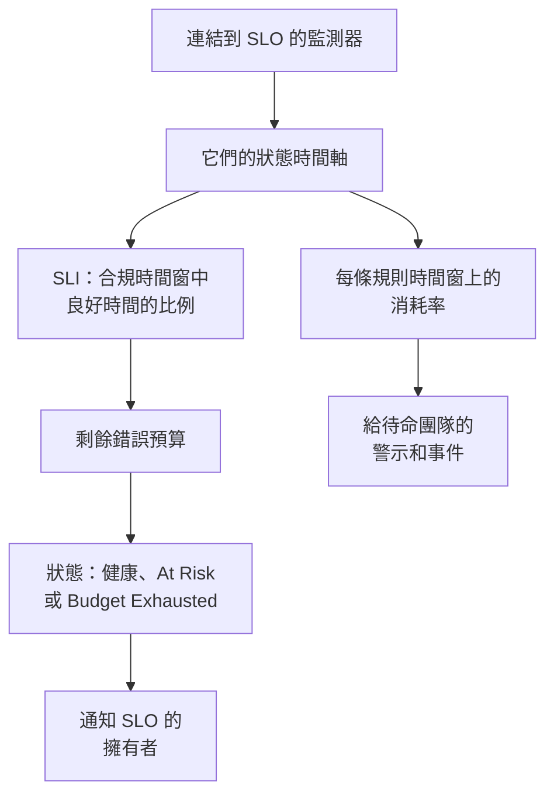

# SLO 概觀

服務等級目標（SLO）是您為所運行的系統設定的可靠性目標，例如「在滾動的 30 天內 99.9% 的時間可用」或「99.9% 的結帳請求成功」。OneUptime 每 5 分鐘將每個 SLO 與其目標比對測量一次，因此您回答的不再是「它現在能用嗎？」，而是「在對使用者重要的時間範圍內，我們是否足夠可靠，還剩多少出錯的餘地？」。[詞彙表](/docs/introduction/glossary#slo) 把 SLO 與 OneUptime 使用的其他詞彙放在一起介紹。

:::cards
- [建立 SLO](#建立-slo): 衡量對象、一個名稱和一個目標，其餘一切都從預設值開始。
- [監測器與監測器規則](/docs/slo/monitor-rules): 選擇 SLO 要測量的監測器。
- [請求與延遲 SLO](/docs/slo/request-slos): 根據服務的追蹤衡量其請求。
- [錯誤預算](/docs/slo/error-budget): 目標允許多少停機時間，以及預算如何恢復。
- [消耗率警示與事件](/docs/slo/burn-rate-alerts): 當預算消耗過快時提醒您的團隊。
:::

## 運作方式

SLO 衡量的是兩種對象之一。監測器可用率 SLO 會讀取連結到它的監測器的狀態時間軸，也就是您的狀態頁所顯示的同一份資料。請求 SLO 則根據服務的追蹤，計算這些服務處理的請求：請參閱[請求與延遲 SLO](/docs/slo/request-slos)。本頁其餘部分說明的是監測器可用率 SLO；除非另有說明，請求 SLO 的運作方式相同。OneUptime 據此計算合規時間窗中良好時間所占的比例、錯誤預算還剩多少，以及預算消耗的速度。監測器的監測關閉期間的時間會被排除：那段時間沒有任何東西檢查該監測器，因此這段時間既不消耗錯誤預算，也不算作良好時間。監測器第一次檢查之前的時間同樣會被排除：在有東西檢查監測器之前，它的狀態只是每個監測器建立時都具有的正常運作狀態，因此 SLO 從其監測器的第一次檢查開始測量；監測器尚未被任何東西檢查過的 SLO，在它們被檢查之前沒有任何可測量的內容。



## 重要概念

OneUptime 各處使用的詞彙都收錄在 [詞彙表](/docs/introduction/glossary) 中。

| 術語 | 意義 |
| --- | --- |
| **SLI**（服務等級指標） | 測量值：SLO 的監測器在合規時間窗中處於可用狀態的時間百分比，或其服務的請求中良好請求所占的百分比。 |
| **SLO**（服務等級目標） | SLI 的目標，例如「過去 30 天至少 99.9%」。 |
| **錯誤預算** | 目標允許的停機時間：`(100% − target) × window`。30 天內 99.9% 即 43 分 12 秒。對於請求 SLO，它是目標允許的不良請求：在 99.9% 時，每 1,000 個請求中允許 1 個。 |
| **消耗率** | 與等速相比，預算被花掉的速度。消耗率為 1 時，預算恰好在時間窗結束時用完。 |

錯誤預算把可靠性變成了可以花用的東西。剩得多，就加快發布、勇於冒險；剩得少，就放慢腳步、投入穩定性。SLO 為這場討論提供一個所有人都看得到的數字。

## 建立 SLO

您需要一個可以建立 SLO 的角色：專案擁有者、專案管理員，或具有 Create Service Level Objective 權限的自訂角色。

:::steps
### 開啟 SLO

從頂部列的 **產品** 選單開啟 **SLOs**。它位於第一組，與監測器和事件放在一起。按一下 **建立服務等級目標**。

### 選擇衡量對象

在 **衡量對象** 下，保留 **監測器可用率** 即可衡量監測器處於可用狀態的時間比例。若要改為衡量服務的請求，請選擇 **請求成功率** 或 **請求延遲**，並選擇要衡量的 **服務**：請參閱[請求與延遲 SLO](/docs/slo/request-slos)。若要計算您的服務傳送的計數器或直方圖中的良好事件，請選擇 **指標**：請參閱[基於指標的 SLO](/docs/slo/request-slos#基於指標的-slo)。按一下 **下一步**。

### 命名並設定目標

輸入 **名稱**（例如「API Availability」）和 **目標（%）**：必須良好的時間或請求比例。目標初始值為 `99.9`。它必須大於 0 且不超過 99.999，因為 100% 的目標不會留下任何可追蹤的錯誤預算。

### 在更多欄位中檢查預設值

**更多欄位** 預設為摺疊，並有一行說明其預設值的作用：SLO 以 30 天的滾動時間窗測量，當剩餘錯誤預算低於 20% 時進入風險狀態。展開它即可修改下表中的任一欄位。

### 儲存 SLO

按一下 **建立服務等級目標**。OneUptime 會開啟新的 SLO。由於監測器可用率 SLO 還沒有監測器，它的 **概覽** 會顯示 **Choose what this SLO measures**。

### 連結監測器

對於監測器可用率 SLO，按一下 **建立監測器規則** 可連結所有符合的監測器（包括現在和未來的），或按一下 **新增監測器** 手動選擇。請參閱[監測器與監測器規則](/docs/slo/monitor-rules)。

### 等待第一批數字

OneUptime 每 5 分鐘評估一次已啟用的 SLO。SLI、錯誤預算和燃盡圖會在第一次有監測器可測量或有請求可計算的評估之後出現。
:::

**更多欄位** 中的欄位：

| 欄位 | 設定內容 | 預設值 |
| --- | --- | --- |
| **描述** | SLO 的用途。 | 空白 |
| **風險臨界值（%）** | 剩餘錯誤預算降到多少比例時 SLO 會變為 **有風險**。0 到 100 之間的整數。 | 20 |
| **視窗類型** | **滾動**：最近 N 天，隨著舊的停機時間移出時間窗而恢復。**日曆月**：每個月獨立計算，在 1 日重設。 | **滾動** |
| **視窗（天）** | 僅限滾動時間窗：回看多少天，1 到 366。通常為 28 或 30。 | 30 |
| **時區** | 僅限日曆月：每個月開始和結束所用的時區。 | UTC |
| **標籤** | 用於整理和篩選 SLO 的標籤。 | 無 |

決定 SLO 如何測量的一切都從預設值開始，之後可以修改：

| 設定 | 新 SLO 的初始值 | 修改位置 |
| --- | --- | --- |
| 監測器 | 無 | **監測器** 或 **監測器規則** |
| 停機狀態 | 專案中所有非運作中的狀態 | **設定** → **停機時間計算方式** |
| 多監測器模式 | **任一監測器停機** | **設定** → **停機時間計算方式** |
| 評估 | 開啟 | **設定** → **評估** |
| 消耗率規則 | 一條 **Fast burn** 規則、一條 **Slow burn** 規則和一條 **Slow leak** 規則，依時間窗調整 | **消耗速率規則** |

## SLO 的組成

| 組成部分 | 決定什麼 |
| --- | --- |
| 衡量對象 | **監測器可用率**、**請求成功率** 或 **請求延遲**。 |
| 監測器或服務 | SLI 的來源：監測器（可手動連結，也可用監測器規則連結，請參閱[監測器與監測器規則](/docs/slo/monitor-rules)），或請求 SLO 計算其請求的服務。 |
| 目標 | SLO 承諾的良好時間比例，大於 0 且不超過 99.999。 |
| 合規時間窗 | 測量 SLI 和預算的時間範圍：1 到 366 天的滾動時間窗，或日曆月。 |
| 風險臨界值 | 剩餘預算降到多少比例時 SLO 會變為 **有風險**。 |
| 停機狀態 | 哪些監測器狀態計為停機。 |
| 多監測器模式 | 如何合併多個監測器的停機時間。 |

### 哪些狀態計為停機

每個 SLO 都有自己的一份計為停機的監測器狀態清單。新 SLO 從專案中所有未標示為運作中的狀態開始（例如 Degraded 和 Offline），與狀態頁的做法相同。在 **設定** → **停機時間計算方式** 中修改這份清單。留空則計入所有非運作中的狀態，包括之後新增到專案的狀態。

> [!TIP]
> 用兩個 SLO 以兩種方式測量同一組監測器：一個嚴格的可用性 SLO，Degraded 和 Offline 都計入；一個較寬鬆的完全中斷 SLO，只計入 Offline。

### 合規時間窗

| 時間窗類型 | 行為 |
| --- | --- |
| **滾動** | 從現在起回看固定的天數。舊的停機時間會移出時間窗，因此預算會逐漸回來。 |
| **日曆月** | 從當月 1 日開始測量，使用 SLO 的時區（預設為 UTC）。每月月初全部預算都會回來。 |

### 一個 SLO 包含多個監測器

當 SLO 測量多個監測器時，它的 **多監測器模式** 決定如何合併這些監測器的停機時間。新 SLO 使用 **任一監測器停機**。

| 模式 | 停機時間的計算方式 | 適用情境 |
| --- | --- | --- |
| **任一監測器停機** | 只要至少有一個監測器停機，該時刻就計為整個 SLO 的停機時間。重疊的中斷只計一次。 | 這些監測器共同組成一個服務：任何一個停機，使用者都會察覺。 |
| **監測器秒數平均** | 每個監測器的停機時間分別計算，並在全部監控時間上取平均：SLI = 1 − (所有監測器的停機秒數 ÷ 所有監測器的監控秒數)。 | 這些監測器是一組相似的資源，部分影響應按部分計入。 |

例如，監測器 A 在 10:00 到 11:00 停機，而監測器 B 一直可用。**任一監測器停機** 記錄 60 分鐘停機；**監測器秒數平均** 記錄相當於 30 分鐘的停機，因為兩個監測器中有一個停機了一小時。在此模式下，預算也以監測器秒計算：請參閱[錯誤預算](/docs/slo/error-budget)。

## SLO 狀態

OneUptime 為每個已評估的 SLO 指定一個狀態：

| 狀態 | 意義 |
| --- | --- |
| **健康** | 剩餘預算多於風險臨界值。 |
| **有風險** | 剩餘預算已降至風險臨界值或以下：預設為 20%。 |
| **預算已耗盡** | 預算已全部用完或已超支。 |
| **設定錯誤** | 無法測量此 SLO：它沒有監測器，或其監測器已不存在、尚未被任何東西檢查過、尚未在時間窗內記錄任何狀態，或其目標超出範圍。請求 SLO 在沒有服務、沒有延遲臨界值，或其服務尚未在時間窗內處理任何請求時，也會處於設定錯誤狀態。 |
| **已暫停** | 它測量的每個監測器都已封存，或因手動操作、手動事件或排定維護而關閉了主動監控。只要其中任一監測器恢復監控，它就會自動恢復。 |

已關閉或已封存的 SLO 不會被評估，因此其狀態維持不變；SLO 清單會改為顯示 **已停用** 或 **已封存** 徽章。當狀態變為 **有風險** 或 **預算已耗盡** 時，會通知 SLO 的擁有者：請參閱[錯誤預算](/docs/slo/error-budget)。

## SLO 清單

**SLOs** 頁面列出所有未封存的 SLO，以及它們的狀態、SLI、剩餘預算、消耗率、目標、時間窗、監測器、標籤和擁有者。其 **衡量對象** 欄對請求 SLO 顯示其服務，對監測器正常運作時間 SLO 顯示其監測器；**服務** 篩選器可找出衡量某個服務的 SLO。

- 清單上方的圖塊依狀態統計 SLO：**健康**、**有風險**、**預算已耗盡**、**設定錯誤**、**已暫停** 和 **已停用**。只要有未封存的 SLO，圖塊就會顯示。按一下圖塊只顯示這些 SLO，再按一下則顯示全部。
- 選取多個 SLO，即可一次新增或移除標籤和擁有者、啟用或停用、為它們新增缺少的[推薦消耗率規則](/docs/slo/burn-rate-alerts#一次為多個-slo-新增推薦規則)、封存或刪除它們。
- 側邊選單的 **設定** 區段包含 **標籤規則** 和 **擁有者規則**，用於為新 SLO 加上標籤和擁有者：請參閱[標籤與擁有者規則](/docs/slo/label-and-owner-rules)。
- 側邊選單的 **進階** 區段包含 **已封存**，也就是已封存 SLO 的清單。

## SLO 的頁面

開啟一個 SLO，即可在側邊選單中看到它的頁面：

| 頁面 | 顯示內容 |
| --- | --- |
| **概覽** | 狀態、主要數字、錯誤預算燃盡、近期活動、未關閉的警示和事件，以及消耗率規則。 |
| **指標** | SLO 的 `oneuptime.slo.*` 指標、它的長期錯誤預算歷史，以及影響它的事件和警示的指標。請參閱 [SLO 指標與儀表板](/docs/slo/metrics)。 |
| **月度報告** | SLO 在每個日曆月以及整個期間的表現。請參閱[月度報告](#月度報告)。 |
| **事件** | 其消耗率規則和錯誤預算策略宣告的事件。徽章統計未關閉的數量。 |
| **警示** | 其消耗率規則和錯誤預算策略觸發的警示。徽章統計未關閉的數量。 |
| **動態** | SLO 發生過的事情，以時間軸呈現。請參閱 [SLO 動態與稽核日誌](/docs/slo/feed-and-audit-logs)。 |
| **監測器** | 它測量的監測器，以及每個監測器是由人還是由規則連結的。僅限監測器可用率 SLO。 |
| **監測器規則** | 連結符合監測器的規則。僅限監測器可用率 SLO。 |
| **消耗速率規則** | 在預算消耗過快時觸發警示、宣告事件的規則。 |
| **錯誤預算策略** | 錯誤預算減少時團隊約定要做的事，以及策略的每個級別觸發的警示和事件。請參閱 [錯誤預算策略](/docs/slo/error-budget-policy)。 |
| **擁有者** | 會收到其狀態變化通知的使用者和團隊。 |
| **設定** | 衡量對象、目標、合規期間、停機計算、評估開關和封存卡片。 |
| **稽核日誌** | 誰在何時變更了 SLO、其規則和其擁有者。 |
| **刪除 SLO** | 永久刪除 SLO，並解決它未關閉的消耗率警示和事件。 |

**監測器** 位於 **概覽** 區段的 **概覽** 之下；**監測器規則**、**消耗速率規則** 和 **錯誤預算策略** 位於 **規則** 區段；**擁有者**、**設定**、**稽核日誌** 和 **刪除 SLO** 位於 **管理** 區段。**規則** 和 **管理** 區段預設是摺疊的，用於從程式碼管理 SLO 的 **開發者** 區段也是如此：按一下區段標題即可展開。

當有問題阻止 SLO 測量時，它每個頁面頂端的橫幅會說明問題所在，並連結到可以修正它的頁面：請參閱[疑難排解](#疑難排解)。

### 概覽頁

**概覽** 由上而下回答「我們是否在預算之內？」：

- **摘要**：狀態、一句說明其意義的話以及描述。旁邊是 **重新整理** 和 SLO 上次評估的時間。下方是目標、**合規視窗**（新的滾動時間窗填滿之前會帶有填充指示器：請參閱[新 SLO 與時間窗填充指示器](#新-slo-與時間窗填充指示器)）、監測器數量（請求 SLO 則為服務數量）和擁有者，可透過 **新增擁有者** 就地新增擁有者。
- **主要數字**：
  - **SLI**：時間窗中良好時間的比例，以及它高於或低於目標多少。
  - **剩餘錯誤預算**：一個百分比、類似 "43 分鐘12 秒 中剩餘 12 分鐘30 秒" 的時長（請求 SLO 則為不良請求的數量），以及一條在風險臨界值處有標記的進度列。預算超支時顯示 **已超出預算** 及超出多少。
  - **消耗速率**：過去 60 分鐘內預算被花掉的速度，也就是預設快速消耗規則使用的時間範圍。超過 1× 時變為琥珀色；達到 SLO 已啟用、且回溯 6 小時或更短時間的消耗率規則中最低的臨界值時變為紅色，並顯示 **已達到規則閾值**。一小時的資料對於回溯數天的規則（例如 **Slow leak**）說明不了什麼，因此不會與這類規則比較。
  - **預算可撐時長**：照這個速度預算還能撐多久。請參閱[錯誤預算](/docs/slo/error-budget#預算剩餘時間)。
- **錯誤預算燃盡**：目前時間窗內的剩餘預算。請參閱[錯誤預算](/docs/slo/error-budget#錯誤預算燃盡)。
- **最近活動**：SLO 動態中的最新項目。
- **SLO 詳細資料**：名稱、描述和標籤，這是概覽頁上唯一可編輯的設定。
- **未解決的警示和事件**：消耗率規則目前未關閉的內容。
- **Burn rate rules**：每條已啟用規則的臨界值與目前消耗率的對照（僅限回溯 6 小時或更短時間的規則），以及規則會宣告什麼。

當 SLO 處於其錯誤預算策略的某個級別時，**概覽** 也會顯示該級別，以及團隊約定在該級別要做的事：請參閱 [錯誤預算策略](/docs/slo/error-budget-policy)。

**被使用於**卡片會列出作用於此 SLO 的消耗速率規則和錯誤預算策略層級，以及顯示它的儀表板。封存或刪除此 SLO 時，會先說明這些內容：它的規則和層級會隨之刪除。

### 設定

**設定** 頁面匯集了 SLO 的測量方式，每項一張卡片：

| 卡片 | 修改內容 | 須知 |
| --- | --- | --- |
| **衡量對象** | **衡量對象**、**服務**、**延遲閾值（ms）**、**請求篩選器** 和 **指標**，透過 **編輯衡量對象** 修改。 | 變更之後，請求 SLO 會從頭重新計算它的請求。 |
| **目標** | **目標（%）** 和 **風險臨界值（%）**，透過 **編輯目標** 修改。 | 顯示目標允許的停機時間，例如「每個 30 天視窗 43 分鐘12 秒 停機時間」。 |
| **合規週期** | **視窗類型**、**視窗（天）** 和 **時區**，透過 **編輯週期** 修改。 | 時間窗改變時消耗率規則會保留原有臨界值，因此之後請檢查它們。 |
| **停機時間計算方式** | **多監測器模式** 和 **停機監測器狀態**，透過 **編輯停機時間計算方式** 修改。 | 僅限監測器可用率 SLO。不選任何狀態時會計入所有非運作中的狀態，包括之後新增的狀態。 |
| **評估** | **評估此 SLO** 開關，一切換就會儲存。 | 關閉時會要求確認，因為這也會解決 SLO 未關閉的消耗率警示和事件。 |
| **封存SLO** | **封存** 或 **取消封存**。 | 請參閱[封存 SLO](#封存-slo)。 |

變更衡量對象、目標、期間或停機計算後，OneUptime 會在下一次執行時重新評估 SLO。

### 月度報告

**月度報告** 顯示 SLO 在最近 **3 個月**、**6 個月**、**9 個月** 或 **12 個月**，或某個日曆年中每個日曆月的表現。每個月顯示其 SLI、停機時間（請求 SLO 顯示失敗或慢的請求，基於指標的 SLO 顯示不良事件）、已用錯誤預算的比例以及結果：

| 結果 | 意義 |
| --- | --- |
| 符合 | 該月已結束，其 SLI 達到了目標。 |
| 未達成 | 該月已結束且未達到目標，或該月仍在進行中，但停機時間已經超過整個月允許的停機時間。 |
| 進展正常 | 該月仍在進行中，截至目前的 SLI 達到目標。 |
| 低於目標 | 該月仍在進行中，截至目前的 SLI 低於目標。 |
| 無資料 | 該月沒有任何量測。 |

**總計** 列把整個期間當作一個整體來衡量。有多個監測器的 SLO 還有一個 **依監測器** 表格：每個監測器各自在每個月的 SLI，對 SLO 影響最大的監測器排在最前。**下載 CSV** 會把報告儲存為可在試算表中使用的檔案。

報告不會額外儲存任何資料。每個月在你開啟報告時根據監測器的狀態歷史計算，使用 SLO 目前的監測器、停機狀態和目標，因此可以追溯到建立 SLO 之前。請求 SLO 的各個月份來自 OneUptime 為它統計並保留 400 天的請求，基於指標的 SLO 則來自同樣保留的指標事件。月份依 SLO 的時區劃分，沒有設定時區時依 UTC。

API 會回傳同樣的報告：

```bash
curl -sS "https://oneuptime.com/api/service-level-objective/<slo-id>/monthly-report?months=12" \
  -H "ApiKey: $ONEUPTIME_API_KEY"
```

用 `months` 請求截至目前月份的 1 到 24 個月，或用 `year` 請求某個日曆年，例如 `year=2025`。

## 封存 SLO

不再測量但想保留的 SLO（例如已下線的服務或去年的目標）可以封存。在 **設定** → **封存SLO** 中封存，或在清單中選取 SLO 後選擇 **封存**。

已封存的 SLO：

- 會從 SLO 清單、其狀態圖塊以及儀表板的 SLO 選擇器和清單中隱藏；
- 不會被評估：數字停留在上次評估時，消耗率規則不會觸發，也不傳送指標；
- 其未關閉的消耗率警示和事件會被解決；
- 保留其設定、歷史、規則和擁有者。其監測器規則會讓監測器清單保持最新，因此恢復時會使用正確的監測器。

已封存的 SLO 列在 SLO 清單側邊選單 **進階** 下的 **已封存** 頁面中。在那裡選取它們並選擇 **取消封存** 即可恢復：它們會在下一次執行時重新評估，SLI 和預算會根據其監測器的歷史重新計算。

封存和關閉評估是兩個獨立的開關。封存前已關閉的 SLO 在取消封存後仍是關閉的：用其橫幅中的 **開啟評估**，或 **設定** → **評估** 中的 **評估此 SLO** 重新開啟。

| 您想要 | 這樣做 |
| --- | --- |
| 暫時停止測量，但保留在清單中 | 關閉評估 |
| 讓它退役，但保留歷史和設定 | 封存 |
| 永久移除 | 刪除 |

## 警示、事件和監測器上的 SLO

消耗率規則建立的每個警示和事件都會連結到它的 SLO：

- 警示或事件的頁面會在 **受影響的資源** 下列出該 SLO，並附有指向它的連結。
- 警示和事件清單會在受影響的資源中顯示該 SLO，**受影響的資源** 篩選器可將清單限定為某個 SLO。
- SLO 的 **警示** 和 **事件** 頁面會列出它們，側邊選單中的徽章統計未關閉的數量。

這個連結由 OneUptime 在規則建立警示或事件時建立；您無法手動新增，編輯警示或事件也不會移除它。

監測器的側邊選單也有一個 **SLOs** 頁面：列出測量該監測器的 SLO，讓您在暫停或變更監測器之前，就知道哪些目標依賴它。

## 新 SLO 與時間窗填充指示器

比自身時間窗還新的滾動時間窗 SLO 會依據目前已有的資料測量：昨天建立的 30 天 SLO 只有一天的資料。它的錯誤預算一開始很小，隨著時間窗填滿而增加，因此最初的數字波動會比之後更大。

在此期間，**概覽** 會提示這一點：摘要中顯示 **視窗已填充 23%** 指示器（第一天顯示 **視窗填充不到 1%**），**剩餘錯誤預算** 圖塊也會在數字下方重複說明。時間窗填滿後兩者都會消失。日曆月 SLO 從不顯示它們，因為它們的預算從第一天起就涵蓋整個月；**監測器秒數平均** 模式的 SLO 也不顯示，因為其預算以所有監測器合計。請求 SLO 則會在 OneUptime 仍在計算其服務較早的請求時顯示它們：請參閱[請求與延遲 SLO](/docs/slo/request-slos#請求如何計數)。

## 疑難排解

SLO 頁面頂端的橫幅會說明是什麼阻止了它測量：

| 橫幅 | 意義 | 處理方式 |
| --- | --- | --- |
| **未關聯任何監測器** | SLO 沒有監測器，因此沒有可測量的對象。 | 連結監測器，或建立監測器規則。 |
| **正在等待 SLO 評估** | 已連結監測器，但上一次評估沒有它們的狀態資料。 | 檢查監測器是否正在被檢查。下一次有資料的評估之後就會出現數字。 |
| **正在等待首次檢查** | 已連結監測器，但還沒有任何檢查：例如一分鐘前剛建立的監測器，或尚未連線的自架探測器。 | 無需處理：SLO 從它們的首次檢查開始計量。如果首次檢查遲遲不來，請開啟監測器查看原因。 |
| **測量已暫停** | 它測量的每個監測器都已封存或關閉了主動監控。 | 至少為一個監測器重新開啟監控，或等待維護結束。 |
| **目標超出範圍** | 目標不在大於 0 且小於 100 的範圍內。 | 在 **設定** → **目標** 中設定一個目標，例如 99.9。 |
| **此 SLO 已停用** | 評估已關閉。 | 按一下 **開啟評估**。 |
| **此 SLO 已封存** | SLO 已封存。 | 在 **設定** 中取消封存。 |
| **尚未評估** | SLO 剛剛建立。 | 等待第一次評估，最多幾分鐘。 |
| **未選擇服務** | 請求 SLO 沒有服務，因此沒有可計算的請求。 | 在 **設定** → **衡量對象** 中選擇它的服務。 |
| **未設定延遲閾值** | 請求延遲 SLO 沒有臨界值，因此沒有任何請求能算作夠快。 | 在 **設定** → **衡量對象** 中設定 **延遲閾值（ms）**。 |
| **正在等待請求** | 請求 SLO 的服務都還沒有在時間窗內處理過任何請求。 | 檢查這些服務是否把追蹤傳送到 OneUptime。下一次計算到請求的評估之後就會出現數字。 |
| **沒有可計算的指標** | 基於指標的 SLO 沒有可計算的指標：尚未選擇指標，或缺少區分良好事件的方式。 | 在 **設定** → **衡量對象** 中選擇指標，以及它的良好條件或值。 |
| **正在等待其指標** | 基於指標的 SLO 的服務都還沒有在時間窗內傳送過該指標的任何事件。 | 檢查這些服務是否以 SLO 計算的名稱把指標傳送到 OneUptime。下一次計算到事件的評估之後就會出現數字。 |

## 後續步驟

:::cards
- [監測器與監測器規則](/docs/slo/monitor-rules): 手動或透過規則連結監測器。
- [請求與延遲 SLO](/docs/slo/request-slos): 根據服務的追蹤衡量其請求。
- [錯誤預算](/docs/slo/error-budget): 預算的計算、剩餘時間以及預算如何回來。
- [發布檢查](/docs/slo/release-checks): 回滾正在消耗錯誤預算的版本。
:::
