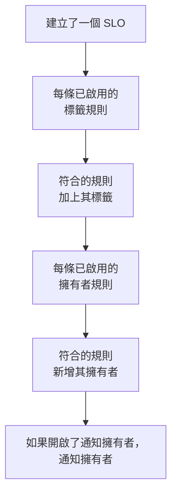

# 標籤與擁有者規則

標籤規則和擁有者規則會替您整理 SLO。**標籤規則** 會為每個符合規則的新 SLO 加上標籤，**擁有者規則** 會為它新增擁有者使用者和團隊。如此一來，新的 checkout SLO 就會被加上 _Checkout_ 標籤並歸 checkout 團隊所有，而不需要任何人記得去做。兩者的運作方式與其他所有產品的標籤和擁有者規則相同：它們的共同點請參閱[標籤與擁有者規則](/docs/configuration/label-and-owner-rules)。

## 運作方式

規則會在透過儀表板或 API 建立 SLO 時執行。標籤規則先執行，因此擁有者規則可以比對標籤規則剛加上的標籤。

兩類規則都作用於整個專案。您可以在 SLO 清單側邊選單的 **設定** 下找到它們：**標籤規則** 和 **擁有者規則**。**設定** 區段預設為摺疊；按一下其標題即可展開。

## 建立規則

:::steps
### 開啟規則清單

開啟 **SLOs**，然後在側邊選單中開啟 **設定** → **標籤規則** 或 **設定** → **擁有者規則**，按一下 **建立SLO Label Rule** 或 **建立SLO Owner Rule**。

### 選擇規則比對什麼

在 **比對** 步驟中，為 SLO 必須滿足的每個條件按一下 **新增條件**（請參閱[比對條件](#比對條件)）。有兩個或更多條件時，選擇 **符合全部** 或 **符合任一**。沒有條件的規則會符合每個新 SLO。

### 選擇規則新增什麼

標籤規則的第二步是 **標籤**，在這裡選擇 **要新增的標籤**。擁有者規則的第二步是 **擁有者**，在這裡選擇要新增的 **擁有者**——人員和團隊，透過 **新增擁有者** 從同一份清單中選擇。規則必須至少新增一個標籤或擁有者。

### 檢查名稱和摺疊的欄位

**名稱** 會依您的選擇自動填入，例如 *新增 Checkout, Production* 或 *將 Checkout team 新增為擁有者*，並隨您的選擇變化，直到您自行輸入名稱為止。**更多欄位** 中包含選填的 **描述**，對於擁有者規則還有 **通知擁有者**。

### 儲存規則

在最後一步再次按一下 **建立SLO Label Rule** 或 **建立SLO Owner Rule**。規則建立後即為啟用狀態。
:::

**通知擁有者**（位於 **更多欄位** 中）預設為開啟：擁有者規則新增的擁有者會收到與手動新增的擁有者相同的「您已被新增為擁有者」通知。關閉它即可靜默新增擁有者。

要暫停規則而不刪除它，請在其編輯表單中關閉 **已啟用**。編輯表單從不強制要求標籤或擁有者：不新增任何內容的舊規則仍可以重新命名、關閉或刪除，清單會將其標示為 **不新增任何內容**。

當規則符合某個 SLO 時：

- 標籤規則會加上 **要新增的標籤** 中的每個標籤。SLO 已有的標籤不會重複新增；多條規則符合時，SLO 會取得它們的全部標籤。
- 擁有者規則會把規則中的每個使用者和團隊新增為擁有者。SLO 已有的擁有者會被略過；多條規則符合時，SLO 會取得它們的全部擁有者。已不再是專案成員的使用者或來自其他專案的團隊永遠不會被新增；規則中的其他擁有者仍會被新增。

SLO 的擁有者是會收到其狀態變化通知的人：請參閱[錯誤預算](/docs/slo/error-budget)。

## 比對條件

每個條件比較 SLO 的一個欄位：

| 欄位 | 比較對象 | 運算子 |
| --- | --- | --- |
| **SLO 標籤** | SLO 的標籤。 | **包含任一**、**包含全部**、**不包含任何** |
| **SLO 名稱** | SLO 的名稱。 | **包含**、**不包含**、**等於**、**不等於**、**開頭為**、**結尾為**、**符合模式**、**不符合模式** |
| **SLO 描述** | SLO 的描述。 | 與 **SLO 名稱** 相同 |

名稱或描述上的新條件預設為 **包含**。模式可以是正規表示式（例如 `^checkout-.*`），也可以是 `*` 萬用字元（例如 `*checkout*`），不區分大小寫。兩者都不是的模式（例如 `checkout-(01`）會在儲存時被拒絕，而不是無聲無息地什麼都比對不到。

| 您想要 | 條件 |
| --- | --- |
| checkout 服務的所有 SLO | **SLO 名稱** 包含 `checkout` |
| 所有正式環境 SLO | **SLO 標籤** 包含任一 _Production_ |
| checkout 的 SLO，但不包括 staging 的 | **符合全部**：**SLO 名稱** 包含 `checkout`，且 **SLO 標籤** 不包含任何 _Staging_ |

## 規則何時執行

- **建立 SLO 時**，無論透過儀表板還是 API：先執行每條已啟用的標籤規則，再執行每條已啟用的擁有者規則。
- **執行規則時**，使用 **Run Now**：見下文。

編輯 SLO 不會再次套用規則，規則也從不移除任何內容：既不移除有人手動新增的標籤或擁有者，也不移除它自己新增的。已關閉的規則不會做任何事。

## 在現有 SLO 上執行規則

您今天撰寫的規則適用於之後建立的 SLO。要把它套用到已有的 SLO，請按一下規則所在列的 **Run Now**，或按一下 **檢視**，再在規則自己的頁面上按一下 **Run Now**。您也可以選取多條規則，透過表格的大量操作執行它們。

一次執行會檢查專案中的每個 SLO（包括已封存的），並回報符合了多少個、變更了多少個。只有當您在執行對話方塊中選擇通知、且規則開啟了 **通知擁有者** 時，執行所新增的擁有者才會收到通知。請參閱[對現有資源執行規則](/docs/configuration/run-rules-now)。

標籤規則也可以在專案之間複製：請參閱[匯入和匯出標籤規則](/docs/configuration/label-rule-import-export)。

## 歷史記錄

每當規則變更 SLO，SLO 的 **Feed** 都會記錄是哪些規則做的。規則新增的每位擁有者還會各自取得一個「已新增為擁有者」的動態項目，因此動態會說明新增了誰以及原因。請參閱 [SLO 動態與稽核日誌](/docs/slo/feed-and-audit-logs)。

## 權限

| 要做的事 | 需要的權限 |
| --- | --- |
| 使用標籤規則 | **Create SLO Label Rule**、**Edit SLO Label Rule**、**Delete SLO Label Rule** 或 **Read SLO Label Rule** |
| 使用擁有者規則 | **Create SLO Owner Rule**、**Edit SLO Owner Rule**、**Delete SLO Owner Rule** 或 **Read SLO Owner Rule** |
| 執行標籤規則 | **Edit SLO Label Rule** 和 **Edit Service Level Objective** |
| 執行擁有者規則 | **Edit SLO Owner Rule**、**Edit Service Level Objective**、**Create SLO User Owner** 和 **Create SLO Team Owner** |

這些權限位於角色的 SLO 群組中，Project Owner 和 Project Admin 角色擁有全部權限。一次執行會變更專案中的每個 SLO，因此僅限於部分標籤或您擁有的 SLO 的權限不足以執行規則。

## 後續步驟

:::cards
- [標籤與擁有者規則](/docs/configuration/label-and-owner-rules): 各產品的標籤和擁有者規則如何運作。
- [對現有資源執行規則](/docs/configuration/run-rules-now): Run Now 對每種規則的運作方式。
- [SLO 概觀](/docs/slo/introduction): SLO 擁有的每個頁面，以及 SLO 清單。
:::
