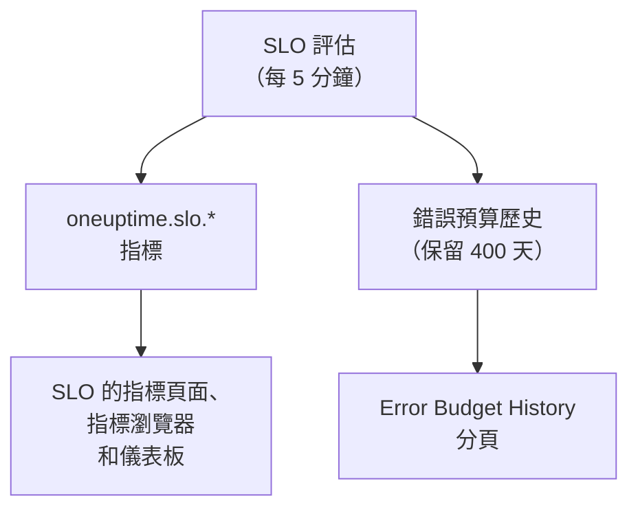

# SLO 指標與儀表板

OneUptime 每次評估 SLO（每 5 分鐘一次）時，都會把結果寫成名為 `oneuptime.slo.*` 的指標。它們與您的監測器指標位於同一個指標儲存區中，因此您可以在 SLO 的 **指標** 頁面上為它繪製圖表，在指標瀏覽器中開啟它，並像其他任何時間序列一樣篩選和分組後放到任何儀表板上。

:::cards
- [指標](#指標): 六個時間序列、它們的單位以及如何彙總。
- [指標頁面](#指標頁面): SLO 的圖表、歷史以及事件和警示指標。
- [儀表板上的 SLO](#儀表板上的-slo): SLO 小工具和 SLO Dashboard 範本。
:::

## 運作方式

## 指標

| 指標 | 單位 | 彙總 | 包含內容 |
| --- | --- | --- | --- |
| `oneuptime.slo.sli.percent` | `%` | Avg | SLO 合規時間窗上的 SLI：測量時間中良好時間所占的比例。 |
| `oneuptime.slo.target.percent` | `%` | Avg | SLO 的目標，每次評估都會寫入，讓圖表能把它畫在 SLI 上方。 |
| `oneuptime.slo.error.budget.remaining.percent` | `%` | Avg | 時間窗中尚未花掉的錯誤預算比例。預算超支後為負數。 |
| `oneuptime.slo.error.budget.remaining.seconds` | `seconds` | Avg | SLO 在被違反之前還能承受的停機時間。預算超支後為負數。 |
| `oneuptime.slo.burn.rate` | `x` | Max | 過去 60 分鐘內預算被花掉的速度。1x 表示恰好在整個時間窗內花完預算。 |
| `oneuptime.slo.status` | — | Max | 每次評估時 SLO 的狀態：`0` 為健康，`1` 為 At Risk，`2` 為 Budget Exhausted。 |

彙總是指 SLO 本身的圖表和 SLO Dashboard 範本如何合併落入同一圖表區間的點。百分比和時長取平均值。消耗率和狀態取最大值，這樣短暫的消耗尖峰或短暫進入 Budget Exhausted 不會被平均掉。

對於 **Monitor Seconds Average** 模式的 SLO，`oneuptime.slo.error.budget.remaining.seconds` 計算的是其所有監測器合計的監測器秒，與其錯誤預算相同：請參閱[錯誤預算](/docs/slo/error-budget)。

### 不寫入資料點的情況

- 已關閉或已封存的 SLO 不會被評估，因此不寫入任何內容。
- **已暫停** 或 **Misconfigured** 的 SLO 不測量任何內容，因此只寫入 `oneuptime.slo.target.percent`，它是設定而不是測量值。其 SLI、預算、消耗率和狀態圖表會出現空缺。
- 不是實數的值，例如沒有資料的時間窗上的消耗率，會被略過，絕不會寫為 0。

### 屬性

每個資料點都帶有這些屬性：

| 屬性 | 值 |
| --- | --- |
| `sloId` | SLO 的 ID。SLO 自己的頁面依它篩選，因此重新命名 SLO 永遠不會拆分其圖表。 |
| `sloName` | 寫入資料點時 SLO 的名稱。 |
| `projectId` | 專案的 ID。 |
| `oneuptime.label.<key>` | 每個 SLO 標籤對應一個屬性。名為 `Tier 1` 的標籤會變成 `oneuptime.label.tier_1` = `true`，名為 `product:checkout` 的標籤會變成 `oneuptime.label.product` = `checkout`。鍵會轉為小寫，空格和標點會變成 `_`。 |

這些時間序列屬於 SLO，而不屬於它的任何監測器，也不計入遙測用量。

事件和警示指標帶有兩個對應的屬性 `serviceLevelObjectiveIds` 和 `serviceLevelObjectiveNames`：以逗號分隔、該事件或警示所影響的 SLO 清單。

### 保留時間

`oneuptime.slo.*` 指標的保留時間與監測器指標相同：預設 **30 天**。在自行託管的安裝中，主要管理員可以在 Admin Dashboard 的 **資料保留** 設定中透過 **Monitor Metric Retention (Days)** 修改它。

這不會限制 SLO **指標** 頁面的 **Error Budget History** 分頁。該歷史另外儲存，保留 400 天。

## 指標頁面

SLO 的 **指標** 頁面有四個分頁：

| 分頁 | 顯示內容 |
| --- | --- |
| **SLO Metrics** | `oneuptime.slo.*` 時間序列，顯示在共用同一時間範圍（預設為過去一天）的三張卡片中：**Objective**（疊加了目標的 SLI，以及剩餘預算）、**Burn**（消耗率和剩餘預算時間）和 **狀態**。 |
| **Error Budget History** | 長期歷史中的 SLI、剩餘預算和消耗率，並在目標、風險和耗盡邊界以及每條已啟用消耗率規則的臨界值處畫線。 |
| **事件指標** | 影響此 SLO 的事件數量、確認時間、解決時間和持續時間，預設為過去一週。包括其消耗率規則宣告的事件。 |
| **警示指標** | 警示的相同內容。包括其消耗率規則觸發的警示。 |

**SLO Metrics**、**事件指標** 和 **警示指標** 分頁會讀取指標儲存區，這需要讀取遙測資料的權限。能讀取 SLO 但不能讀取遙測資料的自訂角色會看到這些分頁是空的，而 **Error Budget History** 仍然可以使用。

## 儀表板上的 SLO

### 為任何 SLO 指標繪製圖表

:::steps
#### 新增圖表

在儀表板的編輯模式下，新增一個圖表或數值小工具，並選擇一個 `oneuptime.slo.*` 指標。

#### 分組或篩選

依 `sloName` 和 `sloId` 分組，每個 SLO 一條線；`sloId` 可以區分同名的兩個 SLO。也可以依 `sloName` 或某個 `oneuptime.label.*` 屬性篩選。

#### 選擇彙總方式

使用上表中的彙總方式：百分比和時長用 Avg，消耗率和狀態用 Max。
:::

### SLO 小工具

[SLO 小工具](/docs/dashboards/widgets#slo)以圖塊或圖表的形式顯示某個 SLO 的 SLI、剩餘預算或消耗率。它透過以下兩種方式之一決定 SLO：

| 設定 | 行為 |
| --- | --- |
| **Service Level Objective** | 把小工具固定到一個 SLO。選擇器會列出未封存的 SLO。 |
| **Follow SLO Variable** | 顯示在儀表板變數中選取的 SLO：一個以 `sloName` 鍵為基礎的 **Telemetry Attribute** 變數。固定了 SLO 時會被忽略。 |

在[公開儀表板](/docs/dashboards/sharing)上，跟隨變數的小工具可讓檢視者依名稱選擇專案中任何未封存的 SLO。固定的小工具只顯示自己的 SLO，並會繼續顯示之後被封存的 SLO 的最後數字。

### SLO Dashboard 範本

建立儀表板時選擇 **SLO Dashboard** 範本，即可取得一個現成的看板，分三個區塊顯示專案中的所有 SLO：

1. **Service Level Objectives**：所有未封存 SLO 的清單，包括狀態、SLI 與目標的對照、預算列和消耗率，以及依狀態統計的 SLO 數量。已啟用的 SLO 排在前面，預算最少的最靠前；已關閉的 SLO 以 **已停用** 排在最後，其最後的數字以灰色顯示。
2. **Error Budget & Burn Rate**：**Lowest Error Budget Remaining**、**Least Error Budget Time Left** 和 **Peak Burn Rate** 圖塊，以及依 `sloName` 和 `sloId` 分組、每個 SLO 一條線的 **Error Budget Remaining by SLO** 和 **Burn Rate by SLO** 圖表。
3. **Selected SLO**：一個 SLO 的 **SLI**、**Error Budget Remaining** 和 **Burn Rate** 圖塊，以及 **SLI History**、**Error Budget History** 和 **Burn Rate History** 圖表。

工具列中的一個 SLO 變數決定整個看板的範圍。它是以 `sloName` 為基礎的 Telemetry Attribute 變數，因此其選項是指標中出現的 SLO 名稱。選擇一個 SLO 會把清單縮小到該 SLO，限定該區塊的圖表和圖塊，並填入跟隨該變數的 **Selected SLO** 小工具。在您選擇之前，它們會提示您在工具列中選擇一個 SLO。

## 疑難排解

:::details 工具列的 SLO 選擇器中缺少某個 SLO
選擇器會列出過去一天內寫入過的 SLO 名稱。新 SLO 在第一次評估後出現；**已暫停** 或 **Misconfigured** 的 SLO 仍可選擇，因為它仍在寫入目標；已關閉或已封存的 SLO 會在其最後一個資料點之後大約一天消失。
:::

:::details 選擇一個名稱時顯示了兩個 SLO
兩個 SLO 同名。清單和圖表會同時顯示兩者，**Selected SLO** 小工具會提示名稱不明確。請為 SLO 取不同的名稱。
:::

:::details SLO Metrics 分頁是空的
您的角色無法讀取遙測資料，或者 SLO 尚未被評估。**Error Budget History** 讀取的是 SLO 本身，仍然可以使用。
:::

## 後續步驟

:::cards
- [儀表板小工具](/docs/dashboards/widgets): 所有小工具，包括 SLO 小工具。
- [儀表板變數](/docs/dashboards/variables): 用一個選擇器決定整個看板的範圍。
- [錯誤預算](/docs/slo/error-budget): 預算數字的意義。
:::
