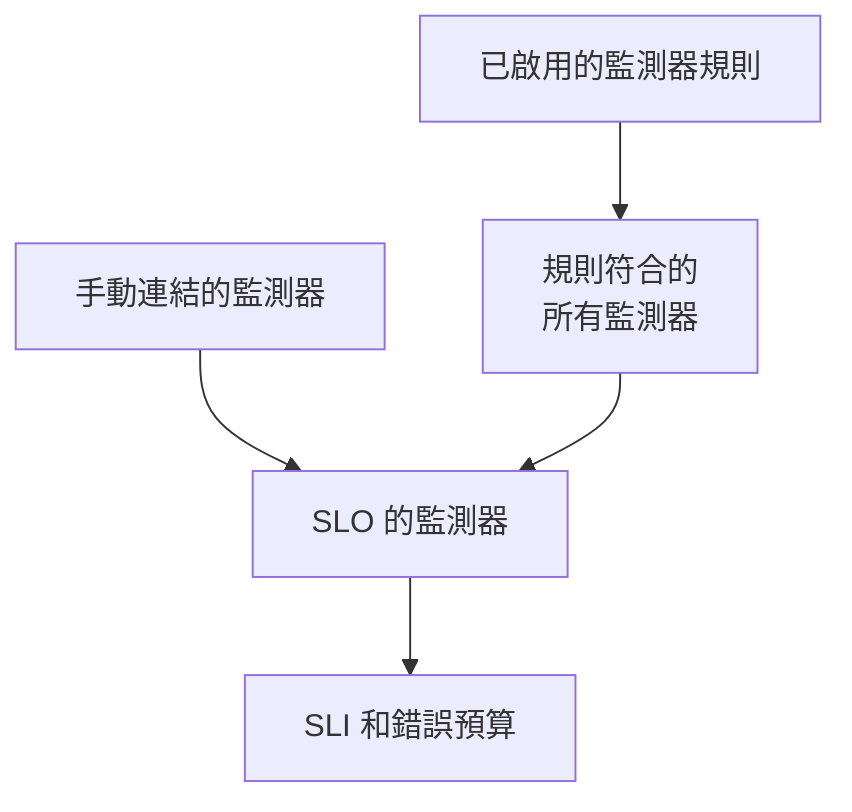

# 監測器與監測器規則

SLO 會測量連結到它的監測器的可用性。您可以手動連結監測器，也可以讓監測器規則連結所有符合的監測器，或兩者並用。本頁介紹 SLO 側邊選單 **設定** 下的 **監測器** 頁面和 **Monitor Rules** 頁面。

:::cards
- [手動選擇監測器](#手動連結監測器): 最適合一小組固定的監測器。
- [用規則連結監測器](#用規則連結監測器): 「所有帶 Production 標籤的監測器」，自動保持最新。
- [比對條件](#比對條件): 規則可以比對的欄位和運算子。
:::

## SLO 測量哪些監測器

SLO 測量的是您手動連結的監測器，加上至少一條已啟用的監測器規則所符合的所有監測器，兩者的聯集。

建立表單不會詢問監測器，因此新 SLO 沒有監測器。在有至少一個監測器之前，它無法被評估：它的頁面會顯示 **No monitors attached**，它的 **概覽** 則提供兩種連結監測器的方式。

## 手動連結監測器

您需要編輯此 SLO 的權限。

:::steps
### 開啟監測器頁面

開啟 SLO，前往 **監測器**。

### 選擇監測器

按一下 **Add Monitors**，從專案中選擇監測器。只會列出尚未連結的監測器。

### 儲存清單

按一下 **Add Monitors**。監測器會以來源 **Manual** 出現在清單中，並從下一次評估開始計入 SLI。
:::

要從 SLO 中移除某個監測器，請按一下該列的 **移除**。監測器本身不會改變，只是不再計入此 SLO 的 SLI 和錯誤預算。

**監測器** 頁面會為每個監測器顯示：

| 欄 | 顯示內容 |
| --- | --- |
| **目前狀態** | 監測器的目前狀態；當它沒有被檢查或尚未回報任何內容時，顯示 **已封存**、**已停用**、**探測器未啟用**、**探測器已中斷連線** 或 **未知**。 |
| **來源** | 如果是 SLO 的某條監測器規則連結的，顯示 **Rule**；如果是有人手動連結的，顯示 **Manual**。 |
| **標籤** | 監測器的標籤。 |

## 用規則連結監測器

監測器規則描述 SLO 應該測量的監測器，例如「所有帶 Production 標籤的監測器」或「所有名稱以 api- 開頭的監測器」。每個符合的監測器都會被連結，不只是現在，每當監測器被建立或變更時也是如此，因此沒有人需要記得下個月有人會新增的監測器。

:::steps
### 開啟 Monitor Rules

開啟 SLO，前往 **Monitor Rules**，按一下 **建立SLO Monitor Rule**。

### 為規則命名

在 **基本資訊** 中輸入 **名稱**，並可在 **描述** 中說明這些監測器為何屬於此 SLO。

### 選擇要比對的內容

在 **比對條件** 中按一下 **新增條件**，選擇欄位和運算子，然後輸入或選擇值。有兩個或更多條件時，選擇 **符合全部** 或 **符合任一**。監測器規則至少需要一個條件。

### 儲存規則

按一下 **建立SLO Monitor Rule**。規則建立後即為啟用狀態，SLO 的監測器會立即重新評估：每個符合的監測器都會以來源 **Rule** 連結。
:::

規則表格會顯示每條規則的名稱、以文字描述的比對條件，以及是否啟用。要暫停某條規則，請在其編輯表單中關閉 **已啟用**。**View Monitors** 會開啟 SLO 的 **監測器** 頁面。

### 比對條件

每個條件比較監測器的一個欄位：

| 欄位 | 比較對象 | 運算子 |
| --- | --- | --- |
| **監測器標籤** | 監測器的標籤。 | **包含任一**、**包含全部**、**不包含任何** |
| **監測器類型** | 從類型清單中選擇的監測器類型。 | **等於**、**不等於** |
| **監測器名稱** | 監測器的名稱。 | **包含**、**不包含**、**等於**、**不等於**、**開頭為**、**結尾為**、**符合模式**、**不符合模式** |
| **監測器描述** | 監測器的描述。 | 與 **監測器名稱** 相同 |

模式可以是正規表示式（例如 `^api-.*`），也可以是 `*` 萬用字元（例如 `*checkout*`），不區分大小寫。兩者都不是的模式（例如 `api-(01`）會在儲存時被拒絕，而不是無聲無息地什麼都比對不到。要連結專案中的所有監測器，請新增一個 **監測器名稱** 符合模式 `.*` 的條件。

| 您想要 | 條件 |
| --- | --- |
| 所有正式環境監測器 | **監測器標籤** 包含任一 _Production_ |
| 所有 API 監測器 | **監測器類型** 等於 _API_ |
| 除手動監測器外的所有監測器 | **監測器類型** 不等於 _Manual_ |
| 所有名稱以 api- 開頭的監測器 | **監測器名稱** 符合模式 `^api-` |
| checkout 監測器，但不包括 staging 的 | **符合全部**：**監測器名稱** 符合模式 `*checkout*`，且 **監測器標籤** 不包含任何 _Staging_ |

### 規則何時執行

- 建立、編輯、開啟、關閉或刪除規則時，SLO 的監測器會立即重新評估。
- 建立監測器，或監測器的標籤、名稱或描述變更時，專案中的每條監測器規則都會檢查它，包括您的監測器標籤規則為它加上的標籤。
- 刪除標籤時，規則中用到該標籤的 SLO 會重新評估。
- 即使 SLO 已關閉或已封存，規則也會讓其監測器清單保持最新，因此恢復時會使用正確的監測器。

規則在每次儲存時都會重新同步，因此 **Run Now** 用於補上 SLO 錯過的內容。它位於每一列、規則自己的頁面（**檢視**）以及表格的大量操作中。執行一條規則會一起重新評估 SLO 所有已啟用的監測器規則，接著對話方塊會告訴您連結和取消連結了多少個監測器。執行規則需要編輯 SLO 監測器規則的權限。請參閱[對現有資源執行規則](/docs/configuration/run-rules-now)。

### 哪些監測器屬於規則

- 只要有已啟用的規則符合，監測器就保持連結；一旦沒有規則符合，就會立即取消連結。
- 關閉或刪除規則只會取消連結那些不再被其他已啟用規則符合的監測器。
- 規則只會取消連結由規則連結的監測器。手動連結的監測器永遠不會被碰巧符合它的規則接管，也不會在不再符合時被取消連結。它的來源維持為 **Manual**。

## 規則開啟時的手動選擇

只要至少有一條規則為啟用狀態，SLO 的監測器就由規則管理：

- 無法手動新增監測器：**Add Monitors** 已停用，橫幅會顯示 **This SLO's monitors are managed by its monitor rules**，並附有 **Manage Monitor Rules** 連結；
- 規則連結的監測器無法手動移除，因為規則會再次連結它們：它們的 **移除** 按鈕會被鎖定，提示訊息會說明原因；
- 在開啟規則之前手動連結的監測器仍然可以移除。

API 也是如此。關閉所有規則即可重新自行選擇監測器。

## 監測器計入的 SLO

監測器的頁面會列出測量它的 SLO：開啟監測器，前往其側邊選單中的 **SLOs**。在暫停或變更監測器之前查看一下，就能知道哪些目標依賴它。已封存的 SLO 不會顯示，因為它們不會被評估。

## 從 Auto-Add Monitors With Labels 移轉

早期版本的 SLO 表單中有一個 **Auto-Add Monitors With Labels** 設定。升級時，每個使用該設定的 SLO 都會取得一條已啟用、名為 **Auto-add monitors with labels** 的監測器規則，比對相同的標籤，因此它會繼續測量完全相同的監測器。SLO API 的 `monitorLabels` 欄位已淘汰：請改用 SLO 監測器規則。

:::details 如果仍有東西儲存舊設定怎麼辦？
升級前開啟的儀表板分頁，或為舊版本撰寫的 API 用戶端或工作流程，仍可能儲存舊設定。為避免 SLO 因此無聲無息地失去監測器：

- **沒有監測器規則的 SLO** 會把儲存的標籤轉換為一條 **Auto-add monitors with labels** 規則，並立即重新評估其監測器。儲存空清單會像以前一樣取消連結該設定所連結的監測器。
- **已有監測器規則的 SLO**，無論規則是否開啟，都會忽略透過舊設定儲存的標籤，因為測量什麼由它的規則決定。
- **建立第一條監測器規則** 時，如果此 SLO 的監測器是由舊設定連結的，會先把該設定轉換為規則，因此新規則會被加在旁邊，而不是取而代之。

您刪除的轉換規則會維持刪除狀態，除非之後其監測器仍處於連結狀態，例如仍在執行舊版本的伺服器在升級期間重新連結了它們：下一次監測器變更或下一條新規則會再次轉換這些標籤。升級完成後請再次刪除該規則。
:::

## 歷史記錄

每次連結和取消連結，以及每條規則的建立、編輯或刪除，都會出現在 SLO 的 **Feed** 中。規則變更也會記錄在其 **稽核日誌** 中。請參閱 [SLO 動態與稽核日誌](/docs/slo/feed-and-audit-logs)。

## 疑難排解

:::details Add Monitors 已停用
SLO 至少有一條監測器規則為啟用狀態，因此其監測器由規則管理。修改規則，或全部關閉以手動選擇監測器。
:::

:::details 監測器的移除按鈕被鎖定
某條監測器規則連結了該監測器，並會再次連結它。修改或關閉符合它的規則。
:::

:::details 本應被規則符合的監測器沒有連結
檢查規則是否已啟用，以及在 **符合全部** 下每個條件是否都滿足。監測器標籤規則加上的標籤也會計入。按一下規則上的 **Run Now** 重新同步 SLO。
:::

:::details 儲存規則時因模式錯誤而失敗
該值既不是正規表示式，也不是 `*` 萬用字元，例如有未閉合的括號。修正模式，或改用 **包含**。
:::

## 後續步驟

:::cards
- [SLO 概觀](/docs/slo/introduction): 如何合併多個監測器的停機時間。
- [錯誤預算](/docs/slo/error-budget): 監測器的停機時間消耗的是什麼。
- [對現有資源執行規則](/docs/configuration/run-rules-now): Run Now 對每種規則的運作方式。
:::
