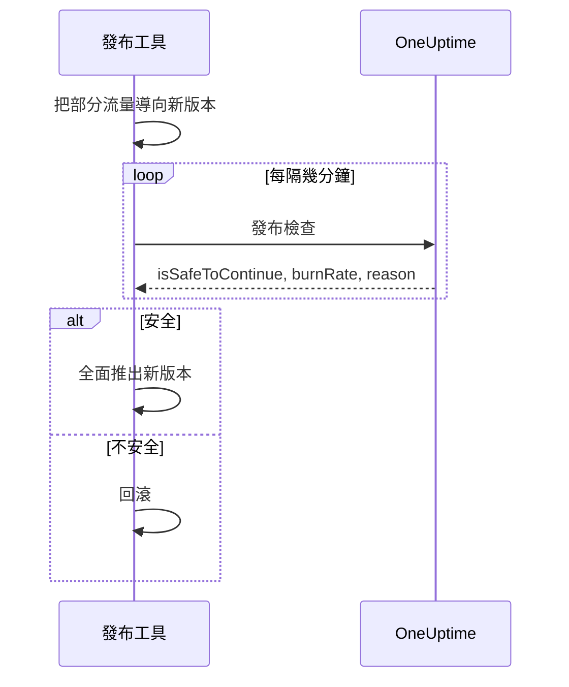

# 發布檢查

發布檢查會在版本發布期間詢問 SLO「繼續推出這個版本安全嗎？」，並根據 SLO 在過去幾分鐘內消耗錯誤預算的速度作答。Argo Rollouts、Flagger 或部署管線會在金絲雀版本開始承接流量時發出這個詢問，並在答案為「否」時回滾該版本。OneUptime 本身不會部署任何東西：推出仍由您的發布工具執行，OneUptime 只負責告訴它這個版本的狀況如何。

:::cards
- [查詢檢查](#查詢檢查): 使用 API 金鑰發出的一個請求，以及它的回答。
- [Argo Rollouts](#argo-rollouts): 會中止推出的分析。
- [Flagger](#flagger): 會暫停金絲雀版本的 webhook。
- [GitHub Actions](#github-actions): 在部署之後回滾的步驟。
- [關閉功能旗標](#關閉功能旗標): 在 SLO 的預算消耗過快時關閉功能旗標的工作流程。
:::

## 運作方式

[部署閘門](/docs/slo/error-budget-policy#部署閘門) 在發布之前作答，依據的是整個合規時間窗的錯誤預算。會造成問題的版本在最初十分鐘內幾乎還沒花掉一個月的預算，因此發布檢查讀取的是這次發布所改變的東西：過去幾分鐘的消耗率。



檢查會以三種判定之一作答：

| 判定 | 時機 | `isSafeToContinue` |
| --- | --- | --- |
| `Pass` | 時間窗消耗錯誤預算的速度等於或慢於 `maxBurnRate`。 | `true` |
| `Fail` | 消耗得更快，或 SLO 的錯誤預算策略正在凍結部署。 | `false` |
| `NotEnoughData` | 時間窗內的請求少於 `minimumRequestCount`，或 SLO 的監測器在其中沒有記錄任何狀態。資料太少，無法斷定這個版本安全。 | `false` |

消耗率為 1 表示時間窗恰好達到 SLO 的目標，因此預設的 `maxBurnRate` 為 `1` 時，表現比目標差的版本就會判定失敗。

檢查讀取的內容取決於 SLO 的衡量對象：

- [請求 SLO](/docs/slo/request-slos) 依據其服務在時間窗內的請求來評判，這些請求在 span 到達時即從中讀取。加上 `serviceVersion` 即可只評判新版本的請求：OneUptime 會將它與 span 的 `service.version` 資源屬性比對，OpenTelemetry SDK 會從 `OTEL_RESOURCE_ATTRIBUTES=service.version=1.4.2` 設定這個屬性。如此一來，金絲雀版本只依據它自己的請求評判，不會被舊版本的請求稀釋。
- [基於指標的 SLO](/docs/slo/request-slos#基於指標的-slo) 依據其指標在時間窗內的事件來評判，這些事件以其 SLI 的方式計數，因此 `minimumRequestCount`、`goodRequestCount` 和 `totalRequestCount` 都是事件數。加上 `serviceVersion` 時，只計入 `service.version` 資源屬性為該值的指標資料點：OpenTelemetry SDK 會像在 span 上一樣，在其指標上設定這個屬性。
- 監測器可用率 SLO 依據其監測器在時間窗內的狀態時間軸來評判。`minimumRequestCount` 不適用於它，帶有 `serviceVersion` 的檢查則會被拒絕：監測器沒有版本。

## 開始之前

您需要一個衡量此次發布會影響之對象的 SLO。您所發布服務的請求 SLO 最適合評判金絲雀版本，因為它讀取的是該服務自己的請求。

## 設定發布檢查

:::steps
### 給推出流程一把金鑰

建立一把專案 [API 金鑰](/docs/api-reference/api-reference)，其角色須能讀取 SLO，並把它存為您的發布工具或管線的機密。

### 複製 SLO 的 ID

開啟 SLO，從網址中複製它的 ID：`/slos/<slo-id>`。

### 手動查詢一次檢查

使用金鑰和 ID 執行 [查詢檢查](#查詢檢查) 中的請求。它會以 `isSafeToContinue` 和 `reason` 作答。

### 將它加入您的推出流程

從 [Argo Rollouts](#argo-rollouts)、[Flagger](#flagger) 或 [GitHub Actions](#github-actions) 查詢檢查，並在 `isSafeToContinue` 為 `false` 時回滾。
:::

## 查詢檢查

檢查是對 SLO 的 `release-check` 位址發出的 `GET` 或 `POST`。選項可放在查詢字串中，或在使用 `POST` 時以 JSON 本文傳送：

```bash
curl -sS "https://oneuptime.com/api/service-level-objective/<slo-id>/release-check?windowInMinutes=10&serviceVersion=1.4.2" \
  -H "ApiKey: $ONEUPTIME_API_KEY"
```

回應先列出判定結果，再列出判定所依據的資料：

```json
{
  "isSafeToContinue": false,
  "verdict": "Fail",
  "reason": "The last 10 minutes burned the error budget at 3.2x, faster than the 1x this check allows (SLI 99.68% against the 99.9% target).",
  "sloId": "<slo-id>",
  "sloName": "Checkout requests",
  "sliType": "Request Success",
  "targetPercentage": 99.9,
  "windowInMinutes": 10,
  "maxBurnRate": 1,
  "burnRate": 3.2,
  "sliPercentage": 99.68,
  "deploymentsAllowed": true,
  "errorBudgetPolicyTier": null,
  "sloStatus": "Healthy",
  "checkedAt": "2026-11-15T12:00:00.000Z",
  "goodRequestCount": 2492,
  "totalRequestCount": 2500,
  "minimumRequestCount": 1,
  "serviceVersion": "1.4.2"
}
```

選項：

| 選項 | 預設值 | 作用 |
| --- | --- | --- |
| `windowInMinutes` | `10` | 檢查回看多久，以整數分鐘計，範圍為 1 到 360。 |
| `maxBurnRate` | `1` | 可以通過的最快消耗率。`2` 允許時間窗以目標所允許速度的兩倍消耗預算。 |
| `minimumRequestCount` | `1` | 僅限請求 SLO：檢查進行評判所需的最少請求數。設為 `0` 時，沒有任何請求的時間窗也會通過。 |
| `serviceVersion` | 無 | 僅限請求 SLO：只評判其 span 帶有此 `service.version` 的請求。 |
| `includeDeploymentGate` | `true` | 在 SLO 的錯誤預算策略凍結部署期間判定失敗。設為 `false` 時，只由消耗率決定。 |
| `failWithStatusCode` | `false` | 以 HTTP 狀態碼 412 而非 200 回答「否」，供只讀取狀態碼的工具使用。 |

回應的欄位：

| 欄位 | 內容 |
| --- | --- |
| `isSafeToContinue` | `true` 表示繼續推出，`false` 表示回滾。 |
| `verdict` | `Pass`、`Fail` 或 `NotEnoughData`。 |
| `reason` | 寫入推出日誌的一句話，說明測量了什麼，以及檢查為何如此作答。 |
| `burnRate` 和 `sliPercentage` | 時間窗消耗錯誤預算的速度，以及時間窗內的 SLI。 |
| `goodRequestCount` 和 `totalRequestCount` | 僅限請求 SLO：時間窗內的請求數，以及其中良好請求的數量。 |
| `deploymentsAllowed` 和 `errorBudgetPolicyTier` | SLO 的錯誤預算策略是否允許部署，以及它所處的級別。 |
| `checkedAt` | 檢查進行測量的時間。 |

無法測量的 SLO（沒有服務的請求 SLO、沒有臨界值的延遲 SLO、沒有可計數指標的基於指標的 SLO、沒有監測器的監測器可用率 SLO）會得到 HTTP 400 回應，並說明要修正什麼，讓推出停在明確的錯誤上，而不是憑猜測繼續。在自行託管的安裝上，請改用它自己的位址，而不是 oneuptime.com。

## Argo Rollouts

帶有 `web` 指標的分析會在金絲雀發布的每個步驟查詢檢查，檢查失敗時，Argo Rollouts 會中止推出並縮減金絲雀版本。請先把 API 金鑰存為機密：

```bash
kubectl create secret generic oneuptime --from-literal=api-key="$ONEUPTIME_API_KEY"
```

接著新增範本，並在金絲雀發布的第一個步驟之後執行它：

:::tabs
@tab AnalysisTemplate
```yaml title="oneuptime-release-check.yaml"
apiVersion: argoproj.io/v1alpha1
kind: AnalysisTemplate
metadata:
  name: oneuptime-release-check
spec:
  args:
    - name: version
    - name: api-key
      valueFrom:
        secretKeyRef:
          name: oneuptime
          key: api-key
  metrics:
    - name: slo-burn-rate
      interval: 2m
      count: 5
      failureLimit: 0
      successCondition: result == true
      provider:
        web:
          url: "https://oneuptime.com/api/service-level-objective/<slo-id>/release-check?windowInMinutes=10&serviceVersion={{args.version}}"
          headers:
            - key: ApiKey
              value: "{{args.api-key}}"
          jsonPath: "{$.isSafeToContinue}"
```
@tab Rollout
```yaml title="rollout.yaml"
apiVersion: argoproj.io/v1alpha1
kind: Rollout
metadata:
  name: checkout
spec:
  strategy:
    canary:
      steps:
        - setWeight: 10
        - analysis:
            templates:
              - templateName: oneuptime-release-check
            args:
              - name: version
                value: "1.4.2"
        - setWeight: 50
        - pause: { duration: 10m }
```
:::

分析會查詢五次，每次間隔兩分鐘，第一個「否」就會中止推出。請傳入與金絲雀 Pod 在 `OTEL_RESOURCE_ATTRIBUTES` 中設定的相同版本。如果金絲雀版本在第一個權重下可能完全沒有流量，請在位址後加上 `&minimumRequestCount=0`，否則沒有流量的金絲雀版本會以 `NotEnoughData` 讓分析失敗。

## Flagger

Flagger 會在分析的每個步驟呼叫 `rollout` webhook，當 webhook 持續失敗時，便暫停並回滾金絲雀版本。Flagger 的 webhook 不會傳送任何標頭，因此請透過 Flagger 負載測試器查詢檢查，它會為 webhook 執行一個命令：

```yaml title="canary.yaml"
apiVersion: flagger.app/v1beta1
kind: Canary
metadata:
  name: checkout
spec:
  analysis:
    interval: 1m
    threshold: 2
    maxWeight: 50
    stepWeight: 10
    webhooks:
      - name: oneuptime-release-check
        type: rollout
        url: http://flagger-loadtester.test/
        timeout: 30s
        metadata:
          type: bash
          cmd: "curl -sSf -H \"ApiKey: $ONEUPTIME_API_KEY\" 'https://oneuptime.com/api/service-level-objective/<slo-id>/release-check?windowInMinutes=5&failWithStatusCode=true'"
```

使用 `failWithStatusCode=true` 時，「否」會是 HTTP 412，因此 `curl -f` 會以錯誤結束，webhook 也隨之失敗。請從 Kubernetes Secret 取得金鑰，以 `ONEUPTIME_API_KEY` 提供給負載測試器的環境。當失敗的檢查達到 `threshold` 次時，Flagger 就會回滾金絲雀版本。

## GitHub Actions

一次完成部署的管線仍然可以觀察這次發布：部署、查詢檢查幾次，並在檢查回答「否」時回滾。

```yaml title=".github/workflows/deploy.yml"
name: Deploy
on:
  push:
    branches: [main]

jobs:
  deploy:
    runs-on: ubuntu-latest
    steps:
      - uses: actions/checkout@v4
      - name: Deploy
        run: ./deploy.sh
      - name: Watch the release against the SLO
        env:
          ONEUPTIME_API_KEY: ${{ secrets.ONEUPTIME_API_KEY }}
          SLO_ID: <slo-id>
          VERSION: ${{ github.sha }}
        run: |
          for attempt in 1 2 3 4 5; do
            sleep 120
            CHECK=$(curl -sS "https://oneuptime.com/api/service-level-objective/$SLO_ID/release-check?windowInMinutes=10&serviceVersion=$VERSION" \
              -H "ApiKey: $ONEUPTIME_API_KEY")
            echo "$CHECK" | jq -r '.reason'
            if [ "$(echo "$CHECK" | jq -r '.isSafeToContinue')" != "true" ]; then
              exit 1
            fi
          done
      - name: Roll back
        if: failure()
        run: ./rollback.sh
```

遇到「否」時，以及遇到任何不含 `isSafeToContinue: true` 的回答（ID 錯誤、金鑰無法讀取 SLO、完全沒有回答）時，該步驟都會失敗，因此管線絕不會依據它沒有取得的回答繼續進行。請在服務啟動時把 `service.version` 設為該次提交（`${{ github.sha }}`），讓檢查只評判新版本。

## 關閉功能旗標

由功能旗標控制的版本，只要關閉旗標就能回滾。工作流程可以替您完成這件事：當 SLO 的某條 [消耗率規則](/docs/slo/burn-rate-alerts) 觸發警示或宣告事件時，工作流程會在 LaunchDarkly 或 Unleash 中關閉該旗標。如此一來，有問題的推出幾分鐘內就會被撤銷，不必等人處理。

:::steps
### 複製消耗率規則的 ID

開啟 SLO，前往 **消耗速率規則**。開啟要用來關閉旗標的那條規則的選單，選擇 **顯示 ID**。快速消耗規則最適合這個用途，因為有問題的推出開始後幾分鐘內它就會觸發。

### 從範本建立工作流程

開啟 **工作流程**，點選 **建立工作流程**。在 **或從範本開始** 下選擇 **SLOs** 類別，再選擇您所用功能旗標服務的範本：

| 範本 | 需要提供的內容 |
| --- | --- |
| **Turn a LaunchDarkly flag off when an SLO burns too fast** | 一個能更新該旗標的 API 存取權杖，以及旗標所屬專案、旗標本身和環境各自的鍵。 |
| **Turn an Unleash flag off when an SLO burns too fast** | 您的 Unleash 位址、一個服務帳戶權杖或個人存取權杖，以及旗標所屬的專案、它的名稱和環境。 |

將規則的 ID 貼到 **Burn Rate Rule ID** 中，填寫其餘內容，然後建立工作流程。

### 開啟工作流程

工作流程建立時處於關閉狀態。準備好之後，在工作流程的 **建構器** 頂端開啟 **已啟用** 開關。
:::

每當專案中的某條消耗率規則觸發警示或宣告事件時，工作流程就會啟動。它的 **如果 / 否則** 只會讓您貼上 ID 的那條規則繼續往下，下一個步驟會呼叫功能旗標服務：在 LaunchDarkly 中是 `turnFlagOff` 指令，並附上一則寫明規則和 SLO 的備註；在 Unleash 中則是針對該環境的 `off`。無論目標設定為何，兩者都會為該環境中的所有人關閉旗標。如果功能旗標服務拒絕這次呼叫，該次執行就會失敗，其日誌會說明原因。規則的警示仍會照常呼叫人員。

**建構器** 上的 **執行工作流程** 會把工作流程當作您選擇的規則剛剛觸發一樣執行，因此它會真的關閉旗標。請先用測試環境中的旗標試試看。

若要使用其他功能旗標服務，或使用有自己位址的 LaunchDarkly 執行個體，請從任一範本開始，並把它的 API 步驟改為在該環境中為所有人關閉旗標的呼叫。請像這兩個範本一樣，選擇連使用者區隔和目標設定規則也能覆寫的呼叫，否則漸進式推出仍會繼續提供該旗標。

## 後續步驟

:::cards
- [請求與延遲 SLO](/docs/slo/request-slos): 衡量服務的請求，這是最適合評判金絲雀版本的 SLI。
- [錯誤預算策略](/docs/slo/error-budget-policy): 在預算偏低時凍結部署。
- [消耗率警示與事件](/docs/slo/burn-rate-alerts): 當預算消耗過快時提醒您的團隊。
:::
