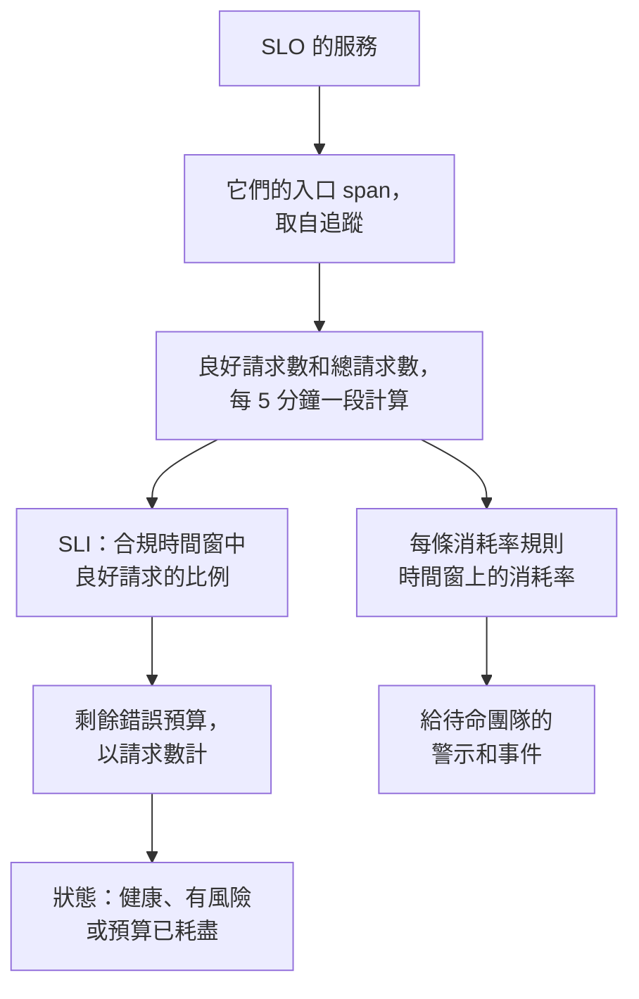

# 請求與延遲 SLO

請求 SLO 衡量的是使用者從服務實際得到的體驗：服務的請求中有多少比例成功，或有多少比例回應得夠快。OneUptime 會從您的服務已在傳送的追蹤中計算這些請求，因此不需要設定任何監測器：選好服務和目標，OneUptime 就會每 5 分鐘測量一次。

:::cards
- [建立請求 SLO](#建立請求-slo): 服務、延遲臨界值和目標。
- [只計算部分請求](#只計算部分請求): 一個端點，或除健康檢查外的所有請求。
- [基於指標的 SLO](#基於指標的-slo): 計數器或直方圖，適用於不傳送追蹤的服務。
- [請求如何計數](#請求如何計數): 哪些 span 會計入，以及何時計入。
- [發布檢查](/docs/slo/release-checks): 回滾正在消耗錯誤預算的版本。
:::

## 請求成功率與請求延遲

| 衡量對象 | 請求在什麼情況下算作不良 | 其錯誤預算計算的是 |
| --- | --- | --- |
| **請求成功率** | 其 span 的狀態為 `Error`。依照 OpenTelemetry 的定義，沒有狀態的 span 算作良好。 | 失敗的請求 |
| **請求延遲** | 耗時超過 SLO 的 **延遲閾值（ms）**，無論其狀態為何。 | 緩慢的請求 |

SLI 是合規時間窗內良好請求所占的比例，錯誤預算則是目標所允許的不良請求：在 99.9% 時，每 1,000 個請求中允許 1 個。延遲 SLO 會把很快就失敗的請求算作良好，因此對重要的服務請從兩方面衡量：一個 SLO 衡量它是否正常運作，另一個衡量它是否夠快。

## 運作方式

請求是 SLO 某個服務的入口 span：請求或訊息進入該服務時的 span，也就是 [追蹤](/docs/telemetry/traces-explorer#追蹤和-span) 清單預設顯示的那些 span。經過 SLO 中兩個服務的請求，會在每個服務中各計一次。

除此之外，請求 SLO 的運作方式與其他 SLO 相同。它的狀態、消耗率規則、錯誤預算策略、擁有者和通知都一樣，只是錯誤預算以請求數而非分鐘計算。

## 開始之前

- 服務會把追蹤傳送到 OneUptime：請參閱 [OpenTelemetry](/docs/telemetry/open-telemetry)。每個服務都以其 `service.name` 列在 [服務目錄](/docs/telemetry/services) 中。
- 一個可以建立 SLO 的角色：專案擁有者、專案管理員，或具有 Create Service Level Objective 權限的自訂角色。

## 建立請求 SLO

:::steps
### 開啟 SLO

從頂部列的 **產品** 選單開啟 **SLOs**，然後按一下 **建立服務等級目標**。

### 選擇衡量對象

在 **衡量對象** 下選擇 **請求成功率** 或 **請求延遲**，再選擇要計算其請求的 **服務**。若選擇 **請求延遲**，還要設定 **延遲閾值（ms）**：在此時間內完成的請求就算夠快，例如 `300`。若只想計算其中部分請求，請輸入 **請求篩選器**：請參閱 [只計算部分請求](#只計算部分請求)。按一下 **下一步**。

### 命名並設定目標

輸入 **名稱**（例如「Checkout requests」）和 **目標（%）**：必須良好的請求比例。按一下 **建立服務等級目標**。

### 等待第一批數字

第一次評估會在 5 分鐘內進行，計算過去 6 小時的請求，因此 SLO 立刻就有數字。之後的評估也會計算更早的請求，直到涵蓋整個合規時間窗。
:::

服務自己的 **SLOs** 頁面列出衡量該服務的 SLO，其中的 **建立服務等級目標** 會開啟同一表單，並已選好該服務。之後若要變更 SLO 的衡量對象、服務、臨界值或篩選器，請開啟它的 **設定**，然後按一下 **編輯衡量對象**。

## 只計算部分請求

請求 SLO 會計算其服務的每個請求。**請求篩選器** 可以只計算重要的請求，例如結帳端點；也可以排除部分請求，例如會讓 SLI 看起來比使用者實際得到的更好的健康檢查。請把它寫成追蹤搜尋，使用與追蹤瀏覽器相同的 [搜尋語法](/docs/telemetry/search-syntax#比對值)：

| 請求篩選器 | 計算的請求 |
| --- | --- |
| `@http.route:/checkout*` | 路由以 `/checkout` 開頭的請求。 |
| `-@http.route:/health` | 除健康檢查外的所有請求。 |
| `@http.request.method:[POST, PUT]` | POST 和 PUT 請求。 |
| `name:"POST /checkout"` | span 名稱為 `POST /checkout` 的請求。 |

每個條件都必須符合，因此 `@http.route:/checkout* -@http.route:/checkout/health` 會計算除健康檢查外的結帳請求。帶有 `@` 的條件是請求 span 的屬性，`name:` 是 span 的名稱。自由文字和瀏覽器的其他欄位（例如 `status:` 和 `duration:`）在這裡不能當作篩選條件：SLO 已經決定了哪些請求算作不良或緩慢。一個篩選器最多可包含 10 個條件，共 500 個字元以內。

**概覽** 會在 SLO 的服務下方顯示篩選器，**設定** 則在 **衡量對象** 下方顯示它。變更篩選器會從頭重新計算 SLO 的請求。

## 基於指標的 SLO

如果您的服務已經把請求計算為指標，或不傳送追蹤，請改為根據計數器或直方圖衡量 SLO。在 **衡量對象** 下選擇 **指標** 以及傳送該指標的 **服務**，然後在 **指標** 步驟中填寫：

| 欄位 | 填寫內容 |
| --- | --- |
| **指標** | 指標的名稱，從專案的指標中選擇或直接輸入，例如 `http_requests_total` 或 `http.server.request.duration`。 |
| **良好事件** | **計數器，依條件判定** 或 **直方圖，依值判定**。 |
| **良好條件** | 對於計數器：哪些事件算作良好，寫成對其屬性的搜尋，例如 `@http.response.status_code:<500`。 |
| **良好上限值** | 對於直方圖：良好觀測值不超過的值，使用指標本身的單位，例如以秒為單位的直方圖，300 ms 寫作 `0.3`。請使用它的其中一個桶邊界。 |
| **指標篩選器** | 選用：要計入的序列，例如 `-@http.route:/health`。 |

計數器的事件是它在每 5 分鐘一段中增加的量，與 Prometheus 的 `increase()` 讀取計數器的方式相同：重新啟動的計數器會重新從零開始計算，累積計數器和 delta 計數器都會計入。直方圖的事件是它的觀測值，其中良好的是落在不超過該值的桶中的觀測值。只有來自 SLO 服務、屬於該指標本身的資料點才會計入：同名的 Gauge 不會計入任何內容。每個雲端指標都是 Gauge，基於 Gauge 的 SLO 會在其頁面上說明這一點，指標選擇器也會說明：請用指標監測器以及該監測器可用率的 SLO 來衡量雲端指標。

除此之外，基於指標的 SLO 的運作方式與請求 SLO 相同，只是其錯誤預算、消耗率規則和發布檢查都以事件數計算。變更指標會從頭重新計算它的事件。

## 請求如何計數

OneUptime 以 5 分鐘為一段，計算每個 SLO 的良好請求數和總請求數並保存這些計數，因此 SLO 是從自己的計數讀取時間窗，而不必每次都讀取所有 span：

- 每一段在結束 2 分鐘後才計算，讓延遲到達的 span 也能計入；下一次評估還會重新計算最後兩段，以納入更晚到達的 span。
- 新 SLO 從過去 6 小時開始計算。之後每次評估最多再計算一天份較早的請求，由新到舊，直到涵蓋整個時間窗。
- 只有仍在您的 [遙測保留期](/docs/telemetry/data-retention#遙測保留多長時間) 內的請求才能計入。已計算的分段會保留 400 天，比任何合規時間窗都長，因此比保留期更長的時間窗會隨著 SLO 存在的時間增長而逐漸填滿。
- 變更 SLO 的衡量對象、服務、延遲臨界值或請求篩選器，會從頭重新計算它的請求。較長的合規時間窗則透過往更早的時間回溯計算來填滿。

當計數只涵蓋合規時間窗的一部分時，**概覽** 會以 **視窗已填充 23%** 指示器提示這一點，**剩餘錯誤預算** 圖塊也會在數字下方重複說明。計數涵蓋整個時間窗後，兩者都會消失。

## 以請求數計的錯誤預算

預算是目標在時間窗內已計算的請求中所允許的不良請求數，因此會隨流量增長：在 99.9% 時，2,000,000 個請求的時間窗允許 2,000 個失敗的請求。在 **概覽** 中：

- **剩餘錯誤預算** 顯示允許的不良請求還剩多少、總共多少，或 SLO 超出預算多少。
- **預算可撐時長** 顯示以目前的消耗率，預算還能撐多久，前提是流量維持原樣。
- 摘要會列出 SLO 的服務數量，延遲 SLO 還會在目標下方顯示其臨界值。

消耗率警示、通知和動態也會以請求數表示預算。請求 SLO 不會傳送 `oneuptime.slo.error.budget.remaining.seconds` 指標；請改用 `oneuptime.slo.error.budget.remaining.percent` 繪製圖表。

請求 SLO 會獲得與任何新 SLO 相同的 **Fast burn**、**Slow burn** 和 **Slow leak** 規則。在只有寥寥幾個請求的冷清時段，一次失敗就可能造成快速消耗，因此規則可以忽略請求過少的時間窗：設定規則的 **最少請求數**，規則就會略過請求數少於該值的長時間窗。

## 疑難排解

:::details SLO 顯示「正在等待請求」
它的服務都還沒有在時間窗內處理過任何請求。請檢查這些服務是否把追蹤傳送到 OneUptime，以及它們的 span 是否包含入口 span：所有 span 都是內部 span 的服務沒有可計算的請求。如果 SLO 設有 **請求篩選器**，請用它在 [追蹤瀏覽器](/docs/telemetry/traces-explorer) 中搜尋：在那裡比對不到任何請求的篩選器，會讓 SLO 沒有可計算的請求。
:::

:::details 變更服務後 SLI 改變了
變更 SLO 的衡量對象、服務、延遲臨界值或請求篩選器會重新計算它的請求，從過去 6 小時開始，因此 SLI 和預算會從那裡重新開始。**視窗已填充 23%** 指示器會顯示目前已計算了多少時間窗。
:::

## 後續步驟

:::cards
- [發布檢查](/docs/slo/release-checks): 讓 Argo Rollouts、Flagger 或管線回滾正在消耗預算的版本。
- [消耗率警示與事件](/docs/slo/burn-rate-alerts): 當預算消耗過快時提醒您的團隊。
- [錯誤預算策略](/docs/slo/error-budget-policy): 約定預算減少時團隊要做的事。
:::
