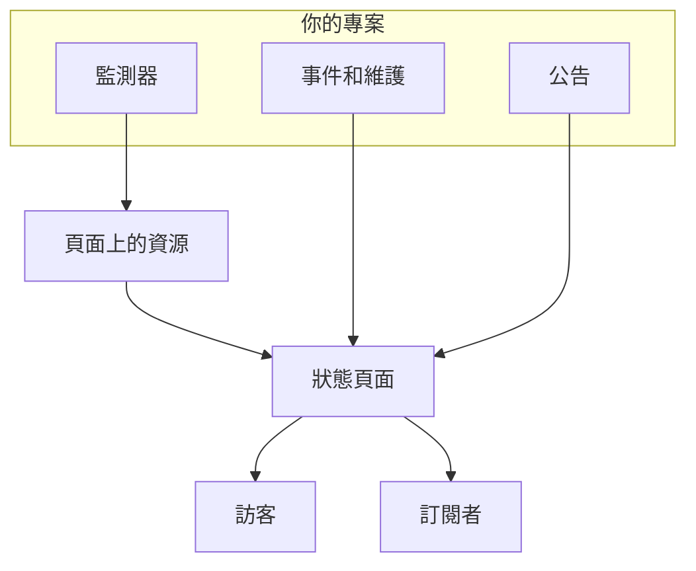

# 狀態頁概觀

狀態頁面是你所監控的一切的公開門面：一個客戶可以直接開啟的 URL，而不必寄電子郵件問你是不是只有他們遇到問題。它顯示你選擇公開的服務的目前狀態、你正在處理的事件、你規劃的維護，以及你想置頂的任何公告。

凌晨 2 點出問題時，支援佇列第一個連結到的就是狀態頁面。訂閱者收到的通知也從這裡發出，所以值得在需要它之前就設定好，而不是在故障期間。

:::cards
- [建立狀態頁面](#建立狀態頁面): 一開始只需要兩個欄位，其餘都可以之後再設定。
- [選擇顯示的內容](#決定頁面上顯示什麼): 事件、片段、公告、維護和正常運作時間，都在一張卡片裡。
- [決定誰能看到](#限制誰能看到這個頁面): 任何擁有連結的人、僅限登入的人，或任何知道密碼的人。
- [封存狀態頁面](#封存狀態頁面): 不刪除頁面就讓它下線。
:::

## 運作方式

狀態頁面位於頂端列 **產品** 選單中的 **狀態頁面** 下，屬於核心產品之一。本頁的所有內容都是按狀態頁面個別設定的：一個專案可以執行任意多個狀態頁面，例如給客戶看的公開頁面、給內部受眾看的私人頁面，或針對特定市場的分區頁面。

頁面把你放在上面的監測器顯示為它的資源。事件和排定維護透過這些監測器到達頁面，公告則直接發布到頁面上。訪客閱讀頁面，訂閱者則透過他們選擇的管道得知每一次變更。

## 快速一覽

- **兩個欄位即可建立。** 新的狀態頁面只要求填寫 **名稱** 和 **描述**。資源、品牌和網域都在之後設定。
- **資源就是訪客看到的內容。** 頁面上的每一列都是一個 **狀態頁面 資源**：一個監測器（或監測器群組），有自己的顯示名稱、提示和正常運作時間選項。群組把長頁面分成幾個區段，而且可以巢狀。
- **從第一天起就有預覽 URL。** 每個狀態頁面都有一個預覽連結，所以在有自訂網域之前就能查看它。
- **面向訪客的路由由設定控制。** 事件、片段、公告和排定事件分別只在 **狀態頁面顯示的內容**（位於 **進階設定**）中對應的開關開啟時才會出現，訂閱頁面只在 **顯示訂閱者頁面** 開啟時才會出現。
- **誰能看到是一個選擇。** 任何擁有連結的人、僅限登入的人（私人使用者、SAML SSO 或 OIDC），或任何知道密碼的人，在頁面的 **存取** 畫面上選擇，**更多設定** 下還有選用的 IP 允許清單。
- **訂閱者會自動收到通知。** 電子郵件、簡訊、Slack、Microsoft Teams 和 Webhook 訂閱者都可以追蹤頁面，每個管道都有自己的開關。

## 關鍵術語

| 術語 | 含義 |
| --- | --- |
| **狀態頁面** | 一個公開（或私人）的頁面，有自己的品牌、網域、資源和訂閱者。即 `StatusPage` 模型。 |
| **資源** | 訪客看到的一列：顯示在頁面上的一個監測器或監測器群組，帶有顯示名稱和正常運作時間選項。 |
| **群組** | 容納資源的具名區段。群組可以巢狀放在其他群組中，每一層都會彙總其下所有內容的狀態。 |
| **公告** | 你發布到一個或多個狀態頁面的訊息，有開始時間和選用的結束時間。 |
| **訂閱者** | 透過電子郵件、簡訊、Slack、Microsoft Teams 或 Webhook 追蹤頁面的人（或系統）。 |
| **自訂網域** | 你自己的網域（`status.example.com`），透過 CNAME 記錄指向頁面。OneUptime 會免費為它核發 SSL 憑證並負責續約。 |
| **私人使用者** | 可以登入私人狀態頁面的帳戶。與你的 OneUptime 專案使用者彼此獨立。 |

## 建立狀態頁面

:::steps
### 開啟建立表單

開啟 **狀態頁面 → 所有狀態頁面**，然後按一下 **建立狀態頁面**。

### 為頁面命名

在 **建立新狀態頁面** 對話方塊中填寫 **名稱**（必填，至少兩個字元），以及選填的 **描述**，然後按一下 **建立狀態頁面**。

這就是整個建立表單。返回的清單會顯示 **名稱**、**描述**、**標籤** 和 **擁有者**，並且可以依 **狀態頁面 ID**、**名稱** 和 **描述** 篩選。

### 開啟新頁面

開啟新頁面後會進入它的 **概覽** 畫面，上面有兩張卡片：帶有頁面本身連結的 **Status Page Preview URL**，以及可以編輯剛才設定的名稱、描述和標籤的 **狀態頁面詳細資料**。專案有狀態頁面自訂欄位後，它們後面還會接著一張 **自訂欄位** 卡片。
:::

透過 API 或 Terraform 建立的頁面，也受下面所述設定的相同方案限制。在 OneUptime Cloud 上，如果建立頁面時開啟了你的方案不包含的設定（例如私人、隱藏某個清單、自訂 HTML、CSS 或 JavaScript、電子郵件報告、簡訊、Slack、Microsoft Teams 或 Webhook 訂閱者、IP 允許清單），會被 `402 Payment Required` 拒絕，訊息中會寫明所需的方案。每項設定所需的方案都在下文與該設定一起列出。像這個表單一樣保留預設值的設定，在所有方案上都能使用。

接下來，大致依實用程度排序：

- 新增資源，讓頁面上有內容。請參閱 [狀態頁資源與群組](/docs/status-pages/resources-and-groups)。
- 設定頁面標題、網站圖示、標誌和封面，然後連接自訂網域。請參閱 [狀態頁品牌與網域](/docs/status-pages/branding-and-domains)。
- 決定大家可以透過哪些管道訂閱。請參閱 [訂閱者與公告](/docs/status-pages/subscribers)。
- 在 **進階設定** 中調整頁面上顯示的內容。

## 各項設定放在哪裡

開啟一個狀態頁面後，它自己的左側選單分成九個區段。把它當作本組文件其餘部分的地圖。

| 區段 | 包含的內容 |
| --- | --- |
| **基礎** | **概覽**、**公告**、**擁有者**。 |
| **資源** | 一個 **資源** 畫面（左側是群組，右側是所選群組的監測器）和 **Monitor Rules**。 |
| **訂閱者** | **電子郵件訂閱者**、**SMS 訂閱者**、**Slack 訂閱者**、**MS Teams 訂閱者**、**Webhook 訂閱者**、**訂閱者設定**。 |
| **通知日誌** | **通知日誌**：傳送給訂閱者的內容。 |
| **品牌** | **品牌**（標誌、標題、網站圖示、連結、頁尾、色彩和語言，都在一個頁面上）、**自訂網域**、**HTML、CSS 與 JavaScript**。 |
| **安全性** | **存取**（誰能看到頁面）、**私人使用者**、**SSO**、**OIDC**、**SCIM**。 |
| **人工智慧** | **MCP**。 |
| **開發者** | **Terraform**、**API**、**AI 助理**：以程式碼形式管理頁面。 |
| **進階** | **嵌入狀態**、**報告**、**自訂欄位**、**進階設定**、**稽核日誌**、**刪除狀態頁面**。 |

只有 **基礎** 和 **資源**（也就是頁面顯示的內容）一開始是展開的。其他每個區段都像 OneUptime 每個選單中不常用的區段一樣，一開始是收合的：按一下區段的標題即可顯示其中的頁面。當你位於某個區段的頁面上時，例如 **進階設定** 或 **電子郵件訂閱者**，該區段會自動展開。

在開始尋找之前，有兩個命名上的特點值得了解：

- 只有在專案啟用了監測器群組時，**資源** 項目才叫 **資源**。否則它會顯示為 **監測器**。不論哪種情況都是同一個畫面。
- 沒有獨立的群組頁面。群組和資源已經合併，舊的 `/groups` 路由現在會重新導向到資源畫面。

在個別頁面之外，**狀態頁面** 區段本身會列出 **所有狀態頁面**，**更多** 區段包含 **公告**。收合的 **設定** 區段包含 **公告範本**、**訂閱者範本**、**自訂欄位**、**擁有者規則** 和 **標籤規則**，它們作用於整個專案，由所有狀態頁面共用。收合的 **進階** 區段包含 **已封存**：你讓它下線的狀態頁面（請參閱 [封存狀態頁面](#封存狀態頁面)）。

**標籤規則** 和 **擁有者規則** 會為新的狀態頁面加上標籤並指派擁有者。規則分成兩個步驟：先是 **比對**，也就是狀態頁面必須符合的條件，然後是 **標籤**（或 **擁有者**），也就是規則要新增的內容，規則的 **名稱** 會根據你的選擇自動填入。新規則必須至少新增一個標籤或擁有者；編輯時不會強制要求，什麼都不新增的舊規則會在清單中標示為 **不新增任何內容**。請參閱 [標籤與擁有者規則](/docs/configuration/label-and-owner-rules)。

## 訪客看到什麼

公開頁面是一個獨立的應用程式，只有少數幾個路由：

- `/`：**總覽**。
- `/incidents` 和 `/incidents/:id`：事件清單和單一事件。
- `/announcements` 和 `/announcements/:id`。
- `/scheduled-events` 和 `/scheduled-events/:id`。
- `/subscribe/email`、`/subscribe/sms`、`/subscribe/slack`、`/subscribe/microsoft-teams`、`/subscribe/webhooks`。
- `/confirm-subscription/:id`、`/update-subscription/:id` 和 `/unsubscribe/:token`：訂閱者收到的訊息中的連結。
- `/rss`：訂閱來源。
- `/login`、`/sso` 和 `/master-password`：只在私人頁面上才有意義。

頂端導覽列一律顯示 **總覽**；其餘項目只在啟用時出現。**事件**、**公告** 和 **排定事件** 各自需要開啟對應的開關；**訂閱** 需要同時開啟 **顯示訂閱者頁面** 和至少一個訂閱管道。私人頁面還會有一個 **登出** 項目。

單一事件、片段、公告或排定事件，只有在頁面會把它列出來時才能開啟，不論它的歷史時間範圍為何：私人的事件或片段、在狀態頁面上隱藏的事件或片段、在狀態頁面上隱藏的排定事件，或排定稍後顯示的公告，透過連結也找不到。

### 總覽頁面

總覽是大多數訪客唯一會看到的頁面。它由上而下依序顯示：

1. **目前的公告**：開始時間已過、結束時間未到的公告。
2. **整體狀態橫幅**：一行文字，概括是所有資源還是部分資源受到影響。
3. **整體正常運作時間百分比**（如果你開啟了它）：在所有資源都正常運作時，顯示在整體狀態橫幅的末尾。預設為關閉。
4. **資源群組**：每個群組及其資源、它們目前的狀態和正常運作時間歷史長條。
5. **進行中事件**（包括進行中的片段）。
6. **排定維護事件**。

一個什麼都沒有的新頁面會顯示空白狀態，提示你從儀表板新增資源，這就是你該前往 **資源** 畫面的訊號。

訪客看到的總覽最多是 15 秒前的版本，而你從頁面上撤下的內容會在一秒內消失：你在狀態頁面上隱藏、設為私人、限定到其他頁面或刪除的事件、片段或排定事件，你結束、延後或刪除的公告，你刪除的公開備註，以及你從頁面移除或刪除的資源、群組或監測器。其他編輯（例如新標題）會在這 15 秒內顯示出來。

關於是什麼讓事件出現在此頁面上、又是什麼讓它再次消失，請參閱 [事件狀態與嚴重程度](/docs/incidents/states-and-severities)。

## 決定頁面上顯示什麼

訪客看到的內容在一張卡片中設定：**狀態頁面 → 您的頁面 → 進階 → 進階設定** 上的 **狀態頁面顯示的內容**。頁面可以顯示的每個清單都有一列，接著是 **正常運作時間歷史記錄**（包括整體正常運作時間百分比，以及哪些狀態計為停機時間）和「Powered by OneUptime」一行。沒有編輯按鈕：開關在你切換時立即儲存，天數在你離開輸入框或按 Enter 時儲存，從清單中的選擇在你做出選擇時儲存。

- **顯示事件**（`showIncidentsOnStatusPage`）：預設開啟。它下方的 **顯示最近 … 天**（`showIncidentHistoryInDays`，預設 14）決定事件清單往前追溯多遠，**顯示事件標籤**（`showIncidentLabelsOnStatusPage`）預設關閉。
- **僅顯示限定到此頁面的事件**（`onlyShowScopedIncidents`）：同樣位於事件這一列，預設關閉。開啟後，頁面只會顯示透過 **僅限這些狀態頁面** 限定到它的事件，也只會就這些事件通知訂閱者。沒有限定到任何頁面的事件，包括監測器、Slack、Microsoft Teams、API 或 AI 自行建立的事件，在有人把此頁面加給它們之前，永遠不會到達此頁面。它也決定哪些事件會把它們的片段帶到頁面上，所以即使 **顯示事件** 關閉，它也會保留。對於共用監測器但面向不同受眾的頁面，請參閱 [每個受眾一個狀態頁](/docs/status-pages/one-status-page-per-audience)。
- **顯示片段**（`showEpisodesOnStatusPage`）：預設開啟，帶有 **顯示最近 … 天**（`showEpisodeHistoryInDays`，預設 14）和 **顯示片段標籤**（`showEpisodeLabelsOnStatusPage`，預設關閉）。片段是擁有自己端點的獨立模型，而不是事件的一種檢視。
- **顯示公告**（`showAnnouncementsOnStatusPage`）：預設開啟，帶有 **顯示最近 … 天**（`showAnnouncementHistoryInDays`，預設 14）。
- **顯示排定維護事件**（`showScheduledMaintenanceEventsOnStatusPage`）：預設開啟，帶有 **顯示最近 … 天**（`showScheduledEventHistoryInDays`，預設 14）和 **顯示事件標籤**（`showScheduledEventLabelsOnStatusPage`，預設關閉）。
- **正常運作時間歷史記錄**：與頁面正常運作時間有關的一切，都在一列裡：
  - **顯示最近 … 天**（`showUptimeHistoryInDays`）是每個資源旁正常運作時間長條的長度。預設 90，必須介於 1 到 90 之間。資源或群組上的每個 **顯示正常運作時間 %** 和 **顯示狀態歷史記錄圖表** 選項都會讀取這個數字，整體正常運作時間百分比也是如此。
  - **顯示整體正常運作時間百分比**（`showOverallUptimePercentOnStatusPage`）：預設關閉。開啟後，在一切正常運作時，整體狀態橫幅的末尾會顯示整個頁面的一個正常運作時間百分比，也就是其資源和群組的平均值。開啟期間，**精確度**（`overallUptimePercentPrecision`）決定顯示幾位小數：`99%`、`99.9%`、`99.99%`（預設）或 `99.999%`。每個資源和群組都有自己的精確度。
  - **計為停機時間**（`downtimeMonitorStatuses`）：這些監測器狀態的時間，會計入頁面上每個正常運作時間百分比（每個資源的、每個群組的和整體的）的停機時間。每個狀態都是一個帶有自身顏色的標籤。從清單中新增一個，或用它的 **×** 移除一個，變更會立即儲存。新的狀態頁面一開始包含專案中所有非正常運作的狀態。至少會保留一個狀態：最後一個無法移除，因為一個都沒有的話，頁面上的每個正常運作時間都會顯示 100%。
- **顯示「Powered By OneUptime」品牌標示**：預設開啟，所以訪客頁面的頁尾會顯示「Powered by OneUptime」。關閉它即可隱藏這一行。該欄以相反的方式儲存它，也就是 `hidePoweredByOneUptimeBranding`。

**關閉的清單** 會從頁面上消失，如果它在導覽列中有對應項目，也會一起消失；它的公開端點會拒絕請求，頁面的訂閱者也不會收到這類事件的通知。這時它的那一列只會顯示開關：隱藏的清單往前追溯多遠、是否顯示標籤，都不會改變任何事情。

**方案。** 在 OneUptime Cloud 上，你的方案無法變更的設定旁邊會顯示所需的方案。四個清單開關、三個標籤開關和片段的歷史需要 **Growth**；顯示整體正常運作時間百分比和隱藏「Powered by OneUptime」一行需要 **Scale**。其他歷史時間範圍、**正常運作時間歷史記錄**、**精確度**、**計為停機時間** 和 **僅顯示限定到此頁面的事件** 在所有方案上都可以變更，而且各自單獨儲存：整體正常運作時間百分比已經開啟的頁面，可以在任何方案上變更它的精確度。把設定恢復成新頁面的樣子（再次顯示某個清單、隱藏標籤或整體正常運作時間百分比、顯示「Powered by OneUptime」一行、把片段的歷史恢復為 14 天）在所有方案上都能使用，所以試用期間改動的設定不會因為缺少方案而無法恢復：開關會說明它仍然可以改回去，以及再次變更需要哪個方案。

頁面是否顯示 **訂閱** 項目（**顯示訂閱者頁面**，`showSubscriberPageOnStatusPage`，預設開啟），以及訪客可以透過哪些管道訂閱，並不在這個畫面上設定：兩者都在 **訂閱者 → 訂閱者設定** 上的 **管道** 卡片中（請參閱 [訂閱管道](/docs/status-pages/subscribers#訂閱管道)）。

卡片下方是 **將狀態頁面匯出為 JSON**，它會把狀態頁面本身的設定下載為一個可以再次匯入的檔案，以及 **Archive status page**（請參閱 [封存狀態頁面](#封存狀態頁面)）。整體正常運作時間百分比和停機狀態過去是這裡兩張獨立的卡片，各自藏在一個 **編輯** 按鈕後面；現在它們是這張卡片中的列。

**色彩在哪裡。** 正常運作時間長條的色彩不在這裡：**預設長條顏色** 和長條顏色規則位於 **狀態頁面 → 您的頁面 → 品牌 → 品牌** 的 **更多設定** 下。任何地方都沒有主題或品牌色設定；超出這些控制項的任何內容都透過 **自訂 CSS** 來實現。

## 上線前先預覽

每個狀態頁面的 **概覽** 畫面上都有一張 **Status Page Preview URL** 卡片，帶有直接開啟頁面的連結。在你還在新增資源、還沒有任何自訂網域時使用它。

在幕後，每個公開路由在 `/status-page/{statusPageId}/...` 下都有一個預覽版本：預覽總覽、預覽事件清單、預覽訂閱頁面等等。這表示從儀表板預覽中取得的 URL 或螢幕擷取畫面，與連接自訂網域後客戶看到的內容並不一致，所以請仔細檢查你貼到執行手冊或電子郵件中的任何連結。

## 限制誰能看到這個頁面

並不是每個狀態頁面都面向大眾。誰能看到頁面是一個選擇，也就是 **狀態頁面 → 您的頁面 → 安全性 → 存取** 上的第一張卡片 **誰可以查看此狀態頁面**：

- **任何擁有連結的人**：頁面是公開的。每個新的狀態頁面都從這裡開始。
- **僅限登入的人**：訪客會進入 `/login`，以私人使用者身分登入，或使用你的 SSO 或 OIDC 提供者登入（見下文）。在這個選項下方，卡片會列出為頁面設定的登入方式（它有多少私人使用者、SSO 和 OIDC 是否開啟，每一項都連結到對應的畫面），而且在選取這個選項時，如果還沒有人能登入，它會提示這一點。
- **任何知道密碼的人**：訪客會進入 `/master-password`，用你與他們共用的一組密碼解鎖頁面。任何人都不需要帳戶。選擇它時，如果頁面還沒有密碼，會在同一個對話方塊中要求設定密碼；如果已經有密碼，你可以保留它或輸入新的。之後，選項下方的 **變更密碼** 用來替換它。密碼以雜湊形式儲存，無法再次顯示，輸入過舊密碼的人最多還能繼續查看頁面 7 天。

選擇一個選項時會要求你確認，並說明訪客會受到什麼影響，然後立即儲存。沒有編輯按鈕。

**圖片。** 頁面所顯示內容（公開備註、公告、描述）中的圖片，會透過它自己那個又長又無法猜測的位址開啟，這個位址不需登入即可使用，因此訂閱者收到的電子郵件中也能顯示它。頁面本身仍然會要求登入或密碼。

**它儲存了什麼。** 這個選擇對應三個欄位，API 和 Terraform 像以前一樣讀寫它們：`isPublicStatusPage`、`enableMasterPassword` 和 `masterPassword`。只有在頁面不公開、`enableMasterPassword` 開啟並且設定了密碼時，訪客才會被要求輸入密碼；開關開啟但沒有密碼的私人頁面是一個登入頁面。選擇 **任何擁有連結的人** 也會關閉 `enableMasterPassword`，因為公開頁面從不要求密碼。**存取** 畫面只會寫入選擇所改變的欄位。

**方案。** 在 OneUptime Cloud 上，把頁面設為私人需要 **Growth** 方案：在較低的方案上，兩個私人選項會顯示所需的方案，而且無法選擇。再次設為公開（**任何擁有連結的人**）在所有方案上都能使用，所以在試用結束後或降級到較低方案後仍保持私人的頁面，隨時都可以重新公開；對話方塊會說明再次設為私人需要 **Growth**。在 **僅限登入的人** 和 **任何知道密碼的人** 之間切換在所有方案上都能使用，**變更密碼** 也一樣。

### 私人使用者

在 **狀態頁面 → 您的頁面 → 安全性 → 私人使用者** 上新增可以登入的人。有一個 **批次新增** 動作：貼上一組電子郵件地址，每個地址都會收到一封邀請郵件。私人使用者有自己的忘記密碼和重設密碼流程，與你的 OneUptime 專案帳戶彼此獨立。

**私人使用者和密碼不會疊加。** 選擇 **任何知道密碼的人** 時，私人使用者無法登入（他們同樣要輸入密碼），**私人使用者** 畫面會說明這一點，並提供返回 **存取** 的連結。

### SSO 與 OIDC

對於與你的身分識別提供者連結的私人頁面，**狀態頁面 → 您的頁面 → 安全性 → SSO** 用來設定 SAML：你輸入登入 URL、簽發者和 x509 憑證，簽章和摘要方法已在 **更多欄位** 下預先填好。**狀態頁面 → 您的頁面 → 安全性 → OIDC** 用來設定 OpenID Connect：你輸入簽發者、用戶端 ID 和密碼，探索 URL、範圍和宣告名稱已在 **更多欄位** 下預先填好。**SCIM** 會自動從 IdP 佈建私人使用者。在 OneUptime Cloud 上，這三項都需要 Scale 或更高的方案。在自行託管的安裝中，SSO 和 OIDC 是每個版本的一部分，SCIM 需要 [企業版](/docs/self-hosted/enterprise)。

關閉或刪除狀態頁面的 SSO 或 OIDC 提供者，會讓透過它登入的私人使用者登出：他們的工作階段會在下一次請求時結束，再次開啟提供者也不會恢復這些工作階段，他們需要重新透過它登入。新的憑證或用戶端密碼、其他 URL 或新名稱會讓所有人保持登入。在要求使用 SSO 的頁面上，關閉最後一個提供者後，在你重新開啟一個提供者或關閉 **登入時要求使用 SSO** 之前，任何人都無法登入；要換到另一個提供者，請先設定並測試新的提供者，再關閉舊的。

在提供者下方，**SSO 設定** 卡片中有 **登入時要求使用 SSO** 開關（`requireSsoForLogin`，預設關閉），切換後立即儲存。開啟它時會先要求確認，因為從那時起，私人使用者無法再用電子郵件和密碼登入：只有你的 SSO 或 OIDC 提供者放行的人才能看到頁面。開啟之前，請先用該畫面上的連結測試 SSO。它只在選擇 **僅限登入的人** 時才有意義，**存取** 畫面會在該選項下把它顯示為 **要求使用 SSO**。開啟期間，用電子郵件和密碼登入的私人使用者也會在下一次請求時登出：只有 SSO 或 OIDC 提供者建立的工作階段才算數。在 OneUptime Cloud 上，開啟它需要 **Scale** 方案，關閉它在所有方案上都能使用。Scale 試用結束後或降級到較低方案後仍要求 SSO 的頁面，會一直要求 SSO，直到有人把它關閉：它的 **SSO** 和 **OIDC** 頁面會在方案升級提示下方顯示用於此目的的開關。

### IP 允許清單

在 **存取** 的 **更多設定** 下，**IP 允許清單** 區段（`ipWhitelist` 欄位）把頁面限制在已知的網路。不論頁面對誰開放，它都會生效：來自任何其他位址的訪客都會被拒絕，即使有密碼或私人使用者帳戶也一樣。每行輸入一項：一個 IPv4 或 IPv6 位址，或一個 IPv4 範圍，例如 `10.0.0.0/8`；兩者都不是的行會在儲存時被拒絕。留空則允許所有位址。清單生效期間，收合的 **更多設定** 標題會顯示 **IP 允許清單** 及其中的項目數。在 OneUptime Cloud 上，變更它需要 **Scale** 方案；清空它在所有方案上都能使用。

## 可嵌入的徽章與 RSS 訂閱來源

有兩種方式可以在頁面本身以外的地方呈現狀態。

**嵌入式狀態徽章。** 在 **狀態頁面 → 您的頁面 → 進階 → 嵌入狀態** 上開啟 **啟用嵌入式狀態徽章**（`enableEmbeddedOverallStatus`，預設關閉），然後在 **安全權杖** 卡片上按一下 **重新產生權杖**，為徽章產生權杖（`embeddedOverallStatusToken`）。徽章由 `/api/status-page/badge/<status-page-id>?token=<token>` 提供，畫面會在 **徽章預覽** 下顯示它以及可複製的程式碼片段，這樣你就能把目前的整體狀態放進你的文件、應用程式的頁尾或行銷頁面中。

**RSS 訂閱來源。** 每個狀態頁面都提供 `/rss`：一個標題為「{頁面標題} Updates」的訂閱來源，其中使用 **品牌** 中頁面的 **頁面標題**，沒有時則使用頁面名稱，項目分別以 `Incident: `、`Announcement: ` 和 `Scheduled Maintenance: ` 為前綴。對於比較想把你的更新匯入閱讀器或聊天機器人、而不是透過電子郵件訂閱的人來說，這很方便。

如果你比較想自己擷取資料，狀態頁面背後有用於總覽、事件、排定維護事件、公告和片段的公開讀取端點，請參閱 [公開 API](/docs/status-pages/public-api)。

## 封存狀態頁面

封存狀態頁面可以讓它下線，而不必刪除它。封存的狀態頁面：

- **處於下線狀態。** 它的 URL、自訂網域、嵌入徽章、公開 API 和 MCP 伺服器都會像頁面不存在一樣回應（「Status Page not found」），所以訪客無法區分封存的頁面和從未存在過的頁面。儀表板的預覽連結也會失效。
- **不會傳送任何內容給訂閱者。** 沒有事件、片段、維護或公告通知，沒有報告，也沒有訂閱確認。任何人都無法訂閱它。
- **離開狀態頁面清單。** 在 **狀態頁面 → 進階 → 已封存** 下可以找到它。
- **保留所有內容。** 它的資源、群組、品牌、網域、私人使用者和訂閱者都會保留，所以取消封存後頁面會完全照原樣恢復上線。

要封存一個狀態頁面，請開啟它並前往 **進階 → 進階設定 → Archive status page**。要封存多個，請在 **狀態頁面** 清單中選取它們並選擇 **封存**。要恢復一個，請開啟 **狀態頁面 → 進階 → 已封存**，選取它並選擇 **取消封存**，或者開啟它並按一下其頁面頂端橫幅上的 **取消封存**。

## 後續步驟

:::cards
- [狀態頁資源與群組](/docs/status-pages/resources-and-groups): 把監測器放到頁面上，並把它們整理成幾個區段。
- [狀態頁品牌與網域](/docs/status-pages/branding-and-domains): 你的標誌和色彩，以及使用你自己網域的頁面。
- [訂閱者與公告](/docs/status-pages/subscribers): 五個訂閱管道，以及發布公告。
- [每個受眾一個狀態頁](/docs/status-pages/one-status-page-per-audience): 每個客戶、站點或地區一個頁面，以及每個事件要通知其中哪些頁面。
:::
