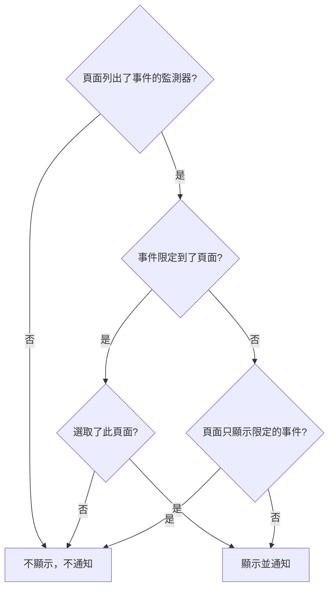

# 每個受眾一個狀態頁

不同的人需要不同的消息。一個客戶不想聽到另一個客戶的故障，一個站點的員工也不想在每次另一個站點斷線時都收到一封郵件。在 OneUptime 中，受眾的單位是狀態頁面：每個狀態頁面都有自己的訂閱者、自己的品牌和自己的隱私設定。所以，給每個受眾一個自己的頁面，再逐一針對每個事件決定哪些頁面會得知它。

過去，共用的基礎架構讓這件事很難做到。事件透過它的監測器到達狀態頁面，所以一個由十個站點頁面共用的監測器，會把一次只影響兩個站點的故障告訴全部十個站點。唯一的變通辦法是為每一種站點組合準備一個頁面或一個監測器。本頁介紹解決這個問題的設定：

- 事件上的 **僅限這些狀態頁面**，讓它只在你挑選的頁面上顯示和通知。
- 狀態頁面上的 **僅顯示限定到此頁面的事件**，讓還沒有人限定範圍的事件在有人做出決定之前不會到達這些頁面中的任何一個。這包括監測器、Slack、Microsoft Teams、API 或 AI 自行建立的事件。
- 一份記錄，說明哪些頁面已被告知事件已建立，這樣之後新增的頁面只會被告知一次，其他頁面也不會被再次告知。
- 一份 **將通知** 摘要，在你宣告事件或發布公開備註之前顯示誰會得知這個事件，以及 **預覽**，顯示每個頁面的訂閱者將收到什麼。

:::cards
- [進行設定](#為每個受眾設定一個頁面): 每個受眾一個頁面，以及讓未限定範圍的事件遠離它們的開關。
- [限定事件](#把事件限定到狀態頁面): 在宣告時或之後挑選頁面。
- [新增或移除頁面](#新增與移除狀態頁面): 新增的頁面會告知誰，以及移除頁面會撤回什麼。
- [每則訊息都附帶什麼](#每則訊息都附帶什麼): 每個頁面都會得到的值，以及它們會告訴每個受眾什麼。
:::

## 何時使用

- **託管服務供應商**：每個客戶一個狀態頁面，使用客戶共用的監測器。
- **擁有多個站點、工廠或地區的組織**：每個都有需要告知的員工。
- **內部 IT**：每個部門或大樓一個頁面。

如果你的受眾樂意自己選擇，一個頁面可能就夠了：讓訂閱者挑選他們關心的資源（請參閱 [訂閱者與公告](/docs/status-pages/subscribers)）。當你要替他們逐一針對每個事件做出選擇，或者一個受眾絕不能看到另一個受眾的事件時，就為每個受眾使用一個頁面。

## 事件如何到達狀態頁面

事件透過它的監測器到達狀態頁面。當頁面的某個資源是事件的某個監測器時（直接或透過頁面上的監測器群組），頁面會顯示該事件並就它通知訂閱者。有兩項設定可以縮小這個範圍：

- 事件上的 **僅限這些狀態頁面**（`statusPages`）。留空時，事件會像以往一樣到達列出其監測器的每個頁面。選了頁面後，它只會到達列出其監測器的頁面 **當中** 被選取的那些。
- 狀態頁面上的 **僅顯示限定到此頁面的事件**（`onlyShowScopedIncidents`，預設關閉）。開啟後，頁面絕不會顯示沒有限定到特定狀態頁面的事件，也絕不會就它通知任何人。



對於列出了事件某個監測器的頁面：

| 事件的情況 | **僅顯示限定到此頁面的事件** 關閉的頁面 | 開啟的頁面 |
| --- | --- | --- |
| 沒有限定到任何狀態頁面 | 顯示並通知 | 不顯示，不通知 |
| 限定到狀態頁面，而且選取了此頁面 | 顯示並通知 | 顯示並通知 |
| 限定到狀態頁面，但不是此頁面 | 不顯示，不通知 | 不顯示，不通知 |

一個沒有列出事件任何監測器的頁面，不論你選擇什麼都不會顯示它，而沒有監測器的事件根本不會通知任何狀態頁面訂閱者。通常的規則仍然疊加適用：事件必須 **於狀態頁面可見** 且不是私人的，頁面必須開啟 **顯示事件**，只選擇了部分資源或事件類型的訂閱者只會收到他們所選的內容。

凡是取決於事件到達哪些頁面的內容，都由同樣的規則決定：

- 公開狀態頁面上的事件清單、總覽和事件自己的頁面，以及狀態頁面 [公開 API](/docs/status-pages/public-api)；
- 事件建立、狀態變更、收到公開備註或收到事後分析時傳送的電子郵件、簡訊、Slack、Microsoft Teams 和 Webhook 訊息；
- 透過電子郵件寄送的狀態頁面報告中的事件數量，它只計算頁面所顯示的事件。

當事件片段的至少一個事件到達某個頁面時，該片段就到達這個頁面。它的通知會傳送到它的事件所到達的每個頁面，而在它的事件都沒有到達的狀態頁面上，它的頁面是找不到的。私人事件不會到達任何頁面，所以它永遠不會把它的片段帶到某個頁面上，而私人片段則根本不會在任何頁面上顯示。

## 為每個受眾設定一個頁面

:::steps
### 為每個受眾建立一個狀態頁面

為每個受眾建立一個頁面，例如 `Site 01` 到 `Site 10`。如果受眾在內部，就把它們設為私人（請參閱 [限制誰能看到這個頁面](/docs/status-pages/index#限制誰能看到這個頁面)）。私人頁面的訂閱者仍然可以透過每則訊息中的連結，不需登入就取消訂閱（請參閱 [管理與取消訂閱](/docs/status-pages/subscribers#管理與取消訂閱)）。給它們加上 `Region East` 之類的標籤，這樣選擇器就可以一次點選新增帶有某個標籤的所有頁面。

### 把共用監測器放到每個頁面上

把共用監測器作為資源新增到每個頁面（請參閱 [狀態頁資源與群組](/docs/status-pages/resources-and-groups)）。**資源 → Monitor Rules** 下的規則可以根據監測器的標籤替你完成這件事。

### 開啟「僅顯示限定到此頁面的事件」

在這些頁面中的每一個上開啟它。它位於 **狀態頁面 → 您的頁面 → 進階 → 進階設定** 上的 **狀態頁面顯示的內容** 卡片中，在 **顯示事件** 下方，切換後立即儲存。從那時起，除非有人選取站點頁面，否則不會有任何內容到達它。

### 新增每個受眾的訂閱者

對於員工，請在 **電子郵件訂閱者** 上使用 **批次新增**，而且優先使用每個人自己的地址，而不是像 `site03-all@` 這樣的郵寄清單：清單上的任何人都可以為清單上的所有人取消訂閱。如果你新增的訂閱者取消了訂閱，頁面的擁有者和新增它的人會收到郵件（請參閱 [共用位址與郵寄清單](/docs/status-pages/subscribers#共用位址與郵寄清單)）。

### 讓回應者能讀取狀態頁面

選擇器只會列出這個人能讀取的狀態頁面，而事件角色無法讀取狀態頁面。在回應者的事件角色之外，再給他們 **Status Page Viewer** 角色；它可以限定到帶有特定標籤的頁面。沒有它，選擇器就是空的。

### 決定每則訊息的內容

在 **事件 → 設定 → 自訂欄位** 中，定義你的團隊每次都要回答的事件自訂欄位，例如 `Impact`（下拉式清單）、`Expected Resolution`（日期和時間）和 `Acknowledgement`（是/否開關）。把它們拖曳成你希望詢問和列出的 **順序**，並開啟 **建立時顯示** 讓宣告表單詢問它們，在必須回答的欄位上開啟 **建立時必填**，在每個受眾都可以閱讀的欄位上開啟 **包含在訂閱者通知中**。這樣它們就會出現在每個頁面的預設郵件中。請參閱 [自訂欄位](/docs/incidents/settings#自訂欄位)。

### 為每個頁面的郵件設定品牌（選用）

在 **Scale** 方案上，為每個頁面提供一個 **自訂 SMTP 設定**，並為事件的各類事件連結自訂範本；它們可以用 `{{incident.customFields.<key>}}` 放入任何欄位。在你撰寫範本時，它下方的 **即時預覽** 會顯示用範例值填好的樣子。請參閱 [自訂範本需要什麼](/docs/status-pages/subscribers#自訂範本需要什麼)，在使用 `{{affectedStatusPages}}` 之前，也請參閱 [每則訊息都附帶什麼](#每則訊息都附帶什麼)。

### 儲存選好頁面的事件範本（選用）

一個 `Region East outage` 範本可以附帶東部站點的頁面，以及自訂欄位的預設答案。

### 在第一次故障之前檢查每個頁面的郵件

選好共用監測器和兩個站點頁面後開始 **宣告事件**，在提交之前的摘要中，開啟 **是** 旁邊的 **預覽**：它會顯示每個頁面的訂閱者會收到的郵件，以及它使用哪個範本、為什麼使用。**傳送測試郵件給我** 會把一封郵件寄到你自己的收件匣。在你宣告事件之前，不會傳送任何內容給其他任何人，所以完成後不提交就離開表單即可。請參閱 [誰會收到通知](#誰會收到通知)。
:::

## 把事件限定到狀態頁面

### 宣告時

在 **事件 → 所有事件 → 宣告事件** 上，**受影響的資源** 步驟在監測器和其他資源之後、**更多欄位** 下有 **僅限這些狀態頁面**。它的預留位置 **列出這些監測器的所有狀態頁面** 就是留空時的含義。依名稱挑選頁面，或者開啟選擇器的 **標籤** 分頁並挑選一個標籤，以新增帶有它的每個頁面。

表單會在以下情況下警告你：

- 所選頁面沒有列出事件的任何監測器，或者根本沒有連結監測器。事件不會在該頁面上顯示，也不會通知它的訂閱者；
- 你還在同一步驟中監測器的正下方設定了 **將監測器狀態變更為**。請參閱 [監測器狀態是共用的](#監測器狀態是共用的)；
- 你還勾選了 **事件詳細資訊** 步驟中 **更多欄位** 下的 **私人事件**。私人事件會在所有狀態頁面上隱藏，包括你選取的那些。

緊接在 **受影響的資源** 之後的 **詳細資料** 步驟，會詢問標示了 **建立時顯示** 的事件自訂欄位（請參閱 [宣告事件](/docs/incidents/declaring-incidents)）。它的答案會傳送到事件到達的每個頁面：自訂欄位的值屬於事件，而不屬於某個狀態頁面。

**從範本建立** 會根據範本填寫這個欄位。範本的頁面在建立它時於它的 **受影響的資源** 步驟中設定，之後在它的 **狀態頁面範圍** 卡片上設定（**事件 → 設定 → 事件範本**）。與其他範本欄位一樣，你自己設定的清單優先。即使回應者無法讀取狀態頁面，範本的頁面也會被填入：設定範本的人已經為每個用它宣告事件的人選好了這些頁面。

### 誰會收到通知

在 **受影響的資源** 步驟中 **更多欄位** 下、選擇器正下方的 **通知狀態頁面訂閱者** 下面，以及在你提交之前的摘要中，表單會顯示事件將到達誰：

> 將通知：
>
> - Site 03（最多 電子郵件 41 人）
> - Site 07（最多 電子郵件 18 人）

在它下面，**不通知：** 下會列出那些列出了監測器但不會被告知的頁面及原因：不是事件所限定的頁面之一，是只顯示限定到它的事件的頁面，或者是不顯示事件的頁面。

當沒有人會被告知時，摘要什麼也不顯示：事件沒有監測器、沒有狀態頁面列出它們、頁面還沒有訂閱者、**通知狀態頁面訂閱者** 已關閉，或者事件是私人的。只有當原因在於狀態頁面範圍時它才會發出警告，並寫出它排除的頁面：事件沒有被限定，而列出其監測器的頁面只顯示限定到它們的事件；它被限定到了其他頁面；或者它所限定的頁面沒有列出它的任何監測器。在摘要中，**通知狀態頁面訂閱者** 像其他每個核取方塊一樣顯示為 **是** 或 **否**，**是** 旁邊有 **預覽**；當核取方塊關閉、事件是私人的或沒有連結監測器時，不會提供它。

當你在事件的 **公開備註** 頁面上撰寫備註時，針對事件目前的情況，**通知狀態頁面訂閱者** 下也會出現同樣的摘要。在那裡，當事件在狀態頁面上隱藏時它也會說明，因為那時什麼都不會傳送。

這些數量是「最多」。它們依管道統計每個頁面已確認且未取消訂閱的訂閱者，而只選擇了部分資源或事件類型的訂閱者可能不會收到這則訊息。你無法讀取的頁面不會寫出名稱。它們會被計為「另有 … 個您無權存取的狀態頁面」。

摘要中 **是** 旁邊以及備註核取方塊旁邊的 **預覽**，會顯示他們將收到什麼：選擇一個頁面，即可看到它的訂閱者將收到的郵件及其主旨，以及它使用哪個範本、為什麼使用，例如由於頁面沒有 **自訂 SMTP 設定**，頁面的自訂範本不會被使用。**傳送測試郵件給我** 會把該頁面的郵件寄到你自己的帳戶電子郵件，不會寄給其他任何人。你無法讀取的頁面會被計數，但不會被預覽。請參閱 [傳送前預覽電子郵件](/docs/status-pages/subscribers#傳送前預覽電子郵件)。

### 宣告之後

開啟事件並前往 **進階 → 設定**。**狀態頁面範圍** 卡片會列出事件所限定的頁面，**編輯狀態頁面範圍** 用來變更它們。事件的 **概覽** 會以唯讀方式把同一份清單顯示為 **狀態頁面範圍**，並附有一個 **在設定中變更** 連結。

在 **事件 → 所有事件** 上，**狀態頁面** 篩選條件可以找到限定到你所選頁面的事件，或者沒有限定到任何頁面的事件。

### 透過 API

`statusPages` 是一份狀態頁面 ID 清單，用於 `POST /api/incident` 和事件的更新，也用於事件範本。每個頁面都必須屬於事件所在的專案；另一個專案的頁面會被拒絕。你新增的每個頁面也必須是你能讀取的，就像在選擇器中一樣，否則請求會被拒絕。不論你能否讀取，事件或範本已有的頁面都會保留，而你能讀取的事件範本中的頁面，可以在宣告事件時選取。由此還會衍生出兩個欄位，它們都不由你設定：

- `isScopedToStatusPages` 由 `statusPages` 計算得出。你為它傳送的任何值都會被忽略。
- `statusPagesNotifiedOnCreation` 是已被告知事件已建立的頁面的記錄。請參閱 [新增狀態頁面](#新增狀態頁面)。

要在不傳送任何內容的情況下查看事件會到達誰，請呼叫受眾端點：

```bash
curl -X POST https://oneuptime.com/api/incident/subscriber-audience \
  -H "apikey: $ONEUPTIME_API_KEY" \
  -H "Content-Type: application/json" \
  -d '{
    "monitorIds": ["<monitor-id>"],
    "statusPageIds": ["<status-page-id>"]
  }'
```

對於已經存在的事件，請改為傳送 `{"incidentId": "<incident-id>"}`。回應會列出每個將收到通知的頁面以及每個管道的數量（`email`、`sms`、`slack`、`microsoftTeams`、`webhook`）、被排除的頁面及原因，以及呼叫端無法讀取的頁面數 `hiddenStatusPageCount`。它從不回傳地址。

## 還沒有人限定範圍的事件

監測器條件、Slack、Microsoft Teams、API 和 AI 都可以自行建立事件，而它們都不知道共用監測器上的故障影響了哪些站點。這樣的事件沒有限定到任何頁面，所以每個列出該監測器的頁面都會在大約一分鐘內顯示它，並通知它的訂閱者。一封郵件一旦寄給了訂閱者，就無法收回。

**僅顯示限定到此頁面的事件** 就是用來阻止這種情況的。開啟了它的頁面會忽略每一個未限定範圍的事件。事件仍然會被建立，值班原則仍然會呼叫回應者，它的擁有者仍然會收到通知，但這些頁面都不會得知它。接著，回應者弄清楚受影響的是誰，在事件的 **設定** 分頁上新增這些頁面，並勾選 **向新加入的頁面傳送事件建立通知**。它們的訂閱者會在大約一分鐘內收到通知。

## 新增與移除狀態頁面

### 新增狀態頁面

一個頁面的訂閱者只會被告知一次事件已建立。所以當你在 **狀態頁面範圍** 卡片上新增頁面時，編輯表單會提供 **向新加入的頁面傳送事件建立通知**，預設勾選：

- 勾選時，事件的「已建立」通知會再次排入佇列，而且只會傳送給尚未被告知的頁面。事件保存著已被告知頁面的記錄，所以其他頁面不會聽到兩次。
- 不勾選時，新增的頁面開始顯示該事件，並會得知此後的一切，但不會被告知它已建立。

只有當勾選它會傳送一些內容時，核取方塊才會出現：你新增的頁面中至少有一個尚未被告知，而且事件在宣告時開啟了 **通知狀態頁面訂閱者**、在狀態頁面上可見且不是私人的。有些情況會自動為你處理：

- **通知仍在佇列中，或者此刻正在傳送。** 佇列中的傳送會在發出時讀取頁面，正在執行的傳送會在完成時再次讀取頁面，然後告知這期間新增的頁面。所以沒有核取方塊：你新增的頁面不論如何都會被告知。（如果那次傳送失敗，這期間新增的頁面會包含在它的 **重試** 所傳送的頁面中。）
- **你新增的每個頁面都已經被告知過。** 例如你移除後又重新新增的頁面，或者一個曾到達所有站點、現在縮小到其中兩個站點的事件。沒有人會被再次告知，所以沒有核取方塊。
- **事件從未被通告過。** 當它在發布時沒有 **通知訂閱者此事件已建立**，或者在宣告時沒有監測器，就沒有人被告知過。勾選核取方塊只會告知你新增的頁面，而不會告知它原本就限定到的頁面。
- **事件是在這項功能推出之前宣告的。** 它的「已建立」通知已傳送給列出其監測器的每個頁面，而且沒有這些頁面的記錄。新增頁面不會再次傳送它，所以不提供核取方塊。
- **事件處於隱藏狀態。** 隱藏期間不會傳送任何內容。當你重新開啟 **於狀態頁面可見** 時，**事件設定** 卡片會為其範圍內從未被告知的頁面（例如在它隱藏期間新增的頁面）提供 **通知訂閱者此事件已建立**。

之後新增的頁面會得知接下來發生的事情：之後的公開備註、狀態變更和事後分析。在它被新增之前發出的備註和狀態變更不會傳送給它。如果它需要跟上進度，請發布一則公開備註。

同一份記錄讓失敗的「已建立」通知上的 **重試** 從它中止的地方繼續：已經被告知的頁面會被略過。只有當一個頁面的每位訂閱者都收到了訊息時，這個頁面才算已被告知；有訊息失敗的頁面，或傳送中途停止的頁面，會重新完整地傳送一遍。每個頁面完成時都會寫入記錄，所以即使是被中斷的傳送也是如此。記錄是依頁面保存的，而不是依訂閱者：在傳送中途停止的頁面上，已經收到訊息的訂閱者會收到第二次。

如果想改為從頭開始，例如在修正了範本或 SMTP 設定之後，請在 **重試** 確認中勾選 **再次傳送到每個狀態頁面，包括已送達的頁面**：按鈕會變為 **重新傳送到所有頁面**，記錄會被清空，事件現在到達的每個頁面都會再次收到它。在一則完整發出的通知之後，事件 **概覽** 上的 **訂閱者通知狀態** 會提供 **重新傳送**，它做同樣的事。兩個確認都會列出它現在會到達的頁面，或者說明它不會到達任何人；一般的 **重試** 確認會把已經到達的頁面列為不會再次傳送，因為它會略過它們。對於被略過的通知，或者仍在佇列中或正在傳送的通知，兩者都不會提供，對於無權編輯事件的人也不會提供。

透過 API，在變更 `statusPages` 的更新中傳送 `"miscDataProps": {"notifyAddedStatusPagesOfIncidentCreated": true}`。你自己把 `subscriberNotificationStatusOnIncidentCreated` 設回 `Pending`，仍然會像以往一樣把「已建立」通知重新傳送到事件到達的每個頁面：記錄會隨之清空。在失敗之後，它會改為從失敗的傳送中止的地方繼續。要在失敗之後也傳送到每個頁面，請在那次更新中加上 `"miscDataProps": {"resendIncidentCreatedToAllStatusPages": true}`。對於被略過的通知，或者正在佇列中或傳送中的通知，該請求會被拒絕。

寫入 `shouldStatusPageSubscribersBeNotifiedOnIncidentCreated` 不屬於以上任何一種。它在宣告事件時選擇，之後沒有任何專案角色可以透過 API 變更它。以系統身分寫入的工作流程和執行個體的主管理員可以變更，但那只會儲存新值。像複製整個事件的工作流程那樣原樣寫回，不會再次傳送任何內容，之後再開啟它，也不會傳送事件在宣告時沒有傳送的「已建立」通知。在那則通知發出之前關閉它，通知就會被略過。

### 移除狀態頁面

移除頁面不會撤回任何內容。該頁面停止顯示事件，它的訂閱者也不會再聽到關於它的任何消息，甚至不會得知它已解決。當你移除一個已經被告知過該事件的頁面時，編輯表單會警告你，並建議發布一則收尾的公開備註。請先在頁面仍在清單中時發布這則備註，然後再移除頁面。

清空整份清單與移除頁面不同：那樣事件就根本不受限定了。它會再次在列出其監測器的每個頁面上顯示並通知，只顯示限定到它們的事件的頁面除外。表單也會就此警告你。

### 所選狀態頁面被刪除時

刪除一個狀態頁面，會把它從每個限定到它的事件中移除。所選頁面全部被刪除的事件仍然保持限定，只是限定到了空集合：它會在每個狀態頁面上隱藏，而不是在列出其監測器的每個頁面上顯示。**狀態頁面範圍** 卡片會說明這一點。要再次顯示它，請選擇其他頁面，或清空清單。

事件範本的運作方式相同。頁面全部被刪除的範本仍然保持限定：由 [表單](/docs/forms/on-submit#事件範本) 或工作流程的 **Create One Incident** 步驟根據它宣告的事件會在每個狀態頁面上隱藏，範本的 **狀態頁面範圍** 卡片會警告你，**宣告事件** 開始時不會選取任何頁面，並要求你選擇事件所針對的頁面。在範本上選擇其他頁面，或者以空清單儲存它，即可停止限定由它宣告的事件。

## 每人一封郵件

對於限定到特定狀態頁面的事件，在其中多個頁面上訂閱的電子郵件地址或電話號碼，每次傳送只會收到一封郵件或一則簡訊，而不是每個頁面一封。頁面依名稱順序處理，所以這個人收到的是第一個頁面的範本、品牌和取消訂閱連結。

Webhook、Slack 和 Microsoft Teams 訊息從不合併。它們的承載內容寫明了所針對的狀態頁面，依頁面接收的整合必須看到每一個頁面。

這只在一次傳送之內適用。一個同時訂閱了 `Site 03` 和 `Site 05`、並透過 `Site 03` 收到「已建立」郵件的人，在之後新增 `Site 05` 時會再次收到它。沒有限定到任何頁面的事件，會像以往一樣為每個訂閱傳送一則訊息。

## 每則訊息都附帶什麼

事件到達的每個頁面都會得到相同的值：它們屬於事件，而不屬於某個狀態頁面。

- **預設訊息中的自訂欄位。** 開啟了 **包含在訂閱者通知中** 的事件自訂欄位，會依它們的 **順序** 列在每個頁面的建立、狀態變更、公開備註和事後分析訊息中：電子郵件、Slack、Microsoft Teams 和 Webhook，但不包括簡訊。這既不需要 Scale 方案，也不需要自訂 SMTP。請參閱 [通知中的事件自訂欄位](/docs/status-pages/subscribers#通知中的事件自訂欄位)。
- **更新。** 單獨變更一個自訂欄位不會告知任何人。下一則公開備註或狀態變更會附帶目前的值，所以要告訴各站點 `Expected Resolution` 變了，請先變更欄位，再發布一則公開備註。
- **備註範本。** 選擇一個備註範本，會用事件目前的值填入 `{{incident.title}}` 和 `{{incident.customFields.<key>}}` 等預留位置，你仍然可以在發布之前編輯備註。請參閱 [備註範本](/docs/incidents/settings#備註範本)。
- **其他受眾的名稱。** 自訂訂閱者範本中的 `{{affectedStatusPages}}`，以及備註範本中的 `{{incident.affectedStatusPages}}`，會列出事件到達的頁面，訊息寄往的每個人都會讀到這份清單：`Site 03` 的訂閱者會得知 `Site 07` 也受到了影響。在同一個組織的站點之間，這可能正是你想要的。在客戶之間，它會把一個客戶告訴另一個客戶，所以請把兩者都從這些頁面所收到的範本和備註中拿掉。

## 與排定維護的差異

排定維護事件也有一份 **狀態頁面** 清單，但它的運作方式不同：

- **排定維護是取代。** 事件只會顯示在它清單中的頁面上，不論這些頁面是否列出了它的監測器。
- **事件是縮小。** 它的清單只能在已經列出其監測器的頁面中進行選擇。選擇一個沒有列出任何監測器的頁面不會產生任何效果，表單也會這麼提示。請先把監測器放到那個頁面上。

這可以防止一次誤選把事件放到一個完全關於其他內容的頁面上。這也表示，沒有監測器的事件不論你選多少個頁面，都不會到達任何狀態頁面。

## 監測器狀態是共用的

一個監測器只有一個狀態，列出該監測器的每個狀態頁面都會顯示它。限定事件不會改變這一點。如果事件設定了 **將監測器狀態變更為**，或者監測器自己停止運作，那麼在列出它的每個頁面上監測器都會變紅，包括事件沒有限定到的頁面，以及只顯示限定到它們的事件的頁面。當你把狀態變更和所選頁面結合使用時，宣告表單會警告你。

**當每個站點都需要自己的狀態時，為每個站點設定一個手動監控。** 為每個站點建立一個 [手動監控](/docs/monitor/manual-monitor)，例如 `Site 03 network`，並只在該站點的頁面上列出它。把受影響站點的手動監控連結到事件上，如果你希望它們的狀態改變，就設定 **將監測器狀態變更為**，並把共用監測器留給應該看到它的頁面。這樣事件就只會到達帶有其監測器的站點，狀態變更也只會顯示在它們的頁面上。

## 記錄了什麼

- **事件動態。** 限定事件的「已建立」項目會列出它所限定的頁面。對清單的每次變更都會新增一則項目，列出新增和移除的頁面，以及新增的頁面是否會收到「已建立」通知。
- **每則訂閱者通知。** 事件動態中的 **訂閱者通知已傳送** 項目有一個 **More Information** 面板，列出這次傳送所到達的每個頁面：每個管道上傳送了多少則、失敗了多少則，以及它的郵件所用的主旨。它還會列出它略過的頁面及原因（已經被告知，或不顯示事件）、被範圍排除的頁面，以及電子郵件和簡訊是否依地址只傳送了一次。當這次傳送把自訂欄位的值放進了訊息時，面板的最後會在 **Custom fields sent** 下列出它們。
- **通知的狀態。** 每則通知的狀態訊息會說明每個頁面上每個管道傳送了多少則、失敗了多少則，並在失敗之後說明 **重試** 會做什麼。因伺服器重新啟動或停止回應而中途被中斷的傳送，會被標示為失敗，並附上一則以 `Interrupted:` 開頭的訊息，而不是一直處於進行中。請參閱 [檢查傳送了什麼](/docs/status-pages/subscribers#檢查傳送了什麼)。
- 每個狀態頁面上的 **通知日誌** 會顯示該頁面傳送的每一則訊息。

關於動態本身，請參閱 [事件備註、負責人與動態](/docs/incidents/notes-owners-and-feed)。

## 權限

- **選擇一個狀態頁面需要對它的讀取權限。** 狀態頁面是在狀態頁面角色下讀取的，而不是事件角色，而且狀態頁面可以依標籤進行限制。給回應者 **Status Page Viewer**，如果你願意，可以限定到某些標籤。沒有它，選擇器就是空的，API 也會拒絕呼叫端無法讀取的頁面，不論是在事件上還是在事件範本上。
- **編輯者看不到的頁面會被保留。** 只能讀取事件部分頁面的編輯者，在選擇器中只能看到那些頁面，儲存時會保留他們看不到的頁面。
- **事件所限定的頁面是事件的一部分。** 就像它的監測器一樣，任何能讀取該事件的人，不論能否讀取那些狀態頁面，都能在 **狀態頁面範圍** 卡片、總覽和事件動態中看到它們的名稱。
- **一次傳送到達了哪裡，也是事件的一部分。** 一旦通知發出，它的狀態訊息和動態項目就會寫出它所寄往的每個狀態頁面，以及每個頁面上傳送了什麼、失敗了什麼，任何能讀取該事件的人，不論能否讀取那些狀態頁面，都能看到它們。只有下面這兩個用於預先查看的摘要和預覽，才只限於這個人能讀取的頁面。
- **受眾摘要** 對可以宣告或編輯事件、或在事件上發布公開備註的角色開放。它只寫出這個人能讀取的頁面的名稱。事件將通知的其他頁面會被計為「另有 … 個您無權存取的狀態頁面」，而且它從不顯示地址。
- **預覽** 對同樣的角色開放，只預覽這個人能讀取的頁面，每十分鐘最多六十次。和摘要一樣，它從不顯示地址。**傳送測試郵件給我** 只會寄到這個人自己的帳戶電子郵件，而且要在該電子郵件驗證之後，每 15 分鐘最多十次。
- **再次傳送通知**，對於事件的「已建立」通知，需要編輯事件的權限；對於備註，需要編輯公開備註的權限和發布會通知訂閱者的公開備註的權限這兩者，告知訂閱者備註有編輯時也是如此。在該通知正在傳送時，這些操作都不會被接受。

## 升級自行託管的伺服器

讓事件留在它所限定的頁面上的，是傳送訂閱者通知的背景工作程序。在升級到帶有此功能的版本的推出過程中，仍處於舊版本的背景工作程序會像以往一樣傳送它取得的通知：傳送給列出事件監測器的每個狀態頁面，包括只顯示限定到它們的事件的頁面。所以，請在任何人把事件限定到狀態頁面或開啟 **僅顯示限定到此頁面的事件** 之前，等待背景工作程序的部署全部完成，或者把舊的背景工作程序縮減為零。使用 Helm 時，`migrate.hook: true` 還會在任何新 Pod 啟動之前執行資料庫遷移。

## 後續步驟

:::cards
- [訂閱者與公告](/docs/status-pages/subscribers): 訂閱者管道，以及每種事件會傳送什麼。
- [宣告事件](/docs/incidents/declaring-incidents): 宣告表單，一步一步來。
- [事件狀態與嚴重程度](/docs/incidents/states-and-severities): 還有什麼會讓事件不出現在狀態頁面上。
- [手動監控](/docs/monitor/manual-monitor): 由你自己設定狀態的監測器。
:::
