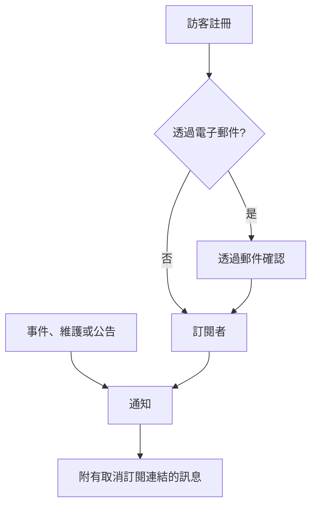

# 訂閱者與公告

狀態頁面是大家會去查看的地方。訂閱者則是那些寧可不必去查看的人：他們只需提供一次電子郵件地址、電話號碼、Slack Webhook 或 HTTP 端點，之後你的更新就會主動送到他們面前。

公告是同一項工作的另一半。監測器可以告訴訪客結帳正在回傳 500 錯誤；但沒有哪個監測器能告訴他們你週六要遷移資料庫、某個第三方供應商今天狀況不佳，或者他們昨天讀到的那個事件已經徹底結束。公告是用來傳達所有檢查看不到的事情的自由文字管道，並且會分送到同一份訂閱者清單。

本頁涵蓋這兩部分：五個訂閱管道以及訪客如何註冊，訂閱者可以選擇接收哪些內容，雙重確認和取消訂閱的流程，訂閱者每月可以收到的電子郵件報告，以及如何撰寫、排程公告並為其製作範本。

:::cards
- [訂閱管道](#訂閱管道): 訪客可以註冊的管道，以及他們註冊的頁面。
- [訂閱者會收到什麼](#訂閱者會收到哪些通知): 公告、維護、事件和片段，以及對它們的編輯。
- [檢查傳送了什麼](#檢查傳送了什麼): 每則通知的狀態，以及重試和重新傳送。
- [公告](#公告): 向一個或多個狀態頁面發布通知。
:::

## 運作方式



每個狀態頁面都有自己的訂閱者。訪客在頁面的 **訂閱** 頁面上註冊，電子郵件地址在收到任何內容之前要先透過連結確認；或者由你的團隊在儀表板上新增。從那時起，每個到達該頁面的事件、排定維護事件和公告都會通知它的訂閱者，各自透過他們註冊時使用的管道，而且每則訊息都附有取消訂閱的連結。

## 訂閱管道

狀態頁面支援五個管道。這些管道以及訪客註冊所用的頁面，都在一個地方開關：**狀態頁面 → 您的頁面 → 訂閱者 → 訂閱者設定** 上的 **管道** 卡片。每個開關在你切換時立即儲存：

- **顯示訂閱者頁面**（`showSubscriberPageOnStatusPage`）：預設開啟。在狀態頁面的導覽列中放置 **訂閱** 項目，訪客在那裡透過下面的管道註冊。
- **電子郵件**（`enableEmailSubscribers`）：預設開啟。其他管道在你開啟之前都是關閉的。
- **SMS**（`enableSmsSubscribers`）：預設關閉。在 OneUptime Cloud 上，每則簡訊都從專案的簡訊和通話餘額中支付，除非頁面有自己的 **Twilio 設定**（請參閱[下文](#電子郵件頁尾自訂-smtp-與-twilio)）。要開啟它，還需要在 **專案設定 > 通知 > 通知設定** 的 **通知管道** 卡片中為專案開啟 **SMS**，專案擁有者、**Billing Admin** 或擁有 **Manage Billing** 的人可以這麼做。
- **Slack**（`enableSlackSubscribers`）：預設關閉。
- **Microsoft Teams**（`enableMicrosoftTeamsSubscribers`）：預設關閉。
- **Webhook**（`enableWebhookSubscribers`）：預設關閉。

這些開關決定訪客可以如何自行註冊，狀態頁面會拒絕透過已關閉的管道註冊。它們不會阻止通知：你的團隊在儀表板上、透過 API 或透過工作流程新增的訂閱者，不論哪些管道開啟，都會收到更新。

在 OneUptime Cloud 上，你的方案不包含的開關旁邊會顯示方案名稱：**SMS** 和 **顯示訂閱者頁面** 需要 **Growth**，**Slack**、**Microsoft Teams** 和 **Webhook** 需要 **Scale**。關閉管道在所有方案上都能使用，所以試用期間開啟的管道隨時都可以再次關閉；開關下方會說明這一點。

每個管道在狀態頁面側邊選單的 **訂閱者** 下也有自己的清單：**電子郵件訂閱者**、**SMS 訂閱者**、**Slack 訂閱者**、**MS Teams 訂閱者** 和 **Webhook 訂閱者**。你可以在那裡查看誰已註冊、手動新增某人，或者為某位訂閱者給自己留一則 **備註**（`internalNote`）。管道關閉期間，清單頂端會說明這一點，管道的開關就在旁邊，所以不必離開清單就能開啟它。

**一個開關是不夠的。** 只有當 **顯示訂閱者頁面** 開啟 *而且* 至少有一個管道開啟時，狀態頁面導覽列中的 **訂閱** 項目才會出現。如果你開啟了 **電子郵件**，卻讓 **顯示訂閱者頁面** 保持關閉，訪客就無法到達表單。

## 訪客在訂閱頁面上看到什麼

**訂閱** 頁面有一個子選單，每個已啟用的管道一個分頁。每個分頁只要求它需要的最少資訊：

| 分頁 | 位址 | 標題 | 要求填寫的內容 |
| --- | --- | --- | --- |
| **電子郵件** | `/subscribe/email` | **透過電子郵件訂閱** | **您的電子郵件**，預留位置為 `subscriber@company.com`。 |
| **簡訊** | `/subscribe/sms` | **透過簡訊訂閱** | **您的電話號碼**，預留位置為 `+11234567890`。 |
| **Slack** | `/subscribe/slack` | **透過 Slack 訂閱** | **Slack 工作區名稱**（用於驗證）和 **Slack 傳入 Webhook URL**，預留位置為 `https://hooks.slack.com/services/...`。 |
| **MS Teams** | `/subscribe/microsoft-teams` | **透過 Microsoft Teams 訂閱** | **Microsoft Teams 工作區名稱** 和 **Microsoft Teams 傳入 Webhook URL**，預留位置為 `https://outlook.office.com/webhook/...`。 |
| **Webhook** | `/subscribe/webhooks` | **透過 Webhook 訂閱** | **Webhook URL**，預留位置為 `https://example.com/webhook`。每個狀態頁面事件都會向它傳送一個 JSON `POST` 請求。 |

提交按鈕上寫著 **訂閱**。透過簡訊、Slack、Microsoft Teams 或 Webhook 註冊後會顯示 *您已成功訂閱。* 透過電子郵件註冊後，會提示確認連結已寄出，如果沒有收到請檢查垃圾郵件資料夾（請參閱 [電子郵件的雙重確認](#電子郵件的雙重確認)）。**電子郵件**、**簡訊**、**Slack** 和 **MS Teams** 分頁還有 **新訂閱** / **管理現有訂閱** 的切換，這樣已經訂閱的人不必翻找舊訊息就能回到自己的偏好設定。

## 讓訂閱者自己挑資源與事件類型

預設情況下，訂閱者會收到頁面上的所有內容。**進階訂閱者設定** 卡片中的兩個開關可以改變這一點：

- **允許訂閱者選擇資源**（`allowSubscribersToChooseResources`）：預設關閉。開啟後，訂閱表單會多出一個 **訂閱所有資源** 開關；取消勾選它，就會出現 **選擇要訂閱的資源**，讓訪客挑選個別資源。
- **允許訂閱者選擇事件類型**（`allowSubscribersToChooseEventTypes`）：預設關閉。形式相同：一個 **訂閱所有事件類型** 開關，取消勾選時下方會出現 **選擇要訂閱的事件類型**。

不論開啟其中哪一個，訂閱表單仍然只有一頁。在更新的傳送位置（電子郵件地址、電話號碼、工作區或 Webhook）下方是 **偏好設定**，它收合成一行，說明訪客將收到什麼。所有資源和所有類型的事件都已預先選取，所以它一開始顯示「您將收到此狀態頁的所有更新。」，想要接收所有內容的訪客不必展開它就可以直接按 **訂閱**。其他人則展開 **偏好設定**，縮小資源或事件類型的範圍；再次收合後，這一行會隨所選內容變化（「您將僅收到所選資源的更新。」）。兩者都關閉時，就沒有 **偏好設定**：表單只有更新的傳送位置，然後是 **訂閱**。

**更新訂閱** 頁面（見下文）會以展開的形式顯示相同的選項，因為訂閱者去那裡正是為了變更它們。

事件類型有 `Incident`、`Announcement` 和 `Scheduled Event`。

**監測器群組代表其中的每個監測器。** 頁面上的資源要麼是監測器，要麼是監測器群組。選擇了某個監測器群組的訂閱者，會收到該群組中任何監測器的事件、排定維護事件（包括其備註）和公告的通知，就像他們選擇了那個監測器一樣，狀態頁面也是這樣顯示它們的。只選擇了其他資源的人不會收到通知；同時選擇了某個監測器和包含它的群組的人，只會收到一則通知，而不是兩則。

這些選擇會記錄在訂閱者記錄上，分別為 **Is Subscribed to All Resources**（`isSubscribedToAllResources`，預設 true）、**Is Subscribed to All Event Types**（`isSubscribedToAllEventTypes`，預設 true）、**Subscribed to Resources** 和 **Subscribed to Event Types**。

**訂閱者只能在自己頁面的資源中選擇。** 不論由誰寫入，**Subscribed to Resources** 指向的都是訂閱者自己所在狀態頁面的資源：頁面上的訪客、儀表板上的隊友、API 金鑰或工作流程。訪客從頁面向他們顯示的內容中選擇，所以監測器已封存、因而被頁面隱藏的資源是無法選擇的。另一個狀態頁面的資源，或頁面對訪客隱藏的資源，會像不符合任何內容的 ID 一樣，被一個指出欄位和 ID 的 `400` 拒絕。變更只會檢查它所新增的資源，所以訂閱會保留它已經指向的資源，例如在被選取之後其監測器才被封存的資源。訂閱者只會透過自己頁面的資源收到某個事件的通知。

適用情境：一個涵蓋多個產品的頁面。只使用你的 API 的客戶，不希望每次行銷網站出現波動時都收到通知；與其眼看著他們徹底取消訂閱，不如讓他們自己縮小清單。

同一張卡片還包含 **訂閱者時區**。

## 電子郵件的雙重確認

電子郵件訂閱者一律需要確認。當使用電子郵件地址建立訂閱者、而且建立時不是已確認狀態時，**Is Subscription Confirmed**（`isSubscriptionConfirmed`）會被強制設為 `false`，並產生一個六位數的 **Subscription Confirmation Token**。接著 OneUptime 會寄出一個確認連結，形式為 `{statusPageUrl}/confirm-subscription/{statusPageSubscriberId}?verification-token={token}`。訪客會進入 **確認訂閱** 頁面，確認完成後會看到 *訂閱確認成功*。

簡訊、Slack、Microsoft Teams 和 Webhook 訂閱者會跳過這一步：它們在建立時 `isSubscriptionConfirmed` 就已設為 `true`。你的團隊在 **電子郵件訂閱者** 上新增的電子郵件訂閱者也是如此：那裡的 **不要傳送確認連結** 預設開啟。關閉它，該地址就會像自行註冊一樣進行確認。

**未確認就表示收不到訊息。** 為通知取得訂閱者的查詢會依 `isUnsubscribed: false` 和 `isSubscriptionConfirmed: true` 篩選。從未按下連結的電子郵件地址會留在你的 **電子郵件訂閱者** 清單中，卻什麼也收不到。如果有人堅稱自己已經訂閱卻什麼都沒收到，請先檢查這一欄。

沒有關閉電子郵件確認的開關：對於透過狀態頁面註冊的任何人，它都是無條件的。另一個依訂閱者設定的欄位 **Send You Have Subscribed Message**（`sendYouHaveSubscribedMessage`，預設 true）控制訂閱者確認後寄出的「你已訂閱」郵件。

## 管理與取消訂閱

訂閱者收到的每則訊息都附有一個取消訂閱連結，形式為 `{statusPageUrl}/unsubscribe/{statusPageSubscriberId}-{token}`：位於郵件底部、簡訊或 Slack 或 Microsoft Teams 訊息的內文中，以及 Webhook 承載內容中的 `unsubscribeUrl`。權杖是屬於這一個訂閱的隨機密碼，所以這個連結不需登入即可使用。私人狀態頁面也是如此，儘管那裡其他一切都需要已登入的訪客。

唯一的例外是來自 **public** 狀態頁面的簡訊，它附的是訂閱者的 **更新訂閱** 連結（見下文）。該頁面在公開狀態頁面上不需登入即可使用，而且它的連結短 57 個字元。簡訊依每 160 個字元的區段計費，所以較長的連結會讓大多數預設簡訊多出一個區段。自訂簡訊範本中的 `{{unsubscribeUrl}}` 遵循同樣的規則。來自私人狀態頁面的簡訊附的是取消訂閱連結。

簡訊日誌（狀態頁面和專案設定中 **通知日誌** 的 **SMS** 分頁）會保存每則簡訊的文字，能讀取它的專案成員比能管理訂閱者的人更多。所以日誌顯示的取消訂閱連結中，權杖被替換為 `[redacted]`，例如 `{statusPageUrl}/unsubscribe/{statusPageSubscriberId}-[redacted]`。只有訂閱者自己的手機會收到可用的連結。API 也從不回傳新訂閱者的權杖，即使在建立它的請求的回應中也不會。

**開啟連結不會改變任何事情。** 頁面會顯示狀態頁面的名稱和標誌，以及連結所屬的訂閱：完整的電子郵件地址、只顯示末四碼的電話號碼、Slack 或 Microsoft Teams 工作區名稱，或者 Webhook 的主機。它會詢問 *您要停止接收此狀態頁的通知嗎？* 只有按下 **取消訂閱** 才會取消訂閱，所以會開啟訊息中每個連結的郵件掃描程式和連結預覽程式無法取消任何人的訂閱。頁面上不會顯示其他任何內容，其中的自訂 JavaScript 也不會執行。確認兩次，或者開啟一個已經取消的訂閱的連結，只會顯示它已被取消。在公開狀態頁面上，取消訂閱頁面還會連結到訂閱者的 **更新訂閱** 頁面，以便改為選擇要接收哪些通知。

**更新訂閱** 頁面 `{statusPageUrl}/update-subscription/{statusPageSubscriberId}` 的標題是 **更新訂閱**，並告訴訪客可以在那裡更新偏好設定或取消訂閱。它包含：

- 頁面允許的任何資源和事件類型選擇器。
- 一個 **取消訂閱** 開關，說明為取消訂閱所有資源。它會寫入 **已取消訂閱**（`isUnsubscribed`，預設 false）。
- 一個寫著 **更新訂閱** 的提交按鈕；儲存後顯示 *您的變更已儲存。*

在私人狀態頁面上，它和頁面的其他部分一樣需要已登入的訪客。遺失連結的人可以在 **訂閱** 頁面上使用 **管理現有訂閱**，然後按 **傳送管理連結**。連結會傳送到訂閱本身（它的電子郵件地址、電話號碼，或者它的 Slack 或 Microsoft Teams 頻道），絕不會傳送到請求中的地址，而且不論是否比對到訂閱，頁面的回應都相同，所以無法用它來查出誰訂閱了。該訊息會連結到 **更新訂閱** 頁面，並把兩個連結都交給自訂範本：`manageSubscriptionUrl` 和 `unsubscribeUrl`。

支撐這一切的端點是 `POST .../subscribe/:statusPageId`、`POST .../manage-subscription/:statusPageId`、`POST .../get-subscription/:statusPageId/:subscriberId`、`PUT .../update-subscription/:statusPageId/:subscriberId`，以及 `GET` 和 `POST .../unsubscribe/:statusPageId/:subscriberId/:token`。取消訂閱的 `GET` 只會描述連結。`POST` 不論請求本文是什麼都會取消訂閱，包括一鍵取消訂閱請求的 `List-Unsubscribe=One-Click` 本文。對於錯誤的權杖、已刪除的訂閱者和另一個狀態頁面的訂閱者，兩者的回應都相同，所以無法用它們來查出誰訂閱了。

取消訂閱是翻轉一個旗標，而不是刪除一列，所以記錄會以設定了 **已取消訂閱** 的狀態留在管道清單中，這在你之後需要解釋某個地址為什麼不再收到郵件時很有用。不論是誰取消了訂閱（訂閱者透過連結或 **更新訂閱** 頁面，或者隊友在儀表板上或透過 API），它還會記錄 **取消訂閱於**（`unsubscribedAt`）。每份訂閱者清單都有一個 **取消訂閱於** 欄位和篩選條件。再次關閉 **已取消訂閱** 會清除它。在 OneUptime 開始記錄這一點之前取消的訂閱沒有日期。

在取消訂閱頁面出現之前寄出的訊息中的連結仍然可用：**更新訂閱** 連結仍然會開啟那個頁面。很舊的訊息中附有 `/api/status-page-subscriber/unsubscribe/{statusPageSubscriberId}`，它過去一開啟就會取消訂閱。現在它不再改變任何事情：它會進入取消訂閱頁面，頁面會說明該連結已過時，請使用最近一則訊息中的連結。

### 共用位址與郵寄清單

任何能讀取某個信箱的人都可以取消它的訂閱。對於某人自己註冊的地址，這正是目的所在。對於你的團隊新增的地址，例如像 `site03-all@` 這樣的站點郵寄清單，這表示一位讀者就可以在下一次故障之前，把清單上的所有人從頁面上移除。所以：

- **盡可能用每個人自己的地址新增他們。** **批次新增** 表單和電子郵件訂閱者表單在電子郵件欄位的說明中都這麼提示。
- **團隊會收到通知。** 你的團隊新增的訂閱者，是指從儀表板、用 API 金鑰（REST API、Terraform、指令碼）或由工作流程新增的訂閱者；API 把它讀作 **Is Added By Team**（`isAddedByTeam`）。當這樣的訂閱者透過連結或 **更新訂閱** 頁面取消訂閱時，狀態頁面的每位擁有者（擁有者使用者以及擁有者團隊的成員）都會收到一封郵件，其中寫明該訂閱者，並附有指向頁面訂閱者清單的連結。如果是隊友新增的，新增它的隊友也會收到。沒有擁有者的頁面只會寄郵件給那位隊友，所以 API 金鑰或工作流程新增到沒有擁有者的頁面上的訂閱者不會被回報。在狀態頁面上自行註冊的人永遠不會被回報。在 OneUptime 開始記錄這一點之前由 API 金鑰或工作流程新增的訂閱者，無法與自行註冊的人區分，因此也不會被回報。
- **訂閱者清單會顯示出來。** 每份清單上方都有一則通知，列出你的團隊新增的、在過去 30 天內取消訂閱的訂閱者。

取消訂閱頁面會在這類訂閱的讀者確認之前警告他們：如果這是一個共用地址，取消訂閱會停止寄給所有收件者的通知，而且團隊會收到通知。

## 訂閱者會收到哪些通知

訂閱者會收到上述三種事件類型的通知，但每個來源都有自己的開關，所以不會意外傳送任何內容。

### 公告通知

公告本身附有 **Should subscribers be notified?**（`shouldStatusPageSubscribersBeNotified`），在建立表單中顯示為 **排程與通知** 下的 **通知狀態頁面訂閱者** 核取方塊，預設開啟。訂閱者只會在公告開始顯示時收到一次通知，所以這一點在建立公告時就決定了；編輯無法變更它。之後寫入它的工作流程只會儲存它：原樣寫回絕不會再次傳送公告，開啟它不會傳送，在通知發出之前關閉它會略過該通知。如果公告在 **受影響的監測器** 下指定了監測器，通知的範圍就限定於這些監測器：在訂閱者可以選擇資源的頁面上，它會傳送給這些監測器的訂閱者、包含它們的監測器群組的訂閱者，以及所有資源的訂閱者。留空則會通知所有訂閱者。在一個既不直接列出、也不透過群組列出這些監測器的狀態頁面上，公告是寫給閱讀該頁面的所有人的，所以該頁面上所有接收公告的訂閱者都會收到通知。

### 排定維護事件

排定維護事件有自己的一組訂閱者欄位：**Should subscribers be notified when event is created?**、**Should subscribers be notified when event is changed to ongoing?**、**Should subscribers be notified when event is changed to ended?**，以及用於提前提醒的 **Subscriber notifications before the event** 和 **Next subscriber notification before the event at?**。事件上的 **狀態頁面** 決定它出現在哪些頁面上，**Should be visible on status page?** 決定它是否出現。

**建立排定維護事件** 和 **宣告事件** 一樣，先走兩個步驟，然後是檢閱：

1. **事件**：**標題**、**描述**、**開始** 和 **結束**。新事件從你的時鐘上的下一個整點開始，持續一小時；只有在時間不對時才需要變更。移動 **開始** 時 **結束** 會隨之移動，所以時間範圍的長度保持不變，而且事件必須在開始之後結束。**擁有者** 和 **標籤** 在 **更多欄位** 下。
2. **受影響的資源**：先是 **監測器**，選好監測器後，其正下方會出現 **將監測器狀態變更為**：事件開始時，這些監測器會變為該狀態，結束時恢復為正常運作。接著是 **其他受影響的資源**：維護涉及的主機、叢集、容器主機、資料庫、IoT 裝置群、網路站點和服務。接著是 **在這些狀態頁面上顯示事件**，然後是 **訂閱者通知**，它收合成一行，說明將會發生什麼。預設顯示「事件的狀態頁面訂閱者會在其排定時、開始時和結束時收到通知。」展開它可以變更 **事件排定時**、**事件開始時**、**事件結束時** 和 **事件前提醒**；這一行會隨你的勾選變化，檢閱步驟中也會顯示它。

從主機、Kubernetes、Proxmox、Ceph 或 Docker Swarm 叢集、Docker 或 Podman 主機、vCenter、儲存陣列、IoT 裝置群、資料庫、服務或網路站點的 **排定維護** 分頁開啟 **建立排定維護事件**（以及 **從範本建立**），會開啟同一個表單，並在 **其他受影響的資源** 下預先選好該資源，導覽路徑會返回那個分頁。清單項目的 **排定維護** 分頁會選取該項目指向的主機、服務或 Kubernetes 叢集，導覽路徑會經由那個資源的分頁返回。

只有標題需要輸入：其他一切都有預設值，所以 **下一步** 會直接走完其他步驟而不要求填寫任何內容，最後的檢閱上有 **建立排定維護事件**。在你選擇狀態頁面之前，不會通知任何人。三個 **事件…時** 設定在建立事件時選擇，之後寫入 **事件排定時** 的工作流程只會儲存它：原樣寫回或開啟它都不會傳送任何內容，在「已排定」通知發出之前關閉它，該通知會被略過。事件的 **Maintenance Details** 卡片上的 **編輯** 按鈕用來變更其標題、時間範圍和標籤（**事件**），以及其狀態頁面和提醒（**狀態頁面**）。其 **受影響的資源** 卡片上的 **編輯** 按鈕與表單的詢問方式相同：**監測器**，有監測器時是 **將監測器狀態變更為**，然後是 **其他受影響的資源**，卡片會在監測器下方顯示該狀態。能編輯事件的人可以在事件開始之前變更其監測器狀態。事件開始時（到達開始時間，或者有人手動、從 Slack 或 Microsoft Teams、或透過 API 把它移到進行中的狀態時），它的監測器會變為它在那一刻所持有的狀態，執行期間新增的監測器也是如此。把它從 **Scheduled** 直接移到你自己放在 **Ongoing** 和 **Ended** 之間的狀態（例如 "Verifying"），也會以同樣的方式開始它：它的監測器會像在 **Ongoing** 中一樣變為它的狀態，並在結束時恢復為正常運作。從那時起，狀態就不能再變更了：卡片的 **編輯** 會以唯讀方式顯示它，並附上「事件已開始，因此無法再變更。」，API 會以 "Change Monitor Status to can no longer be changed: this event has already started." 拒絕變更。寫回事件已經持有的狀態仍然會被接受。排定維護範本（**設定 → 事件範本**）使用相同的步驟，前面是範本名稱，最後是它的週期性排程。不論範本是否指定了監測器，它都會詢問 **將監測器狀態變更為**，因為它的狀態也適用於從它排定事件時所選的監測器。現有範本的 **受影響的資源** 卡片以同樣的方式詢問，並顯示範本所選的狀態，未選擇時顯示 **監測器維持目前狀態。** 能編輯範本的人可以在那裡變更它。

**哪些狀態頁面？** 事件一旦指定了監測器，顯示這些監測器的狀態頁面就會在 **在這些狀態頁面上顯示事件** 下被建議出來：「顯示受影響監測器的狀態頁面：」後面接著每個頁面的名稱。按一下名稱即可新增該頁面，或按一下 **全部新增** 新增所有頁面。直接或透過監測器群組列出了其中一個監測器的頁面都算在內。只會建議你能看到的狀態頁面，已封存的頁面和不顯示排定維護事件的頁面會被排除。不會替你選擇任何內容：你選擇的狀態頁面會顯示該事件，而且在預設通知設定下會告知它的訂閱者，所以這仍然由你決定。事件 **編輯** 中的 **狀態頁面** 步驟和排定維護範本的表單，也會以同樣的方式根據事件或範本的監測器提供建議。

**你自己的狀態。** 事件在 **Ongoing** 中以及在你自己放在 **Ongoing** 和 **Ended** 之間的每個狀態中都處於進行中，例如一個 "Verifying" 步驟。你自己放在 **Ongoing** 之前的狀態表示還沒有開始，放在 **Ended** 之後的狀態（"Reviewing"）表示已經結束。所有詢問事件是否在進行中的地方都遵循這一條規則。這樣的事件會在它的狀態頁面上（總覽、事件自己的頁面和 RSS 訂閱來源中）顯示為進行中，在 **排定維護** 和 **首頁** 下的 **Ongoing** 清單、它們的選單徽章以及 **首頁** 上的 **進行中的維護** 圖塊中也是如此，Microsoft Teams 應用程式會把它列為進行中的維護。它的監測器保持在維護中，它所涵蓋的網路站點和遙測序列保持靜音，其監測器上的 SLO 消耗率警示會被暫緩。到達 **結束** 時，它會像進行中的事件一樣結束，如果 **事件結束時** 開啟，它的訂閱者會收到通知。把它從 **Ongoing** 或 "Verifying" 直接移到你自己放在 **Ended** 之後的狀態，會像 **Ended** 一樣結束它：它的監測器恢復為正常運作，事件的標題列會顯示它持續了多久。從 **Ongoing** 移到 "Verifying"，或從 **Ended** 移到 "Reviewing"，不會再次開始或結束任何事情。狀態的位置是指它在 **排定維護 → 設定** 下 **事件狀態** 頁面的清單中的位置。

**等待開始、結束和完成。** 其餘的也由同一個位置決定。事件在 **Scheduled** 中，以及在你自己放在 **Scheduled** 和 **Ongoing** 之間的每個狀態中（例如一個 "Confirmed" 步驟），等待它的 **開始**。到達開始時間時，它會像從 **Scheduled** 開始一樣從那裡開始：它會進入 **Ongoing**，它的監測器會變為它的 **將監測器狀態變更為**，它的擁有者會收到通知，如果 **事件開始時** 開啟，它的訂閱者也會收到通知。在那之前，它會被列在即將到來的事件中（在它的狀態頁面的總覽、排定事件頁面和 RSS 訂閱來源中，以及有人向 Microsoft Teams 應用程式詢問排定維護時），事件前的提醒也仍然會寄給它的訂閱者。它的動態和它的狀態頁面時間軸會用與 **Scheduled** 相同的時鐘顯示這樣的狀態。你自己放在 **Scheduled** 之前的狀態（"Draft" 或一個核准步驟）也還沒有開始，但它在等待一個人：在那裡，到了時間也不會有任何東西開始事件，它也不會被列為即將到來。事件在 **Ended**、**Completed** 以及你自己放在 **Ended** 之後的每個狀態中都已經結束，事件的 **概覽** 在各處都把它當作已經結束：它的標題列、它的 **測量** 卡片以及它顯示的時間軸。它在 **Completed** 以及你自己放在它之後的每個狀態（"Archived"）中已經完成：這就是讓它的擁有者提醒（**Remind until event is Completed**）停止的條件，是 Slack 和 Microsoft Teams 拒絕 **Mark as Complete** 的原因，也是它的動態和它的狀態頁面時間軸標示為完成的狀態。在 **Ended** 中，或在 **Ended** 和 **Completed** 之間的 "Reviewing" 中，它已經結束但尚未完成。

**網路站點會跟隨每一次狀態變更。** 事件所涵蓋的網路站點，在事件進行期間不會把其計畫中斷計入上層站點。事件狀態的每一次變更都會立即在兩個方向上重新計算它們的狀態，包括它倒退時，例如它目前所處狀態的項目從其 **狀態時間軸** 中被刪除時：從 "Verifying" 倒退到 **Scheduled** 後，它會立即停止讓它們靜音，而不是等到下一次掃描，掃描仍然每五分鐘執行一次作為安全保障。

**動態為編輯記錄了什麼。** 一次編輯會在事件的 **排定 維護 動態消息** 中新增一則 **Scheduled Maintenance was updated.** 項目（也會發布到它的 Slack 和 Microsoft Teams 頻道），它所變更的每項內容占一行，並附上新值：標題、**開始**、**結束**、描述、事件前的提醒、事件影響的內容、**將監測器狀態變更為**、它顯示在哪些狀態頁面上以及它的標籤。照原樣儲存的值不會有對應的行，所以在沒有任何變更的情況下儲存 **Maintenance Details** 卡片（它每次都會傳送標題、時間範圍、標籤、狀態頁面和提醒），或者 API 用戶端、工作流程或 Terraform 照原樣寫回事件，都根本不會新增項目。只要指向同一時刻，時間就被視為相同，不論它是怎麼寫的（沒有寫時區的時間是 UTC，與它的儲存方式一致），提醒、狀態頁面、受影響的資源和標籤只要是相同的集合，順序不同也視為相同。移除所有提醒、狀態頁面或標籤，會分別記錄為 "No reminders before the event."、"Not shown on any status page." 或 "All labels removed."，移除監測器以外的最後一個受影響資源（例如最後一個主機、叢集或服務）會記錄為 "No other affected resources."。只有在它的標籤改變或它的 **傳送提醒** 開關被切換時，事件的提醒規則才會重新比對，等待下一次提醒的計時才會重新開始。關閉了 **Remind While Event is Scheduled** 的提醒規則（**排定維護 → 規則 → Reminder Rules**）從事件開始時計算第一次提醒，所以在開始時間尚未到來時把 **開始** 移到另一個時間，那次提醒也會隨之移動；在事件處於排定狀態期間進行提醒的規則，其提醒維持不變。監測器的動態也以同樣的方式記錄對其名稱、描述和標籤的編輯。

如果建立事件時關閉了 **事件排定時**（在建立表單 **受影響的資源** 步驟的 **訂閱者通知** 中），它上面新的公開備註會以關閉 **Notify status page subscribers** 的狀態開始，核取方塊下方有一行說明原因。這適用於事件的 **公開備註** 頁面，以及 **排定 維護 動態消息** 上開啟同一個備註編輯器的 **Add Public Note**。沒有明確選擇而發布的備註也遵循同樣的 **事件排定時** 設定：Slack 和 Microsoft Teams 中的備註、工作流程，以及省略了 `shouldStatusPageSubscribersBeNotifiedOnNoteCreated` 的 API 請求。明確的 `true` 或 `false` 一律會被保留。**事件排定時** 只會關閉事件建立時傳送的那則通知。提醒（**Subscriber notifications before the event**，在建立表單上用 **事件前提醒** 設定）以及由 **事件開始時** 和 **事件結束時** 設定的通知是個別的設定，仍然會發出。如果訂閱者已經透過這些方式得知了該事件，例如透過提醒或進行中的通知，請勾選核取方塊，就這則備註通知他們。

從事件 **概覽** 頁面頂端的按鈕開啟的 **將排定維護標記為「`<state name>`」** 對話方塊，有一個 **通知狀態頁面訂閱者** 核取方塊，同時作用於狀態變更和對話方塊中的 **公開備註**（收合在 **新增公開備註** 下）。對於建立時開啟了 **事件排定時** 的事件，它和以前一樣以開啟狀態開始。對於建立時關閉了它的事件，它以關閉狀態開始，下方顯示同樣的說明行，但有兩種情況例外，此時它以開啟狀態開始，與自動狀態變更會發出的通知保持一致：

- 你把事件移到它的進行中狀態，或者從尚未開始的狀態移到你自己放在 **Ongoing** 和 **Ended** 之間的狀態（它開始了），而且 **事件開始時** 開啟。
- 你把事件移到已結束或已完成的狀態，或者從進行中的狀態移到你自己放在 **Ended** 之後的狀態（它結束了），而且 **事件結束時** 開啟。

**隨狀態變更傳送的備註就是唯一的訊息。** 在那個對話方塊中（或在 **變更狀態** 批次動作中）開啟 **通知狀態頁面訂閱者** 並撰寫一則 **公開備註**，訂閱者會在每個管道上收到這則備註，而不是一則單獨的狀態變更訊息：一則訊息，而不是兩則。狀態變更會顯示 **已傳送的通知**，它的狀態訊息會說明是由備註傳達的。備註在狀態變更儲存之後發布：在事件的動態以及 Slack 和 Microsoft Teams 中，它接在變更之後；沒有儲存的狀態變更不會發布備註，也不會通知任何人。只有空白的備註不會發布，訂閱者會收到狀態變更訊息。核取方塊關閉時，狀態變更和它的備註都不會通知任何人。透過 API，備註隨狀態變更一起放在 `POST /api/scheduled-maintenance-state-timeline` 的 `"miscDataProps": {"publicNote": "..."}` 中，`shouldStatusPageSubscribersBeNotified` 同時決定兩者（省略時，狀態變更會通知，而它的備註不會）。事件的運作方式相同；請參閱 [事件狀態與嚴重程度](/docs/incidents/states-and-severities#把狀態變更告訴狀態頁面訂閱者)。

**備註會寫明新的狀態。** 由於它是唯一的訊息，隨狀態變更傳送的備註會像狀態變更訊息那樣，在每個管道上說明事件現在的狀態：郵件主旨為 `[Ongoing Scheduled Maintenance] <title>`，詳細資料中顯示 **狀態** 列，簡訊為 `Maintenance <title> on <status page> is Ongoing.`，Slack 和 Microsoft Teams 訊息中附有一行 `**Status:** Ongoing`，Webhook 的 `ScheduledMaintenanceNoteCreated` 承載內容在 `data` 中附有 `scheduledMaintenanceState`。單獨發布的備註維持原樣。發布備註需要 **Create Scheduled Maintenance Status Page Note**（內建的排定維護角色和專案角色都有）：沒有它的人看不到 **新增公開備註**，他們附上備註傳送的狀態變更會被拒絕，所以事件會保持原狀態，而不會在無人知曉的情況下改變。

事件 **狀態時間軸** 頁面上的手動表單和排定維護清單中的 **變更狀態** 批次動作不會參考這些設定：它們的 **通知狀態頁面訂閱者** 核取方塊一律以開啟狀態開始。

從範本建立的事件會從範本取得 **事件排定時** 以及它的其他訂閱者設定。**從範本建立** 會用範本的值填寫建立表單，由 **設定 → 事件範本** 下的範本排定的週期性事件也會複製這些值。

### 事件

`Incident` 是第三種事件類型。是什麼讓事件首先到達狀態頁面（它影響哪些資源、哪些狀態讓它保持可見），在 [事件狀態與嚴重程度](/docs/incidents/states-and-severities) 中介紹。對於宣告時沒有通知訂閱者的事件，其公開備註會以關閉 **通知狀態頁面訂閱者** 的狀態開始；請參閱 [事件備註、負責人與動態](/docs/incidents/notes-owners-and-feed#發布公開備註)。

事件的訊息（建立、狀態變更、公開備註和事後分析）會傳送給列出其某個監測器的每個狀態頁面的訂閱者。有兩項設定可以縮小這個範圍。事件上的 **僅限這些狀態頁面** 把它限定在你從中挑選的頁面上，狀態頁面上的 **僅顯示限定到此頁面的事件** 會擋開每個沒有限定到它的事件。對於限定到特定頁面的事件，在其中多個頁面上訂閱的電子郵件地址或電話號碼，每次傳送只會收到一封郵件或一則簡訊，而不是每個頁面一封；Webhook、Slack 和 Microsoft Teams 訊息從不合併。宣告表單和 **公開備註** 頁面會在傳送任何內容之前顯示誰將收到通知。請參閱 [每個受眾一個狀態頁](/docs/status-pages/one-status-page-per-audience)。

#### 事後分析

訂閱者只會在事件的事後分析發布時收到一次通知，也就是狀態頁面第一次顯示它的時候。當 **在狀態頁面上發布** 開啟而且事後分析有備註時，狀態頁面才會顯示事後分析；它的附件會隨備註一起顯示，絕不會單獨顯示。所以對一則已寫好的備註開啟發布會發布它，為一份已開啟發布的事後分析撰寫備註也會發布它。同一表單上的 **通知訂閱者** 決定是否通知他們。之後：

- **再次儲存不會通知任何人。** **編輯事後檢討備註** 表單每次儲存都會傳送整份事後分析，API 用戶端、Terraform 或工作流程也可能把整個事件寫回；已經發布的內容不是新消息。
- **編輯已發布的事後分析也不會通知任何人。** 狀態頁面會立即顯示新的備註，事件動態會把它記錄一次，也就是 **Postmortem Note updated**，但訂閱者已經收到過通知了。備註前後的空白不算變更。
- **從狀態頁面上撤下它不會通知任何人，再次發布則會再次通知他們**：他們看到了它消失。清空已發布事後分析的備註也會把它從狀態頁面上撤下。
- **開啟了發布但沒有備註的事後分析什麼也不顯示**，所以在它的備註寫好之前，不會通知任何人。
- **事件被隱藏期間發布的事後分析，會在事件變為可見時傳送。** 狀態頁面只會在它顯示的事件上顯示事後分析（**於狀態頁面可見** 開啟，而且事件不是私人的），所以在事件被隱藏期間不會通知任何人，通知的狀態會顯示為 **尚未傳送：事件在狀態頁面上隱藏**。開啟 **於狀態頁面可見** 會傳送一次（對於私人事件，需要同時關閉 **私人事件**），事件 **設定** 頁面上的開關會在你儲存之前提示這一點。隱藏事件後再次顯示不會再傳送任何內容，顯示一個事後分析已經傳送過或未發布的事件也不會傳送任何內容。早期版本以這種方式略過的事後分析，如果你升級時其事件仍然被隱藏，也會以同樣的方式傳送；而其事件在那之後已變為可見的，則維持未傳送，因為狀態頁面從那時起就已經顯示了它。
- **通知訂閱者會在通知發出時讀取。** 關閉它時發布的事後分析不會被通告，之後再開啟它也不會補發它發布時沒有傳送的通知。

通知的狀態在事件的 **事後分析** 頁面上；失敗的通知提供 **重試**（請參閱 [重試與重新傳送](#重試與重新傳送)）。透過 API，對一則已寫好的 `postmortemNote` 把 `showPostmortemOnStatusPage` 寫為 `true` 會發布它，即使請求把整個事件（包括其目前的通知狀態）寫回也是如此；讓隱藏的事件變為可見（把 `isVisibleOnStatusPage` 寫為 `true`，對於私人事件把 `isPrivate` 寫為 `false`）會傳送一份正在等待它的事後分析。把 `subscriberNotificationStatusOnPostmortemPublished` 寫為 `Pending` 會再次傳送它。已經在等待或正在傳送的通知不會被第二次排入佇列，在準備通知期間發布的事後分析也只會被通告一次。AI 自動產生的事後分析草稿絕不會寫入已開啟發布的事後分析，所以未經審閱的草稿永遠不會到達訂閱者。

#### 傳送前預覽電子郵件

**預覽** 是一個小連結，位於它所預覽的值旁邊：在 **宣告新事件** 最後一步 **通知狀態頁面訂閱者** 下的 **是** 旁邊，以及你撰寫公開備註時 **通知狀態頁面訂閱者** 核取方塊旁邊。它會開啟 **預覽通知**，顯示每個狀態頁面的訂閱者將收到的郵件，這封郵件由傳送通知時所用的相同程式碼、範本和設定建構並呈現，所以你看到的就是他們收到的：

- 選擇一個狀態頁面即可查看它的郵件，以及它的主旨和每個管道的「最多」數量；
- 有一行說明使用哪個範本以及原因，例如由於頁面沒有 **自訂 SMTP 設定**，頁面的自訂範本不會被使用；
- 當不會傳送任何內容時（沒有監測器、私人或隱藏的事件、**通知狀態頁面訂閱者** 已關閉，或者沒有顯示該事件的狀態頁面），它會說明這一點，而不是顯示郵件。

只會預覽你能看到的狀態頁面；其他的只計數。郵件會顯示在一個不執行指令碼的沙箱框架中。其中的取消訂閱連結只是範例，因為每位訂閱者的郵件都附有他們自己的連結。

**傳送測試郵件給我** 會把所顯示頁面的郵件寄到你自己的帳戶電子郵件，主旨開頭加上 `[Test]`，如果頁面有 **自訂 SMTP 設定**，就透過它寄出。它絕不會寄到任何其他地址，需要你的帳戶電子郵件已經驗證，每個人每 15 分鐘可以寄出十封測試郵件。

#### 通知中的事件自訂欄位

開啟了 **包含在訂閱者通知中** 的事件自訂欄位（位於 **事件 → 設定 → 自訂欄位**）會隨事件的訊息一起發出：建立、狀態變更、公開備註的發布或更新，以及事後分析。這在所有提供自訂欄位的方案上都能使用；它既不需要自訂範本，也不需要自訂 SMTP。

- **電子郵件** 會在詳細資料方塊中、事件本身的列下方，依欄位的 **順序** 列出它們。事件沒有值的欄位會被省略。是/否欄位顯示為 **是** 或 **否**，日期是所選的那一天（對於在 UTC−10:59 到 UTC+13 之間任何時區選擇的日期，不論收件者身在何處，都是同一天），日期和時間依狀態頁面的訂閱者時區顯示，長文字保留其換行，富文字以格式化的形式顯示，連結規則與備註相同。在第一則包含它的訊息傳送時，其中的內嵌圖片會對收件者變為可見。
- **Slack** 和 **Microsoft Teams** 以同樣的方式列出它們，每行一個。
- **Webhook** 承載內容把它們放在 `data.customFields` 中，以每個欄位的 **範本變數** 為鍵：`{ "name": ..., "type": ..., "value": ... }`，值依儲存的原樣提供（事件沒有值時為 `null`）。欄位重新命名時鍵不會改變。
- **SMS** 會省略它們。簡訊依區段計費，預設簡訊已經接近一個區段；自訂簡訊範本可以用 `{{incident.customFields.<key>}}` 放入任何欄位。
- **Incident episode** 通知不附帶自訂欄位：一個片段把各自擁有自己值的事件歸為一組。每個成員事件自己的通知會附上它的欄位。

事件動態中的 **訂閱者通知已傳送** 項目會在 **Custom fields sent** 下列出每次傳送放進訊息的值。訂閱者通常在你的團隊之外，所以只為可以安全地與他們分享的欄位開啟這個設定。

狀態頁面側邊選單中的 **通知日誌** 區段（`{id}/notification-logs`）是你需要查看頁面實際傳送了什麼時要去的地方。

### 事件片段

事件片段會在 `shouldStatusPageSubscribersBeNotifiedOnEpisodeCreated` 中記錄建立時是否通知了訂閱者。用 **建立片段** 按鈕或透過 **分組規則** 建立的片段會開啟它；API 請求可以在把它設為 `false` 的情況下建立片段。

在建立時把它設為 `false` 的片段上，新的公開備註會以關閉 **Notify status page subscribers** 的狀態開始，下方有一行說明原因，這適用於片段的 **公開備註** 頁面，以及 **片段動態** 上開啟同一個備註編輯器的 **Add Public Note**。你仍然可以勾選它。沒有明確選擇而發布的備註也遵循同樣的設定：Slack 備註、工作流程，以及省略了 `shouldStatusPageSubscribersBeNotifiedOnNoteCreated` 的 API 請求。明確的 `true` 或 `false` 一律會被保留。只有這項設定有作用：與事件不同，把片段設為私人不會改變核取方塊的初始狀態。

這只涉及公開備註。片段的狀態變更（**確認**、**解決** 和自動解決）仍然會通知訂閱者，因為片段的狀態變更對話方塊和其 **狀態時間軸** 頁面上的表單都沒有 **通知狀態頁面訂閱者** 核取方塊。

以較後的狀態建立的片段（透過 **建立片段** 表單上的 **初始狀態**，或透過 API 傳送的狀態）只會透過它的建立通知通告一次：不論它的第一個狀態是什麼，都絕不會作為單獨的狀態變更傳送，而建立時把 `shouldStatusPageSubscribersBeNotifiedOnEpisodeCreated` 設為 `false` 的片段則根本不會通告它。其狀態時間軸的第一列會把該通知記錄為已略過，並附上原因。

### 告知訂閱者有編輯

訂閱者只會在公告或公開備註發布時收到一次通知。之後編輯它會改變狀態頁面顯示的內容，但不會通知任何人，除非你在那次編輯中要求通知。

公告的編輯表單，以及事件、排定維護事件或事件片段上公開備註的編輯表單，都有一個 **將此更新通知訂閱者** 核取方塊。它每次都以未勾選狀態開始，所以修正一個錯字會悄無聲息；當變更很重要時再勾選它，例如新的維護時間範圍、修訂後的影響範圍、更正後的客戶更新。建立表單上沒有它，建立表單有自己的 **通知狀態頁面訂閱者** 選項。在公告上，它位於 **公告** 步驟中，就在描述下方。

在勾選該核取方塊的情況下儲存時，訂閱者收到的編輯內容會被標示為一次更新，而不是一則新發布：

- **電子郵件** 使用它自己的範本，例如主旨 `[Announcement Updated] <title>` 和標題 `Announcement Updated: <title>`，或備註郵件詳細資料方塊中的 **Updated Note**。
- **SMS**、**Slack** 和 **Microsoft Teams** 會說明公告或備註已更新。
- **Webhook** 訂閱者會收到 `AnnouncementUpdated`、`IncidentNoteUpdated`、`ScheduledMaintenanceNoteUpdated` 或 `EpisodeNoteUpdated` 作為 `eventType`，最新內容在 `data` 中。

更新會傳送給原始訊息如今會到達的同一批人：相同的管道開關、相同的資源和事件類型偏好，以及相同的可見性檢查（隱藏的事件或關閉了 **顯示公告** 的頁面仍然不會傳送任何內容）。

有兩種情況會刻意不傳送任何內容，並記錄原因：

- **原始通知還沒有發出。** 如果公告或備註仍在等待通告，那則通知在傳送時才會讀取該項目，因此已經包含你的編輯，單獨的「已更新」訊息只會讓人困惑。如果原始通知正在傳送，更新會改為等待，在原始傳送完成後再發出：那次傳送在你編輯之前讀取了該項目，所以訂閱者收到的可能是編輯之前的文字。
- **公告被排定在稍後顯示。** 在 **開始顯示公告於** 到來之前，它不在任何狀態頁面上，上線時收到通知的人看到的就是編輯後的版本。

編輯過的項目會在原始狀態旁邊顯示一個 **更新通知狀態**，狀態相同（**Sending Soon**、**已傳送的通知**、**失敗** 等）。失敗的更新通知上的 **重試** 會重新傳送更新，絕不會傳送原始的「已發布」訊息。每個狀態頁面都可以用 **Subscriber Announcement Updated**、**Subscriber Incident Note Updated**、**Subscriber Scheduled Maintenance Note Updated** 和 **Subscriber Episode Note Updated** 範本事件類型自訂這些訊息；沒有自訂範本時，使用內建的更新措辭。

透過 API，在你變更的欄位旁邊，於 `miscDataProps` 中傳送這個選擇：

```json
{
  "data": {
    "description": "The maintenance now starts on Sunday at 02:00 UTC."
  },
  "miscDataProps": {
    "notifySubscribersOfUpdate": true
  }
}
```

作為 `PUT /api/status-page-announcement/<announcement-id>`（或 `incident-public-note`、`scheduled-maintenance-public-note`、`incident-episode-public-note`）的請求本文。省略 `miscDataProps`，編輯就會像以前一樣靜默進行。

## 檢查傳送了什麼

每則訂閱者通知都有自己的狀態，顯示在它所涉及的內容旁邊。對於事件，就是事件 **概覽** 上的「已建立」通知、其 **狀態時間軸** 的每一列、每則公開備註以及它的 **事後分析**。排定維護事件和公告以同樣的方式顯示它們的狀態，事件片段則顯示在其公開備註上。按一下狀態可以閱讀它的訊息，其中說明發生了什麼事。公開備註以帶有自己措辭的徽章顯示狀態：

| 狀態 | 在公開備註上 | 含義 |
| --- | --- | --- |
| **Sending Soon** | **Notifying subscribers soon** | 已排入佇列。傳送它的作業每分鐘執行一次。 |
| **Notifications Being Sent** | **Notifying subscribers** | 作業正在逐一處理訂閱者。 |
| **已傳送的通知** | **Subscribers notified** | 已經發出。它代表什麼見下文。 |
| **失敗** | **Notification failed** | 並非每位訂閱者都收到了，或者傳送中止了。訊息會說明傳送了什麼以及 **重試** 會做什麼。 |
| **Notifications skipped.** | **Subscribers not notified** | 本來就不應該傳送任何內容，例如因為事件在狀態頁面上隱藏。訊息會說明原因。 |

### 如何計算傳送

事件和事件片段的通知（建立、狀態變更、公開備註的發布或更新，以及事後分析）會逐則訊息計數：

- **一則訊息被計為已傳送**，是在郵件伺服器或簡訊供應商接收了它，或者 Slack、Microsoft Teams 或 Webhook 端點做出回應之後。「已傳送」是 OneUptime 所能看到的範圍：郵件伺服器之後仍可能把郵件退回。
- **一則訊息被計為失敗**，是在它被拒絕、傳送它時發生錯誤，或者在 4 分鐘內沒有收到回應時。一次失敗就會讓通知變為 **失敗**；其他訂閱者仍然會收到它。
- **每位訂閱者都會被送達。** 狀態頁面的訂閱者每次讀取 10,000 位，直到最後一位，同時有 20 則訊息在傳送中。通知在開始 20 分鐘後不再開始傳送新訊息：到那時還沒有送達的狀態頁面和訂閱者會被列為未傳送，通知會被標示為 **失敗**。
- **計數依狀態頁面記錄。** 狀態訊息會為每個狀態頁面列出每個管道上傳送了多少則、失敗了多少則，例如 `Site 03: 41 email sent. Site 07: 16 email, 2 SMS sent; 2 email failed.` 事件動態中的 **訂閱者通知已傳送** 項目會列出相同的計數，以及每個頁面的郵件所用的主旨。每個狀態頁面上的 **通知日誌** 會顯示每一則訊息。

排定維護和公告的通知還沒有以這種方式計數。它們的訊息不等回應就交給傳送方，所以 **已傳送的通知** 代表它們已被交出，而且一次傳送最多送達每個狀態頁面的 10,000 位訂閱者。

### 被中斷的傳送

伺服器中途重新啟動或停止回應的傳送無法完成，也沒有其他東西會了結它。所以，一則在 40 分鐘後（比任何傳送被允許的時間都長）仍然處於 **Notifications Being Sent** 的通知會被標示為 **失敗**，並附上一則以 `Interrupted:` 開頭、說明 **重試** 會做什麼的訊息。這適用於上面的每一種通知，包括排定維護和公告。這項檢查每 5 分鐘執行一次。

### 重試與重新傳送

**重試** 會出現在 **失敗** 的通知上。它把通知放回佇列，傳送作業的下一次執行（一分鐘之內）會再次傳送它。對於事件，在通知發出之後也可以再次傳送：公開備註上的 **重新傳送通知**，以及事件 **概覽** 上「已建立」通知的 **重新傳送**。兩者都會先詢問，列出它現在會到達的狀態頁面，以及每個管道的「最多」數量。對於被略過的通知，或者仍在佇列中或正在傳送的通知，這些都不會提供。請參閱 [事件備註、負責人與動態](/docs/incidents/notes-owners-and-feed#公開備註何時真正觸及訂閱者)。

再次傳送的通知會依發出時的情況傳送：傳送到那時它會到達的狀態頁面，以及那時的訂閱者。對於事件，這表示此後加入或移出其範圍的頁面會被計入，此後訂閱或取消訂閱的人也會被計入。

**進度依狀態頁面保存，而不是依訂閱者保存。**

- **事件的「已建立」通知** 會在某個狀態頁面的每位訂閱者都收到它之後記錄該頁面，**重試** 會略過這些頁面。有訊息失敗的頁面，或傳送中途停止的頁面，會重新完整地傳送一遍，所以那個頁面上已經收到它的訂閱者會收到第二次。要再次傳送到每個頁面，請使用 **重新傳送到所有頁面**（請參閱 [新增狀態頁面](/docs/status-pages/one-status-page-per-audience#新增狀態頁面)）。
- **其他每一種通知**（狀態變更、公開備註、事後分析，以及片段、排定維護事件和公告的通知）都不會保存這樣的記錄。**重試** 會再次傳送到每個狀態頁面，包括已經收到它的訂閱者。

對於限定到特定狀態頁面的事件，每人一封郵件或一則簡訊的規則只在每次傳送之內適用，所以本身就是一次傳送的重試，可能會到達收到過第一次的人。請參閱 [每人一封郵件](/docs/status-pages/one-status-page-per-audience#每人一封郵件)。

## 電子郵件報告

狀態頁面可以依排程寄送報告郵件給訂閱者：頁面上每個資源在一段時間內的正常運作時間、停機時間和事件。它在 **狀態頁面 → 您的頁面 → 進階 → 報告** 的 **電子郵件報告** 卡片中設定。

- **寄送電子郵件報告** 用來開啟和關閉報告，切換後立即儲存。不論哪種情況都不需要填寫任何內容。
- **第一次開啟報告時**，頁面會得到一個排程：每月 1 日 09:00 寄送一份報告，從下一個月的 1 日開始，每份報告涵蓋它之前的整個日曆月，所以 11 月 1 日寄出的報告涵蓋 10 月。09:00 採用報告時區，除非你變更，否則為 UTC。
- **報告開啟期間**，卡片會顯示下一份報告何時寄出以及它涵蓋的日期、報告的寄送頻率、每份報告涵蓋什麼以及時區。**編輯排程** 在一個頁面上變更它們：**頻率**，以及 **第一份報告時間**，之後的每份報告都依你設定的頻率在一天中的同一時間接續。**更多欄位** 下有 **報告時區** 和 **報告期間**：上一個完整的日曆期間（每週報告涵蓋週一到週日），或者截止於報告寄送時的滾動天數。下一份報告及其日期會在你編輯時、儲存之前計算出來。如果報告開啟時卡片上顯示 **尚未排程**，請用 **編輯排程** 儲存排程：這會計算出下一份報告何時寄出。
- **關閉報告** 會保留排程。再次開啟後，報告會從排程中的下一個日期開始再次寄送，所以關閉了一個月的頁面不會補寄它錯過的報告。
- 卡片下方的 **寄送測試報告** 會把一份報告寄到你提供的地址，這樣不論報告是否開啟，你都能看到訂閱者會收到什麼。它需要開啟報告所需的條件：編輯頁面的權限，以及在 OneUptime Cloud 上的 **Growth** 方案。

報告會寄給頁面的電子郵件訂閱者；簡訊、Slack、Microsoft Teams 和 Webhook 訂閱者不會收到。當頁面有 **自訂 SMTP 設定** 時，連結到頁面的 **Subscriber Report** 範本會取代內建郵件（請參閱 [自訂通知範本](#自訂通知範本)）。在 OneUptime Cloud 上，開啟報告需要 **Growth** 或更高的方案，在較低的方案上，開關旁邊會顯示方案名稱。關閉報告在所有方案上都能使用，所以試用期間設定為寄送報告的頁面隨時都可以停止：開關下方會說明這一點，而再次開啟報告需要 **Growth**。

**透過 API 或 Terraform**，在沒有 `reportStartDateTime` 或 `reportRecurringInterval` 的情況下開啟 `isReportEnabled`，會給頁面相同的預設排程，而不是讓報告保持開啟卻什麼都沒有排程。你隨之傳送的排程會被保留，頁面已有的排程也會被保留。只傳送 `reportRecurringInterval` 而不傳送 `reportStartDateTime` 時，第一份報告會在該間隔的下一個期間開始時的 09:00 寄出：每日排程為隔天，每週排程為下一個週一，每月排程為下個月的 1 日，每年排程為 1 月 1 日；每小時的排程從下一個整點開始。伺服器會計算 `sendNextReportBy`，也就是下一份報告寄出的時間，並拒絕它無法讀取的 `reportStartDateTime` 或 `reportRecurringInterval`。

## 自訂通知範本

**訂閱者設定** 的 **通知範本** 分頁列出此狀態頁面使用的範本，欄位為 **範本名稱**、**事件類型** 和 **通知方式**，這樣你可以依事件類型和管道改變措辭，而不必為所有內容接受同一則固定訊息。

專案範圍的範本位於上一層，在 **狀態頁面 → 設定 → 訂閱者範本**，與 **公告範本** 相鄰。

### 自訂範本需要什麼

在 OneUptime Cloud 上，訂閱者通知範本是 **Scale** 方案的功能；自行託管的安裝沒有方案限制。範本只有在該頁面的 **通知範本** 分頁上連結到狀態頁面之後才會被使用，而且有兩個管道還需要頁面透過你自己的供應商傳送：

| 管道 | 在頁面具備以下條件時使用連結的範本 |
| --- | --- |
| **電子郵件** | 一個 **自訂 SMTP 設定**（請參閱[下文](#電子郵件頁尾自訂-smtp-與-twilio)） |
| **SMS** | 一個 **Twilio 設定** |
| **Slack** 和 **Microsoft Teams** | 不需要其他條件 |

沒有這些條件時，頁面會傳送它的預設郵件或簡訊。當連結的電子郵件或簡訊範本因此無法使用時，**通知範本** 分頁會以 **自訂範本需要設定** 說明這一點。自訂 SMTP 和 Twilio 設定需要 **Growth** 或更高的方案。Webhook 訂閱者一律收到標準的 JSON 承載內容。

要把事件自訂欄位放進訊息，以上這些都不需要。標示了 **包含在訂閱者通知中** 的欄位，在所有提供自訂欄位的方案上，都會出現在預設的電子郵件、Slack、Microsoft Teams 和 Webhook 訊息中（請參閱 [通知中的事件自訂欄位](#通知中的事件自訂欄位)）。自訂範本是讓你自己在自己的版面配置中任何位置放置它們。

### 事件變數

五種事件類型（**Subscriber Incident Created**、**Subscriber Incident State Changed**、**Subscriber Incident Note Created**、**Subscriber Incident Note Updated** 和 **Subscriber Incident Postmortem Published**）的範本，除了它們自己的變數之外，還可以使用以下變數：

| 變數 | 填入的內容 |
| --- | --- |
| `{{incidentLabels}}` | 事件的標籤，以逗號分隔。 |
| `{{affectedStatusPages}}` | 顯示該事件的每個狀態頁面的名稱，以逗號分隔。 |
| `{{incident.customFields.<key>}}` | 依欄位的 **範本變數** 取得的事件自訂欄位的值，不論該欄位是否標示了 **包含在訂閱者通知中**。 |

鍵是欄位的 **範本變數**，欄位重新命名時它不會改變；範本表單會在範本內文下方列出專案的事件自訂欄位，每個都附有它的變數（請參閱 [插入變數](#插入變數)）。用舊的 `{{customFields.<key>}}` 儲存的範本也會以同樣的方式填寫。事件沒有值的欄位會留空。在郵件內文中，一般欄位像其他任何值一樣被跳脫，而富文字、長文字或日期和時間欄位會以 HTML 形式放入：格式化的 Markdown、它的各行，或者每個訂閱者時區一行。富文字欄位中的內嵌圖片會對收件者變為可見。

**其中兩個是內部資料。** `{{affectedStatusPages}}` 會寫出事件到達的每個受眾的名稱：在 [每個受眾一個狀態頁](/docs/status-pages/one-status-page-per-audience) 的情況下，一個站點的訂閱者會知道還有哪些站點受到影響，一個客戶會知道其他客戶的名稱。自訂欄位可能包含寫給你的團隊的備註。只把它們放在訂閱者可以看到這些內容的範本中。

**放置標籤和自訂欄位需要事件存取權限。** `{{incidentLabels}}` 和 `{{incident.customFields.<key>}}` 會讀取你的團隊的事件記錄，而狀態頁面並不顯示這些記錄。所以放置它們的範本，只有能讀取每個事件及其自訂欄位的人才能儲存：**Project Owner**、**Project Admin**、**Project Member** 或 **Viewer**，或者 **Incident Admin**、**Incident Member** 或 **Incident Viewer**，而且沒有被限制在某些標籤或自己負責的事件上。僅有 **Status Page Admin** 和 **Status Page Member** 可以撰寫範本，但不能新增這些預留位置；對於已經包含它們的範本，他們仍然可以編輯其餘部分。`{{affectedStatusPages}}` 不需要比範本本身更多的權限。

### 備註範本中的狀態

**Subscriber Incident Note Created** 和 **Subscriber Scheduled Maintenance Note Created** 的範本可以用 `{{incidentState}}` 和 `{{scheduledMaintenanceState}}` 寫出事件的狀態。對於隨狀態變更發布的備註，那是變更所移到的狀態，即使在傳送訊息時事件已經繼續變化；對於其他任何備註，則是傳送訊息時事件的狀態。**Note Updated** 範本取得的是傳送更新時事件的狀態。沒有自己主旨的自訂郵件範本，對於隨狀態變更發布的備註，會改用狀態變更的主旨：`[Incident Resolved] <title>` 或 `[Scheduled Maintenance Ongoing] <title>`。

### 插入變數

你從來不需要手動輸入變數的名稱。在範本內文下方（以及郵件範本的主旨下方），**範本變數** 會列出範本的事件可以使用的每個變數，以及它會填入什麼：狀態頁面的變數、事件本身的變數，對於事件類的事件，還有依名稱列出的專案事件自訂欄位。它在你展開之前會保持收合，按一下一個變數就會把它放到游標所在的位置。郵件範本的 HTML 編輯器的工具列中還有 **插入變數**，在這些欄位中的任何一個裡輸入 `{{` 都會在游標下方開啟清單：繼續輸入可以縮小範圍，用方向鍵選擇，然後按 Enter 或 Tab。對於報告範本，清單的末尾是它的迴圈能存取的內容，例如 `{{#each report.resources}}` 中的 `{{this.resourceName}}`。範本自己的頁面保存著完整的 **範本變數參考**。

### 範本中的值

**電子郵件** 範本的內文以 HTML 傳送，所以 OneUptime 放入其中的值會被跳脫：標題、名稱、嚴重程度或狀態以及 URL，會依它們所包含的字元原樣讀出，其中的標記（例如標題為 `<a href="...">` 的事件）會顯示為文字，而不會變成連結。描述、備註、事後分析和 `{{resourcesAffected}}` 已經是 HTML，會原樣放入。範本自己的 HTML 會依你寫的原樣傳送。主旨和簡訊依原樣顯示文字，所以它們會原封不動地得到每個一般值，而描述、備註、事後分析和富文字欄位則以純文字形式得到：它們的 Markdown 格式會被移除，HTML 標籤和註解也會被移除，例如 `<b>`、`</p>` 或 `<!-- draft -->`。不構成這些內容開頭的 `<`（如 `p99 < 200 ms` 中的）會保留。要保留角括號，請把文字放進行內程式碼中，例如用單個反引號括起來的 `Map<String, Integer>`：圍欄程式碼區塊會被省略，註解中的任何內容也會被省略。Slack 或 Microsoft Teams 訊息是 Markdown，所以在每則訂閱者訊息中（事件、事件片段、排定維護事件或公告的訊息，以及歡迎訊息和測試訊息），每個一般值（標題、狀態頁面的名稱、嚴重程度或狀態、受影響的資源、自訂欄位的文字）都會針對 Markdown 進行跳脫，不論是在預設訊息中還是在你自己的範本中：它依所包含的字元原樣讀出，顯示在一行上，其中的方括號、`<` 或 `<!channel>` 之類的提及會顯示為文字，而不會變成連結、圖片或提醒。描述和備註已經是 Markdown，會原樣放入。

到達郵件中的 Markdown（描述、備註、公告）裡的連結和圖片，只有在地址為 `http`、`https` 和 `mailto` 時才會保留（圖片為 `http` 和 `https`）；其他任何連結都會顯示為它的文字。

### 即時預覽

在你撰寫範本時，範本內文下方的 **即時預覽** 會用範例值填寫它，就像每則通知用實際值填寫一樣。郵件範本會在沙箱框架中顯示為郵件的樣子，HTML 值以 HTML 顯示，其他每個值都被跳脫；其他管道顯示它們將要傳送的文字。範本的事件不提供的預留位置會列在預覽下方：它們會依原樣傳送。報告範本沒有預覽，因為它們在報告寄出時用報告自己的資料填寫。

## 電子郵件頁尾、自訂 SMTP 與 Twilio

**訂閱者設定** 上的另外三張卡片控制訂閱者訊息如何從你的專案發出：

- **電子郵件頁尾設定**：**啟用自訂電子郵件頁尾文字** 和 **訂閱者電子郵件通知頁尾文字** 會為訂閱者郵件加上你自己的頁尾。
- **自訂 SMTP**：**自訂 SMTP 設定** 讓訂閱者郵件透過你自己的郵件伺服器寄出，而不是預設伺服器。
- **Twilio 設定**：**Twilio 設定** 是用於簡訊訂閱者的 Twilio 帳戶。

如果你有電子郵件訂閱者，值得盡早設定自訂 SMTP：來自你自己網域的郵件被過濾的可能性要低得多，在凌晨 2 點閱讀它的客戶也更有可能信任它。

## 公告

公告是一則專案層級的記錄（`StatusPageAnnouncement` 模型），你把它分送到一個或多個狀態頁面，可以選擇限定到特定的監測器，並有一個顯示它的時間範圍。

你可以從 **狀態頁面 → 更多 → 公告** 建立公告，也可以從個別狀態頁面側邊選單中的 **公告** 建立。從狀態頁面建立時，該頁面已經被選取，所以只需要填寫標題和描述：**下一步** 會走完其餘步驟，檢閱上的 **建立公告** 會把你帶回該頁面的 **公告** 清單（如果你中途取消選取了該頁面，則回到專案的清單）。建立表單有兩個步驟，然後是檢閱：

1. **公告**：**標題**（必填，至少兩個字元）和 **描述**（Markdown，必填：這是大家在狀態頁面上閱讀的內文）。**附件** 用於應隨公告一起在狀態頁面上提供的檔案，位於 **更多欄位** 下。
2. **狀態頁面**：**在這些狀態頁面上顯示公告**，一個必填的多選項目（一則公告可以同時面向多個頁面），以及 **受影響的監測器**：如果一個都不選，就會通知所有訂閱者。選好監測器後，顯示這些監測器的狀態頁面會在狀態頁面選擇器下方被建議出來（「顯示受影響監測器的狀態頁面：」，後面接著每個頁面的名稱）。按一下名稱即可新增該頁面，或按一下 **全部新增**；不會替你選擇任何內容。在它們下方，**排程與通知** 收合成一行，說明將會發生什麼：「立即顯示，並一直顯示到您結束它為止。 開始顯示時會通知訂閱者。」展開它可以變更 **開始顯示公告於**（預設為現在）、**公告顯示結束於**（留空：公告會一直顯示，直到你設定結束時間）或 **通知狀態頁面訂閱者**（預設開啟）。這一行會隨你的回答變化。結束時間必須晚於開始時間，而且對於新公告，必須是尚未到來的時間：已經結束的公告永遠不會顯示。

檢閱步驟會顯示同樣的一行。**從範本建立** 會用範本填寫表單；從狀態頁面建立時，範本自己的狀態頁面會與該頁面一起保留。

公告自己的頁面用同樣的兩個步驟編輯它。**將此更新通知訂閱者** 位於描述下方（請參閱 [告知訂閱者有編輯](#告知訂閱者有編輯)），**排程** 包含開始和結束。設定一個已經過去的結束時間，就是撤下公告的方法。

訪客在 `/announcements` 閱讀公告，分為 **進行中公告** 和 **過往公告**，每則都標有 **公告於**。目前上線的公告也會置頂在總覽頁面上。沒有可顯示的內容時，頁面會顯示 *無公告*，並附有至今尚未發布任何公告的說明。

附件透過 `GET {statusPageCrudPath}/status-page-announcement/attachment/:statusPageId/:announcementId/:fileId` 提供，受與狀態頁面本身相同的讀取檢查保護，所以私人頁面上的附件仍然是私人的。

## 公告排程的運作方式

**Show At**（`showAnnouncementAt`）和 **End At**（`endAnnouncementAt`）驅動著一切，但總覽頁面和公告清單問的是不同的問題，這種差異常常讓人困惑。

- **總覽頁面** 會在 `showAnnouncementAt` 已經過去、而且 `endAnnouncementAt` 在未來或為空時顯示公告。
- **`/announcements` 清單** 會顯示 `showAnnouncementAt` 落在公告歷史時間範圍（`showAnnouncementHistoryInDays`，預設 14）內的公告，然後在用戶端把它們分為進行中和過往。

有兩個後果值得在規劃時考慮：

- **沒有結束日期的公告永遠不會過期。** 把 **公告顯示結束於** 留空，它就會無限期地置頂在總覽頁面上。凡是有時限的內容都要設定結束日期。
- **一則舊但仍處於進行中的公告可能會從清單中消失。** 如果它是在 `showAnnouncementHistoryInDays` 天之前開始的，它會從 `/announcements` 中掉出，但仍留在總覽上。如果你有長期發布的通知，請調大歷史時間範圍。

**圖片跟隨公告。** 公告描述中的圖片從 **開始顯示公告於** 起對所有人開放，在那之前不開放。在公告被排定在稍後顯示期間，它的圖片只對你的專案成員開放，就像公告本身只在儀表板中顯示一樣。一旦它開始顯示，它的圖片就對所有人開放，不論是在狀態頁面上，還是在訂閱者收到的郵件中。在它結束之後仍然如此，因為它的狀態頁面仍然會在 **過往公告** 下列出它，它的連結也繼續有效。把公告移到較晚的時間，它的圖片在那之前會再次變為私人。

公告是否出現，在 **進階設定** 上的 **狀態頁面顯示的內容** 卡片中設定：**顯示公告**（`showAnnouncementsOnStatusPage`，預設 true），以及它下方的 **顯示最近 … 天**（`showAnnouncementHistoryInDays`，預設 14）。**顯示公告** 關閉時，公告端點會直接拒絕請求。

## 公告範本

如果你反覆發布同一類通知（每月的維護預告、反覆出現的第三方效能降低），就把它預先準備好。**狀態頁面 → 設定 → 公告範本** 會儲存 `StatusPageAnnouncementTemplate` 模型。它的表單依序是 **範本資訊**（**範本名稱**、**範本描述**），然後是公告自己的步驟：**公告**（**標題**、**描述**）和 **狀態頁面**（**在這些狀態頁面上顯示公告**、**受影響的監測器** 和預設開啟的 **通知狀態頁面訂閱者**），所以分送範圍和是否通知的決定只需做一次，而不是每次都做。範本不保存排程：用它建立的公告會在建立時開始顯示，除非你在 **排程與通知** 下變更。

## Webhook 訂閱者與 SSRF 防護

Webhook 訂閱者在每個狀態頁面事件發生時都會收到一個 JSON `POST` 請求，這使它們成為把狀態頁面更新匯入你自己系統的最簡單方式，例如聊天機器人、內部儀表板或工單佇列。事件承載內容包含 `data.customFields`，也就是標示了 **包含在訂閱者通知中** 的事件自訂欄位（請參閱 [通知中的事件自訂欄位](#通知中的事件自訂欄位)）。

由於訂閱是公開頁面上的公開操作，OneUptime 會保護目標位址：

- 一般的 **Webhook URL** 在被接受之前會經過驗證，私人、迴路、連結本機和雲端中繼資料位址會被拒絕。你無法把訂閱指向 OneUptime 部署本身網路內部的任何東西。
- **Slack 傳入 Webhook URL** 必須以 `https://hooks.slack.com/services/` 開頭。
- **Microsoft Teams 傳入 Webhook URL** 必須是位於 `office.com`、`office365.com`、`logic.azure.com` 或 `environment.api.powerplatform.com` 或其子網域上的 `https` 位址。

如果 Webhook 訂閱在註冊時被拒絕，首先要檢查的是內部 URL 或格式錯誤的 URL。

## 後續步驟

:::cards
- [狀態頁概觀](/docs/status-pages/index): 狀態頁面是什麼，以及它是如何組成的。
- [狀態頁資源與群組](/docs/status-pages/resources-and-groups): 訂閱者從中選擇的監測器和群組。
- [每個受眾一個狀態頁](/docs/status-pages/one-status-page-per-audience): 把事件限定到訂閱者應該得知它的頁面。
- [狀態頁品牌與網域](/docs/status-pages/branding-and-domains): 你的訊息所連結的頁面的外觀。
:::
