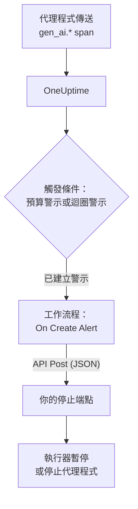

# AI 代理程式斷路器

AI 代理程式很少因為當機而失敗。它失敗的方式是停不下來：一再重試壞掉的工具、再次規劃同一個步驟，或啟動更多子代理程式，而每一輪都在耗用更多 token。本頁用 OneUptime 已有的元件為此打造一個斷路器：一個察覺失控代理程式的警示，以及一個呼叫你自己的端點來讓代理程式停下的工作流程。

:::cards
- [選擇觸發條件](#選擇觸發條件): 針對支出，或針對被一再呼叫的某個工具發出警示。
- [打造停止端點](#打造停止端點): 讓代理程式暫停的小型服務。
- [打造工作流程](#打造工作流程): 從新警示到呼叫你的端點。
- [測試斷路器](#測試斷路器): 先手動觸發，再在真實條件下觸發。
:::

## 運作方式



斷路器監看代理程式已經在傳送的 OpenTelemetry（直接傳送或 [透過閘道](/docs/telemetry/ai-gateways) 傳送），在請求路徑之外而不是之中發揮作用。它不會在每次模型呼叫上多加任何東西，更換供應商、SDK 或閘道也不會讓它失效。

代價是速度：它在幾分鐘內而不是幾毫秒內讓失控的代理程式停下。請在代理程式內部保留步驟上限和逾時，讓斷路器去攔下從它們之間漏掉的情況。

| 觸發條件 | 能發現什麼 | 發出警示所需時間 |
| --- | --- | --- |
| 來自指標監測器的預算警示 | 不論原因，持續上升的支出 | 最長 15 分鐘，再加上監測器約一分鐘 |
| 來自追蹤監測器的迴圈警示 | 被一再呼叫的同一個工具 | 1 到 5 分鐘 |

## 開始之前

- 代理程式正在把 GenAI span 傳送到 OneUptime。請參閱 [AI / LLM 可觀測性](/docs/telemetry/ai-llm-observability)。
- 一個可以暫停或停止代理程式執行器、且能從 OneUptime 連線的 HTTPS 端點。你會在 [打造停止端點](#打造停止端點) 中打造它。
- 在專案中建立監測器和工作流程的權限。

## 選擇觸發條件

兩種觸發條件的結局相同：監測器建立一個警示，新警示啟動工作流程。你可以兩種都設定，工作流程不在乎是哪一種觸發的。

### 預算警示

支出是代理程式失控最可靠的訊號。預算每 15 分鐘加總一次當天的 AI 支出，並以兩個指標發布：`oneuptime.llm.budget.spend.usd` 和 `oneuptime.llm.budget.percent.used`，每個指標都在 `oneuptime.llm.budget.id` 中帶有預算的 ID。

:::steps
1. 開啟 **產品 → AI / LLM → 預算** ，按一下 **建立LLM Cost Budget** 。設定 **每日預算（美元）** ，並在 **服務（選填）** 中選擇代理程式的服務，讓預算只監看這個代理程式。
2. 在新預算的列選單中選擇 **顯示 ID** ，複製該 ID。
3. 針對 `oneuptime.llm.budget.percent.used` 建立一個 [指標監控](/docs/monitor/metrics-monitor)，以屬性 `oneuptime.llm.budget.id` 等於複製的 ID 進行篩選，並把 **時間範圍** 設為 **Past 30 Minutes** 。
4. 新增一個會建立警示的條件 **Greater Than Or Equal To** `100`，並給它一個包含代理程式名稱的 **警示標題** ，例如 `LLM budget exceeded: support-bot`。工作流程和你的端點都會讀取這個標題。
:::

請依 ID 而不是名稱篩選：重新命名預算會重新命名它的序列，依舊名稱篩選的監測器會悄悄地不再符合。時間範圍請保持 30 分鐘：預算每 15 分鐘發布一個點，較短的範圍在兩個點之間什麼也找不到，警示就會反覆開啟又解決。

在 `80` 處再加一個嚴重程度較低的條件，可以在斷路器於 `100` 處觸發之前，先透過警示的待命策略提醒一個人。

### 迴圈警示

卡住的代理程式會留下可辨認的痕跡：同一個工具 span 一次又一次出現。正常的執行不會在幾分鐘內呼叫同一個工具數十次，所以計數能比預算更早發現迴圈。

:::steps
1. 開啟 **監測** ，按一下 **建立監測器** ，並在 **更多監測器類型** 下選擇 **追蹤** 。
2. 在 **更多欄位** 下，把 **依遙測服務篩選** 設為代理程式的服務，把 **依屬性篩選** 設為 `gen_ai.tool.name` 等於你預期它會反覆呼叫的工具，例如 `search_web`。如果你的檢測會以工具為各自的 span 命名，請改把該名稱填入 **Span 名稱** 。
3. 把 **監測 (time) 內的追蹤** 設為 **過去 5 分鐘** 。
4. 新增條件 **Span Count** **Greater Than** 一個正常執行在五分鐘內達不到的數字，例如 `50`，並讓它建立一個標題類似 `Agent loop: support-bot` 的警示。
:::

再加一個追蹤監測器，把 **依 Span 狀態篩選** 設為 **錯誤** 並使用較低的計數，就能發現重試風暴：一個不斷失敗的工具，和一個不斷重試它的代理程式。

## 打造停止端點

工作流程會向你執行的端點傳送帶有 JSON 內文的 `POST`。「停止」具體代表什麼由你決定。依影響由小到大：

| 動作 | 效果 |
| --- | --- |
| 停止新的工作 | 執行器不再為該代理程式啟動新的執行 |
| 取消它的執行 | 該代理程式進行中的執行會被取消 |
| 暫停整個集區 | 所有工作程序清空，直到有人重設斷路器 |

一個以 Express 撰寫、依代理程式觸發斷路的最小端點：

```typescript title="circuit-breaker.ts"
import express from "express";

const app = express();
app.use(express.json());

const tripped = new Set<string>(); // agents whose breaker is open

app.post("/circuit-breaker", (req, res) => {
  if (req.headers["authorization"] !== `Bearer ${process.env.KILL_TOKEN}`) {
    return res.status(401).end();
  }

  const alertTitle: string = req.body.alertTitle ?? "";

  // "LLM budget exceeded: support-bot" -> "support-bot"
  const agent: string = alertTitle.split(": ").pop() ?? "unknown";

  tripped.add(agent); // your run loop checks this set
  abortActiveRuns(agent); // cancel that agent's runs in flight

  // Answer fast; do the slow cleanup in the background.
  return res.status(200).json({ tripped: agent });
});
```

請依照這些規則打造它：

- 讓觸發保持冪等。一次預警加一次超限，或同時到來的預算警示和迴圈警示，都可能讓它觸發不只一次，而第二次觸發不能改變任何東西。
- 在一兩秒內回應，把清理工作放到背景進行。工作流程把任何 2xx 回應都視為成功。
- 要求提供密鑰。任何能呼叫該端點的人都能停掉你的代理程式，所以請驗證 bearer 權杖，工作流程會從一個機密全域變數傳送它。
- 手動重設。觸發後的斷路器會一直維持觸發狀態，直到有人檢視過這次執行：在 **產品 → AI / LLM → 對話** 下開啟代理程式的對話，閱讀或重播它做過的事。

請求從 OneUptime 發出。在 OneUptime Cloud 上，你的端點必須能從網際網路連線。自行託管的安裝會拒絕私人網路位址，除非管理員允許：請參閱 [輸出網路存取](/docs/workflows/configuration#對外網路存取)。

## 打造工作流程

先把端點的權杖存放在工作流程可以使用但不會顯示它的地方：開啟 **工作流程 → 全域變數** ，按一下 **建立工作流程 變數** ，命名為 `AGENT_KILL_TOKEN`，把權杖填入 **內容** ，並開啟 **密鑰** 。機密值會從執行記錄和步驟追蹤中被抹除。

:::steps
### 建立工作流程

開啟 **產品 → 工作流程** ，按一下 **建立工作流程** 。按一下 **從零開始** ，命名為 `AI agent circuit breaker`，再按一下 **建立工作流程** 。它會在 **建構器** 中以關閉狀態開啟。

### 新增觸發器

按一下虛線框 **Choose what starts this workflow** ，在 **Add Trigger** 面板中選擇 **On Create Alert** 。按一下觸發器，在 **Select Fields** 中勾選標題和描述，然後按一下 **儲存** 。區塊上的 ID `alert-on-create-1` 是後續區塊參照它的方式。

### 檢查標題

按一下 **新增元件** ，選擇 **If / Else** ，把觸發器的 **Success** 連接點連到它。把 **Value to check** 設為警示標題（按一下 **{ }** 後選擇它），把 **Comparison** 設為 **包含** ，把 **Compare with** 設為你的觸發條件標題共同的開頭，例如 `LLM budget exceeded`。

### 呼叫你的端點

新增 **API Post (JSON)** ，把 **If / Else** 的 **Yes** 連接點連到它。把它的 **URL** 設為你的端點，例如 `https://agents.example.com/circuit-breaker`，並填寫下方的標頭和內文。

### 回報失敗

新增 **Send Message to Slack** 或 **Send Email** ，把 API 區塊的 **Error** 連接點連到它。沒能觸發的斷路器，正是必須有人看到的那個警示。

### 開啟它

在 **建構器** 頂端開啟 **已啟用** 。
:::

API 區塊的 **Request Headers** ：

```json title="Request Headers"
{
  "Authorization": "Bearer {{global.variables.AGENT_KILL_TOKEN}}",
  "Content-Type": "application/json"
}
```

它的 **Request Body** ：

```json title="Request Body"
{
  "source": "oneuptime-circuit-breaker",
  "alertId": "{{local.components.alert-on-create-1.returnValues.model._id}}",
  "alertTitle": "{{local.components.alert-on-create-1.returnValues.model.title}}",
  "alertDescription": "{{local.components.alert-on-create-1.returnValues.model.description}}"
}
```

要對多個觸發條件做出反應，請讓它們的標題以相同方式開頭，或從 **No** 連接點串接更多 **If / Else** 區塊。畫布請參閱 [撰寫工作流程](/docs/workflows/authoring)，`{{…}}` 參照請參閱 [變數](/docs/workflows/variables)。

## 測試斷路器

:::steps
1. 手動觸發。開啟 **警示** ，按一下 **建立警示** ，建立一個標題為 `LLM budget exceeded: test` 的警示。執行會出現在 **工作流程 → 日誌 → 執行記錄** 下，你的端點會收到請求。
2. 在真實條件下觸發。在一個測試代理程式的服務上建立一個額度極小的預算，例如 `0.01` 美元，把一個預算監測器指向它，然後讓代理程式執行：百分比超過 100，警示開啟，工作流程執行，斷路器觸發。對於迴圈警示，請給測試代理程式一個總是失敗的工具。
3. 觸發兩次。再建立一次同樣的警示：你的端點必須在不改變任何東西的情況下接受第二次觸發。
:::

## 斷路器隨時間的行為

- 工作流程在警示建立時執行，所以一個觸發條件每個警示只觸發一次斷路器，而不是每次評估觸發一次。
- 預算以 UTC 日計算，所以百分比會在 UTC 午夜從 0 重新開始。屆時預算警示可能會解決，而下一個糟糕的日子會開啟新的警示，再次觸發斷路器。
- 只要條件仍然符合，監測器就會讓警示保持開啟。開啟 **自動解決警示** 後，條件不再符合時警示會解決，下一次超限會開啟新的警示。
- 重設在兩邊都由人決定：在 OneUptime 中解決警示，在你的執行器中重設斷路器。
- 專案中的每個新警示都會啟動工作流程。把其他警示擋在斷路器之外的正是 **If / Else** ：不要省略它。

## 疑難排解

:::details 工作流程沒有執行
檢查 **建構器** 頂端的 **已啟用** 是否已開啟：工作流程建立時處於關閉狀態。接著檢查警示是否是在你開啟工作流程之後建立的：觸發器只會為新警示啟動執行。
:::

:::details 工作流程有執行，但總是走 No 分支
標題是空的或不符合。觸發器的 **Select Fields** 中未勾選的欄位會以空值抵達，所以請勾選標題。然後把警示標題與 **Compare with** 比對：**包含** 必須能在其中找到完全相同的文字。
:::

:::details 你的端點回應 401
`Authorization` 標頭與你的端點預期的權杖不一致。檢查 `{{global.variables.AGENT_KILL_TOKEN}}` 中的名稱，以及全域變數中儲存的值。機密變數的值無法讀回，如有疑慮，請用 **Update Content** 重新輸入。
:::

:::details 預算警示反覆開啟又解決
監測器的 **時間範圍** 短於預算兩個點之間的 15 分鐘。請把它設為 **Past 30 Minutes** 。
:::

:::details 請求始終到不了你的端點
在 **工作流程 → 日誌 → 執行記錄** 下開啟這次執行，查看 **API Post (JSON)** 步驟：那裡寫明了請求失敗的原因。在 OneUptime Cloud 上，端點必須能從網際網路連線；自行託管的安裝會拒絕私人網路位址，除非管理員允許。
:::

## 後續步驟

:::cards
- [AI / LLM 可觀測性](/docs/telemetry/ai-llm-observability): 預算、成本，以及斷路器監看的 span。
- [追蹤監控](/docs/monitor/traces-monitor): span 篩選器和條件的詳細說明。
- [工作流程](/docs/workflows/index): 觸發器、元件、變數和執行。
- [AI 閘道](/docs/telemetry/ai-gateways): 讓所有代理程式的模型呼叫透過一個匯出傳送。
:::
