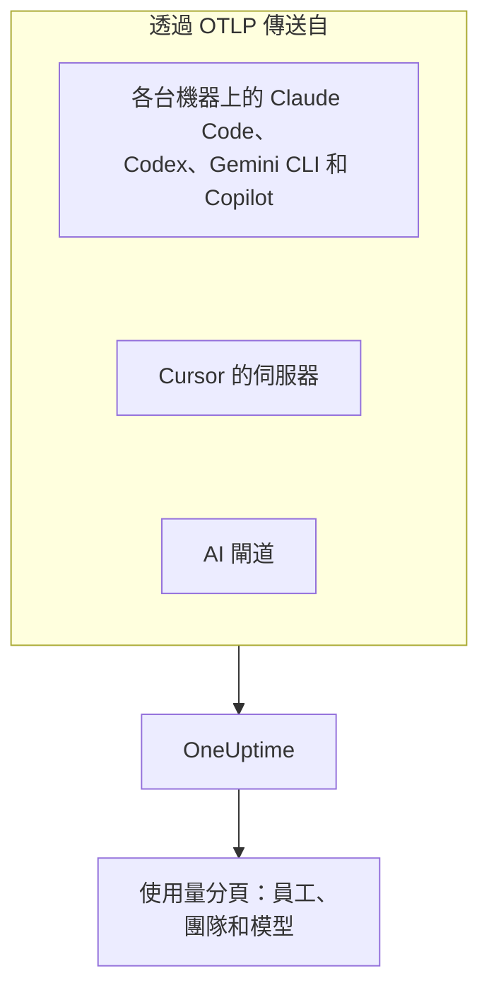

# AI 程式設計助理

你的工程師在使用 Claude Code、Cursor、Codex、Gemini CLI 和 Copilot，帳單持續成長。本頁回答管理者關心的問題： **誰在用哪個工具、用哪些模型，以及每個人和每個團隊花了多少錢** 。

大多數程式設計助理會自行匯出 OpenTelemetry，因此不需要在開發人員的機器上安裝任何東西：把匯出指向 OneUptime，token、成本和工具使用情況就會和你自己應用程式的 AI 呼叫放在一起。這裡的一切都透過 OpenTelemetry 抵達；OneUptime 不會輪詢任何廠商的管理或計費 API。

:::cards
- [支援矩陣](#支援矩陣): 每個工具傳送什麼，以及它是否指明某個人。
- [員工和團隊歸屬](#員工和團隊歸屬): 為支出標上姓名和團隊的鍵。
- [使用量分頁](#使用量分頁): 支出表格對程式設計助理能顯示什麼、不能顯示什麼。
- [從哪裡開始](#從哪裡開始): 第一天就能看到成果的導入順序。
:::

## 運作方式

每個工具都會用你的擷取金鑰把遙測傳送到 OneUptime 的 OTLP 端點：從每台開發人員機器、從廠商的伺服器（Cursor），或從你的模型流量經過的閘道。



## 開始之前

1. 在 **專案設定 → 遙測與 APM → 擷取金鑰** 下建立遙測擷取金鑰。
2. 你的 OTLP 端點是 `https://oneuptime.com/otlp`；如果你自行託管 OneUptime，則是 `https://YOUR-ONEUPTIME-HOST/otlp`。
3. 每次匯出都會在 `x-oneuptime-token` 標頭中傳送金鑰。

所有機器共用一把擷取金鑰就可以了。它會出現在每台開發人員機器上，因此請把它當作只能傳送資料的共用認證，並像其他認證一樣定期輪替。

## 支援矩陣

一個工具能給你什麼，取決於三件事：它是否傳送 OpenTelemetry、它的遙測如何抵達 OneUptime，以及其中是否有內容指明某個人。

| 工具 | 傳送什麼 | 如何抵達 OneUptime | 指明誰 | 指南 |
| --- | --- | --- | --- | --- |
| Claude Code | 指標和日誌；追蹤為搶先版 | 從每台機器；環境變數或受管設定檔 | 使用 Claude 帳號登入時為 `user.email` | [Claude Code](/docs/telemetry/claude-code) |
| Cursor | 指標和日誌 | 從 Cursor 的伺服器，在 Cursor 儀表板中設定一次；僅限 Enterprise 方案 | 整數 `cursor.user.id` | [Cursor](/docs/telemetry/cursor) |
| OpenAI Codex | 追蹤、指標和日誌，各自在 `~/.codex/config.toml` 中開啟 | 從每台機器，每種訊號一個完整 URL | span 和指標上不指明任何人：你需要在 `[otel.span_attributes]` 中自行設定 `user.id` 和 `user.email` | [OpenAI Codex](/docs/telemetry/openai-codex) |
| Gemini CLI | 追蹤、指標和日誌 | 從每台機器，通常經由本機 Collector | 登入時為 `user.email` | [Gemini CLI 與 GitHub Copilot](/docs/telemetry/gemini-cli-and-copilot) |
| GitHub Copilot | 追蹤、指標和日誌，僅來自其代理程式功能 | 從編輯器或代理程式主機 | 不指明任何人：你需要在每台機器上自行設定 `enduser.id` 和 `user.email` | [Gemini CLI 與 GitHub Copilot](/docs/telemetry/gemini-cli-and-copilot) |
| Cline | 指標和日誌 | 在 Cline 的組織儀表板中集中設定 | 匿名化的 `user_id` | — |
| LiteLLM 和 Portkey | 經過閘道的每次呼叫的追蹤 | 從閘道處理程序 | 使用 LiteLLM 時為虛擬金鑰的擁有者 | [AI 閘道](/docs/telemetry/ai-gateways) |
| 你自己的應用程式 | 你的 GenAI 檢測傳送的內容 | 從你的應用程式 | 你設定為 `user.id` 的人 | [AI / LLM 可觀測性](/docs/telemetry/ai-llm-observability) |
| Windsurf、JetBrains AI、Amazon Bedrock、Azure OpenAI | 沒有自己的 OpenTelemetry | 只能經由你放在前面的閘道 | 閘道指明的人 | [AI 閘道](/docs/telemetry/ai-gateways) |

破折號表示 OneUptime 還沒有該工具的指南。它的遙測仍會像其他 OpenTelemetry 一樣被擷取。

:::details GitHub Copilot 究竟匯出什麼
Copilot 只從其代理程式功能匯出 OpenTelemetry：VS Code 的聊天和代理程式模式、Copilot CLI 背後的代理程式主機、Copilot SDK，以及透過 Copilot 外掛程式在 JetBrains IDE 中執行的代理程式工作流程。對於內嵌完成、github.com 上的 Copilot 和 Copilot 程式碼審查，GitHub 沒有記載任何匯出。Copilot 不會傳送任何使用者屬性，因此請透過 `resourceAttributes` 或 `OTEL_RESOURCE_ATTRIBUTES` 為每台機器設定 `enduser.id` 和 `user.email`。
:::

:::details Amazon Bedrock、Azure OpenAI、Windsurf 和 JetBrains AI
- **Amazon Bedrock** ：`InvokeModel` 和 `Converse` API 不會傳送 OpenTelemetry。Bedrock AgentCore 則不同：AWS 為它記載了指標、span 和日誌，預設傳送到 CloudWatch。設定 `DISABLE_ADOT_OBSERVABILITY=true` 會關閉執行階段的預設 ADOT 設定，這樣你就能把 ADOT SDK 指向 OneUptime。
- **Azure OpenAI** ：該服務不會傳送任何內容，其 Azure Monitor 指標也沒有使用者維度。請檢測用戶端，或在前面放置 API Management 或其他閘道。
- **Windsurf** ：沒有記載任何遙測匯出。依使用者區分的資料位於 Windsurf 的 Enterprise API 中，OneUptime 不會輪詢它。
- **JetBrains AI Assistant 和 Junie** ：不匯出使用量。JetBrains 的 OpenTelemetry 外掛程式是在 IDE 內接收你自己應用程式的遙測；它不會向外傳送任何內容。
:::

## 員工和團隊歸屬

遙測抵達時，OneUptime 會把發起呼叫的人及其團隊複製到欄位中，因此 **使用量** 分頁不需要屬性篩選就能為人員和團隊排名。

### 讀取為員工的屬性

在 span 上，會依下列順序由第一個出現的鍵勝出：

| 欄位 | 鍵（優先者在前） |
| --- | --- |
| 員工 ID | `user.id`、`enduser.id`、`litellm.metadata.user_api_key_user_id`、`metadata.user_api_key_user_id`、`traceloop.association.properties.user_id`、`langfuse.user.id`、`user.account_uuid`、`user.account_id`、`cursor.user.id` |
| 員工電子郵件 | `user.email`、`litellm.metadata.user_api_key_user_email`、`metadata.user_api_key_user_email`、`traceloop.association.properties.user_email`、`enduser.email` |
| 團隊 / 成本中心 | `team.id`、`team`、`cost_center`、`department`、`litellm.metadata.user_api_key_team_id`、`litellm.team.id`、`metadata.user_api_key_team_id`、`cursor.team.id` |

在指標資料點上，清單較短，並從電子郵件開始，因為傳送指標的程式設計助理會自行傳送 `user.email`：

| 欄位 | 鍵（優先者在前） |
| --- | --- |
| 員工 | `user.email`、`user.id`、`user.account_uuid`、`user.account_id`、`cursor.user.id` |
| 團隊 / 成本中心 | `team.id`、`team`、`cost_center`、`department`、`cursor.team.id` |
| 模型 | `gen_ai.request.model`、`model`、`cursor.model.name` |

這些鍵的讀取方式：

- **每個鍵也會以 `resource.` 前置詞形式讀取。** OTLP 擷取會把資源屬性存放在該前置詞下，因此 `OTEL_RESOURCE_ATTRIBUTES=team.id=platform` 會以 `resource.team.id` 的形式抵達。不帶前置詞的鍵會優先嘗試，因此 span 上的值勝過整個處理程序上的值。
- **呼叫有電子郵件時，使用量分頁會顯示人員的電子郵件，否則顯示 ID。** 顯示相同電子郵件的資料列會合併，因此一位工程師使用兩台機器也只占一列。
- **只會從 AI 呼叫讀取身分。** `user.id`、`user.email` 和 `team.id` 是瀏覽器和後端 span 也會攜帶的通用鍵；只有已被辨識為 AI 呼叫的 span 才會填入這些欄位。
- **不會從日誌記錄讀取身分。** 這對 Codex 很重要，因為它只在日誌上放置 `user.email`。
- LiteLLM 以兩種方式書寫這些鍵：其預設的 `otel` 回呼使用 `metadata.` 前置詞，而可選用的 OpenTelemetry v2 模式（`LITELLM_OTEL_V2=true`）使用 `litellm.` 命名空間。OneUptime 兩者都會讀取，因此標準 Proxy 不需要額外設定即可運作。

### 團隊和成本中心

沒有任何檢測會傳送 `team.id`、`team`、`cost_center` 或 `department`：這些由你的組織設定，通常透過工具處理程序上的 `OTEL_RESOURCE_ATTRIBUTES`。

```bash
export OTEL_RESOURCE_ATTRIBUTES="team.id=platform,team=Platform_Engineering,cost_center=eng-123,department=engineering"
```

請在你已經佈建開發人員機器的地方設定：MDM 設定檔、受管設定檔或 dotfiles 中的 shell 設定檔。值中不能包含空格：請使用底線，或 `%20` 這類百分比編碼。Codex 沒有資源屬性，因此請改為在它的 `[otel.span_attributes]` 中設定相同的鍵。

若要依應用程式區分支出，請使用服務名稱（`OTEL_SERVICE_NAME`，或工具自己的設定）。 **應用程式 / 服務** 細分只涵蓋傳送 GenAI span 的工具。

### 刻意不視為員工的內容

一次呼叫可能涉及兩個不同的人：發起呼叫的員工，以及呼叫所服務的客戶。下列鍵代表客戶，OneUptime 絕不會把它們讀入身分欄位：

- `gen_ai.user` 和 `llm.user`：檢測對 OpenAI 要求參數 `user` 的回傳，OpenAI 將其描述為你的終端使用者的識別碼。
- `litellm.metadata.user_api_key_end_user_id`、`metadata.user_api_key_end_user_id` 和 `litellm.end_user.id`：LiteLLM 的終端使用者，與身為員工的金鑰擁有者不同。

如果把客戶 ID 當作員工讀取，一個服務 40,000 名客戶的支援機器人就會變成 40,000 名虛構的員工，而真正負責這筆支出的工程師看起來卻什麼都沒花。這些鍵會保留在 span 的屬性中，追蹤檢視器的 **LLM** 分頁會把它們顯示為終端使用者。

### 隱私

員工電子郵件欄包含個人資料。追蹤的 **清理規則** 對這一欄的作用與對其來源屬性完全相同，因此遮罩電子郵件的規則也會遮罩這一欄。你可以在 **追蹤 → 設定** 下找到它們。

## OneUptime 讀取的程式設計助理指標

程式設計助理以自己的前置詞而不是 `gen_ai.*` 命名指標，因此 OneUptime 會依名稱辨識每一個：

| 指標 | 工具 | 單位 |
| --- | --- | --- |
| `claude_code.token.usage` | Claude Code | token |
| `claude_code.cost.usage` | Claude Code | USD |
| `cursor.token.usage` | Cursor | token |
| `cursor.cost.usage` | Cursor | USD，Cursor 自己的估算 |
| `codex.turn.token_usage` | OpenAI Codex | token |
| `codex.turn.cost_microusd` | OpenAI Codex | 百萬分之一美元：OneUptime 會換算，所以請勿自行換算 |

OneUptime 也會從 `gen_ai.client.token.usage`、`gen_ai.client.token.count`、`llm.token.usage` 和 `llm.usage.tokens` 讀取 token，從 `gen_ai.client.cost`、`gen_ai.client.cost.usd`、`gen_ai.usage.cost`、`litellm_spend_metric` 和 `litellm.cost.total` 讀取成本。

閱讀數字之前需要了解兩點：

- **刻意不讀取 `gemini_cli.token.usage`。** Gemini CLI 會把 token 傳送兩次，一次作為自己的指標，一次作為 `gen_ai.client.token.usage`，同時讀取會使其加倍。它的 token 只透過 `gen_ai.client.token.usage` 計算一次。Gemini CLI 不會傳送成本指標：請開啟它的追蹤，讓每次呼叫都能計價。
- **只計算輸入和輸出 token。** token 類型會從 `gen_ai.token.type`、`llm.token.type`、`type`、`cursor.token.type` 或 `token_type` 讀取，只計算 `input` 和 `output`（或舊的 `prompt` 和 `completion`）。快取讀寫、Codex 的 `total`（重複了其他值）和 `reasoning_output`（`output` 的一部分）都不計入，因此來自指標的總數會小於工具傳送的所有值之和。

## 使用量分頁

開啟 **產品 → AI / LLM** ，進入 **使用量** 。它會依支出為 **員工** 、 **團隊** 、 **模型** 、 **提供者** 和 **應用程式 / 服務** 排名，除非你另外選擇時間範圍，否則為最近 7 天。沒有指明任何人的呼叫會計入 **未歸屬** ：如果 **未歸屬** 這一列很大，代表有工具仍需設定身分。

### 程式設計助理指標是備援，而不是附加

GenAI span 優先：只有對 span 沒有回報的數字才會讀取指標，兩者絕不相加（ [原因](/docs/telemetry/ai-llm-observability#span-優先指標補充) ）。對程式設計助理來說，這有一個直接的後果： **如果同一個專案接收帶有成本的 GenAI span，程式設計助理的支出就不會顯示。** 請為程式設計助理另外準備一個專案，並使用它自己的擷取金鑰。

備援生效時，對於只傳送指標的工具，每種細分能顯示的內容如下：

| 細分 | 來自指標 |
| --- | --- |
| **員工** | 是，來自上方的每個身分鍵，包括不帶前置詞和帶 `resource.` 前置詞的形式 |
| **團隊** | 是，來自團隊鍵 |
| **模型** | 是：Claude Code 和 Codex 傳送不帶前置詞的 `model`，Cursor 傳送 `cursor.model.name` |
| **提供者** | 否：程式設計助理的指標不指明提供者 |
| **應用程式 / 服務** | 否：它們的指標不屬於任何 OneUptime 服務 |

從指標讀取的資料列只攜帶成本：其呼叫和 token 儲存格顯示 `—`，因為支出計數器沒有逐次呼叫的細節，而在那裡顯示 0 就等於聲稱此人沒有發起任何呼叫。該表格會標示 **來自 GenAI 指標** 。

## 沒有 OpenTelemetry？在前面放一個閘道

對於 Windsurf、JetBrains AI、Bedrock 模型 API、Azure OpenAI 以及其他沒有自己匯出功能的工具，請在前面放置 AI 閘道。這樣每次呼叫都會經過一個傳送 OpenTelemetry 的處理程序，你只需設定一次匯出。

**為每位員工使用一把虛擬金鑰來執行 LiteLLM。** LiteLLM 會在每個 span 上標註金鑰擁有者的 ID 和電子郵件，OneUptime 將其讀取為員工，並把金鑰的團隊讀取為團隊。它也會依你在 Proxy 上設定的自訂費率自行為每次呼叫計價，它回報的成本優先於 OneUptime 的估算。請不要為此使用它的終端使用者 ID：那是客戶。設定方式請參閱 [AI 閘道](/docs/telemetry/ai-gateways)。

圍繞閘道進行規劃之前，有兩個限制：

- **閘道只能看到經過它的流量。** Cursor 自己的基礎 URL 覆寫是依使用者的設定，只涵蓋聊天模型（Tab 完成仍使用 Cursor 的模型），因此請優先使用 Cursor 的原生匯出。
- **閘道看到的是模型呼叫，而不是代理程式。** 它會記錄提示和回答，但不會記錄工具自身遙測所回報的工具呼叫、檔案編輯，以及接受或拒絕的決定。

## 提示內容：各工具的預設值不同

提示和回答是這條管線中風險最高的資料：其中經常包含原始碼、客戶資料和貼上的認證。請檢查每個工具的預設值：

| 工具 | 預設是否包含提示內容 |
| --- | --- |
| Claude Code | 關閉：每種內容都有自己的開啟變數 |
| Cursor | 關閉：只有可選用的 `conversation_content` 系列會傳送訊息文字 |
| OpenAI Codex | 關閉：`log_user_prompt` 預設為 `false` |
| Gemini CLI | **開啟** ：`logPrompts` 預設為 `true`，因此開啟遙測時請把它設為 `false` |
| GitHub Copilot | 關閉：`captureContent`，受管設定可以用 `lockCaptureContent` 鎖定 |
| LiteLLM | 使用預設的 `otel` 回呼時開啟（用 `turn_off_message_logging` 關閉）；在 OpenTelemetry v2 模式下關閉 |

Codex 預設也會把它的指標傳送給 OpenAI：請參閱 [OpenAI Codex](/docs/telemetry/openai-codex)。在你刻意擷取內容的地方，追蹤的 **清理規則** 和 **捨棄過濾器** 會像對其他遙測一樣對其生效。

## OneUptime 尚未做到的事

- **沒有廠商管理或計費連接器。** OneUptime 不會輪詢 Anthropic 的 Admin API、Cursor 的 Admin API、OpenAI 的使用量和成本端點、GitHub 的 Copilot 計費，也不會輪詢 Windsurf 或 JetBrains 的 API。需要與帳單一致的數字時，請向廠商取得。
- **除非工具回報，否則成本是估算值。** 回報的成本會原樣使用；否則 OneUptime 會依牌價為 token 計價。Cursor 的 `cursor.cost.usage` 本身就是估算值。
- **不會讀取日誌記錄上的身分。** Codex 只在日誌上傳送的 `user.email` 不會與支出關聯。
- **尚未讀取 Cursor 的 `cursor.user.email`** ，因此 Cursor 使用者會顯示為其整數 `cursor.user.id`。
- **Codex 的 span 不指明模型** ，因此 OneUptime 無法為其計價：Codex 會顯示依人員的 token，其成本只出現在總數中。
- **工具變化很快。** 如果本頁說某個工具沒有匯出功能，請在圍繞閘道進行建置之前查看其最新文件。

## 從哪裡開始

依下列順序導入；每一步本身都有用。請使用尚未從你自己的應用程式接收 GenAI span 的專案，否則 [備援規則](#程式設計助理指標是備援而不是附加) 會讓程式設計助理的支出無法顯示在頁面上。

1. **Gemini CLI** ，如果有人在用的話。它不需要設定就會傳送 `user.email`，因此能展示端對端的歸屬效果。也請開啟它的追蹤：它不會傳送成本指標。
2. **Claude Code** ：為所有機器準備一個受管設定檔，免費取得 `user.email`、真正的成本指標，以及依開發人員劃分的接受率、提交、提取要求和程式碼行數。
3. **Cursor** ，使用 Enterprise 方案：在 Cursor 儀表板中設定一個畫面，不必動到任何開發人員機器，不過人員會以整數形式抵達。
4. **Copilot 和 Codex** ，兩者都需要在每台機器上設定身分。請在佈建機器時完成：沒有身分就抵達的呼叫，事後無法歸屬。
5. **LiteLLM 閘道** ，用於其他所有工具，每位員工一把虛擬金鑰。

## 後續步驟

:::cards
- [Claude Code](/docs/telemetry/claude-code): 為一台機器或所有機器開啟 Claude Code 的匯出。
- [Cursor](/docs/telemetry/cursor): 從 Cursor 儀表板傳送 Cursor 的團隊遙測。
- [OpenAI Codex](/docs/telemetry/openai-codex): 設定 Codex 的三個匯出器，並在其 span 上標註身分。
- [AI / LLM 可觀測性](/docs/telemetry/ai-llm-observability): 每次 AI 呼叫的對話、警示、成本和預算。
:::
