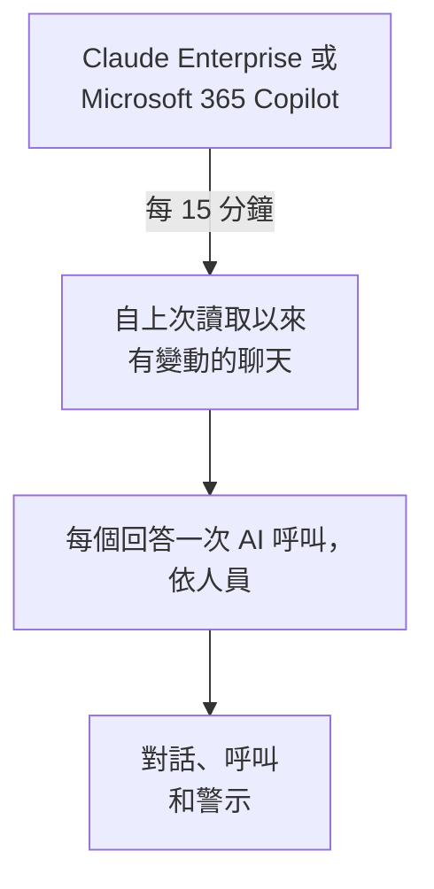

# 公司的 AI 工具

以依人員劃分的對話形式，查看你的員工向公司付費的 AI 工具問了什麼。用只能讀取的憑證連線 Claude Enterprise 或 Microsoft 365 Copilot，OneUptime 就會每 15 分鐘把每個新聊天匯入 **對話** 。除非你另行選擇，否則只有專案擁有者和管理員可以閱讀。

:::cards
- [先告知你的員工](#先告知你的員工): 他們的聊天是他們自己的話。
- [連線工具](#連線工具): 貼上憑證，選擇誰可以閱讀，測試後連線。
- [隱私](#隱私): 誰可以閱讀對話，以及是否保留所寫內容。
- [其他 AI 工具](#其他-ai-工具): ChatGPT Enterprise、Gemini、Open WebUI、LibreChat 和程式設計助理。
:::

## 先告知你的員工

> [!IMPORTANT]
> 這些是你的員工自己寫下的話。在連線工具之前，請告訴他們與該工具的聊天會被保留以及誰可以閱讀，並與法務或人資團隊確認你們的政策和當地法律有何要求。

## 運作方式

OneUptime 每 15 分鐘向工具要求自上次讀取以來有變動的聊天。每個回答都會成為提問者的一次 AI 呼叫，並附上自上一個回答以來提出的問題；每個聊天成為一個對話。

聊天與你應用程式的 AI 呼叫以相同方式抵達，因此清除規則、捨棄篩選器、保留期和 AI 警示都適用於它們。這些工具按席次付費，因此這些呼叫沒有 token，也沒有成本。一個問題如果一小時沒有回答，會單獨匯入，這樣 AI 從未回答的聊天也會顯示。

## 開始之前

- Project Owner 或 Project Admin 角色。只有他們可以連線、修改或移除工具。
- 負責建立憑證的工具管理員：下方每個工具的段落會說明是誰。
- 已告知你的員工，並已取得法務或人資團隊的答覆。

## 連線工具

:::steps
### 開啟連線

開啟 **產品 → AI / LLM → 連線** 。在 **公司的 AI 工具** 中點選工具的圖塊。

### 貼上憑證

在 **憑證** 中填寫工具要求的內容。密鑰會加密儲存，之後不會再顯示。

### 選擇誰可以閱讀

在 **隱私** 中依 [隱私](#隱私) 的說明設定 **誰可以閱讀對話** 和 **保留所寫內容** 。

### 測試

在 **測試** 中點選 **測試連線** 。OneUptime 只統計最近 7 天的聊天數量：不會讀取、顯示或保留任何人寫的內容。

### 連線

點選 **連線** 。第一次讀取會在一分鐘內開始，並匯入最近 7 天的資料。
:::

## Claude Enterprise

OneUptime 透過 Compliance API 讀取你組織的每個 claude.ai 聊天：誰提問、向 Claude 問了什麼、Claude 如何回答，以及使用了哪個模型。收到新訊息的聊天會被重新讀取，已經匯入的回答會被辨識並略過。

:::steps
### 開啟 Compliance API

你組織的主要擁有者在 claude.ai 中開啟 Organization settings、API，並開啟 Compliance API。

### 建立合規存取金鑰

在同一處建立一個具有 `read:compliance_user_data` 範圍的金鑰。它以 `sk-ant-api01-` 開頭。

### 連線 Claude Enterprise

把金鑰貼到 **合規存取金鑰** 中。
:::

## Microsoft 365 Copilot

OneUptime 從 Microsoft Graph 讀取每個人的 Copilot 互動記錄：他們在 Teams、Outlook、Word、Excel、PowerPoint、Loop 或 Copilot Chat 中向 Copilot 問了什麼、得到什麼回答，以及在哪個應用程式中。一個提示詞和它的回答成為一次 AI 呼叫，一個 Copilot 工作階段成為一個對話。大型租用戶會分批讀取，並從上次讀取停止的地方繼續。

:::steps
### 註冊應用程式

在 Microsoft Entra ID 中註冊一個應用程式，並為它建立用戶端密碼。

### 授與權限

為該應用程式授與 Microsoft Graph 的 `AiEnterpriseInteraction.Read.All` 和 `User.Read.All` 應用程式權限，並授與管理員同意。

### 連線 Copilot

填寫 **目錄（租用戶）ID** 、 **應用程式（用戶端）ID** 和 **用戶端密碼** 。如果只讀取部分人員，請在 **更多欄位** 中的 **僅限此群組中的人員** 填入某個群組的物件 ID，並同時為應用程式授與 `GroupMember.Read.All`。若是 Azure Government，請在同一處修改 **雲端** 。
:::

## 隱私

| 設定 | 作用 |
| --- | --- |
| **誰可以閱讀對話** | **專案擁有者與管理員** （預設）：專案中的其他人在 OneUptime 的任何地方都看不到這些對話，也看不到組成它們的 AI 呼叫。 **所有可以讀取 AI 呼叫的人** ：所有可以讀取專案追蹤的人。 |
| **保留所寫內容** | 開啟（預設）：保留問題和回答。關閉：OneUptime 保留提問者、時間、模型和所用應用程式，但不保留所寫內容。 |

對誰可以閱讀的變更會在一分鐘內生效。關閉 **保留所寫內容** 只影響之後讀取的聊天；之前保留的內容會一直保留到其保留期結束。

如果要保留所寫內容但遮蔽其中一部分，例如電子郵件地址或卡號，請使用 **追蹤 → 設定** 中的 **清理規則** ：它們在任何內容儲存之前生效。對話的保留時間與該連線的服務保留其追蹤的時間相同：請參閱 [資料保留](/docs/telemetry/data-retention)。移除連線會停止它的讀取；它讀取過的內容仍然只對同樣的人可讀，直到保留期結束。

## 其他 AI 工具

這些工具沒有 OneUptime 可用來讀取員工聊天的 API，或者需要其他途徑。

### ChatGPT Enterprise

OpenAI 只會應要求為工作區開放其 Compliance API，且沒有公開其記錄包含哪些內容，因此 OneUptime 目前還無法讀取 ChatGPT Enterprise 的聊天。把你的 OpenAI 組織作為 [提供者帳戶](/docs/telemetry/ai-provider-accounts#openai) 連線，可以看到它的 API 使用量和成本，但其中不包含 ChatGPT。

### Gemini for Google Workspace

Google 沒有提供讀取員工 Gemini 聊天的 API。Google Vault 會為電子蒐證保留這些聊天。

### 程式設計助理

Claude Code、Codex、Gemini CLI、GitHub Copilot 和 Cursor 會傳送自己的 OpenTelemetry：請參閱 [AI 程式設計助理](/docs/telemetry/ai-coding-assistants)。

### Open WebUI 和 LibreChat

自行託管的聊天應用程式透過你設定的 API 呼叫模型。在模型前面放一個 LiteLLM 代理伺服器，並依 [AI 閘道](/docs/telemetry/ai-gateways#litellm-proxy) 的說明把它的追蹤傳送到 OneUptime：每個聊天的提示詞和回答都會作為 AI 呼叫抵達。每人一個虛擬金鑰可以說明是誰提問；所有人共用的金鑰則說明不了任何人。Open WebUI 內建的 OpenTelemetry 匯出追蹤的是它的 Web 請求和資料庫呼叫，而不是聊天。

## 疑難排解

:::details 測試找不到任何聊天
最近 7 天沒有人使用該工具，或者憑證屬於另一個組織或租用戶。若是 Copilot，請檢查 **僅限此群組中的人員** 中的群組是否就是你想要的群組。
:::

:::details 憑證有效，但無法讀取連線所需的內容
若是 Copilot，請為應用程式的 Graph 權限授與管理員同意；指定群組時還要授與 `GroupMember.Read.All`。若是 Claude Enterprise，請使用 `read:compliance_user_data` 範圍建立金鑰。
:::

:::details 有人看不到對話
**誰可以閱讀對話** 設定為 **專案擁有者與管理員** 。擁有者或管理員可以在連線所在列中用 **編輯** 修改。
:::

:::details 對話顯示了提問者，但沒有內容
讀取時 **保留所寫內容** 處於關閉狀態。開啟後只影響之後讀取的聊天。
:::

## 後續步驟

:::cards
- [AI / LLM 可觀測性](/docs/telemetry/ai-llm-observability): 閱讀和重新播放對話，並在回答出問題時收到通知。
- [AI 提供者帳戶](/docs/telemetry/ai-provider-accounts): 你的 OpenAI、Anthropic、Azure、Bedrock 和 Vertex AI 帳戶的使用量和成本。
- [AI 程式設計助理](/docs/telemetry/ai-coding-assistants): 程式設計工具上每位工程師的支出。
- [資料保留](/docs/telemetry/data-retention): 對話會保留多久。
:::
