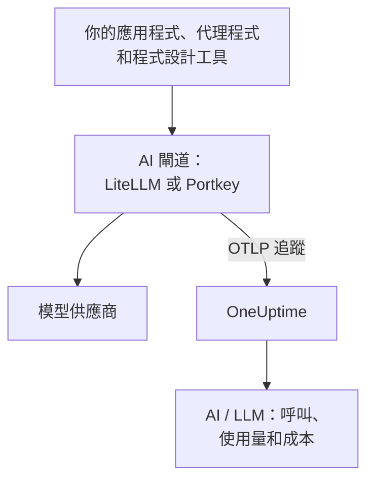

# AI 閘道(LiteLLM、Portkey)

AI 閘道位於你的應用程式和模型供應商之間，所以每次模型呼叫都會經過它。把閘道的 OpenTelemetry 傳送到 OneUptime 一次，它背後的每次呼叫都會帶著模型、token、成本，以及（除非你關閉）提示和回答抵達 [AI / LLM](/docs/telemetry/ai-llm-observability)，不需要逐一為應用程式加上檢測。

:::cards
- [LiteLLM Proxy](#litellm-proxy): 內建匯出，用三個變數完成設定。
- [誰花了什麼](#每位員工一把虛擬金鑰): 每位員工一把 LiteLLM 虛擬金鑰，就能辨識每個人。
- [Portkey](#portkey): 自行託管的閘道有內建匯出；其他情況請為應用程式加上檢測。
- [檢查呼叫是否抵達](#檢查呼叫是否抵達): 你應該看到什麼，看不到時該怎麼辦。
:::

## 運作方式



| | LiteLLM Proxy | Portkey（自行託管或 Enterprise） | Portkey（開放原始碼或託管版） |
| --- | --- | --- | --- |
| 匯出到 OneUptime | 內建 | 內建，實驗性 | 無：改為替應用程式加上檢測 |
| 要設定的端點 | `https://oneuptime.com/otlp/v1/traces` | `https://oneuptime.com/otlp` | 應用程式自己的匯出工具 |
| 能辨識每個人 | 能，每位員工一把虛擬金鑰 | 不能 | 只有應用程式傳送的內容 |
| 提示和回答 | 傳送，除非你關閉 | 一律傳送 | 取決於檢測 |

## 開始之前

- 一把擷取金鑰：開啟 **專案設定 → 遙測與 APM → 擷取金鑰** ，按一下 **建立擷取金鑰** 。
- 你的 OTLP 基礎 URL：`https://oneuptime.com/otlp`，如果你自行託管 OneUptime，則為 `https://YOUR-ONEUPTIME-HOST/otlp`。OneUptime 接受透過 HTTP 的 OTLP，protobuf 和 JSON 皆可。
- 金鑰透過每個匯出請求的 `x-oneuptime-token` 標頭傳遞。

## LiteLLM Proxy

LiteLLM 的 OpenTelemetry 回呼是開放原始碼 Proxy 的一部分，官方 Docker 映像檔（`ghcr.io/berriai/litellm`）已包含它所需的套件。

:::steps
### 開啟 otel 回呼

在 Proxy 的 `config.yaml` 中把 `otel` 加入回呼：

```yaml title="config.yaml"
model_list:
  - model_name: gpt-4o
    litellm_params:
      model: openai/gpt-4o
      api_key: os.environ/OPENAI_API_KEY

litellm_settings:
  callbacks: ["otel"]
```

### 讓匯出工具指向 OneUptime

在 Proxy 上設定三個變數：

```bash
export OTEL_EXPORTER="otlp_http"
export OTEL_ENDPOINT="https://oneuptime.com/otlp/v1/traces"
export OTEL_HEADERS="x-oneuptime-token=YOUR_INGESTION_TOKEN"
```

### 啟動 Proxy

:::tabs
@tab Docker
```bash
docker run \
  -v $(pwd)/config.yaml:/app/config.yaml \
  -e OPENAI_API_KEY="sk-..." \
  -e OTEL_EXPORTER="otlp_http" \
  -e OTEL_ENDPOINT="https://oneuptime.com/otlp/v1/traces" \
  -e OTEL_HEADERS="x-oneuptime-token=YOUR_INGESTION_TOKEN" \
  -e OTEL_SERVICE_NAME="litellm-gateway" \
  -p 4000:4000 \
  ghcr.io/berriai/litellm:main-stable \
  --config /app/config.yaml
```
@tab pip
```bash
pip install 'litellm[proxy]' opentelemetry-api opentelemetry-sdk opentelemetry-exporter-otlp
litellm --config config.yaml
```
:::

單獨安裝 `litellm[proxy]` 不包含 OpenTelemetry 套件，所以請一併安裝。

### 透過它傳送一個請求

呼叫一次 Proxy，然後依照 [檢查呼叫是否抵達](#檢查呼叫是否抵達) 中的說明檢查 AI / LLM。
:::

| 變數 | 值 | 說明 |
| --- | --- | --- |
| `OTEL_EXPORTER` | `otlp_http` | 也會以 `OTEL_EXPORTER_OTLP_PROTOCOL` 讀取 |
| `OTEL_ENDPOINT` | `https://oneuptime.com/otlp/v1/traces` | 完整路徑 `/v1/traces` 適用於所有 LiteLLM 版本；也會以 `OTEL_EXPORTER_OTLP_ENDPOINT` 讀取 |
| `OTEL_HEADERS` | `x-oneuptime-token=YOUR_INGESTION_TOKEN` | 以逗號分隔的 `key=value` 配對；也會以 `OTEL_EXPORTER_OTLP_HEADERS` 讀取 |
| `OTEL_SERVICE_NAME` | 你的閘道名稱 | 呼叫顯示在其下的服務；未設定時為 `litellm` |

### LiteLLM 傳送的內容

每次呼叫都帶有 `gen_ai.system`、`gen_ai.request.model`、`gen_ai.response.model`、`gen_ai.usage.input_tokens` 和 `gen_ai.usage.output_tokens`，以及它的參數、提示和回答：OneUptime [讀取這次呼叫](/docs/telemetry/ai-llm-observability) 所需的一切。

從 LiteLLM 1.81 起，這些屬性位於請求的 `Received Proxy Server Request` span 上，不再有獨立的 `litellm_request` span。當一個請求進行多次模型呼叫時，每次呼叫都會在那裡覆寫前一次呼叫的屬性，所以請設定 `USE_OTEL_LITELLM_REQUEST_SPAN=true`，讓每次呼叫都有一個 `litellm_request` span。

LiteLLM 會自己為每次呼叫計價，包括你在 Proxy 上設定的自訂費率，並以 `gen_ai.cost.total_cost` 回報價格。OneUptime 會優先使用回報的價格而不是自己的估算，只有在 LiteLLM 無法為呼叫計價時（例如沒有設定價格的自訂模型），才會 [依 token 估算](/docs/telemetry/ai-llm-observability)。

### 每位員工一把虛擬金鑰

給每個人一把自己的 LiteLLM 虛擬金鑰，他們發出的每次呼叫抵達時都會帶著身分。LiteLLM 會把金鑰擁有者的 ID、電子郵件和團隊寫到 span 上，OneUptime 把它們讀作員工和團隊，所以 **使用量** 分頁不需要在每個人的電腦上做任何設定，就能依人排出支出。

虛擬金鑰需要 Proxy 上有資料庫和主金鑰（`DATABASE_URL` 和 `LITELLM_MASTER_KEY`）。先用電子郵件建立使用者，再為該使用者建立金鑰：

```bash
curl -X POST "http://localhost:4000/user/new" \
  -H "Authorization: Bearer YOUR_MASTER_KEY" \
  -H "Content-Type: application/json" \
  -d '{"user_email": "alice@example.com"}'

curl -X POST "http://localhost:4000/key/generate" \
  -H "Authorization: Bearer YOUR_MASTER_KEY" \
  -H "Content-Type: application/json" \
  -d '{"user_id": "USER_ID_FROM_THE_FIRST_CALL", "team_id": "platform"}'
```

| LiteLLM 的 span 屬性 | OneUptime 將其讀作 |
| --- | --- |
| `metadata.user_api_key_user_id` | 員工的 ID |
| `metadata.user_api_key_user_email` | 員工的電子郵件 |
| `metadata.user_api_key_team_id` | 團隊 |
| `metadata.user_api_key_end_user_id` | 絕不讀作員工：這是你的應用程式為它自己的客戶傳送的 `user` |

在 LiteLLM 的 OpenTelemetry v2 模式中，同樣的值會帶著 `litellm.` 前置詞抵達（`litellm.metadata.user_api_key_user_email` 等），OneUptime 也會讀取它們。

### 不傳送提示

`otel` 回呼預設會傳送完整的提示和回答。若不想傳送，請使用下列其中一個選項：

:::tabs
@tab 所有回呼
```yaml title="config.yaml"
litellm_settings:
  callbacks: ["otel"]
  turn_off_message_logging: true
```
@tab 僅 OTel 回呼
```yaml title="config.yaml"
litellm_settings:
  callbacks: ["otel"]

callback_settings:
  otel:
    message_logging: False
```
@tab 環境變數
```bash
export OTEL_INSTRUMENTATION_GENAI_CAPTURE_MESSAGE_CONTENT="NO_CONTENT"
```
:::

`callback_settings` 是最上層的鍵，不是 `litellm_settings` 下的鍵。若要保留提示但遮蔽其中一部分，請改用 **追蹤 → 設定** 下的清除規則。

:::details LiteLLM 的 OpenTelemetry v2 模式
較新的 LiteLLM 版本有一個選用的 OpenTelemetry v2 模式（`LITELLM_OTEL_V2=true`，不需修改 `config.yaml`）。它為每個請求傳送一個追蹤，把 HTTP 處理、驗證、防護機制和模型呼叫作為名稱類似 `chat gpt-4o` 的 GenAI span。在 v2 模式下，提示預設為關閉；請用 `OTEL_INSTRUMENTATION_GENAI_CAPTURE_MESSAGE_CONTENT` 開啟。成本會以 `litellm.cost.total` 抵達，OneUptime 也會讀取它。請只使用其中一種模式，不要同時使用兩種。
:::

## Portkey

Portkey 能傳送什麼，取決於你如何執行它：

| 部署方式 | 匯出到 OneUptime |
| --- | --- |
| 自行託管或 Enterprise 閘道 | 內建（實驗性）：設定下方的變數 |
| 開放原始碼閘道（`portkey-ai/gateway`） | 無：為呼叫它的應用程式加上檢測 |
| 託管閘道（portkey.ai） | 閘道上沒有：為呼叫它的應用程式加上檢測 |

Portkey 也有自己的 OpenTelemetry 端點（`api.portkey.ai/v1/otel`）。它是把追蹤接收到 Portkey，方向與本頁相反。

### 自行託管和 Enterprise 閘道

在閘道的容器上設定這些變數：

```yaml title="docker-compose.yml"
services:
  portkey-gateway:
    environment:
      EXPERIMENTAL_GEN_AI_OTEL_TRACES_ENABLED: "true"
      EXPERIMENTAL_GEN_AI_OTEL_EXPORTER_OTLP_ENDPOINT: "https://oneuptime.com/otlp"
      EXPERIMENTAL_GEN_AI_OTEL_EXPORTER_OTLP_HEADERS: "x-oneuptime-token=YOUR_INGESTION_TOKEN"
```

- 填寫 OTLP 基礎 URL：Portkey 會自己加上 `/v1/traces`。
- 標頭是以逗號分隔的 `key=value` 配對。`EXPERIMENTAL_GEN_AI_OTEL_RESOURCE_ATTRIBUTES` 會以同樣的方式新增資源屬性，例如 `deployment.environment=production`。
- Portkey 只以 JSON 格式透過 HTTP 傳送 OTLP，OneUptime 不需要中間的收集器就能接受。
- 每次呼叫都是一個名為 `{operation} {model}` 的 span，例如 `chat gpt-4o`，位於服務 `portkey` 下，帶有 `gen_ai.provider.name`、請求的模型和實際回應的模型、token 計數、`gen_ai.conversation.id`，以及 `gen_ai.input.messages` 和 `gen_ai.output.messages` 中的訊息。
- 完整的提示和回答一律包含在內。請用 **追蹤 → 設定** 下的清除規則遮蔽需要遮蔽的內容。
- 每次呼叫在回應後各自傳送，沒有批次處理，也沒有重試：匯出失敗就會遺失。請把它當作可觀測性，而不是稽核記錄。
- 如果你的 `x-portkey-trace-id` 是有效的追蹤 ID（32 個十六進位字元），Portkey 會重複使用它，讓閘道的 span 接上你自己應用程式的追蹤。

Portkey 把這個匯出標示為實驗性。如果變數沒有效果，請把 Portkey 的最新文件與你的閘道版本對照檢查。

### 開放原始碼和託管閘道

開放原始碼閘道沒有匯出工具，託管閘道也無法設定它的變數。請改為替呼叫 Portkey 的應用程式加上檢測。Portkey 使用 OpenAI 的 API，所以 [AI / LLM 可觀測性](/docs/telemetry/ai-llm-observability) 中的 GenAI 檢測（OpenLLMetry、OpenInference、OpenLIT）即使在基礎 URL 指向 Portkey 時，也會追蹤你的 SDK 的呼叫：

```python
from traceloop.sdk import Traceloop
from openai import OpenAI

Traceloop.init(
    app_name="my-ai-agent",
    api_endpoint="https://oneuptime.com/otlp",
    headers={"x-oneuptime-token": "YOUR_INGESTION_TOKEN"},
)

client = OpenAI(
    base_url="https://api.portkey.ai/v1",   # or your gateway's URL
    default_headers={"x-portkey-api-key": "PORTKEY_API_KEY"},
)
# Calls through Portkey are now traced to OneUptime.
```

這些 span 描述的是你的應用程式發出的呼叫：它請求的模型、等待的時間、取回的 token。閘道在途中做出的決定，例如備援、重試或快取命中，會留在 Portkey 中。若要在 OneUptime 中看到這些，請使用自行託管閘道的匯出。

## 檢查呼叫是否抵達

:::steps
1. 透過閘道傳送一個請求，等幾秒鐘。
2. 開啟 **產品 → AI / LLM → 呼叫** 。這次呼叫會連同供應商、模型和 token 一起列出。
3. 按一下這次呼叫開啟它的追蹤，再開啟該 span 的 **LLM** 分頁：模型、token、參數，以及（除非你關閉了）提示和回答。
4. 開啟 **使用量** ：這次呼叫計入總計，成本為閘道回報的或 OneUptime 估算的金額。
:::

## 疑難排解

:::details LiteLLM 沒有任何資料抵達
暫時設定 `OTEL_EXPORTER="console"`。如果 Proxy 的輸出中出現 span，代表 LiteLLM 有在追蹤，問題出在端點或金鑰上。`DEBUG_OTEL="true"` 會顯示匯出工具在做什麼。
:::

:::details 金鑰遭到拒絕
金鑰缺少、未知或已過期時，OneUptime 會回應 `401`；金鑰已停用或是瀏覽器金鑰時，會回應 `422`。請在 **專案設定 → 遙測與 APM → 擷取金鑰** 下建立伺服器金鑰，並透過 `x-oneuptime-token` 傳送。
:::

:::details 端點不正確
LiteLLM 使用完整路徑 `https://oneuptime.com/otlp/v1/traces`。Portkey 使用基礎 URL `https://oneuptime.com/otlp`，並自己加上 `/v1/traces`。
:::

:::details span 有抵達，但沒有出現在 AI / LLM 中
在 **追蹤** 中依閘道的服務（`litellm`、`portkey` 或你的 `OTEL_SERVICE_NAME`）篩選，查看原始 span。只有帶有 `gen_ai.*` 屬性的 span 才算是模型呼叫：請檢查回呼是否為 `otel`，以及這次呼叫是否送往了模型。
:::

:::details 支出顯示為未歸屬
這些呼叫沒有指出是誰。請依照 [每位員工一把虛擬金鑰](#每位員工一把虛擬金鑰) 的做法，給每位員工一把自己的虛擬金鑰。你的應用程式傳送的 `user` 欄位指的是它的客戶而不是員工，永遠不會被讀作員工。
:::

:::details 多次呼叫中只顯示最後一次
從 LiteLLM 1.81 起，一個請求中的多次模型呼叫共用同一個 span。請設定 `USE_OTEL_LITELLM_REQUEST_SPAN=true`，讓每次呼叫都有一個 span。
:::

## 後續步驟

:::cards
- [AI / LLM 可觀測性](/docs/telemetry/ai-llm-observability): 這些呼叫的對話、警示、使用量和每日成本預算。
- [AI 程式設計助理](/docs/telemetry/ai-coding-assistants): 在自己不傳送遙測的工具前面放一個閘道。
- [AI 代理程式斷路器](/docs/telemetry/ai-agent-circuit-breaker): 警示觸發時讓失控的代理程式停下。
- [追蹤監控](/docs/monitor/traces-monitor): 針對 span 模式發出警示，例如在迴圈中被呼叫的工具。
:::
