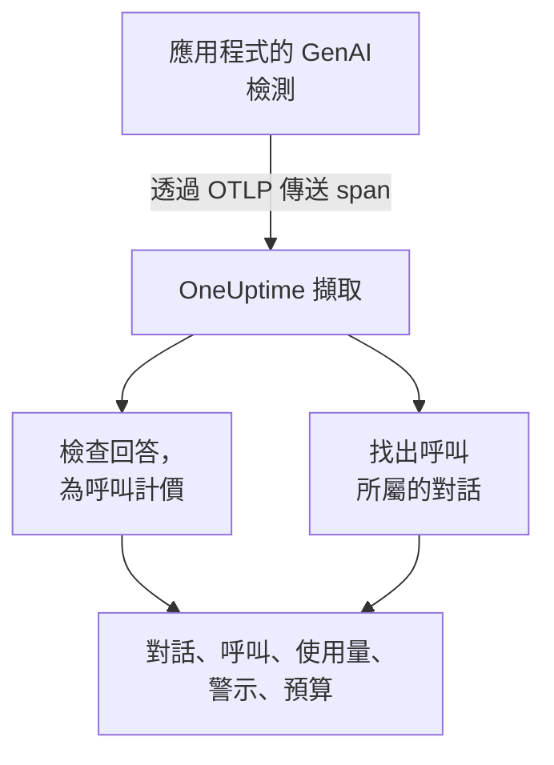
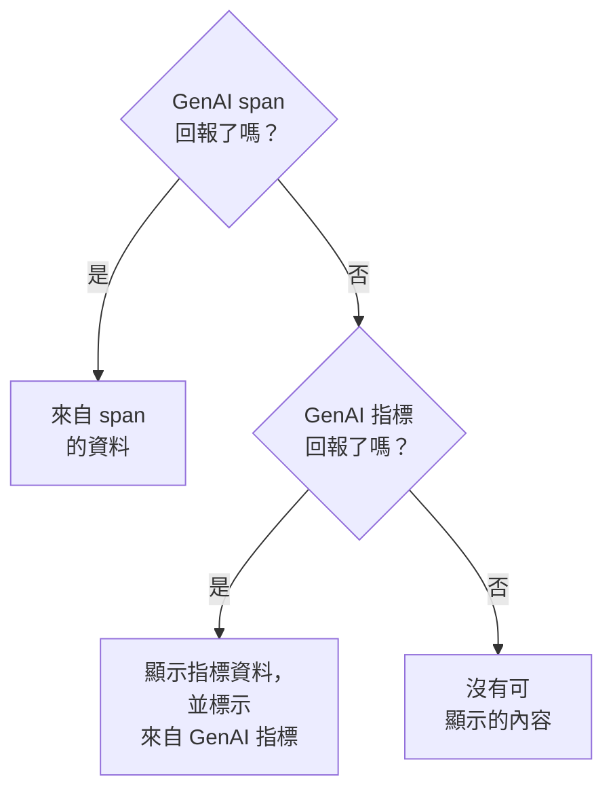

# AI / LLM 可觀測性

閱讀 AI 進行過的每一段對話，依當時的節奏重新播放，並在 AI 回答不佳時收到通知。OneUptime 完全以標準 OpenTelemetry 建構這一切：只要你的應用程式傳送遵循 **GenAI 語意慣例** （`gen_ai.*`）的 span，就能取得對話、警示、使用量和成本，不需要專有 SDK。

:::cards
- [開始設定](#五個步驟完成設定): 五個步驟，從第一個 span 到被標記的回答。
- [重新播放對話](#閱讀和重新播放對話): 依對方看到的樣子、依當時的節奏閱讀一段聊天。
- [接收警示](#ai-回答不佳時收到通知): 針對失敗、遭拒絕、被截斷、被標記或過慢的回答的現成警示。
- [掌握支出](#查看誰在花什麼錢): 依人員、團隊、模型和應用程式劃分的成本，以及每日預算。
:::

## 運作方式

應用程式的 GenAI 檢測會把對模型的每次呼叫匯出為一個 OpenTelemetry span。span 抵達時，OneUptime 會讀取它的 `gen_ai.*` 屬性，檢查回答是否有問題，為呼叫計價，並把它歸入所屬的對話。



在 **可觀測性** 下開啟 **產品 → AI / LLM** 。這個產品有七個分頁：

| 分頁 | 顯示內容 |
| --- | --- |
| **對話** | AI 進行過的每一段對話，需要注意的排在最前面。清單上方會顯示：對話數、AI 回答數、需要注意的數量、成本和一般的回答時間。 |
| **呼叫** | 每一次模型、內嵌、代理程式和工具呼叫。可依服務、提供者、模型、作業、人員、團隊或對話篩選；按一下呼叫即可在追蹤檢視器中開啟。 |
| **使用量** | 某個時間範圍內的呼叫、token 和成本，依員工、團隊、模型、提供者或應用程式排名。 |
| **警示** | 針對 AI 回答不佳的現成警示，以及你的 AI / LLM 監測器。 |
| **預算** | 每日成本上限，以可設定警示的指標形式發布。 |
| **定價** | 為內建價目表中沒有的模型設定你自己的價格。 |
| **設定** | 下方的五個步驟，以及你專案的端點。 |

在追蹤檢視器中，每次 AI 呼叫的 span 還有一個 **LLM** 分頁：提供者、模型、token、成本、要求參數，以及提示和回答。

## 開始之前

- 一個你可以在其中建立遙測擷取金鑰的 OneUptime 專案。
- 一個呼叫模型的應用程式，以及適用於其語言的 GenAI 檢測： **OpenLLMetry** （Traceloop）、 **OpenInference** （Arize）、 **Vercel AI SDK** ，或適用於 OpenAI、Anthropic 和 Gemini 的 OpenTelemetry 檢測。

> [!TIP]
> 經過 LiteLLM 或 Portkey 等閘道的模型流量，可以從閘道匯出，不必從每個應用程式匯出：請參閱 [AI 閘道](/docs/telemetry/ai-gateways)。關於工程師使用的程式設計助理，請參閱 [AI 程式設計助理](/docs/telemetry/ai-coding-assistants)。

## 五個步驟完成設定

只要第一步就能看到呼叫。之後的每一步都會讓你看到更多。

:::steps
### 傳送你的 AI 呼叫

在 **專案設定 → 遙測與 APM → 擷取金鑰** 下建立擷取金鑰（ [OpenTelemetry 快速入門](/docs/telemetry/open-telemetry#建立擷取金鑰) 會逐步說明）。接著把你的檢測指向 OneUptime：

:::tabs
@tab Python
```bash
pip install traceloop-sdk opentelemetry-exporter-otlp
```

```python
from traceloop.sdk import Traceloop

Traceloop.init(
    app_name="my-ai-agent",
    api_endpoint="https://oneuptime.com/otlp",
    headers={"x-oneuptime-token": "YOUR_INGESTION_TOKEN"},
)
# Your OpenAI, Anthropic and LangChain calls are now traced.
```
@tab Node.js
```bash
npm install @traceloop/node-server-sdk
```

```typescript
import * as traceloop from "@traceloop/node-server-sdk";

traceloop.initialize({
  appName: "my-ai-agent",
  baseUrl: "https://oneuptime.com/otlp",
  headers: { "x-oneuptime-token": "YOUR_INGESTION_TOKEN" },
});
```
@tab OpenTelemetry SDK
```bash
export OTEL_EXPORTER_OTLP_ENDPOINT="https://oneuptime.com/otlp"
export OTEL_EXPORTER_OTLP_HEADERS="x-oneuptime-token=YOUR_INGESTION_TOKEN"
export OTEL_EXPORTER_OTLP_PROTOCOL="http/protobuf"
export OTEL_SERVICE_NAME="my-ai-agent"
```
:::

自行託管 OneUptime？請用 `https://YOUR-ONEUPTIME-HOST/otlp` 取代 `https://oneuptime.com/otlp`。呼叫一次模型，這次呼叫就會出現在 **呼叫** 中。

### 記錄說了什麼

只有在你的檢測記錄了內容時，對話中才會顯示人們問了什麼、AI 答了什麼。除非你設定 `TRACELOOP_TRACE_CONTENT=false`，否則 OpenLLMetry 會記錄提示和回答。OpenTelemetry 檢測只有在你要求時才會記錄：

```bash
export OTEL_INSTRUMENTATION_GENAI_CAPTURE_MESSAGE_CONTENT=true
```

較新的 OpenTelemetry 檢測接受 `span_only`、`event_only` 或 `span_and_event`，而不是 `true`。即使沒有記錄內容，對話仍會顯示其時間、成本和問題。提示可能包含敏感資料： [隱私與遮蔽](#隱私與遮蔽) 說明了如何在儲存前加以遮罩。

### 把呼叫歸入對話

聊天應用程式每一輪呼叫一次模型。在每次 AI 呼叫上把 `gen_ai.conversation.id`（或 `session.id`）設為你的聊天 ID，每個聊天就會顯示為一段對話，無論它用了多少次呼叫和多少個追蹤。使用 OpenLLMetry 時，每個要求設定一次即可：

```python
from traceloop.sdk import Traceloop

Traceloop.set_association_properties({
    "session_id": chat.id,
    "user_email": user.email,
})
```

使用 Vercel AI SDK 時，把聊天 ID 以 `experimental_telemetry: { metadata: { sessionId } }` 傳入。沒有對話 ID 的呼叫仍會顯示，一次一個要求（一個追蹤）。

### 說明是誰問的

在每次 AI 呼叫上設定 `user.id` 或 `user.email`（上方的關聯屬性會設定電子郵件）。這樣每段對話都會顯示對方是誰，你可以依人員搜尋清單， **使用量** 分頁也會依員工為支出排名。 [員工和團隊歸屬](/docs/telemetry/ai-coding-assistants#員工和團隊歸屬) 列出了 OneUptime 讀取的所有身分鍵。

### 標記不佳的回答

OneUptime 會在每個回答抵達時加以檢查，並標記出了什麼問題：

| 問題 | 意義 | 判斷依據 |
| --- | --- | --- |
| 失敗 | 呼叫以錯誤結束，因此沒有回答 | span 狀態 Error、`error.type`，或結束原因 `error` |
| 遭拒絕 | AI 拒絕回答，或安全篩選器封鎖了回答 | 因拒絕或安全原因結束（`content_filter`、`refusal`、`SAFETY` 等）、回答中的拒絕，或以英文制式拒絕語開頭的回答 |
| 被截斷 | 回答在 token 上限處停止 | 結束原因 `length`、`max_tokens` 或 `MAX_TOKENS` |
| 空白 | 既沒有文字也沒有工具呼叫 | 記錄的內容為空，或輸出 token 為 0 |
| 被標記 | 你的應用程式傳送的評估認為回答不佳 | `gen_ai.evaluation.result` 事件 |

前四種不需要你做任何事。若要標記被你的防護機制、評估或「倒讚」按鈕否決的回答，請在 span 仍開啟時，於回答的 span 加入 `gen_ai.evaluation.result` 事件，並把 `gen_ai.evaluation.score.label` 設為 `fail`：

```python
from opentelemetry import trace

trace.get_current_span().add_event(
    "gen_ai.evaluation.result",
    {
        "gen_ai.evaluation.name": "relevance",
        "gen_ai.evaluation.score.label": "fail",
        "gen_ai.evaluation.explanation": "The answer is about another product.",
    },
)
```

`incorrect`、`wrong`、`unhelpful`、`toxic`、`unsafe` 和 `hallucination` 等標籤也算是失敗。OneUptime 絕不會把你的對話傳給另一個 AI 評判：每項檢查都只讀取呼叫本身攜帶的資訊。
:::

## 閱讀和重新播放對話

對話會像聊天應用程式顯示歷程記錄那樣整段開啟：對方說的話在右邊，AI 的回答在左邊，附上模型、時間、token 和成本，工具呼叫夾在中間，出問題的地方會在發生處標出。回答下方的 **詳細資料** 會顯示它停止的原因、它的評估，以及前往追蹤中該呼叫的連結。

底部的列會依對方經歷的樣子重新播放對話：

| 控制項 | 作用 |
| --- | --- |
| **重新播放** | 從第一則訊息開始，依當時的節奏播放對話。回答在路上時，「AI 正在回答…」會計時。按一下任一則訊息的時間，即可從那裡開始播放。 |
| **略過等待** | 預設開啟：縮短任何超過 3 秒的靜默。 |
| `1x` | 變更速度：1x、2x、4x 或 8x。 |
| **K** 、 **J** 或 **←** 、 **L** 或 **→** | 播放或暫停、後退一則訊息、前進一則訊息。 |

頁面網址會保存播放停止時的訊息（`?step=`），因此你分享的連結會在那個時刻開啟。

## AI 回答不佳時收到通知

**警示** 分頁列出了大多數 AI 應用程式需要的警示。選擇其中一個會開啟已填好內容的 **建立監測器** ，儲存前你可以修改任何內容：

| 警示 | 何時通知你 | 嚴重性 |
| --- | --- | --- |
| 回答出錯 | 15 分鐘內超過 5% 的回答失敗、遭拒絕、被截斷、空白或被標記 | Warning |
| AI 呼叫失敗 | 5 分鐘內超過 10% 的模型呼叫以錯誤結束 | Critical |
| AI 拒絕回答 | 30 分鐘內超過 5% 的回答是拒絕 | Warning |
| 回答被截斷 | 30 分鐘內有 3 個以上的回答在 token 上限處停止 | Warning |
| 回答被標記 | 某項評估把回答標記為不佳 | Warning |
| 回答緩慢 | 15 分鐘內超過 10% 的回答耗時超過 30 秒 | Warning |
| AI 停止回答 | AI 在 30 分鐘內沒有給出任何回答 | Critical |

依回答比例觸發的警示還會等到至少有 3 個不佳回答，因此兩個回答中有一個不佳不會呼叫任何人。Critical 警示會採用你專案中最嚴重的警示嚴重性，Warning 警示則採用下一級：在新專案中分別是 High 和 Low。

每個警示都是一個 **AI / LLM** 監測器。它的設定決定什麼算是不佳回答（ **發生下列情況時將回答計為不佳** 、 **或耗時超過（秒）** ）、每次檢查回溯多遠（ **時間範圍** ，預設 15 分鐘）、監測哪些 **應用程式** ，以及在 **更多欄位** 下監測哪個 **模型** 。 **預覽** 會顯示監測器此刻會統計到什麼。它的條件比較三個數字： **不佳的 AI 回答 (%)** 、 **不佳的 AI 回答** 和 **AI 回答** 。

現成警示會觸發能自行解決的警示，並在回答不佳期間把監測器顯示為 **Degraded** 。它的事件已填好但處於關閉狀態：如需呼叫某人，請將其開啟。

## 查看誰在花什麼錢

**使用量** 分頁會顯示某個時間範圍（除非你另外選擇，否則為最近 7 天）內的呼叫、token 和成本，以及依五種細分之一列出的前 25 名表格： **員工** 、 **團隊** 、 **模型** 、 **提供者** 和 **應用程式 / 服務** 。沒有指明任何人的呼叫會計入 **未歸屬** ，絕不捨棄。

人員和團隊來自呼叫上的身分屬性：請參閱 [員工和團隊歸屬](/docs/telemetry/ai-coding-assistants#員工和團隊歸屬)。

### span 優先，指標補充

GenAI span 攜帶一次呼叫的模型、token 和成本，因此只要有 span，就能回答一切。有些工具會發布 token 和成本指標，卻不傳送 GenAI span，大多數程式設計助理都是如此。OneUptime 只會為 span 沒有回報的數字讀取這些指標，而且絕不把兩者相加：許多檢測會為同一次呼叫同時傳送兩者，相加會讓每一塊美元被計算兩次。



| 位置 | 改用指標的內容 | 何時 |
| --- | --- | --- |
| 輸入和輸出 token | 兩個總數 | span 的 token 總數皆為 0 |
| 成本（USD） | 成本，Codex 以微美元計的成本會換算為 USD | span 的成本總數為 0 |
| LLM 呼叫 | 無：僅限 span | — |
| **員工** 、 **團隊** 、 **模型** 表格 | 僅成本；呼叫和 token 儲存格顯示 `—` | 該表格找不到 span 的資料列 |
| **提供者** 、 **應用程式 / 服務** 表格 | 無：僅限 span | — |
| 對話 | 無：對話由 span 建構 | — |

取自指標的數字會標示 **來自 GenAI 指標** ，因為它在 **呼叫** 中沒有對應的資料列。所以，一旦你的 GenAI span 回報了某個數字，只傳送指標的工具所占的部分就不會顯示。若要單獨查看這類工具的支出，請把它傳送到沒有 GenAI span 抵達的專用專案。

## 一次呼叫的成本

檢測回報的成本（`gen_ai.usage.cost`）會原樣使用，即使它為 0。沒有回報時，OneUptime 會在 span 抵達時，依 token 數量和內建價目表估算成本，價目表涵蓋 OpenAI、Anthropic、Google Gemini、Mistral、DeepSeek、xAI、Cohere、Amazon Nova 和 Meta Llama 的常用模型。先依實際回應的模型計價，再依要求的模型計價。

模型會以最長的名稱前置詞比對，因此 `gpt-4o-2024-08-06` 和 `us.anthropic.claude-sonnet-4-5-20250929-v1:0` 這類帶有日期或廠商修飾的 ID 也能找到其系列的價格。價目表不認識的模型，即使是新發布的，也絕不會被猜測：在你為它定價之前，其成本維持為 0。估算使用牌價，不含快取或批次折扣。

若要自行為模型定價（協商費率、微調模型或你自行託管的模型），請在 **定價** 分頁的 **自訂 LLM 定價** 中新增： **模型前置詞** 、 **輸入價格（每 100 萬 token 美元）** 和 **輸出價格（每 100 萬 token 美元）** 。在你的價格和內建價目表之間，比對到最長前置詞者勝出；長度相同時，你的價格勝出。價格適用於儲存後大約一分鐘起抵達的呼叫；已儲存的呼叫保留原有成本。

## 每日成本預算

預算會依 UTC 日以 USD 追蹤一天的支出。OneUptime 每 15 分鐘彙總當天的 AI 支出（來自 span，或在沒有 span 回報支出時來自 GenAI 成本指標），顯示在預算上，並發布兩個指標：

| 指標 | 意義 |
| --- | --- |
| `oneuptime.llm.budget.spend.usd` | 當天到目前為止的支出，單位為 USD |
| `oneuptime.llm.budget.percent.used` | 支出占每日上限的百分比 |

兩者都攜帶 `oneuptime.llm.budget.id` 和 `oneuptime.llm.budget.name`，以及預算的範圍（如果有）。

:::steps
### 建立預算

在 **預算** 分頁上，按一下 **建立LLM Cost Budget** 。為它設定名稱和 **每日預算（美元）** ，範圍留空表示整個專案，或者選擇 **服務（選填）** 、 **LLM 提供者（選用）** 或 **LLM 模型（選用）** 。多個預算可以監測不同的範圍。

### 為它設定警示

在 `oneuptime.llm.budget.percent.used` 上建立 [指標監控](/docs/monitor/metrics-monitor)，並依 `oneuptime.llm.budget.id` 篩選（重新命名預算時名稱會改變）。新增觸發警告的條件 `>= 80`，以及觸發嚴重警示的條件 `>= 100`。

### 擴大時間範圍

把監測器的滾動時間範圍設為 30 分鐘。預算每 15 分鐘發布一個點，因此預設的 1 分鐘時間範圍在兩個點之間找不到任何資料。
:::

預算警示也可以執行工作流程來阻止失控的代理程式：請參閱 [AI 代理程式斷路器](/docs/telemetry/ai-agent-circuit-breaker)。

## 儀表板和指標警示

`gen_ai.client.token.usage` 和 `gen_ai.client.operation.duration` 等 GenAI 指標會以一般 OpenTelemetry 指標的形式抵達。你可以在 [儀表板](/docs/dashboards/index) 上繪製它們，或用 [指標監控](/docs/monitor/metrics-monitor) 為它們設定警示，例如當依模型分組的 `gen_ai.client.operation.duration` 的 p95 超過閾值時。

## 隱私與遮蔽

AI 呼叫以追蹤 span 的形式儲存，因此追蹤的 **清理規則** 和 **捨棄過濾器** 也適用於它們：在儲存之前遮罩某個屬性或捨棄某個 span。兩者都在 **追蹤 → 設定** 下。員工電子郵件欄會與其來源屬性一起被清理，因此遮罩電子郵件的規則也會涵蓋這一欄。

讀取對話所需的權限與追蹤相同：能讀取專案追蹤的人才能讀取其對話，其他人都不能。

## OneUptime 讀取的屬性

OneUptime 會讀取 OpenTelemetry GenAI 慣例，以及 OpenLLMetry、OpenInference、Vercel AI SDK 和 LiteLLM 使用的寫法，因此常用的程式庫可以直接使用。對每個值，span 上出現的第一個鍵勝出：

| 值 | 鍵（依嘗試順序） |
| --- | --- |
| 提供者 | `gen_ai.system`、`gen_ai.provider.name`、`llm.system`、`llm.provider` |
| 作業 | `gen_ai.operation.name`、`llm.request.type`、`openinference.span.kind` |
| 要求的模型 | `gen_ai.request.model`、`llm.model_name`、`llm.request.model` |
| 回應的模型 | `gen_ai.response.model`、`llm.response.model` |
| 輸入 token | `gen_ai.usage.input_tokens`、`gen_ai.usage.prompt_tokens`、`llm.token_count.prompt`、`llm.usage.prompt_tokens` |
| 輸出 token | `gen_ai.usage.output_tokens`、`gen_ai.usage.completion_tokens`、`llm.token_count.completion`、`llm.usage.completion_tokens` |
| 總 token | `gen_ai.usage.total_tokens`、`llm.token_count.total`、`llm.usage.total_tokens` |
| 成本（USD） | `gen_ai.usage.cost`、`gen_ai.usage.cost_usd`、`gen_ai.usage.total_cost`、`llm.usage.total_cost`、`gen_ai.cost.total_cost`、`litellm.cost.total` |
| 對話 | `gen_ai.conversation.id`、`session.id`、`langfuse.session.id`、`traceloop.association.properties.session_id`、`ai.telemetry.metadata.sessionId` |
| 代理程式 | `gen_ai.agent.name`、`agent.name` |
| 工具 | `gen_ai.tool.name`、`tool.name`、`ai.toolCall.name` |
| 結束原因 | `gen_ai.response.finish_reasons`、`gen_ai.response.finish_reason`、`llm.response.finish_reason`、`ai.response.finishReason` |
| 錯誤 | `error.type` |

當 span 帶有其中任一個值，或任何以 `gen_ai.`、`llm.` 或 `traceloop.` 開頭的屬性時，就算是一次 AI 呼叫。沒有回報總數時，總 token 為輸入加輸出。`gen_ai.usage.total_tokens` 和 `gen_ai.usage.cost` 這兩個鍵不屬於慣例，慣例對兩者都沒有定義；OneUptime 讀取它們是因為常見的檢測會傳送它們。

身分鍵（誰發起了呼叫，以及其團隊）列在 [員工和團隊歸屬](/docs/telemetry/ai-coding-assistants#員工和團隊歸屬) 中。

### 提示和回答從哪裡讀取

對話檢視會依下列順序讀取一次呼叫的訊息：

- `gen_ai.client.inference.operation.details` 事件；
- `gen_ai.input.messages`、`gen_ai.output.messages` 和 `gen_ai.system_instructions` 屬性；
- 舊的依角色劃分的事件：`gen_ai.system.message`、`gen_ai.user.message`、`gen_ai.assistant.message`、`gen_ai.tool.message` 和 `gen_ai.choice`；
- 帶索引的屬性：OpenLLMetry 的 `gen_ai.prompt.N.content` 和 `gen_ai.completion.N.content`，OpenInference 的 `llm.input_messages.N.message.content` 和 `llm.output_messages.N.message.content`；
- `gen_ai.prompt`、`gen_ai.completion`、`ai.prompt.messages`、`ai.response.text`、`input.value` 和 `output.value` 中的訊息陣列。

## 疑難排解

:::details 呼叫已抵達，但沒有任何對話顯示文字
你的檢測沒有記錄內容。請依 [記錄說了什麼](#記錄說了什麼) 中的說明開啟；在那之前的呼叫仍然沒有文字。
:::

:::details 一個聊天的每次呼叫都顯示為單獨的對話
這些呼叫沒有對話 ID。請依 [把呼叫歸入對話](#把呼叫歸入對話) 中的說明，在聊天的每次呼叫上設定 `gen_ai.conversation.id` 或 `session.id`。
:::

:::details 呼叫顯示了 token，但成本為 $0
模型不在內建價目表中，或者 span 沒有指明模型。請在 **定價** 分頁上新增該模型的價格；此後抵達的呼叫就會被計價。
:::

:::details 使用量分頁顯示「來自 GenAI 指標」，呼叫和 token 顯示 `—`
這些數字來自只傳送指標、不傳送 GenAI span 的工具，例如程式設計助理。指標攜帶成本，但沒有逐次呼叫的細節，因此這些儲存格會保持空白。請參閱 [span 優先，指標補充](#span-優先指標補充)。
:::

:::details 預算監測器在兩種狀態之間來回切換
監測器的滾動時間範圍短於 15 分鐘，因此有時找不到任何點。請把它設為 30 分鐘。
:::

## 後續步驟

:::cards
- [AI 程式設計助理](/docs/telemetry/ai-coding-assistants): Claude Code、Cursor、Codex、Gemini CLI 和 Copilot 依工程師劃分的支出。
- [AI 閘道](/docs/telemetry/ai-gateways): 透過一個 LiteLLM 或 Portkey 閘道追蹤每個應用程式的模型呼叫。
- [AI 代理程式斷路器](/docs/telemetry/ai-agent-circuit-breaker): 預算警示觸發時阻止失控的代理程式。
- [OpenTelemetry](/docs/telemetry/open-telemetry): 每種訊號的端點、擷取金鑰和限制。
:::
