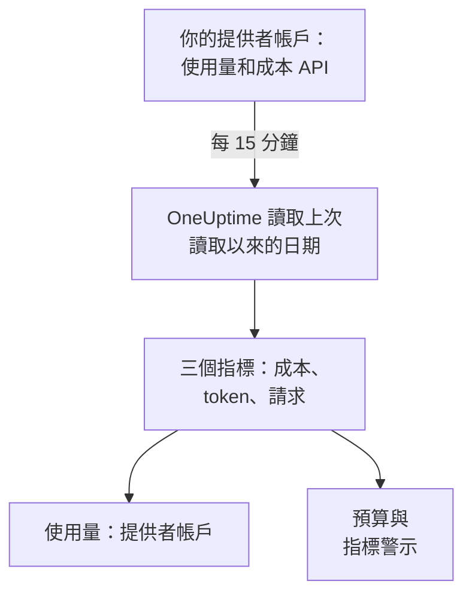

# AI 提供者帳戶

不必修改應用程式，就能查看你的 AI 提供者帳戶用了多少、花了多少。用只能讀取的憑證連線 OpenAI、Anthropic、Azure OpenAI 和 Microsoft Foundry、Amazon Bedrock 或 Google Vertex AI 帳戶，OneUptime 就會每 15 分鐘讀取一次它的使用量，寫入 **使用量** 、 **預算** 以及可以設定警示的指標。

:::cards
- [連線帳戶](#連線帳戶): 選擇提供者，貼上憑證，測試後連線。
- [每個提供者提供什麼](#每個提供者提供什麼): 成本、token 和請求，以及每個提供者如何分組。
- [查看使用量](#查看使用量): 依模型、人員、專案或資源、API 金鑰和連線查看。
- [預算與警示](#預算與警示): 針對帳單的每日預算，以及針對指標的警示。
:::

## 運作方式

OneUptime 每 15 分鐘向每個已連線的帳戶要求依 UTC 日統計的使用量，並把它儲存為該連線專屬服務的三個指標。每次讀取都會取得上次讀取以來的日期，並重新讀取包含今天在內的最近 3 天，因為提供者會持續補上今天的資料，並修正剛過去的幾天。

帳戶的使用量就是它按日被收費的內容。其中沒有對話、提示詞或回答：如需這些，請依 [AI / LLM 可觀測性](/docs/telemetry/ai-llm-observability) 的說明傳送你應用程式的 AI 呼叫。兩者分開儲存，因此不會重複計算。

## 開始之前

- Project Owner 或 Project Admin 角色。只有他們可以連線、修改或移除帳戶；所有能讀取專案遙測資料的人都能看到連線和使用量。
- 由帳戶管理員提供的該帳戶憑證。下方每個提供者的段落會說明需要哪種憑證以及在哪裡建立。
- 不需要安裝任何東西：OneUptime 從自己的伺服器呼叫提供者的 API。

## 連線帳戶

:::steps
### 開啟連線

開啟 **產品 → AI / LLM → 連線** 。在 **你的 AI 提供者帳戶** 中點選提供者的圖塊。

### 貼上憑證

在 **憑證** 中填寫提供者要求的內容。密鑰會加密儲存，之後不論在儀表板或透過 API 都不會再顯示。 **名稱** 以及大多數人不會修改的設定位於 **更多欄位** 中。

### 測試

在 **測試** 中點選 **測試連線** 。OneUptime 會讀取最近 7 天的使用量，並顯示它找到的內容：成本、token、請求、模型、人員、金鑰和專案。在你連線之前不會儲存任何內容。

### 連線

點選 **連線** 。第一次讀取會在一分鐘內開始，並匯入最近 30 天的資料。
:::

已連線的帳戶會列在圖塊下方，並顯示 **狀態** 和 **上次讀取** 。 **立即讀取** 會立即讀取， **測試** 會重新檢查已儲存的設定， **關閉** 會停止讀取並保留已讀取的資料， **編輯** 會修改設定：留空的密鑰會保留已儲存的值。 **View error** 會顯示讀取失敗的原因，其中不含任何密鑰。

## 每個提供者提供什麼

| 提供者 | 成本 | 分組方式 | 憑證 |
| --- | --- | --- | --- |
| OpenAI | OpenAI 回報的金額 | 專案、API 金鑰、人員和模型 | 管理員金鑰 |
| Anthropic | Anthropic 回報的金額 | 工作區、API 金鑰、人員和模型 | 管理員金鑰 |
| Azure OpenAI 和 Microsoft Foundry | 依 token 估算 | 資源和模型 | 具備 Monitoring Reader 的應用程式 |
| Amazon Bedrock | 依 token 估算 | 區域和模型 | 可讀取 CloudWatch 的存取金鑰 |
| Google Vertex AI | 依 token 估算 | 區域和模型 | 具備 Monitoring Viewer 的服務帳戶 |

除了 Anthropic，每個提供者也會統計請求數：Anthropic 的使用量報告沒有請求數。估算成本使用 [一次呼叫的成本](/docs/telemetry/ai-llm-observability#一次呼叫的成本) 中的價目表和你在 **定價** 中設定的價格，並標示為估算值。價目表不認得的模型沒有成本，直到你在那裡為它定價。

這些憑證都不能呼叫模型：每一種都只讀取使用量、成本或指標。

## OpenAI

OneUptime 用管理員金鑰讀取你的 OpenAI 組織：依日、模型、專案、API 金鑰和人員統計的 completions 和 embeddings 使用量，以及依專案和明細項目統計的每日成本。每一項成本會分攤給使用過該模型的金鑰和人員，因此人員所在的列也有成本。專案名稱、金鑰名稱和人員的電子郵件會取代 OpenAI 的 ID。

:::steps
### 建立 OpenAI 管理員金鑰

在 OpenAI 的主控台中開啟 Settings、Organization、Admin keys，然後建立一個金鑰。只有組織擁有者可以建立。它以 `sk-admin-` 開頭。

### 連線 OpenAI

把金鑰貼到 **管理員金鑰** 中。
:::

## Anthropic

OneUptime 用管理員金鑰讀取你的 Claude API 組織：依日、模型、工作區、API 金鑰和人員統計的訊息使用量報告，以及依工作區和明細項目統計的成本報告，並以同樣的方式分攤。使用組織的金鑰或 Console 登入的 Claude Code 也包含在這些報告中，歸在使用它的人員或金鑰下。

:::steps
### 建立 Anthropic 管理員金鑰

在 Claude Console 中開啟 Settings、Admin keys，然後建立一個金鑰。只有組織管理員可以建立。它以 `sk-ant-admin01-` 開頭。

### 連線 Anthropic

把金鑰貼到 **管理員金鑰** 中。
:::

## Azure OpenAI 和 Microsoft Foundry

OneUptime 從 Azure Monitor 讀取訂用帳戶中的每個 Azure OpenAI 和 Foundry 資源：依日、資源和模型統計的 token 和請求。Azure Monitor 統計的是 token 而不是金額，也不指明人員或金鑰，因此成本是 OneUptime 的估算值，人員和金鑰為空白。

:::steps
### 註冊應用程式

在 Microsoft Entra ID 中註冊一個應用程式，並為它建立用戶端密碼。

### 允許它讀取指標

在訂用帳戶上為該應用程式指派 Monitoring Reader 角色。

### 連線 Azure

填寫 **目錄（租用戶）ID** 、 **應用程式（用戶端）ID** 、 **訂用帳戶 ID** 和 **用戶端密碼** 。若是 Azure Government，請在 **更多欄位** 中修改 **雲端** 。
:::

## Amazon Bedrock

OneUptime 讀取你指定的每個區域的 CloudWatch 指標 `AWS/Bedrock`：依日和模型統計的輸入、輸出和快取 token 以及呼叫次數。CloudWatch 統計的是 token 而不是金額，也不指明人員或金鑰：成本是 OneUptime 的估算值，每個區域顯示為一個專案。

:::steps
### 建立存取金鑰

建立一個 IAM 使用者或角色，其政策允許 `cloudwatch:GetMetricData` 和 `cloudwatch:ListMetrics`，並為它建立存取金鑰。

### 連線 Bedrock

填寫 **存取金鑰 ID** 、 **秘密存取金鑰** 和 **區域** ，以逗號分隔：若不修改，則為 `us-east-1`。
:::

## Google Vertex AI

OneUptime 讀取 Vertex AI 為其模型（Gemini 以及 Claude 等合作夥伴模型）發布的 Cloud Monitoring 指標：依日、區域和模型統計的輸入和輸出 token 以及呼叫次數。Cloud Monitoring 統計的是 token 而不是金額，也不指明人員或金鑰：成本是 OneUptime 的估算值。

:::steps
### 建立服務帳戶

在專案中建立一個具有 Monitoring Viewer 角色的服務帳戶，並為它建立 JSON 金鑰。

### 連線 Vertex AI

填寫 **專案 ID** ，並把整個金鑰檔案貼到 **服務帳戶金鑰（JSON）** 中。
:::

## 查看使用量

開啟 **使用量** 並選擇 **提供者帳戶** 。這裡會顯示你的帳戶在該時間範圍內回報的成本、token 和請求，並依 **模型** 、 **人員** 、 **提供者** 、 **專案或資源** 、 **API 金鑰** 或 **連線** 排名。由於提供者按整日回報，時間範圍從第一天的 UTC 午夜開始。

**提供者帳戶** 和 **你的 AI 呼叫** 絕不會相加。你的應用程式使用某個已連線帳戶的金鑰發出的呼叫會同時出現在兩者中，相加就會重複計算。

## 預算與警示

一個預算只統計其中一種。在 **預算** 中建立預算，並把 **支出統計來源** 設為 **提供者帳戶** ：它統計已連線帳戶在該 UTC 日被收費的金額，如果你設定了 **LLM 提供者（選用）** 和 **LLM 模型（選用）** ，則依它們縮小範圍。提供者會延遲幾分鐘到幾小時回報一天的使用量，因此如果需要在幾分鐘內收到警示，請改為對 **你的 AI 呼叫** 設定預算。

每個帳戶的使用量都儲存為三個指標，你可以在 [儀表板](/docs/dashboards/index) 上繪製圖表，或用 [指標監控](/docs/monitor/metrics-monitor) 設定警示：

| 指標 | 說明 |
| --- | --- |
| `oneuptime.llm.provider.cost` | 一天的成本，以 USD 計 |
| `oneuptime.llm.provider.tokens` | 一天的 token 數，依 `gen_ai.token.type` 區分：`input`（包含快取的 token）、`output`、`cache_read` 和 `cache_write` |
| `oneuptime.llm.provider.requests` | 一天的請求數 |

每個資料點的時間戳記都是其 UTC 日的開始。它帶有 `oneuptime.llm.connection.id` 和 `oneuptime.llm.connection.name`，以及提供者給出的 `gen_ai.provider.name`、`gen_ai.request.model`、`user.email`、`oneuptime.llm.provider.project` 和 `oneuptime.llm.provider.api_key`。估算成本帶有 `oneuptime.llm.cost.estimated`。

## 何時讀取

| 讀取 | 時間 |
| --- | --- |
| 第一次 | 連線後一分鐘內，回溯 30 天 |
| 之後 | 每 15 分鐘 |
| 金鑰或權限被拒絕之後 | 60 分鐘後 |
| 其他任何失敗之後 | 15 分鐘後 |
| 已關閉 | 重新開啟前不讀取 |

沒有遙測功能的方案不會讀取任何內容。移除連線會停止它的讀取，並保留它讀取過的內容，直到服務的保留期將其刪除。

## 為什麼 OneUptime 沒有自己的閘道

OneUptime 讀取你的帳戶；它從不位於你的應用程式和提供者之間。代理伺服器會持有你的提供者金鑰，並讓你的應用程式的每次模型呼叫多經過一站。如果你的模型流量已經經過 LiteLLM、Portkey 或 OpenRouter，請依 [AI 閘道](/docs/telemetry/ai-gateways) 的說明把閘道的追蹤傳送到 OneUptime，並連線帳戶以取得帳單。

## 疑難排解

:::details 測試顯示金鑰或密鑰未被接受
請檢查你是否完整複製、它是否已被撤銷，以及它是否為該提供者要求的類型：OpenAI 或 Anthropic 的管理員金鑰，而不是專案金鑰或 API 金鑰。
:::

:::details 憑證有效，但無法讀取連線所需的內容
為它指派本頁為該提供者列出的角色：Azure 訂用帳戶上的 Monitoring Reader、AWS 上的兩個 CloudWatch 動作、Google Cloud 專案上的 Monitoring Viewer。
:::

:::details 測試通過，但今天沒有任何資料
提供者會在幾分鐘到幾小時後回報一天的使用量，並在之後一兩天內修正。後續讀取會把它匯入。
:::

:::details 成本與帳單不同
回報的成本是提供者在稅金、抵用金和折扣之前的金額。估算成本是依定價，或依你在 **定價** 中設定的價格計算的 token 費用。
:::

## 後續步驟

:::cards
- [AI / LLM 可觀測性](/docs/telemetry/ai-llm-observability): 你自己應用程式的 AI 呼叫的對話、警示和成本。
- [公司的 AI 工具](/docs/telemetry/ai-company-tools): 你的員工向 Claude Enterprise 和 Microsoft 365 Copilot 提了什麼問題。
- [AI 閘道](/docs/telemetry/ai-gateways): 追蹤經過 LiteLLM、Portkey 或 OpenRouter 的每次模型呼叫。
- [指標監控](/docs/monitor/metrics-monitor): 針對提供者指標設定警示。
:::
