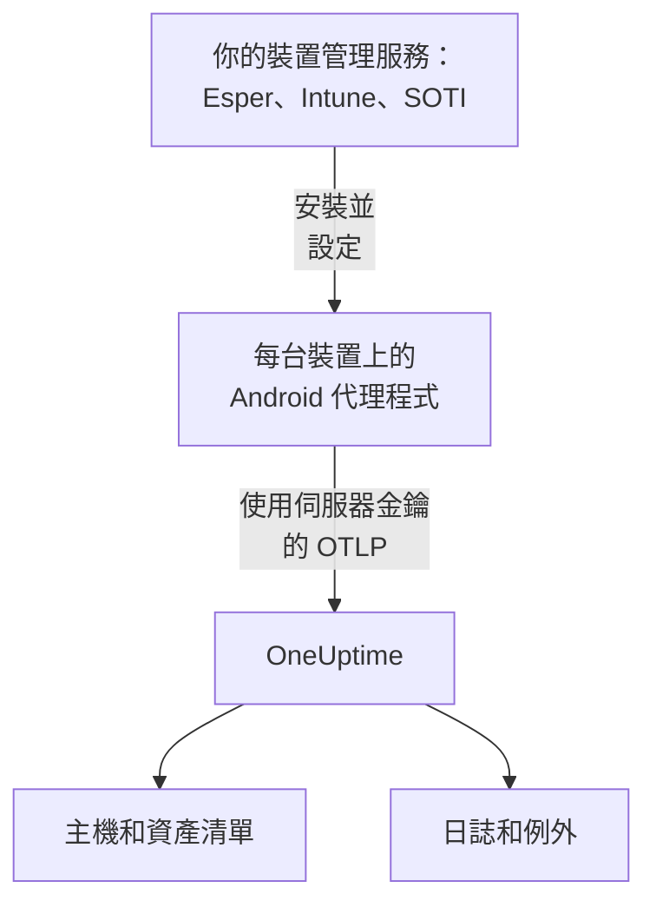

# Android 代理程式

OneUptime Android 代理程式會把你的組織擁有的 Android 裝置（例如點餐自助服務機、POS 終端機、手持裝置或數位看板播放器）的狀況回報給 OneUptime：它的記憶體、儲存空間、網路、電池和溫度，它的重新啟動、安裝在上面的應用程式，以及其上各個應用程式的當機和日誌。你的裝置管理服務會一次為整個裝置群安裝並設定它。每台裝置都會成為 **主機** 中的一台主機和 **資產清單** 中的一個項目，與你的伺服器和 Windows 機器並列。

:::cards
- [何時使用](#代理程式還是應用程式檢測): 代理程式看到的是裝置，應用程式檢測看到的是你的應用程式。
- [使用 Esper 部署](#使用-esper-部署): 上傳 APK、推送設定、啟動一次。
- [設定](#設定): 其受管理設定中的每個鍵。
- [讀取其他應用程式的日誌](#讀取其他應用程式的日誌): 透過 adb 或你的裝置管理服務授予一次 READ_LOGS。
- [日誌工作階段](#日誌工作階段): 一段時間內每個應用程式的日誌，由裝置前的人允許。
:::

## 運作方式

代理程式是一個以前景服務執行的小型應用程式。它每分鐘讀取一次裝置的健康狀態，並連同裝置的重新啟動、已安裝的應用程式和日誌，使用 **伺服器** 擷取金鑰透過 OTLP 傳送到你的 OneUptime。裝置開機時它會自行啟動；網路中斷期間，它會把收集到的資料保留在裝置上，並在網路恢復後傳送。它絕不會讓休眠中的裝置保持喚醒，並會壓縮傳送的資料。



## 代理程式還是應用程式檢測

| | 應用程式中的 [OpenTelemetry Android](/docs/rum/android-setup) | Android 代理程式 |
| --- | --- | --- |
| 看得到什麼 | 你的應用程式：它的當機、ANR、畫面、工作階段、請求和工作流程 | 裝置：記憶體、儲存空間、網路、電池、重新啟動、已安裝的應用程式，以及每個應用程式的當機和 ANR |
| 顯示在哪裡 | **真實使用者監測** 、 **追蹤** 和 **例外** | **主機** 、 **資產清單** 、 **日誌** 和 **例外** |
| 如何安裝 | 寫在應用程式的程式碼中 | 作為應用程式，透過你的裝置管理服務安裝 |

在你擁有的裝置上，兩者都用，並在兩邊為裝置取相同的名稱：代理程式的 `device_name` 設定，以及你的應用程式設定的 `host.name` 。這樣裝置在 **資產清單** 中就是一個項目，應用程式的遙測和裝置的遙測匯集在一起。

## 開始之前

- 執行 Android 7.0 或更新版本的裝置，並由支援 Android 受管理設定的裝置管理服務管理：Esper、Microsoft Intune、Workspace ONE、SOTI 以及其他 Android Enterprise 裝置管理服務。如果只有一台裝置，用 adb 就夠了。
- 一個 **伺服器** 擷取金鑰，在 **專案設定 → 遙測與 APM → 擷取金鑰** 中以 **建立擷取金鑰** 建立。
- 代理程式： `oneuptime-android-agent.apk` ，附加在每個 [OneUptime 發行版本](https://github.com/OneUptime/oneuptime/releases/latest) 中。
- 從裝置連往你的 OneUptime URL 的輸出 HTTPS。由於每個請求都帶有擷取金鑰，代理程式會拒絕不是 `https://` 的 URL。

## 使用 Esper 部署

:::steps
### 上傳 APK

在 Esper 主控台中，把 `oneuptime-android-agent.apk` 上傳到 **App Library** ，並把它加入要監測的裝置的藍圖（blueprint）。

### 推送設定

在藍圖中，開啟代理程式的 **Managed Configuration** ，貼上它的設定。使用 Esper Agent 8.00.0764 或更新版本時，Esper 會在每台裝置上填入預留位置：

```json title="Managed configuration"
{
  "oneuptime_url": "https://oneuptime.com",
  "oneuptime_token": "YOUR_TELEMETRY_INGESTION_TOKEN",
  "device_name": "${esper.deviceName}",
  "device_serial": "${esper.serialNumber}",
  "device_type": "kiosk",
  "labels": "region=emea"
}
```

如果你自行託管 OneUptime，請把你自己的 URL 填入 `oneuptime_url` 。接著對裝置執行 Converge，讓它們讀取新的設定。

### 啟動一次

在新安裝的應用程式被開啟過一次之前，Android 不會在開機時啟動它。請在 Multi-App mode 的藍圖中為代理程式啟用 **Launch on Start** ，或在每台裝置上開啟一次代理程式。此後，每次裝置開機以及每次更新之後，它都會自行啟動。

### 在 OneUptime 中找到裝置

一分鐘內，每台裝置都會以其 `device_name` 命名，出現在 **主機** 下和 **資產清單** 中。裝置上代理程式自己的畫面會說明它是否正在回報，以及沒有回報時是什麼阻止了它。
:::

其他裝置管理服務的用法相同：把 APK 加入為企業營運（LOB）應用程式或內部應用程式，在其應用程式設定中設定相同的鍵，並在每台裝置上開啟一次。

## 設定

代理程式會從其受管理設定讀取下列鍵。沒有受管理設定的裝置，可以改在代理程式自己的畫面上設定 URL、擷取金鑰和裝置名稱。在那裡輸入的金鑰會以 Android Keystore 加密儲存。

| 鍵 | 設定的內容 | 預設值 |
| --- | --- | --- |
| `oneuptime_url` | 你的 OneUptime URL | `https://oneuptime.com` |
| `oneuptime_token` | 一個 **伺服器** 擷取金鑰 | 無：沒有它，代理程式什麼也不會傳送 |
| `device_name` | 裝置在 **主機** 和 **資產清單** 中的名稱，也是它在那裡的身分識別 | 裝置型號加上其 Android ID 的開頭部分 |
| `device_serial` | 裝置的序號，從 Android 10 起 Android 不再提供給應用程式 | 無 |
| `device_type` | 裝置是什麼，例如自助服務機、POS 終端機或手持裝置 | `Android device` |
| `device_location` | 裝置在哪裡，例如門市編號 | 無 |
| `labels` | 主機的標籤，寫成以逗號分隔的 `name=value` 組 | 無 |
| `collection_interval_seconds` | 回報頻率，30 到 600 秒 | `60` |
| `logcat_enabled` | 是否傳送從 Logcat 讀取的內容 | `true` |
| `logcat_min_level` | 在 Android 12 及更早版本上傳送的 Logcat 行的最低層級： `verbose` 、 `debug` 、 `info` 、 `warn` 、 `error` 或 `fatal` | `warn` |
| `installed_apps_enabled` | 是否傳送已安裝的應用程式 | `true` |

裝置管理服務沒有填入的預留位置（例如原樣傳來的 `${esper.deviceName}` ）會被忽略，代理程式的畫面也會說明這一點。裝置開始回報後，請保持 `device_name` 不變：新的名稱就是一台新的主機。

代理程式的畫面、它的通知，以及你的裝置管理服務為這些鍵顯示的標題和說明，都會以裝置的語言顯示，涵蓋 OneUptime 儀表板支援的每一種語言。

## 讀取其他應用程式的日誌

Android 只允許擁有 READ_LOGS 權限的應用程式讀取其他應用程式的日誌，而且只有 adb 能授予這個權限：應用程式本身不行，裝置原則也不行。在每台裝置上授予一次，它就會在重新啟動和更新後一直保持授予狀態：

```bash
adb shell pm grant com.oneuptime.androidagent android.permission.READ_LOGS
```

使用 Esper 時，請透過 **Secure Remote ADB** 執行該命令：為裝置啟用 ADB 存取，以 `espercli secureadb connect --device DEVICE_ID` 連線，然後執行命令。授予權限後，Android 會重新啟動代理程式，代理程式隨即開始讀取。

之後代理程式讀取的內容取決於 Android 版本：

- Android 13 及更新版本：每個應用程式的當機和 ANR。Android 只會向顯示在螢幕上的應用程式顯示其他應用程式的日誌行，而且要經過裝置前的人允許，因此在背景執行的代理程式無法讀取它們。可以用 [日誌工作階段](#日誌工作階段) 在一段時間內要求取得它們。
- Android 12 及更早版本：每個應用程式的當機和 ANR，以及每個應用程式在 `logcat_min_level` 及以上層級的日誌行。

沒有 READ_LOGS 時，代理程式仍會回報其他所有內容，它的畫面和裝置的日誌會說明如何授予這個權限。

### 當機堆疊和重新啟動原因

Android 會把每個應用程式當機、原生當機和 ANR 的完整報告，以及每次重新啟動的原因，保存在它的 DropBox 中。當代理程式擁有 READ_LOGS 和使用狀況存取權，並在 Android 15 及更新版本上擁有 READ_DROPBOX_DATA 時，它會讀取每個應用程式的這些內容。與 READ_LOGS 一樣，以 adb 授予一次：

```bash
adb shell pm grant com.oneuptime.androidagent android.permission.READ_DROPBOX_DATA
adb shell appops set com.oneuptime.androidagent GET_USAGE_STATS allow
```

第一個命令適用於 Android 15 及更新版本；使用狀況存取權也可以在裝置的 **設定 → 使用狀況存取權** 中開啟。裝置原則無法授予這些權限，代理程式的畫面會列出仍需執行的命令。授予之後， **例外** 中的每個當機都有完整的堆疊追蹤，原生當機有其訊號和當機所在的程式庫，ANR 有其主執行緒的堆疊， **日誌** 中的重新啟動則有 Android 提供的原因。代理程式讀取的內容中的卡號、電子郵件地址、權杖和密碼會在傳送前被替換為 `[card number]` 、 `[email]` 、 `[token]` 和 `[redacted]` 。

### 為整個裝置群授予這些權限

代理程式的每次回報都會說明它仍缺少其中哪些權限。若要列出需要這些權限的裝置，請開啟 **資產清單** ，再開啟 **所有項目** ，然後將 **代理程式權限** 篩選條件設為 **遺失** 。開啟 **代理程式權限** 欄即可查看每台裝置缺少什麼，也可以把清單匯出為 CSV。

裝置原則無法授予這些權限：READ_LOGS 和 READ_DROPBOX_DATA 是只有 adb、系統或裝置製造商才能授予的權限，而使用狀況存取權則由 adb 或裝置前的人設定。以下是 Esper 提供的幾種方式，以及它們為何都無法授予這些權限：

- **應用程式權限** 無論是在藍圖中設定，還是透過 `SET_APP_PERMISSION` 命令設定，都會經過 Android 的裝置擁有者 API，而這個 API 只會授予應用程式會向裝置前的人要求的權限。Android 會拒絕授予這些權限。
- **受管理設定** 設定的是代理程式自己的設定，從不涉及 Android 的權限。
- **Run Shell Script** 在 Linux 和 Windows 裝置上執行，無法在 Android 裝置上執行。
- **Secure Remote ADB** 一次只能連線到一台裝置，而且要從執行 `espercli` 的電腦連線。在 Esper Foundation 裝置上，它不需要裝置前有人。在其他裝置上，第一次連線時需要裝置前的人接受 **Allow USB debugging?** 提示。

因此，請用 adb 授予這些權限：

- **裝置送往現場之前** ，在以 USB 纜線佈建裝置時授予。下列命令會為連接到電腦的每台裝置授予全部三項權限：

  ```bash
  for serial in $(adb devices | awk 'NR > 1 && $2 == "device" { print $1 }'); do
    adb -s "$serial" shell pm grant com.oneuptime.androidagent android.permission.READ_LOGS
    adb -s "$serial" shell pm grant com.oneuptime.androidagent android.permission.READ_DROPBOX_DATA
    adb -s "$serial" shell appops set com.oneuptime.androidagent GET_USAGE_STATS allow
  done
  ```

  在 Android 14 及更早版本上，第二個命令會指出這是未知的權限：這類裝置不需要它。
- **對於已在現場的裝置** ，透過 Secure Remote ADB 授予，每次處理 **遺失** 清單中的一台裝置。
- **只有使用狀況存取權** 可以由裝置前的人自行開啟：在 **設定 → 使用狀況存取權** 中開啟，或使用代理程式畫面上的按鈕。

裝置在一分鐘內的下一次回報會把它從 **遺失** 清單中移除。

### CPU 使用率

Android 8 及更新版本不會向應用程式提供裝置的 CPU 使用率。只有裝置擁有者應用程式才能讀取它，而且只在硬體會回報它的裝置上可行。代理程式在成為裝置擁有者時讀取它；你可以用 adb 在沒有任何帳戶、也沒有其他裝置擁有者的裝置上進行設定：

```bash
adb shell dpm set-device-owner com.oneuptime.androidagent/.admin.AgentDeviceAdminReceiver
```

已由你的裝置管理服務擁有的裝置不能再有第二個擁有者，因此無法取得其 CPU 使用率，代理程式的畫面也會說明這一點。此時它的 CPU 使用率不會出現在主機清單中，也不會為它提供 **High CPU Utilization** 範本。

## 日誌工作階段

日誌工作階段會在一段時間內傳送裝置上每個應用程式的日誌，用於排解裝置的問題。在 Android 13 及更新版本上，這是讀取其他應用程式日誌行的唯一方法，因為 Android 只會向顯示在螢幕上的應用程式顯示它們，而且要經過裝置前的人允許。

:::steps
### 提出要求

在 **主機** 中開啟裝置，再開啟 **日誌** ，然後在 **日誌工作階段** 中按一下 **要求日誌工作階段** 。選擇裝置傳送日誌的時間長度（15 分鐘到 4 小時），以及它傳送的最低層級： **資訊** 、 **偵錯** 或 **詳細** 。新增 **備註** ，說明你提出要求的原因，例如「調查付款應用程式為何在下午 6 點後當機」。

### 在裝置上允許

一分鐘內，裝置會顯示一則通知，說明有人要求了它的日誌，並附上此人的名稱和你的備註。裝置前的人開啟代理程式，要求會連同下方你的備註一起顯示在代理程式中，然後此人輕觸 **允許** 。在 Android 13 及更新版本上，Android 接著會詢問是否允許存取所有裝置記錄，此人也要允許。

### 查看日誌行

工作階段會顯示為 **收集中** ，每個應用程式的日誌行都會進入裝置的日誌。按一下 **顯示日誌行** 即可單獨查看該工作階段的日誌行，按一下 **下載日誌行** 則可將它們儲存為檔案。工作階段會在時間到時結束，或在有人於裝置上停止它、或在 OneUptime 中取消它時結束。
:::

備註是一行文字，最多 200 個字元。在工作階段等待或執行期間，裝置會在通知和代理程式的畫面上，依你寫的原樣加上引號顯示它；它絕不會被翻譯。換行會變成空格，其中的卡號、電子郵件地址、權杖和密碼會在保存前被替換為 `[card number]` 、 `[email]` 、 `[token]` 和 `[redacted]` ，與代理程式傳送的內容一樣。工作階段清單會在提出要求的人下方顯示備註，主機的 **稽核日誌** 也會將它與要求一起保存。

**下載日誌行** 會把工作階段的日誌行儲存為文字檔，格式與 `logcat -v threadtime` 的輸出相同，廠商的支援人員能夠讀懂：每一行都有精確到毫秒的時間、處理程序和執行緒、層級、標籤和訊息。時間採用 UTC。檔案的前幾行會說明這是哪個工作階段、哪台裝置、哪則備註，以及是誰提出要求。檔案包含的是 **日誌** 中顯示的日誌行，也就是經代理程式遮蔽敏感資訊後的內容，因此下載它所需的權限與讀取裝置日誌相同。一個檔案最多包含 100,000 行、32 MB；較長的工作階段，其檔案結尾會說明該工作階段共有多少行。

工作階段需要 READ_LOGS 和 `logcat_enabled` ；缺少它們時會顯示為 **無法使用** 。一台裝置上同一時間只會執行一個工作階段。一小時內無人允許的要求會過期；裝置在工作階段期間重新啟動時，工作階段會隨之結束，因為 Android 的權限會隨代理程式的處理程序一起結束。要求工作階段需要編輯該主機的權限，主機的 **稽核日誌** 會記錄是誰、在何時提出了要求。

## 回報的內容

| 內容 | 在 OneUptime 中的位置 |
| --- | --- |
| 記憶體、儲存空間、網路和運行時間 | **主機** 中該裝置的頁面：與伺服器的收集器傳送的指標相同，因此主機警示範本同樣適用 |
| 電池電量和溫度，以及裝置是否接上外部電源 | 指標 `hw.battery.charge` 、 `hw.temperature` 和 `android.battery.plugged` |
| 熱狀態 | 指標 `android.thermal.status` 和 `android.thermal.headroom` |
| CPU 使用率 | 指標 `system.cpu.utilization` ：在 Android 7 上，以及在代理程式是 [裝置擁有者](#cpu-使用率) 的 Android 8 及更新版本上 |
| 重新啟動 | **日誌** ，以 `@event.name:device.boot` 查找：裝置之前運行了多久、是否正常關機、關機了多久、為什麼重新啟動，以及重新啟動循環 |
| 已安裝的應用程式 | **日誌** ，以 `@event.name:android.package.inventory` 查找：每天一次，以及每次安裝、更新和移除 |
| 每個應用程式的當機和 ANR | **例外** ，作為未處理的例外，以應用程式命名；代理程式讀取 [DropBox](#當機堆疊和重新啟動原因) 時附帶其堆疊 |
| 廠牌、型號、序號、作業系統版本、安全性修補程式等級和韌體 | 該裝置在 **資產清單** 中的項目，以及 **安全性修補程式等級** 篩選條件和欄 |
| 安全性修補程式等級有多舊 | 指標 `android.os.security_patch.age` ，以天為單位 |
| 代理程式仍缺少的權限 | 該裝置在 **資產清單** 中的項目，以及 **代理程式權限** 篩選條件和欄 |

在 **主機** 中，裝置的作業系統會顯示為 Android，並帶有 Android 的標誌。

當裝置的安全性修補程式等級距今超過 90 天時，它的安全性修補程式就落後了。Google 每個月發布一份 Android 安全性公告，Android Enterprise Recommended 則要求裝置製造商在 90 天內推出每一份公告的更新，因此落後更久的裝置缺少其製造商早該推出的修正。在 **資產清單** 中， **安全性修補程式等級** 篩選條件會列出 **需要更新** 的裝置； **Security Patch Out of Date** 範本會針對每一台這樣的裝置發出警示。

裝置在過去一小時內的開機次數是指標 `android.boot.recent_count` ，不斷重新啟動的裝置會在每次開機時記錄一筆警告日誌。在 **主機** 中，Android 裝置會獲得自己的警示範本：Device Unplugged、Low Battery、Device Overheating、Restart Loop、Storage Nearly Full 和 Security Patch Out of Date，以及 Host Stopped Reporting、Host Restarted 和 High Memory Utilization，並在回報 CPU 使用率後獲得 High CPU Utilization。每個警示最先提供的偵錯命令都是 adb 命令。請參閱 [主機監控](/docs/monitor/host-monitor#android-裝置) 。

## 疑難排解

:::details 裝置沒有出現在主機中
在裝置上開啟代理程式：它的畫面會說明問題所在，例如缺少擷取金鑰、URL 無法使用，或上傳失敗及其原因。安裝後從未開啟過代理程式的裝置並沒有啟動它：請開啟它一次，或啟用 **Launch on Start** 。
:::

:::details 代理程式顯示 OneUptime 拒絕了擷取金鑰
請使用已啟用且未過期的 **伺服器** 金鑰。裝置送出的 **瀏覽器** 金鑰會被拒絕。
:::

:::details 沒有來自其他應用程式的日誌
依照 [讀取其他應用程式的日誌](#讀取其他應用程式的日誌) 中的說明授予 READ_LOGS。在 Android 13 及更新版本上，除非有 [日誌工作階段](#日誌工作階段) 正在執行，否則只會讀取其他應用程式的當機和 ANR。
:::

:::details 日誌工作階段一直停留在等待核准
裝置前還沒有人允許它。必須有人在裝置上開啟代理程式並輕觸 **允許** ，在 Android 13 及更新版本上，還要在代理程式顯示在螢幕上時允許 Android 的提示。被 Android 的提示拒絕的工作階段會顯示為 **已拒絕** ：請重新要求一個。
:::

:::details 兩台裝置顯示為一台主機
它們的 `device_name` 相同。請使用因裝置而異的預留位置，例如 `${esper.deviceName}` 或 `${esper.serialNumber}` 。
:::

## 後續步驟

:::cards
- [Android 端設定](/docs/rum/android-setup): 使用 OpenTelemetry Android 檢測你自己的應用程式。
- [主機](/docs/telemetry/hosts): 主機的頁面、讀數和警示。
- [主機監控](/docs/monitor/host-monitor): 在裝置停止回報或儲存空間不足時收到警示。
- [例外](/docs/telemetry/exceptions): 分類處理你的裝置回報的當機和 ANR。
:::
