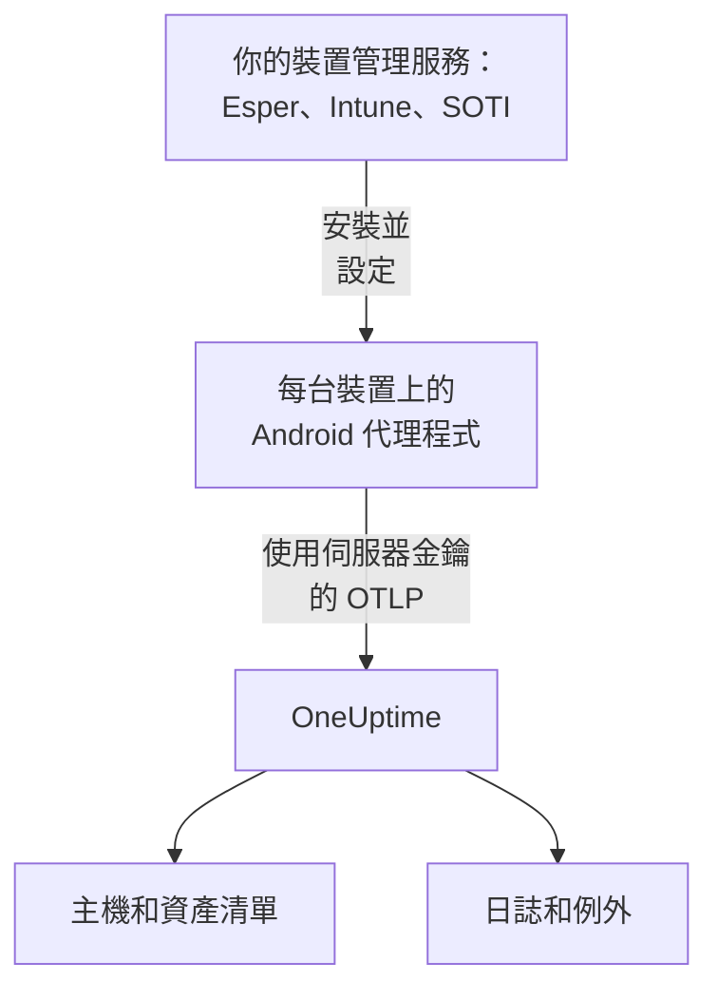

# Android 代理程式

OneUptime Android 代理程式會把你的組織擁有的 Android 裝置（例如點餐自助服務機、POS 終端機、手持裝置或數位看板播放器）的狀況回報給 OneUptime：它的記憶體、儲存空間、網路、電池和溫度，它的重新啟動、安裝在上面的應用程式，以及其上各個應用程式的當機和日誌。你的裝置管理服務會一次為整個裝置群安裝並設定它。每台裝置都會成為 **主機** 中的一台主機和 **資產清單** 中的一個項目，與你的伺服器和 Windows 機器並列。

:::cards
- [何時使用](#代理程式還是應用程式檢測): 代理程式看到的是裝置，應用程式檢測看到的是你的應用程式。
- [使用 Esper 部署](#使用-esper-部署): 上傳 APK、推送設定、啟動一次。
- [設定](#設定): 其受管理設定中的每個鍵。
- [讀取其他應用程式的日誌](#讀取其他應用程式的日誌): 透過 adb 或你的裝置管理服務授予一次 READ_LOGS。
:::

## 運作方式

代理程式是一個以前景服務執行的小型應用程式。它每分鐘讀取一次裝置的健康狀態，並連同裝置的重新啟動、已安裝的應用程式和日誌，使用 **伺服器** 擷取金鑰透過 OTLP 傳送到你的 OneUptime。裝置開機時它會自行啟動；網路中斷期間，它會把收集到的資料保留在裝置上，並在網路恢復後傳送。它絕不會讓休眠中的裝置保持喚醒，並會壓縮傳送的資料。



## 代理程式還是應用程式檢測

| | 應用程式中的 [OpenTelemetry Android](/docs/rum/android-setup) | Android 代理程式 |
| --- | --- | --- |
| 看得到什麼 | 你的應用程式：它的當機、ANR、畫面、工作階段、請求和工作流程 | 裝置：記憶體、儲存空間、網路、電池、重新啟動、已安裝的應用程式，以及每個應用程式的當機和 ANR |
| 顯示在哪裡 | **真實使用者監測** 、 **追蹤** 和 **例外** | **主機** 、 **資產清單** 、 **日誌** 和 **例外** |
| 如何安裝 | 寫在應用程式的程式碼中 | 作為應用程式，透過你的裝置管理服務安裝 |

在你擁有的裝置上，兩者都用，並在兩邊為裝置取相同的名稱：代理程式的 `device_name` 設定，以及你的應用程式設定的 `host.name` 。這樣裝置在 **資產清單** 中就是一個項目，應用程式的遙測和裝置的遙測匯集在一起。

## 開始之前

- 執行 Android 7.0 或更新版本的裝置，並由支援 Android 受管理設定的裝置管理服務管理：Esper、Microsoft Intune、Workspace ONE、SOTI 以及其他 Android Enterprise 裝置管理服務。如果只有一台裝置，用 adb 就夠了。
- 一個 **伺服器** 擷取金鑰，在 **專案設定 → 遙測與 APM → 擷取金鑰** 中以 **建立擷取金鑰** 建立。
- 代理程式： `oneuptime-android-agent.apk` ，附加在每個 [OneUptime 發行版本](https://github.com/OneUptime/oneuptime/releases/latest) 中。
- 從裝置連往你的 OneUptime URL 的輸出 HTTPS。由於每個請求都帶有擷取金鑰，代理程式會拒絕不是 `https://` 的 URL。

## 使用 Esper 部署

:::steps
### 上傳 APK

在 Esper 主控台中，把 `oneuptime-android-agent.apk` 上傳到 **App Library** ，並把它加入要監測的裝置的藍圖（blueprint）。

### 推送設定

在藍圖中，開啟代理程式的 **Managed Configuration** ，貼上它的設定。使用 Esper Agent 8.00.0764 或更新版本時，Esper 會在每台裝置上填入預留位置：

```json title="Managed configuration"
{
  "oneuptime_url": "https://oneuptime.com",
  "oneuptime_token": "YOUR_TELEMETRY_INGESTION_TOKEN",
  "device_name": "${esper.deviceName}",
  "device_serial": "${esper.serialNumber}",
  "device_type": "kiosk",
  "labels": "region=emea"
}
```

如果你自行託管 OneUptime，請把你自己的 URL 填入 `oneuptime_url` 。接著對裝置執行 Converge，讓它們讀取新的設定。

### 啟動一次

在新安裝的應用程式被開啟過一次之前，Android 不會在開機時啟動它。請在 Multi-App mode 的藍圖中為代理程式啟用 **Launch on Start** ，或在每台裝置上開啟一次代理程式。此後，每次裝置開機以及每次更新之後，它都會自行啟動。

### 在 OneUptime 中找到裝置

一分鐘內，每台裝置都會以其 `device_name` 命名，出現在 **主機** 下和 **資產清單** 中。裝置上代理程式自己的畫面會說明它是否正在回報，以及沒有回報時是什麼阻止了它。
:::

其他裝置管理服務的用法相同：把 APK 加入為企業營運（LOB）應用程式或內部應用程式，在其應用程式設定中設定相同的鍵，並在每台裝置上開啟一次。

## 設定

代理程式會從其受管理設定讀取下列鍵。沒有受管理設定的裝置，可以改在代理程式自己的畫面上設定 URL、擷取金鑰和裝置名稱。在那裡輸入的金鑰會以 Android Keystore 加密儲存。

| 鍵 | 設定的內容 | 預設值 |
| --- | --- | --- |
| `oneuptime_url` | 你的 OneUptime URL | `https://oneuptime.com` |
| `oneuptime_token` | 一個 **伺服器** 擷取金鑰 | 無：沒有它，代理程式什麼也不會傳送 |
| `device_name` | 裝置在 **主機** 和 **資產清單** 中的名稱，也是它在那裡的身分識別 | 裝置型號加上其 Android ID 的開頭部分 |
| `device_serial` | 裝置的序號，從 Android 10 起 Android 不再提供給應用程式 | 無 |
| `device_type` | 裝置是什麼，例如自助服務機、POS 終端機或手持裝置 | `Android device` |
| `device_location` | 裝置在哪裡，例如門市編號 | 無 |
| `labels` | 主機的標籤，寫成以逗號分隔的 `name=value` 組 | 無 |
| `collection_interval_seconds` | 回報頻率，30 到 600 秒 | `60` |
| `logcat_enabled` | 是否傳送從 Logcat 讀取的內容 | `true` |
| `logcat_min_level` | 在 Android 12 及更早版本上傳送的 Logcat 行的最低層級： `verbose` 、 `debug` 、 `info` 、 `warn` 、 `error` 或 `fatal` | `warn` |
| `installed_apps_enabled` | 是否傳送已安裝的應用程式 | `true` |

裝置管理服務沒有填入的預留位置（例如原樣傳來的 `${esper.deviceName}` ）會被忽略，代理程式的畫面也會說明這一點。裝置開始回報後，請保持 `device_name` 不變：新的名稱就是一台新的主機。

## 讀取其他應用程式的日誌

Android 只允許擁有 READ_LOGS 權限的應用程式讀取其他應用程式的日誌，而且只有 adb 能授予這個權限：應用程式本身不行，裝置原則也不行。在每台裝置上授予一次，它就會在重新啟動和更新後一直保持授予狀態：

```bash
adb shell pm grant com.oneuptime.androidagent android.permission.READ_LOGS
```

使用 Esper 時，請透過 **Secure Remote ADB** 執行該命令：為裝置啟用 ADB 存取，以 `espercli secureadb connect -d DEVICE_ID` 連線，然後執行命令。授予權限後，Android 會重新啟動代理程式，代理程式隨即開始讀取。

之後代理程式讀取的內容取決於 Android 版本：

- Android 13 及更新版本：每個應用程式的當機和 ANR。Android 只會向顯示在螢幕上的應用程式顯示其他應用程式的日誌行，而且要經過裝置前的人允許，因此在背景執行的代理程式無法讀取它們。
- Android 12 及更早版本：每個應用程式的當機和 ANR，以及每個應用程式在 `logcat_min_level` 及以上層級的日誌行。

沒有 READ_LOGS 時，代理程式仍會回報其他所有內容，它的畫面和裝置的日誌會說明如何授予這個權限。

## 回報的內容

| 內容 | 在 OneUptime 中的位置 |
| --- | --- |
| 記憶體、儲存空間、網路和運行時間 | **主機** 中該裝置的頁面：與伺服器的收集器傳送的指標相同，因此主機警示範本同樣適用 |
| 電池電量和溫度，以及裝置是否接上外部電源 | 指標 `hw.battery.charge` 、 `hw.temperature` 和 `android.battery.plugged` |
| 熱狀態 | 指標 `android.thermal.status` 和 `android.thermal.headroom` |
| 重新啟動 | **日誌** ，以 `@event.name:device.boot` 查找：裝置之前運行了多久、是否正常關機、關機了多久，以及重新啟動循環 |
| 已安裝的應用程式 | **日誌** ，以 `@event.name:android.package.inventory` 查找：每天一次，以及每次安裝、更新和移除 |
| 每個應用程式的當機和 ANR | **例外** ，作為未處理的例外，以應用程式命名 |
| 廠牌、型號、序號、作業系統版本和韌體 | 該裝置在 **資產清單** 中的項目 |

Android 8 及更新版本不會向應用程式提供裝置的 CPU 使用量，因此代理程式只會在 Android 7 以及允許這麼做的組建上回報 CPU 使用量。

適用於裝置的主機警示範本有 Host Stopped Reporting、High Memory Utilization、High Filesystem Usage 和 Host Restarted。不斷重新啟動的裝置會在每次開機時記錄一筆警告日誌，並把 `android.boot.recent_count` 設為它在過去一小時內的開機次數。

## 疑難排解

:::details 裝置沒有出現在主機中
在裝置上開啟代理程式：它的畫面會說明問題所在，例如缺少擷取金鑰、URL 無法使用，或上傳失敗及其原因。安裝後從未開啟過代理程式的裝置並沒有啟動它：請開啟它一次，或啟用 **Launch on Start** 。
:::

:::details 代理程式顯示 OneUptime 拒絕了擷取金鑰
請使用已啟用且未過期的 **伺服器** 金鑰。裝置送出的 **瀏覽器** 金鑰會被拒絕。
:::

:::details 沒有來自其他應用程式的日誌
依照 [讀取其他應用程式的日誌](#讀取其他應用程式的日誌) 中的說明授予 READ_LOGS。在 Android 13 及更新版本上，只會讀取其他應用程式的當機和 ANR。
:::

:::details 兩台裝置顯示為一台主機
它們的 `device_name` 相同。請使用因裝置而異的預留位置，例如 `${esper.deviceName}` 或 `${esper.serialNumber}` 。
:::

## 後續步驟

:::cards
- [Android 端設定](/docs/rum/android-setup): 使用 OpenTelemetry Android 檢測你自己的應用程式。
- [主機](/docs/telemetry/hosts): 主機的頁面、讀數和警示。
- [主機監控](/docs/monitor/host-monitor): 在裝置停止回報或儲存空間不足時收到警示。
- [例外](/docs/telemetry/exceptions): 分類處理你的裝置回報的當機和 ANR。
:::
