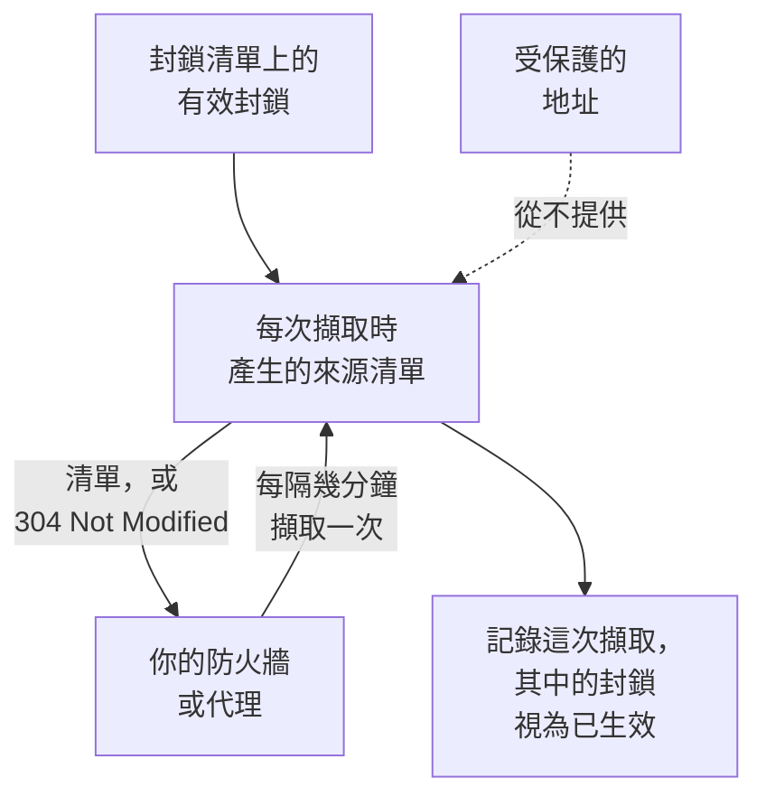

# 適用於防火牆和代理的封鎖清單來源

封鎖清單來源是一個秘密 URL，防火牆或代理每隔幾分鐘從中讀取專案的[封鎖清單](/docs/telemetry/security-cases#封鎖清單)。Palo Alto Networks、FortiGate、Check Point、Cisco Secure Firewall、OPNsense 和 pfSense 把它當作外部清單讀取；從 OneUptime 複製的指令則透過 nftables、ipset、nginx、HAProxy 或 Windows 防火牆套用它。由防火牆主動連線到 OneUptime，因此 OneUptime 不需要進入你網路的路由，也不需要防火牆的密碼。

:::cards
- [建立來源](#建立來源)：選擇防火牆，複製密鑰，依照它的步驟操作。
- [設定防火牆](#設定防火牆)：每種防火牆和代理的步驟，以及擷取頻率。
- [封鎖何時生效](#封鎖何時生效)：只有在防火牆擷取了包含它的清單之後。
- [輪替或撤銷密鑰](#輪替或撤銷密鑰)：新密鑰與舊密鑰重疊一天，或立即全部停用。
:::

## 運作方式



每次擷取時，都會根據那一刻有效的封鎖產生清單。到期或解除的封鎖會從下一次擷取中消失，受保護的地址永遠不會出現在清單中，即使它是在被封鎖之後才受保護的。只有在防火牆擷取了包含某個封鎖的清單之後，該封鎖才在來源上視為已生效。

## 開始之前

- 能從 `https` URL 讀取地址清單的防火牆或代理，或是可以用 root 或系統管理員身分執行指令的 Linux 或 Windows 主機。
- 防火牆能透過 HTTPS 連線到 OneUptime：`https://oneuptime.com`，或你自己的 OneUptime 伺服器地址。
- 可以建立來源的角色：專案擁有者、專案管理員或安全性管理員。安全性成員和安全性檢視者可以查看來源及其擷取記錄。請參閱[角色](/docs/permissions/reference#角色)。

## 建立來源

:::steps
### 開啟封鎖清單來源

開啟 **產品 → 安全事件 → 劇本 → 封鎖清單來源**。

### 新建一個來源

點擊 **建立封鎖清單來源**，並選擇讀取它的 **防火牆**。**名稱** 是封鎖清單在顯示封鎖生效位置時對該來源的稱呼；留空時會以防火牆命名，例如「FortiGate feed」。在 **更多欄位** 下，**提供** 用於選擇 IPv4 與 IPv6、僅 IPv4 或僅 IPv6，**允許的來源地址** 用於限制誰可以讀取該來源。

### 複製密鑰

來源的頁面開啟時會顯示它的密鑰，且只顯示一次：OneUptime 只保存它的雜湊。複製密鑰，然後點擊 **完成**。在你離開頁面之前，頁面上的步驟會為你填好密鑰。

### 依照防火牆的步驟操作

**設定防火牆** 會顯示要貼上的 URL、防火牆傳送密鑰的方式，以及在防火牆自己的主控台中要執行的步驟，並已填好相應的值。在那裡選擇其他防火牆，即可查看它的步驟。防火牆第一次擷取後，來源的狀態會變為 **正在讀取**，**擷取記錄** 中也會列出這次擷取。
:::

## 來源提供的內容

| 檔案 | 適用於 | 內容 |
| --- | --- | --- |
| `blocklist.txt` | Palo Alto Networks、pfSense、ipset、HAProxy、Windows 防火牆以及其他任何防火牆 | 每行一個地址或範圍。 |
| `blocklist.txt?comments=1` | 會略過以 `#` 開頭之行的 FortiGate、Check Point、Cisco Secure Firewall 和 OPNsense | 每個地址或範圍之前有一行說明封鎖原因。 |
| `nftables.nft` | nftables | 供 `nft -f` 使用的檔案，會清空並重新填入 `inet oneuptime` 表格中的 `blocklist_v4` 與 `blocklist_v6` 集合。 |
| `nginx.conf` | nginx | 每個地址或範圍一行 `deny`。 |
| 在檔名後加上 `.md5`，例如 `blocklist.txt.md5` | Cisco Secure Firewall | 檔案的 MD5，讓防火牆只在清單變更時才下載。 |

來源的 URL 是 `https://oneuptime.com/api/blocklist-feed/<feed ID>/<file>`，來源的頁面會顯示為你的防火牆填好的 URL。加上 `?comments=1` 後，清單如下：

```text
# OneUptime case CASE-42 until 2026-11-21 10:42 UTC
203.0.113.7
# OneUptime blocklist until lifted
198.51.100.0/24
```

來源提供動作為 **封鎖** 的有效封鎖。它從不提供挑戰，因為防火牆無法執行挑戰；僅提供 IPv4 或僅提供 IPv6 的來源會排除另一類地址。由於 nftables 不接受同一集合中彼此重疊的項目，nftables 檔案會排除已被清單中其他範圍包含的地址。

沒有任何封鎖時，`blocklist.txt` 只包含一個地址 `192.0.2.1`（僅提供 IPv6 的來源為 `2001:db8::1`）。這是專供文件使用的地址，網際網路上沒有來自它的流量：Palo Alto Networks 和 Cisco 在收到空清單時會保留上一次讀取的清單，因此空清單會讓你已解除的封鎖繼續生效。

每個回應都帶有 `ETag`。防火牆在 `If-None-Match` 中把它送回時，只要清單沒有變更，就會收到 `304 Not Modified`，OneUptime 提供的指令也是這樣做的。

## 防火牆如何傳送密鑰

| 方式 | 防火牆傳送的內容 | 使用者 |
| --- | --- | --- |
| 基本驗證 | 任意使用者名稱（例如 `oneuptime`），密碼為密鑰 | Palo Alto Networks（僅限 HTTPS）、FortiGate 和 Check Point |
| Bearer 權杖 | `Authorization: Bearer <secret>` | 用於 nftables、ipset、nginx、HAProxy 和 Windows 防火牆的指令 |
| URL 中的密鑰 | `https://oneuptime.com/api/blocklist-feed/<feed ID>/<secret>/blocklist.txt` | 文件中沒有說明傳送密鑰方式的 Cisco Secure Firewall、OPNsense 和 pfSense |

沒有密鑰或密鑰錯誤的請求會收到 `401 Unauthorized`。包含錯誤密鑰的 URL 會收到 `404 Not Found`，與不存在的地址一樣。OneUptime 自己的 Web 伺服器不會把來源的 URL 寫入存取記錄，因此 URL 中的密鑰不會留在那裡。

## 限制誰可以讀取來源

**更多欄位** 下的 **允許的來源地址** 最多可填寫 50 個地址和範圍，每行一個，例如 `203.0.113.7` 或 `198.51.100.0/24`。來自其他地址的請求即使帶有正確的密鑰，也會收到 `403 Forbidden`。留空則允許持有密鑰的任何地址讀取該來源。

每個地址每分鐘最多擷取同一個來源 60 次，所有來源合計每分鐘最多 600 次。超過後會收到帶有 `Retry-After` 標頭的 `429 Too Many Requests`。

## 封鎖何時生效

封鎖建立之後，只要防火牆擷取了包含它的清單，該封鎖就在來源上視為已生效，並在每次這樣的擷取後持續 10 分鐘。`304 Not Modified` 回應也算作擷取了同一個清單。此時 **封鎖清單** 的 **生效於** 中該來源的標籤會變成綠色，提示會說明防火牆在封鎖建立多久後擷取了它，例如「防火牆在此封鎖建立 3 分鐘 後從 FortiGate feed 擷取了它。最近一次擷取：2 分鐘前。」

如果 10 分鐘內沒有擷取，標籤會顯示防火牆此後再未擷取該來源：防火牆可能仍在封鎖該地址，但 OneUptime 無法確認。因此，請讓你的防火牆每 5 分鐘或更頻繁地擷取來源。擷取頻率較低的防火牆（例如 OPNsense）在兩次擷取之間仍會封鎖，而 OneUptime 只在每次擷取後的 10 分鐘內認為封鎖在那裡已生效。

到期或解除的封鎖會從下一次擷取中消失，它的標籤會等待防火牆擷取不含它的清單。當 OneUptime 無法讀取哪些地址受保護時，來源會回傳帶有 `Retry-After: 60` 的 `503 Service Unavailable`，而不是一個可能包含受保護地址的清單；防火牆會保留已有的清單。

## 防火牆停止讀取時

OneUptime 會了解每個來源通常多久被擷取一次。如果某個來源在其通常間隔的三倍時間內（且至少 10 分鐘）沒有被擷取，它的狀態會顯示 **已停止讀取**，**封鎖清單** 會在清單上方列出它，專案擁有者會收到一封電子郵件：「Your firewall stopped reading the blocklist feed _來源名稱_」。在防火牆擷取兩次之前，OneUptime 預期的擷取頻率是每 5 分鐘一次，OPNsense 為每小時一次，pfSense 為每天一次。

下一次擷取會清除這個狀態；之後再次停止時，會再寄送一封電子郵件。密鑰已被撤銷的來源永遠不會被視為已停止。

## 輪替或撤銷密鑰

來源頁面上的 **輪替密鑰** 會建立新的密鑰並只顯示一次。被取代的密鑰在 24 小時內仍然有效，讓你能把新密鑰設定到每台防火牆；**擷取記錄** 會把仍使用舊密鑰的擷取標示為 **上一個密鑰**。在這 24 小時內再次輪替，最舊的密鑰會立即失效。

**撤銷密鑰** 會讓密鑰及其上一個密鑰立即失效：請在密鑰外洩時使用。之後來源不再回應任何人，它的防火牆會保留已有的清單但無法重新整理，直到 **輪替密鑰** 建立新的密鑰。刪除來源會一併刪除來源、它的密鑰和擷取記錄。

## 設定防火牆

來源的頁面會針對你選擇的防火牆顯示這些步驟，並填好 URL、使用者名稱，以及在密鑰剛建立後填好密鑰。

| 防火牆 | 檔案 | 密鑰 | 擷取頻率 | 上限 |
| --- | --- | --- | --- | --- |
| Palo Alto Networks | `blocklist.txt` | 基本驗證 | 5 分鐘（可設定的最短間隔） | 30 個自訂清單，總計 50,000 個地址（PA-3200、PA-5200 和 PA-7000 系列為 150,000 個） |
| FortiGate | `blocklist.txt?comments=1` | 基本驗證 | 5 分鐘（1 到 43,200 分鐘，預設 5 分鐘） | 所有威脅來源合計 300,000 個地址 |
| Check Point | `blocklist.txt?comments=1`，IPv4 | 基本驗證 | 5 分鐘（預設每小時） | 每個來源 50,000 個地址 |
| Cisco Secure Firewall | `blocklist.txt?comments=1` 及其 MD5 | 在 URL 中 | 5 分鐘（預設 2 小時） | |
| OPNsense | `blocklist.txt?comments=1` | 在 URL 中 | 1 小時（可設定的最短間隔） | |
| pfSense | `blocklist.txt` | 在 URL 中 | 1 天（可設定的最短間隔） | |
| nftables、ipset、nginx、HAProxy、Windows 防火牆 | 各自的檔案 | Bearer 權杖 | 1 分鐘 | |

### Palo Alto Networks

1. 在 Web 介面中前往 **Objects → External Dynamic Lists**，然後點擊 **Add**。
2. 將 **Type** 設為 **IP List**，將 **Source** 設為來源的 URL `https://oneuptime.com/api/blocklist-feed/<feed ID>/blocklist.txt`。
3. 開啟 **Client Authentication**，**Username** 填寫 `oneuptime`，**Password** 填寫來源的密鑰。
4. 將 **Check for updates** 設為 **Every Five Minutes**，點擊 **OK** 並 commit。
5. 在 **Policies → Security** 中新增一條規則，將此清單設為 **Source Address**，動作設為 **Deny**，然後 commit。

Palo Alto Networks 只透過 HTTPS 傳送使用者名稱和密碼。它只讀取寫在地址後面的註解，不讀取單獨成行的註解，因此它的來源使用一般清單。請參閱 [Configure the Firewall to Access an External Dynamic List](https://docs.paloaltonetworks.com/pan-os/11-1/pan-os-admin/policy/use-an-external-dynamic-list-in-policy/configure-the-firewall-to-access-an-external-dynamic-list)。

### FortiGate

1. 前往 **Security Fabric → External Connectors**，點擊 **Create New**，並在 **Threat Feeds** 下選擇 **IP Address**。
2. 將 **URL of external resource** 設為來源的 URL `https://oneuptime.com/api/blocklist-feed/<feed ID>/blocklist.txt?comments=1`。
3. 開啟 **HTTP basic authentication**，**Username** 填寫 `oneuptime`，**Password** 填寫來源的密鑰。
4. 將 **Refresh Rate** 設為 5 分鐘，然後點擊 **OK**。
5. 在 **Policy & Objects → Firewall Policy** 中，將此來源用作策略的 **Source**，並將 **Action** 設為 **DENY**。

請參閱 [Configuring a threat feed](https://docs.fortinet.com/document/fortigate/7.6.0/administration-guide/379433/configuring-a-threat-feed)。

### Check Point

1. 在 SmartConsole 中開啟 **Object Explorer**，選擇 **New → More → Network Object → Network Feed**。
2. 將 **Feed URL** 設為來源的 URL `https://oneuptime.com/api/blocklist-feed/<feed ID>/blocklist.txt?comments=1`，**Format** 設為 **Flat list**，**Data type** 設為 **IP Address**。
3. 在 **Advanced Settings** 的 **Authentication** 中，**Username** 填寫 `oneuptime`，密碼填寫來源的密鑰。
4. 將 **Check feed interval** 設為 5 分鐘，點擊 **Test Feed**，然後點擊 **OK**。
5. 將此來源用作動作為 **Drop** 的 Access Control 規則的 **Source**，然後安裝策略。

Check Point 的網路來源文件只說明了 IPv4 地址，因此為它建立的來源只提供 IPv4。請參閱 [Network Feed](https://sc1.checkpoint.com/documents/R82/WebAdminGuides/EN/CP_R82_SecurityManagement_AdminGuide/Content/Topics-SECMG/Network_Feed.htm)。

### Cisco Secure Firewall

1. 在管理中心中選擇 **Objects → Security Intelligence**，然後點擊 **Add Network Lists and Feeds**。
2. 將 **Type** 設為 **Feed**，將 **Feed URL** 設為來源的 URL `https://oneuptime.com/api/blocklist-feed/<feed ID>/<secret>/blocklist.txt?comments=1`，將 **MD5 URL** 設為在同一 URL 的 `blocklist.txt` 後加上 `.md5`。
3. 將 **Update Frequency** 設為 5 分鐘並儲存。
4. 在存取控制策略中開啟 **Security Intelligence → Networks**，將此來源加入 **Block List**，然後儲存並部署。

更新頻率為 30 分鐘或更短時，Cisco 需要 MD5 URL；而它的受管裝置每 30 分鐘從管理中心取得一次更新，因此封鎖會在來源被擷取後最多 30 分鐘內到達這些裝置。請參閱 [Creating Security Intelligence feeds](https://docs.manage.security.cisco.com/cdfmc/t_creating_security_intelligence_feeds.html)。

### OPNsense

1. 前往 **Firewall → Aliases**，新增一個類型為 **URL Table (IPs)** 的別名。
2. 將 **Content** 設為來源的 URL `https://oneuptime.com/api/blocklist-feed/<feed ID>/<secret>/blocklist.txt?comments=1`，將 **Refresh Frequency** 設為 0 天 1 小時。
3. 儲存並點擊 **Apply**，然後在 **Firewall → Rules** 中新增一條規則，封鎖 **Source** 為此別名的流量。

OPNsense 最多每小時擷取一次 URL 表，因此 OneUptime 只在每次擷取後的 10 分鐘內確認其封鎖。兩次擷取之間它仍會繼續封鎖。請參閱 [Aliases](https://docs.opnsense.org/manual/aliases.html)。

### pfSense

1. 前往 **Firewall → Aliases**，點擊 **Add** 並選擇 **URL Table (IPs)**。
2. 輸入來源的 URL `https://oneuptime.com/api/blocklist-feed/<feed ID>/<secret>/blocklist.txt`，並將其設定為每 1 天重新整理一次。
3. 點擊 **Save** 和 **Apply Changes**，然後在 **Firewall → Rules** 中新增一條規則，將此別名設為 **Source**，動作設為 **Block**。

> [!WARNING]
> pfSense 最多每天擷取一次 URL 表：太慢，無法在攻擊發生時封鎖。請將它用於長期封鎖，並搭配一台每隔幾分鐘擷取一次的防火牆。

請參閱 [Alias Types](https://docs.netgate.com/pfsense/en/latest/firewall/aliases-types.html)。

### nftables

以 root 身分執行一次來源頁面上顯示的指令。它們會建立帶有 `blocklist_v4` 與 `blocklist_v6` 兩個集合的 `inet oneuptime` 表格、在其 `input` 與 `forward` 鏈中丟棄來自集合中地址之流量的規則，以及指令碼 `/usr/local/sbin/oneuptime-blocklist`。指令碼把密鑰保存在只有 root 能讀取的 `/etc/oneuptime-blocklist` 中。

```bash
# Run once, as root.
install -d -m 700 /etc/oneuptime-blocklist /var/lib/oneuptime-blocklist
printf 'Authorization: Bearer %s\n' 'YOUR_FEED_SECRET' > /etc/oneuptime-blocklist/auth
chmod 600 /etc/oneuptime-blocklist/auth
cat > /usr/local/sbin/oneuptime-blocklist <<'SCRIPT'
#!/bin/sh
# Loads the OneUptime blocklist into nftables when it changed.
set -eu
URL='https://oneuptime.com/api/blocklist-feed/<feed ID>/nftables.nft'
STATE=/var/lib/oneuptime-blocklist
if ! nft list table inet oneuptime >/dev/null 2>&1; then
  rm -f "$STATE/etag"
  nft -f - <<'NFT'
table inet oneuptime {
  set blocklist_v4 { type ipv4_addr; flags interval; auto-merge; }
  set blocklist_v6 { type ipv6_addr; flags interval; auto-merge; }
  chain input {
    type filter hook input priority filter; policy accept;
    ip saddr @blocklist_v4 drop
    ip6 saddr @blocklist_v6 drop
  }
  chain forward {
    type filter hook forward priority filter; policy accept;
    ip saddr @blocklist_v4 drop
    ip6 saddr @blocklist_v6 drop
  }
}
NFT
fi
TMP=$(mktemp)
trap 'rm -f "$TMP" "$TMP.h"' EXIT
ETAG=$(cat "$STATE/etag" 2>/dev/null || true)
CODE=$(curl --silent --show-error --max-time 60 --header @/etc/oneuptime-blocklist/auth \
  ${ETAG:+--header "If-None-Match: $ETAG"} \
  --dump-header "$TMP.h" --output "$TMP" --write-out '%{http_code}' "$URL")
[ "$CODE" = 304 ] && exit 0
[ "$CODE" = 200 ] || { echo "oneuptime-blocklist: the feed answered $CODE" >&2; exit 1; }
nft -f "$TMP"
sed -n 's/^[Ee][Tt][Aa][Gg]:[[:space:]]*//p' "$TMP.h" | tr -d '\r' > "$STATE/etag"
SCRIPT
chmod 700 /usr/local/sbin/oneuptime-blocklist
echo '* * * * * root flock -n /run/oneuptime-blocklist.lock /usr/local/sbin/oneuptime-blocklist' > /etc/cron.d/oneuptime-blocklist
/usr/local/sbin/oneuptime-blocklist
```

指令碼每分鐘由 `/etc/cron.d/oneuptime-blocklist` 執行。它只在清單變更時以單一交易載入 `nftables.nft`，因此集合永遠不會處於填到一半的狀態。請參閱 [Sets](https://wiki.nftables.org/wiki-nftables/index.php/Sets)。

### ipset 與 iptables

以 root 身分執行一次來源頁面上顯示的指令。它們會建立 `oneuptime_v4` 與 `oneuptime_v6` 兩個集合，以及 iptables 與 ip6tables 在 `raw` 表格 `PREROUTING` 鏈中丟棄來自集合中地址之流量的規則。

指令碼每分鐘由 cron 執行。清單變更時，它會填入兩個新集合並替換舊集合，因此規則永遠不會看到填到一半的集合。請參閱 [ipset](https://ipset.netfilter.org/ipset.man.html)。

### nginx

將 include 行加入要保護之每個網站的 `server` 區塊，然後以 root 身分執行一次來源頁面上顯示的指令：

```nginx
server {
    include /etc/nginx/oneuptime-blocklist.conf;
}
```

```bash
# Run once, as root.
install -d -m 700 /etc/oneuptime-blocklist /var/lib/oneuptime-blocklist
printf 'Authorization: Bearer %s\n' 'YOUR_FEED_SECRET' > /etc/oneuptime-blocklist/auth
chmod 600 /etc/oneuptime-blocklist/auth
touch /etc/nginx/oneuptime-blocklist.conf
cat > /usr/local/sbin/oneuptime-blocklist <<'SCRIPT'
#!/bin/sh
# Writes the OneUptime blocklist for nginx when it changed, and reloads nginx.
set -eu
URL='https://oneuptime.com/api/blocklist-feed/<feed ID>/nginx.conf'
STATE=/var/lib/oneuptime-blocklist
TMP=$(mktemp)
trap 'rm -f "$TMP" "$TMP.h"' EXIT
ETAG=$(cat "$STATE/etag" 2>/dev/null || true)
CODE=$(curl --silent --show-error --max-time 60 --header @/etc/oneuptime-blocklist/auth \
  ${ETAG:+--header "If-None-Match: $ETAG"} \
  --dump-header "$TMP.h" --output "$TMP" --write-out '%{http_code}' "$URL")
[ "$CODE" = 304 ] && exit 0
[ "$CODE" = 200 ] || { echo "oneuptime-blocklist: the feed answered $CODE" >&2; exit 1; }
cp /etc/nginx/oneuptime-blocklist.conf "$STATE/last.conf"
cp "$TMP" /etc/nginx/oneuptime-blocklist.conf
if nginx -t -q; then nginx -s reload; else cp "$STATE/last.conf" /etc/nginx/oneuptime-blocklist.conf; exit 1; fi
sed -n 's/^[Ee][Tt][Aa][Gg]:[[:space:]]*//p' "$TMP.h" | tr -d '\r' > "$STATE/etag"
SCRIPT
chmod 700 /usr/local/sbin/oneuptime-blocklist
echo '* * * * * root flock -n /run/oneuptime-blocklist.lock /usr/local/sbin/oneuptime-blocklist' > /etc/cron.d/oneuptime-blocklist
/usr/local/sbin/oneuptime-blocklist

# Then add this line to the server block of the site to protect, and reload nginx:
#   include /etc/nginx/oneuptime-blocklist.conf;
```

指令碼每分鐘由 cron 執行。清單變更時，它會寫入 `/etc/nginx/oneuptime-blocklist.conf`，用 `nginx -t` 檢查設定並重新載入 nginx；檢查失敗時會還原先前的檔案。

在負載平衡器或 CDN 之後，除非設定了 realip 模組，否則 nginx 看到的是負載平衡器的地址，而不是訪客的地址：將 `set_real_ip_from` 設為負載平衡器的地址，將 `real_ip_header` 設為它傳送的標頭，或改為在負載平衡器上封鎖。請參閱 [ngx_http_access_module](https://nginx.org/en/docs/http/ngx_http_access_module.html)。

### HAProxy

以 root 身分建立清單檔案，並在 `haproxy.cfg` 中加入兩行，然後重新載入一次 HAProxy：它的 Runtime API 只能更新 HAProxy 已在讀取的清單。

```text
global
    stats socket /run/haproxy/admin.sock mode 660 level admin

frontend www
    http-request deny if { src -n -f /etc/haproxy/oneuptime-blocklist.lst }
```

然後執行來源頁面上顯示的其餘指令。指令碼每分鐘由 cron 執行，清單變更時會寫入 `/etc/haproxy/oneuptime-blocklist.lst`，並透過 Runtime API 更新 HAProxy，無需重新載入。請參閱 [The Runtime API](https://docs.haproxy.org/3.4/management.html#9.3)。

### Windows 防火牆

以系統管理員身分在 PowerShell 中執行一次來源頁面上顯示的指令。它們會把指令碼和密鑰保存在只有 SYSTEM 和 Administrators 能讀取的 `C:\ProgramData\OneUptime\Blocklist` 中，並註冊排程工作「OneUptime Blocklist」，以 SYSTEM 身分每分鐘執行一次指令碼。

指令碼維護輸入規則來封鎖清單中的每個地址，每條規則 1,000 個：「OneUptime blocklist 0」、「OneUptime blocklist 1」，依此類推。請參閱 [Set-NetFirewallRule](https://learn.microsoft.com/en-us/powershell/module/netsecurity/set-netfirewallrule)。

### 其他防火牆

1. 將你的防火牆或代理指向來源的 URL `https://oneuptime.com/api/blocklist-feed/<feed ID>/blocklist.txt`：每行一個地址或範圍。
2. 將來源的密鑰作為基本驗證的密碼（使用者名稱不限）傳送，或作為 Bearer 權杖傳送。
3. 讓它每 5 分鐘或更頻繁地擷取清單：每次擷取後的 10 分鐘內，封鎖在那裡視為已生效。

### Kubernetes

在叢集前面的邊緣或雲端 WAF 上封鎖：在 **安全性連線** 或 **雲端連線** 中把它連線為封鎖清單的生效位置；或者在叢集前面你自己執行的代理上，使用 nginx 或 HAProxy 的指令。社群版 Ingress NGINX 控制器已經停止維護，其程式碼存放庫已於 2026 年 3 月封存，因此 OneUptime 不為它的註解提供文件。請參閱 [Ingress NGINX Retirement](https://kubernetes.io/blog/2025/11/11/ingress-nginx-retirement/)。

## 限制

| 項目 | 限制 |
| --- | --- |
| 來源中的項目 | 20,000 個 |
| 允許的來源地址 | 50 個地址和範圍 |
| 一個地址擷取同一個來源的次數 | 每分鐘 60 次 |
| 一個地址擷取所有來源的次數 | 每分鐘 600 次 |
| 被取代的密鑰繼續有效的時間 | 24 小時 |
| 擷取後封鎖視為已生效的時間 | 10 分鐘 |
| 擷取記錄的保留時間 | 30 天 |

## 疑難排解

:::details 防火牆收到 401 Unauthorized
它傳送的密鑰不是該來源的密鑰。請檢查密碼或 Bearer 權杖是否是完整的密鑰，前後沒有多餘的字元。超過 24 小時前被取代的密鑰已不再有效：**輪替密鑰** 會建立新的密鑰。
:::

:::details 防火牆收到 404 Not Found
URL 指向了不存在的來源、來源不提供的檔案，或者 URL 中的密鑰是錯誤的。請從來源的頁面重新複製 URL。
:::

:::details 防火牆收到 403 Forbidden
來源的 **允許的來源地址** 中沒有防火牆用於擷取的地址。**擷取記錄** 會顯示每次擷取來自哪個地址。
:::

:::details 封鎖的標籤顯示正在等待防火牆擷取該來源
封鎖建立後還沒有防火牆擷取過該來源。請查看來源頁面上的 **擷取記錄**：每 5 分鐘擷取一次的防火牆會在 5 分鐘內套用該封鎖。
:::

## 後續步驟

:::cards
- [安全案例和劇本](/docs/telemetry/security-cases)：從案例中手動封鎖地址，或透過劇本封鎖。
- [威脅情資](/docs/telemetry/threat-intelligence)：將已知的惡意地址匯入 OneUptime。
- [安全事件](/docs/telemetry/security-events)：找出值得封鎖的地址。
:::
