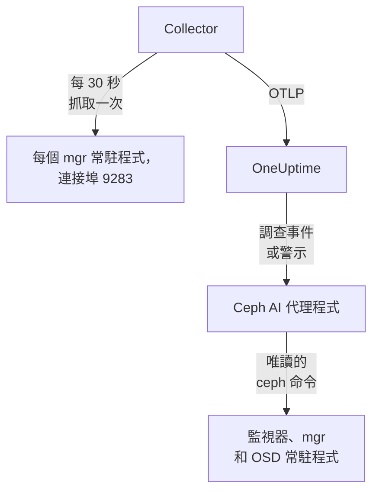

# Ceph 代理程式

OneUptime Ceph 代理程式會監控 Ceph 叢集：它的健康狀態、監視器仲裁、OSD、儲存池和放置群組。它會在每個 mgr 常駐程式上抓取 Ceph mgr 的 `prometheus` 模組，為每個指標加上你的叢集名稱，並傳送到 OneUptime，叢集會在那裡連同其 OSD、儲存池和常駐程式一起顯示。[Ceph 監控](/docs/monitor/ceph-monitor) 會根據收到的資料發出警示。

:::cards
- [安裝代理程式](#安裝代理程式): 啟用 mgr 模組，再使用安裝指令碼或 Docker Compose。
- [代理程式收集的內容](#代理程式收集的內容): Ceph 頁面、指標和警示範本背後的序列。
- [AI 代理程式](#ai-代理程式): 讓 OneUptime AI 在調查時讀取叢集。
- [疑難排解](#疑難排解): 一個診斷指令碼，以及常見問題。
:::

## 運作方式

代理程式是你在一台機器上用 Docker Compose 執行的兩個容器。OpenTelemetry Collector 每 30 秒在每個 mgr 常駐程式上抓取 mgr 的 `prometheus` 模組。只有作用中的 mgr 會回傳指標，因此當它容錯移轉到待命 mgr 時，指標會繼續送達，無需任何變更。旁邊的 Ceph AI 代理程式讓 OneUptime AI 在調查事件或警示時執行唯讀的 `ceph` 命令。



叢集會隨其第一批資料，以代理程式作為 `ceph.cluster.name` 加到每個指標上的名稱自行註冊。

## 開始之前

- Docker Engine 20.10 或更新版本，搭配 Docker Compose v2 外掛程式，所在機器要能透過連接埠 9283 連到你的 Ceph mgr 常駐程式。
- Ceph 管理節點上的一個 shell，`ceph` CLI 在其中能以管理員權限執行。
- 一把擷取金鑰。在 **專案設定 → 遙測與 APM → 擷取金鑰** 下建立一把並複製其值。
- 從該機器到你的 OneUptime URL 的輸出 HTTPS。

## 安裝代理程式

:::steps
### 啟用 mgr 的 prometheus 模組

在 Ceph 管理節點上：

```bash
ceph mgr module enable prometheus
```

之後每個 mgr 常駐程式都會在連接埠 `9283` 的 `/metrics` 上提供 Prometheus 指標。只有作用中的 mgr 會回傳指標：待命 mgr 會回傳空白回應；若 `mgr/prometheus/standby_behaviour` 設為 `error`，則回傳 HTTP 錯誤。這就是代理程式要抓取每個 mgr 的原因。列出它們：

```bash
ceph mgr stat                    # active mgr
ceph orch ps --daemon-type mgr   # all mgrs (cephadm clusters)
```

### 安裝並啟動代理程式

:::tabs
@tab install.sh
下載安裝指令碼，並在將要裝載代理程式的機器上執行它：

```bash
curl -sSL https://raw.githubusercontent.com/OneUptime/oneuptime/master/agents/CephAgent/install.sh -o install.sh
bash install.sh
```

指令碼會詢問你的 OneUptime URL、擷取金鑰、叢集名稱和 mgr 端點，以及 [AI 代理程式](#ai-代理程式) 是否可以套用修正。在 `ceph` 能以管理員權限執行的地方，它也會提議為 AI 代理程式建立專用的 Ceph 用戶端。它會安裝到 `/opt/oneuptime-ceph-agent`，寫入一個 `0600` 權限的 `.env` 檔案，並用 Docker Compose 啟動代理程式。再次執行指令碼會重複使用該 `.env` 中的所有內容，不會再次詢問，這就是 [升級代理程式](#升級代理程式) 的方式。
@tab Docker Compose
從 [CephAgent 目錄](https://github.com/OneUptime/oneuptime/tree/master/agents/CephAgent) 下載 `docker-compose.yml` 和 `otel-collector-config.yaml` 到一個新資料夾中：

```bash
mkdir oneuptime-ceph-agent && cd oneuptime-ceph-agent
curl -fsSLO https://raw.githubusercontent.com/OneUptime/oneuptime/master/agents/CephAgent/docker-compose.yml
curl -fsSLO https://raw.githubusercontent.com/OneUptime/oneuptime/master/agents/CephAgent/otel-collector-config.yaml
```

在它們旁邊建立一個 `.env` 檔案：

```bash title=".env"
ONEUPTIME_URL=YOUR_ONEUPTIME_URL
ONEUPTIME_TELEMETRY_INGESTION_KEY=YOUR_TELEMETRY_INGESTION_TOKEN
CEPH_CLUSTER_NAME=my-ceph-cluster
CEPH_MGR_ENDPOINTS=[ceph-mon-1:9283,ceph-mon-2:9283,ceph-mon-3:9283]
```

列出每個 mgr 常駐程式，包括作用中的和待命的，以逗號分隔並放在方括號中：方括號會讓 Collector 將該值讀作抓取目標清單。啟動代理程式：

```bash
docker compose up -d
```

AI 代理程式的容器也會啟動，並等待它自己的 Ceph 用戶端：請參閱 [AI 代理程式](#ai-代理程式)。
:::

### 檢查代理程式是否正在執行

```bash
docker compose ps
docker logs -f oneuptime-ceph-agent
```

`docker compose ps` 會列出 Collector（`oneuptime-ceph-agent`）和 AI 代理程式（`oneuptime-ceph-ai-agent`）。Collector 啟動後，其日誌中應出現這一行：

```text
Everything is ready. Begin running and processing data.
```

### 在 OneUptime 中找到叢集

開啟 **產品 → 基礎設施 → Ceph → 所有叢集**。大約一分鐘內，叢集會以其 `CEPH_CLUSTER_NAME` 出現，並帶有其 OSD、儲存池和常駐程式。
:::

## 環境變數

安裝指令碼會將這些寫入 `/opt/oneuptime-ceph-agent/.env`；Docker Compose 安裝則會從 `docker-compose.yml` 旁邊的 `.env` 中讀取它們。變更其中任何一個之後，請在該資料夾中執行 `docker compose up -d`。

| 變數 | 必要 | 說明 |
| --- | --- | --- |
| `ONEUPTIME_URL` | 是 | 你的 OneUptime URL，例如 `https://oneuptime.com` 或你的自行託管執行個體。如果執行個體只支援 HTTP，請使用 `http://` 及其連接埠。 |
| `ONEUPTIME_TELEMETRY_INGESTION_KEY` | 是 | 來自 **專案設定 → 遙測與 APM → 擷取金鑰** 的擷取金鑰。 |
| `CEPH_CLUSTER_NAME` | 是 | 叢集在 OneUptime 中的名稱，會作為 `ceph.cluster.name` 資源屬性加到每個指標上。請保持不變：之後變更它會註冊另一個叢集。預設為 `ceph`。 |
| `CEPH_MGR_ENDPOINTS` | 是 | 每個 mgr 常駐程式，寫成放在方括號中、以逗號分隔的 `host:port` 清單，例如 `[ceph-mon-1:9283,ceph-mon-2:9283,ceph-mon-3:9283]`。安裝指令碼會為你加上方括號。 |

AI 代理程式自己的設定請見 [AI 代理程式](#ai-代理程式)。

## 代理程式如何抓取

- **每個 mgr，每 30 秒一次。** mgr 的 `prometheus` 模組會將每次抓取結果快取 `mgr/prometheus/scrape_interval`（預設 15 秒）。抓取頻率切勿高於此值：否則只會再次讀取快取。
- **`honor_labels: true`。** Ceph 匯出的標籤（`ceph_daemon`、`pool_id`、每個常駐程式的執行個體標籤）會保持原樣。沒有它，`instance` 標籤會針對每個抓取目標被改寫，並在每次作用中的 mgr 變更時改變，進而打斷每個序列。

## 代理程式收集的內容

代理程式會傳送 mgr 的 `prometheus` 模組匯出的所有內容。OneUptime 的 Ceph 頁面、指標目錄和警示範本建立在以下序列之上：

| 類別 | 指標 |
| --- | --- |
| 叢集健康 | `ceph_health_status`（0 = OK，1 = WARN，2 = ERR）、`ceph_health_detail`（每個作用中的健康檢查一個序列，帶有 `name` 和 `severity` 標籤，從 Quincy 開始；健康檢查警示範本和概覽中 **Active Health Checks** 的資料來源）、`ceph_healthcheck_slow_ops`、`ceph_daemon_health_metrics`（依常駐程式，以 `type` 為鍵）、`ceph_mon_quorum_status`、`ceph_mon_metadata`、`ceph_cluster_total_bytes`、`ceph_cluster_total_used_bytes` |
| OSD | `ceph_osd_up`、`ceph_osd_in`、`ceph_osd_apply_latency_ms`、`ceph_osd_commit_latency_ms`、`ceph_osd_stat_bytes`、`ceph_osd_stat_bytes_used`、`ceph_osd_numpg`、`ceph_osd_metadata`，依 OSD 以 `ceph_daemon` 標籤區分（例如 `osd.3`） |
| 儲存池 | `ceph_pool_stored`、`ceph_pool_max_avail`、`ceph_pool_objects`、`ceph_pool_rd`、`ceph_pool_wr`、`ceph_pool_rd_bytes`、`ceph_pool_wr_bytes`、`ceph_pool_metadata`。資料序列只帶有 `pool_id` 標籤；儲存池的名稱在 `ceph_pool_metadata` 上。 |
| 放置群組 | `ceph_pg_total`、`ceph_pg_active`、`ceph_pg_clean`、`ceph_pg_degraded`、`ceph_pg_undersized`（皆依儲存池，以 `pool_id` 區分）、`ceph_num_objects_degraded`、`ceph_num_objects_misplaced` |
| 常駐程式 | `ceph_mgr_metadata`、`ceph_mds_metadata` 和 `ceph_rgw_metadata`，加上上方的監視器和 OSD 中繼資料。每個都指出一個常駐程式，並在 `ceph_version` 標籤中帶有其版本：**Daemons** 頁面會列出它們。 |

### 更多抓取目標

mgr 模組涵蓋叢集的健康狀態和容量。若要深入查看，請在 `otel-collector-config.yaml` 的 `scrape_configs` 下新增更多工作：

- **`ceph-exporter`（Reef 18.2 及更新版本）。** cephadm 會在每台叢集主機上執行一個 `ceph-exporter` 常駐程式，在連接埠 `9926` 上提供每個常駐程式的效能計數器。每台主機新增一個目標。
- **`node_exporter`。** 每台 Ceph 主機的 CPU、記憶體、磁碟和網路指標的常用搭檔，預設連接埠為 `9100`。

兩者都會從隨附的 `resource` 處理器取得 `ceph.cluster.name` 資源屬性，因此會落到 OneUptime 中的同一個叢集上。

## 選用 — 傳送 Ceph 叢集日誌

代理程式可以追蹤 `/var/log/ceph/ceph.log` 並將其傳送到 OneUptime，進而填入叢集的 **Cluster Log** 頁面。它預設為關閉，因為這時代理程式必須在擁有叢集日誌的主機上執行：預設是監視器主機。

:::steps
### 開啟接收器

在 `otel-collector-config.yaml` 中，取消註解 `filelog` 接收器和 `logs` 管線。

### 掛載日誌目錄

在 `docker-compose.yml` 中，取消註解將該目錄掛載到 Collector 中的磁碟區：

```yaml
- /var/log/ceph:/var/log/ceph:ro
```

### 重新啟動代理程式

```bash
docker compose up -d
```
:::

日誌行在寫入時即會傳送。OneUptime 在顯示時會讀取 `ceph.log` 的格式（時間、常駐程式、`INF`/`WRN`/`ERR` 層級、訊息），而 `resource` 處理器會加上 `ceph.cluster.name`，因此日誌會落到這個叢集上。

## 用專案標籤標記叢集

以 `oneuptime.label.` 開頭的資源屬性會成為叢集上的專案標籤：`oneuptime.label.<dimension>=<value>` 就是標籤 `<dimension>:<value>`。在 `otel-collector-config.yaml` 的 `resource` 處理器中，緊鄰 `ceph.cluster.name` 新增這些屬性：

```yaml
processors:
  resource:
    attributes:
      # ...existing attributes...
      - key: oneuptime.label.team
        value: storage
        action: upsert
      - key: oneuptime.label.env
        value: production
        action: upsert
```

Collector 只在啟動時讀取其設定：請執行 `docker compose restart oneuptime-ceph-agent`。之後叢集會顯示標籤 `team:storage` 和 `env:production`。標籤比對不區分大小寫，因此現有的 `Production` 標籤會被重複使用而不是重複建立，而且代理程式絕不會移除別人在 OneUptime 中新增的標籤。

## 以 systemd 服務執行

若要讓代理程式隨機器啟動，並在失敗時重新啟動，請安裝它的 systemd 單元。它假設代理程式位於 `/opt/oneuptime-ceph-agent`，也就是安裝指令碼放置它的位置：

```bash
sudo curl -fsSL https://raw.githubusercontent.com/OneUptime/oneuptime/master/agents/CephAgent/systemd/oneuptime-ceph-agent.service -o /etc/systemd/system/oneuptime-ceph-agent.service
sudo systemctl daemon-reload
sudo systemctl enable --now oneuptime-ceph-agent
```

## 升級代理程式

代理程式會將其檔案所固定的 Collector 版本回報為它的 **代理程式版本**。當它比此 OneUptime 發行版本所固定的版本舊時，叢集 **概覽** 上它的旁邊會出現警告標誌。選取該標誌即可看到這些指令。在其檔案開始回報版本之前安裝的代理程式，在以這種方式升級之前不會顯示版本。

Collector 映像檔固定在 `docker-compose.yml` 中，其設定是旁邊的一個檔案，因此只提取映像檔並不能讓代理程式升級。請再次執行 `install.sh`：它會重複使用你現有 `.env` 中的每個值（不會再詢問任何內容），重新整理 `docker-compose.yml` 和 `otel-collector-config.yaml`（你編輯過的檔案會保留為 `<file>.bak.<timestamp>`），提取映像檔並重新建立代理程式，讓 Collector 讀取新的設定。AI 代理程式的 `ceph/` 資料夾會保持原樣。

```bash
curl -sSL https://raw.githubusercontent.com/OneUptime/oneuptime/master/agents/CephAgent/install.sh -o install.sh
bash install.sh
```

改用 Docker Compose 安裝的？在代理程式的資料夾中重新下載這兩個檔案（並重新做一次你對它們所做的任何修改），然後提取映像檔並重新建立代理程式：

```bash
curl -fsSLO https://raw.githubusercontent.com/OneUptime/oneuptime/master/agents/CephAgent/docker-compose.yml
curl -fsSLO https://raw.githubusercontent.com/OneUptime/oneuptime/master/agents/CephAgent/otel-collector-config.yaml
docker compose pull
docker compose up -d --force-recreate
```

## 解除安裝代理程式

```bash
cd /opt/oneuptime-ceph-agent
docker compose down
```

如果你建立了 AI 代理程式的 Ceph 用戶端，請在管理節點上用 `ceph auth del client.oneuptime-ai` 移除它。

## AI 代理程式

代理程式的 `docker-compose.yml` 也會執行 **Ceph AI 代理程式**，也就是 `oneuptime-ceph-ai-agent`（映像檔 `oneuptime/resource-ai-agent:release`）。當 OneUptime AI 調查此叢集上的事件或警示時，會透過它執行唯讀的 `ceph` 命令——`ceph health detail`、`ceph osd tree`、`ceph pg dump_stuck`、`ceph crash ls`——並且只在你允許時套用修正，例如將 OSD 重新標記為 in 或清除 `noout`。它和 Collector 一樣，註冊為名為 `CEPH_CLUSTER_NAME` 的叢集，並顯示在 OneUptime 中該叢集的 **人工智慧 → AI 代理程式** 頁面上。

- **AI 調查預設為開啟。** 代理程式連線後，OneUptime AI 會用它來調查該叢集上的事件和警示，叢集的 **概覽** 會顯示代理程式的狀態。若要停止，請在代理程式執行的位置設定 `ONEUPTIME_AI_INVESTIGATION=false`（AI 代理程式頁面上 **AI 可以執行的操作** 下的 **變更** 會顯示方法），或不安裝代理程式。
- **它自己的 Ceph 用戶端就是硬性界限。** 它以 `client.oneuptime-ai` 身分連線，使用叢集的最小 `ceph.conf` 和該用戶端的金鑰圈，兩者放在 `docker-compose.yml` 旁邊的 `ceph/` 資料夾中（以唯讀方式掛載到 `/etc/ceph`）。只有讀取 caps 時，它執行的任何命令都無法變更叢集。全新安裝時，`install.sh` 會提議建立該用戶端；再次執行時絕不會建立。切勿將 admin 金鑰圈放進該資料夾。
- 除非你設定 `ONEUPTIME_AI_ALLOW_WRITES=true` 並為用戶端授予修正所需的 caps（代理程式的 README 列出了這些 caps），否則它是 **唯讀** 的；`ONEUPTIME_AI_WRITE_TARGETS`（例如 `osd.*,cluster`）會限制修正可以觸及的範圍。同一個 `.env` 中的 `ONEUPTIME_AI_FIXES` 決定修正如何執行——`ask-for-approval`（由人逐一核准）、`automatic` 或 `bypass-approval`——AI 代理程式頁面會以唯讀方式顯示它（[AI 可以執行的操作，由代理程式設定](/docs/ai/infrastructure-ai-agents#what-ai-may-do-set-by-the-agent)）。
- 它會對外連線到監視器（TCP 3300 和 6789）以及 mgr 和 OSD 常駐程式（TCP 6800–7300），以 UID 1000 執行且不帶任何 capabilities，絕不執行 `auth`、`config-key`、`tell` 或任何會刪除資料的命令。如果你不使用 OneUptime AI，請從 `docker-compose.yml` 中刪除 `oneuptime-ceph-ai-agent` 服務。

若要手動建立該用戶端，請在 Ceph 管理節點上、代理程式的資料夾中執行以下命令（如果代理程式在另一台機器上，請將這兩個檔案複製到那台機器的 `ceph/` 資料夾中）：

```bash
mkdir -p ceph
ceph config generate-minimal-conf > ceph/ceph.conf
ceph auth get-or-create client.oneuptime-ai mon 'allow r' mgr 'allow r' osd 'allow r' -o ceph/ceph.client.oneuptime-ai.keyring
sudo chown 1000:1000 ceph/ceph.client.oneuptime-ai.keyring
sudo chmod 600 ceph/ceph.client.oneuptime-ai.keyring
docker compose up -d
```

它可以執行什麼、修正如何運作以及如何排解它的問題：[Infrastructure AI Agents](/docs/ai/infrastructure-ai-agents#ceph-clusters)。

## 疑難排解

:::details 先執行診斷指令碼
代理程式隨附一個指令碼 [`troubleshoot.sh`](https://github.com/OneUptime/oneuptime/blob/master/agents/CephAgent/troubleshoot.sh)，它會檢查整條鏈路：容器執行階段、你設定的每個 mgr 端點、加到每個指標上的叢集名稱、權杖的格式、Collector 自身的指標，以及 OneUptime 是否接受擷取金鑰。當沒有任何端點回傳 `ceph_health_status`，或只設定了一個端點時，它會發出警告，因為只有作用中的 mgr 會提供指標。金鑰檢查最重要。OneUptime 會以 `401` 拒絕錯誤的金鑰（已停用的金鑰或瀏覽器金鑰為 `422`），而 Collector 會將兩者都視為永久性錯誤：它會捨棄該批次並記錄一則 `Exporting failed` 錯誤，而容器仍保持正常，這很容易被忽略。該指令碼會從代理程式的網路內部要求 `GET <url>/otlp/v1/validate`，直接得到 `200`（有效）或 `401`（無效），並在較舊的伺服器上改用 `POST /fluentd/v1/logs`。

```bash
curl -sSL https://raw.githubusercontent.com/OneUptime/oneuptime/master/agents/CephAgent/troubleshoot.sh -o troubleshoot.sh
bash troubleshoot.sh    # add -d <dir> if you installed outside /opt/oneuptime-ceph-agent
```

它最後會輸出一個指出最可能原因的結論。
:::

:::details OneUptime 中沒有出現叢集
1. 查看 Collector 的日誌：`docker logs oneuptime-ceph-agent`。匯出時出現 `401` 表示擷取金鑰錯誤；連線被拒表示 `ONEUPTIME_URL` 錯誤。
2. 檢查是否有 mgr 在提供指標：`curl http://ACTIVE_MGR_HOST:9283/metrics | head` 應輸出 `ceph_*` 行。如果沒有，請用 `ceph mgr module enable prometheus` 啟用該模組。
3. 檢查 `CEPH_MGR_ENDPOINTS` 是否放在方括號中。沒有方括號時，Collector 會將整個以逗號分隔的清單讀作一個目標，而這個目標並不存在。
:::

:::details 叢集顯示為已中斷
當 OneUptime 在 15 分鐘內沒有從叢集收到任何資料時，叢集會變為已中斷連線；OneUptime 每 5 分鐘檢查一次，而且它自身未在接收資料的時間不計入。請檢查 Collector 是否在執行（`docker compose ps`）、其日誌是否沒有匯出錯誤，以及機器是否仍能連到你的 OneUptime URL。收到下一批資料後，叢集會重新變為已連線。
:::

:::details mgr 容錯移轉後指標停止
你可能只在抓取以前處於作用中的 mgr。請在 `CEPH_MGR_ENDPOINTS` 中列出每個 mgr 常駐程式：抓取待命 mgr 幾乎沒有成本，它們只會回傳空白回應。
:::

:::details Collector 日誌中出現待命 mgr 的抓取錯誤
當你的叢集將 `mgr/prometheus/standby_behaviour` 設為 `error` 時，這是預期行為：此時待命 mgr 會以 HTTP 500 回應。作用中 mgr 的抓取仍然成功，因此這些錯誤只是雜訊；將該行為改回 `default` 即可消除它們。
:::

:::details 指標落在錯誤的叢集下
OneUptime 依叢集的 `ceph.cluster.name` 註冊 Ceph 叢集，代理程式從 `CEPH_CLUSTER_NAME` 取得該值。在第一批資料之後變更它，會建立第二個叢集，而不是重新命名第一個。
:::

## 後續步驟

:::cards
- [Ceph 監控](/docs/monitor/ceph-monitor): 針對健康狀態、OSD、放置群組、容量、當機和緩慢操作發出警示。
- [Proxmox 代理程式](/docs/telemetry/proxmox): 在 Proxmox VE 下執行 Ceph？也監控該叢集。
- [Infrastructure AI Agents](/docs/ai/infrastructure-ai-agents): Ceph AI 代理程式可以執行什麼，以及修正如何運作。
- [主機 OpenTelemetry Collector](/docs/telemetry/host-otel-collector): 從作業系統層面查看每台 Ceph 主機。
:::
