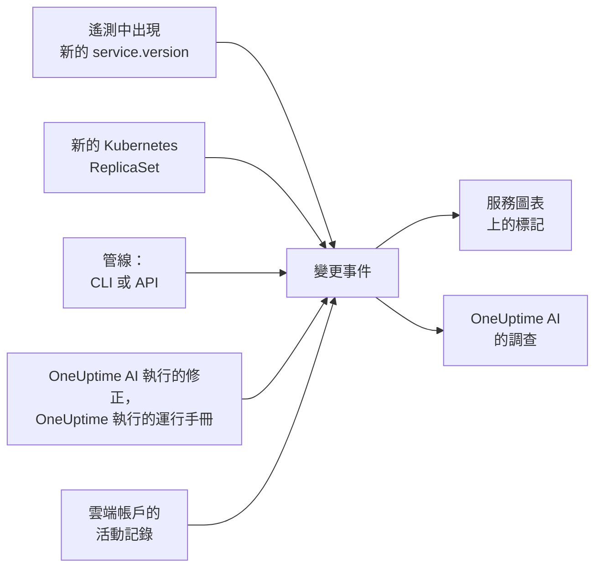

# 部署與變更

OneUptime 會記錄你專案中發生的變更：部署、Kubernetes 滾動更新、設定變更、你已連線的雲端帳戶中的變更，以及它自己執行的修正。每個變更都會以標記的形式繪製在其所屬服務或雲端資源的圖表上，OneUptime AI 調查事件時也會讀取這些變更，因此「問題恰好在 10:02 那次部署之後開始」會是你最先得知的事，而不是最後才知道。

:::cards
- [OneUptime 自行記錄的內容](#oneuptime-自行記錄的內容): 來自遙測資料的部署和滾動更新、雲端帳戶中的變更，以及它自己的修正。
- [從管線記錄部署](#從管線記錄部署): CLI、GitHub Actions 和 API。
- [OneUptime AI 如何使用變更](#oneuptime-ai-如何使用變更): 每次調查中的可疑變更。
- [參考](#參考): 欄位、屬性和限制。
:::

## 運作方式



## OneUptime 自行記錄的內容

這些變更不需要你傳送任何內容。OneUptime 會根據它已經接收的遙測資料，以及它自己執行的操作來記錄它們。

| 變更 | 何時記錄 | 來源 |
| --- | --- | --- |
| 部署 | 某個服務開始回報一個它先前在其環境中從未回報過的 `service.version` | `service-version` |
| 滾動更新 | Kubernetes Deployment 的 Pod 開始執行一個它們先前從未執行過的 ReplicaSet：新的映像檔、變更過的環境變數或設定參照，或是一次重新啟動 | `kubernetes` |
| OneUptime AI 執行的修正 | AI 代理程式回報了一條會變更某些內容的指令的結果，例如 `kubectl rollout restart` | `oneuptime-ai` |
| 運行手冊 | OneUptime 執行的運行手冊在開始後完成、失敗或被取消 | `runbook` |
| 雲端變更 | 已連線雲端帳戶的活動記錄記下了一項變更：AWS CloudTrail、Azure 活動記錄或 Google Cloud 的 Admin Activity 稽核記錄 | `cloud` |
| 供應商事件 | 雲端供應商發布了關於該帳戶的健康事件：AWS Health、Azure Service Health 或 Resource Health，或 Google Cloud Service Health | `cloud-health` |

- **服務回報的第一個版本是它的基準，而不是一次部署。** 一個已經執行了好幾個月的服務，並不是在 OneUptime 開始接收其遙測資料的那一刻才部署的。
- **回復到過去 30 天內出現過的版本不會被記錄，** 因為那個版本並不新。OneUptime AI 執行的回復會作為修正被記錄。
- **一小時內超過 6 個新版本或 ReplicaSet 時，在這一小時結束之前不再記錄。** 否則，像建置時間戳記這樣隨每個 Pod 變化的「版本」，會為每個 Pod 都記錄一次部署。

只有回報 `service.version` 的服務才會記錄部署。請在你的 OpenTelemetry SDK 或 Collector 的資源屬性中設定它，同時設定環境和提交：

```bash
OTEL_RESOURCE_ATTRIBUTES="service.version=2.3.1,deployment.environment.name=production,vcs.ref.head.revision=$GIT_SHA"
```

滾動更新需要 [Kubernetes 代理程式](/docs/telemetry/kubernetes-agent)，它會為每個 Pod 的遙測資料標上其所屬的 Deployment 和 ReplicaSet。

雲端變更和供應商事件需要一個[已連線的雲端帳戶](/docs/telemetry/cloud-accounts)。當 OneUptime 列出了相應資源時，每一項都會連結到它所指的雲端資源，並繪製在該資源的圖表上。其類型取決於操作：操作名稱表明時為 `deployment`、`scaling` 或 `rollback`，否則為 `config-change`，健康事件則為 `provider-event`。未篩選到任何資源的圖表不會顯示雲端帳戶的活動記錄，這樣忙碌的帳戶就不會擠掉你的部署；供應商的健康事件仍會保留在這些圖表上。

## 從管線記錄部署

管線可以在部署或任何其他變更發生時記錄它：設定變更、遷移、功能旗標。它使用你專案的遙測擷取金鑰寫入，也就是你的應用程式傳送遙測資料所用的那種金鑰。請在 **專案設定 → 遙測與 APM → 擷取金鑰** 下建立一把。

固定到某個服務的金鑰，會把每個變更都記錄在該服務下。

:::tabs
@tab CLI
```bash
oneuptime deploy \
  --service checkout \
  --service-version 2.3.1 \
  --commit "$GIT_SHA" \
  --environment production \
  --url https://oneuptime.com \
  --ingestion-key "$ONEUPTIME_TELEMETRY_INGESTION_KEY"
```
@tab GitHub Actions
```yaml title=".github/workflows/deploy.yml"
- name: Record the deploy in OneUptime
  env:
    ONEUPTIME_URL: https://oneuptime.com
    ONEUPTIME_TELEMETRY_INGESTION_KEY: ${{ secrets.ONEUPTIME_TELEMETRY_INGESTION_KEY }}
  run: |
    npx -y @oneuptime/cli deploy \
      --service checkout \
      --service-version "${{ github.ref_name }}" \
      --commit "${{ github.sha }}" \
      --repository "${{ github.server_url }}/${{ github.repository }}" \
      --environment production
```
@tab API
```bash
curl -X POST https://oneuptime.com/telemetry/change-events/v1/ingest \
  -H "Content-Type: application/json" \
  -H "x-oneuptime-token: $ONEUPTIME_TELEMETRY_INGESTION_KEY" \
  -d '{"events": [{"serviceName": "checkout", "version": "2.3.1", "commit": "1a2b3c4", "environment": "production"}]}'
```
:::

在自行託管的 OneUptime 上，請使用你自己的位址代替 `https://oneuptime.com`。API 會在回應中說明它儲存了多少個事件、略過了多少個：

```json
{ "ingested": 1, "skipped": 0 }
```

CLI 的每個選項請參閱 [`oneuptime deploy`](/docs/cli/command-reference#oneuptime-deploy)。

## OneUptime AI 如何使用變更

事件或警示的每次 [AI 調查](/docs/ai/ai-sre) 都從它之前 2 小時內以及之後 10 分鐘內記錄的變更開始，之後的 10 分鐘是為那些在滾動更新完成後才記錄部署的管線準備的。與該事件連結的服務、叢集、主機和雲端資源上的變更排在最前面。

對於其中最多 4 個指明了服務的變更，OneUptime 會讀取該服務在變更前後各 30 分鐘內的遙測資料，如果服務在變更之後立即明顯變差，就將該變更標記為 **可疑變更**：

| 訊號 | 何時成為可疑變更 |
| --- | --- |
| 失敗的 span | 錯誤率至少翻倍，且至少上升 1 個百分點，失敗的 span 至少有 10 個 |
| 延遲 | p99 至少增長到原來的 1.5 倍，且至少增加 100 ms |
| 例外 | 每分鐘的數量至少是原來的 3 倍，且至少有 10 個 |
| 新例外 | 在該變更發布的版本中，於變更前 10 分鐘至變更後 30 分鐘之間首次出現的某種例外類型至少發生了 3 次 |

OneUptime 根據這些數字判斷哪個變更是可疑變更，而不是根據變更標題的內容。調查會先檢查可疑變更，說明它是否導致了該事件，並說明回復它是否是最快的安全修正。

當可疑變更是某個已開啟 [AI 修正](/docs/ai/ai-sre#修正如何運作) 的叢集上的 Kubernetes 滾動更新時，OneUptime AI 會先回復它，所用的 `kubectl rollout undo` 由 OneUptime 根據記錄的變更建構。發布程式碼的部署則透過其提交來回復：調查會指出造成問題的提交或拉取請求，這樣 [修正拉取請求](/docs/ai/ai-sre#自動程式碼修正) 就可以恰好撤銷那一處變更。

無論是否有人被呼叫，OneUptime 還會自行檢查每一次部署。部署之後的 30 分鐘過去後，它會依相同的門檻把這 30 分鐘與部署之前的 30 分鐘進行比較；如果服務變差了，一則 [AI 洞察](/docs/ai/ai-sre#洞察主動偵測) 會指出該服務上的這次部署。

OneUptime AI 開啟的修正拉取請求也會以同樣的方式檢查：一旦某次已記錄的部署包含了它的提交，OneUptime 就會在那裡觀察修正的目標——例外、它加快的操作、事件或警示背後的監控器、它新增的遙測——並說明修正是否奏效（請參閱 [自動程式碼修正](/docs/ai/ai-sre#自動程式碼修正)）。只有當服務自身的遙測回報了部署版本時，才會依該版本讀取已部署的修正，否則從部署後 10 分鐘、舊執行個體停止之後開始讀取。

在調查中以及在 [詢問 AI](/docs/ai/ask-ai) 中，`recent_changes` 會列出任意時間範圍內的變更，`get_change_details` 會顯示一次部署發布了什麼：自該服務上一次部署以來的提交、它們的作者、拉取請求，以及它們變動的檔案。這需要變更上帶有提交，並且其儲存庫已在程式碼中連線：透過 [GitHub App](/docs/ai/github-app)，或透過 GitLab、Forgejo 或 Gitea 連線（請參閱 [連接儲存庫](/docs/ai/ai-agent#連接儲存庫)）。

## 參考

### 欄位

| 欄位 | 說明 |
| --- | --- |
| `title` | 變更了什麼，例如 `Deploy 2.3.1`。傳送了 `version` 的部署可以省略它 |
| `eventType` | 變更的類型：`deployment`（預設值）、`config-change`、`scaling`、`rollback`、`feature-flag` 或你自己的類型 |
| `serviceName` | 變更所屬的服務。沒有服務時，該變更作用於整個專案 |
| `time` | 變更發生的時間，可以是 ISO 8601，也可以是以秒或毫秒為單位的 epoch 時間。預設為它到達的時間 |
| `description` | 變更的詳細資訊 |
| `version` | 部署的版本 |
| `previousVersion` | 它所取代的版本 |
| `commit` | 部署的提交（也可以用 `commitSha` 或 `sha`） |
| `repository` | 該提交所在的儲存庫（也可以用 `repositoryUrl`） |
| `branch` | 部署的分支 |
| `pullRequest` | 部署的拉取請求 |
| `environment` | 部署到的環境 |
| `attributes` | 最多 50 個其他屬性，值可以是文字、數字或布林值 |

頂層欄位會以 OpenTelemetry 名稱儲存為屬性：`version` 存為 `service.version`，`commit` 存為 `vcs.ref.head.revision`，`repository` 存為 `vcs.repository.url.full`，`branch` 存為 `vcs.ref.head.name`，`pullRequest` 存為 `vcs.change.id`，`environment` 存為 `deployment.environment.name`。以這些名稱之一傳送的屬性優先於對應的欄位。

名稱以 `oneuptime.` 開頭的屬性是 OneUptime 自己的屬性，會從管線傳送的內容中捨棄。管線記錄的每個變更都會在 `oneuptime.change.source` 中註明這一點，其值為 `api`。

從雲端帳戶讀取的變更會用 OpenTelemetry 的名稱 `cloud.provider`、`cloud.account.id`、`cloud.region` 和 `cloud.resource_id` 標明帳戶和資源，並把操作記在 `oneuptime.cloud.operation`，執行者記在 `oneuptime.cloud.actor`，是否失敗記在 `oneuptime.change.status`，所屬雲端帳戶記在 `oneuptime.cloud_account.id`。

### 限制

| 限制 | 值 |
| --- | --- |
| 單一請求中的事件數 | 100 |
| 標題 | 500 個字元 |
| 描述 | 5,000 個字元 |
| 屬性 | 50 |
| 時間 | 超過 366 天以前，或超過 60 分鐘以後的時間，會被替換為事件到達的時間 |

## 後續步驟

:::cards
- [AI SRE](/docs/ai/ai-sre): 調查會讀取什麼，以及它如何修正發現的問題。
- [命令參考](/docs/cli/command-reference): CLI 的每個命令。
- [OpenTelemetry](/docs/telemetry/open-telemetry): 傳送你的服務的遙測資料，並附上它們的版本。
- [連線雲端帳戶](/docs/telemetry/cloud-accounts): 你的 AWS、Azure 和 Google Cloud 帳戶的變更和健康事件。
:::
