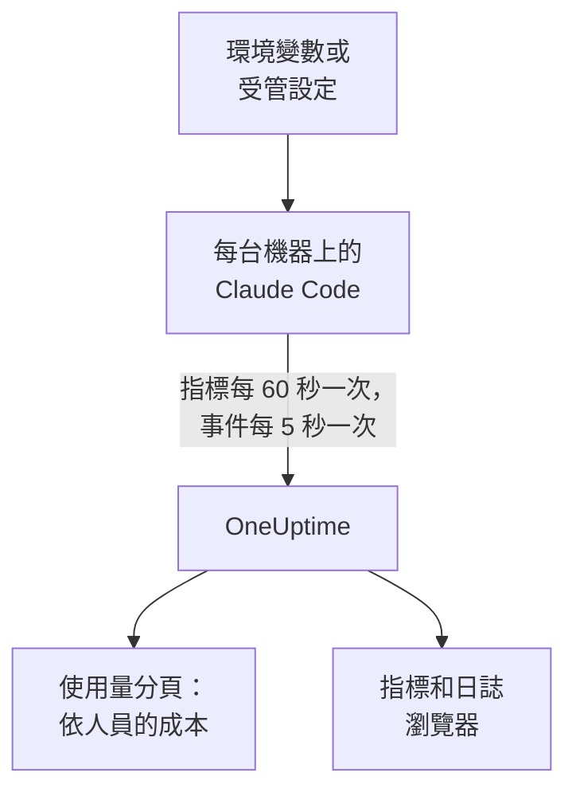

# Claude Code

Claude Code 會自行匯出 OpenTelemetry 指標和事件，直接傳送到 OneUptime：中間不需要 Collector，也不需要閘道。用幾個環境變數開啟它，或用一個受管設定檔為所有機器開啟，就能依開發人員查看成本、token、工作階段、提交和被接受的編輯。

:::cards
- [設定一台機器](#設定一台機器): 六個環境變數和一次重新啟動。
- [推廣到所有機器](#推廣到所有機器): 每台機器上一個受管設定檔。
- [把支出歸屬到人](#把使用量歸屬到人員和團隊): 誰已登入，以及何時必須自行設定身分。
- [疑難排解](#疑難排解): 什麼都沒有抵達時要檢查什麼。
:::

## 運作方式



Claude Code 傳送：

- **成本和 token** ：`claude_code.cost.usage`（USD）和 `claude_code.token.usage`，依模型、依主要代理程式或子代理程式，以及依發起呼叫的代理程式、技能、外掛程式或 MCP 伺服器劃分。
- **活動** ：工作階段、提交、提取要求、新增和刪除的程式碼行數，以及活躍時間。
- **編輯決定** ：`claude_code.code_edit_tool.decision` 會統計被接受和被拒絕的編輯，因此接受率為 `accept / (accept + reject)`，可依語言和工具劃分。
- **事件** ：提示、工具結果、API 要求和錯誤、權限模式變更，以及 MCP 伺服器連線，以 OTLP 日誌記錄的形式傳送。

當開發人員使用 Claude 帳號登入時，每個指標資料點和每個事件都帶有 `user.email`，OneUptime 會在指標上將其讀取為員工，成本和 token 就在指標上。

## 開始之前

1. 在 **專案設定 → 遙測與 APM → 擷取金鑰** 下建立遙測擷取金鑰。
2. 你的 OTLP 端點是 `https://oneuptime.com/otlp`；如果你自行託管 OneUptime，則是 `https://YOUR-ONEUPTIME-HOST/otlp`。
3. 所有機器使用同一把金鑰。它會出現在每台開發人員機器上，因此請把它當作只能傳送資料的共用認證，並像其他認證一樣定期輪替。

## 設定一台機器

:::steps
### 匯出變數

把它們加入你的 shell 設定檔（`.zshrc` 或 `.bashrc`），或在啟動 Claude Code 的終端機中匯出：

```bash
export CLAUDE_CODE_ENABLE_TELEMETRY=1
export OTEL_METRICS_EXPORTER=otlp
export OTEL_LOGS_EXPORTER=otlp
export OTEL_EXPORTER_OTLP_PROTOCOL=http/protobuf
export OTEL_EXPORTER_OTLP_ENDPOINT="https://oneuptime.com/otlp"
export OTEL_EXPORTER_OTLP_HEADERS="x-oneuptime-token=YOUR_INGESTION_TOKEN"
```

| 變數 | 作用 |
| --- | --- |
| `CLAUDE_CODE_ENABLE_TELEMETRY` | 總開關：沒有它，什麼都不會匯出。 |
| `OTEL_METRICS_EXPORTER`、`OTEL_LOGS_EXPORTER` | `otlp` 會傳送到 OneUptime。`otlp,console` 也會列印傳送的內容，方便設定時查看。 |
| `OTEL_EXPORTER_OTLP_PROTOCOL` | `http/protobuf`；`http/json` 和 `grpc` 也可以。 |
| `OTEL_EXPORTER_OTLP_ENDPOINT` | 基礎 URL。Claude Code 會自行附加 `/v1/metrics` 和 `/v1/logs`。 |
| `OTEL_EXPORTER_OTLP_HEADERS` | 以逗號分隔的 `key=value` 配對；這裡是你的擷取金鑰。 |

### 重新啟動 Claude Code

變數會在 Claude Code 啟動時讀取。指標每 60 秒傳送一次，事件每 5 秒傳送一次，因此查看之前請先使用 Claude Code 一分鐘。

### 確認資料已抵達

開啟 **指標** 並尋找 `claude_code.token.usage`，接著開啟 **產品 → AI / LLM** 並前往 **使用量** ：你的成本會顯示在你的電子郵件下，並標示 **來自 GenAI 指標** 。
:::

若要把指標和事件傳送到不同的地方，請改為設定 `OTEL_EXPORTER_OTLP_METRICS_ENDPOINT` 和 `OTEL_EXPORTER_OTLP_LOGS_ENDPOINT`，並使用完整路徑（`https://oneuptime.com/otlp/v1/metrics`、`https://oneuptime.com/otlp/v1/logs`）。

## 推廣到所有機器

對組織而言，請用受管設定檔發佈相同的變數。它的格式與 `settings.json` 相同，變數放在 `env` 區塊中：

```json title="managed-settings.json"
{
  "env": {
    "CLAUDE_CODE_ENABLE_TELEMETRY": "1",
    "OTEL_METRICS_EXPORTER": "otlp",
    "OTEL_LOGS_EXPORTER": "otlp",
    "OTEL_EXPORTER_OTLP_PROTOCOL": "http/protobuf",
    "OTEL_EXPORTER_OTLP_ENDPOINT": "https://oneuptime.com/otlp",
    "OTEL_EXPORTER_OTLP_HEADERS": "x-oneuptime-token=YOUR_INGESTION_TOKEN",
    "OTEL_RESOURCE_ATTRIBUTES": "team.id=platform,cost_center=eng-123"
  }
}
```

:::steps
### 把檔案放在 Claude Code 讀取的位置

| 平台 | 路徑 |
| --- | --- |
| macOS | `/Library/Application Support/ClaudeCode/managed-settings.json` |
| Linux 和 WSL | `/etc/claude-code/managed-settings.json` |
| Windows | `C:\Program Files\ClaudeCode\managed-settings.json` |

Claude Code 不再讀取舊的 Windows 路徑 `C:\ProgramData\ClaudeCode\managed-settings.json`。如果你已經在發佈受管設定檔，請改為在它旁邊加入一個附加檔案，例如 `managed-settings.d/10-telemetry.json`：Claude Code 會先合併 `managed-settings.json`，再依字母順序合併 `managed-settings.d/` 中的每個 `*.json` 檔案。

### 檢查一台機器

在 Claude Code 中執行 `/status`。`Setting sources` 這一行應顯示 `Enterprise managed settings (file)`，附加檔案則顯示 `(drop-ins)` 或 `(file + drop-ins)`。括號中如果是其他來源，代表優先順序更高的來源勝出，你的檔案沒有被使用。

### 觀察所有機器陸續抵達

在 **使用量** 分頁上，每位開發人員以新設定使用過 Claude Code 後，就會顯示為一列。
:::

同樣的 JSON 也可以來自 claude.ai 管理主控台中的伺服器受管設定（在啟動時以及每小時擷取）、`com.anthropic.claudecode` 網域中的 macOS 設定描述檔，或 Windows 上 `HKLM\SOFTWARE\Policies\ClaudeCode` 下的 `Settings` 值。

:::details 哪個受管來源勝出，以及遙測變數如何組合
預設情況下，Claude Code 會使用設定了任一原則鍵的最高優先順序來源，並忽略其他來源：依序為伺服器受管設定、MDM 或作業系統原則、受管設定檔，以及依使用者的 `HKCU` 登錄值。`env` 區塊是例外：從 2.1.223 版起，它會在各管理來源之間逐一變數合併。

遙測變數則不會：`OTEL_EXPORTER_OTLP_*` 變數、`OTEL_LOG_*` 內容開關、`OTEL_LOGS_EXPORTER` 以及搶先版追蹤變數，會一起取自設定了其中任一變數的最高優先順序來源，因此一個來源的端點絕不會與另一個來源的認證搭配。如果更高優先順序的來源設定了其中任何一個，遙測附加檔案就不會有任何作用。

伺服器受管設定還需要多一個步驟：非空白的 `OTEL_EXPORTER_OTLP_ENDPOINT` 只有在每位開發人員於互動式工作階段中接受安全性核准對話方塊後才會生效，而匯出器設定的變更要到下次啟動時才會生效。檔案和 MDM 原則沒有對話方塊。
:::

:::details 不編輯每台機器即可輪替擷取金鑰
不使用固定的標頭，而是在設定中指定 `"otelHeadersHelper": "/path/to/generate-otel-headers.sh"`。該指令碼會輸出一個扁平的標頭 JSON 物件，例如 `{"x-oneuptime-token":"..."}`。Claude Code 會在啟動時執行它，之後每隔 `CLAUDE_CODE_OTEL_HEADERS_HELPER_DEBOUNCE_MS` 毫秒再次執行（預設 `1740000`，即 29 分鐘）。失敗資訊會顯示在 `/status` 中。
:::

## 把使用量歸屬到人員和團隊

**員工就是 `user.email`。** 開發人員使用 Claude 帳號登入時，Claude Code 會傳送它，而且沒有變數可以關閉它。OneUptime 不需要任何設定，就能從每個成本和 token 資料點讀取它。

**其他登入方式不會傳送電子郵件。** 使用 API 金鑰，或使用 Amazon Bedrock、Google Cloud 或 Microsoft Foundry 上的 Claude 時，工作階段中沒有 Claude 帳號，Claude Code 只會傳送 `user.id` 和 `session.id`。請在受管設定或啟動包裝指令碼中，為每台機器自行設定身分：

```bash
export OTEL_RESOURCE_ATTRIBUTES="user.email=jdoe@example.com,team.id=platform"
```

**`user.id` 不是一個人。** 它是 Claude Code 第一次執行時寫入 `~/.claude.json` 的隨機 ID：每次安裝一個，刪除該檔案後會產生新的。沒有電子郵件時，每次安裝都會顯示為單獨的一列。有一個例外：登入 Claude 應用程式閘道的工作階段會傳送登入的身分（`user.id` 是身分識別提供者的主體，`user.email` 是電子郵件），並忽略你自行設定的 `user.*` 鍵。

**團隊和成本中心** 來自 `OTEL_RESOURCE_ATTRIBUTES`：OneUptime 會讀取 `team.id`、`team`、`cost_center` 和 `department`。值中不能包含空格，加上引號也無法跳脫：請寫成 `team=Platform_Engineering`，或使用百分比編碼，例如 `team=Platform%20Engineering`。Claude Code 會把這些鍵複製到每個資料點上（`OTEL_METRICS_INCLUDE_RESOURCE_ATTRIBUTES`，預設開啟），無論哪種方式 OneUptime 都能讀取。你設定的鍵絕不會覆寫 Claude Code 自己設定的鍵。

## OneUptime 顯示什麼

在 **產品 → AI / LLM → 使用量** 中，`claude_code.cost.usage` 會為 **員工** 、 **團隊** 和 **模型** 表格提供資料，`claude_code.token.usage` 則提供 token 總數。你看到的內容由兩條規則決定：

- **指標只補充 span，絕不與之相加。** 如果同一個專案從你自己的應用程式接收帶有成本的 GenAI span，Claude Code 的支出就不會顯示。請把 Claude Code 傳送到單獨的專案。請參閱 [span 優先，指標補充](/docs/telemetry/ai-llm-observability#span-優先指標補充)。
- **來自指標的資料列只攜帶成本。** 其呼叫和 token 儲存格顯示 `—`， **提供者** 和 **應用程式 / 服務** 表格保持空白：這些指標不指明提供者，也不屬於任何 OneUptime 服務。

其他所有內容，例如依開發人員劃分的接受率、程式碼行數、提交和提取要求，或依 `query_source` 劃分的支出，都可以根據下方的指標在 [儀表板](/docs/dashboards/index) 上繪製，並用 [指標監控](/docs/monitor/metrics-monitor) 設定警示。

## 指標

每個指標都是計數器，除了自己的屬性外還攜帶標準屬性。

| 指標 | 單位 | 自己的屬性 |
| --- | --- | --- |
| `claude_code.session.count` | 無 | `start_type`：`fresh`、`resume`、`continue`、`agents_view` |
| `claude_code.lines_of_code.count` | 無 | `type`：`added`、`removed`；`model` |
| `claude_code.commit.count` | 無 | 無 |
| `claude_code.pull_request.count` | 無 | 無 |
| `claude_code.cost.usage` | USD | `model`；`query_source`：`main`、`subagent`、`auxiliary`；`speed`：`fast`、`normal`；`effort`；`agent.name`、`skill.name`、`plugin.name`、`marketplace.name`、`mcp_server.name`、`mcp_tool.name` |
| `claude_code.token.usage` | token | `type`：`input`、`output`、`cacheRead`、`cacheCreation`；以及與 `claude_code.cost.usage` 相同的屬性 |
| `claude_code.code_edit_tool.decision` | 無 | `tool_name`：`Edit`、`Write`、`NotebookEdit`；`decision`：`accept`、`reject`；`source`；`language` |
| `claude_code.active_time.total` | 秒 | `type`：`user`（在鍵盤前）、`cli`（工具和模型回應） |

標準屬性包括 `session.id`、`app.version`、`app.entrypoint`、`organization.id`、`user.account_uuid`、`user.account_id`、`user.id`、`user.email` 和 `terminal.type`，以及你的 `OTEL_RESOURCE_ATTRIBUTES`。其中一些可以關閉：請參閱 [降低指標量](#降低指標量)。

- 快取 token 類型使用駝峰式命名：`cacheRead` 和 `cacheCreation`。OneUptime 的 token 總數只計算 `input` 和 `output`。
- 在成本和 token 指標上，除非設定了 `OTEL_LOG_TOOL_DETAILS=1`（Claude Code 2.1.273 或更新版本），否則你自己的代理程式和 MCP 伺服器，以及第三方外掛程式和技能的名稱會顯示為 `custom` 或 `third-party`。

## 事件

事件會以 OTLP 日誌記錄的形式抵達，每一筆都帶有 `event.name`、`event.timestamp` 和 `event.sequence`。你最常用的幾種：

| 事件 | 記錄的內容 |
| --- | --- |
| `claude_code.user_prompt` | 一則提示：其長度和命令；只有開啟後才包含文字 |
| `claude_code.api_request` | 一次模型要求：`model`、`cost_usd`、`cost_usd_micros`、`duration_ms`、`input_tokens`、`output_tokens`、快取 token |
| `claude_code.api_error` | 重試後仍失敗的要求：`model`、`error`、`status_code`、`attempt` |
| `claude_code.tool_result` | 一次工具執行：`tool_name`、`success`、`duration_ms`，以及允許它執行的決定 |
| `claude_code.tool_decision` | 工具是否被允許，以及由什麼決定 |
| `claude_code.mcp_server_connection` | MCP 伺服器連線成功或失敗 |

Claude Code 還會傳送許多其他事件，例如拒絕、權限模式變更，以及外掛程式、勾點和技能事件：Anthropic 的 [監控參考](https://code.claude.com/docs/en/monitoring-usage) 列出了全部事件。在 `cost_usd_micros` 中，成本是以百萬分之一美元為單位的整數，加總時不會產生捨入誤差。

## 降低指標量

預設情況下，Claude Code 會在每個資料點上加上 `session.id`，每個工作階段都是一個新的序列。在所有機器上，單是這一個屬性就會推高指標量，而成本報告並不需要它：

```bash
export OTEL_METRICS_INCLUDE_SESSION_ID=false
```

| 變數 | 預設值 | 新增的內容 |
| --- | --- | --- |
| `OTEL_METRICS_INCLUDE_SESSION_ID` | `true` | `session.id`，每個工作階段一個新值 |
| `OTEL_METRICS_INCLUDE_VERSION` | `false` | `app.version` |
| `OTEL_METRICS_INCLUDE_ACCOUNT_UUID` | `true` | `user.account_uuid` 和 `user.account_id` |
| `OTEL_METRICS_INCLUDE_ENTRYPOINT` | `false` | `app.entrypoint` |
| `OTEL_METRICS_INCLUDE_RESOURCE_ATTRIBUTES` | `true` | 你的 `OTEL_RESOURCE_ATTRIBUTES` 鍵 |
| `OTEL_METRICS_INCLUDE_REPOSITORY` | `false` | 存放庫的 `vcs.*` 屬性 |

`user.email`、`user.id`、`organization.id` 和 `terminal.type` 沒有開關。事件是較繁忙的訊號：每位活躍的開發人員每 5 秒傳送一次（`OTEL_LOGS_EXPORT_INTERVAL`，單位為毫秒）。調高此值可以用較少次數傳送較大的批次；如果你只需要成本和使用量，它們都在指標中，可以設定 `OTEL_LOGS_EXPORTER=none`。

## 提示和工具內容預設關閉

除非你逐項開啟，否則 Claude Code 不會匯出提示、回答、工具引數或工具輸出：

| 變數 | 預設值 | `1` 開啟的內容 |
| --- | --- | --- |
| `OTEL_LOG_USER_PROMPTS` | 關閉 | 提示文字 |
| `OTEL_LOG_ASSISTANT_RESPONSES` | 關閉 | 回答文字；未設定時跟隨 `OTEL_LOG_USER_PROMPTS` |
| `OTEL_LOG_TOOL_DETAILS` | 關閉 | 工具參數、Bash 命令，以及代理程式、外掛程式、技能和 MCP 伺服器的真實名稱 |
| `OTEL_LOG_TOOL_CONTENT` | 關閉 | 工具的輸入和輸出，僅限追蹤 span |
| `OTEL_LOG_RAW_API_BODIES` | 關閉 | 完整的 API 要求和回應本文（`file:<dir>` 會改為寫入磁碟） |

我們建議保持關閉：指標和遮蔽後的事件已經能回答誰在哪個模型上花了多少錢、接受率是多少。擷取內容會把提示、原始碼和工具輸出移到一個存取控制與你的存放庫不同的遙測存放區。如果為了調查而開啟，`CLAUDE_CODE_OTEL_CONTENT_MAX_LENGTH`（預設 `61440`）會限制每筆記錄傳輸的內容量，而 **追蹤 → 設定** 下追蹤的 **清理規則** 和 **捨棄過濾器** 會在儲存前加以遮罩或捨棄。

## 指標以差異值形式抵達

Claude Code 預設傳送差異值指標：每個資料點是自上次匯出以來的增量，而不是累計總數。繪圖或設定警示時，請在時間範圍內把資料點相加，不要像對待累積計數器那樣套用速率或計數器重設函式：數字會出錯，卻看不出異常。

```bash
export OTEL_EXPORTER_OTLP_METRICS_TEMPORALITY_PREFERENCE=cumulative
```

只有當組織中的每個匯出器都使用 `cumulative` 時才固定它，而且不要在同一批機器中混用兩種方式。

## 追蹤（搶先版）

Claude Code 還有一個搶先版追蹤匯出器，它會把每次互動繪製成一棵 span 樹：`claude_code.interaction` 下方是 `claude_code.llm_request` 和 `claude_code.tool`。

```bash
export CLAUDE_CODE_ENHANCED_TELEMETRY_BETA=1
export OTEL_TRACES_EXPORTER=otlp
```

> [!WARNING]
> 請不要把搶先版追蹤傳送到你用來統計支出的專案。它的模型 span 帶有 `gen_ai.system` 和 `gen_ai.request.model`，因此 OneUptime 會在 **呼叫** 中列出它們，但它們的 token 位於 `input_tokens` 和 `output_tokens`，而不是 `gen_ai.usage.*` 鍵中，所以抵達時既沒有 token 也沒有成本。一旦它們存在， **員工** 、 **團隊** 和 **模型** 表格顯示的就是這些成本為 $0 的資料列，而不是指標中的支出。

在 Agent SDK 工作階段和非互動式 `-p` 工作階段中，Claude Code 會接收傳入的 `TRACEPARENT`，因此它的 span 會加入呼叫端的追蹤；互動式工作階段會忽略它。只有當 `ANTHROPIC_BASE_URL` 未設定或指向 Anthropic API 時，它才會向模型傳送 `traceparent` 標頭；在你自己的 Proxy 後方，請設定 `CLAUDE_CODE_PROPAGATE_TRACEPARENT=1`。

## 疑難排解

:::details 完全沒有資料抵達
先檢查 `CLAUDE_CODE_ENABLE_TELEMETRY=1`：沒有它，其他變數都不會起作用。接著在匯出器中加入 `console`（`OTEL_METRICS_EXPORTER=otlp,console`）並觀察終端機：如果列印出了資料點，表示 Claude Code 正常，問題出在端點、金鑰或網路。
:::

:::details 受管設定檔似乎被忽略了
執行 `/status` 並查看 `Setting sources` 這一行。如果沒有列出受管來源，代表檔案路徑錯誤、不是有效的 JSON，或開發人員的帳戶無法讀取它。如果列出了其他來源，代表那個來源勝出，你的檔案沒有被使用。伺服器受管設定還要等開發人員在互動式工作階段中接受核准對話方塊。
:::

:::details 支出顯示為未歸屬，或每次安裝顯示為一列
這些開發人員沒有使用 Claude 帳號登入：他們使用的是 API 金鑰、Amazon Bedrock、Google Cloud 或 Microsoft Foundry。請依 [把使用量歸屬到人員和團隊](#把使用量歸屬到人員和團隊) 中的說明，在 `OTEL_RESOURCE_ATTRIBUTES` 中為他們設定 `user.email`。
:::

:::details 缺少團隊或成本中心
請確認 `OTEL_RESOURCE_ATTRIBUTES` 已在該機器上設定、不包含空格，而且沒有重複使用 Claude Code 自己設定的鍵：Claude Code 的值會勝出。
:::

:::details 數字看起來太小或太大
Claude Code 傳送的是差異值：請在時間範圍內把資料點相加，參見 [指標以差異值形式抵達](#指標以差異值形式抵達)。另外請等滿一分鐘：指標每 60 秒傳送一次。
:::

:::details 金鑰被拒絕
OneUptime 會拒絕錯誤的 `x-oneuptime-token`。請從 **專案設定 → 遙測與 APM → 擷取金鑰** 重新複製金鑰，並確認標頭為 `x-oneuptime-token=YOUR_INGESTION_TOKEN`，且 `=` 兩側沒有空格。
:::

## 後續步驟

:::cards
- [AI 程式設計助理](/docs/telemetry/ai-coding-assistants): 支出如何在所有程式設計助理之間歸屬。
- [AI / LLM 可觀測性](/docs/telemetry/ai-llm-observability): 你自己的 AI 呼叫的對話、警示、成本和預算。
- [指標監控](/docs/monitor/metrics-monitor): 針對依開發人員劃分的支出或 token 設定警示。
:::
