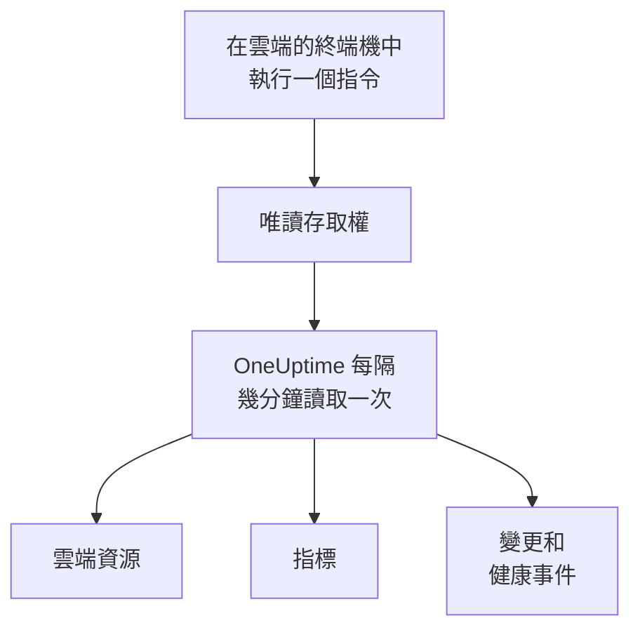

# 連線雲端帳戶

在儀表板中連線 AWS 帳戶、Azure 訂用帳戶或 Google Cloud 專案，OneUptime 會列出其中的每個資源，讀取它們的關鍵指標並說明每個資源的狀況，記錄它們發生了哪些變更以及你的雲端供應商對它們健康狀況的說明，並讀取帳戶的成本以及降低成本的方法。你只需在雲端自帶的瀏覽器終端機中執行一個指令，再貼上它的輸出：不需要執行收集器，也不需要安裝任何東西。

:::cards
- [Amazon Web Services](#amazon-web-services): OneUptime 登入所用的 IAM 角色，或一組存取金鑰。
- [Microsoft Azure](#microsoft-azure): 具有 Monitoring Reader 和 Cost Management Reader 角色的應用程式。
- [Google Cloud](#google-cloud): 具有六個唯讀角色的服務帳戶。
- [OneUptime 讀取什麼](#oneuptime-讀取什麼): 資源、指標、變更、健康事件和成本，多久讀取一次，以及讀取它們的費用是多少。
- [雲端成本與節省](/docs/telemetry/cloud-costs): 每個帳戶的成本、減少支出的方法，以及會發出警示的預算。
- [串流 CloudWatch 指標和日誌](/docs/telemetry/cloud-streaming): 透過 Amazon Data Firehose，在幾分鐘內取得每個指標以及 CloudWatch Logs。
- [串流 Azure Monitor 指標和日誌](/docs/telemetry/cloud-streaming-azure): 幾分鐘內取得關鍵指標和資源日誌，從你訂用帳戶中的事件中樞讀取。
- [串流 Google Cloud 日誌](/docs/telemetry/cloud-streaming-google-cloud): 每筆日誌一寫入就透過 Pub/Sub 推送。
- [資料安全](#資料安全): 這個連線讓資料安全讀取什麼，以及每個層級會在指令中新增什麼。
- [讓 AI 修正問題](#讓-ai-修正問題): 再執行一個指令，OneUptime AI 就能修正它發現的問題。
:::

## 運作方式



- **存取權只能讀取。** 指令建立的存取權只會讀取你的資源及其設定、它們的指標、發生的變更、供應商的健康事件和帳戶的成本，不做其他任何事：在 AWS 上是下方列出的動作，在 Azure 上是 **Monitoring Reader** 和 **Cost Management Reader** 角色，在 Google Cloud 上是六個檢視者角色。OneUptime 從不透過它讀取資料或機密：只有當你允許 AI 讀取帳戶的日誌時，才會讀取日誌行；只有當你為 [資料安全](#資料安全) 開啟內容樣本時，才會讀取這些樣本。刪除它即可切斷 OneUptime 的存取。
- **OneUptime 依排程讀取。** 除非你在連線時選擇其他間隔，Azure 和 Google Cloud 每 5 分鐘讀取一次，AWS 每 10 分鐘讀取一次。每次讀取也會記錄自上次以來的變更，而且每 30 分鐘會有一次讀取重新列出所有資源。
- **每個資源都有自己的頁面。** 資源會顯示在 **雲端 → 所有資源** 中，附上其健康狀況、關鍵指標、擁有者和標籤。已列出資源的頁面也會顯示它的 **相連的資源**（它在什麼裡面執行，什麼向它傳送流量）、它的端點、標籤和設定，以及它的 **事件**、**警示** 和 **變更**。
- **每個帳戶都有自己的頁面。** 帳戶會顯示在 **雲端 → 帳戶** 中，附上依類型和區域分組的資源、它們的 **成本**、它們的 **變更**，以及顯示其資源如何彼此相連的 **拓撲**。
- **雲端從它的概覽開啟。** **雲端 → 概覽** 列出需要注意的資源及原因、帳戶本月的成本，以及你的雲端認為可以節省的金額。[雲端成本與節省](/docs/telemetry/cloud-costs) 說明成本、節省和預算是如何讀取的。如果你的帳戶在受管理的應用程式平台上執行應用程式，**應用程式平台** 卡片會統計其環境與應用程式，每個計數都會在應用程式平台中開啟對應清單，並已依這些帳戶篩選。
- **OneUptime AI 會讀取發生的變更。** 對連結到雲端資源的事件或警示所做的調查，會先讀取該資源的變更，並在開始時重新讀取帳戶的活動記錄。

## 開始之前

- **專案擁有者或管理員。** 只有他們可以連線、測試和編輯雲端帳戶。
- **你的雲端的終端機**（AWS CloudShell、Azure Cloud Shell 或 Google Cloud Shell），並以可以建立 IAM 角色或使用者、應用程式註冊或服務帳戶的身分登入。

## Amazon Web Services

:::steps
### 開啟 AWS 表單

前往 **雲端 → 連線**，然後選擇 **Amazon Web Services**。

### 在 AWS CloudShell 中執行指令

選擇 OneUptime 的登入方式。建議使用 **IAM 角色**：不會儲存任何機密，你也可以隨時刪除該角色。表單會顯示為你的專案撰寫的指令：它會建立一個以你專案的外部 ID 信任 OneUptime 的 AWS 帳戶的角色，並輸出該角色的 ARN。

在 **讀取範圍** 中，選擇此帳戶或你的 AWS Organization 中的每個帳戶。在組織的管理帳戶中執行組織的指令：它會新增一個 StackSet，把同一個角色放進每個帳戶（現有的帳戶和之後加入的帳戶），並讓管理帳戶的角色列出這些帳戶。一個連線最多讀取 50 個帳戶。

無法使用角色時，請使用 **存取金鑰**：它只會讀取自己的帳戶。以下指令會建立一個具有相同權限的使用者，並輸出其金鑰：

```bash
aws iam create-user --user-name OneUptimeReadOnly > /dev/null 2>&1 || true
aws iam put-user-policy --user-name OneUptimeReadOnly --policy-name OneUptimeReadOnly --policy-document '{"Version":"2012-10-17","Statement":[{"Effect":"Allow","Action":["cloudwatch:GetMetricData","cloudwatch:ListMetrics","tag:GetResources","iam:ListAccountAliases","cloudformation:ListResources","ec2:DescribeInstances","ec2:DescribeVolumes","ec2:DescribeVpcs","ec2:DescribeNatGateways","autoscaling:DescribeAutoScalingGroups","elasticloadbalancing:DescribeLoadBalancers","elasticloadbalancing:DescribeLoadBalancerAttributes","elasticloadbalancing:DescribeTargetGroups","elasticloadbalancing:DescribeTargetGroupAttributes","elasticloadbalancing:DescribeTargetHealth","elasticloadbalancing:DescribeTags","ecs:ListClusters","ecs:DescribeClusters","ecs:ListServices","ecs:DescribeServices","lambda:ListFunctions","rds:DescribeDBInstances","rds:DescribeDBClusters","elasticache:DescribeReplicationGroups","sqs:ListQueues","sqs:GetQueueAttributes","sns:ListTopics","sns:GetTopicAttributes","sns:ListSubscriptionsByTopic","dynamodb:ListTables","dynamodb:DescribeTable","kinesis:ListStreams","kinesis:DescribeStreamSummary","states:ListStateMachines","states:DescribeStateMachine","cloudfront:ListDistributions","elasticfilesystem:DescribeFileSystems","es:ListDomainNames","es:DescribeDomains","apprunner:ListServices","apprunner:DescribeService","elasticbeanstalk:DescribeEnvironments","cloudtrail:LookupEvents","health:DescribeEvents","health:DescribeEventDetails","ce:GetCostAndUsage","ce:GetCostAndUsageWithResources","ce:GetSavingsPlansCoverage","ce:GetSavingsPlansUtilization","ce:GetReservationCoverage","ce:GetReservationUtilization","cost-optimization-hub:ListRecommendations","rds:DescribeEvents","autoscaling:DescribeScalingActivities","ec2:DescribeInstanceStatus","ecs:DescribeTaskDefinition","lambda:GetFunctionConfiguration","lambda:GetFunctionConcurrency","lambda:GetAlias","servicequotas:ListServiceQuotas","logs:DescribeLogGroups","logs:FilterLogEvents"],"Resource":"*"},{"Effect":"Allow","Action":["apigateway:GET"],"Resource":["arn:aws:apigateway:*::/restapis*","arn:aws:apigateway:*::/apis*"]}]}'
aws iam create-access-key --user-name OneUptimeReadOnly
```

### 貼上 AWS 指令的輸出

將指令輸出的全部內容貼到 **指令的輸出** 中。OneUptime 會從中找出角色的 ARN，或存取金鑰 ID 及其機密。

### 測試並連線 AWS

此步驟開啟時，OneUptime 會測試連線：它會登入，計算找到的資源，並說明讀取它們的費用。選擇 **連線** 即可儲存。
:::

該角色和使用者只能做以下這些事：

| OneUptime 的用途 | 動作 |
| --- | --- |
| 找到回報指標的資源，並讀取它們的指標 | `cloudwatch:GetMetricData`, `cloudwatch:ListMetrics` |
| 為每個資源命名並讀取其標籤 | `tag:GetResources`, `iam:ListAccountAliases` |
| 透過 Cloud Control 列出每個資源及其設定 | `cloudformation:ListResources`, `ec2:DescribeInstances`, `ec2:DescribeVolumes`, `ec2:DescribeVpcs`, `ec2:DescribeNatGateways`, `autoscaling:DescribeAutoScalingGroups`, `elasticloadbalancing:DescribeLoadBalancers`, `elasticloadbalancing:DescribeLoadBalancerAttributes`, `elasticloadbalancing:DescribeTargetGroups`, `elasticloadbalancing:DescribeTargetGroupAttributes`, `elasticloadbalancing:DescribeTargetHealth`, `elasticloadbalancing:DescribeTags`, `ecs:ListClusters`, `ecs:DescribeClusters`, `ecs:ListServices`, `ecs:DescribeServices`, `lambda:ListFunctions`, `rds:DescribeDBInstances`, `rds:DescribeDBClusters`, `elasticache:DescribeReplicationGroups`, `sqs:ListQueues`, `sqs:GetQueueAttributes`, `sns:ListTopics`, `sns:GetTopicAttributes`, `sns:ListSubscriptionsByTopic`, `dynamodb:ListTables`, `dynamodb:DescribeTable`, `kinesis:ListStreams`, `kinesis:DescribeStreamSummary`, `states:ListStateMachines`, `states:DescribeStateMachine`, `cloudfront:ListDistributions`, `elasticfilesystem:DescribeFileSystems`, `es:ListDomainNames`, `es:DescribeDomains`, `apprunner:ListServices`, `apprunner:DescribeService`, `elasticbeanstalk:DescribeEnvironments`, `apigateway:GET` |
| 讀取發生的變更：帳戶的管理事件 | `cloudtrail:LookupEvents` |
| 讀取 AWS 自己針對該帳戶的健康事件 | `health:DescribeEvents`, `health:DescribeEventDetails` |
| 從 Cost Explorer 讀取帳戶的成本 | `ce:GetCostAndUsage`, `ce:GetCostAndUsageWithResources`, `ce:GetSavingsPlansCoverage`, `ce:GetSavingsPlansUtilization`, `ce:GetReservationCoverage`, `ce:GetReservationUtilization` |
| 從 Cost Optimization Hub 讀取減少支出的方法 | `cost-optimization-hub:ListRecommendations` |
| 在調查期間讀取資源的目前狀態和最近的事件 | `rds:DescribeEvents`, `autoscaling:DescribeScalingActivities`, `ec2:DescribeInstanceStatus`, `ecs:DescribeTaskDefinition`, `lambda:GetFunctionConfiguration`, `lambda:GetFunctionConcurrency`, `lambda:GetAlias` |
| 在調查期間讀取帳戶的配額 | `servicequotas:ListServiceQuotas` |
| 讀取日誌行，僅當你允許 AI 讀取帳戶的日誌時 | `logs:DescribeLogGroups`, `logs:FilterLogEvents` |
| 從組織的管理帳戶列出組織的帳戶 | `organizations:ListAccounts` |

`apigateway:GET` 只允許用於 API 本身的定義，從不用於它們的金鑰，而且只有管理帳戶的角色可以列出組織的帳戶。AWS Health 只回應使用 Business、Enterprise On-Ramp 或 Enterprise 支援方案的帳戶：沒有這類方案時，OneUptime 會在一天後再次詢問。

> [!NOTE]
> 在自行託管的 OneUptime 上，**IAM 角色** 方式需要 OneUptime 自己的 AWS 身分：將 `CLOUD_CONNECT_AWS_ACCESS_KEY_ID` 和 `CLOUD_CONNECT_AWS_SECRET_ACCESS_KEY` 設定為一個可以呼叫 `sts:AssumeRole` 的 IAM 使用者的金鑰。未設定時，表單會提供 **存取金鑰**。

## Microsoft Azure

:::steps
### 開啟 Azure 表單

前往 **雲端 → 連線**，然後選擇 **Microsoft Azure**。

### 在 Azure Cloud Shell 中執行指令

該指令會在你目前的訂用帳戶上建立一個具有 **Monitoring Reader** 和 **Cost Management Reader** 角色的應用程式，並輸出其詳細資料以及其機密的到期日期：

```bash
SCOPE="/subscriptions/$(az account show --query id --output tsv)"
OUT=$(az ad sp create-for-rbac --name OneUptimeReadOnly --role "Monitoring Reader" --scopes "$SCOPE")
APP=$(echo "$OUT" | jq -r .appId)
az role assignment create --assignee "$APP" --role "Cost Management Reader" --scope "$SCOPE" > /dev/null
END=$(az ad app credential list --id "$APP" --query "max([].endDateTime)" --output tsv)
echo "$OUT" | jq --arg end "$END" '. + {endDateTime: $end}'
```

在 **讀取範圍** 中改為選擇租用戶中的每個訂用帳戶，角色就會授予租用戶的根管理群組：

```bash
SCOPE="/providers/Microsoft.Management/managementGroups/$(az account show --query tenantId --output tsv)"
OUT=$(az ad sp create-for-rbac --name OneUptimeReadOnly --role "Monitoring Reader" --scopes "$SCOPE")
APP=$(echo "$OUT" | jq -r .appId)
az role assignment create --assignee "$APP" --role "Cost Management Reader" --scope "$SCOPE" > /dev/null
END=$(az ad app credential list --id "$APP" --query "max([].endDateTime)" --output tsv)
echo "$OUT" | jq --arg end "$END" '. + {endDateTime: $end}'
```

### 貼上 Azure 指令的輸出

將指令輸出的全部內容貼到 **指令的輸出** 中。OneUptime 會從中找出 `tenant`、`appId`、`password` 和到期日期。

### 測試並連線 Azure

此步驟開啟時，OneUptime 會測試連線。選擇 **連線** 即可儲存。
:::

要用同一個應用程式讀取更多訂用帳戶，請在每個訂用帳戶上為它授予這兩個角色：

```bash
az role assignment create --assignee <APP_ID> --role "Monitoring Reader" --scope /subscriptions/<SUBSCRIPTION_ID>
az role assignment create --assignee <APP_ID> --role "Cost Management Reader" --scope /subscriptions/<SUBSCRIPTION_ID>
```

除非你在 **訂用帳戶** 中列出一些訂用帳戶，否則 OneUptime 會讀取該應用程式可以讀取的每個訂用帳戶，最多 50 個。應用程式的機密會在到期日停止運作：從到期前 30 天起，每次讀取都會對此發出提醒。再次執行該指令並貼上它的輸出，即可為它換一個新的機密。

## Google Cloud

:::steps
### 開啟 Google Cloud 表單

前往 **雲端 → 連線**，然後選擇 **Google Cloud**。

### 在 Google Cloud Shell 中執行指令

在要監控的專案中執行它。它會啟用 OneUptime 讀取的 API，建立一個具有 **Monitoring Viewer**、**Cloud Asset Viewer**、**Logs Viewer**、**Service Health Viewer**、**BigQuery Job User** 和 **Compute Recommender Viewer** 角色的服務帳戶，並輸出其金鑰：

```bash
PROJECT_ID=$(gcloud config get-value project)
gcloud services enable monitoring.googleapis.com cloudasset.googleapis.com logging.googleapis.com cloudresourcemanager.googleapis.com servicehealth.googleapis.com bigquery.googleapis.com recommender.googleapis.com
gcloud iam service-accounts create oneuptime-read-only --display-name "OneUptime (read only)" > /dev/null 2>&1 || true
gcloud projects add-iam-policy-binding "$PROJECT_ID" --member "serviceAccount:oneuptime-read-only@$PROJECT_ID.iam.gserviceaccount.com" --role roles/monitoring.viewer --condition=None > /dev/null
gcloud projects add-iam-policy-binding "$PROJECT_ID" --member "serviceAccount:oneuptime-read-only@$PROJECT_ID.iam.gserviceaccount.com" --role roles/cloudasset.viewer --condition=None > /dev/null
gcloud projects add-iam-policy-binding "$PROJECT_ID" --member "serviceAccount:oneuptime-read-only@$PROJECT_ID.iam.gserviceaccount.com" --role roles/logging.viewer --condition=None > /dev/null
gcloud projects add-iam-policy-binding "$PROJECT_ID" --member "serviceAccount:oneuptime-read-only@$PROJECT_ID.iam.gserviceaccount.com" --role roles/servicehealth.viewer --condition=None > /dev/null
gcloud projects add-iam-policy-binding "$PROJECT_ID" --member "serviceAccount:oneuptime-read-only@$PROJECT_ID.iam.gserviceaccount.com" --role roles/bigquery.jobUser --condition=None > /dev/null
gcloud projects add-iam-policy-binding "$PROJECT_ID" --member "serviceAccount:oneuptime-read-only@$PROJECT_ID.iam.gserviceaccount.com" --role roles/recommender.computeViewer --condition=None > /dev/null
gcloud iam service-accounts keys create oneuptime-key.json --iam-account "oneuptime-read-only@$PROJECT_ID.iam.gserviceaccount.com"
cat oneuptime-key.json && rm oneuptime-key.json
```

在 **讀取範圍** 中改為選擇組織中的每個專案，角色就會授予該專案所屬的組織：

```bash
PROJECT_ID=$(gcloud config get-value project)
ORG_ID=$(gcloud projects get-ancestors "$PROJECT_ID" --format="value(id)" | tail -1)
gcloud services enable monitoring.googleapis.com cloudasset.googleapis.com logging.googleapis.com cloudresourcemanager.googleapis.com servicehealth.googleapis.com bigquery.googleapis.com recommender.googleapis.com
gcloud iam service-accounts create oneuptime-read-only --display-name "OneUptime (read only)" > /dev/null 2>&1 || true
gcloud organizations add-iam-policy-binding "$ORG_ID" --member "serviceAccount:oneuptime-read-only@$PROJECT_ID.iam.gserviceaccount.com" --role roles/monitoring.viewer --condition=None > /dev/null
gcloud organizations add-iam-policy-binding "$ORG_ID" --member "serviceAccount:oneuptime-read-only@$PROJECT_ID.iam.gserviceaccount.com" --role roles/cloudasset.viewer --condition=None > /dev/null
gcloud organizations add-iam-policy-binding "$ORG_ID" --member "serviceAccount:oneuptime-read-only@$PROJECT_ID.iam.gserviceaccount.com" --role roles/logging.viewer --condition=None > /dev/null
gcloud organizations add-iam-policy-binding "$ORG_ID" --member "serviceAccount:oneuptime-read-only@$PROJECT_ID.iam.gserviceaccount.com" --role roles/servicehealth.viewer --condition=None > /dev/null
gcloud organizations add-iam-policy-binding "$ORG_ID" --member "serviceAccount:oneuptime-read-only@$PROJECT_ID.iam.gserviceaccount.com" --role roles/bigquery.jobUser --condition=None > /dev/null
gcloud organizations add-iam-policy-binding "$ORG_ID" --member "serviceAccount:oneuptime-read-only@$PROJECT_ID.iam.gserviceaccount.com" --role roles/recommender.computeViewer --condition=None > /dev/null
gcloud iam service-accounts keys create oneuptime-key.json --iam-account "oneuptime-read-only@$PROJECT_ID.iam.gserviceaccount.com"
cat oneuptime-key.json && rm oneuptime-key.json
```

### 貼上金鑰

貼上指令輸出的全部內容。OneUptime 會讀取金鑰本身所屬的專案，並加密儲存金鑰。

### 測試並連線 Google Cloud

此步驟開啟時，OneUptime 會測試連線。選擇 **連線** 即可儲存。
:::

要用同一個服務帳戶讀取更多專案，請在每個專案中為它授予這些角色，並在 **專案** 中列出它們：

```bash
for ROLE in roles/monitoring.viewer roles/cloudasset.viewer roles/logging.viewer roles/servicehealth.viewer roles/recommender.computeViewer; do gcloud projects add-iam-policy-binding <PROJECT_ID> --member "serviceAccount:oneuptime-read-only@<KEY_PROJECT_ID>.iam.gserviceaccount.com" --role "$ROLE"; done
```

除非你在 **專案** 中列出一些專案，否則組織的連線最多讀取其 50 個專案。

Google Cloud 沒有提供專案成本的 API：OneUptime 從你的帳單帳戶匯出到 BigQuery 的資料中讀取成本，只要你在 **帳單匯出資料表** 中填入它的資料表即可。[雲端成本與節省](/docs/telemetry/cloud-costs#google-cloud) 說明了具體做法。

## 資料安全

同一個連線可以讓 [資料安全](/docs/data-security/index) 讀取帳戶的資料儲存區：它的儲存貯體、資料庫和資料倉儲。在 **更多欄位** 下，**資料安全** 在你另行選擇之前為 **關閉**，表單顯示的指令也會隨之改變：

| 資料安全 | 資料安全可以讀取什麼 | 指令新增什麼 |
| --- | --- | --- |
| **關閉** | 不讀取帳戶的任何資料儲存區 | 無 |
| **僅設定** | 誰可以存取每個資料儲存區，以及它的加密、備份和日誌記錄方式。從不讀取資料。 | 在 AWS 上，新增第二個內嵌政策 `OneUptimeDataSecurity`，其中包含讀取動作。在 Azure 和 Google Cloud 上不新增任何內容：**Monitoring Reader** 和 **Cloud Asset Viewer** 已經能讀取這些資訊。 |
| **設定和內容樣本** | 上述內容，以及物件和資料列的樣本，用來在其中找出敏感資料 | 在 AWS 上，是同一個政策再加上 `s3:ListBucket`、`s3:GetObject`，以及僅限透過 S3 的 `kms:Decrypt`。在 Azure 上，是 **Storage Blob Data Reader**。在 Google Cloud 上，是 `roles/storage.objectViewer` 和 `roles/bigquery.dataViewer`。 |

在 AWS 上，角色的指令會多一行來新增這個政策。在內容層級時，這一行是：

```bash
aws iam put-role-policy --role-name "$ROLE" --policy-name OneUptimeDataSecurity --policy-document '{"Version":"2012-10-17","Statement":[{"Effect":"Allow","Action":["s3:ListAllMyBuckets","s3:GetBucketLocation","s3:GetBucketPolicyStatus","s3:GetBucketPublicAccessBlock","s3:GetAccountPublicAccessBlock","s3:GetBucketAcl","s3:GetBucketPolicy","s3:GetEncryptionConfiguration","s3:GetBucketVersioning","s3:GetBucketLogging","s3:GetBucketOwnershipControls","s3:GetReplicationConfiguration","s3:GetBucketTagging","rds:DescribeDBInstances","rds:DescribeDBClusters","rds:DescribeDBSnapshots","rds:DescribeDBSnapshotAttributes","rds:DescribeDBClusterSnapshots","rds:DescribeDBClusterSnapshotAttributes","dynamodb:ListTables","dynamodb:DescribeTable","dynamodb:DescribeContinuousBackups","redshift:DescribeClusters","redshift:DescribeLoggingStatus","es:ListDomainNames","es:DescribeDomains","elasticache:DescribeReplicationGroups","elasticfilesystem:DescribeFileSystems","kms:ListAliases","iam:GetAccountAuthorizationDetails","iam:GenerateCredentialReport","iam:GetCredentialReport"],"Resource":"*"},{"Effect":"Allow","Action":["s3:ListBucket"],"Resource":"arn:aws:s3:::*"},{"Effect":"Allow","Action":["s3:GetObject"],"Resource":"arn:aws:s3:::*/*"},{"Effect":"Allow","Action":["kms:Decrypt"],"Resource":"*","Condition":{"StringLike":{"kms:ViaService":"s3.*.amazonaws.com"}}}]}'
```

IAM 將使用者自己的內嵌政策合計限制在 2,048 個字元以內，因此使用 **存取金鑰** 時，政策會放在使用者所加入的群組 `OneUptimeDataSecurity` 上：

```bash
aws iam create-user --user-name OneUptimeReadOnly > /dev/null 2>&1 || true
aws iam put-user-policy --user-name OneUptimeReadOnly --policy-name OneUptimeReadOnly --policy-document '{"Version":"2012-10-17","Statement":[{"Effect":"Allow","Action":["cloudwatch:GetMetricData","cloudwatch:ListMetrics","tag:GetResources","iam:ListAccountAliases","cloudformation:ListResources","ec2:DescribeInstances","ec2:DescribeVolumes","ec2:DescribeVpcs","ec2:DescribeNatGateways","autoscaling:DescribeAutoScalingGroups","elasticloadbalancing:DescribeLoadBalancers","elasticloadbalancing:DescribeLoadBalancerAttributes","elasticloadbalancing:DescribeTargetGroups","elasticloadbalancing:DescribeTargetGroupAttributes","elasticloadbalancing:DescribeTargetHealth","elasticloadbalancing:DescribeTags","ecs:ListClusters","ecs:DescribeClusters","ecs:ListServices","ecs:DescribeServices","lambda:ListFunctions","rds:DescribeDBInstances","rds:DescribeDBClusters","elasticache:DescribeReplicationGroups","sqs:ListQueues","sqs:GetQueueAttributes","sns:ListTopics","sns:GetTopicAttributes","sns:ListSubscriptionsByTopic","dynamodb:ListTables","dynamodb:DescribeTable","kinesis:ListStreams","kinesis:DescribeStreamSummary","states:ListStateMachines","states:DescribeStateMachine","cloudfront:ListDistributions","elasticfilesystem:DescribeFileSystems","es:ListDomainNames","es:DescribeDomains","apprunner:ListServices","apprunner:DescribeService","elasticbeanstalk:DescribeEnvironments","cloudtrail:LookupEvents","health:DescribeEvents","health:DescribeEventDetails","ce:GetCostAndUsage","ce:GetCostAndUsageWithResources","ce:GetSavingsPlansCoverage","ce:GetSavingsPlansUtilization","ce:GetReservationCoverage","ce:GetReservationUtilization","cost-optimization-hub:ListRecommendations","rds:DescribeEvents","autoscaling:DescribeScalingActivities","ec2:DescribeInstanceStatus","ecs:DescribeTaskDefinition","lambda:GetFunctionConfiguration","lambda:GetFunctionConcurrency","lambda:GetAlias","servicequotas:ListServiceQuotas","logs:DescribeLogGroups","logs:FilterLogEvents"],"Resource":"*"},{"Effect":"Allow","Action":["apigateway:GET"],"Resource":["arn:aws:apigateway:*::/restapis*","arn:aws:apigateway:*::/apis*"]}]}'
aws iam create-group --group-name OneUptimeDataSecurity > /dev/null 2>&1 || true
aws iam put-group-policy --group-name OneUptimeDataSecurity --policy-name OneUptimeDataSecurity --policy-document '{"Version":"2012-10-17","Statement":[{"Effect":"Allow","Action":["s3:ListAllMyBuckets","s3:GetBucketLocation","s3:GetBucketPolicyStatus","s3:GetBucketPublicAccessBlock","s3:GetAccountPublicAccessBlock","s3:GetBucketAcl","s3:GetBucketPolicy","s3:GetEncryptionConfiguration","s3:GetBucketVersioning","s3:GetBucketLogging","s3:GetBucketOwnershipControls","s3:GetReplicationConfiguration","s3:GetBucketTagging","rds:DescribeDBInstances","rds:DescribeDBClusters","rds:DescribeDBSnapshots","rds:DescribeDBSnapshotAttributes","rds:DescribeDBClusterSnapshots","rds:DescribeDBClusterSnapshotAttributes","dynamodb:ListTables","dynamodb:DescribeTable","dynamodb:DescribeContinuousBackups","redshift:DescribeClusters","redshift:DescribeLoggingStatus","es:ListDomainNames","es:DescribeDomains","elasticache:DescribeReplicationGroups","elasticfilesystem:DescribeFileSystems","kms:ListAliases","iam:GetAccountAuthorizationDetails","iam:GenerateCredentialReport","iam:GetCredentialReport"],"Resource":"*"},{"Effect":"Allow","Action":["s3:ListBucket"],"Resource":"arn:aws:s3:::*"},{"Effect":"Allow","Action":["s3:GetObject"],"Resource":"arn:aws:s3:::*/*"},{"Effect":"Allow","Action":["kms:Decrypt"],"Resource":"*","Condition":{"StringLike":{"kms:ViaService":"s3.*.amazonaws.com"}}}]}'
aws iam add-user-to-group --user-name OneUptimeReadOnly --group-name OneUptimeDataSecurity
aws iam create-access-key --user-name OneUptimeReadOnly
```

在 Azure 上，內容層級會在與 **Monitoring Reader** 相同的範圍上新增 **Storage Blob Data Reader**：

```bash
SCOPE="/subscriptions/$(az account show --query id --output tsv)"
OUT=$(az ad sp create-for-rbac --name OneUptimeReadOnly --role "Monitoring Reader" --scopes "$SCOPE")
APP=$(echo "$OUT" | jq -r .appId)
az role assignment create --assignee "$APP" --role "Cost Management Reader" --scope "$SCOPE" > /dev/null
az role assignment create --assignee "$APP" --role "Storage Blob Data Reader" --scope "$SCOPE" > /dev/null
END=$(az ad app credential list --id "$APP" --query "max([].endDateTime)" --output tsv)
echo "$OUT" | jq --arg end "$END" '. + {endDateTime: $end}'
```

在 Google Cloud 上，它會新增這兩個角色：

```bash
PROJECT_ID=$(gcloud config get-value project)
gcloud services enable monitoring.googleapis.com cloudasset.googleapis.com logging.googleapis.com cloudresourcemanager.googleapis.com servicehealth.googleapis.com bigquery.googleapis.com recommender.googleapis.com
gcloud iam service-accounts create oneuptime-read-only --display-name "OneUptime (read only)" > /dev/null 2>&1 || true
gcloud projects add-iam-policy-binding "$PROJECT_ID" --member "serviceAccount:oneuptime-read-only@$PROJECT_ID.iam.gserviceaccount.com" --role roles/monitoring.viewer --condition=None > /dev/null
gcloud projects add-iam-policy-binding "$PROJECT_ID" --member "serviceAccount:oneuptime-read-only@$PROJECT_ID.iam.gserviceaccount.com" --role roles/cloudasset.viewer --condition=None > /dev/null
gcloud projects add-iam-policy-binding "$PROJECT_ID" --member "serviceAccount:oneuptime-read-only@$PROJECT_ID.iam.gserviceaccount.com" --role roles/logging.viewer --condition=None > /dev/null
gcloud projects add-iam-policy-binding "$PROJECT_ID" --member "serviceAccount:oneuptime-read-only@$PROJECT_ID.iam.gserviceaccount.com" --role roles/servicehealth.viewer --condition=None > /dev/null
gcloud projects add-iam-policy-binding "$PROJECT_ID" --member "serviceAccount:oneuptime-read-only@$PROJECT_ID.iam.gserviceaccount.com" --role roles/bigquery.jobUser --condition=None > /dev/null
gcloud projects add-iam-policy-binding "$PROJECT_ID" --member "serviceAccount:oneuptime-read-only@$PROJECT_ID.iam.gserviceaccount.com" --role roles/recommender.computeViewer --condition=None > /dev/null
gcloud projects add-iam-policy-binding "$PROJECT_ID" --member "serviceAccount:oneuptime-read-only@$PROJECT_ID.iam.gserviceaccount.com" --role roles/storage.objectViewer --condition=None > /dev/null
gcloud projects add-iam-policy-binding "$PROJECT_ID" --member "serviceAccount:oneuptime-read-only@$PROJECT_ID.iam.gserviceaccount.com" --role roles/bigquery.dataViewer --condition=None > /dev/null
gcloud iam service-accounts keys create oneuptime-key.json --iam-account "oneuptime-read-only@$PROJECT_ID.iam.gserviceaccount.com"
cat oneuptime-key.json && rm oneuptime-key.json
```

較低層級的指令會用較低層級的政策取代 AWS 政策。**關閉** 不新增任何內容，因此先前指令授予的權限會保留，直到你將其刪除：在 AWS 上是 `OneUptimeDataSecurity` 政策，用 `aws iam delete-role-policy --role-name <your role> --policy-name OneUptimeDataSecurity` 刪除；在 Azure 和 Google Cloud 上則是內容層級的角色。無論哪種方式，資料安全都會立即停止讀取：它只讀取連線層級所允許的內容。[設定資料安全](/docs/data-security/setup) 列出政策的每個動作，以及資料安全會保留所讀取內容中的哪些部分。

## OneUptime 讀取什麼

| | AWS | Azure | Google Cloud |
| --- | --- | --- | --- |
| 資源 | 你使用的每個區域中 OneUptime 所知類型的每個資源，來自 Cloud Control | 訂用帳戶中的每個資源，來自 Resource Graph | 專案中的每個資源，來自 Cloud Asset Inventory |
| 指標 | 每項服務的關鍵指標，例如執行個體的 CPU、網路和狀態檢查 | 每個資源最多 8 個關鍵指標 | 每種資源類型的關鍵指標 |
| 變更 | CloudTrail 管理事件 | 活動記錄的管理事件 | Admin Activity 稽核記錄 |
| 健康事件 | AWS Health | Service Health 和 Resource Health | Service Health |
| 成本 | 每天的成本，依服務和區域，開啟「依資源的成本」後還依資源，來自 Cost Explorer | 每天的成本，依資源和服務，來自 Cost Management | 每天的成本，依服務、區域和資源，來自你匯出到 BigQuery 的帳單資料 |
| 減少支出的方法 | Cost Optimization Hub | Azure Advisor | Recommender |
| 承諾 | Savings Plans 和預留執行個體：涵蓋了多少以及使用了多少，來自 Cost Explorer | 節省方案和保留項目，來自 Cost Management | 承諾使用折扣，來自你匯出到 BigQuery 的帳單資料 |
| 讀取間隔 | 10 分鐘 | 5 分鐘 | 5 分鐘 |
| 已刪除的資源 | 完整清單中不再有它時封存 | 完整清單中不再有它時封存 | 完整清單中不再有它時封存 |

每次讀取都會從上一次停止的地方繼續，因此每個資料點和每項變更只會寫入一次。在安全事件中開啟 **雲端稽核日誌** 後，同樣的讀取也會把帳戶的稽核日誌保存為 [安全事件](/docs/telemetry/security-events#讀取雲端帳戶的稽核日誌)。新連線的第一次讀取會在一分鐘內開始，指標回溯一小時，變更回溯 2 小時；暫停之後，一次讀取最多回溯 6 小時。只回報指標、且不在任何清單中的資源，會在 7 天沒有指標後封存。成本每天讀取兩次，減少支出的方法和承諾每天讀取一次。

OneUptime 發出的呼叫會依你的雲端的價格計入你的雲端帳戶。列出資源、讀取變更和健康事件、讀取減少支出的方法以及讀取 Azure 的成本都不收費；讀取指標會收費，讀取 AWS 和 Google Cloud 的成本也會收費。測試會估算它找到的內容的費用，降低讀取頻率可以減少費用：在 **更多欄位** 中修改 **指標讀取間隔**。

| 雲端 | 價格 |
| --- | --- |
| AWS | CloudWatch `GetMetricData`：每 1,000 個指標 $0.01，每個資源的每個關鍵指標每次讀取計為一個指標 |
| AWS 成本 | Cost Explorer：每個請求 $0.01。每次讀取成本會發出幾個請求，承諾每天四個，「依資源的成本」每天再多幾個 |
| Azure | 每個訂用帳戶每月的前 1,000,000 次指標讀取免費，之後每 1,000 次 $0.01 |
| Google Cloud | 每月讀取的前 1,000,000 個時間序列免費，之後每百萬個 $0.50 |
| Google Cloud 成本 | BigQuery 會對帳單匯出的查詢收費：每月前 1 TiB 免費，之後每 TiB $6.25 |

Service Bus 或 Event Hubs 命名空間的關鍵指標會依 `EntityName` 維度拆分，為它的每個佇列、主題和事件中樞讀取，每次讀取仍然只對每個命名空間呼叫一次：每 5 分鐘讀取一次時，有 50 個佇列的命名空間每小時呼叫 12 次，與只有一個佇列的命名空間相同。每次讀取每個命名空間最多讀取 1,000 個，超出時會說明。每一個的指標都會顯示在 [佇列](/docs/telemetry/queues#azure-service-bus) 下它本身的頁面上，歸屬方式與 Collector 的 `azure_monitor` 接收器相同；如果該接收器也讀取某個佇列的同一指標，則保留它的值並捨棄連線的值，因此不會重複計算。

## 你在 OneUptime 中看到的內容

- **帳戶的頁面。** 在 **雲端 → 帳戶** 下，帳戶的概觀會依類型和區域計算其資源，並說明某個連線上次讀取它的時間。它的 **資源** 會列出這些資源，它的 **變更** 會依從新到舊列出其中發生的變更，它的 **拓撲** 會繪製它的區域、其中的網路以及每個網路中執行的內容，並在連結的資源上顯示未關閉的事件和警示。在 **變更** 中，OneUptime AI 所做的變更會標示為 **OneUptime AI**，並附上它修正的事件或警示、核准者（或說明它是自動執行的），以及指向帳戶 **AI 日誌** 中對應項目的連結。它的 **動態** 會記錄該帳戶如何來到 OneUptime、它的雲端 AI 代理程式何時連線或被重設，以及誰變更了 OneUptime AI 在其中可以做什麼。
- **資源的變更。** 一項變更會儲存為一個變更事件，連結到它所變更的資源和該資源的帳戶，並與資源的事件和警示一起，以標記的形式繪製在資源的指標圖表上。未篩選到任何資源的圖表不會顯示雲端帳戶的活動記錄，這樣忙碌的帳戶就不會擠掉你的部署；供應商的健康事件仍會保留在這些圖表上。
- **事件和警示。** 在監控器、事件或警示的已連結資源中連結一個雲端資源，它的事件和警示就會列在該資源的頁面上。如果網站、API、SSL、ping 或連接埠監控器的主機直接或透過 DNS 指向某個資源的端點，該監控器的 **已連結的資源** 卡片會在 **建議的雲端資源** 下列出該資源：選擇 **連結資源** 即可連結它。
- **資源的健康狀況。** 每次讀取都會保存資源關鍵指標的最新值並加以判斷：資源會顯示 **健康**、**效能下降** 或 **不健康**，並附上原因，例如狀態檢查失敗或儲存空間快滿，指標停止時會顯示 **未回報**。**雲端 → 概覽** 和帳戶的概覽會列出需要注意的內容，最緊急的排在最前。
- **建議的監測器。** 帳戶的 **建議** 依資源類型列出 OneUptime 為其資源建議的監測器，以及每個監測器適用的資源和已有多少資源設定了它：可以將其新增到單一資源，或一次新增到同類型的所有資源，側邊選單會統計仍待設定的數量。資源自己的 **建議** 分頁會提供它自己的監測器。每個監測器每 5 分鐘讀取一次連線所讀取的關鍵指標，在 AWS 上讀取最近 30 分鐘、在 Azure 和 Google Cloud 上讀取最近 15 分鐘的資料，並連結到其資源。計數（例如錯誤或被節流的請求）會在該時間範圍內加總，因此[以串流方式傳送指標](/docs/telemetry/cloud-streaming)的帳戶與被讀取的帳戶會以相同方式發出警示，串流傳送的帳戶會更早發出。ACM 每天發布兩次的憑證剩餘天數每小時讀取一次：其監測器讀取最近 2 天的資料，在憑證剩餘 30 天或更少時，或在憑證過期、ACM 停止發布時發出警示。RDS 執行個體的連線數會與其執行個體類別和引擎連線上限的 90% 進行比較。當[維護事件](/docs/scheduled-maintenance/creating-events)包含某個資源時，其監測器不會建立事件或警示。
- **帳戶的成本。** **雲端 → 支出 → 成本** 繪製每天的支出及其去向，**雲端 → 支出 → 節省** 列出減少支出的方法，**雲端 → 支出 → 預算** 會在某個月的成本超出應有水準之前發出警示：[雲端成本與節省](/docs/telemetry/cloud-costs)。

## 讓 AI 修正問題

OneUptime AI 在調查時會透過上述的唯讀存取讀取每個已連線的帳戶。若要讓它也能修正問題，例如重新啟動服務、擴展服務或回復服務，請在 **雲端 → 帳戶** 下開啟該帳戶，然後在其 **概覽** 的 **AI 代理程式** 卡片中選擇 **讓 AI 修正問題**。

對話方塊只問一個問題——**AI 可以做到哪一步？** 選擇預設的 **先詢問我** 時，OneUptime AI 會提出每項修正，由人一鍵核准；選擇 **自行修正低風險問題** 時，安全的變更會自行執行，風險較高的變更仍需等待核准。其他所有設定都在 **更多欄位** 下，並有安全的預設值。接著它會顯示一個為此帳戶撰寫的指令：請以可在該帳戶中建立角色的身分登入，在 AWS CloudShell、Azure Cloud Shell 或 Google Cloud Shell 中執行它。該指令會建立一個只能進行已開啟變更的角色，並用它在你的帳戶中啟動雲端 AI 代理程式。代理程式會在幾分鐘內自行連線，對話方塊也會顯示這一點：不需要貼回任何內容。

該指令包含一個僅為此帳戶的代理程式建立的金鑰，在代理程式用它連線之前一天內有效：重新開啟對話方塊即可取得新金鑰。只有可以重設代理程式並編輯該帳戶的人才能取得金鑰。

對於讀取 AWS Organization 的連線所找到的 AWS 帳戶，對話方塊也會詢問 **哪些帳戶？**：選擇 **組織的所有帳戶** 後，只需在管理帳戶的 AWS CloudShell 中執行一個指令，即可在組織的每個帳戶中各設定一個代理程式，每個代理程式都有自己的金鑰和相同的最小權限角色，並列出哪些帳戶的代理程式已連線。

代理程式整個月都在你的帳戶中執行，由你的雲端依其牌價計費。在 Google Cloud 上，它執行於一台專屬的小型虛擬機器，所在網路不允許任何連入連線；如果專案所屬組織不允許任何虛擬機器擁有外部 IP 位址，請在 **更多欄位** 的 **代理程式的執行位置** 中選擇 **Cloud Run**：

| 雲端 | 執行的內容 | 大約 |
| --- | --- | --- |
| AWS | 一個 0.25 vCPU、0.5 GB 的 ECS Fargate 任務及其公用 IPv4 位址，依 `us-east-1` 的價格計算 | 每月 $13 |
| Azure | 一個 0.25 vCPU、0.5 GiB 的 Container Apps 複本，扣除訂用帳戶每月 180,000 vCPU 秒和 360,000 GiB 秒的免費額度之後 | 每月 $14 |
| Google Cloud | 一台 `e2-micro` Compute Engine 虛擬機器，及其 10 GB 標準開機磁碟和外部 IPv4 位址，依 `us-central1` 的價格計算。Google Cloud 的免費方案每月涵蓋 `us-central1`、`us-west1` 和 `us-east1` 中的一台 `e2-micro` 虛擬機器 | 每月 $10 |
| Google Cloud（Cloud Run 上） | 一個 1 vCPU、0.5 GiB 且一律分配 CPU 的 Cloud Run 執行個體，它會佔用一整個 vCPU，扣除每月 240,000 vCPU 秒和 450,000 GiB 秒的免費方案之後 | 每月 $45 |

代理程式可以變更什麼、每項變更如何分級和復原，以及如何讀取其日誌：[基礎設施 AI 代理程式](/docs/ai/infrastructure-ai-agents#在雲端帳戶中)。

## 疑難排解

:::details 測試顯示金鑰或機密未被接受
複製指令輸出的全部內容並重新貼上。剛建立的金鑰可能需要一點時間才能生效。已過期的 Azure 機密也會被拒絕：請再次執行該指令。
:::

:::details 測試可以登入，但無法讀取
再次執行該指令：它會授予 OneUptime 所需的角色。在 AWS 上，請執行表單為此專案顯示的指令：為其他專案建立的角色信任的是那個專案的外部 ID，而不是此專案的外部 ID。
:::

:::details Google Cloud 不允許該指令建立金鑰
組織政策 `iam.disableServiceAccountKeyCreation` 可能禁止服務帳戶金鑰。請向組織的管理員申請為該專案設定例外，或[使用你自己的收集器傳送指標](/docs/telemetry/cloud-resources)。
:::

:::details 沒有顯示任何資源
第一次讀取會列出帳戶的每個資源，無論它是否回報指標。如果某個連線無法正常運作，**雲端 → 連線** 中的 **檢視錯誤** 會說明其上次讀取失敗的原因。
:::

:::details 組織的部分帳戶不見了
一個連線最多讀取 50 個帳戶、訂用帳戶或專案，超出時每次讀取都會說明。請用另一個連線連線其餘的帳戶。
:::

:::details 讀取有警告
正常運作的讀取仍可能遺漏一些內容，例如雲端沒有為某些資源傳回的指標，或命名空間中超出前 1,000 個的佇列。此時，**雲端 → 連線** 中連線的狀態會顯示其上次讀取有多少個警告：選取它即可逐一檢視。
:::

## 後續步驟

:::cards
- [雲端資源](/docs/telemetry/cloud-resources): 改為執行你自己的 OpenTelemetry Collector，或以串流方式傳送 CloudWatch 指標。
- [部署與變更](/docs/telemetry/change-events): OneUptime 記錄的每項變更，以及 OneUptime AI 如何讀取它們。
- [指標監控器](/docs/monitor/metrics-monitor): 根據資源的指標發出警示。
:::
