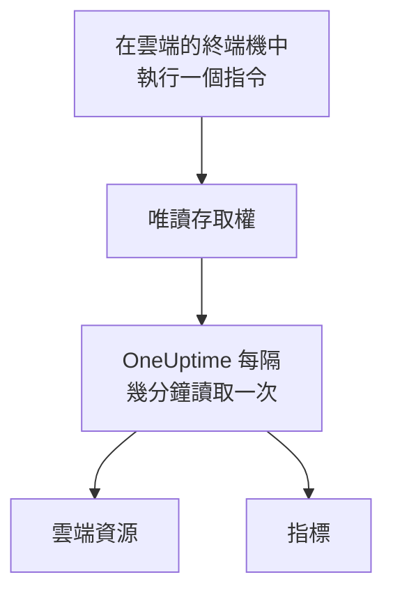

# 連線雲端帳戶

在儀表板中連線 AWS 帳戶、Azure 訂用帳戶或 Google Cloud 專案，OneUptime 會列出其中的資源，並依排程讀取它們的關鍵指標。你只需在雲端自帶的瀏覽器終端機中執行一個指令，再貼上它的輸出：不需要執行收集器，也不需要安裝任何東西。

:::cards
- [Amazon Web Services](#amazon-web-services): OneUptime 登入所用的 IAM 角色，或一組存取金鑰。
- [Microsoft Azure](#microsoft-azure): 具有 Monitoring Reader 角色的應用程式。
- [Google Cloud](#google-cloud): 具有 Monitoring Viewer 角色的服務帳戶。
- [OneUptime 讀取什麼](#oneuptime-讀取什麼): 讀取哪些資源和指標、多久讀取一次，以及費用是多少。
:::

## 運作方式



- **存取權只能讀取。** 指令建立的存取權只會讀取指標，不做其他任何事：在 AWS 上是三個讀取動作，在 Azure 上是 **Monitoring Reader** 角色，在 Google Cloud 上是 **Monitoring Viewer** 角色。刪除它即可切斷 OneUptime 的存取。
- **OneUptime 依排程讀取。** 除非你在連線時選擇其他間隔，Azure 和 Google Cloud 每 5 分鐘讀取一次，AWS 每 10 分鐘讀取一次。
- **每個資源都有自己的頁面。** 資源會顯示在 **雲端 → 所有資源** 中，附上其關鍵指標、擁有者和標籤，和收集器回報的資源一樣。

## 開始之前

- **專案擁有者或管理員。** 只有他們可以連線、測試和編輯雲端帳戶。
- **你的雲端的終端機**（AWS CloudShell、Azure Cloud Shell 或 Google Cloud Shell），並以可以建立 IAM 角色或使用者、應用程式註冊或服務帳戶的身分登入。

## Amazon Web Services

:::steps
### 開啟 AWS 表單

前往 **雲端 → 連線**，然後選擇 **Amazon Web Services**。

### 在 AWS CloudShell 中執行指令

選擇 OneUptime 的登入方式。建議使用 **IAM 角色**：不會儲存任何機密，你也可以隨時刪除該角色。表單會顯示為你的專案撰寫的指令：它會建立一個以你專案的外部 ID 信任 OneUptime 的 AWS 帳戶的角色，並輸出該角色的 ARN。無法使用角色時，請使用 **存取金鑰**。以下指令會建立一個具有相同權限的使用者，並輸出其金鑰：

```bash
aws iam create-user --user-name OneUptimeReadOnly > /dev/null 2>&1 || true
aws iam put-user-policy --user-name OneUptimeReadOnly --policy-name OneUptimeReadOnly --policy-document '{"Version":"2012-10-17","Statement":[{"Effect":"Allow","Action":["cloudwatch:GetMetricData","cloudwatch:ListMetrics","tag:GetResources"],"Resource":"*"}]}'
aws iam create-access-key --user-name OneUptimeReadOnly
```

### 貼上 AWS 指令的輸出

將指令輸出的全部內容貼到 **指令的輸出** 中。OneUptime 會從中擷取角色的 ARN，或存取金鑰 ID 及其機密。

### 測試並連線 AWS

選擇 **測試連線**。OneUptime 會登入、計算找到的資源，並說明讀取它們的費用。選擇 **連線** 即可儲存。
:::

該角色和使用者只能做以下三件事：

| 動作 | OneUptime 的用途 |
| --- | --- |
| `cloudwatch:ListMetrics` | 在每個區域中找到回報指標的資源 |
| `cloudwatch:GetMetricData` | 讀取它們的關鍵指標 |
| `tag:GetResources` | 用 `Name` 標籤為每個資源命名 |

> [!NOTE]
> 在自行託管的 OneUptime 上，**IAM 角色** 方式需要 OneUptime 自己的 AWS 身分：將 `CLOUD_CONNECT_AWS_ACCESS_KEY_ID` 和 `CLOUD_CONNECT_AWS_SECRET_ACCESS_KEY` 設定為一個可以呼叫 `sts:AssumeRole` 的 IAM 使用者的金鑰。未設定時，表單會提供 **存取金鑰**。

## Microsoft Azure

:::steps
### 開啟 Azure 表單

前往 **雲端 → 連線**，然後選擇 **Microsoft Azure**。

### 在 Azure Cloud Shell 中執行指令

該指令會在你目前的訂用帳戶上建立一個具有 **Monitoring Reader** 角色的應用程式，並輸出其詳細資料：

```bash
az ad sp create-for-rbac --name OneUptimeReadOnly --role "Monitoring Reader" --scopes "/subscriptions/$(az account show --query id --output tsv)"
```

### 貼上 Azure 指令的輸出

將指令輸出的全部內容貼到 **指令的輸出** 中。OneUptime 會從中擷取 `tenant`、`appId` 和 `password`。

### 測試並連線 Azure

選擇 **測試連線**，然後選擇 **連線**。
:::

若要用同一個應用程式讀取更多訂用帳戶，請在每個訂用帳戶上為它指派該角色：

```bash
az role assignment create --assignee <APP_ID> --role "Monitoring Reader" --scope /subscriptions/<SUBSCRIPTION_ID>
```

除非你在 **訂用帳戶** 中列出部分訂用帳戶，OneUptime 會讀取該應用程式可以讀取的所有訂用帳戶。

## Google Cloud

:::steps
### 開啟 Google Cloud 表單

前往 **雲端 → 連線**，然後選擇 **Google Cloud**。

### 在 Google Cloud Shell 中執行指令

在要監控的專案中執行它。它會啟用 Cloud Monitoring API，建立一個具有 **Monitoring Viewer** 角色的服務帳戶，並輸出其金鑰：

```bash
PROJECT_ID=$(gcloud config get-value project)
gcloud services enable monitoring.googleapis.com
gcloud iam service-accounts create oneuptime-read-only --display-name "OneUptime (read only)"
gcloud projects add-iam-policy-binding "$PROJECT_ID" --member "serviceAccount:oneuptime-read-only@$PROJECT_ID.iam.gserviceaccount.com" --role roles/monitoring.viewer --condition=None > /dev/null
gcloud iam service-accounts keys create oneuptime-key.json --iam-account "oneuptime-read-only@$PROJECT_ID.iam.gserviceaccount.com"
cat oneuptime-key.json && rm oneuptime-key.json
```

### 貼上金鑰

貼上指令輸出的全部內容。OneUptime 會讀取金鑰所屬的專案，並加密儲存該金鑰。

### 測試並連線 Google Cloud

選擇 **測試連線**，然後選擇 **連線**。
:::

若要用同一個服務帳戶讀取更多專案，請在每個專案中為它指派該角色，並在 **專案** 中列出這些專案：

```bash
gcloud projects add-iam-policy-binding <PROJECT_ID> --member "serviceAccount:oneuptime-read-only@<KEY_PROJECT_ID>.iam.gserviceaccount.com" --role roles/monitoring.viewer
```

## OneUptime 讀取什麼

| | AWS | Azure | Google Cloud |
| --- | --- | --- | --- |
| 資源 | 在你使用的每個區域中向 CloudWatch 回報指標的資源 | 訂用帳戶中的所有資源 | 向 Cloud Monitoring 回報指標的資源 |
| 指標 | 每項服務的關鍵指標，例如執行個體的 CPU、網路和狀態檢查 | 每個資源最多 8 個關鍵指標 | 每種資源類型的關鍵指標 |
| 讀取間隔 | 10 分鐘 | 5 分鐘 | 5 分鐘 |
| 已刪除的資源 | 7 天沒有指標後封存 | 在下一次讀取時封存 | 7 天沒有指標後封存 |

每次讀取都會從上一次停止的地方繼續，因此每個資料點只會寫入一次。新連線的第一次讀取會很快開始，並回溯最近一小時；暫停之後，一次讀取最多回溯 6 小時。

OneUptime 發出的呼叫會依你的雲端的價格計入你的雲端帳戶。**測試連線** 會估算它找到的內容的費用，降低讀取頻率可以減少費用：在 **更多欄位** 中修改 **指標讀取間隔**。

| 雲端 | 價格 |
| --- | --- |
| AWS | CloudWatch `GetMetricData`：每 1,000 個指標 $0.01，每個資源的每個關鍵指標每次讀取計為一個指標 |
| Azure | 每個訂用帳戶每月的前 1,000,000 次指標讀取免費，之後每 1,000 次 $0.01 |
| Google Cloud | 每月讀取的前 1,000,000 個時間序列免費，之後每百萬個 $0.50 |

## 疑難排解

:::details 測試顯示金鑰或機密未被接受
複製指令輸出的全部內容並重新貼上。剛建立的金鑰可能需要一點時間才能生效。
:::

:::details 測試可以登入，但無法讀取
再次執行該指令：它會授予 OneUptime 所需的角色。在 AWS 上，請執行表單為此專案顯示的指令：為其他專案建立的角色信任的是那個專案的外部 ID，而不是此專案的外部 ID。
:::

:::details Google Cloud 不允許該指令建立金鑰
組織政策 `iam.disableServiceAccountKeyCreation` 可能禁止服務帳戶金鑰。請向組織的管理員申請為該專案設定例外，或[使用你自己的收集器傳送指標](/docs/telemetry/cloud-resources)。
:::

:::details 沒有顯示任何資源
在 AWS 和 Google Cloud 上，資源會在回報指標後顯示。如果某個連線無法正常運作，**雲端 → 連線** 中的 **View error** 會說明其上次讀取失敗的原因。
:::

## 後續步驟

:::cards
- [雲端資源](/docs/telemetry/cloud-resources): 改為執行你自己的 OpenTelemetry Collector，或以串流方式傳送 CloudWatch 指標。
- [指標監控器](/docs/monitor/metrics-monitor): 根據資源的指標發出警示。
:::
