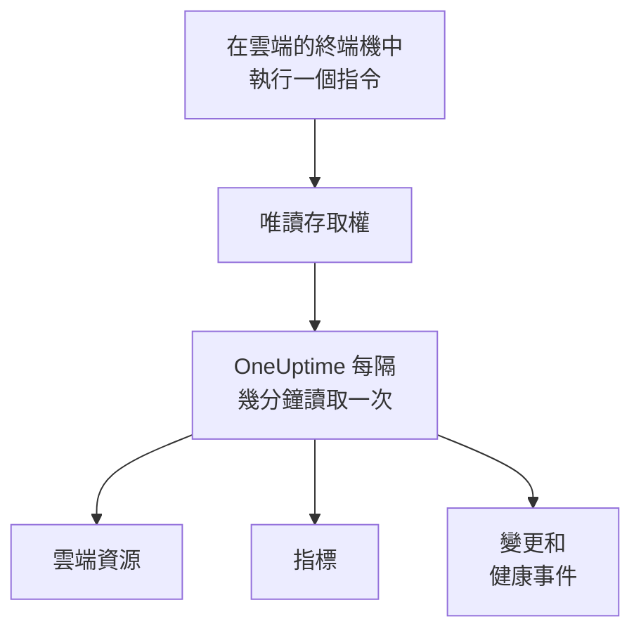

# 連線雲端帳戶

在儀表板中連線 AWS 帳戶、Azure 訂用帳戶或 Google Cloud 專案，OneUptime 會列出其中的每個資源，讀取它們的關鍵指標，並記錄它們發生了哪些變更，以及你的雲端供應商對它們健康狀況的說明。你只需在雲端自帶的瀏覽器終端機中執行一個指令，再貼上它的輸出：不需要執行收集器，也不需要安裝任何東西。

:::cards
- [Amazon Web Services](#amazon-web-services): OneUptime 登入所用的 IAM 角色，或一組存取金鑰。
- [Microsoft Azure](#microsoft-azure): 具有 Monitoring Reader 角色的應用程式。
- [Google Cloud](#google-cloud): 具有四個唯讀角色的服務帳戶。
- [OneUptime 讀取什麼](#oneuptime-讀取什麼): 資源、指標、變更和健康事件，多久讀取一次，以及費用是多少。
- [讓 AI 修正問題](#讓-ai-修正問題): 再執行一個指令，OneUptime AI 就能修正它發現的問題。
:::

## 運作方式



- **存取權只能讀取。** 指令建立的存取權只會讀取你的資源及其設定、它們的指標、發生的變更和供應商的健康事件，不做其他任何事：在 AWS 上是下方列出的動作，在 Azure 上是 **Monitoring Reader** 角色，在 Google Cloud 上是四個檢視者角色。OneUptime 從不透過它讀取資料或機密，只有當你允許 AI 讀取帳戶的日誌時，才會讀取日誌行。刪除它即可切斷 OneUptime 的存取。
- **OneUptime 依排程讀取。** 除非你在連線時選擇其他間隔，Azure 和 Google Cloud 每 5 分鐘讀取一次，AWS 每 10 分鐘讀取一次。每次讀取也會記錄自上次以來的變更，而且每 30 分鐘會有一次讀取重新列出所有資源。
- **每個資源都有自己的頁面。** 資源會顯示在 **雲端 → 所有資源** 中，附上其關鍵指標、擁有者和標籤。已列出資源的頁面也會顯示它的 **相連的資源**（它在什麼裡面執行，什麼向它傳送流量）、它的端點、標籤和設定，以及它的 **事件**、**警示** 和 **變更**。
- **每個帳戶都有自己的頁面。** 帳戶會顯示在 **雲端 → 帳戶** 中，附上依類型和區域分組的資源、它們的 **變更**，以及顯示其資源如何彼此相連的 **拓撲**。
- **OneUptime AI 會讀取發生的變更。** 對連結到雲端資源的事件或警示所做的調查，會先讀取該資源的變更，並在開始時重新讀取帳戶的活動記錄。

## 開始之前

- **專案擁有者或管理員。** 只有他們可以連線、測試和編輯雲端帳戶。
- **你的雲端的終端機**（AWS CloudShell、Azure Cloud Shell 或 Google Cloud Shell），並以可以建立 IAM 角色或使用者、應用程式註冊或服務帳戶的身分登入。

## Amazon Web Services

:::steps
### 開啟 AWS 表單

前往 **雲端 → 連線**，然後選擇 **Amazon Web Services**。

### 在 AWS CloudShell 中執行指令

選擇 OneUptime 的登入方式。建議使用 **IAM 角色**：不會儲存任何機密，你也可以隨時刪除該角色。表單會顯示為你的專案撰寫的指令：它會建立一個以你專案的外部 ID 信任 OneUptime 的 AWS 帳戶的角色，並輸出該角色的 ARN。

在 **讀取範圍** 中，選擇此帳戶或你的 AWS Organization 中的每個帳戶。在組織的管理帳戶中執行組織的指令：它會新增一個 StackSet，把同一個角色放進每個帳戶（現有的帳戶和之後加入的帳戶），並讓管理帳戶的角色列出這些帳戶。一個連線最多讀取 50 個帳戶。

無法使用角色時，請使用 **存取金鑰**：它只會讀取自己的帳戶。以下指令會建立一個具有相同權限的使用者，並輸出其金鑰：

```bash
aws iam create-user --user-name OneUptimeReadOnly > /dev/null 2>&1 || true
aws iam put-user-policy --user-name OneUptimeReadOnly --policy-name OneUptimeReadOnly --policy-document '{"Version":"2012-10-17","Statement":[{"Effect":"Allow","Action":["cloudwatch:GetMetricData","cloudwatch:ListMetrics","tag:GetResources","iam:ListAccountAliases","cloudformation:ListResources","ec2:DescribeInstances","ec2:DescribeVolumes","ec2:DescribeVpcs","ec2:DescribeNatGateways","autoscaling:DescribeAutoScalingGroups","elasticloadbalancing:DescribeLoadBalancers","elasticloadbalancing:DescribeLoadBalancerAttributes","elasticloadbalancing:DescribeTargetGroups","elasticloadbalancing:DescribeTargetGroupAttributes","elasticloadbalancing:DescribeTargetHealth","elasticloadbalancing:DescribeTags","ecs:ListClusters","ecs:DescribeClusters","ecs:ListServices","ecs:DescribeServices","lambda:ListFunctions","rds:DescribeDBInstances","rds:DescribeDBClusters","elasticache:DescribeReplicationGroups","sqs:ListQueues","sqs:GetQueueAttributes","sns:ListTopics","sns:GetTopicAttributes","sns:ListSubscriptionsByTopic","dynamodb:ListTables","dynamodb:DescribeTable","kinesis:ListStreams","kinesis:DescribeStreamSummary","states:ListStateMachines","states:DescribeStateMachine","cloudfront:ListDistributions","elasticfilesystem:DescribeFileSystems","es:ListDomainNames","es:DescribeDomains","apprunner:ListServices","apprunner:DescribeService","cloudtrail:LookupEvents","health:DescribeEvents","health:DescribeEventDetails","rds:DescribeEvents","autoscaling:DescribeScalingActivities","ec2:DescribeInstanceStatus","ecs:DescribeTaskDefinition","lambda:GetFunctionConfiguration","lambda:GetFunctionConcurrency","lambda:GetAlias","servicequotas:ListServiceQuotas","logs:DescribeLogGroups","logs:FilterLogEvents"],"Resource":"*"},{"Effect":"Allow","Action":["apigateway:GET"],"Resource":["arn:aws:apigateway:*::/restapis","arn:aws:apigateway:*::/restapis/*","arn:aws:apigateway:*::/apis","arn:aws:apigateway:*::/apis/*"]}]}'
aws iam create-access-key --user-name OneUptimeReadOnly
```

### 貼上 AWS 指令的輸出

將指令輸出的全部內容貼到 **指令的輸出** 中。OneUptime 會從中找出角色的 ARN，或存取金鑰 ID 及其機密。

### 測試並連線 AWS

此步驟開啟時，OneUptime 會測試連線：它會登入，計算找到的資源，並說明讀取它們的費用。選擇 **連線** 即可儲存。
:::

該角色和使用者只能做以下這些事：

| OneUptime 的用途 | 動作 |
| --- | --- |
| 找到回報指標的資源，並讀取它們的指標 | `cloudwatch:GetMetricData`, `cloudwatch:ListMetrics` |
| 為每個資源命名並讀取其標籤 | `tag:GetResources`, `iam:ListAccountAliases` |
| 透過 Cloud Control 列出每個資源及其設定 | `cloudformation:ListResources`, `ec2:DescribeInstances`, `ec2:DescribeVolumes`, `ec2:DescribeVpcs`, `ec2:DescribeNatGateways`, `autoscaling:DescribeAutoScalingGroups`, `elasticloadbalancing:DescribeLoadBalancers`, `elasticloadbalancing:DescribeLoadBalancerAttributes`, `elasticloadbalancing:DescribeTargetGroups`, `elasticloadbalancing:DescribeTargetGroupAttributes`, `elasticloadbalancing:DescribeTargetHealth`, `elasticloadbalancing:DescribeTags`, `ecs:ListClusters`, `ecs:DescribeClusters`, `ecs:ListServices`, `ecs:DescribeServices`, `lambda:ListFunctions`, `rds:DescribeDBInstances`, `rds:DescribeDBClusters`, `elasticache:DescribeReplicationGroups`, `sqs:ListQueues`, `sqs:GetQueueAttributes`, `sns:ListTopics`, `sns:GetTopicAttributes`, `sns:ListSubscriptionsByTopic`, `dynamodb:ListTables`, `dynamodb:DescribeTable`, `kinesis:ListStreams`, `kinesis:DescribeStreamSummary`, `states:ListStateMachines`, `states:DescribeStateMachine`, `cloudfront:ListDistributions`, `elasticfilesystem:DescribeFileSystems`, `es:ListDomainNames`, `es:DescribeDomains`, `apprunner:ListServices`, `apprunner:DescribeService`, `apigateway:GET` |
| 讀取發生的變更：帳戶的管理事件 | `cloudtrail:LookupEvents` |
| 讀取 AWS 自己針對該帳戶的健康事件 | `health:DescribeEvents`, `health:DescribeEventDetails` |
| 在調查期間讀取資源的目前狀態和最近的事件 | `rds:DescribeEvents`, `autoscaling:DescribeScalingActivities`, `ec2:DescribeInstanceStatus`, `ecs:DescribeTaskDefinition`, `lambda:GetFunctionConfiguration`, `lambda:GetFunctionConcurrency`, `lambda:GetAlias` |
| 在調查期間讀取帳戶的配額 | `servicequotas:ListServiceQuotas` |
| 讀取日誌行，僅當你允許 AI 讀取帳戶的日誌時 | `logs:DescribeLogGroups`, `logs:FilterLogEvents` |
| 從組織的管理帳戶列出組織的帳戶 | `organizations:ListAccounts` |

`apigateway:GET` 只允許用於 API 本身的定義，從不用於它們的金鑰，而且只有管理帳戶的角色可以列出組織的帳戶。AWS Health 只回應使用 Business、Enterprise On-Ramp 或 Enterprise 支援方案的帳戶：沒有這類方案時，OneUptime 會在一天後再次詢問。

> [!NOTE]
> 在自行託管的 OneUptime 上，**IAM 角色** 方式需要 OneUptime 自己的 AWS 身分：將 `CLOUD_CONNECT_AWS_ACCESS_KEY_ID` 和 `CLOUD_CONNECT_AWS_SECRET_ACCESS_KEY` 設定為一個可以呼叫 `sts:AssumeRole` 的 IAM 使用者的金鑰。未設定時，表單會提供 **存取金鑰**。

## Microsoft Azure

:::steps
### 開啟 Azure 表單

前往 **雲端 → 連線**，然後選擇 **Microsoft Azure**。

### 在 Azure Cloud Shell 中執行指令

該指令會在你目前的訂用帳戶上建立一個具有 **Monitoring Reader** 角色的應用程式，並輸出其詳細資料以及其機密的到期日期：

```bash
SCOPE="/subscriptions/$(az account show --query id --output tsv)"
OUT=$(az ad sp create-for-rbac --name OneUptimeReadOnly --role "Monitoring Reader" --scopes "$SCOPE")
APP=$(echo "$OUT" | jq -r .appId)
END=$(az ad app credential list --id "$APP" --query "max([].endDateTime)" --output tsv)
echo "$OUT" | jq --arg end "$END" '. + {endDateTime: $end}'
```

在 **讀取範圍** 中改為選擇租用戶中的每個訂用帳戶，角色就會授予租用戶的根管理群組：

```bash
SCOPE="/providers/Microsoft.Management/managementGroups/$(az account show --query tenantId --output tsv)"
OUT=$(az ad sp create-for-rbac --name OneUptimeReadOnly --role "Monitoring Reader" --scopes "$SCOPE")
APP=$(echo "$OUT" | jq -r .appId)
END=$(az ad app credential list --id "$APP" --query "max([].endDateTime)" --output tsv)
echo "$OUT" | jq --arg end "$END" '. + {endDateTime: $end}'
```

### 貼上 Azure 指令的輸出

將指令輸出的全部內容貼到 **指令的輸出** 中。OneUptime 會從中找出 `tenant`、`appId`、`password` 和到期日期。

### 測試並連線 Azure

此步驟開啟時，OneUptime 會測試連線。選擇 **連線** 即可儲存。
:::

要用同一個應用程式讀取更多訂用帳戶，請在每個訂用帳戶上為它授予該角色：

```bash
az role assignment create --assignee <APP_ID> --role "Monitoring Reader" --scope /subscriptions/<SUBSCRIPTION_ID>
```

除非你在 **訂用帳戶** 中列出一些訂用帳戶，否則 OneUptime 會讀取該應用程式可以讀取的每個訂用帳戶，最多 50 個。應用程式的機密會在到期日停止運作：從到期前 30 天起，每次讀取都會對此發出提醒。再次執行該指令並貼上它的輸出，即可為它換一個新的機密。

## Google Cloud

:::steps
### 開啟 Google Cloud 表單

前往 **雲端 → 連線**，然後選擇 **Google Cloud**。

### 在 Google Cloud Shell 中執行指令

在要監控的專案中執行它。它會啟用 OneUptime 讀取的 API，建立一個具有 **Monitoring Viewer**、**Cloud Asset Viewer**、**Logs Viewer** 和 **Service Health Viewer** 角色的服務帳戶，並輸出其金鑰：

```bash
PROJECT_ID=$(gcloud config get-value project)
gcloud services enable monitoring.googleapis.com cloudasset.googleapis.com logging.googleapis.com cloudresourcemanager.googleapis.com servicehealth.googleapis.com
gcloud iam service-accounts create oneuptime-read-only --display-name "OneUptime (read only)" > /dev/null 2>&1 || true
gcloud projects add-iam-policy-binding "$PROJECT_ID" --member "serviceAccount:oneuptime-read-only@$PROJECT_ID.iam.gserviceaccount.com" --role roles/monitoring.viewer --condition=None > /dev/null
gcloud projects add-iam-policy-binding "$PROJECT_ID" --member "serviceAccount:oneuptime-read-only@$PROJECT_ID.iam.gserviceaccount.com" --role roles/cloudasset.viewer --condition=None > /dev/null
gcloud projects add-iam-policy-binding "$PROJECT_ID" --member "serviceAccount:oneuptime-read-only@$PROJECT_ID.iam.gserviceaccount.com" --role roles/logging.viewer --condition=None > /dev/null
gcloud projects add-iam-policy-binding "$PROJECT_ID" --member "serviceAccount:oneuptime-read-only@$PROJECT_ID.iam.gserviceaccount.com" --role roles/servicehealth.viewer --condition=None > /dev/null
gcloud iam service-accounts keys create oneuptime-key.json --iam-account "oneuptime-read-only@$PROJECT_ID.iam.gserviceaccount.com"
cat oneuptime-key.json && rm oneuptime-key.json
```

在 **讀取範圍** 中改為選擇組織中的每個專案，角色就會授予該專案所屬的組織：

```bash
PROJECT_ID=$(gcloud config get-value project)
ORG_ID=$(gcloud projects get-ancestors "$PROJECT_ID" --format="value(id)" | tail -1)
gcloud services enable monitoring.googleapis.com cloudasset.googleapis.com logging.googleapis.com cloudresourcemanager.googleapis.com servicehealth.googleapis.com
gcloud iam service-accounts create oneuptime-read-only --display-name "OneUptime (read only)" > /dev/null 2>&1 || true
gcloud organizations add-iam-policy-binding "$ORG_ID" --member "serviceAccount:oneuptime-read-only@$PROJECT_ID.iam.gserviceaccount.com" --role roles/monitoring.viewer --condition=None > /dev/null
gcloud organizations add-iam-policy-binding "$ORG_ID" --member "serviceAccount:oneuptime-read-only@$PROJECT_ID.iam.gserviceaccount.com" --role roles/cloudasset.viewer --condition=None > /dev/null
gcloud organizations add-iam-policy-binding "$ORG_ID" --member "serviceAccount:oneuptime-read-only@$PROJECT_ID.iam.gserviceaccount.com" --role roles/logging.viewer --condition=None > /dev/null
gcloud organizations add-iam-policy-binding "$ORG_ID" --member "serviceAccount:oneuptime-read-only@$PROJECT_ID.iam.gserviceaccount.com" --role roles/servicehealth.viewer --condition=None > /dev/null
gcloud iam service-accounts keys create oneuptime-key.json --iam-account "oneuptime-read-only@$PROJECT_ID.iam.gserviceaccount.com"
cat oneuptime-key.json && rm oneuptime-key.json
```

### 貼上金鑰

貼上指令輸出的全部內容。OneUptime 會讀取金鑰本身所屬的專案，並加密儲存金鑰。

### 測試並連線 Google Cloud

此步驟開啟時，OneUptime 會測試連線。選擇 **連線** 即可儲存。
:::

要用同一個服務帳戶讀取更多專案，請在每個專案中為它授予這四個角色，並在 **專案** 中列出它們：

```bash
for ROLE in roles/monitoring.viewer roles/cloudasset.viewer roles/logging.viewer roles/servicehealth.viewer; do gcloud projects add-iam-policy-binding <PROJECT_ID> --member "serviceAccount:oneuptime-read-only@<KEY_PROJECT_ID>.iam.gserviceaccount.com" --role "$ROLE"; done
```

除非你在 **專案** 中列出一些專案，否則組織的連線最多讀取其 50 個專案。

## OneUptime 讀取什麼

| | AWS | Azure | Google Cloud |
| --- | --- | --- | --- |
| 資源 | 你使用的每個區域中 OneUptime 所知類型的每個資源，來自 Cloud Control | 訂用帳戶中的每個資源，來自 Resource Graph | 專案中的每個資源，來自 Cloud Asset Inventory |
| 指標 | 每項服務的關鍵指標，例如執行個體的 CPU、網路和狀態檢查 | 每個資源最多 8 個關鍵指標 | 每種資源類型的關鍵指標 |
| 變更 | CloudTrail 管理事件 | 活動記錄的管理事件 | Admin Activity 稽核記錄 |
| 健康事件 | AWS Health | Service Health 和 Resource Health | Service Health |
| 讀取間隔 | 10 分鐘 | 5 分鐘 | 5 分鐘 |
| 已刪除的資源 | 完整清單中不再有它時封存 | 完整清單中不再有它時封存 | 完整清單中不再有它時封存 |

每次讀取都會從上一次停止的地方繼續，因此每個資料點和每項變更只會寫入一次。新連線的第一次讀取會在一分鐘內開始，指標回溯一小時，變更回溯 2 小時；暫停之後，一次讀取最多回溯 6 小時。只回報指標、且不在任何清單中的資源，會在 7 天沒有指標後封存。

OneUptime 發出的呼叫會依你的雲端的價格計入你的雲端帳戶。在這三種雲端上，列出資源以及讀取變更和健康事件都不收費；讀取指標則會收費。測試會估算它找到的內容的費用，降低讀取頻率可以減少費用：在 **更多欄位** 中修改 **指標讀取間隔**。

| 雲端 | 價格 |
| --- | --- |
| AWS | CloudWatch `GetMetricData`：每 1,000 個指標 $0.01，每個資源的每個關鍵指標每次讀取計為一個指標 |
| Azure | 每個訂用帳戶每月的前 1,000,000 次指標讀取免費，之後每 1,000 次 $0.01 |
| Google Cloud | 每月讀取的前 1,000,000 個時間序列免費，之後每百萬個 $0.50 |

## 你在 OneUptime 中看到的內容

- **帳戶的頁面。** 在 **雲端 → 帳戶** 下，帳戶的概觀會依類型和區域計算其資源，並說明某個連線上次讀取它的時間。它的 **資源** 會列出這些資源，它的 **變更** 會依從新到舊列出其中發生的變更，它的 **拓撲** 會繪製它的區域、其中的網路以及每個網路中執行的內容，並在連結的資源上顯示未關閉的事件和警示。它的 **動態** 會記錄該帳戶如何來到 OneUptime、它的雲端 AI 代理程式何時連線或被重設，以及誰變更了 OneUptime AI 在其中可以做什麼。
- **資源的變更。** 一項變更會儲存為一個變更事件，連結到它所變更的資源和該資源的帳戶，並與資源的事件和警示一起，以標記的形式繪製在資源的指標圖表上。未篩選到任何資源的圖表不會顯示雲端帳戶的活動記錄，這樣忙碌的帳戶就不會擠掉你的部署；供應商的健康事件仍會保留在這些圖表上。
- **事件和警示。** 在監控器、事件或警示的已連結資源中連結一個雲端資源，它的事件和警示就會列在該資源的頁面上。如果網站、API、SSL、ping 或連接埠監控器的主機直接或透過 DNS 指向某個資源的端點，該監控器的 **已連結的資源** 卡片會在 **建議的雲端資源** 下列出該資源：選擇 **連結資源** 即可連結它。

## 讓 AI 修正問題

OneUptime AI 在調查時會透過上述的唯讀存取讀取每個已連線的帳戶。若要讓它也能修正問題，例如重新啟動服務、擴展服務或回復服務，請在 **雲端 → 帳戶** 下開啟該帳戶，然後在其 **概覽** 的 **AI 代理程式** 卡片中選擇 **讓 AI 修正問題**。

對話方塊只問一個問題——**AI 可以做到哪一步？** 選擇預設的 **先詢問我** 時，OneUptime AI 會提出每項修正，由人一鍵核准；選擇 **自行修正低風險問題** 時，安全的變更會自行執行，風險較高的變更仍需等待核准。其他所有設定都在 **更多欄位** 下，並有安全的預設值。接著它會顯示一個為此帳戶撰寫的指令：請以可在該帳戶中建立角色的身分登入，在 AWS CloudShell、Azure Cloud Shell 或 Google Cloud Shell 中執行它。該指令會建立一個只能進行已開啟變更的角色，並用它在你的帳戶中啟動雲端 AI 代理程式。代理程式會在幾分鐘內自行連線，對話方塊也會顯示這一點：不需要貼回任何內容。

代理程式是一個整個月都在你的帳戶中執行的小型容器，由你的雲端依其牌價計費：

| 雲端 | 執行的內容 | 大約 |
| --- | --- | --- |
| AWS | 一個 0.25 vCPU、0.5 GB 的 ECS Fargate 任務及其公用 IPv4 位址，依 `us-east-1` 的價格計算 | 每月 $13 |
| Azure | 一個 0.25 vCPU、0.5 GiB 的 Container Apps 複本，扣除訂用帳戶每月 180,000 vCPU 秒和 360,000 GiB 秒的免費額度之後 | 每月 $14 |
| Google Cloud | 一個 1 vCPU、0.5 GiB 且一律分配 CPU 的 Cloud Run 執行個體，它會佔用一整個 vCPU，扣除每月 240,000 vCPU 秒和 450,000 GiB 秒的免費方案之後 | 每月 $45 |

代理程式可以變更什麼、每項變更如何分級和復原，以及如何讀取其日誌：[基礎設施 AI 代理程式](/docs/ai/infrastructure-ai-agents#在雲端帳戶中)。

## 疑難排解

:::details 測試顯示金鑰或機密未被接受
複製指令輸出的全部內容並重新貼上。剛建立的金鑰可能需要一點時間才能生效。已過期的 Azure 機密也會被拒絕：請再次執行該指令。
:::

:::details 測試可以登入，但無法讀取
再次執行該指令：它會授予 OneUptime 所需的角色。在 AWS 上，請執行表單為此專案顯示的指令：為其他專案建立的角色信任的是那個專案的外部 ID，而不是此專案的外部 ID。
:::

:::details Google Cloud 不允許該指令建立金鑰
組織政策 `iam.disableServiceAccountKeyCreation` 可能禁止服務帳戶金鑰。請向組織的管理員申請為該專案設定例外，或[使用你自己的收集器傳送指標](/docs/telemetry/cloud-resources)。
:::

:::details 沒有顯示任何資源
第一次讀取會列出帳戶的每個資源，無論它是否回報指標。如果某個連線無法正常運作，**雲端 → 連線** 中的 **View error** 會說明其上次讀取失敗的原因。
:::

:::details 組織的部分帳戶不見了
一個連線最多讀取 50 個帳戶、訂用帳戶或專案，超出時每次讀取都會說明。請用另一個連線連線其餘的帳戶。
:::

## 後續步驟

:::cards
- [雲端資源](/docs/telemetry/cloud-resources): 改為執行你自己的 OpenTelemetry Collector，或以串流方式傳送 CloudWatch 指標。
- [部署與變更](/docs/telemetry/change-events): OneUptime 記錄的每項變更，以及 OneUptime AI 如何讀取它們。
- [指標監控器](/docs/monitor/metrics-monitor): 根據資源的指標發出警示。
:::
