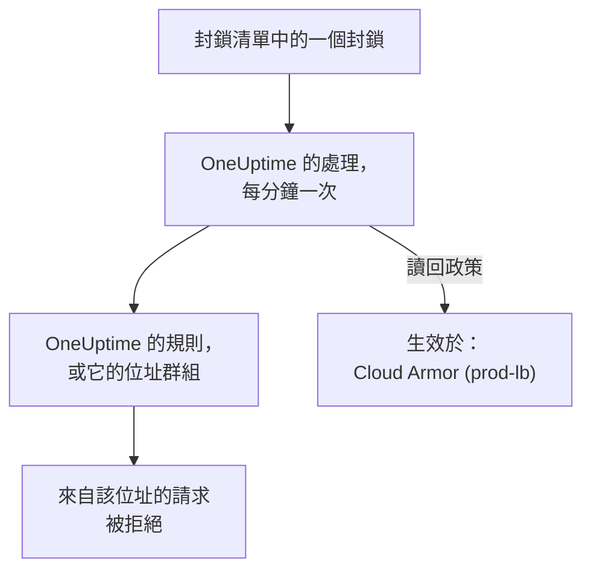

# 在 Cloud Armor 中封鎖位址

你的專案的封鎖清單可以在你的負載平衡器的 Google Cloud Armor 安全性政策中執行。為你已有的 Google Cloud 連線開啟它並選擇安全性政策後，封鎖清單封鎖的每個位址都會在那裡被封鎖，無論封鎖它的是人、劇本還是 OneUptime AI。

:::cards
- [開啟](#開啟): Google Cloud 連線上的一項設定，以及它所需的角色。
- [OneUptime 建立的內容](#oneuptime-建立的內容): 在每個政策中建立自己的規則，或在使用 Cloud Armor Enterprise 時建立位址群組。
- [比對哪個位址](#比對哪個位址): 建立連線的位址，或代理伺服器後方的使用者 IP。
:::

## 運作方式

OneUptime 會在你選擇的每個安全性政策中保留自己的規則，並把封鎖清單封鎖的位址放入其中。它每分鐘只變更有變化的部分，每次一條規則，然後讀回該政策。在 **封鎖清單** 頁面上，只有當政策持有該封鎖時，該封鎖的 **生效於** 才會顯示 Cloud Armor (prod-lb)；在此之前，它並未生效。

## 開始之前

- 一個已連線到 OneUptime 的 Google Cloud 專案（請參閱[連線雲端帳戶](/docs/telemetry/cloud-accounts#google-cloud)）。
- 可以變更封鎖清單生效位置的角色：**專案擁有者**、**專案管理員** 或 **安全性管理員**。
- 能夠在該 Google Cloud 專案中建立並授予角色的人，以便在 Cloud Shell 中執行一條指令。

## 開啟

:::steps
### 開啟連線
開啟 **雲端 → 連線**，編輯 Google Cloud 連線。

### 開啟設定
在 **更多欄位** 下，將 **在 Cloud Armor 中封鎖位址** 設為 **開啟**，然後儲存。表單顯示的設定指令現在會在授予其他角色的位置授予下文所述的角色。已有的連線不需要再次執行它：**新增 WAF** 對話方塊會提供在該政策所在專案中授予該角色的指令。

### 新增安全性政策
開啟 **安全事件 → 劇本 → 封鎖清單**。在 **雲端 WAF** 下，點選 **新增 WAF** 並選擇一個安全性政策。OneUptime 會詢問 Google Cloud 該連線能否寫入它，而不會寫入任何內容。

### 授予缺少的角色
缺少某項權限時，對話方塊會顯示在該政策所在專案中授予它的指令。在 Cloud Shell 中執行這些指令，點選 **重新檢查**，然後新增該政策。OneUptime 完成設定後，它的 **狀態** 會顯示 **生效中**。
:::

安全性政策來自連線的資源清單：OneUptime 尚未讀取的政策會在下一次讀取後列出。當某個政策正在執行封鎖清單時，其連線的設定不能關閉，連線也不能刪除：請先移除該政策，讓 OneUptime 撤下其規則。

## OneUptime 建立的內容

OneUptime 會在你新增政策時決定該政策以何種方式容納封鎖清單。

| 內容 | 名稱 | 位置 |
| --- | --- | --- |
| 以 403 拒絕請求的規則，每條最多包含 10 個位址或範圍 | 其描述以 `OneUptime blocklist <project> #1`、`#2` 等開頭 | 在你選擇的每個政策中，最多 20 條。 |
| 兩個位址群組，IPv4 和 IPv6 | `oneuptime-<project>-block-ipv4`, `oneuptime-<project>-block-ipv6` | 全域，位於該政策所在的專案中。僅限 Cloud Armor Enterprise。 |
| 一條以 403 拒絕任一位址群組所含位址的規則 | 其描述以 `OneUptime blocklist <project>, address groups` 開頭 | 在你選擇的每個全域後端政策中，需要 Cloud Armor Enterprise。 |

`<project>` 是你的專案外部 ID 的前八個字元，因此選擇同一政策的兩個 OneUptime 專案永遠不會寫入彼此的規則。Cloud Armor 只用優先順序來識別規則，因此 OneUptime 透過描述來辨識自己的規則。

- **規則。** Cloud Armor 的一條規則可容納 10 個位址或範圍，因此一個政策在 OneUptime 的 20 條規則中最多可容納 200 個封鎖；放不下的封鎖會在其所在列上說明。
- **位址群組。** 在啟用了 Cloud Armor Enterprise 的專案中，全域後端政策改為在兩個位址群組中容納封鎖清單：10,000 個 IPv4 範圍和 2,000 個 IPv6 範圍。該專案的所有此類政策共用這些位址群組，每個政策中有一條規則拒絕其中所含的位址。這些位址群組會佔用該專案位址群組配額中的 16,000 個單位。

OneUptime 使用 Cloud Armor 的規則方法逐條新增、變更和刪除自己的規則：它從不整體寫入政策，也從不寫入你的規則。單一位址寫成 `/32` 或 `/128`。

## 規則在政策中的位置

OneUptime 會把它的規則放在你的第一條放行請求的規則之前的空閒優先順序上，從最小的開始，因此你的任何規則都不會放行被封鎖的位址：即允許、節流、依速率封鎖或公平分享的規則。你的拒絕規則可以排在它們前面。OneUptime 從不重新編號、變更或刪除你的規則：當你的第一條此類規則之前沒有空閒的優先順序時，政策會顯示 **無可用優先順序**，在你騰出一個之後，OneUptime 就會新增其規則。

## 比對哪個位址

| 安全性政策 | 用戶端位址 | 何時選擇 |
| --- | --- | --- |
| 後端 | **連線到負載平衡器的位址（origin.ip）** | 預設值。 |
| 後端 | 來自該政策請求標頭的使用者 IP（origin.user_ip） | 適用於位於其他代理伺服器或 CDN 之後的負載平衡器。 |
| 邊緣 | 連線到負載平衡器的位址（origin.ip） | 唯一的選項：邊緣政策不讀取其他位址。 |

`origin.user_ip` 是該政策的使用者 IP 請求標頭（`userIpRequestHeaders`）中的位址，這些標頭由負載平衡器前方的代理伺服器或 CDN 寫入。如果沒有設定任何此類標頭，或其中沒有有效位址，它就是 `origin.ip`。僅當這樣的代理伺服器會寫入這些標頭時才選擇它，因為直接存取負載平衡器的用戶端可以自己寫入它們。該選項位於 **新增 WAF** 對話方塊的 **更多欄位** 下，之後你可以在政策所在列使用 **用戶端位址** 變更它。

適用於直通式網路負載平衡器的網路邊緣安全性政策無法選擇，**新增 WAF** 對話方塊會說明原因：它的規則比對的是封包，而不是請求。

OneUptime 在 Cloud Armor 中的規則只會拒絕。要求挑戰某個位址的封鎖不會在 Cloud Armor 中套用，並會說明這一點。自動回應政策的挑戰在那裡會以相同時長的封鎖來執行。

## 規則被手動變更時

當有人將 OneUptime 的某條規則設為預覽模式、變更或刪除它，或刪除它的某個位址群組時，OneUptime 會保持其被修改後的樣子。政策會顯示 **已手動變更**，其中所含的封鎖不會生效，並會說明原因，直到有人在政策所在列點選 **還原**。還原會按照 OneUptime 的寫法重新寫入該規則，只要其原有優先順序仍空閒，就寫在該優先順序上，並會重新建立被刪除的位址群組。

OneUptime 不檢查政策是否已附加到後端服務。未附加到任何後端服務的政策不會封鎖任何內容。

## 在 Terraform 中管理政策

帶有 `rule` 區塊的 `google_compute_security_policy` 擁有該政策的每條規則，因此它的下一次 plan 會移除 OneUptime 的規則。請將你的規則寫成 `google_compute_security_policy_rule` 資源，它們不會影響其他規則；或者在該政策的 `lifecycle` 區塊中新增 `ignore_changes = [rule]`。

## 權限

設定指令會在授予連線其他角色的位置新增一個自訂角色 `oneuptimeCloudArmorBlocklist`，並將其授予連線的服務帳戶。**新增 WAF** 對話方塊顯示的指令會在該政策所在專案中新增同一角色。以規則（而非位址群組）容納封鎖清單的政策只需要它自身的權限。

| 權限 | 原因 |
| --- | --- |
| `compute.securityPolicies.get`, `compute.securityPolicies.update` | 讀取全域政策，並變更其中 OneUptime 的規則。 |
| `compute.regionSecurityPolicies.get`, `compute.regionSecurityPolicies.update` | 讀取區域政策，並變更其中 OneUptime 的規則。 |
| `compute.globalOperations.get`, `compute.regionOperations.get` | 等待變更完成。 |
| `compute.projects.get` | 讀取該專案是否啟用了 Cloud Armor Enterprise。 |
| `networksecurity.addressGroups.get`, `networksecurity.addressGroups.list`, `networksecurity.addressGroups.create`, `networksecurity.addressGroups.update`, `networksecurity.addressGroups.delete`, `networksecurity.addressGroups.use` | 維護 OneUptime 的位址群組，並在其規則中參考它們。僅限 Cloud Armor Enterprise。 |
| `networksecurity.operations.get` | 等待位址群組的變更完成。 |

該角色無法刪除政策，OneUptime 也從不寫入其他任何內容。設定指令還會啟用 Compute Engine 和 Network Security API。

## 移除

:::steps
### 移除安全性政策
在 **安全事件 → 劇本 → 封鎖清單** 中，點選政策所在列的 **移除**。OneUptime 會從政策中撤下其規則，並在該專案中沒有其他政策使用其位址群組時刪除這些位址群組。

### 關閉設定
編輯連線，將 **在 Cloud Armor 中封鎖位址** 設為 **關閉**，然後儲存。只有當該連線的所有政策都不再執行封鎖清單時，才能關閉此設定。
:::

當 OneUptime 可能無法再寫入該政策時，請在 **移除 WAF** 對話方塊中勾選 **僅從 OneUptime 移除**。OneUptime 會將該政策從封鎖清單中移除，並列出它留下的規則和位址群組：在你於 Google Cloud 中刪除它們之前，它們會繼續封鎖其中包含的位址。

## 疑難排解

:::details 未生效
政策的狀態會說明 Google Cloud 的回覆以及該怎麼做。如果遭到拒絕，它會指出缺少的權限：執行 **新增 WAF** 為該政策顯示的指令，然後點選 **重新檢查**。如果因配額遭到拒絕，它會指出該配額：請向 Google Cloud 申請更多配額，或刪除不再使用的規則。
:::

:::details 無可用優先順序
你的第一條放行請求的規則之前的每個優先順序都已被佔用。請把這條規則移到更大的編號上，然後點選 **重新檢查**。
:::

:::details 某個政策不在清單中
OneUptime 會在讀取已開啟該設定的連線的安全性政策之後列出它們。之後新增的政策會在連線的下一次讀取後出現。
:::

## 後續步驟

:::cards
- [安全案件與劇本](/docs/telemetry/security-cases): 從案件中封鎖位址，並查看其步驟的檢查結果。
- [連線雲端帳戶](/docs/telemetry/cloud-accounts): 此設定所屬的連線。
:::
