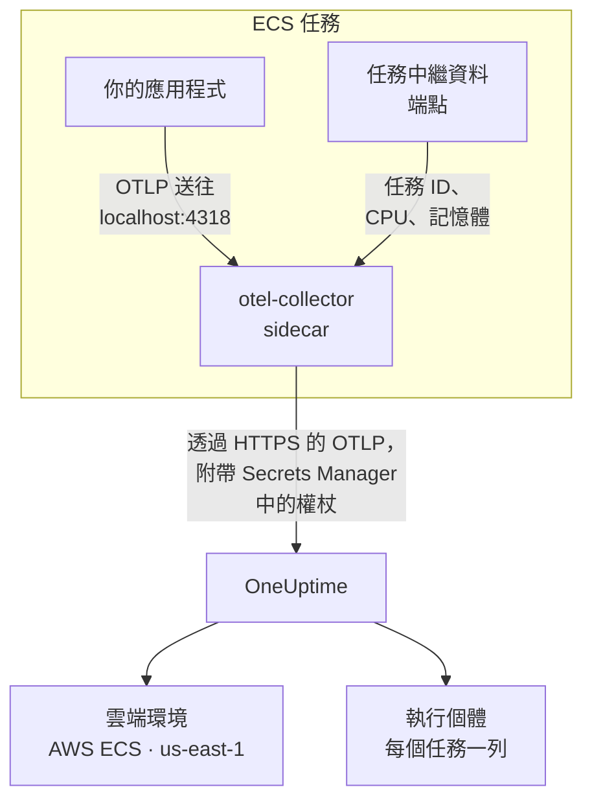

# AWS ECS / Fargate

將 Amazon ECS 任務的追蹤、日誌與指標傳送到 OneUptime，Fargate 與 EC2 啟動類型都適用。每個回報 `cloud.platform=aws_ecs` 的任務都會進入依 AWS 帳戶與區域劃分的一個 **Cloud Environment**（例如 _AWS ECS · us-east-1 · 123456789012_），不論其中執行一個服務還是五十個服務。

:::cards
- [運作方式](#運作方式): ECS 偵測器與 sidecar Collector 各自做什麼。
- [設定](#設定): 儲存權杖、把設定加入任務定義、部署並檢查。
- [完整的任務定義](#完整的任務定義): 可以直接註冊的完整 Fargate 任務定義。
- [疑難排解](#疑難排解): 卡在 PENDING 的任務、被拒絕的匯出、空的執行個體或圖格。
:::

## 運作方式



- **ECS 偵測器為環境命名。** SDK 或 Collector 中的 OpenTelemetry ECS 資源偵測器會讀取 ECS 提供給每個容器的任務中繼資料端點，並把帳戶、區域與任務標記到任務傳送的所有資料上。不需要寫死任何內容。
- **任務為每個執行個體命名。** 環境的 **執行個體** 分頁會依任務 ID 列出執行中的任務，並附上它們的 CPU 與記憶體。
- **sidecar Collector 提供 CPU 與記憶體。** 它的 `awsecscontainermetrics` 接收器會從同一個端點讀取每個任務的 CPU 與記憶體，而且權杖由它保管，應用程式永遠看不到權杖。

ECS 偵測器會設定下列資源屬性：

| 屬性 | ECS 偵測器設定的值 | 用途 |
| ------------------------------------------------------------------ | ----------------------- | --------------------------------------------------------------------------------------------------------- |
| `cloud.platform` | `aws_ecs` | 把遙測資料歸檔到 **雲端環境** 下。值必須完全一致 |
| `cloud.account.id` | `123456789012` | 環境金鑰的一部分 |
| `cloud.region` | `us-east-1` | 環境金鑰的一部分 |
| `aws.ecs.task.arn` | 任務 ARN | 依結尾的任務 ID 在 **執行個體** 下為一個執行中的任務命名 |
| `aws.ecs.task.id` | 任務 ID | 同上；較新的偵測器版本會同時設定兩者 |
| `aws.ecs.cluster.arn`, `aws.ecs.task.family`, `aws.ecs.launchtype` | 叢集與任務 | 保留在每個 span、日誌與指標上供你搜尋；不屬於環境的一部分 |

環境金鑰是 `aws_ecs|123456789012|us-east-1`。即使 SDK 也設定了 `service.instance.id`，執行個體的名稱仍取自任務 ID：sidecar 的容器指標只帶有任務 ID，因此用它當作金鑰，可以讓一個任務的 span 與它的 CPU 和記憶體留在同一列。完整規則請參閱 [雲端環境](/docs/telemetry/cloud-environments)。

## 開始之前

- **擷取金鑰。** 在 **專案設定 → 遙測與 APM → 擷取金鑰** 中建立一個 **伺服器** 金鑰並複製其權杖。
- **一個 ECS 叢集與一個你可以修訂的任務定義**，以及為該帳戶設定好的 AWS CLI。
- **以 OpenTelemetry SDK 檢測的應用程式**，能夠匯出 OTLP，語言不限。

## 選擇遙測資料離開任務的方式

| | Sidecar collector | SDK direct |
| ----------------------- | ---------------------------------------------- | ----------------------------------------------- |
| 額外的容器 | 每個任務中的 `otel-collector` | 無 |
| 每個任務的 CPU 與記憶體 | 有，來自 `awsecscontainermetrics` 接收器 | 無 |
| 保管權杖的一方 | Collector | 應用程式 |
| 機密中存放的內容 | 只有權杖 | 完整的標頭 `x-oneuptime-token=...` |

大多數團隊使用 sidecar Collector：它甚至會為那些對 ECS 一無所知的程式庫所發出的遙測資料加上 `cloud.*` 屬性。對於單一服務，SDK direct 是最簡單的選擇。下面每個步驟都為兩者各提供一個分頁；選擇其中一個，所有步驟都會跟著切換。

## 設定

:::steps
### 將權杖儲存到 Secrets Manager

> [!IMPORTANT]
> 權杖屬於機密。請把它保存在 AWS Secrets Manager 中，並在任務定義中透過 `secrets` 與 `valueFrom` 參照。寫在一般 `environment` 項目中的權杖，任何能讀取任務定義的人都看得到，而且會出現在每一次 `describe-task-definition` 輸出與 CloudFormation diff 中。

:::tabs
@tab Sidecar collector
```bash
aws secretsmanager create-secret \
  --name oneuptime/ingestion-token \
  --region us-east-1 \
  --secret-string "YOUR_TELEMETRY_INGESTION_TOKEN"
```

Collector 的設定會加上標頭名稱，因此這個機密只存放權杖。
@tab SDK direct
```bash
aws secretsmanager create-secret \
  --name oneuptime/ingestion-token \
  --region us-east-1 \
  --secret-string "x-oneuptime-token=YOUR_TELEMETRY_INGESTION_TOKEN"
```

ECS 會把機密的值原封不動放入變數，而 `OTEL_EXPORTER_OTLP_HEADERS` 需要完整的 `name=value` 組合，因此這個機密存放完整的標頭。
:::

記下指令印出的 ARN。它以一段隨機後綴結尾，例如 `oneuptime/ingestion-token-AbCdEf`，你需要把它貼到任務定義中。

### 允許任務讀取機密

任務執行角色（ECS 啟動任務時使用的角色，而不是你的程式碼執行時使用的角色）必須能夠讀取這個機密。請將下列政策附加到 `ecsTaskExecutionRole`：

```json title="secret-access-policy.json"
{
  "Version": "2012-10-17",
  "Statement": [
    {
      "Effect": "Allow",
      "Action": ["secretsmanager:GetSecretValue"],
      "Resource": "arn:aws:secretsmanager:us-east-1:123456789012:secret:oneuptime/ingestion-token-*"
    }
  ]
}
```

如果這個機密由客戶管理的 KMS 金鑰加密，該角色還需要對該金鑰的 `kms:Decrypt` 權限。缺少其中任何一項，任務都無法啟動，會以 `ResourceInitializationError: unable to pull secrets` 停止。

### 將設定加入任務定義

:::tabs
@tab Sidecar collector
1. **AWS Console → Amazon Elastic Container Service → Task definitions** → 選擇任務定義系列 → **Create new revision**。
2. 在 **Container - 1**（你的應用程式）下展開 **Environment variables**，加入下面的應用程式變數。
3. **+ Add container**：名稱 `otel-collector`，映像檔 `otel/opentelemetry-collector-contrib:latest`（確認可以運作後再固定版本），**Essential container: No**。在 **Docker configuration → Command** 中輸入 `--config=env:OTEL_COLLECTOR_CONFIG`。
4. 在 Collector 容器上加入環境變數 `ONEUPTIME_TOKEN`，選擇 **Value type: ValueFrom** 並填入機密 ARN；再加入 `OTEL_COLLECTOR_CONFIG`，選擇 **Value type: Value** 並填入下面的 Collector 設定。
5. 在應用程式容器的 **Startup dependency ordering** 下加入 `otel-collector`，條件為 **Start**，這樣應用程式就不會在連接埠 4318 有程式監聽之前啟動。
6. 在 **Task execution role** 下，確認它就是你附加了政策的那個角色。

應用程式變數。在 `awsvpc` 網路模式（在 Fargate 上一律如此）下，一個任務中的容器共用同一個網路，因此 `localhost` 就是 sidecar：

```bash
OTEL_SERVICE_NAME=checkout-api
OTEL_EXPORTER_OTLP_ENDPOINT=http://localhost:4318
OTEL_EXPORTER_OTLP_PROTOCOL=http/protobuf
```

Collector 設定。Collector 會從 `OTEL_COLLECTOR_CONFIG` 變數讀取全部設定，因此不需要把檔案打包進映像檔；它也會從 ECS 放入其環境的機密展開 `${env:ONEUPTIME_TOKEN}`：

```yaml title="OTEL_COLLECTOR_CONFIG"
receivers:
  otlp:
    protocols:
      http:
        endpoint: 0.0.0.0:4318
      grpc:
        endpoint: 0.0.0.0:4317
  # Per-task and per-container CPU / memory from the ECS task metadata
  # endpoint. This is what fills the CPU and memory tiles in OneUptime.
  awsecscontainermetrics:
    collection_interval: 20s
processors:
  # Stamps cloud.provider, cloud.platform=aws_ecs, cloud.account.id,
  # cloud.region and aws.ecs.task.arn on every span, log and metric.
  resourcedetection:
    detectors: [env, ecs]
    timeout: 5s
  batch: {}
exporters:
  otlphttp/oneuptime:
    endpoint: https://oneuptime.com/otlp
    headers:
      x-oneuptime-token: ${env:ONEUPTIME_TOKEN}
service:
  pipelines:
    traces:
      receivers: [otlp]
      processors: [resourcedetection, batch]
      exporters: [otlphttp/oneuptime]
    metrics:
      receivers: [otlp, awsecscontainermetrics]
      processors: [resourcedetection, batch]
      exporters: [otlphttp/oneuptime]
    logs:
      receivers: [otlp]
      processors: [resourcedetection, batch]
      exporters: [otlphttp/oneuptime]
```

`ecs` 偵測器與 `awsecscontainermetrics` 接收器都不需要 IAM 權限：兩者讀取的都是 ECS 透過 `ECS_CONTAINER_METADATA_URI_V4` 提供給每個容器的中繼資料端點。
@tab SDK direct
1. **AWS Console → Amazon Elastic Container Service → Task definitions** → 選擇任務定義系列 → **Create new revision**。
2. 在 **Container - 1**（你的應用程式）下展開 **Environment variables**，加入下面的變數。加入 `OTEL_EXPORTER_OTLP_HEADERS` 時選擇 **Value type: ValueFrom**，並以機密 ARN 作為值。
3. 從下表中加入開啟你所用語言的 ECS 資源偵測器的開關。
4. 在 **Task execution role** 下，確認它就是你附加了政策的那個角色。

```bash
OTEL_SERVICE_NAME=checkout-api
OTEL_EXPORTER_OTLP_ENDPOINT=https://oneuptime.com/otlp
OTEL_EXPORTER_OTLP_PROTOCOL=http/protobuf
# Injected from Secrets Manager (secrets / valueFrom), not typed here.
OTEL_EXPORTER_OTLP_HEADERS=x-oneuptime-token=YOUR_TELEMETRY_INGESTION_TOKEN
```

| 語言 | 開啟 ECS 偵測器 |
| -------- | --------------------------------------------------------------------------------------------------------------- |
| Node.js | `OTEL_NODE_RESOURCE_DETECTORS=env,host,os,aws` (auto-instrumentations-node) |
| Python | `pip install opentelemetry-sdk-extension-aws`，然後設定 `OTEL_EXPERIMENTAL_RESOURCE_DETECTORS=aws_ecs` |
| Java | `-Dotel.resource.providers.aws.enabled=true`（agent 預設關閉這個提供者） |
| Go | `import "go.opentelemetry.io/contrib/detectors/aws/ecs"`，並將 `ecs.NewResourceDetector()` 傳給 `resource.New` |
| .NET | `OpenTelemetry.Resources.AWS` 套件：`.ConfigureResource(r => r.AddAWSECSDetector())` |

在任務定義檔案中，機密寫成 `"secrets": [{ "name": "OTEL_EXPORTER_OTLP_HEADERS", "valueFrom": "<secret ARN>" }]`。
:::

如果你自行託管 OneUptime，請使用 `https://YOUR-ONEUPTIME-HOST/otlp` 作為端點。

### 部署新的修訂版本

按一下 **Create**，然後依序執行 **Clusters → your cluster → Services → select the service → Update → Task definition revision: latest → Deploy**。也可以使用 CLI：

```bash
aws ecs update-service \
  --cluster production \
  --service checkout-api \
  --task-definition checkout-api
```

### 檢查連線

先檢查權杖：這是最省事的檢查，它沒過，後面的一切都無法運作。

```bash
curl -i https://oneuptime.com/otlp/v1/validate \
  -H "x-oneuptime-token: YOUR_TELEMETRY_INGESTION_TOKEN"
```

回傳 `200` 且 `"valid": true` 表示權杖已被接受。`401` 表示權杖未知、已撤銷、已停用或已過期。用 ECS Exec 在任務內部執行同一個指令，以證明任務本身能夠連到 OneUptime：

```bash
aws ecs execute-command --cluster production --task <task id> \
  --container app --interactive --command "sh"
```

Collector 的 CloudWatch 日誌串流（`otel/otel-collector/...`）中應該出現 `Everything is ready`，而且沒有包含 `401` 或 `connection refused` 的行。在第一個 span、日誌或指標送達後的 1 分鐘內，環境就會以 _AWS ECS · us-east-1 · 123456789012_ 的名稱出現在 **雲端 → All Environments** 中。
:::

## 完整的任務定義

下面是 sidecar 設定的檔案形式，用 `aws ecs register-task-definition --cli-input-json file://task-definition.json` 註冊。請替換帳戶 ID、區域、映像檔與機密 ARN：

```json title="task-definition.json"
{
  "family": "checkout-api",
  "requiresCompatibilities": ["FARGATE"],
  "networkMode": "awsvpc",
  "cpu": "512",
  "memory": "1024",
  "executionRoleArn": "arn:aws:iam::123456789012:role/ecsTaskExecutionRole",
  "taskRoleArn": "arn:aws:iam::123456789012:role/checkout-api-task-role",
  "containerDefinitions": [
    {
      "name": "app",
      "image": "123456789012.dkr.ecr.us-east-1.amazonaws.com/checkout-api:1.4.2",
      "essential": true,
      "portMappings": [{ "containerPort": 8080, "protocol": "tcp" }],
      "environment": [
        { "name": "OTEL_SERVICE_NAME", "value": "checkout-api" },
        {
          "name": "OTEL_EXPORTER_OTLP_ENDPOINT",
          "value": "http://localhost:4318"
        },
        { "name": "OTEL_EXPORTER_OTLP_PROTOCOL", "value": "http/protobuf" }
      ],
      "dependsOn": [
        { "containerName": "otel-collector", "condition": "START" }
      ],
      "logConfiguration": {
        "logDriver": "awslogs",
        "options": {
          "awslogs-group": "/ecs/checkout-api",
          "awslogs-region": "us-east-1",
          "awslogs-stream-prefix": "app"
        }
      }
    },
    {
      "name": "otel-collector",
      "image": "otel/opentelemetry-collector-contrib:latest",
      "essential": false,
      "command": ["--config=env:OTEL_COLLECTOR_CONFIG"],
      "secrets": [
        {
          "name": "ONEUPTIME_TOKEN",
          "valueFrom": "arn:aws:secretsmanager:us-east-1:123456789012:secret:oneuptime/ingestion-token-AbCdEf"
        }
      ],
      "environment": [
        {
          "name": "OTEL_COLLECTOR_CONFIG",
          "value": "receivers:\n  otlp:\n    protocols:\n      http:\n        endpoint: 0.0.0.0:4318\n      grpc:\n        endpoint: 0.0.0.0:4317\n  awsecscontainermetrics:\n    collection_interval: 20s\nprocessors:\n  resourcedetection:\n    detectors: [env, ecs]\n    timeout: 5s\n  batch: {}\nexporters:\n  otlphttp/oneuptime:\n    endpoint: https://oneuptime.com/otlp\n    headers:\n      x-oneuptime-token: ${env:ONEUPTIME_TOKEN}\nservice:\n  pipelines:\n    traces:\n      receivers: [otlp]\n      processors: [resourcedetection, batch]\n      exporters: [otlphttp/oneuptime]\n    metrics:\n      receivers: [otlp, awsecscontainermetrics]\n      processors: [resourcedetection, batch]\n      exporters: [otlphttp/oneuptime]\n    logs:\n      receivers: [otlp]\n      processors: [resourcedetection, batch]\n      exporters: [otlphttp/oneuptime]\n"
        }
      ],
      "logConfiguration": {
        "logDriver": "awslogs",
        "options": {
          "awslogs-group": "/ecs/checkout-api",
          "awslogs-region": "us-east-1",
          "awslogs-stream-prefix": "otel"
        }
      }
    }
  ]
}
```

`OTEL_COLLECTOR_CONFIG` 的值是寫成單一 JSON 字串的 Collector 設定。與其手動跳脫，不如把 YAML 存在 `collector.yaml` 中，讓 `jq` 來處理：

```bash
jq --rawfile cfg collector.yaml \
  '.containerDefinitions[1].environment[0].value = $cfg' \
  task-definition.json > task-definition.rendered.json
aws ecs register-task-definition --cli-input-json file://task-definition.rendered.json
```

## 網路

任務必須能連到 VPC 外的兩個目標：啟動時需要 Secrets Manager，匯出時需要 OneUptime。

- **私有子網路中的 Fargate 任務** 需要一條通往網際網路的路由：子網路路由表中的 NAT 閘道，或帶有 `assignPublicIp=ENABLED` 的公有子網路。兩者都沒有的任務會在取得機密時卡在 `PENDING`，Collector 還來不及傳送任何資料。
- **安全性群組的輸出規則** 必須允許透過 TCP 443 連到 OneUptime 主機：`oneuptime.com`，或你自己的主機及其監聽的連接埠。預設安全性群組允許所有輸出流量；收緊過的安全性群組往往不允許。遙測資料不需要任何輸入規則。
- **VPC 介面端點** 用於 `com.amazonaws.us-east-1.secretsmanager`（以及拉取映像檔所需的 `ecr.api`、`ecr.dkr` 與 S3），可以讓 AWS 呼叫不經過 NAT。OneUptime 本身仍然需要通往網際網路的路由。

```bash
aws ecs update-service \
  --cluster production \
  --service checkout-api \
  --task-definition checkout-api \
  --network-configuration "awsvpcConfiguration={subnets=[subnet-0abc1234],securityGroups=[sg-0def5678],assignPublicIp=ENABLED}"
```

## 你會看到什麼

- **概覽**：根據追蹤計算的請求、錯誤率與 p95 延遲，**CPU** 與 **記憶體** 圖格，以及 **依 CPU 排序的前幾名執行個體**。圖格的資料來自 `awsecscontainermetrics` 接收器的 `ecs.task.cpu.utilized` 與 `ecs.task.memory.utilized`，或來自任何帶有任務識別的 `container.cpu.utilization` 與 `container.memory.usage` 指標。SDK direct 兩者都不傳送。
- **執行個體**：每個執行中的任務一列，以任務 ID（`aws.ecs.task.arn` 的結尾部分）命名，並顯示最新的 CPU、記憶體與最後一次出現的時間。停止回報的任務會變成 **Stale**。
- **日誌**、**追蹤** 與 **指標**：該帳戶與區域中所有帶有 `cloud.platform=aws_ecs` 的資料。
- **服務**：同樣的任務，依 `service.name` 拆分。

## 疑難排解

依發生順序列出的 ECS 故障：

:::details 任務卡在 PENDING，出現 "unable to pull secrets"
完整的錯誤是 `ResourceInitializationError: unable to pull secrets`。不是任務執行角色缺少對該機密的 `secretsmanager:GetSecretValue`（或對其金鑰的 `kms:Decrypt`），就是任務沒有通往 Secrets Manager 的路由：既沒有 NAT 閘道，也沒有 VPC 端點。請參閱 [網路](#網路)。
:::

:::details Collector 日誌中出現 401
機密中的值不正確。對於 sidecar Collector，它必須只有權杖；對於 SDK direct，則必須是完整的標頭 `x-oneuptime-token=...`。用 [檢查連線](#檢查連線) 中的指令檢查權杖本身。
:::

:::details 環境出現了，但執行個體是空的
遙測資料中沒有任務識別。請確認 `ecs` 偵測器有在執行：資源上必須帶有 `aws.ecs.task.arn`、`aws.ecs.task.id` 或 `service.instance.id`。
:::

:::details 執行個體有資料，但 CPU 與記憶體圖格一直是空的
`metrics` 管線中缺少 `awsecscontainermetrics` 接收器，或該管線略過了 `resourcedetection` 處理器，因此容器指標送達時沒有 `cloud.platform`。SDK direct 永遠不會填入這些圖格。
:::

環境始終沒有出現、落在 **主機** 或 **無伺服器函式** 下、顯示 **已中斷** 或被拆成兩個，這些情況請參閱 [雲端疑難排解](/docs/telemetry/cloud-troubleshooting)。

## 後續步驟

:::cards
- [雲端環境](/docs/telemetry/cloud-environments): 環境與執行個體是如何識別的。
- [雲端疑難排解](/docs/telemetry/cloud-troubleshooting): 所有平台共有的故障。
- [雲端資源(IaaS 與 PaaS)](/docs/telemetry/cloud-resources): 來自 CloudWatch 的負載平衡器、RDS 資料庫與儲存貯體。
- [OpenTelemetry](/docs/telemetry/open-telemetry): 檢測你的應用程式，以及端點與限制。
:::
