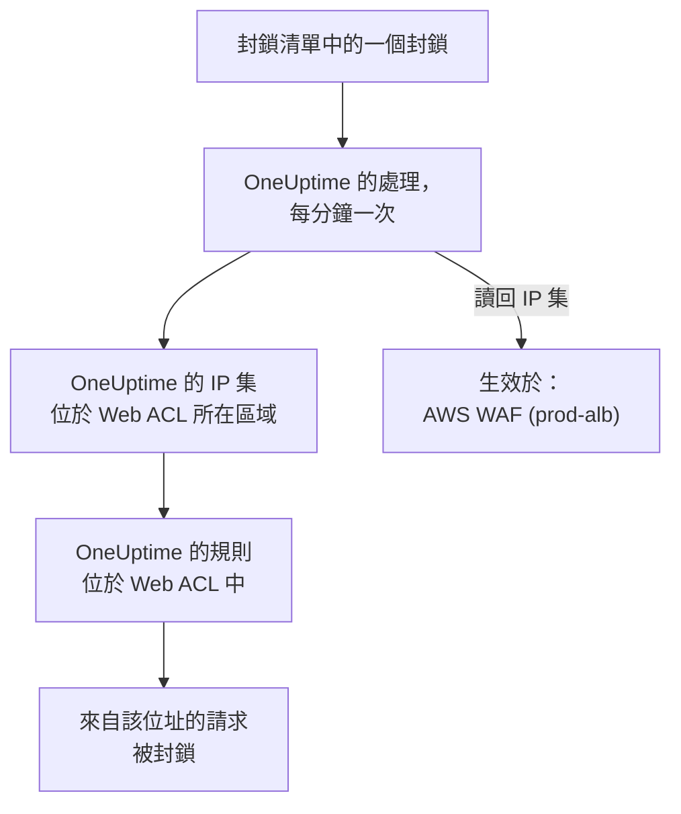

# 在 AWS WAF 中封鎖位址

你的專案的封鎖清單可以在位於 CloudFront 分佈、負載平衡器和 API Gateway 前方的 AWS WAF Web ACL 中執行。為你已有的 AWS 雲端連線開啟它並選擇 Web ACL 後，封鎖清單封鎖的每個位址都會在那裡被封鎖，無論封鎖它的是人、劇本還是 OneUptime AI。

:::cards
- [開啟](#開啟): 變更 AWS 連線上的一項設定，然後再次執行其設定指令。
- [OneUptime 建立的內容](#oneuptime-建立的內容): 每個區域四個 IP 集，每個 Web ACL 兩條規則。
- [在程式碼中管理 Web ACL](#在程式碼中管理-web-acl): 自行在 Terraform 或 CloudFormation 中新增規則。
:::

## 運作方式

OneUptime 會在所選 Web ACL 所在的每個區域中保留自己的 IP 集，並在每個 Web ACL 中保留一條規則，封鎖這些 IP 集所含的位址。它每分鐘用封鎖清單中的內容把每個 IP 集寫入一次，然後讀回這些 IP 集。在 **封鎖清單** 頁面上，只有當 AWS WAF 持有該封鎖、且 Web ACL 的規則封鎖了它所在的 IP 集時，該封鎖的 **生效於** 才會顯示 AWS WAF (prod-alb)；在此之前，它並未生效。

## 開始之前

- 一個已連線到 OneUptime 的 AWS 帳戶（請參閱[連線雲端帳戶](/docs/telemetry/cloud-accounts#amazon-web-services)）。
- 可以變更封鎖清單生效位置的角色：**專案擁有者**、**專案管理員** 或 **安全性管理員**。
- 能夠在該 AWS 帳戶中再次執行連線設定指令的人。

## 開啟

:::steps
### 開啟連線
開啟 **雲端 → 連線**，編輯 AWS 連線。

### 選擇由誰新增規則
在 **更多欄位** 下，將 **在 AWS WAF 中封鎖位址** 設為 **開啟，由 OneUptime 新增其規則**；如果你的 Web ACL 由 Terraform 或 CloudFormation 管理，則設為 **開啟，由我在程式碼中新增規則**。

### 再次執行設定指令
表單顯示的指令現在會授予 IP 集的權限，並在由 OneUptime 新增規則時授予規則的權限。在 AWS CloudShell 中執行它，然後儲存連線。

### 新增 Web ACL
開啟 **安全事件 → 劇本 → 封鎖清單**。在 **雲端 WAF** 下，點選 **新增 Web ACL**，選擇一個 Web ACL 以及它讀取用戶端位址的位置，然後新增。OneUptime 會立即完成設定，當其規則封鎖這些 IP 集時，它的 **狀態** 會顯示 **生效中**。
:::

Web ACL 來自連線的資源清單：OneUptime 尚未讀取的 Web ACL 會在下一次讀取後列出。當某個 Web ACL 正在執行封鎖清單時，其連線的設定既不能關閉，也不能從由 OneUptime 新增規則改為在程式碼中新增，連線也不能刪除：請先移除該 Web ACL，讓 OneUptime 撤下其規則。

## OneUptime 建立的內容

| 內容 | 名稱 | 位置 |
| --- | --- | --- |
| 四個 IP 集：封鎖和挑戰，各有 IPv4 和 IPv6 | `oneuptime-<project>-block-ipv4`, `oneuptime-<project>-block-ipv6`, `oneuptime-<project>-challenge-ipv4`, `oneuptime-<project>-challenge-ipv6` | 所選 Web ACL 所在的每個區域。CloudFront 的 Web ACL 是全域的，其 IP 集位於 `us-east-1`。 |
| 兩條規則：一條封鎖，一條挑戰 | `OneUptime-Blocklist-<project>`, `OneUptime-Challenge-<project>` | 由 OneUptime 新增規則時，位於每個所選 Web ACL 中。 |

`<project>` 是你的專案外部 ID 的前八個字元，因此同一帳戶中的兩個 OneUptime 專案永遠不會寫入彼此的 IP 集。同一區域的 Web ACL 共用這些 IP 集。單一位址寫成 `/32` 或 `/128`。AWS WAF 的一個 IP 集最多容納 10,000 個位址，一個區域最多容納 100 個 IP 集，除非 AWS 為你提高了上限；放不下的封鎖會在其所在列上說明。

## 規則在 Web ACL 中的位置

OneUptime 會把它的兩條規則放在編號小於你的第一條規則的空閒優先順序上，因此它們會在你撰寫的規則之前執行。如果 Web ACL 中沒有任何規則，它們使用優先順序 0 和 1。OneUptime 從不重新編號、變更或刪除你的規則：當編號小於你的第一條規則的優先順序中沒有兩個空閒時，Web ACL 會顯示 **無可用優先順序**，在你騰出兩個之後，OneUptime 就會新增其規則。

當用戶端位址位於其 IPv4 或 IPv6 的 IP 集之一時，每條規則都會相符。AWS WAF 會整體更新 Web ACL，因此 OneUptime 會讀取 Web ACL、新增其規則，並使用 Web ACL 的鎖定權杖寫回；如果在此期間有其他人寫入了它，就會重新讀取。

## 轉送的位址

位於其他代理伺服器或 CDN 之後的 Web ACL 看到的是代理伺服器的位址，而不是用戶端的位址。在 **用戶端位址** 中選擇它從何處讀取用戶端位址：

| 用戶端位址 | 規則讀取的內容 |
| --- | --- |
| **請求的來源位址** | 請求發出的位址。預設值。 |
| `X-Forwarded-For` 標頭中的最後一個位址 | 最後一個代理伺服器附加的位址。它之前的位址是請求自己宣稱的。 |
| `CF-Connecting-IP` 標頭 | Cloudflare 寫入的唯一位址。 |
| `True-Client-IP` 標頭 | Akamai 或 Cloudflare Enterprise 寫入的唯一位址。 |

沒有該標頭的請求不會相符：AWS WAF 會放行它，而不是封鎖代理伺服器的位址。

## 在程式碼中管理 Web ACL

選擇 **開啟，由我在程式碼中新增規則** 時，OneUptime 只建立 IP 集，從不寫入你的 Web ACL。在 Web ACL 所在列點選 **顯示規則**：它會以 Terraform（`aws_wafv2_web_acl` 的 `rule` 區塊）和 CloudFormation 兩種形式提供這兩條規則，並附上每個 IP 集的 ARN 以及 Web ACL 讀取的標頭。把它們新增到你的程式碼中、放在你的其他規則之前，然後套用。

在規則加入之前，Web ACL 會顯示 **等待你新增規則**，其封鎖不會生效。OneUptime 每次處理都會讀取該 Web ACL；從第一次發現有規則封鎖每個 IP 集的那次處理起，無論你為規則取什麼名稱，其封鎖都會生效。

## 權限

設定指令會為角色新增一個內嵌政策 `OneUptimeWafBlocklist`。使用存取金鑰時，由於 IAM 限制使用者自身政策的數量，該政策會附加到一個群組 `OneUptimeWafBlocklist-<project>` 上，並讓該使用者加入這個群組。

| 動作 | 資源 | 原因 |
| --- | --- | --- |
| `wafv2:ListIPSets` | 任何 | 在區域中尋找 OneUptime 的 IP 集。 |
| `wafv2:GetIPSet`, `wafv2:CreateIPSet`, `wafv2:UpdateIPSet`, `wafv2:DeleteIPSet` | 僅 OneUptime 的 IP 集（`oneuptime-<project>-*`） | 維護這些 IP 集，並在你移除某個區域的最後一個 Web ACL 時刪除它們。 |
| `wafv2:GetSampledRequests` | Web ACL | 讀取規則拒絕的請求：這是檢查案件封鎖步驟的依據。 |
| `wafv2:UpdateWebACL` | Web ACL，以及它們參考的 IP 集、規則運算式模式集和規則群組 | 新增 OneUptime 的規則。僅在選擇 **開啟，由 OneUptime 新增其規則** 時需要。 |

讀取 Web ACL 所需的 `wafv2:GetWebACL` 已包含在連線的唯讀政策中。

## 移除

:::steps
### 移除 Web ACL
在 **安全事件 → 劇本 → 封鎖清單** 中，點選 Web ACL 所在列的 **移除**。OneUptime 會從該 Web ACL 中撤下其規則，並在該區域沒有其他 Web ACL 使用其 IP 集時，清空並刪除這些 IP 集。

### 關閉設定
編輯連線，將 **在 AWS WAF 中封鎖位址** 設為 **關閉**，然後儲存。只有當該連線的所有 Web ACL 都不再執行封鎖清單時，才能關閉此設定。
:::

當 OneUptime 可能無法再寫入該 Web ACL 時，請在 **移除 Web ACL** 對話方塊中勾選 **僅從 OneUptime 移除**。OneUptime 會將該 Web ACL 從封鎖清單中移除，並列出它留在 AWS WAF 中的規則和 IP 集：在你於 AWS WAF 中刪除它們之前，它們會繼續封鎖其中包含的位址。仍被你的規則參考的 IP 集也會保留：OneUptime 會清空它，並列出它的名稱。

## 疑難排解

:::details 未生效
Web ACL 的狀態會說明 AWS 的回覆以及該怎麼做。如果遭到拒絕，它會指出被拒絕的動作以及授予該動作的設定：開啟該設定，或選擇 **開啟，由 OneUptime 新增其規則**，然後再次執行連線的設定指令，並點選 **重新檢查**。
:::

:::details 無可用優先順序
你的第一條規則位於優先順序 0 或 1，因此編號小於它的優先順序中沒有兩個空閒。把你所有規則的優先順序都往後移兩位，然後點選 **重新檢查**。
:::

:::details 某個 Web ACL 不在清單中
OneUptime 會在讀取已開啟該設定的連線的 Web ACL 之後列出它們。僅透過指標看到的 Web ACL 需要再次執行連線的設定指令，OneUptime 才能讀取它們。
:::

## 後續步驟

:::cards
- [安全案件與劇本](/docs/telemetry/security-cases): 從案件中封鎖位址，並查看其步驟的檢查結果。
- [連線雲端帳戶](/docs/telemetry/cloud-accounts): 此設定所屬的連線。
:::
