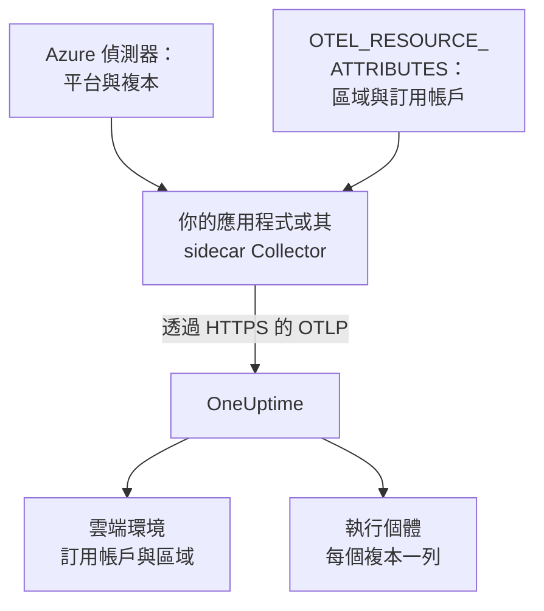

# Azure Container Apps

將 Azure Container Apps 的追蹤、日誌與指標傳送到 OneUptime。每個回報 `cloud.platform=azure_container_apps` 的複本都會進入依 Azure 訂用帳戶與區域劃分的一個 **Cloud Environment**（例如 _Azure Container Apps · eastus · 00000000-0000-0000-0000-000000000000_），執行中的複本會列在 **執行個體** 下。

:::cards
- [運作方式](#運作方式): 偵測器設定了什麼，以及需要你自己設定的兩個屬性。
- [設定](#設定): 儲存權杖、用 Azure CLI 或入口網站設定應用程式，然後檢查。
- [使用環境的受控 OpenTelemetry 代理程式](#使用環境的受控-opentelemetry-代理程式): 不需要 sidecar 就能轉送環境中所有應用程式的資料。
- [疑難排解](#疑難排解): 被拒絕的匯出、缺少的環境，以及空的執行個體。
:::

## 運作方式



Container Apps 有資源偵測器：Collector 的 `azurecontainerapps` 偵測器，以及 Node.js（`@opentelemetry/resource-detector-azure`）與 .NET（`OpenTelemetry.Resources.Azure`）的偵測器。它們會讀取 `CONTAINER_APP_NAME` 與 `CONTAINER_APP_REPLICA_NAME`，並設定 `cloud.provider`、`cloud.platform`、`service.name` 與複本 ID。它們都不知道區域與訂用帳戶，所以你需要在 `OTEL_RESOURCE_ATTRIBUTES` 中自己設定 `cloud.region` 與 `cloud.account.id`。

| 屬性 | 值 | 用途 |
| --------------------------------- | ------------------------------------------------------------------------- | ------------------------------------------------------------ |
| `cloud.provider` | `azure` | 顯示在概覽中 |
| `cloud.platform` | `azure_container_apps` | 把遙測資料歸檔到 **雲端環境** 下 |
| `cloud.region` | 環境所在區域，例如 `eastus`：由你設定 | 環境金鑰的一部分 |
| `cloud.account.id` | 訂用帳戶 ID：由你設定 | 環境金鑰的一部分 |
| `azure.container_app.instance.id` | 複本名稱，由偵測器根據 `CONTAINER_APP_REPLICA_NAME` 設定 | 為一個執行中的複本命名：在 **執行個體** 下每個複本一列 |
| `service.instance.id` | 複本名稱（如果你自己設定） | 在沒有偵測器設定複本 ID 時使用 |

- **帶點號的寫法也能用。** Node.js 與 .NET 偵測器把平台寫成帶點號的 `azure.container_apps`。OneUptime 收到時會把它改寫為 `azure_container_apps`，因此兩種寫法會進入同一個環境。
- **主機名稱就是複本名稱。** 只執行 `host` 偵測器的 SDK 會把複本名稱回報為 `host.name`，在沒有更具體的值時，OneUptime 就用它為執行個體命名。

環境金鑰是 `azure_container_apps|<subscription id>|eastus`。

## 開始之前

- **擷取金鑰。** 在 **專案設定 → 遙測與 APM → 擷取金鑰** 中建立一個 **伺服器** 金鑰並複製其權杖。
- **已安裝 `containerapp` 擴充功能的 Azure CLI**（`az extension add --name containerapp --upgrade`），並已登入該訂用帳戶，或使用 Azure 入口網站。
- **以 OpenTelemetry SDK 檢測的應用程式**，能夠匯出 OTLP。

## 選擇遙測資料離開應用程式的方式

| | SDK direct | Sidecar collector |
| ------------------ | ------------------------------------------- | ------------------------------------------------------------ |
| 額外的容器 | 無 | 應用程式中的 `otel-collector`，與複本共用 CPU 與記憶體 |
| 設定屬性的一方 | SDK，以及應用程式上的 `OTEL_RESOURCE_ATTRIBUTES` | Collector，作用於經過它的所有資料 |
| 機密 | `oneuptime-otlp-headers`，完整的標頭 | `oneuptime-token`，只有權杖 |

第三種方式是使用環境的受控 OpenTelemetry 代理程式，它不需要 sidecar 就能轉送環境中所有應用程式的資料：請參閱 [使用環境的受控 OpenTelemetry 代理程式](#使用環境的受控-opentelemetry-代理程式)。下面每個步驟都分別為 SDK direct 與 sidecar Collector 提供分頁；選擇其中一個，所有步驟都會跟著切換。

## 設定

:::steps
### 將權杖儲存為 Container Apps 機密

> [!IMPORTANT]
> 權杖屬於機密。請把它儲存為 Container Apps 機密，並在環境變數中透過 `secretref:` 參照。機密一經設定，就不會顯示在 `az containerapp show` 或入口網站中；一般環境變數則會顯示。

:::tabs
@tab SDK direct
```bash
az containerapp secret set \
  --name checkout-api \
  --resource-group my-rg \
  --secrets oneuptime-otlp-headers="x-oneuptime-token=YOUR_TELEMETRY_INGESTION_TOKEN"
```

SDK 的 `OTEL_EXPORTER_OTLP_HEADERS` 需要完整的 `name=value` 標頭，因此機密存放的就是它。
@tab Sidecar collector
```bash
az containerapp secret set \
  --name checkout-api \
  --resource-group my-rg \
  --secrets oneuptime-token=YOUR_TELEMETRY_INGESTION_TOKEN
```

Collector 會自己加上標頭名稱，因此機密只存放權杖。
:::

在入口網站中：**Azure portal → Container Apps → your app → Settings → Secrets → + Add**。輸入索引鍵，選擇類型 **Container Apps secret**，貼上值，然後按一下 **Add**。

如果你把機密存放在 Key Vault 中，請參照該機密，而不是複製它的值。應用程式的受控識別需要對該保存庫擁有 **Key Vault Secrets User** 角色：

```bash
az containerapp secret set \
  --name checkout-api --resource-group my-rg \
  --secrets "oneuptime-token=keyvaultref:https://my-vault.vault.azure.net/secrets/oneuptime-token,identityref:system"
```

### 設定容器應用程式

:::tabs
@tab SDK direct
在應用程式容器上設定匯出器，以及偵測器不知道的屬性。請把區域與訂用帳戶 ID 換成你自己的：

```bash
az containerapp update \
  --name checkout-api \
  --resource-group my-rg \
  --set-env-vars \
    OTEL_SERVICE_NAME=checkout-api \
    OTEL_EXPORTER_OTLP_ENDPOINT=https://oneuptime.com/otlp \
    OTEL_EXPORTER_OTLP_PROTOCOL=http/protobuf \
    OTEL_EXPORTER_OTLP_HEADERS=secretref:oneuptime-otlp-headers \
    "OTEL_RESOURCE_ATTRIBUTES=cloud.provider=azure,cloud.platform=azure_container_apps,cloud.region=eastus,cloud.account.id=00000000-0000-0000-0000-000000000000"
```

若要取得複本識別，請開啟 SDK 的 Azure 偵測器：Node.js 中使用 `OTEL_NODE_RESOURCE_DETECTORS=env,host,os,azure`，.NET 中使用 `OpenTelemetry.Resources.Azure` 與 `.ConfigureResource(r => r.AddAzureContainerAppsDetector())`。它會根據 `CONTAINER_APP_REPLICA_NAME` 設定 `azure.container_app.instance.id`。

Container Apps 無法把一個環境變數嵌入另一個環境變數，因此在其他語言中無法把 `service.instance.id` 放進 `OTEL_RESOURCE_ATTRIBUTES`。請開啟主機偵測器（它的 `host.name` 就是複本名稱），或在程式碼中設定：

```js title="tracing.js"
// Node.js: the file you load with --require before the app starts
const { NodeSDK } = require("@opentelemetry/sdk-node");
const { resourceFromAttributes } = require("@opentelemetry/resources");

const sdk = new NodeSDK({
  resource: resourceFromAttributes({
    "service.instance.id": process.env.CONTAINER_APP_REPLICA_NAME,
  }),
});
sdk.start();
```

```python title="tracing.py"
# Python: before the tracer provider is created
import os
from opentelemetry.sdk.resources import Resource

resource = Resource.create({"service.instance.id": os.environ.get("CONTAINER_APP_REPLICA_NAME", "")})
```

無論使用哪個偵測器，都要在 `OTEL_RESOURCE_ATTRIBUTES` 中保留 `cloud.region` 與 `cloud.account.id`：沒有任何 Container Apps 偵測器會設定它們，而環境金鑰需要它們。

或者在入口網站中：

1. 開啟 **Application → Containers → Edit and deploy**，在 **Container** 分頁中選取你的容器，然後按一下 **Edit**。
2. 在 **Environment variables** 下，以 **Manual entry** 為來源加入上面的每個變數，並以 **Reference a secret** 為來源加入 `OTEL_EXPORTER_OTLP_HEADERS`，指向 `oneuptime-otlp-headers`。
3. 按一下 **Save**。
@tab Sidecar collector
sidecar 執行在同一個複本中，因此看得到相同的 `CONTAINER_APP_NAME` 與 `CONTAINER_APP_REPLICA_NAME`。它的 `azurecontainerapps` 偵測器會把它們轉換為 `cloud.provider`、`cloud.platform`、`service.name` 與 `azure.container_app.instance.id`，而它的 `env` 偵測器會從 Collector 自身環境中的 `OTEL_RESOURCE_ATTRIBUTES` 讀取 `cloud.region` 與 `cloud.account.id`。應用程式只需要匯出到 `http://localhost:4318`。

匯出應用程式的定義，把 Collector 加入 `template.containers`，然後套用它：

```bash
az containerapp show --name checkout-api --resource-group my-rg -o yaml > checkout-api.yaml
# edit checkout-api.yaml as below
az containerapp update --name checkout-api --resource-group my-rg --yaml checkout-api.yaml
```

```yaml title="checkout-api.yaml"
properties:
  configuration:
    secrets:
      - name: oneuptime-token
        value: YOUR_TELEMETRY_INGESTION_TOKEN
  template:
    containers:
      - name: app
        image: myregistry.azurecr.io/checkout-api:1.4.2
        env:
          - name: OTEL_SERVICE_NAME
            value: checkout-api
          - name: OTEL_EXPORTER_OTLP_ENDPOINT
            value: http://localhost:4318
          - name: OTEL_EXPORTER_OTLP_PROTOCOL
            value: http/protobuf
        resources:
          cpu: 0.5
          memory: 1Gi
      - name: otel-collector
        image: otel/opentelemetry-collector-contrib:latest
        args:
          - --config=env:OTEL_COLLECTOR_CONFIG
        env:
          - name: ONEUPTIME_TOKEN
            secretRef: oneuptime-token
          # Read by the resourcedetection processor's env detector.
          - name: OTEL_RESOURCE_ATTRIBUTES
            value: cloud.provider=azure,cloud.platform=azure_container_apps,cloud.region=eastus,cloud.account.id=00000000-0000-0000-0000-000000000000
          - name: OTEL_COLLECTOR_CONFIG
            value: |
              receivers:
                otlp:
                  protocols:
                    http:
                      endpoint: 0.0.0.0:4318
                    grpc:
                      endpoint: 0.0.0.0:4317
              processors:
                # env: cloud.region + cloud.account.id from OTEL_RESOURCE_ATTRIBUTES.
                # azurecontainerapps: cloud.provider, cloud.platform, service.name
                # and azure.container_app.instance.id from the CONTAINER_APP_*
                # variables. override: false keeps the service.name the
                # application set instead of the Container App's name.
                resourcedetection:
                  detectors: [env, azurecontainerapps]
                  timeout: 2s
                  override: false
                batch: {}
              exporters:
                otlphttp/oneuptime:
                  endpoint: https://oneuptime.com/otlp
                  headers:
                    x-oneuptime-token: ${env:ONEUPTIME_TOKEN}
              service:
                pipelines:
                  traces:
                    receivers: [otlp]
                    processors: [resourcedetection, batch]
                    exporters: [otlphttp/oneuptime]
                  metrics:
                    receivers: [otlp]
                    processors: [resourcedetection, batch]
                    exporters: [otlphttp/oneuptime]
                  logs:
                    receivers: [otlp]
                    processors: [resourcedetection, batch]
                    exporters: [otlphttp/oneuptime]
        resources:
          cpu: 0.25
          memory: 0.5Gi
```

`az containerapp show` 不會匯出機密的值，所以請手動把 `secrets` 項目加回去；如果你在第一個步驟已經設定了機密，也可以省略它：更新會保留現有的機密。Container Apps 會把複本中所有容器的 CPU 與記憶體加總，因此 sidecar 的 `resources` 會計入應用程式的配額。

或者在入口網站中：

1. 開啟 **Application → Containers → Edit and deploy**。在 **Container** 分頁中，透過 **+ Add** 加入一個名為 `otel-collector` 的容器，映像檔為 `otel/opentelemetry-collector-contrib:latest`，**Arguments override** 為 `--config=env:OTEL_COLLECTOR_CONFIG`。
2. 加入它的環境變數：`ONEUPTIME_TOKEN`（**Reference a secret**：`oneuptime-token`）、`OTEL_RESOURCE_ATTRIBUTES` 與 `OTEL_COLLECTOR_CONFIG`（**Manual entry**，值如上）。
3. 按一下 **Save**。
:::

如果你自行託管 OneUptime，請使用 `https://YOUR-ONEUPTIME-HOST/otlp` 作為端點。

### 部署新的修訂版本

`az containerapp update` 本身就會部署新的修訂版本。在入口網站中按一下 **Create**。如果有多個修訂版本處於使用中，請在 **Revisions and replicas** 下把流量移到新版本。

### 檢查連線

```bash
curl -i https://oneuptime.com/otlp/v1/validate \
  -H "x-oneuptime-token: YOUR_TELEMETRY_INGESTION_TOKEN"
```

回傳 `200` 且 `"valid": true` 表示權杖已被接受。`401` 表示權杖未知、已撤銷、已停用或已過期。接著查看 Collector 的輸出：

```bash
az containerapp logs show --name checkout-api --resource-group my-rg \
  --container otel-collector --follow
```

尋找 `Everything is ready`，並確認沒有 `401` 或 `connection refused`。在第一個 span、日誌或指標送達後的 1 分鐘內，環境就會以 _Azure Container Apps · eastus · 00000000-0000-0000-0000-000000000000_ 的名稱出現在 **雲端 → All Environments** 中。
:::

## 使用環境的受控 OpenTelemetry 代理程式

Container Apps 環境可以執行 Azure 的受控 OpenTelemetry 代理程式。它會從環境中的每個應用程式接收 OTLP，並轉送到你設定的端點，不需要在每個應用程式中放置 sidecar。這個代理程式 **只透過 OTLP/gRPC** 匯出，因此無法使用 HTTP 路徑 `/otlp`。請改為讓它指向 OneUptime 主機的 443 連接埠，OneUptime 在那裡透過 TLS 提供 OTLP/gRPC：

```bash
az containerapp env telemetry otlp add \
  --name my-aca-env \
  --resource-group my-rg \
  --otlp-name oneuptime \
  --endpoint oneuptime.com:443 \
  --insecure false \
  --headers "x-oneuptime-token=YOUR_TELEMETRY_INGESTION_TOKEN" \
  --enable-open-telemetry-traces true \
  --enable-open-telemetry-logs true \
  --enable-open-telemetry-metrics true
```

- **自行託管：** 使用 `YOUR-ONEUPTIME-HOST:443`。自行託管的 OneUptime 只接受透過 TLS 的 OTLP/gRPC：請參閱 [透過 gRPC 的 OTLP](/docs/telemetry/open-telemetry#透過-grpc-的-otlp)。
- **屬性仍由應用程式設定。** 代理程式會在每個應用程式中放入它自己的 `OTEL_EXPORTER_OTLP_ENDPOINT` 與 `OTEL_EXPORTER_OTLP_PROTOCOL=grpc`，因此請從應用程式中移除這兩項，並保留 `OTEL_SERVICE_NAME` 與 `OTEL_RESOURCE_ATTRIBUTES`。代理程式會轉送應用程式傳送的內容，因此 `cloud.*` 與複本 ID 仍然來自每個應用程式。
- **你的 `OTEL_RESOURCE_ATTRIBUTES` 優先。** 代理程式也會設定 `OTEL_RESOURCE_ATTRIBUTES`，而應用程式上設定的值會取代它：請在你的值中包含容器應用程式名稱與複本 ID，或在程式碼中設定它們。

## 網路

- **輸出流量預設是開放的。** 不論環境的輸入是外部還是內部，複本都不需要任何設定就能連到 `oneuptime.com:443`。
- **自訂 VNet 是例外。** 如果 VNet 有把 `0.0.0.0/0` 送往防火牆或 NAT 閘道的使用者定義路由，或子網路上有網路安全性群組，請在防火牆或 NSG 上允許透過 TCP 443 連到 OneUptime 主機（或你自己主機的連接埠）。
- **VNet 內自行託管的 OneUptime** 必須能從環境的子網路解析並路由到。
- **遙測資料不需要任何 Azure 角色。** 只有 Key Vault 參照需要應用程式的受控識別對該保存庫擁有 **Key Vault Secrets User**。

## 你會看到什麼

- **概覽**：根據追蹤計算的請求、錯誤率與 p95 延遲。Container Apps 不會向 sidecar 公開複本的資源使用量，因此只有在你傳送帶有複本識別的 `container.cpu.utilization` 與 `container.memory.usage` 指標時，**CPU** 與 **記憶體** 圖格才會有資料。大多數團隊會把這些交給 Azure Monitor。
- **執行個體**：每個複本一列，名稱取自偵測器設定的 `azure.container_app.instance.id`、你自己設定的 `service.instance.id`，或在只有主機偵測器執行時取自 `host.name`。
- 依環境篩選的 **日誌**、**追蹤** 與 **指標**，以及 **服務** 下的個別服務檢視。

## 疑難排解

:::details 什麼都沒出現，Collector 日誌中有 401
機密中的值不正確。`oneuptime-token` 必須只有權杖；`oneuptime-otlp-headers` 必須是完整的標頭 `x-oneuptime-token=...`。
:::

:::details 應用程式出現在服務下，但沒有環境
缺少 `OTEL_RESOURCE_ATTRIBUTES`，或 `cloud.platform` 不完全等於 `azure_container_apps`。用 `az containerapp show ... --query properties.template.containers[].env` 查看應用程式的設定。
:::

:::details 環境存在，但執行個體是空的
資源上 `service.instance.id`、`azure.container_app.instance.id` 與 `host.name` 一個都沒有。請在 Collector 中加入 `azurecontainerapps` 偵測器、開啟 SDK 的 Azure 偵測器或主機偵測器，或在程式碼中設定 `service.instance.id`。
:::

:::details 一個訂用帳戶出現了兩個環境
一個應用程式設定了 `cloud.region`（或 `cloud.account.id`）而另一個沒有，或區域的寫法不同（`eastus` 與 `East US`）。這些值必須逐字元一致。
:::

其他問題請參閱 [雲端疑難排解](/docs/telemetry/cloud-troubleshooting)。

## 後續步驟

:::cards
- [雲端環境](/docs/telemetry/cloud-environments): 環境與執行個體是如何識別的。
- [其他雲端平台](/docs/telemetry/cloud-other-platforms): Azure App Service 與 Azure Container Instances。
- [雲端疑難排解](/docs/telemetry/cloud-troubleshooting): 所有平台共有的故障。
- [雲端資源(IaaS 與 PaaS)](/docs/telemetry/cloud-resources): 來自 Azure Monitor 的訂用帳戶中的每個資源。
:::
