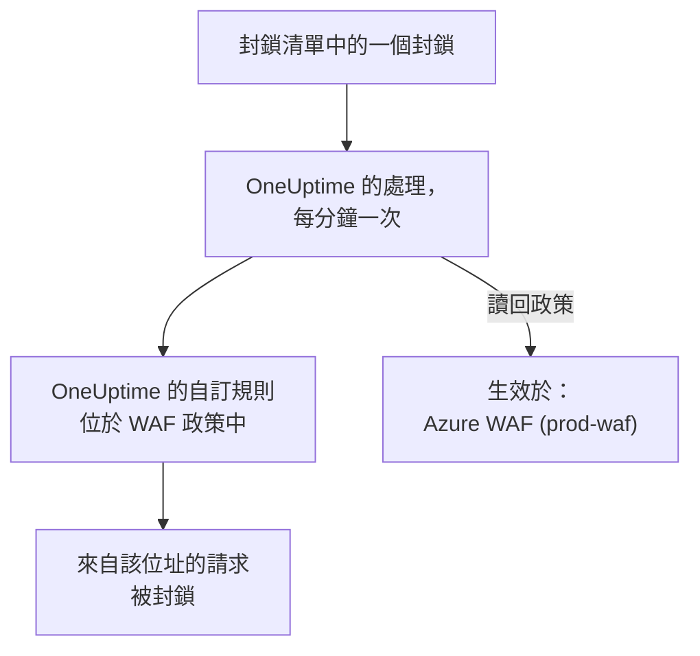

# 在 Azure WAF 中封鎖位址

你的專案的封鎖清單可以在你的 Application Gateway 和 Front Door 的 Azure WAF 政策中執行。為你已有的 Azure 雲端連線開啟它並選擇 WAF 政策後，封鎖清單封鎖的每個位址都會在那裡被封鎖，無論封鎖它的是人、劇本還是 OneUptime AI。

:::cards
- [開啟](#開啟): Azure 連線上的一項設定，以及它所需的角色。
- [OneUptime 建立的內容](#oneuptime-建立的內容): 在你選擇的每個政策中建立自己的自訂規則。
- [比對哪個位址](#比對哪個位址): 建立連線的位址，或代理伺服器後方的原始用戶端。
:::

## 運作方式

OneUptime 會在你選擇的每個 WAF 政策中保留自己的自訂規則，並把封鎖清單封鎖的位址放入其中。它每分鐘用封鎖清單中的內容把政策寫入一次，然後讀回該政策。在 **封鎖清單** 頁面上，只有當政策持有該封鎖、且 Azure 已套用這次變更時，該封鎖的 **生效於** 才會顯示 Azure WAF (prod-waf)；在此之前，它並未生效。

## 開始之前

- 一個已連線到 OneUptime 的 Azure 訂用帳戶（請參閱[連線雲端帳戶](/docs/telemetry/cloud-accounts#microsoft-azure)）。
- 可以變更封鎖清單生效位置的角色：**專案擁有者**、**專案管理員** 或 **安全性管理員**。
- 能夠在該 Azure 訂用帳戶中指派角色的人，以便在 Azure Cloud Shell 中執行一條指令。

## 開啟

:::steps
### 開啟連線
開啟 **雲端 → 連線**，編輯 Azure 連線。

### 開啟設定
在 **更多欄位** 下，將 **在 Azure WAF 中封鎖位址** 設為 **開啟**，然後儲存。表單顯示的設定指令現在會在整個訂用帳戶上授予下文所述的角色。已有的連線不需要再次執行它：**新增 WAF** 對話方塊會提供僅在一個政策上授予該角色的指令。

### 新增 WAF 政策
開啟 **安全事件 → 劇本 → 封鎖清單**。在 **雲端 WAF** 下，點選 **新增 WAF** 並選擇一個 WAF 政策。OneUptime 會詢問 Azure 該連線能否寫入它，而不會寫入任何內容。

### 授予缺少的角色
缺少某項權限時，對話方塊會顯示僅在該政策上授予它的指令。在 Azure Cloud Shell 中執行這些指令，點選 **重新檢查**，然後新增該政策。OneUptime 讀取該政策後，它的 **狀態** 會顯示 **生效中**。
:::

WAF 政策來自連線的資源清單：OneUptime 尚未讀取的政策會在下一次讀取後列出。當某個政策正在執行封鎖清單時，其連線的設定不能關閉，連線也不能刪除：請先移除該政策，讓 OneUptime 撤下其規則。

## OneUptime 建立的內容

| 內容 | 名稱 | 位置 |
| --- | --- | --- |
| 自訂規則，每條包含一個 IP 比對條件，動作為 Block | `OneUptime<project>Block1`, `OneUptime<project>Block2`, ... | 在你選擇的每個 WAF 政策中，最多 10 條。 |

`<project>` 是你的專案外部 ID 的前八個字元，因此選擇同一政策的兩個 OneUptime 專案永遠不會寫入彼此的規則。在 Application Gateway 上，一條規則可容納 540 個位址或範圍，使用 CRS 3.2 或 Default Rule Set 時為 600 個；在 Front Door 上為 600 個。有十條規則時，一個政策可容納 5,400 或 6,000 個封鎖；放不下的封鎖會在其所在列上說明。

OneUptime 只變更政策中自己的規則，不變更其他任何內容。Azure 只能整體寫入 WAF 政策，因此 OneUptime 會連同 ETag 一起讀取政策，變更自己的規則，然後在 `If-Match` 中帶上 ETag 將其寫回：其他所有規則、設定和受控規則集都按讀取時的原樣寫入。如果在此期間有其他人寫入了該政策，Azure 會拒絕這次寫入，OneUptime 會重新讀取它，並在對方寫入的內容之上進行變更。

## 規則在政策中的位置

OneUptime 會把它的規則放在你的第一條允許流量的規則之前的空閒優先順序上，從最小的開始，因此你的任何規則都不會放行被封鎖的位址。你的封鎖或記錄規則可以排在它們前面。OneUptime 從不重新編號、變更或刪除你的規則：當你的第一條 Allow 規則之前沒有空閒的優先順序時，政策會顯示 **無可用優先順序**，在你騰出一個之後，OneUptime 就會新增其規則。

## 比對哪個位址

| WAF 政策 | 用戶端位址 | 何時選擇 |
| --- | --- | --- |
| Front Door | **連線到 Front Door 的位址（SocketAddr）** | 預設值。 |
| Front Door | 原始用戶端，來自 X-Forwarded-For（RemoteAddr） | 適用於位於其他代理伺服器或 CDN 之後的 Front Door。 |
| Application Gateway | 連線到閘道的位址（RemoteAddr） | 唯一的選項：它的 IP 比對不讀取其他位址。 |

Front Door 的 `RemoteAddr` 取自 `X-Forwarded-For` 標頭，而直接連線到 Front Door 的用戶端可以自己寫入該標頭。僅當 Front Door 前方的其他代理伺服器或 CDN 會寫入該標頭時才選擇它。該選項位於 **新增 WAF** 對話方塊的 **更多欄位** 下，之後你可以在政策所在列使用 **用戶端位址** 變更它。

Application Gateway 的 IP 比對只讀取 IPv4 位址，因此 IPv6 封鎖不會在那裡套用，其所在列會說明原因。

OneUptime 在 Azure WAF 中的規則只會封鎖。要求挑戰某個位址的封鎖不會在 Azure WAF 中套用，並會說明這一點。自動回應政策的挑戰在那裡會以相同時長的封鎖來執行。

## 變更需要多久

Application Gateway 會在 Azure 寫入變更時套用它。Front Door 接受變更後，會在接下來的幾分鐘內將其分送到各個邊緣節點：政策會顯示 **套用中**，新封鎖的 **生效於** 會等待該政策，直到 Azure 回報其已完成佈建。此後該封鎖即會生效。

## 規則被手動變更時

當有人在 Azure 中關閉、變更或刪除 OneUptime 的某條規則時，OneUptime 會保持其被修改後的樣子。政策會顯示 **已手動變更**，該規則所含的封鎖不會生效，並會說明原因，直到有人在政策所在列點選 **還原**。還原會按照 OneUptime 的寫法重新寫入該規則，只要其原有優先順序仍空閒，就寫在該優先順序上。

不封鎖任何內容的政策也會說明這一點，其封鎖不會生效：

- 已關閉的政策。
- 處於 **Detection** 模式的政策，它只記錄與 OneUptime 規則相符的內容。
- 未關聯到應用程式閘道、接聽程式、路徑規則或 Front Door 網域的政策。

## 在 Terraform 中管理政策

Terraform 也會整體寫入 WAF 政策，因此它的下一次 plan 會移除 OneUptime 的規則。若要讓 OneUptime 保留這些規則，請將 `ignore_changes = [custom_rules]` 新增到 `lifecycle` 區塊中（用於 `azurerm_web_application_firewall_policy`），或將 `ignore_changes = [custom_rule]` 新增到 `azurerm_cdn_frontdoor_firewall_policy` 的同一區塊中，並且不要在該政策的程式碼中撰寫你自己的自訂規則。

## 權限

設定指令會新增一個自訂角色 `OneUptime WAF Blocklist`，並在訂用帳戶上將其指派給連線的應用程式。**新增 WAF** 對話方塊顯示的指令只會在一個政策上指派同一角色。

| 動作 | 原因 |
| --- | --- |
| `Microsoft.Network/ApplicationGatewayWebApplicationFirewallPolicies/read`, `Microsoft.Network/ApplicationGatewayWebApplicationFirewallPolicies/write` | 讀取 Application Gateway WAF 政策，並在其中寫入 OneUptime 的規則。 |
| `Microsoft.Network/FrontDoorWebApplicationFirewallPolicies/read`, `Microsoft.Network/FrontDoorWebApplicationFirewallPolicies/write` | 讀取 Front Door WAF 政策，並在其中寫入 OneUptime 的規則。 |

該角色無法刪除政策，OneUptime 也從不寫入其他任何內容。

## 移除

:::steps
### 移除 WAF 政策
在 **安全事件 → 劇本 → 封鎖清單** 中，點選政策所在列的 **移除**。OneUptime 會從政策中撤下其規則，且不會變更其中的任何其他內容。

### 關閉設定
編輯連線，將 **在 Azure WAF 中封鎖位址** 設為 **關閉**，然後儲存。只有當該連線的所有政策都不再執行封鎖清單時，才能關閉此設定。
:::

當 OneUptime 可能無法再寫入該政策時，請在 **移除 WAF** 對話方塊中勾選 **僅從 OneUptime 移除**。OneUptime 會將該政策從封鎖清單中移除，並列出它留在政策中的規則：在你於 Azure 中刪除它們之前，它們會繼續封鎖其中包含的位址。

## 疑難排解

:::details 未生效
政策的狀態會說明 Azure 的回覆以及該怎麼做。如果遭到拒絕，它會指出缺少的權限：執行 **新增 WAF** 為該政策顯示的指令，然後點選 **重新檢查**。
:::

:::details 無可用優先順序
你的第一條允許流量的規則位於優先順序 1，或者它之前的每個優先順序都已被佔用。請給它一個更大的優先順序編號，然後點選 **重新檢查**。
:::

:::details 某個政策不在清單中
OneUptime 會在讀取已開啟該設定的連線的 WAF 政策之後列出它們。之後新增的政策會在連線的下一次讀取後出現。
:::

## 後續步驟

:::cards
- [安全案件與劇本](/docs/telemetry/security-cases): 從案件中封鎖位址，並查看其步驟的檢查結果。
- [連線雲端帳戶](/docs/telemetry/cloud-accounts): 此設定所屬的連線。
:::
