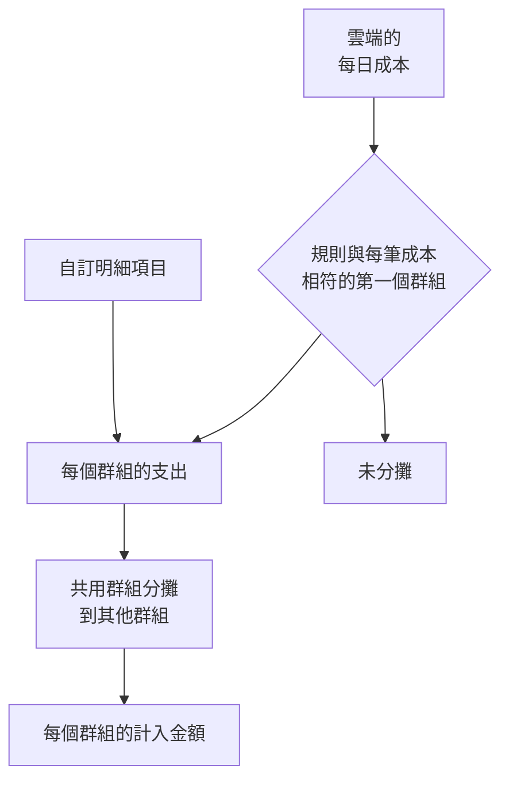

# 雲端成本分攤

成本群組回答每月雲端帳單的第一個問題：錢是誰花的。像「依團隊」或「依成本中心」這樣的**成本檢視**，會依規則把已連線帳戶的支出分配到**成本群組**中，不會重複計算。沒有規則相符的部分會以未分攤支出清楚顯示，共用成本則分攤到各群組。它們位於 **雲端 → 支出 → 成本群組**。

:::cards
- [建立檢視](#建立檢視): 依據你已設定的擁有者依團隊、依標記，或使用自訂群組。
- [撰寫群組的規則](#撰寫群組的規則): 帳戶、服務、標記、擁有者團隊、標籤等。
- [未分攤支出](#未分攤支出): 沒有規則相符的部分，一鍵即可分配。
- [共用成本](#共用成本): 支援方案或共用叢集，分攤到各群組。
:::

## 運作方式



- **第一個相符的群組取得這筆成本。** 檢視中的群組有先後順序，每筆成本會歸入規則與其相符的第一個群組，因此不會重複計算。各群組與未分攤支出的總和一律等於該時段的總額。
- **規則會讀取成本帶有的所有資訊。** 帳戶、雲端、服務、地區、資源及其標記，以及 OneUptime 對該資源的了解：它的擁有者團隊、標籤、App Platforms 環境與應用程式。
- **一切都在檢視時計算。** 不會為每筆成本寫入任何內容。變更規則後，OneUptime 保留的每個月都會重新分配，最多回溯 400 天，無須等待。
- **多個檢視可以分配同一筆支出。** 「依團隊」和「依成本中心」各自以自己的方式分配全部支出。

## 開始之前

- **已讀取的成本。** [連線雲端帳戶](/docs/telemetry/cloud-accounts)，並讓它[讀取成本](/docs/telemetry/cloud-costs)。
- **視需要使用標記或擁有者。** 標記規則需要成本帶有這些標記；在 AWS 上，請開啟[依資源的成本](/docs/telemetry/cloud-costs#依資源的成本)。擁有者團隊來自每個資源的擁有者，可以手動設定，也可以透過[擁有者規則](/docs/configuration/label-and-owner-rules)設定。

## 建立檢視

開啟 **雲端 → 支出 → 成本群組**。尚無檢視的專案會看到三種開始方式：

| 開始方式 | 建立的內容 |
| --- | --- |
| **依團隊（依據擁有者）** | 為每個擁有雲端資源的團隊建立一個群組，並連結到該團隊。 |
| **依標記** | 為成本所帶標記的每個值建立一個群組，例如 `team` 或 `cost-center`。 |
| **自訂群組** | 一個空白檢視。你自行撰寫每個群組的規則。 |

依標記或依擁有者團隊的檢視，其群組會在儲存時由 OneUptime 建立，之後每小時隨著新的標記值與擁有者出現繼續建立。你可以重新命名這些群組、將其連結到團隊或設為共用。它們的規則由 OneUptime 維護。若要立即建立缺少的群組，請開啟檢視並按一下 **立即建立群組**。

## 撰寫群組的規則

開啟一個檢視，然後在 **群組** 下選擇 **建立成本群組**。只要群組的**任一**規則與某筆成本相符，該成本就屬於此群組；而一條規則要相符，其條件必須**全部**相符。條件會把成本帶有的一項資訊與你選擇或輸入的值比較：

| 欄位 | 讀取的內容 |
| --- | --- |
| **標籤** | 依標記的鍵讀取標記的值。**已設定** 與 **未設定** 判斷成本是否帶有該標記。 |
| **帳戶** | 計費該成本的已連線帳戶。 |
| **擁有者團隊** | 在 OneUptime 中擁有該資源的團隊。 |
| **服務** | 雲端帳單中使用的服務名稱。 |
| **標籤** | 資源或其帳戶在 OneUptime 中的標籤。 |
| **地區** | 地區。對全域服務請將值留空。 |
| **雲端** | AWS、Azure 或 Google Cloud。 |
| **資源** | 雲端中對該資源的命名。 |
| **App Platforms 環境** 與 **應用程式** | 依 **雲端 → 支出 → 成本** 的計算方式，環境或應用程式被計費的金額。 |
| **Kubernetes 命名空間** 與 **Kubernetes 叢集** | 共用群組依叢集的命名空間分攤時所用的命名空間。請參閱 [Kubernetes 叢集](#kubernetes-叢集)。 |

文字比較不區分大小寫：`Payments` 和 `payments` 是同一個團隊。標記的鍵依書寫原樣比較，與雲端保存的一致。

例如，一個有三條規則的**付款**群組會取得帶有 `team: payments` 標記的成本，**或**計費到 payments 帳戶的成本，**或**由付款團隊擁有的成本。

### 群組的順序

在 **群組** 下拖曳群組即可變更順序。若某個群組的規則已被前面的群組完全涵蓋，它就永遠取不到成本，其所在列會顯示取得全部成本的群組。若某個群組的規則也與前面群組取得的成本相符，則會顯示它從中得到多少。

### 有多個擁有者團隊的資源

由兩個團隊擁有的資源會在它們之間平均分攤：每個團隊的一半分別經過規則。不涉及擁有者的規則（例如標記或帳戶）仍會取得整筆成本。所屬團隊沒有群組的那一半維持未分攤。

## 未分攤支出

檢視頁面會列出尚無規則相符的部分：它由哪些服務、帳戶、標記值與擁有者團隊組成，依成本由高到低排列。按一下其中一項旁的 **新增到群組**，即可把針對它的規則新增到某個群組或新群組。其成本會立即移入該群組，包括過去月份的成本。

## 共用成本

支援方案、共用叢集或網路中樞屬於所有人。把它建成一個獨立的群組，接著在 **更多欄位** 中開啟 **共用**，並選擇如何將其成本分攤到檢視中的其他群組：

| 分攤方式 | 方法 |
| --- | --- |
| **依支出占比分攤** | 每個群組依其他群組當月雲端支出中的占比分得一份。當月它們沒有支出時，平均分攤。 |
| **平均分攤** | 每個群組分得相同的金額。 |
| **依固定百分比分攤** | 你為每個群組設定的百分比，合計 100。 |
| **依 Kubernetes 命名空間分攤** | 叢集中每個命名空間當月的成本。請見下文。 |

共用群組的成本依每個月的份額逐日分攤，因此一個月無論依日讀取或依月讀取，數字都相同。未分攤支出永遠不會分得份額。

### Kubernetes 叢集

叢集的節點由雲端計費，而叢集本身的成本引擎會提供每個命名空間的用量。若要把共用叢集中的工作負載計入各團隊：

1. 建立一個規則與叢集節點相符的群組，例如 **標籤** `eks:cluster-name` **是下列任一項** `prod`。
2. 開啟 **共用**，選擇 **依 Kubernetes 命名空間分攤**，然後選擇 **Kubernetes叢集**。
3. 為各團隊的群組設定讀取命名空間標籤的規則，這些標籤會視為標記。例如 **標籤** `team` **是下列任一項** `payments`，或 **Kubernetes 命名空間** **開頭是** `payments-`。

每個月，節點成本會依每個命名空間在叢集[成本引擎](/docs/telemetry/kubernetes-cost)中的成本分攤，每個命名空間的部分歸入規則與其相符的第一個群組。閒置容量，以及沒有任何群組取得的命名空間，都會留在叢集的群組中。叢集本身計價的成本永遠不會加到你的帳單上，因此不會重複計算。

## 自訂明細項目

在 **雲端 → 支出 → 成本群組** 的 **自訂明細項目** 中，新增雲端帳單中沒有的費用或抵免：支援合約的分攤額、企業折扣、內部加成或平台費。

- **一次或每月。** 每月明細項目會分攤到每個月的各天，因此不滿一個月時只計入相應的部分。
- **新增到帳戶或群組。** 新增到帳戶的明細項目會像該帳戶的成本一樣經過每個檢視的規則。新增到群組的明細項目直接歸入該群組。
- **一律分開。** 每個數字都把明細項目與雲端計費的金額分開，因此雲端本身的數字仍與其主控台一致。

## 檢視每個群組的支出

- **雲端 → 支出 → 成本**：在 **錢花在哪裡** 下選擇 **成本群組** 和一個檢視。顯示每個群組的支出，並與上一時段比較。
- **檢視頁面**：每個群組的計入金額（含共用成本）、沒有規則相符的部分，以及用於當月成本回收的 **下載 CSV**。
- **群組頁面**：逐日支出、計費最多的服務、資源與帳戶，以及它的規則。頁面只顯示該群組的支出，因此請把群組連結到它的 **團隊**，並把頁面傳給團隊：任何有權讀取雲端支出的人都能開啟它。

## API、CLI 與 MCP

檢視、群組與明細項目都是 API 資源（`cloud-cost-view`、`cloud-cost-group`、`cloud-cost-line-item`），和其他資源一樣有 CLI 指令與 MCP 工具。群組的規則是 JSON：

```json
[
  { "conditions": [{ "field": "tag", "key": "team", "operator": "is", "values": ["payments"] }] },
  { "conditions": [{ "field": "ownerTeam", "operator": "is", "values": ["<team ID>"] }] }
]
```

若要依完整的 UTC 日（從 `startDate` 到 `endDate`）讀取檢視的分配結果：

```bash
curl -X POST "https://oneuptime.com/api/cloud-cost-view/<view ID>/allocation" \
  -H "apikey: <API key>" -H "tenantid: <project ID>" -H "Content-Type: application/json" \
  -d '{"startDate": "2026-11-01", "endDate": "2026-11-30", "currency": "USD"}'
```

回應包含每個群組的 `total` 及其組成（`cloud`、`lineItems`、`sharedIn`、`sharedOut`）、依日或依月的數字、上一時段，以及未分攤支出的組成。`POST /cloud-cost-group/<group ID>/spend` 會回傳單一群組的結果。

## 限制

- 一個檢視最多包含 500 個群組。依標記的檢視會為成本最高的 500 個值建立群組。
- 一個群組最多有 25 條規則，一條規則最多 20 個條件，一個條件最多 200 個值。
- 成本保留 400 天，因此檢視最多讀取 400 天。

## 疑難排解

:::details 某個群組什麼都沒有
它的規則可能尚未與任何成本相符，或前面的群組取得了它們相符的所有成本。此時它在 **群組** 下的列會顯示那個群組：把這個群組拖曳到它上方，或縮小前面那個群組的規則範圍。
:::

:::details 某筆成本進了錯誤的群組
每筆成本會歸入規則與其相符的第一個群組。把它應屬的群組拖曳到取得它的群組上方，或縮小那個群組的規則範圍。
:::

:::details 標記規則什麼都不相符
成本會保留讀取時帶有的標記：Google Cloud 帳單匯出的標籤，否則是其計費資源的標記，在 AWS 上這需要[依資源的成本](/docs/telemetry/cloud-costs#依資源的成本)。標記的鍵依書寫原樣比較。
:::

:::details 依標記或依擁有者團隊的檢視缺少某個群組
OneUptime 每小時建立缺少的群組：最近 400 天成本中的每個標記值，或每個擁有雲端資源的團隊，各建立一個群組，最多 500 個。若要立即建立，請在檢視頁面按一下 **立即建立群組**。
:::

:::details 數字中少了某個帳戶
檢視的數字以大多數帳戶的計費幣別顯示。以其他幣別計費的帳戶不會計入其中，其他幣別的明細項目也一樣。
:::

## 後續步驟

:::cards
- [雲端成本與節省](/docs/telemetry/cloud-costs): 已連線帳戶的成本，以及如何少花錢。
- [標籤與擁有者規則](/docs/configuration/label-and-owner-rules): 為資源設定供規則讀取的擁有者團隊與標籤。
- [Kubernetes 成本可觀測性](/docs/telemetry/kubernetes-cost): 每個 Kubernetes 工作負載的成本。
:::
