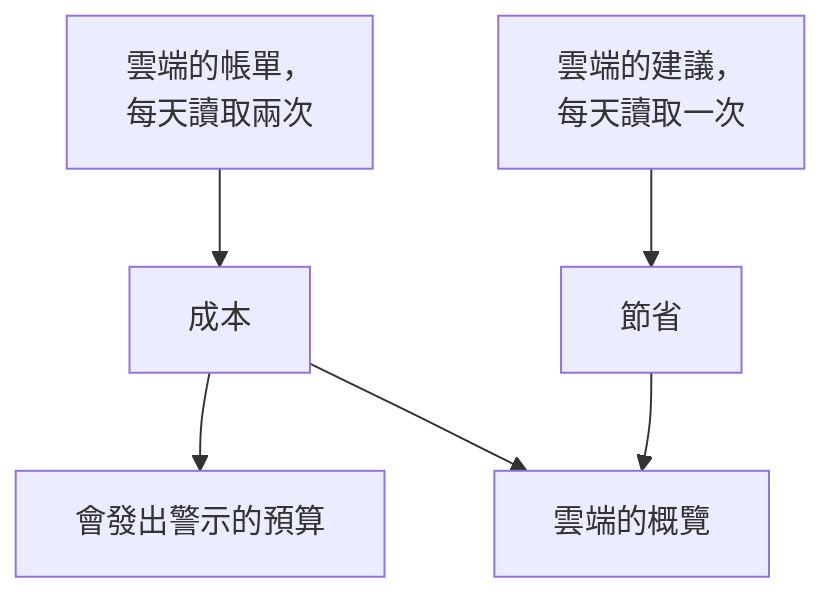

# 雲端成本與節省

已連線的雲端帳戶也會告訴你它的成本，以及如何降低成本。OneUptime 從雲端本身的帳單讀取每天的成本，從雲端本身的建議服務讀取建議，在 **雲端 → 支出 → 成本** 和 **雲端 → 支出 → 節省** 中顯示它們，並在某個月的成本超出預算之前透過 **雲端 → 支出 → 預算** 發出警示。

:::cards
- [Amazon Web Services](#amazon-web-services): Cost Explorer 和 Cost Optimization Hub，各開啟一次。
- [Microsoft Azure](#microsoft-azure): Cost Management 和 Azure Advisor，多一個角色。
- [Google Cloud](#google-cloud): 你匯出到 BigQuery 的帳單資料，以及 Recommender。
- [預算](#預算): 當某個月的支出超過預算的某個比例時發出的警示。
:::

## 運作方式



- **成本來自雲端本身的帳單。** AWS Cost Explorer、Azure Cost Management 以及 Google Cloud 匯出到 BigQuery 的帳單資料，在抵扣點數和退款之前，以帳戶的計費幣別計算。每個金額都是一天的金額，依 UTC 日期，與雲端的計費方式一致。
- **雲端會延遲回報最後一兩天。** 每次讀取都會重新讀取最近一週，並在每月的前幾天重新讀取整個上個月，因此某一天的成本會隨著雲端結束這一天而確定下來。連線的第一次讀取會回溯到上上個月的月初。
- **當月預測沿用最近一週的速度。** 它等於本月到目前為止的成本，再加上剩餘每一天依最近七個完整日的平均值計算的成本。
- **節省來自雲端本身的建議服務。** AWS Cost Optimization Hub、Azure Advisor 和 Google Cloud 的 Recommender：更小的規格、閒置的資源、值得做的承諾，每一項都附有每月可節省的金額。你在雲端主控台中執行或忽略的建議，會在下一次讀取時消失。

## 開始之前

- **一個已連線的帳戶。** 使用目前的設定指令 [連線雲端帳戶](/docs/telemetry/cloud-accounts)：它讓連線可以讀取成本和建議。之前建立的連線在你重新執行其指令之前，兩者都不會讀取。

## Amazon Web Services

連線用 `ce:GetCostAndUsage` 讀取成本，用 `cost-optimization-hub:ListRecommendations` 讀取建議。兩者都需要先在帳戶中開啟某項功能：

:::steps
### 開啟 Cost Explorer

在 AWS Billing and Cost Management 主控台中開啟一次 Cost Explorer：AWS 會在一天內準備好帳戶的成本。連線組織的管理帳戶，即可讀取每個成員帳戶的成本。

### 加入 Cost Optimization Hub

在同一個主控台中開啟 Cost Optimization Hub 並加入：組織從其管理帳戶加入，或者只為這個帳戶加入。它的建議會在一天內送達。
:::

Cost Explorer 每個請求收費 $0.01，每次讀取成本會發出幾個請求。Cost Optimization Hub 免費。

## Microsoft Azure

應用程式使用 **Cost Management Reader** 角色讀取成本，範圍與 **Monitoring Reader** 相同：設定指令會同時授予這兩個角色。Azure Advisor 的建議透過 **Monitoring Reader** 讀取，因此不需要開啟任何功能。要為之前建立的應用程式授予該角色，請執行：

```bash
az role assignment create --assignee <APP_ID> --role "Cost Management Reader" --scope /subscriptions/<SUBSCRIPTION_ID>
```

Cost Management 會依每個訂用帳戶回覆，並附上每項成本所屬的資源，讀取它不收費。當它無法為某個訂用帳戶回覆時，帳戶的 **成本** 會說明原因。

## Google Cloud

Google Cloud 沒有提供專案成本的 API：OneUptime 從你的帳單帳戶匯出到 BigQuery 的資料中讀取成本。

:::steps
### 將帳單匯出到 BigQuery

在 Google Cloud 主控台中開啟 Billing，再開啟 Billing export，開啟將詳細使用費用匯出到 BigQuery 資料集。Google 從你開啟的那天起寫入，會延遲幾個小時。

### 允許服務帳戶讀取它

在匯出的資料集上為連線的服務帳戶授予 **BigQuery Data Viewer**。設定指令已經為它授予 **BigQuery Job User**，以便在它自己的專案中執行查詢。

### 填寫匯出的資料表

在 **雲端 → 連線** 中編輯連線，並在 **更多欄位** 中將 **帳單匯出資料表** 設為資料表的完整名稱：`<PROJECT_ID>.<DATASET>.gcp_billing_export_resource_v1_<BILLING_ACCOUNT_ID>`。
:::

詳細匯出會寫明每項成本所屬的資源；標準匯出只寫明服務和區域。BigQuery 會對查詢收費：每月前 1 TiB 免費，之後每 TiB $6.25，一個月的匯出資料從幾 MB 到幾 GB 不等。Recommender 關於機器類型和閒置資源的建議透過設定指令授予的 **Compute Recommender Viewer** 讀取，不收費。

## 減少支出的方法

**雲端 → 支出 → 節省** 列出每一條建議，節省最多的排在最前：要做什麼、針對哪個資源、會改變什麼，以及每月能節省多少。上方的橫條會加總它們，包括總計和依類型的合計：更小的規格、閒置的資源、承諾。當 OneUptime 中有該資源時，建議會連結到其資源的頁面。

### 依 OneUptime 自身讀數進行的規格調整

如果建議服務未開啟、不涵蓋資源的類型或認為資源太新，以致沒有建議服務提出建議，OneUptime 會依連線在最近 14 天讀取的 CPU 和記憶體讀數來判斷資源的規格。它判斷 AWS 上的 EC2 執行個體、RDS 資料庫和 ElastiCache 叢集，Azure 上的虛擬機器、PostgreSQL 和 MySQL 彈性伺服器以及 App Service 方案，還有 Google Cloud 上的 Compute Engine 虛擬機器和 Cloud SQL 執行個體：

- **過度配置** 指規格減半、甚至只剩四分之一時仍有餘裕：在較小的規格上，CPU 的第 95 百分位數最多為 60%，最高 CPU 讀數最多為 100%，並且在讀取記憶體時，記憶體峰值最多為 70%。
- **配置不足** 指 CPU 的第 95 百分位數達到 85% 或以上，或記憶體峰值達到 90% 或以上：建議使用大一倍的規格。

資源有了 6 天的讀數後就會被判斷規格。資源的頁面會在其成本旁顯示 **規格調整**，過度配置的資源會以 OneUptime 為來源列在 **雲端 → 支出 → 節省** 中。一項變更能節省的金額，是它在資源最近 30 天成本中所占的部分，因此只要雲端依名稱為資源計費，就能知道：Azure 和 Google Cloud 的詳細匯出會這樣做，AWS Cost Explorer 不會。EC2 執行個體只有安裝 CloudWatch 代理程式、Compute Engine 虛擬機器只有安裝 Ops Agent 才會回報記憶體，沒有代理程式時只依 CPU 判斷規格。t3、B 系列和 e2-micro 等可突增規格從不判斷。

## 預算

:::steps
### 建立預算

在 **雲端 → 支出 → 預算** 中建立預算：填寫它的 **每月金額** 以及適用的 **帳戶**，留空則適用於所有帳戶。

### 選擇何時發出警示

**警示門檻** 填寫要發出警示的預算比例，以百分比表示：一開始是 80 和 100。**預計超出時發出警示** 也會在依最近一週的速度本月將超出預算時，每月發出一次警示。**異常日發出警示** 也會在某天的成本遠高於平常時，於隔天發出警示：請參閱 [異常日](#異常日)。**警示嚴重性** 和 **待命策略** 決定警示的嚴重程度以及呼叫誰。
:::

每次讀取成本之後以及每小時都會檢查預算。當本月支出越過一個閾值時，會為它發出一則警示；如果一次讀取同時越過多個閾值，則為最高的閾值發出警示。新的月份開始時，上個月的警示會被解決。預算只計算以其幣別計費的帳戶。

AI 代理可以透過 [MCP 伺服器](/docs/ai/mcp-server) 建立和變更預算，指令碼則可以使用 CLI 的 `oneuptime cloud-budget` 命令：請參閱 [資源操作](/docs/cli/resource-operations)。

### 異常日

每次讀取之後，帳戶最近 14 個完整日子中的每一天，都會與其之前的 14 天比較。當某項服務的成本達到其平常一天的兩倍或以上，或整個帳戶達到其平常一天的一倍半或以上時，這一天就是異常日。兩種情況的增加額都必須至少比平常多 10（以帳戶的貨幣計），並且至少為帳戶平常一天的 5%，所以幾分錢絕不會被當作激增。某一天的平常值是其之前 14 天的中位數，因此一次激增幾乎不會改變它；帳戶也要在有了一週的成本之後才會被判斷。

**雲端 → 支出 → 成本** 在每日支出下方列出異常日。計入該帳戶的預算會在隔天為每個帳戶和每一天發出一則警示，並列出每項成本上升的服務。持續數天的激增會在其開始的那天告知，超過一週的日子則不再告知。

## 你在 OneUptime 中看到的內容

- **雲端的概覽。** **雲端 → 概覽** 在需要注意的內容旁邊，顯示本月支出與上月同一天之前支出的比較、成本最高的服務，以及效果最大的減少支出的方法。
- **每天的支出。** **雲端 → 支出 → 成本** 繪製最近 30 天中的每一天，列出成本遠高於平常的日子，並依服務、區域、帳戶或資源拆分某個期間。未讀取成本的帳戶會列在下方，並附上原因。
- **帳戶的成本。** 帳戶的 **成本** 只針對該帳戶顯示同樣的內容，並附上它減少支出的方法。
- **資源的成本。** 當雲端依名稱為資源計費時，資源的頁面會顯示它本月和最近 30 天的成本，並附上它減少支出的方法和規格調整。

## 疑難排解

:::details 帳戶顯示 需要權限
連線還不能讀取帳戶的成本。從 **雲端 → 連線** 重新執行它的設定指令：指令會新增讀取成本所需的權限。在 Google Cloud 上，還要在匯出的資料集上為服務帳戶授予 **BigQuery Data Viewer**。
:::

:::details 帳戶顯示 未設定
它的雲端還沒有可提供的成本。在 AWS 上開啟 Cost Explorer；在 Google Cloud 上，在 **帳單匯出資料表** 中填寫匯出的資料表。第一批金額會隨下一次讀取送達，在 12 小時之內。
:::

:::details 金額漏掉了某個帳戶
金額以大多數帳戶的計費幣別顯示。以其他幣別計費的帳戶會連同其幣別列在下方，預算只計算以預算本身幣別計費的帳戶。
:::

:::details 本月金額低於雲端主控台中的金額
雲端會延遲回報最後一兩天，而且金額是抵扣點數和退款之前的金額。之後的讀取會追上來。
:::

## 後續步驟

:::cards
- [連線雲端帳戶](/docs/telemetry/cloud-accounts): 連線另一個帳戶，或重新執行它的指令。
- [雲端資源](/docs/telemetry/cloud-resources): 每個資源的指標，來自你自己的收集器。
- [Kubernetes 成本可觀測性](/docs/telemetry/kubernetes-cost): 每個 Kubernetes 工作負載的成本。
:::
