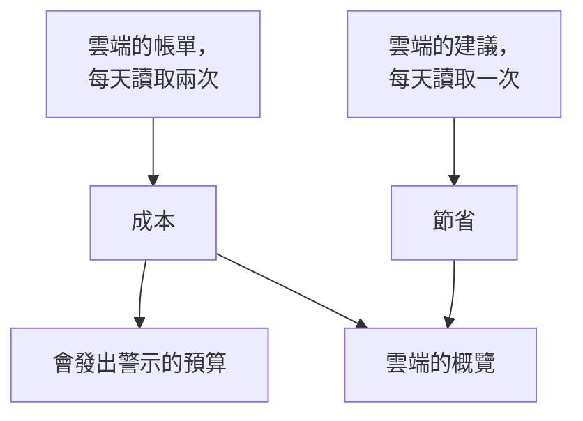

# 雲端成本與節省

已連線的雲端帳戶也會告訴你它的成本，以及如何降低成本。OneUptime 從雲端本身的帳單讀取每天的成本，從雲端本身的建議服務讀取建議，在 **雲端 → 支出 → 成本** 和 **雲端 → 支出 → 節省** 中顯示它們，在 **雲端 → 支出 → 承諾** 中列出你的 Savings Plans、保留項目和承諾使用折扣，並在某個月的成本超出預算之前透過 **雲端 → 支出 → 預算** 發出警示。

:::cards
- [Amazon Web Services](#amazon-web-services): Cost Explorer 和 Cost Optimization Hub，各開啟一次。
- [Microsoft Azure](#microsoft-azure): Cost Management 和 Azure Advisor，多一個角色。
- [Google Cloud](#google-cloud): 你匯出到 BigQuery 的帳單資料，以及 Recommender。
- [計費成本、攤銷成本和淨成本](#計費成本攤銷成本和淨成本): 每項成本都有三種基準，讓承諾和抵扣點數落在錢真正花出去的地方。
- [承諾與續約](#承諾與續約): 每一項承諾、在承諾結束前或使用不足時發出的警示，以及該續約或購買什麼。
- [預算](#預算): 當某個月的支出超過預算的某個比例時發出的警示。
:::

## 運作方式



- **成本來自雲端本身的帳單。** AWS Cost Explorer、Azure Cost Management 以及 Google Cloud 匯出到 BigQuery 的帳單資料，以帳戶的計費幣別計算，每項都依計費成本、攤銷成本和淨成本保存：請參閱 [計費成本、攤銷成本和淨成本](#計費成本攤銷成本和淨成本)。每個金額都是一天的金額，依 UTC 日期，與雲端的計費方式一致。
- **雲端會延遲回報最後一兩天。** 每次讀取都會重新讀取最近一週，並在每月的前幾天重新讀取整個上個月，因此某一天的成本會隨著雲端結束這一天而確定下來。連線的第一次讀取會回溯到上上個月的月初。
- **當月預測沿用最近一週的速度。** 它等於本月到目前為止的成本，再加上剩餘每一天依最近七個完整日的平均值計算的成本。
- **節省來自雲端本身的建議服務。** AWS Cost Optimization Hub、Azure Advisor 和 Google Cloud 的 Recommender：更小的規格、閒置的資源、值得做的承諾，每一項都附有每月可節省的金額。你在雲端主控台中執行或忽略的建議，會在下一次讀取時消失。

## 開始之前

- **一個已連線的帳戶。** 使用目前的設定指令 [連線雲端帳戶](/docs/telemetry/cloud-accounts)：它讓連線可以讀取成本和建議。之前建立的連線在你重新執行其指令之前，兩者都不會讀取。

## Amazon Web Services

連線用 `ce:GetCostAndUsage` 讀取成本，用 `ce:GetSavingsPlansCoverage`、`ce:GetSavingsPlansUtilization`、`ce:GetSavingsPlansUtilizationDetails`、`ce:GetReservationCoverage` 和 `ce:GetReservationUtilization` 讀取承諾，用 `savingsplans:DescribeSavingsPlans` 讀取已購買的 Savings Plans，用 `cost-optimization-hub:ListRecommendations` 和 `cost-optimization-hub:GetRecommendation` 讀取建議。設定指令把 Cost Explorer 的讀取作為三個系列授予：`ce:GetCostAndUsage*`、`ce:GetSavingsPlans*` 和 `ce:GetReservation*`，它們全都只是讀取，這樣存取金鑰的使用者仍能控制在 IAM 允許其政策使用的 2,048 個字元以內。Cost Explorer 和 Cost Optimization Hub 都需要先在帳戶中開啟：

:::steps
### 開啟 Cost Explorer

在 AWS Billing and Cost Management 主控台中開啟一次 Cost Explorer：AWS 會在一天內準備好帳戶的成本。連線組織的管理帳戶，即可讀取每個成員帳戶的成本。

### 加入 Cost Optimization Hub

在同一個主控台中開啟 Cost Optimization Hub 並加入：組織從其管理帳戶加入，或者只為這個帳戶加入。它的建議會在一天內送達。
:::

Cost Explorer 每個請求收費 $0.01：每次讀取成本會發出兩個或稍多幾個請求，一個用於計費成本和攤銷成本，一個用於淨成本；承諾每天用四個請求讀取其涵蓋率和使用率，另外每天再用六到十二個請求讀取每項承諾本身的資料。Savings Plans API 和 Cost Optimization Hub 免費。

### 依資源的成本

開啟資源層級資料後，Cost Explorer 還會提供最近 14 天每個資源的成本。在 AWS Billing and Cost Management 主控台中開啟 Cost Management 偏好設定，以每日粒度開啟資源層級資料；組織則從其管理帳戶開啟。AWS 會在 48 小時內準備好資料。

接著在 **雲端 → 連線** 下編輯連線，並在 **更多欄位** 中開啟 **依資源的成本**。連線每天用 `ce:GetCostAndUsageWithResources` 讀取一次：第一次讀取 14 天，之後再次讀取最近三天，每次發出幾個請求。讀到的內容在 Cost Explorer 不再保留後仍隨帳戶的成本保存。之前建立的連線需要重新執行設定指令，以新增此動作。

## Microsoft Azure

應用程式使用 **Cost Management Reader** 角色讀取成本，範圍與 **Monitoring Reader** 相同：設定指令會同時授予這兩個角色。Azure Advisor 的建議透過 **Monitoring Reader** 讀取，因此不需要開啟任何功能。要為之前建立的應用程式授予該角色，請執行：

```bash
az role assignment create --assignee <APP_ID> --role "Cost Management Reader" --scope /subscriptions/<SUBSCRIPTION_ID>
```

Cost Management 會依每個訂用帳戶回覆，並附上每項成本所屬的資源，讀取它不收費。當它無法為某個訂用帳戶回覆時，帳戶的 **成本** 會說明原因。

Cost Management 會限制讀取一個租用戶成本的速度，對所有讀取者都一樣：每個查詢讀取的每個月資料消耗一個查詢處理單位 (QPU)，一個租用戶每 10 秒有 12 QPU，每分鐘 60，每小時 600。OneUptime 在每項配額的三分之二以內逐一讀取租用戶的訂用帳戶，在 Cost Management 拒絕查詢時依其要求等待，並在下一次讀取時從停下的地方繼續。尚未讀取的訂用帳戶顯示 **排隊中** 以及讀取時間；已有金額的訂用帳戶在此期間保留其金額。訂用帳戶的攤銷成本每次讀取時都會讀取，實際成本每天讀取一次，因此訂用帳戶的第一次讀取會查詢 Cost Management 兩次，消耗兩倍的查詢單位：大型租用戶的第一批金額要多等幾次讀取。

租用戶的保留項目和節省方案透過 **Reservations Reader** 和 **Savings plan Reader** 讀取，Azure 在租用戶本身的範圍授予這兩個角色，只有具備提升存取權的全域管理員才能在那裡授予。設定指令會嘗試授予，無法授予時會說明。之後要授予它們，請以具備提升存取權的全域管理員身分執行：

```bash
az role assignment create --assignee <APP_ID> --role "Reservations Reader" --scope /providers/Microsoft.Capacity
az role assignment create --assignee <APP_ID> --role "Savings plan Reader" --scope /providers/Microsoft.BillingBenefits
```

沒有它們時，成本和建議仍像以前一樣讀取，**雲端 → 支出 → 承諾** 會說明要授予哪個角色。

## Google Cloud

Google Cloud 沒有提供專案成本的 API：OneUptime 從你的帳單帳戶匯出到 BigQuery 的資料中讀取成本。

:::steps
### 將帳單匯出到 BigQuery

在 Google Cloud 主控台中開啟 Billing，再開啟 Billing export，開啟將詳細使用費用匯出到 BigQuery 資料集。Google 從你開啟的那天起寫入，會延遲幾個小時。

### 允許服務帳戶讀取它

在匯出的資料集上為連線的服務帳戶授予 **BigQuery Data Viewer**。設定指令已經為它授予 **BigQuery Job User**，以便在它自己的專案中執行查詢。

### 填寫匯出的資料表

在 **雲端 → 連線** 中編輯連線，並在 **更多欄位** 中將 **帳單匯出資料表** 設為資料表的完整名稱：`<PROJECT_ID>.<DATASET>.gcp_billing_export_resource_v1_<BILLING_ACCOUNT_ID>`。
:::

詳細匯出會寫明每項成本所屬的資源；標準匯出只寫明服務和區域。BigQuery 會對查詢收費：每月前 1 TiB 免費，之後每 TiB $6.25，一個月的匯出資料從幾 MB 到幾 GB 不等。Recommender 關於機器類型和閒置資源的建議透過設定指令授予的 **Compute Recommender Viewer** 讀取，不收費。Compute Engine 的承諾透過 **Cloud Asset Viewer** 從 Cloud Asset Inventory 列出，設定指令已經授予該角色：不需要再授予其他權限。

## 計費成本、攤銷成本和淨成本

每項成本都以三種基準保存，**雲端 → 支出 → 成本**、帳戶的 **成本**、雲端概覽和預算會顯示你選擇的那一種：

- **計費成本** 是雲端在出帳當天記下的每筆費用，在抵扣點數和退款之前。預付的 Savings Plan 或保留項目是購買當天的一筆大額費用，而它涵蓋的用量在其餘期間內看起來是免費的。
- **攤銷成本** 把每項承諾的費用分攤到它涵蓋的日子和資源上，讓錢落在花出去的地方。它仍然在抵扣點數和退款之前。除非你選擇其他基準，頁面顯示的就是它。
- **淨成本** 是攤銷成本減去抵扣點數、退款和折扣：也就是帳單的合計。

| | 計費成本 | 攤銷成本 | 淨成本 |
|---|---|---|---|
| AWS | Cost Explorer 的非混合成本 (unblended) | Cost Explorer 的攤銷成本 | Cost Explorer 的淨攤銷成本，含抵扣點數和退款 |
| Azure | Cost Management 的實際成本 | Cost Management 的攤銷成本 | 攤銷成本：Azure 在計費帳戶上扣除抵扣點數，而訂用帳戶的連線不會讀取計費帳戶 |
| Google Cloud | 匯出資料中的成本 | 成本減去承諾使用折扣和訂閱的抵扣點數 | 成本減去所有抵扣點數 |

金額上方的切換器會變更頁面上的基準，OneUptime 會在你的瀏覽器中記住你在此專案中的選擇。專案自己的基準，也就是頁面開啟時使用、預算所關注的基準，位於 **雲端 → 設定 → 成本設定**。預算可以關注自己的基準：編輯預算並設定 **成本基準**。

在三種成本開始保存之前讀取的成本，在每種基準下都顯示其計費金額。每個連線會再讀取一次自己的成本，回溯範圍與第一次讀取相同，以便填滿每種基準。

## 減少支出的方法

**雲端 → 支出 → 節省** 列出每一條建議，節省最多的排在最前：要做什麼、針對哪個資源、會改變什麼，以及每月能節省多少。上方的橫條會加總它們，包括總計和依類型的合計：更小的規格、閒置的資源、承諾。當 OneUptime 中有該資源時，建議會連結到其資源的頁面。

### 依 OneUptime 自身讀數進行的規格調整

如果建議服務未開啟、不涵蓋資源的類型或認為資源太新，以致沒有建議服務提出建議，OneUptime 會依連線在最近 14 天讀取的 CPU 和記憶體讀數來判斷資源的規格。它判斷 AWS 上的 EC2 執行個體、RDS 資料庫和 ElastiCache 叢集，Azure 上的虛擬機器、PostgreSQL 和 MySQL 彈性伺服器以及 App Service 方案，還有 Google Cloud 上的 Compute Engine 虛擬機器和 Cloud SQL 執行個體：

- **過度配置** 指規格減半、甚至只剩四分之一時仍有餘裕：在較小的規格上，CPU 的第 95 百分位數最多為 60%，最高 CPU 讀數最多為 100%，並且在讀取記憶體時，記憶體峰值最多為 70%。
- **配置不足** 指 CPU 的第 95 百分位數達到 85% 或以上，或記憶體峰值達到 90% 或以上：建議使用大一倍的規格。

資源有了 6 天的讀數後就會被判斷規格。資源的頁面會在其成本旁顯示 **規格調整**，過度配置的資源會以 OneUptime 為來源列在 **雲端 → 支出 → 節省** 中。一項變更能節省的金額，是它在資源最近 30 天成本中所占的部分，因此只要雲端依名稱為資源計費，就能知道：Azure 和 Google Cloud 的詳細匯出會這樣做，AWS 在開啟「依資源的成本」後也會。EC2 執行個體只有安裝 CloudWatch 代理程式、Compute Engine 虛擬機器只有安裝 Ops Agent 才會回報記憶體，沒有代理程式時只依 CPU 判斷規格。t3、B 系列和 e2-micro 等可突增規格從不判斷。

### 承諾

**雲端 → 支出 → 節省** 和帳戶的 **成本** 會顯示最近 30 天的支出中有多少由各帳戶的承諾支付，以及其中有多少被使用，每種類型一行：

- AWS：Savings Plans 和預留執行個體，來自 Cost Explorer。組織的管理帳戶會為組織中的每個帳戶讀取。
- Azure：節省方案和保留項目，來自 Cost Management，以攤銷成本計算。
- Google Cloud：承諾使用折扣，來自你的帳單匯出。匯出不會說明承諾中有多少未被使用，因此不顯示使用了多少。

沒有承諾的帳戶會顯示以隨需費率執行、而承諾能以更低價格支付的部分。每種類型的數字都是其雲端自己的，各類型從不相加：保留項目和 Savings Plan 可能都會把同一台機器的支出算作自己要涵蓋的部分。每項承諾都單獨列在 **雲端 → 支出 → 承諾** 中：請參閱 [承諾與續約](#承諾與續約)。

## 承諾與續約

**雲端 → 支出 → 承諾** 列出你的連線能讀取的每個 Savings Plan、保留項目和承諾使用折扣，這樣不會有承諾在你不知情時結束：

- 頂部的 **使用中的承諾** 統計使用中的承諾和 90 天內結束的承諾，**使用率** 顯示最近 30 天使用了多少、有多少未被使用，**涵蓋率** 顯示它們涵蓋了多少支出。
- **即將結束** 列出 90 天內結束且不會自動續約的承諾，每項都附有續約計畫：要保住折扣需要購買什麼（其每小時承諾或執行個體，依已使用的部分），每月成本和節省多少，何時回本，以及現在和結束後有多少支出被涵蓋。**在主控台中續約** 會開啟雲端中續約它的頁面。
- **所有承諾** 是完整清單：每項是什麼、涵蓋什麼，它的帳戶、何時結束、期間和付款選項、最近 30 天使用了多少，以及它支付了哪些用量、節省了多少。
- **購買計畫** 是雲端的建議服務建議購買的內容，每項都顯示每月的成本和節省、何時回本以及涵蓋率會如何變化。**在主控台中購買** 會開啟購買它的頁面。
- 在它們下方，是每個帳戶依類型列出的承諾，與其 **成本** 中顯示的一樣，以及承諾何時發出警示，可透過 **變更警示** 調整。

OneUptime 只做規劃：它從不購買、續約或退還承諾。購買在你的雲端主控台中進行。

| | 承諾來自哪裡 | 每項承諾的已知資訊 |
|---|---|---|
| AWS | Cost Explorer 的 Savings Plans 和預留執行個體，各自帶有自己的使用率，以及用於已購買方案（包括排隊等待開始的方案）的 Savings Plans API | 結束時間、期間、付款選項、每小時承諾或執行個體、費用，以及最近 30 天和 7 天的使用率 |
| Azure | 租用戶的保留項目和節省方案 | 結束時間、期間、計費方案、是否自動續約，以及最近 30 天和 7 天的使用率 |
| Google Cloud | Compute Engine 的承諾，來自 Cloud Asset Inventory | 結束時間、方案、資源以及是否自動續約。Google Cloud 不會說明承諾被使用了多少 |

在 AWS 上，組織的管理帳戶會列出每個帳戶的承諾。Google Cloud 保存在帳單帳戶而不是專案中的以支出為基礎的承諾使用折扣，目前尚未列出。

### 承諾警示

承諾會發出警示，並像任何警示一樣透過待命策略呼叫。在 **雲端 → 設定 → 成本設定** 中，**承諾警示** 決定何時發出：

- **承諾結束前發出警示**：初始為結束前 90、30 和 7 天。在承諾已到達的這些日子中最近的一天發出一則警示，每個更近的日子都會取代前一個。會自動續約的承諾，或其續約已排隊在結束時開始的承諾，不會發出警示。
- **使用率低於此值時發出警示**：初始為 80%，針對承諾最近 7 天的使用率，在它執行滿一週之後。使用率恢復後警示會被解決。
- **涵蓋率低於此值時發出警示**：初始為 60%，針對帳戶中某一類型的承諾可以涵蓋的支出，在曾經涵蓋更多之後。涵蓋率恢復後會被解決。留空時，涵蓋率不會發出警示。

**對承諾發出警示** 可以關閉所有這些警示，**警示嚴重性**、**待命策略** 和 **擁有者** 決定它們有多嚴重、呼叫誰以及歸誰所有。每則警示都會說明承諾涵蓋什麼、支付了什麼，並指向它的續約計畫。當承諾結束、續約或不再被列出時，警示會自動解決。

## 預算

:::steps
### 建立預算

在 **雲端 → 支出 → 預算** 中建立預算：填寫它的 **每月金額**、適用的 **帳戶**（留空則適用於所有帳戶），以及它計算的 **成本基準**（留空則使用專案的基準）。

### 選擇何時發出警示

**警示門檻** 填寫要發出警示的預算比例，以百分比表示：一開始是 80 和 100。**預計超出時發出警示** 也會在依最近一週的速度本月將超出預算時，每月發出一次警示。**異常日發出警示** 也會在某天的成本遠高於平常時，於隔天發出警示：請參閱 [異常日](#異常日)。**警示嚴重性** 和 **待命策略** 決定警示的嚴重程度以及呼叫誰。
:::

每次讀取成本之後以及每小時都會檢查預算。當本月支出越過一個閾值時，會為它發出一則警示；如果一次讀取同時越過多個閾值，則為最高的閾值發出警示。新的月份開始時，上個月的警示會被解決。預算只計算以其幣別計費的帳戶，並依它的基準計算：攤銷成本的預算不會因預付購買的承諾而觸發，而計費成本的預算會在購買當天計入它。

AI 代理可以透過 [MCP 伺服器](/docs/ai/mcp-server) 建立和變更預算，指令碼則可以使用 CLI 的 `oneuptime cloud-budget` 命令：請參閱 [資源操作](/docs/cli/resource-operations)。

### 異常日

每次讀取之後，帳戶最近 14 個完整日子中的每一天，都會與其之前的 14 天比較。當某項服務的成本達到其平常一天的兩倍或以上，或整個帳戶達到其平常一天的一倍半或以上時，這一天就是異常日。兩種情況的增加額都必須至少比平常多 10（以帳戶的貨幣計），並且至少為帳戶平常一天的 5%，所以幾分錢絕不會被當作激增。某一天的平常值是其之前 14 天的中位數，因此一次激增幾乎不會改變它；帳戶也要在有了一週的成本之後才會被判斷。

**雲端 → 支出 → 成本** 在每日支出圖中把異常日標在其長條上方，並在下方列出它們。檢視所有帳戶時，每個標記都會開啟其帳戶的 **成本**。計入該帳戶的預算會在隔天為每個帳戶和每一天發出一則警示，並列出每項成本上升的服務。持續數天的激增會在其開始的那天告知，超過一週的日子則不再告知。在這類警示出現之前建立的預算，要等您編輯預算並將其開啟後才會發出這類警示。

## 錢花在哪裡

**雲端 → 支出 → 成本** 可依服務、區域、帳戶或資源拆分某個期間的支出，還有另外三種方式：

- 依應用程式平台環境：每個環境在其帳戶和區域中的平台服務（例如 Amazon ECS 或 Cloud Run），以及 Elastic Beanstalk 環境中依 AWS 賦予的標記找到的資源。
- 依應用程式：平台依名稱向應用程式計費的部分，例如 Cloud Run 服務或 Container App。Amazon ECS 依工作計費，App Service 依方案計費，因此其應用程式的成本仍歸其環境。
- 依標記：你所選標記的每個值。成本會保留讀取時的標記：Google Cloud 帳單匯出的標籤，否則為其計費資源的標記；在 AWS 上這需要「依資源的成本」。

清單下方，卡片會說明其餘部分的金額：不屬於任何環境的部分、依整個環境計費的部分，或不帶該標記的部分。在開始保留標記之前讀取的成本會再讀取一次，回溯到第一次讀取的範圍，以補上它們的標記。

## 你在 OneUptime 中看到的內容

- **雲端的概覽。** **雲端 → 概覽** 在需要注意的內容旁邊，顯示本月支出與上月同一天之前支出的比較、成本最高的服務，以及效果最大的減少支出的方法。
- **每天的支出。** **雲端 → 支出 → 成本** 繪製最近 30 天中的每一天並標出成本遠高於平常的日子，列出這些日子，並依服務、區域、帳戶、資源、應用程式平台環境、應用程式或標記拆分某個期間，可依計費成本、攤銷成本或淨成本檢視。未讀取成本的帳戶會列在下方，並附上原因。
- **每項承諾。** **雲端 → 支出 → 承諾** 列出每項承諾何時結束、使用了多少，即將結束的承諾該續約什麼，以及該購買什麼。
- **帳戶的成本。** 帳戶的 **成本** 只針對該帳戶顯示同樣的內容，並附上它的承諾和減少支出的方法。
- **資源的成本。** 當雲端依名稱為資源計費時，資源的頁面會顯示它本月和最近 30 天的成本，並附上它減少支出的方法和規格調整。

## 疑難排解

:::details 帳戶顯示 需要權限
連線還不能讀取帳戶的成本。從 **雲端 → 連線** 重新執行它的設定指令：指令會新增讀取成本所需的權限。在 Google Cloud 上，還要在匯出的資料集上為服務帳戶授予 **BigQuery Data Viewer**。
:::

:::details 帳戶顯示 未設定
它的雲端還沒有可提供的成本。在 AWS 上開啟 Cost Explorer；在 Google Cloud 上，在 **帳單匯出資料表** 中填寫匯出的資料表。第一批金額會隨下一次讀取送達，在 12 小時之內。
:::

:::details 帳戶顯示 排隊中
它的成本正在排隊等候：Azure Cost Management 限制讀取一個租用戶成本的速度。帳戶會顯示讀取時間，即從那時起連線的第一次讀取，無需任何操作。已有金額的帳戶在此期間保留其金額。
:::

:::details 依資源的成本顯示 未設定
該帳戶未開啟資源層級資料。請在 AWS Billing and Cost Management 主控台的 Cost Management 偏好設定中以每日粒度開啟；組織成員需從組織的管理帳戶開啟。AWS 會在 48 小時內準備好資料，隔天的讀取會取得它。
:::

:::details 承諾顯示 需要權限
連線還不能讀取該帳戶的 Savings Plans 和保留項目。請從 **雲端 → 連線** 重新執行其設定指令：它會新增讀取它們所用的動作。在 Azure 上，由具備提升存取權的全域管理員授予 **Reservations Reader** 和 **Savings plan Reader**：請參閱 [Microsoft Azure](#microsoft-azure)。
:::

:::details 攤銷成本和淨成本顯示的與計費成本相同
在三種成本開始保存之前讀取的成本，在連線下一次讀取成本之前，在每種基準下都顯示其計費金額，下一次讀取會回溯到與第一次讀取相同的範圍重新讀取。在 Azure 上，淨成本一律等於攤銷成本。
:::

:::details 承諾結束了，卻沒有收到警示
會自動續約的承諾，或其續約已排隊在結束時開始的承諾，不會發出警示；在 **雲端 → 設定 → 成本設定** 中關閉了承諾警示的專案，其承諾也不會。警示還需要專案設定了警示嚴重性。
:::

:::details 金額漏掉了某個帳戶
金額以大多數帳戶的計費幣別顯示。以其他幣別計費的帳戶會連同其幣別列在下方，預算只計算以預算本身幣別計費的帳戶。
:::

:::details 本月金額低於雲端主控台中的金額
雲端會延遲回報最後一兩天，而且計費金額和攤銷金額是抵扣點數和退款之前的金額。之後的讀取會追上來。請與雲端主控台顯示的基準進行比較：AWS 預設開啟的是非混合成本，也就是計費成本。
:::

## 後續步驟

:::cards
- [連線雲端帳戶](/docs/telemetry/cloud-accounts): 連線另一個帳戶，或重新執行它的指令。
- [雲端資源](/docs/telemetry/cloud-resources): 每個資源的指標，來自你自己的收集器。
- [Kubernetes 成本可觀測性](/docs/telemetry/kubernetes-cost): 每個 Kubernetes 工作負載的成本。
:::
