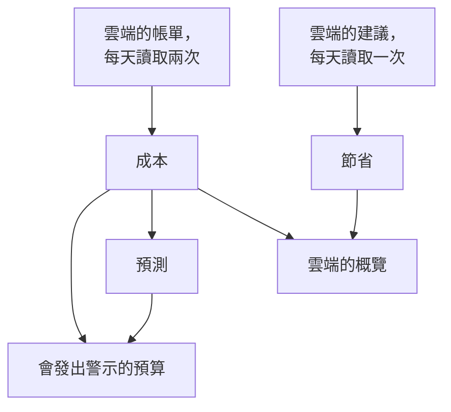

# 雲端成本與節省

已連線的雲端帳戶也會告訴你它的成本，以及如何降低成本。OneUptime 從雲端本身的帳單讀取每天的成本，從雲端本身的建議服務讀取建議，在 **雲端 → 支出 → 成本** 和 **雲端 → 支出 → 節省** 中顯示它們，在 **雲端 → 支出 → 承諾** 中列出你的 Savings Plans、保留項目和承諾使用折扣，在某個月、季或年度的成本超出預算之前透過 **雲端 → 支出 → 預算** 告知你，並在 **雲端 → 支出 → 預測** 中預測未來幾個月。如果你允許，它也會執行擁有者核准的節省，在非上班時間停止非正式環境的資源，並以帳單核對每項變更。

:::cards
- [Amazon Web Services](#amazon-web-services): Cost Explorer 和 Cost Optimization Hub，各開啟一次。
- [Microsoft Azure](#microsoft-azure): Cost Management 和 Azure Advisor，多一個角色。
- [Google Cloud](#google-cloud): 你匯出到 BigQuery 的帳單資料，以及 Recommender。
- [計費成本、攤銷成本和淨成本](#計費成本攤銷成本和淨成本): 每項成本都有三種基準，讓承諾和抵扣點數落在錢真正花出去的地方。
- [承諾與續約](#承諾與續約): 每一項承諾、在承諾結束前或使用不足時發出的警示，以及該續約或購買什麼。
- [執行節省](#執行節省): 經擁有者核准後套用一項節省，也可以復原。
- [非上班時間排程](#非上班時間排程): 在夜間和週末停止非正式環境的資源。
- [節省 AI 規則](#節省-ai-規則): 提議給擁有者，或在上限內直接變更。
- [預算](#預算): 適用於任何帳戶、成本群組或服務的月度、季或年度預算。
- [預測](#預測): 未來 12 個月預計花費多少，以及可信度如何。
- [必要標記](#必要標記): 有多少支出帶有你要求的標記，以及缺少這些標記的新資源。
:::

## 運作方式



- **成本來自雲端本身的帳單。** AWS Cost Explorer、Azure Cost Management 以及 Google Cloud 匯出到 BigQuery 的帳單資料，以帳戶的計費幣別計算，每項都依計費成本、攤銷成本和淨成本保存：請參閱 [計費成本、攤銷成本和淨成本](#計費成本攤銷成本和淨成本)。每個金額都是一天的金額，依 UTC 日期，與雲端的計費方式一致。
- **雲端會延遲回報最後一兩天。** 每次讀取都會重新讀取最近一週，並在每月的前幾天重新讀取整個上個月，因此某一天的成本會隨著雲端結束這一天而確定下來。連線的第一次讀取會回溯到上上個月的月初。
- **當月預測沿用最近一週的速度。** 它等於本月到目前為止的成本，再加上剩餘每一天依最近七個完整日的平均值計算的成本。
- **節省來自雲端本身的建議服務。** AWS Cost Optimization Hub、Azure Advisor 和 Google Cloud 的 Recommender：更小的規格、閒置的資源、值得做的承諾，每一項都附有每月可節省的金額。你在雲端主控台中執行或忽略的建議，會在下一次讀取時消失。

## 開始之前

- **一個已連線的帳戶。** 使用目前的設定指令 [連線雲端帳戶](/docs/telemetry/cloud-accounts)：它讓連線可以讀取成本和建議。之前建立的連線在你重新執行其指令之前，兩者都不會讀取。

## Amazon Web Services

連線用 `ce:GetCostAndUsage` 讀取成本，用 `ce:GetSavingsPlansCoverage`、`ce:GetSavingsPlansUtilization`、`ce:GetSavingsPlansUtilizationDetails`、`ce:GetReservationCoverage` 和 `ce:GetReservationUtilization` 讀取承諾，用 `savingsplans:DescribeSavingsPlans` 讀取已購買的 Savings Plans，用 `cost-optimization-hub:ListRecommendations` 和 `cost-optimization-hub:GetRecommendation` 讀取建議。設定指令把 Cost Explorer 的讀取作為三個系列授予：`ce:GetCostAndUsage*`、`ce:GetSavingsPlans*` 和 `ce:GetReservation*`，它們全都只是讀取，這樣存取金鑰的使用者仍能控制在 IAM 允許其政策使用的 2,048 個字元以內。Cost Explorer 和 Cost Optimization Hub 都需要先在帳戶中開啟：

:::steps
### 開啟 Cost Explorer

在 AWS Billing and Cost Management 主控台中開啟一次 Cost Explorer：AWS 會在一天內準備好帳戶的成本。連線組織的管理帳戶，即可讀取每個成員帳戶的成本。

### 加入 Cost Optimization Hub

在同一個主控台中開啟 Cost Optimization Hub 並加入：組織從其管理帳戶加入，或者只為這個帳戶加入。它的建議會在一天內送達。
:::

Cost Explorer 每個請求收費 $0.01：每次讀取成本會發出兩個或稍多幾個請求，一個用於計費成本和攤銷成本，一個用於淨成本；承諾每天用四個請求讀取其涵蓋率和使用率，另外每天再用六到十二個請求讀取每項承諾本身的資料。Savings Plans API 和 Cost Optimization Hub 免費。

### 依資源的成本

開啟資源層級資料後，Cost Explorer 還會提供最近 14 天每個資源的成本。在 AWS Billing and Cost Management 主控台中開啟 Cost Management 偏好設定，以每日粒度開啟資源層級資料；組織則從其管理帳戶開啟。AWS 會在 48 小時內準備好資料。

接著在 **雲端 → 連線** 下編輯連線，並在 **更多欄位** 中開啟 **依資源的成本**。連線每天用 `ce:GetCostAndUsageWithResources` 讀取一次：第一次讀取 14 天，之後再次讀取最近三天，每次發出幾個請求。讀到的內容在 Cost Explorer 不再保留後仍隨帳戶的成本保存。之前建立的連線需要重新執行設定指令，以新增此動作。

## Microsoft Azure

應用程式使用 **Cost Management Reader** 角色讀取成本，範圍與 **Monitoring Reader** 相同：設定指令會同時授予這兩個角色。Azure Advisor 的建議透過 **Monitoring Reader** 讀取，因此不需要開啟任何功能。要為之前建立的應用程式授予該角色，請執行：

```bash
az role assignment create --assignee <APP_ID> --role "Cost Management Reader" --scope /subscriptions/<SUBSCRIPTION_ID>
```

Cost Management 會依每個訂用帳戶回覆，並附上每項成本所屬的資源，讀取它不收費。當它無法為某個訂用帳戶回覆時，帳戶的 **成本** 會說明原因。

Cost Management 會限制讀取一個租用戶成本的速度，對所有讀取者都一樣：每個查詢讀取的每個月資料消耗一個查詢處理單位 (QPU)，一個租用戶每 10 秒有 12 QPU，每分鐘 60，每小時 600。OneUptime 在每項配額的三分之二以內逐一讀取租用戶的訂用帳戶，在 Cost Management 拒絕查詢時依其要求等待，並在下一次讀取時從停下的地方繼續。尚未讀取的訂用帳戶顯示 **排隊中** 以及讀取時間；已有金額的訂用帳戶在此期間保留其金額。訂用帳戶的攤銷成本每次讀取時都會讀取，實際成本每天讀取一次，因此訂用帳戶的第一次讀取會查詢 Cost Management 兩次，消耗兩倍的查詢單位：大型租用戶的第一批金額要多等幾次讀取。

租用戶的保留項目和節省方案透過 **Reservations Reader** 和 **Savings plan Reader** 讀取，Azure 在租用戶本身的範圍授予這兩個角色，只有具備提升存取權的全域管理員才能在那裡授予。設定指令會嘗試授予，無法授予時會說明。之後要授予它們，請以具備提升存取權的全域管理員身分執行：

```bash
az role assignment create --assignee <APP_ID> --role "Reservations Reader" --scope /providers/Microsoft.Capacity
az role assignment create --assignee <APP_ID> --role "Savings plan Reader" --scope /providers/Microsoft.BillingBenefits
```

沒有它們時，成本和建議仍像以前一樣讀取，**雲端 → 支出 → 承諾** 會說明要授予哪個角色。

## Google Cloud

Google Cloud 沒有提供專案成本的 API：OneUptime 從你的帳單帳戶匯出到 BigQuery 的資料中讀取成本。

:::steps
### 將帳單匯出到 BigQuery

在 Google Cloud 主控台中開啟 Billing，再開啟 Billing export，開啟將詳細使用費用匯出到 BigQuery 資料集。Google 從你開啟的那天起寫入，會延遲幾個小時。

### 允許服務帳戶讀取它

在匯出的資料集上為連線的服務帳戶授予 **BigQuery Data Viewer**。設定指令已經為它授予 **BigQuery Job User**，以便在它自己的專案中執行查詢。

### 填寫匯出的資料表

在 **雲端 → 連線** 中編輯連線，並在 **更多欄位** 中將 **帳單匯出資料表** 設為資料表的完整名稱：`<PROJECT_ID>.<DATASET>.gcp_billing_export_resource_v1_<BILLING_ACCOUNT_ID>`。
:::

詳細匯出會寫明每項成本所屬的資源；標準匯出只寫明服務和區域。BigQuery 會對查詢收費：每月前 1 TiB 免費，之後每 TiB $6.25，一個月的匯出資料從幾 MB 到幾 GB 不等。Recommender 關於機器類型和閒置資源的建議透過設定指令授予的 **Compute Recommender Viewer** 讀取，不收費。Compute Engine 的承諾透過 **Cloud Asset Viewer** 從 Cloud Asset Inventory 列出，設定指令已經授予該角色：不需要再授予其他權限。

## 計費成本、攤銷成本和淨成本

每項成本都以三種基準保存，**雲端 → 支出 → 成本**、帳戶的 **成本**、雲端概覽和預算會顯示你選擇的那一種：

- **計費成本** 是雲端在出帳當天記下的每筆費用，在抵扣點數和退款之前。預付的 Savings Plan 或保留項目是購買當天的一筆大額費用，而它涵蓋的用量在其餘期間內看起來是免費的。
- **攤銷成本** 把每項承諾的費用分攤到它涵蓋的日子和資源上，讓錢落在花出去的地方。它仍然在抵扣點數和退款之前。除非你選擇其他基準，頁面顯示的就是它。
- **淨成本** 是攤銷成本減去抵扣點數、退款和折扣：也就是帳單的合計。

| | 計費成本 | 攤銷成本 | 淨成本 |
|---|---|---|---|
| AWS | Cost Explorer 的非混合成本 (unblended) | Cost Explorer 的攤銷成本 | Cost Explorer 的淨攤銷成本，含抵扣點數和退款 |
| Azure | Cost Management 的實際成本 | Cost Management 的攤銷成本 | 攤銷成本：Azure 在計費帳戶上扣除抵扣點數，而訂用帳戶的連線不會讀取計費帳戶 |
| Google Cloud | 匯出資料中的成本 | 成本減去承諾使用折扣和訂閱的抵扣點數 | 成本減去所有抵扣點數 |

金額上方的切換器會變更頁面上的基準，OneUptime 會在你的瀏覽器中記住你在此專案中的選擇。專案自己的基準，也就是頁面開啟時使用、預算所關注的基準，位於 **雲端 → 設定 → 成本設定**。預算可以關注自己的基準：編輯預算並設定 **成本基準**。

在三種成本開始保存之前讀取的成本，在每種基準下都顯示其計費金額。每個連線會再讀取一次自己的成本，回溯範圍與第一次讀取相同，以便填滿每種基準。

## 減少支出的方法

**雲端 → 支出 → 節省** 列出每一條建議，節省最多的排在最前：要做什麼、針對哪個資源、會改變什麼，以及每月能節省多少。上方的橫條會加總它們，包括總計和依類型的合計：更小的規格、閒置的資源、承諾。當 OneUptime 中有該資源時，建議會連結到其資源的頁面；OneUptime 能執行的建議帶有 **套用**：請參閱 [執行節省](#執行節省)。

### 依 OneUptime 自身讀數進行的規格調整

如果建議服務未開啟、不涵蓋資源的類型或認為資源太新，以致沒有建議服務提出建議，OneUptime 會依連線在最近 14 天讀取的 CPU 和記憶體讀數來判斷資源的規格。它判斷 AWS 上的 EC2 執行個體、RDS 資料庫和 ElastiCache 叢集，Azure 上的虛擬機器、PostgreSQL 和 MySQL 彈性伺服器以及 App Service 方案，還有 Google Cloud 上的 Compute Engine 虛擬機器和 Cloud SQL 執行個體：

- **過度配置** 指規格減半、甚至只剩四分之一時仍有餘裕：在較小的規格上，CPU 的第 95 百分位數最多為 60%，最高 CPU 讀數最多為 100%，並且在讀取記憶體時，記憶體峰值最多為 70%。
- **配置不足** 指 CPU 的第 95 百分位數達到 85% 或以上，或記憶體峰值達到 90% 或以上：建議使用大一倍的規格。

資源有了 6 天的讀數後就會被判斷規格。資源的頁面會在其成本旁顯示 **規格調整**，過度配置的資源會以 OneUptime 為來源列在 **雲端 → 支出 → 節省** 中。一項變更能節省的金額，是它在資源最近 30 天成本中所占的部分，因此只要雲端依名稱為資源計費，就能知道：Azure 和 Google Cloud 的詳細匯出會這樣做，AWS 在開啟「依資源的成本」後也會。t3、B 系列和 e2-micro 等可突增規格從不判斷。

雲端只有在虛擬機器內裝有自己的代理程式時才能讀取其記憶體：EC2 執行個體需要 CloudWatch 代理程式，Compute Engine 虛擬機器需要 Ops Agent，而 Azure 虛擬機器沒有這樣的代理程式，回報的是剩餘記憶體而不是已用記憶體。執行著 [OneUptime 主機收集器](/docs/telemetry/hosts) 的虛擬機器，則改為依主機收集器讀取的記憶體判斷規格：

- **虛擬機器和主機是同一台機器**：當供應商、帳戶、區域和執行個體 ID 全都一致時才這樣認定，比較的是 EC2 執行個體 ID、Compute Engine 虛擬機器的數字 ID 或 Azure 虛擬機器的 `vmId`。僅憑主機名稱永遠不會相符，而被兩台主機同時認領的虛擬機器（例如複製的機器）不會與任何一台關聯。虛擬機器的頁面會顯示其主機，主機的頁面會顯示其虛擬機器，兩者互相連結。
- **記憶體是主機的已用記憶體，不含快取和緩衝區**，即主機頁面圖表中的數值，取同樣的 14 天。忙碌的檔案快取不會被讀成機器已滿。主機同樣需要 6 天的讀數。
- **兩者都讀取記憶體時**，例如同時裝有 Ops Agent 和主機收集器的 Compute Engine 虛擬機器，採用讀數較多的一方。CPU 一律採用雲端的讀數。

虛擬機器的 **規格調整** 會說明其記憶體來自哪裡，它在 **雲端 → 支出 → 節省** 中的那一列也會說明。只依 CPU 判斷規格的虛擬機器會註明這一點，並提供安裝主機收集器的連結。主機收集器透過 [主機指南的設定](/docs/telemetry/host-otel-collector) 中的 `resourcedetection/cloud` 步驟標記其所在雲端的身分。使用 OneUptime 預設設定的主機會在 OneUptime 的下一個版本中取得這個步驟，使用自有設定的主機需要自行加入。Kubernetes 節點交給 [Kubernetes 成本可觀測性](/docs/telemetry/kubernetes-cost)，它會為節點上執行的內容調整要求。

### 承諾

**雲端 → 支出 → 節省** 和帳戶的 **成本** 會顯示最近 30 天的支出中有多少由各帳戶的承諾支付，以及其中有多少被使用，每種類型一行：

- AWS：Savings Plans 和預留執行個體，來自 Cost Explorer。組織的管理帳戶會為組織中的每個帳戶讀取。
- Azure：節省方案和保留項目，來自 Cost Management，以攤銷成本計算。
- Google Cloud：承諾使用折扣，來自你的帳單匯出。匯出不會說明承諾中有多少未被使用，因此不顯示使用了多少。

沒有承諾的帳戶會顯示以隨需費率執行、而承諾能以更低價格支付的部分。每種類型的數字都是其雲端自己的，各類型從不相加：保留項目和 Savings Plan 可能都會把同一台機器的支出算作自己要涵蓋的部分。每項承諾都單獨列在 **雲端 → 支出 → 承諾** 中：請參閱 [承諾與續約](#承諾與續約)。

## 承諾與續約

**雲端 → 支出 → 承諾** 列出你的連線能讀取的每個 Savings Plan、保留項目和承諾使用折扣，這樣不會有承諾在你不知情時結束：

- 頂部的 **使用中的承諾** 統計使用中的承諾和 90 天內結束的承諾，**使用率** 顯示最近 30 天使用了多少、有多少未被使用，**涵蓋率** 顯示它們涵蓋了多少支出。
- **即將結束** 列出 90 天內結束且不會自動續約的承諾，每項都附有續約計畫：要保住折扣需要購買什麼（其每小時承諾或執行個體，依已使用的部分），每月成本和節省多少，何時回本，以及現在和結束後有多少支出被涵蓋。**在主控台中續約** 會開啟雲端中續約它的頁面。
- **所有承諾** 是完整清單：每項是什麼、涵蓋什麼，它的帳戶、何時結束、期間和付款選項、最近 30 天使用了多少，以及它支付了哪些用量、節省了多少。
- **購買計畫** 是雲端的建議服務建議購買的內容，每項都顯示每月的成本和節省、何時回本以及涵蓋率會如何變化。**在主控台中購買** 會開啟購買它的頁面。
- 在它們下方，是每個帳戶依類型列出的承諾，與其 **成本** 中顯示的一樣，以及承諾何時發出警示，可透過 **變更警示** 調整。

OneUptime 只做規劃：它從不購買、續約或退還承諾。購買在你的雲端主控台中進行。

| | 承諾來自哪裡 | 每項承諾的已知資訊 |
|---|---|---|
| AWS | Cost Explorer 的 Savings Plans 和預留執行個體，各自帶有自己的使用率，以及用於已購買方案（包括排隊等待開始的方案）的 Savings Plans API | 結束時間、期間、付款選項、每小時承諾或執行個體、費用，以及最近 30 天和 7 天的使用率 |
| Azure | 租用戶的保留項目和節省方案 | 結束時間、期間、計費方案、是否自動續約，以及最近 30 天和 7 天的使用率 |
| Google Cloud | Compute Engine 的承諾，來自 Cloud Asset Inventory | 結束時間、方案、資源以及是否自動續約。Google Cloud 不會說明承諾被使用了多少 |

在 AWS 上，組織的管理帳戶會列出每個帳戶的承諾。Google Cloud 保存在帳單帳戶而不是專案中的以支出為基礎的承諾使用折扣，目前尚未列出。

### 承諾警示

承諾會發出警示，並像任何警示一樣透過待命策略呼叫。在 **雲端 → 設定 → 成本設定** 中，**承諾警示** 決定何時發出：

- **承諾結束前發出警示**：初始為結束前 90、30 和 7 天。在承諾已到達的這些日子中最近的一天發出一則警示，每個更近的日子都會取代前一個。會自動續約的承諾，或其續約已排隊在結束時開始的承諾，不會發出警示。
- **使用率低於此值時發出警示**：初始為 80%，針對承諾最近 7 天的使用率，在它執行滿一週之後。使用率恢復後警示會被解決。
- **涵蓋率低於此值時發出警示**：初始為 60%，針對帳戶中某一類型的承諾可以涵蓋的支出，在曾經涵蓋更多之後。涵蓋率恢復後會被解決。留空時，涵蓋率不會發出警示。

**對承諾發出警示** 可以關閉所有這些警示，**警示嚴重性**、**待命策略** 和 **擁有者** 決定它們有多嚴重、呼叫誰以及歸誰所有。每則警示都會說明承諾涵蓋什麼、支付了什麼，並指向它的續約計畫。當承諾結束、續約或不再被列出時，警示會自動解決。

## 執行節省

只要帳戶雲端連線的 **節省動作** 設定允許，OneUptime 就會透過該連線執行節省：[節省動作](/docs/telemetry/cloud-accounts#節省動作) 說明了每個選項授予什麼。它只執行一步就能完成的變更：停止閒置的執行個體或資料庫，把 gp2 磁碟區改為 gp3，刪除未連接的磁碟、舊快照或未使用的映像，釋放未使用的位址，以及在你允許時把執行個體或資料庫調整為建議的規格。它從不購買承諾：**在主控台中購買** 會為此開啟你雲端的頁面。

:::steps
### 選擇套用

在 **雲端 → 支出 → 節省** 中，對一項節省選擇 **套用**。對話方塊會說明會改變什麼、每月節省多少、如何復原或無法復原，以及由誰核准。

### 擁有者核准

被指定為資源擁有者的人，或擁有該資源的團隊中同時可以編輯它的成員，核准這項變更。沒有擁有者的資源由專案擁有者或專案管理員核准。如果你自己可以核准，**套用** 會立即以你的身分執行它。否則，它會在 **等待核准** 中等待，直到擁有者選擇 **核准**，或選擇 **隱藏** 並說明原因。

### OneUptime 執行變更

變更透過連線執行，並連同核准者一起記錄在資源和帳戶的時間軸上。刪除磁碟前會先建立最終快照，除非你關閉 **先建立最終快照**。
:::

每項變更都會說明如何復原：**已執行的變更** 中的 **復原** 會重新啟動已停止的執行個體，把磁碟區或規格改回原樣，或從最終快照重新建立已刪除的磁碟。永久刪除的內容，例如快照、映像或已釋放的位址，無法復原，對話方塊會在你套用前說明這一點。如果專案透過 **風險較高的修正需要兩次核准** 要求兩次核准，無法復原的變更需要兩個人核准。

如果資源的標記表示它以程式碼管理，例如由 Terraform 或 CloudFormation 管理，則改為在程式碼中變更：對話方塊會提供 **開啟提取要求**，送到宣告它的存放庫，這樣下一次 apply 就不會復原這項節省。

### 由帳單證明

**本月已節省** 只計算你的雲端帳單顯示的金額。變更後的 3 天在帳單中穩定之後，會把資源的每日成本與變更前一週比較：成本至少下降了承諾金額的四分之一時為 **帳單中已反映**，否則為 **帳單中未反映**；如果你的雲端不依名稱為該資源計費，則為 **無法測量**。**正在核對帳單** 計算仍在等待這些天數的變更。

## 非上班時間排程

在 **雲端 → 支出 → 排程** 中，排程會在非上班時間停止非正式環境的執行個體和資料庫，並重新啟動它們：

:::steps
### 選取資源

指定選取它們的雲端標記，例如 `Schedule` = `office-hours`，可以在一個帳戶中，也可以在所有帳戶中。

### 指定執行時間

選擇上班日、啟動時間和停止時間（24 小時制）以及時區。
:::

上班時間結束時，排程會透過其帳戶的連線，停止其標記選取且已知不是正式環境的每個執行中資源；上班時間開始時，它只重新啟動自己停止的資源：有人手動停止的資源會保持停止。**檢視資源** 會列出排程目前選取的資源，以及讓某些資源保持執行的原因。它會停止 AWS 上的 EC2 執行個體和 RDS 資料庫、Azure 上的虛擬機器，以及 Google Cloud 上的 Compute Engine 執行個體。AWS 會自行重新啟動已停止七天的資料庫。

排程從不停止正式環境，也不停止沒有任何資訊說明其環境的資源。在下列情況下，資源已知不是正式環境：

- 它的某個標記如此表示，鍵如 `environment`、`env`、`stage`、`tier` 或 `deployment.environment`，值如 `dev`、`test`、`qa`、`staging` 或 `sandbox`；
- 或它的帳戶在帳戶 **設定** 的 **環境** 中被標為 **非正式環境**。

OneUptime 標籤從不會讓資源對排程而言成為非正式環境。重新命名一個標籤會一次改變帶有它的每個資源，因此 `Staging` 或 `env: dev` 這樣的標籤只會在由人核准變更的地方讀取，例如 **套用**。以正式環境為準：值為 `prod`、`production` 或 `live` 的標記、被標為 **正式環境** 的帳戶，或 `Production`、`env: prod` 這樣的標籤，會讓資源保持執行，無論其他資訊怎麼說。判斷時從不讀取資源的名稱。每次停止都會在執行前一刻重新讀取資源。關閉排程後，它不再停止任何資源，並會在上班時間開始時啟動它停止的資源；刪除排程後，它停止的資源會立即啟動。

## 節省 AI 規則

開啟 **啟用 AI** 後，OneUptime AI 每次讀取帳戶的節省後，都會把它能執行的每項節省提議給資源的擁有者，由他們在 **等待核准** 中核准或駁回。在 **雲端 → 設定 → 節省 AI 規則** 中，規則依變更類型、資源的環境和所在的雲端，說明 OneUptime AI 如何處理與之相符的節省：**關閉**、**提議給擁有者**，或在每月上限內 **不經詢問直接執行**。沒有規則時，每項節省都會被提議，但不會執行；有規則時只處理與規則相符的節省，相符的規則之間以最謹慎的為準。

規則只會在依排程的讀法已知不是正式環境的資源上（依據其標記或帳戶，絕不只依據其標籤）、只對可以復原的變更、只在相符規則中最小的上限之內不經詢問直接執行，而且每個專案每小時最多 10 次：其餘都會被提議。在執行變更前一刻會重新讀取資源，屆時已不再已知不是正式環境的資源會改為被提議。不經詢問執行的變更會連同執行它的規則一起記錄在時間軸上，其擁有者可以復原。被駁回或復原的節省在 30 天內不會再次被提議。

## 預算

:::steps
### 建立預算

在 **雲端 → 支出 → 預算** 中建立預算，並選擇它的 **適用於**：所有帳戶、一個 **帳戶**、依規則劃分支出的 **成本群組**，或 **篩選器** 指定的服務、區域和標記（寫法與成本群組的規則相同）。將它的 **成本基準** 留空，即依專案的基準計算。

### 設定可以花費多少

它的 **期間** 是一個月、一季或一年，它的 **金額** 是一個期間可以花費的金額。季和年度從 **年度第一個月** 開始：從四月開始時，一年是從四月到隔年三月。一年的 **預算計畫** 可以把金額平均分到各個月，或在 **月度計畫** 中為每個月設定自己的金額。這樣每個月都與自己的份額比較，清淡月份絕不會因繁忙月份的支出而收到警示。

### 選擇何時發出警示

**警示門檻** 填寫要採取行動的預算比例，以百分比表示：初始為 80 和 100。**預計超出時發出警示** 也會在期間預計花費超過預算時，每個期間發出一次警示。**異常日發出警示** 也會在某天的成本遠高於平常時，於隔天發出警示：參見 [異常日](#異常日)。**警示嚴重性** 決定其警示的嚴重程度。

### 選擇告知誰

當支出越過低於 100% 的比例時，**通知** 中的人員和團隊會透過電子郵件和聊天得到告知，不發警示，因此不會因預算內的支出呼叫任何人。**通知成本群組的團隊** 也會告知成本群組所屬的團隊。從 100% 起會建立警示，他們成為警示的擁有者，並呼叫 **待命策略**。無人可告知的預算會在每個比例都建立警示。
:::

每次讀取成本之後以及每小時都會檢查預算。當期間的支出越過一個比例時，會告知要通知的人員，或從 100% 起建立警示；如果一次讀取同時越過多個比例，則只為最高的建立一次。新的期間開始時，上一個期間的警示會被解決。按月拆分的一年會逐月檢查，與當月的份額比較。預算只計算以其貨幣計費的帳戶，並依它的基準計算：攤銷成本的預算不會因預付購買的承諾而觸發，而計費成本的預算會在購買當天計入它。

當一個期間截至目前的成本、本月剩餘天數依最近一個完整週的速度計算的花費，以及季或年度之後的月份依 [預測](#預測) 計算的花費，合計超過預算時，該期間就預計會超出預算。

每個預算的列會顯示它計入的內容、它的期間以及截至目前的期間：對於按月拆分的一年，顯示本月與其份額的對比，旁邊是全年。它的頁面會逐月顯示期間與每個月份額的對比、本月的每日支出、成本最高的項目以及告知對象。年度預算的頁面可以把它的預測儲存為計畫。

AI 代理可以透過 [MCP 伺服器](/docs/ai/mcp-server) 建立和變更預算，指令碼則可以使用 CLI 的 `oneuptime cloud-budget` 命令：請參閱 [資源操作](/docs/cli/resource-operations)。

### 異常日

每次讀取之後，帳戶最近 14 個完整日子中的每一天，都會與其之前的 14 天比較。當某項服務的成本達到其平常一天的兩倍或以上，或整個帳戶達到其平常一天的一倍半或以上時，這一天就是異常日。兩種情況的增加額都必須至少比平常多 10（以帳戶的貨幣計），並且至少為帳戶平常一天的 5%，所以幾分錢絕不會被當作激增。某一天的平常值是其之前 14 天的中位數，因此一次激增幾乎不會改變它；帳戶也要在有了一週的成本之後才會被判斷。

**雲端 → 支出 → 成本** 會在每日支出的長條上方標出異常日，並在下方列出。在所有帳戶檢視中，每個標記都會開啟其帳戶的 **成本**。適用於所有帳戶或一個帳戶的月度預算，會在隔天為每個帳戶和每一天建立一則警示，並列出每個偏高的服務。其他預算會以同樣的方式，把它計入的內容與它自己的平常一天比較。持續多日的激增會在開始的那天回報，超過一週的日子不會回報。在這些警示出現之前建立的預算，要等你編輯並開啟後才會建立它們。

## 預測

**雲端 → 支出 → 預測** 會依你選擇的成本基準，說明所有內容、一個帳戶、一個成本群組或一項服務在未來 12 個月中每個月預計花費多少。它也會說明每個預測是如何得出的，依據是 OneUptime 保存的完整月份成本，一年或稍多一些：

- **本月** 是截至目前的成本，加上剩餘每天依最近七個完整日的平均值計算的花費，與預算的估算方式相同。
- **不足 3 個完整月份** 時，之後每個月都沿用這個速度，不提供可能範圍：讀取的資料太少，無法區分趨勢和偶然波動。
- **從 3 個完整月份起**，趨勢會穿過每個月的平均一天：取每兩個月之間斜率的中位數，因此單一異常月份幾乎不會改變它。
- **從 12 個完整月份起**，每個日曆月也會記住去年高於或低於趨勢的程度，因此十二月的高峰也會在下一個十二月被預測出來。

之後每個月都有一個可能範圍，它應當 10 次中有 8 次落在其中，依據是過去各月偏離趨勢的程度，單側從不窄於 5%。月份越遠、預測所依據的月份越少，範圍越寬。從 12 個完整月份起，每個範圍還會更寬，因為一年中每個日曆月只出現一次。預測不是承諾：新的服務、遷移或價格變化，會以過去任何月份都沒有出現過的方式改變未來幾個月。

**模擬** 會從你選擇的月份起，依你輸入的比例讓之後每個月成長或減少，例如從一月起 20%。**另存為預算計畫** 會把未來十二個月設為年度預算的計畫，可以是新預算，也可以是現有預算，每個月依其預測份額控管。

## API 中的預算和預測

預算是一種 API 資源（`cloud-budget`），與其他資源一樣有 CLI 命令和 MCP 工具。預算的 `scope` 是 `allAccounts`、`account`（帶 `cloudAccountId`）、`costGroup`（帶 `cloudCostGroupId`）或 `filter`（帶 `filterRules`，寫法與成本群組的規則相同）。它的 `period` 是 `month`、`quarter` 或 `year`，從 `fiscalYearStartMonth`（1 到 12）開始。一年的 `planSplit` 是 `none`、`equal` 或 `byMonth`，十二個月依會計年度順序放在 `monthlyPlan` 中。

要像預算頁面那樣，逐月讀取預算的期間、本月的每日支出以及成本最高的項目：

```bash
curl -X POST "https://oneuptime.com/api/cloud-budget/<budget ID>/spend" \
  -H "apikey: <API key>" -H "tenantid: <project ID>"
```

要預測某個範圍未來 1 到 24 個月的花費，可附帶選用的模擬：

```bash
curl -X POST "https://oneuptime.com/api/cloud-budget/forecast" \
  -H "apikey: <API key>" -H "tenantid: <project ID>" -H "Content-Type: application/json" \
  -d '{"scope": "costGroup", "cloudCostGroupId": "<group ID>", "monthsAhead": 12, "growth": {"percent": 20, "fromMonth": "2027-01"}}'
```

回應的 `forecast` 包含它的 `method`（`pace`、`trend` 或 `trendAndSeason`）、它所依據的月份，以及每個月的 `amount`，之後的月份還有 `low` 和 `high`。將 `basis` 設為 `billed`、`amortized` 或 `net`，即可依該基準預測；不設定時依專案的基準預測，回應中的 `basis` 會說明是哪一個。預算的支出依它自己的基準計算。

## 錢花在哪裡

**雲端 → 支出 → 成本** 可依服務、區域、帳戶或資源拆分某個期間的支出，還有另外三種方式：

- 依應用程式平台環境：每個環境在其帳戶和區域中的平台服務（例如 Amazon ECS 或 Cloud Run），以及 Elastic Beanstalk 環境中依 AWS 賦予的標記找到的資源。
- 依應用程式：平台依名稱向應用程式計費的部分，例如 Cloud Run 服務或 Container App。Amazon ECS 依工作計費，App Service 依方案計費，因此其應用程式的成本仍歸其環境。
- 依標記：你所選標記的每個值。成本會保留讀取時的標記：Google Cloud 帳單匯出的標籤，否則為其計費資源的標記；在 AWS 上這需要「依資源的成本」。

清單下方，卡片會說明其餘部分的金額：不屬於任何環境的部分、依整個環境計費的部分，或不帶該標記的部分。在開始保留標記之前讀取的成本會再讀取一次，回溯到第一次讀取的範圍，以補上它們的標記。

## 必要標記

支出的歸屬只能像它帶有的標記一樣準確。在 **雲端 → 支出 → 標記** 中，指定每個資源都必須帶有的標記，例如 `team`、`env` 和 `cost-center`，即可查看有多少支出和資源帶有這些標記、哪些資源沒有，以及誰建立了缺少這些標記的每個新資源。

:::steps
### 要求一個標記

選擇 **設為必要標記**，然後輸入其 **標記鍵**。在 **允許的值** 中列出它可用的值，以逗號分隔，或留空以接受任意值。選擇一個 **帳戶**，即可只在該帳戶中要求此標記。**更多欄位** 下的 **描述** 會在相關電子郵件中說明此標記的用途。

### 查看涵蓋率

頁面開頭顯示最近 30 天的支出和你的資源中帶有全部必要標記的比例。下方是缺少標記的資源，成本最高的排在前面，接著是每個標記各自的比例、最近 12 週的趨勢和每個帳戶。

### 補上缺少的標記

每個缺少標記的資源都會顯示 OneUptime 建議的值，以及在你的雲端中設定該值的命令。在程式碼中宣告的資源會顯示宣告它的程式碼：請在那裡加上標記，否則下次部署會再次移除它。
:::

- **鍵不分大小寫。** `Team`、`team` 和 `TEAM` 是同一個鍵，只要任一種寫法帶有允許的值，資源就算帶有該標記。值同樣不分大小寫，空值不算值。
- **允許的值可以是模式。** `*` 代表任意字元，`?` 代表一個字元，因此 `prod-*` 符合 `prod-eu` 和 `prod-us`。模式不是規則運算式。
- **帳戶自身的標記。** 在某個帳戶中要求的標記，會在該帳戶中取代專案中同一鍵的標記，帳戶也可以要求自己的鍵。帳戶的 **標記** 會同時顯示兩者。
- **不會變更你雲端中的任何內容。** OneUptime 絕不會因為缺少標記而停止資源或為其加上標記。它會通知相關人員並建議值。

### 涵蓋率

- **已加標記的支出** 是最近 30 天的成本中帶有全部必要標記的比例，依讀取每筆成本時的標記計算。每次開啟頁面時都會重新計算，因此今天要求的標記也會依過去 30 天來衡量。AWS 的成本只有在開啟 [依資源的成本](#依資源的成本) 後才帶有標記：在此之前，AWS 帳戶的支出顯示為 **未測量**，而不是 0%。
- **已加標記的資源** 是你的連線列出的資源中，依目前標記帶有全部必要標記的比例。
- **涵蓋率趨勢** 顯示最近 12 週中的每一週：支出來自成本，資源來自 OneUptime 每天的計數。

### 新資源

連線在其帳戶首次完整列出之後列出的資源即為新資源。連線每 30 分鐘列出一次，因此新資源會在建立後的一小時內被發現。缺少必要標記的資源只通知一次：

- **通知誰。** 當帳戶的變更記錄透過電子郵件地址指出你專案的某位成員時，通知建立它的人，並依擁有者規則和團隊通知資源的擁有者。兩者都無法通知時，通知專案擁有者。每個人都必須能讀取你的雲端資源。
- **多久一次。** 每小時一封電子郵件，向每個人列出所有新內容。在 **更多設定** 中，**每個資源一封電子郵件** 會逐一寄送，**觸發警示** 還會為每個帳戶觸發一則警示，其嚴重性和待命策略在 **警示送往何處** 中設定。
- **加上標記後。** 在電子郵件寄出前已加上標記的資源不會出現在郵件中，**新資源** 清單會在資源帶上標記後將其標為 **已加標記**。

### 建議的值

只有當標記允許某個值時，OneUptime 才會建議該值：

- **類似團隊的鍵**，例如 `team`、`owner` 或 `squad`：擁有該資源的團隊。
- **類似環境的鍵**，例如 `env`、`environment` 或 `stage`：以該資源執行的應用程式所在的 App Platforms 環境，或者對於虛擬機器，其主機回報的部署環境。
- **任意鍵**：與它相鄰的大多數資源所帶的值，即同一 CloudFormation 堆疊、同一 Azure 資源群組中，或編號前名稱相同的資源，例如 `web-1` 和 `web-2`。至少要有兩個一致。
- **只允許一個值的標記**：就是該值。

該命令在你雲端自己的 shell 中一步設定標記：AWS 上是 `aws resourcegroupstaggingapi tag-resources`，Azure 上是 `az tag update --operation Merge`，Google Cloud 上針對 Compute Engine 虛擬機器和磁碟、Cloud Storage 值區和 Cloud SQL 執行個體使用 `gcloud ... add-labels` 或 `--update-labels`。

## 報告與匯出

### 成本報告

**雲端 → 支出 → 報告** 會依排程把各個雲端的成本透過電子郵件寄出，並傳送到 Slack 或 Microsoft Teams 頻道，讓需要這些數字的人不必開啟 OneUptime 就能拿到。一份報告包含：

- **涵蓋**：所有帳戶、一個帳戶、一個成本群組，或包含其所有群組的一個成本檢視。
- **期間**：上週（週一到週日）、上個月，或本月至今。每一種都與上一時段比較：上週與其前一週比較，上個月與其前一個月比較，本月至今與上個月同一天之前的部分比較。
- **成本基準**：計費成本、攤銷成本或淨成本。留空時使用專案的基準，也就是「成本」開啟時使用的基準。報告一定會說明它採用哪種基準。
- **排程**：每週或每月，在某個時區的某一天、某個時間寄出，規則與 Slack 和 Microsoft Teams 摘要相同。新的每週報告會在下週一你所在時區的 09:00 寄出，每月報告在 1 日寄出，之後的報告全年維持這一天和這個時間。

電子郵件會說明該期間相對上一時段的成本、它所計入的預算（每個預算都依本月至今、依預算自己的基準計算）、上升和下降最多的服務、成本檢視的各群組以及不屬於任何群組的部分、異常日、尚未執行的最大節省，以及承諾涵蓋了多少支出。郵件中的數字以 CSV 附件形式附上。**開啟成本** 會以與報告完全相同的日期、基準和檢視開啟 **成本**，因此報告中的數字與頁面上的數字一致。以其他幣別計費的帳戶不計入這些數字，報告會列出它們的名稱。

Slack 或 Microsoft Teams 頻道會收到一則簡短訊息：總額及其變化、預算、報告各清單的前幾列，以及 **開啟成本**。

### 誰會收到報告

- 專案中的人員和團隊會依其通知設定透過電子郵件收到報告，每個人都可以在通知設定中關閉雲端成本報告。每個人收到的是自己有權讀取的數字：存取權受標籤限制的人只會收到其帳戶的數字，不再有權讀取專案雲端成本的人則會被略過。
- 專案以外的 **電子郵件地址**（例如你的會計的地址），以及 Slack 和 Microsoft Teams 頻道，需要雲端管理員、專案管理員或專案擁有者權限，因為 OneUptime 無法得知誰會閱讀它們。它們收到的報告與新增它們的人有權讀取的內容一致；如果此人失去該權限，它們就不再收到報告。API 金鑰無法設定它們。
- 任何可以建立其他雲端記錄的人（雲端成員及以上）都可以建立、變更和刪除報告。雲端檢視者可以讀取報告。

一份報告最多寄給 200 人、25 個地址，以及每種 10 個頻道。**上次寄送** 會說明它上次何時寄出，以及略過了誰、為什麼。

### 每個團隊一個部分

成本檢視的報告可以透過 **寄給每個群組的團隊其部分**，向每個群組寄送其自己的部分。每個群組上指定之團隊的成員，會收到本群組相對上一時段的支出、群組內上升和下降最多的服務，以及本群組的異常日。共用群組沒有自己的部分：它的成本包含在它所分攤到的各群組中。報告本身的人員、團隊和地址會收到所有群組。同時屬於兩個群組之團隊的人，會收到兩個部分。以這種方式設定的成本檢視月度報告，就是當月的成本展示（showback）。

### 預覽和寄副本給我

**預覽** 會依你有權讀取的內容、以電子郵件的版面顯示報告此刻的內容，並說明其上次寄送略過了誰、為什麼。**寄副本給我** 會立即把它以電子郵件寄給你。

### 下載 CSV

**下載 CSV** 會儲存卡片所顯示的內容：**成本** 上的 **錢花在哪裡**（任何拆分方式，以及與上一時段的比較）、每天的支出、**節省** 的建議，以及成本群組的頁面。檔案名稱會說明其內容、拆分依據、檢視和帳戶、成本基準以及日期，例如 `cloud-costs-by-service-amortized-2026-11-01-to-2026-11-30.csv`。數字是不帶格式的一般數字，試算表會當作公式讀取的文字以撇號開頭。

### FOCUS

**成本** 上的 **匯出 FOCUS** 會把該期間的所有成本下載為 FOCUS 1.2 檔案，也就是財務工具會讀取的 FinOps Open Cost and Usage Specification 1.2 版。一個檔案最多包含 93 天，以及帳戶計費所用的每一種幣別，每一列使用自己的幣別。

檔案包含 FOCUS 1.2 規定為必填的每一欄，以及 OneUptime 有資料的條件欄：`RegionId`、`RegionName`、`ResourceId`、`ResourceName`、`SubAccountId`、`SubAccountName` 和 `Tags`。OneUptime 保存的每一項成本對應一列：某一天、某個帳戶、某個服務、某個區域，以及在雲端給出名稱時的某個資源。

- `BilledCost` 是雲端所計費的金額，`EffectiveCost` 是把承諾分攤到其涵蓋對象上之後的成本。
- 雲端扣除的部分，也就是其抵扣點數、退款和折扣，自成一列，其 `ChargeCategory` 為 `Credit`。把檔案中的 `EffectiveCost` 加總，就是淨成本。
- 對於 AWS 在其 Tax 服務下計費的成本，`ChargeCategory` 為 `Tax`，其餘為 `Usage`。
- `BillingAccountId` 是連線讀取帳單所用的帳戶：AWS 組織的管理帳戶、Google Cloud 帳單帳戶，或 Azure 訂用帳戶，因為不會讀取 Azure 計費帳戶。`SubAccountId` 是 AWS 帳戶、Azure 訂用帳戶或 Google Cloud 專案。
- 日期是完整的 UTC 日，計費期間和帳單週期的結束日不包含在內。帳單週期是日曆月。

FOCUS 1.2 要求但 OneUptime 不讀取的內容，會留空或依規格允許的方式填寫。`PricingQuantity` 和 `PricingUnit` 為空，因為成本是依日、服務、區域和資源讀取的，而不是依用量類型。`ListCost` 和 `ContractedCost` 等於 `BilledCost`，這是 FOCUS 在單價未知時的要求。購買（例如保留項目的預付費用）算作它所購買之服務的用量。沒有 SKU、承諾折扣、容量保留或發票的欄。FOCUS 1.3 和 1.4 增加了一些欄，1.2 的讀取端不需要它們。

### 透過 API 和 CLI

API 傳回的是拆分結果，而不只是成本的各列，因此財務系統可以擷取當月的成本回收資料：

- `POST /api/cloud-cost/breakdown`，帶上 `by`（`service`、`region`、`account`、`resource`、`environment`、`app`、帶 `tagKey` 的 `tag`，或帶 `cloudCostViewId` 的 `group`）、一個 `period`（`this-month`、`last-month`、`last-week`、`last-30-days`）或一個 `startDate` 和一個 `endDate`，以及選用的 `cloudAccountIds`、`currency`、`basis` 和 `compareWithPrevious`。它傳回該期間的總額和每一份占比，並把上一時段並列在旁；帶上 `"format": "csv"` 時，傳回 **下載 CSV** 提供的 CSV。
- `POST /api/cloud-cost/export`，帶上一個 `period`，或一個 `startDate` 和一個 `endDate`，傳回 FOCUS 檔案。

兩者都依金鑰有權讀取成本的方式讀取。透過 [CLI](/docs/cli/command-reference)：

```bash
oneuptime cloud-cost breakdown --by group --view <view-id> --period last-month
oneuptime cloud-cost export --period last-month --file focus.csv
```

### 在儀表板上

**雲端成本** 小工具把支出的總額、拆分或趨勢放在產生這些支出的服務旁邊。請參閱 [儀表板小工具](/docs/dashboards/widgets#雲端支出)。

## 你在 OneUptime 中看到的內容

- **雲端的概覽。** **雲端 → 概覽** 在需要注意的內容旁邊，顯示本月支出與上月同一天之前支出的比較、成本最高的服務，以及效果最大的減少支出的方法。
- **每天的支出。** **雲端 → 支出 → 成本** 繪製最近 30 天中的每一天並標出成本遠高於平常的日子，列出這些日子，並依服務、區域、帳戶、資源、應用程式平台環境、應用程式或標記拆分某個期間，可依計費成本、攤銷成本或淨成本檢視。未讀取成本的帳戶會列在下方，並附上原因。
- **每項承諾。** **雲端 → 支出 → 承諾** 列出每項承諾何時結束、使用了多少，即將結束的承諾該續約什麼，以及該購買什麼。
- **報告。** **雲端 → 支出 → 報告** 列出每份排程的報告，附上它涵蓋的內容、下次寄送時間，以及上次寄送的情況。
- **帳戶的成本。** 帳戶的 **成本** 只針對該帳戶顯示同樣的內容，並附上它的承諾和減少支出的方法。
- **必要標記。** **雲端 → 支出 → 標記** 顯示支出和資源中帶有必要標記的比例，帳戶的 **標記** 則只針對該帳戶顯示同樣的內容。
- **資源的成本。** 當雲端依名稱為資源計費時，資源的頁面會顯示它本月和最近 30 天的成本，並附上它減少支出的方法和規格調整。
- **每個預算。** **雲端 → 支出 → 預算** 列出每個預算及其計入的內容、期間和截至目前的期間，每一項都會開啟它的頁面。
- **未來幾個月。** **雲端 → 支出 → 預測** 繪製預測所依據的月份、本月的預計值和未來 12 個月，並說明它是如何得出的。
- **節省了多少。** **雲端 → 支出 → 節省** 首先顯示已執行的變更本月依帳單節省了多少、等待核准的變更和已執行的變更，以及排程停止資源的時數。

## 疑難排解

:::details 帳戶顯示 需要權限
連線還不能讀取帳戶的成本。從 **雲端 → 連線** 重新執行它的設定指令：指令會新增讀取成本所需的權限。在 Google Cloud 上，還要在匯出的資料集上為服務帳戶授予 **BigQuery Data Viewer**。
:::

:::details 帳戶顯示 未設定
它的雲端還沒有可提供的成本。在 AWS 上開啟 Cost Explorer；在 Google Cloud 上，在 **帳單匯出資料表** 中填寫匯出的資料表。第一批金額會隨下一次讀取送達，在 12 小時之內。
:::

:::details 帳戶顯示 排隊中
它的成本正在排隊等候：Azure Cost Management 限制讀取一個租用戶成本的速度。帳戶會顯示讀取時間，即從那時起連線的第一次讀取，無需任何操作。已有金額的帳戶在此期間保留其金額。
:::

:::details 依資源的成本顯示 未設定
該帳戶未開啟資源層級資料。請在 AWS Billing and Cost Management 主控台的 Cost Management 偏好設定中以每日粒度開啟；組織成員需從組織的管理帳戶開啟。AWS 會在 48 小時內準備好資料，隔天的讀取會取得它。
:::

:::details 承諾顯示 需要權限
連線還不能讀取該帳戶的 Savings Plans 和保留項目。請從 **雲端 → 連線** 重新執行其設定指令：它會新增讀取它們所用的動作。在 Azure 上，由具備提升存取權的全域管理員授予 **Reservations Reader** 和 **Savings plan Reader**：請參閱 [Microsoft Azure](#microsoft-azure)。
:::

:::details 攤銷成本和淨成本顯示的與計費成本相同
在三種成本開始保存之前讀取的成本，在連線下一次讀取成本之前，在每種基準下都顯示其計費金額，下一次讀取會回溯到與第一次讀取相同的範圍重新讀取。在 Azure 上，淨成本一律等於攤銷成本。
:::

:::details 承諾結束了，卻沒有收到警示
會自動續約的承諾，或其續約已排隊在結束時開始的承諾，不會發出警示；在 **雲端 → 設定 → 成本設定** 中關閉了承諾警示的專案，其承諾也不會。警示還需要專案設定了警示嚴重性。
:::

:::details 金額漏掉了某個帳戶
金額以大多數帳戶的計費幣別顯示。以其他幣別計費的帳戶會連同其幣別列在下方，預算只計算以預算本身幣別計費的帳戶。
:::

:::details 某項節省沒有套用
OneUptime 只執行一步就能完成的變更：承諾，或會改變多處的建議，需要在你的雲端主控台中完成。當帳戶的連線不允許時，套用會開啟一個對話方塊，說明為什麼無法在這裡執行：開啟它的 **節省動作**，並再次執行它的設定指令。
:::

:::details 某個排程讓資源保持執行
**檢視資源** 會說明原因：它是正式環境、沒有資訊表示它不是正式環境、只有其標籤如此表示，或其帳戶的連線不允許節省動作。在你的雲端為它加上標記，例如 `environment` = `dev`，或將其帳戶標為 **非正式環境**。
:::

:::details 規則提議一項它以前會不經詢問直接執行的變更
它的卡片會說明原因。規則只會在其標記或帳戶表示不是正式環境的資源上不經詢問執行變更：只有標籤稱其為非正式環境的資源，會改為向其擁有者提議。在你的雲端為它加上標記，例如 `environment` = `dev`，或將其帳戶標為 **非正式環境**。
:::

:::details 預測沒有可能範圍
它所依據的成本不足 3 個完整月份，因此之後每個月都沿用最近一個完整週的速度，不提供範圍。讀取到第三個完整月份後就會提供範圍。連線的首次讀取會追溯到上上個月的月初。
:::

:::details 有人收到了預算告知，但沒有警示
低於 100% 時，指定了要通知的人員或團隊的預算會告知他們，不建立警示，因此不會呼叫任何人。從 100% 起它會建立警示，並呼叫它的待命策略。無人可告知的預算會在每個比例都建立警示。
:::

:::details 本月金額低於雲端主控台中的金額
雲端會延遲回報最後一兩天，而且計費金額和攤銷金額是抵扣點數和退款之前的金額。之後的讀取會追上來。請與雲端主控台顯示的基準進行比較：AWS 預設開啟的是非混合成本，也就是計費成本。
:::

## 後續步驟

:::cards
- [雲端成本分攤](/docs/telemetry/cloud-cost-allocation): 將支出分攤到團隊、產品和成本中心。
- [連線雲端帳戶](/docs/telemetry/cloud-accounts): 連線另一個帳戶，或重新執行它的指令。
- [雲端資源](/docs/telemetry/cloud-resources): 每個資源的指標，來自你自己的收集器。
- [Kubernetes 成本可觀測性](/docs/telemetry/kubernetes-cost): 每個 Kubernetes 工作負載的成本。
:::
