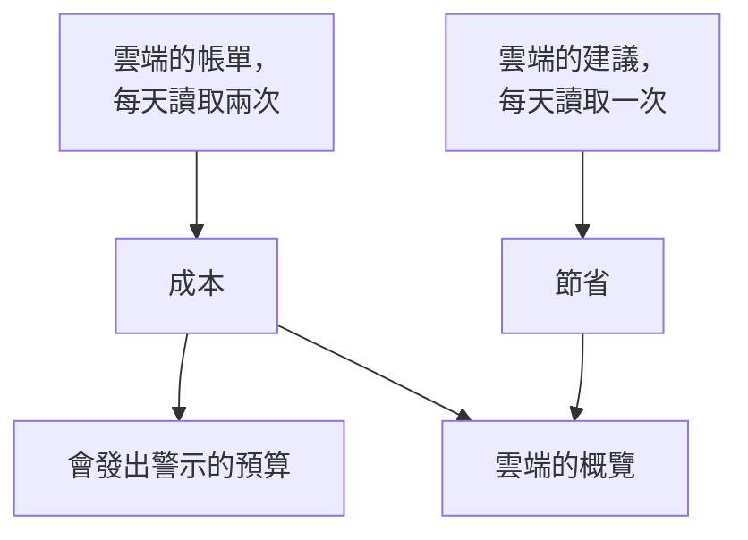

# 雲端成本與節省

已連線的雲端帳戶也會告訴你它的成本，以及如何降低成本。OneUptime 從雲端本身的帳單讀取每天的成本，從雲端本身的建議服務讀取建議，在 **雲端 → 支出 → 成本** 和 **雲端 → 支出 → 節省** 中顯示它們，並在某個月的成本超出預算之前透過 **雲端 → 支出 → 預算** 發出警示。

:::cards
- [Amazon Web Services](#amazon-web-services): Cost Explorer 和 Cost Optimization Hub，各開啟一次。
- [Microsoft Azure](#microsoft-azure): Cost Management 和 Azure Advisor，多一個角色。
- [Google Cloud](#google-cloud): 你匯出到 BigQuery 的帳單資料，以及 Recommender。
- [預算](#預算): 當某個月的支出超過預算的某個比例時發出的警示。
- [必要標記](#必要標記): 有多少支出帶有你要求的標記，以及缺少這些標記的新資源。
:::

## 運作方式



- **成本來自雲端本身的帳單。** AWS Cost Explorer、Azure Cost Management 以及 Google Cloud 匯出到 BigQuery 的帳單資料，在抵扣點數和退款之前，以帳戶的計費幣別計算。每個金額都是一天的金額，依 UTC 日期，與雲端的計費方式一致。
- **雲端會延遲回報最後一兩天。** 每次讀取都會重新讀取最近一週，並在每月的前幾天重新讀取整個上個月，因此某一天的成本會隨著雲端結束這一天而確定下來。連線的第一次讀取會回溯到上上個月的月初。
- **當月預測沿用最近一週的速度。** 它等於本月到目前為止的成本，再加上剩餘每一天依最近七個完整日的平均值計算的成本。
- **節省來自雲端本身的建議服務。** AWS Cost Optimization Hub、Azure Advisor 和 Google Cloud 的 Recommender：更小的規格、閒置的資源、值得做的承諾，每一項都附有每月可節省的金額。你在雲端主控台中執行或忽略的建議，會在下一次讀取時消失。

## 開始之前

- **一個已連線的帳戶。** 使用目前的設定指令 [連線雲端帳戶](/docs/telemetry/cloud-accounts)：它讓連線可以讀取成本和建議。之前建立的連線在你重新執行其指令之前，兩者都不會讀取。

## Amazon Web Services

連線用 `ce:GetCostAndUsage` 讀取成本，用 `ce:GetSavingsPlansCoverage`、`ce:GetSavingsPlansUtilization`、`ce:GetReservationCoverage` 和 `ce:GetReservationUtilization` 讀取承諾，用 `cost-optimization-hub:ListRecommendations` 讀取建議。Cost Explorer 和 Cost Optimization Hub 都需要先在帳戶中開啟：

:::steps
### 開啟 Cost Explorer

在 AWS Billing and Cost Management 主控台中開啟一次 Cost Explorer：AWS 會在一天內準備好帳戶的成本。連線組織的管理帳戶，即可讀取每個成員帳戶的成本。

### 加入 Cost Optimization Hub

在同一個主控台中開啟 Cost Optimization Hub 並加入：組織從其管理帳戶加入，或者只為這個帳戶加入。它的建議會在一天內送達。
:::

Cost Explorer 每個請求收費 $0.01：每次讀取成本會發出幾個請求，承諾每天用四個請求讀取。Cost Optimization Hub 免費。

### 依資源的成本

開啟資源層級資料後，Cost Explorer 還會提供最近 14 天每個資源的成本。在 AWS Billing and Cost Management 主控台中開啟 Cost Management 偏好設定，以每日粒度開啟資源層級資料；組織則從其管理帳戶開啟。AWS 會在 48 小時內準備好資料。

接著在 **雲端 → 連線** 下編輯連線，並在 **更多欄位** 中開啟 **依資源的成本**。連線每天用 `ce:GetCostAndUsageWithResources` 讀取一次：第一次讀取 14 天，之後再次讀取最近三天，每次發出幾個請求。讀到的內容在 Cost Explorer 不再保留後仍隨帳戶的成本保存。之前建立的連線需要重新執行設定指令，以新增此動作。

## Microsoft Azure

應用程式使用 **Cost Management Reader** 角色讀取成本，範圍與 **Monitoring Reader** 相同：設定指令會同時授予這兩個角色。Azure Advisor 的建議透過 **Monitoring Reader** 讀取，因此不需要開啟任何功能。要為之前建立的應用程式授予該角色，請執行：

```bash
az role assignment create --assignee <APP_ID> --role "Cost Management Reader" --scope /subscriptions/<SUBSCRIPTION_ID>
```

Cost Management 會依每個訂用帳戶回覆，並附上每項成本所屬的資源，讀取它不收費。當它無法為某個訂用帳戶回覆時，帳戶的 **成本** 會說明原因。

Cost Management 會限制讀取一個租用戶成本的速度，對所有讀取者都一樣：每個查詢讀取的每個月資料消耗一個查詢處理單位 (QPU)，一個租用戶每 10 秒有 12 QPU，每分鐘 60，每小時 600。OneUptime 在每項配額的三分之二以內逐一讀取租用戶的訂用帳戶，在 Cost Management 拒絕查詢時依其要求等待，並在下一次讀取時從停下的地方繼續。尚未讀取的訂用帳戶顯示 **排隊中** 以及讀取時間；已有金額的訂用帳戶在此期間保留其金額。

## Google Cloud

Google Cloud 沒有提供專案成本的 API：OneUptime 從你的帳單帳戶匯出到 BigQuery 的資料中讀取成本。

:::steps
### 將帳單匯出到 BigQuery

在 Google Cloud 主控台中開啟 Billing，再開啟 Billing export，開啟將詳細使用費用匯出到 BigQuery 資料集。Google 從你開啟的那天起寫入，會延遲幾個小時。

### 允許服務帳戶讀取它

在匯出的資料集上為連線的服務帳戶授予 **BigQuery Data Viewer**。設定指令已經為它授予 **BigQuery Job User**，以便在它自己的專案中執行查詢。

### 填寫匯出的資料表

在 **雲端 → 連線** 中編輯連線，並在 **更多欄位** 中將 **帳單匯出資料表** 設為資料表的完整名稱：`<PROJECT_ID>.<DATASET>.gcp_billing_export_resource_v1_<BILLING_ACCOUNT_ID>`。
:::

詳細匯出會寫明每項成本所屬的資源；標準匯出只寫明服務和區域。BigQuery 會對查詢收費：每月前 1 TiB 免費，之後每 TiB $6.25，一個月的匯出資料從幾 MB 到幾 GB 不等。Recommender 關於機器類型和閒置資源的建議透過設定指令授予的 **Compute Recommender Viewer** 讀取，不收費。

## 減少支出的方法

**雲端 → 支出 → 節省** 列出每一條建議，節省最多的排在最前：要做什麼、針對哪個資源、會改變什麼，以及每月能節省多少。上方的橫條會加總它們，包括總計和依類型的合計：更小的規格、閒置的資源、承諾。當 OneUptime 中有該資源時，建議會連結到其資源的頁面。

### 依 OneUptime 自身讀數進行的規格調整

如果建議服務未開啟、不涵蓋資源的類型或認為資源太新，以致沒有建議服務提出建議，OneUptime 會依連線在最近 14 天讀取的 CPU 和記憶體讀數來判斷資源的規格。它判斷 AWS 上的 EC2 執行個體、RDS 資料庫和 ElastiCache 叢集，Azure 上的虛擬機器、PostgreSQL 和 MySQL 彈性伺服器以及 App Service 方案，還有 Google Cloud 上的 Compute Engine 虛擬機器和 Cloud SQL 執行個體：

- **過度配置** 指規格減半、甚至只剩四分之一時仍有餘裕：在較小的規格上，CPU 的第 95 百分位數最多為 60%，最高 CPU 讀數最多為 100%，並且在讀取記憶體時，記憶體峰值最多為 70%。
- **配置不足** 指 CPU 的第 95 百分位數達到 85% 或以上，或記憶體峰值達到 90% 或以上：建議使用大一倍的規格。

資源有了 6 天的讀數後就會被判斷規格。資源的頁面會在其成本旁顯示 **規格調整**，過度配置的資源會以 OneUptime 為來源列在 **雲端 → 支出 → 節省** 中。一項變更能節省的金額，是它在資源最近 30 天成本中所占的部分，因此只要雲端依名稱為資源計費，就能知道：Azure 和 Google Cloud 的詳細匯出會這樣做，AWS 在開啟「依資源的成本」後也會。t3、B 系列和 e2-micro 等可突增規格從不判斷。

雲端只有在虛擬機器內裝有自己的代理程式時才能讀取其記憶體：EC2 執行個體需要 CloudWatch 代理程式，Compute Engine 虛擬機器需要 Ops Agent，而 Azure 虛擬機器沒有這樣的代理程式，回報的是剩餘記憶體而不是已用記憶體。執行著 [OneUptime 主機收集器](/docs/telemetry/hosts) 的虛擬機器，則改為依主機收集器讀取的記憶體判斷規格：

- **虛擬機器和主機是同一台機器**：當供應商、帳戶、區域和執行個體 ID 全都一致時才這樣認定，比較的是 EC2 執行個體 ID、Compute Engine 虛擬機器的數字 ID 或 Azure 虛擬機器的 `vmId`。僅憑主機名稱永遠不會相符，而被兩台主機同時認領的虛擬機器（例如複製的機器）不會與任何一台關聯。虛擬機器的頁面會顯示其主機，主機的頁面會顯示其虛擬機器，兩者互相連結。
- **記憶體是主機的已用記憶體，不含快取和緩衝區**，即主機頁面圖表中的數值，取同樣的 14 天。忙碌的檔案快取不會被讀成機器已滿。主機同樣需要 6 天的讀數。
- **兩者都讀取記憶體時**，例如同時裝有 Ops Agent 和主機收集器的 Compute Engine 虛擬機器，採用讀數較多的一方。CPU 一律採用雲端的讀數。

虛擬機器的 **規格調整** 會說明其記憶體來自哪裡，它在 **雲端 → 支出 → 節省** 中的那一列也會說明。只依 CPU 判斷規格的虛擬機器會註明這一點，並提供安裝主機收集器的連結。主機收集器透過 [主機指南的設定](/docs/telemetry/host-otel-collector) 中的 `resourcedetection/cloud` 步驟標記其所在雲端的身分。使用 OneUptime 預設設定的主機會在 OneUptime 的下一個版本中取得這個步驟，使用自有設定的主機需要自行加入。Kubernetes 節點交給 [Kubernetes 成本可觀測性](/docs/telemetry/kubernetes-cost)，它會為節點上執行的內容調整要求。

### 承諾

**雲端 → 支出 → 節省** 和帳戶的 **成本** 會顯示最近 30 天的支出中有多少由各帳戶的承諾支付，以及其中有多少被使用，每種類型一行：

- AWS：Savings Plans 和預留執行個體，來自 Cost Explorer。組織的管理帳戶會為組織中的每個帳戶讀取。
- Azure：節省方案和保留項目，來自 Cost Management，以攤銷成本計算。
- Google Cloud：承諾使用折扣，來自你的帳單匯出。匯出不會說明承諾中有多少未被使用，因此不顯示使用了多少。

沒有承諾的帳戶會顯示以隨需費率執行、而承諾能以更低價格支付的部分。每種類型的數字都是其雲端自己的，各類型從不相加：保留項目和 Savings Plan 可能都會把同一台機器的支出算作自己要涵蓋的部分。

## 預算

:::steps
### 建立預算

在 **雲端 → 支出 → 預算** 中建立預算：填寫它的 **每月金額** 以及適用的 **帳戶**，留空則適用於所有帳戶。

### 選擇何時發出警示

**警示門檻** 填寫要發出警示的預算比例，以百分比表示：一開始是 80 和 100。**預計超出時發出警示** 也會在依最近一週的速度本月將超出預算時，每月發出一次警示。**異常日發出警示** 也會在某天的成本遠高於平常時，於隔天發出警示：請參閱 [異常日](#異常日)。**警示嚴重性** 和 **待命策略** 決定警示的嚴重程度以及呼叫誰。
:::

每次讀取成本之後以及每小時都會檢查預算。當本月支出越過一個閾值時，會為它發出一則警示；如果一次讀取同時越過多個閾值，則為最高的閾值發出警示。新的月份開始時，上個月的警示會被解決。預算只計算以其幣別計費的帳戶。

AI 代理可以透過 [MCP 伺服器](/docs/ai/mcp-server) 建立和變更預算，指令碼則可以使用 CLI 的 `oneuptime cloud-budget` 命令：請參閱 [資源操作](/docs/cli/resource-operations)。

### 異常日

每次讀取之後，帳戶最近 14 個完整日子中的每一天，都會與其之前的 14 天比較。當某項服務的成本達到其平常一天的兩倍或以上，或整個帳戶達到其平常一天的一倍半或以上時，這一天就是異常日。兩種情況的增加額都必須至少比平常多 10（以帳戶的貨幣計），並且至少為帳戶平常一天的 5%，所以幾分錢絕不會被當作激增。某一天的平常值是其之前 14 天的中位數，因此一次激增幾乎不會改變它；帳戶也要在有了一週的成本之後才會被判斷。

**雲端 → 支出 → 成本** 在每日支出圖中把異常日標在其長條上方，並在下方列出它們。檢視所有帳戶時，每個標記都會開啟其帳戶的 **成本**。計入該帳戶的預算會在隔天為每個帳戶和每一天發出一則警示，並列出每項成本上升的服務。持續數天的激增會在其開始的那天告知，超過一週的日子則不再告知。在這類警示出現之前建立的預算，要等您編輯預算並將其開啟後才會發出這類警示。

## 錢花在哪裡

**雲端 → 支出 → 成本** 可依服務、區域、帳戶或資源拆分某個期間的支出，還有另外三種方式：

- 依應用程式平台環境：每個環境在其帳戶和區域中的平台服務（例如 Amazon ECS 或 Cloud Run），以及 Elastic Beanstalk 環境中依 AWS 賦予的標記找到的資源。
- 依應用程式：平台依名稱向應用程式計費的部分，例如 Cloud Run 服務或 Container App。Amazon ECS 依工作計費，App Service 依方案計費，因此其應用程式的成本仍歸其環境。
- 依標記：你所選標記的每個值。成本會保留讀取時的標記：Google Cloud 帳單匯出的標籤，否則為其計費資源的標記；在 AWS 上這需要「依資源的成本」。

清單下方，卡片會說明其餘部分的金額：不屬於任何環境的部分、依整個環境計費的部分，或不帶該標記的部分。在開始保留標記之前讀取的成本會再讀取一次，回溯到第一次讀取的範圍，以補上它們的標記。

## 必要標記

支出的歸屬只能像它帶有的標記一樣準確。在 **雲端 → 支出 → 標記** 中，指定每個資源都必須帶有的標記，例如 `team`、`env` 和 `cost-center`，即可查看有多少支出和資源帶有這些標記、哪些資源沒有，以及誰建立了缺少這些標記的每個新資源。

:::steps
### 要求一個標記

選擇 **設為必要標記**，然後輸入其 **標記鍵**。在 **允許的值** 中列出它可用的值，以逗號分隔，或留空以接受任意值。選擇一個 **帳戶**，即可只在該帳戶中要求此標記。**更多欄位** 下的 **描述** 會在相關電子郵件中說明此標記的用途。

### 查看涵蓋率

頁面開頭顯示最近 30 天的支出和你的資源中帶有全部必要標記的比例。下方是缺少標記的資源，成本最高的排在前面，接著是每個標記各自的比例、最近 12 週的趨勢和每個帳戶。

### 補上缺少的標記

每個缺少標記的資源都會顯示 OneUptime 建議的值，以及在你的雲端中設定該值的命令。在程式碼中宣告的資源會顯示宣告它的程式碼：請在那裡加上標記，否則下次部署會再次移除它。
:::

- **鍵不分大小寫。** `Team`、`team` 和 `TEAM` 是同一個鍵，只要任一種寫法帶有允許的值，資源就算帶有該標記。值同樣不分大小寫，空值不算值。
- **允許的值可以是模式。** `*` 代表任意字元，`?` 代表一個字元，因此 `prod-*` 符合 `prod-eu` 和 `prod-us`。模式不是規則運算式。
- **帳戶自身的標記。** 在某個帳戶中要求的標記，會在該帳戶中取代專案中同一鍵的標記，帳戶也可以要求自己的鍵。帳戶的 **標記** 會同時顯示兩者。
- **不會變更你雲端中的任何內容。** OneUptime 絕不會因為缺少標記而停止資源或為其加上標記。它會通知相關人員並建議值。

### 涵蓋率

- **已加標記的支出** 是最近 30 天的成本中帶有全部必要標記的比例，依讀取每筆成本時的標記計算。每次開啟頁面時都會重新計算，因此今天要求的標記也會依過去 30 天來衡量。AWS 的成本只有在開啟 [依資源的成本](#依資源的成本) 後才帶有標記：在此之前，AWS 帳戶的支出顯示為 **未測量**，而不是 0%。
- **已加標記的資源** 是你的連線列出的資源中，依目前標記帶有全部必要標記的比例。
- **涵蓋率趨勢** 顯示最近 12 週中的每一週：支出來自成本，資源來自 OneUptime 每天的計數。

### 新資源

連線在其帳戶首次完整列出之後列出的資源即為新資源。連線每 30 分鐘列出一次，因此新資源會在建立後的一小時內被發現。缺少必要標記的資源只通知一次：

- **通知誰。** 當帳戶的變更記錄透過電子郵件地址指出你專案的某位成員時，通知建立它的人，並依擁有者規則和團隊通知資源的擁有者。兩者都無法通知時，通知專案擁有者。每個人都必須能讀取你的雲端資源。
- **多久一次。** 每小時一封電子郵件，向每個人列出所有新內容。在 **更多設定** 中，**每個資源一封電子郵件** 會逐一寄送，**觸發警示** 還會為每個帳戶觸發一則警示，其嚴重性和待命策略在 **警示送往何處** 中設定。
- **加上標記後。** 在電子郵件寄出前已加上標記的資源不會出現在郵件中，**新資源** 清單會在資源帶上標記後將其標為 **已加標記**。

### 建議的值

只有當標記允許某個值時，OneUptime 才會建議該值：

- **類似團隊的鍵**，例如 `team`、`owner` 或 `squad`：擁有該資源的團隊。
- **類似環境的鍵**，例如 `env`、`environment` 或 `stage`：以該資源執行的應用程式所在的 App Platforms 環境，或者對於虛擬機器，其主機回報的部署環境。
- **任意鍵**：與它相鄰的大多數資源所帶的值，即同一 CloudFormation 堆疊、同一 Azure 資源群組中，或編號前名稱相同的資源，例如 `web-1` 和 `web-2`。至少要有兩個一致。
- **只允許一個值的標記**：就是該值。

該命令在你雲端自己的 shell 中一步設定標記：AWS 上是 `aws resourcegroupstaggingapi tag-resources`，Azure 上是 `az tag update --operation Merge`，Google Cloud 上針對 Compute Engine 虛擬機器和磁碟、Cloud Storage 值區和 Cloud SQL 執行個體使用 `gcloud ... add-labels` 或 `--update-labels`。

## 你在 OneUptime 中看到的內容

- **雲端的概覽。** **雲端 → 概覽** 在需要注意的內容旁邊，顯示本月支出與上月同一天之前支出的比較、成本最高的服務，以及效果最大的減少支出的方法。
- **每天的支出。** **雲端 → 支出 → 成本** 繪製最近 30 天中的每一天並標出成本遠高於平常的日子，列出這些日子，並依服務、區域、帳戶、資源、應用程式平台環境、應用程式或標記拆分某個期間。未讀取成本的帳戶會列在下方，並附上原因。
- **帳戶的成本。** 帳戶的 **成本** 只針對該帳戶顯示同樣的內容，並附上它的承諾和減少支出的方法。
- **必要標記。** **雲端 → 支出 → 標記** 顯示支出和資源中帶有必要標記的比例，帳戶的 **標記** 則只針對該帳戶顯示同樣的內容。
- **資源的成本。** 當雲端依名稱為資源計費時，資源的頁面會顯示它本月和最近 30 天的成本，並附上它減少支出的方法和規格調整。

## 疑難排解

:::details 帳戶顯示 需要權限
連線還不能讀取帳戶的成本。從 **雲端 → 連線** 重新執行它的設定指令：指令會新增讀取成本所需的權限。在 Google Cloud 上，還要在匯出的資料集上為服務帳戶授予 **BigQuery Data Viewer**。
:::

:::details 帳戶顯示 未設定
它的雲端還沒有可提供的成本。在 AWS 上開啟 Cost Explorer；在 Google Cloud 上，在 **帳單匯出資料表** 中填寫匯出的資料表。第一批金額會隨下一次讀取送達，在 12 小時之內。
:::

:::details 帳戶顯示 排隊中
它的成本正在排隊等候：Azure Cost Management 限制讀取一個租用戶成本的速度。帳戶會顯示讀取時間，即從那時起連線的第一次讀取，無需任何操作。已有金額的帳戶在此期間保留其金額。
:::

:::details 依資源的成本顯示 未設定
該帳戶未開啟資源層級資料。請在 AWS Billing and Cost Management 主控台的 Cost Management 偏好設定中以每日粒度開啟；組織成員需從組織的管理帳戶開啟。AWS 會在 48 小時內準備好資料，隔天的讀取會取得它。
:::

:::details 承諾顯示 需要權限
連線還不能讀取該帳戶的 Savings Plans 和保留項目。請從 **雲端 → 連線** 重新執行其設定指令：它會新增讀取它們所用的四個動作。
:::

:::details 金額漏掉了某個帳戶
金額以大多數帳戶的計費幣別顯示。以其他幣別計費的帳戶會連同其幣別列在下方，預算只計算以預算本身幣別計費的帳戶。
:::

:::details 本月金額低於雲端主控台中的金額
雲端會延遲回報最後一兩天，而且金額是抵扣點數和退款之前的金額。之後的讀取會追上來。
:::

## 後續步驟

:::cards
- [連線雲端帳戶](/docs/telemetry/cloud-accounts): 連線另一個帳戶，或重新執行它的指令。
- [雲端資源](/docs/telemetry/cloud-resources): 每個資源的指標，來自你自己的收集器。
- [Kubernetes 成本可觀測性](/docs/telemetry/kubernetes-cost): 每個 Kubernetes 工作負載的成本。
:::
