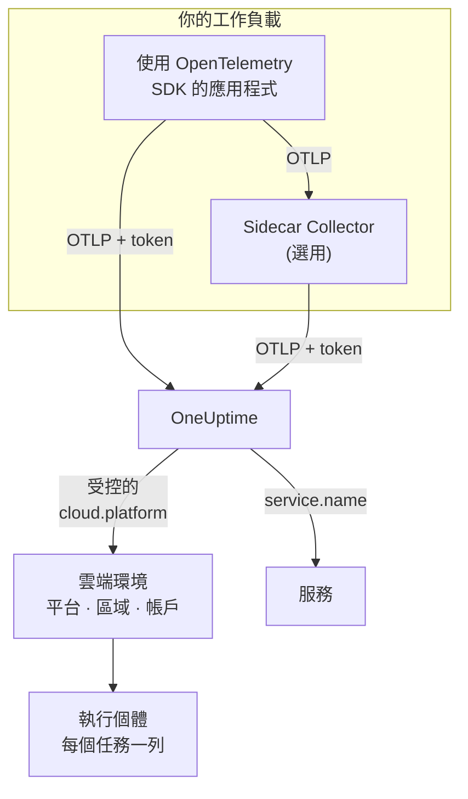

# 雲端環境

**Cloud Environment** 是你的容器在受控雲端平台上執行的地方：ECS 叢集所在的帳戶與區域、Cloud Run 的專案與區域、Container Apps 的訂用帳戶與區域。當你的遙測資料第一次帶著正確的資源屬性送達時，OneUptime 就會建立一個環境，並彙整在其中執行的每個工作負載。不需要手動註冊任何東西。

:::cards
- [AWS ECS / Fargate](/docs/telemetry/cloud-aws-ecs): Fargate 或 EC2 上的任務，以及每個任務的 CPU 與記憶體。
- [Google Cloud Run](/docs/telemetry/cloud-gcp-cloud-run): 服務與作業，也會以無伺服器函式的形式列出。
- [Azure Container Apps](/docs/telemetry/cloud-azure-container-apps): 複本，其區域與訂用帳戶需要手動設定。
- [其他雲端平台](/docs/telemetry/cloud-other-platforms): Elastic Beanstalk、App Runner、App Engine、App Service 與 Container Instances。
:::

## 運作方式



- **資源偵測器會說明工作負載在哪裡執行。** SDK 或 Collector 中的 OpenTelemetry 資源偵測器會讀取平台的中繼資料，並在工作負載傳送的所有資料上設定 `cloud.platform`、`cloud.account.id` 與 `cloud.region`。沒有偵測器的地方，就由你自己設定。
- **環境負責彙整。** 平台、帳戶與區域都相同的工作負載會進入同一個環境。各個服務仍在 **服務** 中保有各自的列。
- **每個執行中的任務都是一個執行個體。** 環境的 **執行個體** 分頁會列出執行中的任務、執行個體或複本，並在平台能提供時顯示即時的 CPU 與記憶體。

## 開始之前

- **擷取金鑰。** 在 **專案設定 → 遙測與 APM → 擷取金鑰** 中建立一個 **伺服器** 金鑰並複製其權杖，請參閱[建立擷取金鑰](/docs/telemetry/open-telemetry#建立擷取金鑰)。權杖屬於機密：每個平台頁面都會說明應把它存放在該雲端的機密存放區中的什麼位置。
- **應用程式中的 OpenTelemetry。** 匯出 OTLP 的 OpenTelemetry SDK，或在應用程式旁執行的 OpenTelemetry Collector。

## 支援的平台

| 平台 | `cloud.platform` | `cloud.*` 由誰填入 | 執行個體識別 | 指南 |
| ------------------------- | --------------------------- | ---------------------- | --------------------------------- | ------------------------------------------------------------------ |
| AWS ECS / Fargate | `aws_ecs` | 資源偵測器 | `aws.ecs.task.arn` | [AWS ECS / Fargate](/docs/telemetry/cloud-aws-ecs) |
| AWS Elastic Beanstalk | `aws_elastic_beanstalk` | 資源偵測器 | `host.id` | [其他雲端平台](/docs/telemetry/cloud-other-platforms) |
| AWS App Runner | `aws_app_runner` | 手動設定 | `host.name` | [其他雲端平台](/docs/telemetry/cloud-other-platforms) |
| Google Cloud Run | `gcp_cloud_run` | 資源偵測器 | `faas.instance` | [Google Cloud Run](/docs/telemetry/cloud-gcp-cloud-run) |
| Google App Engine | `gcp_app_engine` | 資源偵測器 | `faas.instance` | [其他雲端平台](/docs/telemetry/cloud-other-platforms) |
| Azure Container Apps | `azure_container_apps` | 資源偵測器 | `azure.container_app.instance.id` | [Azure Container Apps](/docs/telemetry/cloud-azure-container-apps) |
| Azure Container Instances | `azure_container_instances` | 手動設定 | `host.name` | [其他雲端平台](/docs/telemetry/cloud-other-platforms) |
| Azure App Service | `azure_app_service` | 資源偵測器 | `host.id` | [其他雲端平台](/docs/telemetry/cloud-other-platforms) |

- **資源偵測器：** SDK 或 Collector 的 `resourcedetection` 處理器中的 OpenTelemetry 資源偵測器會替你設定 `cloud.*` 屬性。
- **手動設定：** 沒有偵測器，所以你要把屬性寫進 `OTEL_RESOURCE_ATTRIBUTES`。平台頁面會列出確切的那一行。
- **Azure 偵測器知道的比較少。** Container Apps 偵測器既不知道區域也不知道訂用帳戶，App Service 偵測器則不知道訂用帳戶：缺少的部分需要你自己設定。
- **帶點號的 Azure 寫法也能用。** Node.js 與 .NET 的 Azure 偵測器寫入的是 `azure.container_apps` 與 `azure.app_service`。OneUptime 收到後會把它們改寫為上面帶底線的值。

## OneUptime 如何識別環境

三個資源屬性的每一種組合各對應一個環境：

| 屬性 | 必填 | 說明 |
| ------------------ | -------- | ------------------------------------------------------------------------------------------- |
| `cloud.platform` | 是 | [支援的平台](#支援的平台) 中的其中一個值 |
| `cloud.account.id` | 否 | AWS 帳戶 ID、Google Cloud 專案 ID 或 Azure 訂用帳戶 ID |
| `cloud.region` | 否 | 區域，例如 `us-east-1`、`us-central1` 或 `eastus` |

OneUptime 用 `|` 把這三個值串成 **環境金鑰**，並用同樣的值為環境命名，例如 _AWS ECS · us-east-1 · 123456789012_ ：

```text title="Environment keys"
aws_ecs|123456789012|us-east-1
gcp_cloud_run|my-project|us-central1
azure_container_apps|00000000-0000-0000-0000-000000000000|eastus
```

> [!IMPORTANT]
> 缺少的部分會以空白區段的形式留在金鑰中：`aws_ecs||us-east-1`。因此，省略 `cloud.account.id` 的工作負載會進入與有設定它的工作負載不同的環境。原本預期只有一個環境卻看到兩個，通常就是這個原因。

### 執行個體識別

在一個環境中，每個執行中的任務、執行個體或複本會在 **執行個體** 下各占一列。它的名稱取自遙測資料中依下列順序找到的第一個資源屬性：

1. `aws.ecs.task.id`
2. `aws.ecs.task.arn`（縮短為任務 ID）
3. `faas.instance`
4. `azure.container_app.instance.id`
5. `service.instance.id`
6. `container.id`
7. `host.id`
8. `host.name`

平台自己的識別會刻意排在最前面。sidecar Collector 與應用程式的 SDK 都看得到它，而且它在重新啟動後保持不變。SDK 通常會為每個程序產生新的 `service.instance.id`（Node.js SDK 預設就是如此），因此如果先用它當作金鑰，一個 ECS 任務就會被拆成兩列。只有在平台沒有設定自己的識別時，才會使用 `service.instance.id`。[支援的平台](#支援的平台) 中的 **執行個體識別** 欄列出每個平台上典型設定所使用的屬性。

### 手動建立的環境

很少需要這麼做：擷取流程會為你建立環境。若要在遙測資料送達之前建立環境，請開啟 **雲端 → All Environments** 並按一下 **建立雲端資源**。選擇 **雲端平台**，然後依照遙測資料回報的值準確填入 **雲端帳戶 ID** 與 **雲端區域**。OneUptime 用這三個值建立金鑰 `platform|account|region`，而擷取流程只依金鑰比對環境。環境的名稱與擷取流程會給的名稱相同；若要顯示其他名稱，請開啟 **更多欄位** 並填入 **顯示名稱**。

## 哪些不是雲端環境

| 執行於 | 出現的位置 | 原因 |
| ------------------------------------------------------------------------------------------------- | ------------------------ | ---------------------------------------------------------------------------------------------------- |
| EC2, Compute Engine, Azure VM (`aws_ec2`, `gcp_compute_engine`, `azure_vm`) | **主機** | 虛擬機器就是主機。請參閱 [主機 OpenTelemetry Collector](/docs/telemetry/host-otel-collector) |
| EKS、GKE、AKS、自行管理的 Kubernetes | **Kubernetes** | 依 `k8s.*` 屬性路由。請參閱 [Kubernetes 代理程式](/docs/telemetry/kubernetes-agent) |
| Lambda, Cloud Functions, Azure Functions (`aws_lambda`, `gcp_cloud_functions`, `azure_functions`) | **無伺服器函式** | 依 `faas.name` 路由，若 `cloud.platform` 為 FaaS 平台，則依 `service.name` 路由。請參閱 [無伺服器函式](/docs/telemetry/serverless-functions) |
| 負載平衡器、儲存貯體、受控資料庫，以及其他 IaaS 或 PaaS 資源 | **Cloud Resources** | 根據 Azure Monitor、CloudWatch 與 Cloud Monitoring 發布的指標探索而來。請參閱 [雲端資源](/docs/telemetry/cloud-resources) |

> [!NOTE]
> Cloud Run 與 App Engine 會刻意出現在兩個地方。它們的偵測器同時設定了受控的 `cloud.platform` 與 `faas.name`，因此每個服務本身也是一個 **無伺服器函式**，而 **Cloud Environment** 則彙整該專案與區域中的所有服務。同一份遙測資料會同時歸檔到兩處。

## 連接工作負載

每個平台頁面都會用該雲端自己的指令與主控台畫面說明這些步驟。概要如下：

:::steps
### 為遙測資料加上雲端屬性

:::tabs
@tab Sidecar collector
任務、執行個體或複本中的第二個容器。應用程式匯出到 `localhost:4318`，Collector 的 `resourcedetection` 處理器會在經過的所有資料上加上 `cloud.*`。權杖由 Collector 保管，在 ECS 上它還會傳送每個任務的 CPU 與記憶體：

```yaml title="collector.yaml"
processors:
  resourcedetection:
    detectors: [env, ecs] # [env, gcp] on Cloud Run and App Engine; [env, azurecontainerapps] on Container Apps
    timeout: 5s
```
@tab SDK direct
應用程式的 SDK 直接匯出到 OneUptime。在 SDK 中開啟平台的資源偵測器，例如 Node.js 中的 `OTEL_NODE_RESOURCE_DETECTORS=env,host,os,aws`：每個平台頁面都列出了各語言對應的開關。沒有額外的容器，也就沒有容器的 CPU 與記憶體。
:::

### 將 OTLP 匯出到 OneUptime

:::tabs
@tab Sidecar collector
```yaml title="collector.yaml"
exporters:
  otlphttp/oneuptime:
    endpoint: https://oneuptime.com/otlp
    headers:
      x-oneuptime-token: ${env:ONEUPTIME_TOKEN}

service:
  pipelines:
    traces:
      receivers: [otlp]
      processors: [resourcedetection, batch]
      exporters: [otlphttp/oneuptime]
    metrics:
      receivers: [otlp]
      processors: [resourcedetection, batch]
      exporters: [otlphttp/oneuptime]
    logs:
      receivers: [otlp]
      processors: [resourcedetection, batch]
      exporters: [otlphttp/oneuptime]
```

Collector 會從環境變數展開 `${env:ONEUPTIME_TOKEN}`，這個變數由平台從其機密存放區填入：Secrets Manager、Secret Manager 或 Container Apps 機密。
@tab SDK direct
```bash
OTEL_EXPORTER_OTLP_ENDPOINT="https://oneuptime.com/otlp"
OTEL_EXPORTER_OTLP_HEADERS="x-oneuptime-token=YOUR_TELEMETRY_INGESTION_TOKEN"
```
:::

如果你自行託管 OneUptime，請使用 `https://YOUR-ONEUPTIME-HOST/otlp`。

### 檢查連線

```bash
curl -i https://oneuptime.com/otlp/v1/validate \
  -H "x-oneuptime-token: YOUR_TELEMETRY_INGESTION_TOKEN"
```

回傳 `200` 且 `"valid": true` 表示權杖已被接受。`401` 表示權杖未知、已撤銷、已停用或已過期，回應中的 `message` 會說明是哪一種。在第一個 span、日誌或指標送達後的 1 分鐘內，環境就會出現在 **雲端 → All Environments** 中。
:::

> [!TIP]
> 同樣的步驟也在儀表板中，並已填好你的權杖：在第一個環境送達之前位於 **雲端 → All Environments**，之後位於每個環境的 **文件** 分頁。

## 你會看到什麼

環境的 **概覽** 會顯示：

- 根據追蹤計算的 **請求**、**錯誤率** 與 **p95 latency**，以及你所選時間範圍內的請求、錯誤與記憶體圖表。
- 所有線上執行個體的 **CPU** 與 **記憶體**，以及 **依 CPU 排序的前幾名執行個體** 清單。這些資料來自帶有執行個體識別的 `container.cpu.utilization` 與 `container.memory.usage` 指標；在 ECS 上則來自 `awsecscontainermetrics` 接收器的 `ecs.task.cpu.utilized` 與 `ecs.task.memory.utilized`。
- **執行個體**：最近 15 分鐘內回報過的執行個體數量。**執行個體** 分頁中每個執行個體一列。
- 依環境篩選的 **日誌**、**追蹤** 與 **指標** 分頁。

遙測資料中斷 15 分鐘的環境會顯示 **已中斷**，下一個 span、日誌或指標送達後會恢復為 **已連線**。OneUptime 本身停機或追趕積壓資料的時間不計入這 15 分鐘。

### 標籤與擁有者

- **來自遙測資料：** 像 `oneuptime.label.team=payments` 這樣的資源屬性會為環境加上標籤 `team:payments`。
- **來自規則：** **雲端 → 設定 → 標籤規則** 與 **擁有者規則** 會為符合條件的環境加上標籤與擁有者。請參閱 [標籤與擁有者規則](/docs/configuration/label-and-owner-rules)。

## 疑難排解

[雲端疑難排解](/docs/telemetry/cloud-troubleshooting) 會依發生順序逐一說明各種故障：環境始終沒有出現、落在 **主機** 下或只出現在 **無伺服器函式** 下、沒有執行個體或沒有 CPU 與記憶體、顯示 **已中斷**、被拆成兩個，或是手動建立後始終無法比對。

## 後續步驟

:::cards
- [AWS ECS / Fargate](/docs/telemetry/cloud-aws-ecs): 最常見的設定，附上完整的任務定義。
- [雲端疑難排解](/docs/telemetry/cloud-troubleshooting): 環境缺少或不正確時該檢查什麼。
- [雲端資源(IaaS 與 PaaS)](/docs/telemetry/cloud-resources): 來自雲端本身監控的負載平衡器、儲存貯體與受控資料庫。
- [無伺服器函式](/docs/telemetry/serverless-functions): Lambda、Cloud Functions 與 Azure Functions。
:::
