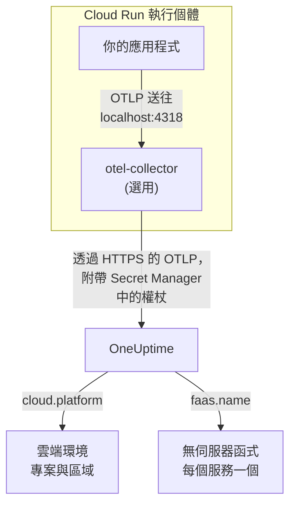

# Google Cloud Run

將 Cloud Run 服務與作業的追蹤、日誌與指標傳送到 OneUptime。所有回報 `cloud.platform=gcp_cloud_run` 的資料都會進入依 Google Cloud 專案與區域劃分的一個 **Cloud Environment**（例如 _GCP Cloud Run · us-central1 · my-project_），每個服務也會出現在 **無伺服器函式** 下。

:::cards
- [運作方式](#運作方式): GCP 偵測器設定了什麼，以及為什麼一個服務會出現在兩個地方。
- [設定](#設定): 儲存權杖、設定服務、部署並檢查。
- [帶有 sidecar 的服務 YAML](#帶有-sidecar-的服務-yaml): 一個帶有 Collector 的完整 Cloud Run 服務。
- [疑難排解](#疑難排解): 機密錯誤、sidecar 啟動順序，以及缺少的環境。
:::

## 運作方式



OpenTelemetry GCP 資源偵測器會讀取中繼資料伺服器，以及環境變數 `K_SERVICE` 與 `K_REVISION`，並設定：

| 屬性 | 在 Cloud Run 上的值 | 用途 |
| ------------------ | ------------------------------ | ----------------------------------------------------------------------------------------- |
| `cloud.platform` | `gcp_cloud_run` | 把遙測資料歸檔到 **雲端環境** 下 |
| `cloud.account.id` | 專案 ID | 環境金鑰的一部分 |
| `cloud.region` | `us-central1` | 環境金鑰的一部分 |
| `faas.name` | 服務名稱（`K_SERVICE`） | 也會在 **無伺服器函式** 下列出該服務 |
| `faas.version` | 修訂版本（`K_REVISION`） | 顯示在該服務的無伺服器函式概覽中；環境不會使用它 |
| `faas.instance` | 執行個體 ID | 為一個執行中的執行個體命名：在 **執行個體** 下每個執行個體一列 |

> [!NOTE]
> Cloud Run 會刻意出現在兩個地方。因為偵測器設定了 `faas.name`，每個服務也是一個 **無伺服器函式**，有自己的叫用次數、錯誤率與持續時間。**Cloud Environment** 則彙整了該專案與區域中的所有服務。資料不會儲存兩次：同一份遙測資料會同時歸檔到兩處。

環境金鑰是 `gcp_cloud_run|my-project|us-central1`。

## 開始之前

- **擷取金鑰。** 在 **專案設定 → 遙測與 APM → 擷取金鑰** 中建立一個 **伺服器** 金鑰並複製其權杖。
- **`gcloud`**：已登入該專案，並已啟用 Secret Manager API：`gcloud services enable secretmanager.googleapis.com`。
- **以 OpenTelemetry SDK 檢測的應用程式**，能夠匯出 OTLP。

## 選擇遙測資料離開服務的方式

| | SDK direct | Sidecar collector |
| --------------- | ---------------------------------------------------- | ---------------------------------------------------------------------- |
| 額外的容器 | 無 | 服務中的 `otel-collector` |
| 最適合 | 單一服務，以及 Cloud Run 作業 | 一個專案中的多個服務，或無法執行偵測器的 SDK |
| 保管權杖的一方 | 應用程式 | Collector |
| 機密 | `oneuptime-otlp-headers`，完整的標頭 | `oneuptime-ingestion-token`，只有權杖 |

作業會一直執行到完成，沒有必要讓 sidecar 持續運作：請使用 SDK direct。下面每個步驟都為兩者各提供一個分頁；選擇其中一個，所有步驟都會跟著切換。

## 設定

:::steps
### 將權杖儲存到 Secret Manager

> [!IMPORTANT]
> 權杖屬於機密。請把它放進 Secret Manager，並在服務中以機密型環境變數參照它。一般環境變數對專案的每位檢視者都看得到，在主控台與 `gcloud run services describe` 中都會顯示。

:::tabs
@tab SDK direct
```bash
printf '%s' "x-oneuptime-token=YOUR_TELEMETRY_INGESTION_TOKEN" | gcloud secrets create oneuptime-otlp-headers \
  --data-file=- \
  --replication-policy=automatic

gcloud secrets add-iam-policy-binding oneuptime-otlp-headers \
  --member="serviceAccount:checkout-api@my-project.iam.gserviceaccount.com" \
  --role="roles/secretmanager.secretAccessor"
```

Cloud Run 會把機密的值原封不動放入變數，而 `OTEL_EXPORTER_OTLP_HEADERS` 需要完整的 `name=value` 組合，因此這個機密存放完整的標頭。
@tab Sidecar collector
```bash
printf '%s' "YOUR_TELEMETRY_INGESTION_TOKEN" | gcloud secrets create oneuptime-ingestion-token \
  --data-file=- \
  --replication-policy=automatic

gcloud secrets add-iam-policy-binding oneuptime-ingestion-token \
  --member="serviceAccount:checkout-api@my-project.iam.gserviceaccount.com" \
  --role="roles/secretmanager.secretAccessor"
```

Collector 的設定會加上標頭名稱，因此這個機密只存放權杖。
:::

在 `--member` 中填入服務的執行階段服務帳戶，而不是你自己的使用者。如果沒有 `roles/secretmanager.secretAccessor`，修訂版本會部署失敗並出現 `Permission denied on secret`。如果服務仍以預設的 Compute 服務帳戶執行，請將這個角色授予該帳戶，並考慮為服務指派專屬帳戶：預設帳戶由專案中的所有內容共用。

### 設定服務

:::tabs
@tab SDK direct
1. **Google Cloud console → Cloud Run → click the service → Edit & deploy new revision**。
2. 在 **Containers** 分頁中開啟你的容器，前往 **Variables & Secrets**。加入下面的變數。
3. 按一下 **Reference a secret**，選擇 `oneuptime-otlp-headers`、版本 `latest`，並將其公開為環境變數 `OTEL_EXPORTER_OTLP_HEADERS`。
4. 在 **Security** 分頁中，確認 **Service account** 就是你授予了 `roles/secretmanager.secretAccessor` 的那個帳戶。

```bash
OTEL_SERVICE_NAME=checkout-api
OTEL_EXPORTER_OTLP_ENDPOINT=https://oneuptime.com/otlp
OTEL_EXPORTER_OTLP_PROTOCOL=http/protobuf
# Secret-backed (Variables & Secrets → Reference a secret), not typed here.
OTEL_EXPORTER_OTLP_HEADERS=x-oneuptime-token=YOUR_TELEMETRY_INGESTION_TOKEN
```

接著開啟你所用語言的 GCP 資源偵測器：

| 語言 | 開啟 GCP 偵測器 |
| -------- | ------------------------------------------------------------------------------------------------------------------- |
| Node.js | `OTEL_NODE_RESOURCE_DETECTORS=env,host,os,gcp` (auto-instrumentations-node) |
| Python | `pip install opentelemetry-resourcedetector-gcp`，然後設定 `OTEL_EXPERIMENTAL_RESOURCE_DETECTORS=gcp_resource_detector` |
| Java | `-Dotel.resource.providers.gcp.enabled=true` |
| Go | `import "go.opentelemetry.io/contrib/detectors/gcp"`，並將 `gcp.NewDetector()` 傳給 `resource.New` |
| .NET | `OpenTelemetry.Resources.Gcp` 套件：`.ConfigureResource(r => r.AddGcpDetector())` |

或者全部透過 CLI 設定：

```bash
gcloud run services update checkout-api --region us-central1 \
  --set-env-vars "^@^OTEL_SERVICE_NAME=checkout-api@OTEL_EXPORTER_OTLP_ENDPOINT=https://oneuptime.com/otlp@OTEL_EXPORTER_OTLP_PROTOCOL=http/protobuf@OTEL_NODE_RESOURCE_DETECTORS=env,host,os,gcp" \
  --set-secrets "OTEL_EXPORTER_OTLP_HEADERS=oneuptime-otlp-headers:latest"
```

前綴 `^@^` 會讓 `gcloud` 用 `@` 而不是 `,` 拆分該旗標的清單。少了它，`gcloud` 會在每個逗號處拆分 `OTEL_NODE_RESOURCE_DETECTORS=env,host,os,gcp`，並以 `Bad syntax for dict arg [host]` 失敗。
@tab Sidecar collector
1. **Google Cloud console → Cloud Run → click the service → Edit & deploy new revision**。
2. 在 **Containers** 分頁中開啟你的容器，前往 **Variables & Secrets**。加入下面的應用程式變數。
3. 按一下 **+ Add container**。將容器映像檔 URL 設為 `otel/opentelemetry-collector-contrib:latest`，並在 **Container command and arguments** 下加入引數 `--config=env:OTEL_COLLECTOR_CONFIG`。
4. 在新容器的 **Variables & Secrets** 分頁中使用 **Reference a secret**，把 `oneuptime-ingestion-token` 公開為環境變數 `ONEUPTIME_TOKEN`。再加入變數 `OTEL_COLLECTOR_CONFIG`，其值為 [帶有 sidecar 的服務 YAML](#帶有-sidecar-的服務-yaml) 中的 Collector 設定。
5. 在 Collector 的 **Settings** 分頁中加入 **Startup probe**（HTTP，路徑 `/`，連接埠 `13133`），並在 **Container start-up order** 下讓你的容器相依於 `otel-collector`。
6. 在 **Security** 分頁中，確認 **Service account** 就是你授予了 `roles/secretmanager.secretAccessor` 的那個帳戶。

同一個 Cloud Run 執行個體中的容器共用 `localhost`，因此應用程式就在那裡匯出到 sidecar：

```bash
OTEL_SERVICE_NAME=checkout-api
OTEL_EXPORTER_OTLP_ENDPOINT=http://localhost:4318
OTEL_EXPORTER_OTLP_PROTOCOL=http/protobuf
```

透過 CLI 時，sidecar 就是下面的服務 YAML，以 `gcloud run services replace service.yaml --region us-central1` 部署。
:::

如果你自行託管 OneUptime，請使用 `https://YOUR-ONEUPTIME-HOST/otlp` 作為端點。

### 部署新的修訂版本

在主控台中按一下 **Deploy**。Cloud Run 會以這些設定啟動新的修訂版本，並在它就緒後將流量導過去。`gcloud` 指令本身就會部署新的修訂版本。

### 檢查連線

```bash
curl -i https://oneuptime.com/otlp/v1/validate \
  -H "x-oneuptime-token: YOUR_TELEMETRY_INGESTION_TOKEN"
```

回傳 `200` 且 `"valid": true` 表示權杖已被接受。`401` 表示權杖未知、已撤銷、已停用或已過期。接著對服務送出一個請求，並在 Cloud Logging 中查看 Collector 的日誌（依 `otel-collector` 容器篩選），確認是否有 `401`、`connection refused` 或 `context deadline exceeded`。1 分鐘內，環境就會以 _GCP Cloud Run · us-central1 · my-project_ 的名稱出現在 **雲端 → All Environments** 中，服務則會出現在 **無伺服器函式** 下。
:::

## 帶有 sidecar 的服務 YAML

Collector 會從 `OTEL_COLLECTOR_CONFIG`（`--config=env:OTEL_COLLECTOR_CONFIG`）讀取全部設定，並透過 `${env:ONEUPTIME_TOKEN}` 從機密讀取權杖。`run.googleapis.com/container-dependencies` 註解會讓 Cloud Run 先啟動 Collector，等它的啟動探查通過後再啟動應用程式：

```yaml title="service.yaml"
apiVersion: serving.knative.dev/v1
kind: Service
metadata:
  name: checkout-api
spec:
  template:
    metadata:
      annotations:
        # "app" depends on "otel-collector": the collector starts first and
        # must pass its startup probe before the app container is started.
        run.googleapis.com/container-dependencies: '{"app":["otel-collector"]}'
    spec:
      serviceAccountName: checkout-api@my-project.iam.gserviceaccount.com
      containers:
        - name: app
          image: us-central1-docker.pkg.dev/my-project/apps/checkout-api:1.4.2
          ports:
            - containerPort: 8080
          env:
            - name: OTEL_SERVICE_NAME
              value: checkout-api
            - name: OTEL_EXPORTER_OTLP_ENDPOINT
              value: http://localhost:4318
            - name: OTEL_EXPORTER_OTLP_PROTOCOL
              value: http/protobuf
        - name: otel-collector
          image: otel/opentelemetry-collector-contrib:latest
          args:
            - --config=env:OTEL_COLLECTOR_CONFIG
          env:
            - name: ONEUPTIME_TOKEN
              valueFrom:
                secretKeyRef:
                  name: oneuptime-ingestion-token
                  key: latest
            - name: OTEL_COLLECTOR_CONFIG
              value: |
                receivers:
                  otlp:
                    protocols:
                      http:
                        endpoint: 0.0.0.0:4318
                      grpc:
                        endpoint: 0.0.0.0:4317
                processors:
                  # Stamps cloud.provider, cloud.platform=gcp_cloud_run,
                  # cloud.account.id, cloud.region and faas.* on everything.
                  resourcedetection:
                    detectors: [env, gcp]
                    timeout: 5s
                  batch: {}
                exporters:
                  otlphttp/oneuptime:
                    endpoint: https://oneuptime.com/otlp
                    headers:
                      x-oneuptime-token: ${env:ONEUPTIME_TOKEN}
                extensions:
                  health_check:
                    endpoint: 0.0.0.0:13133
                service:
                  extensions: [health_check]
                  pipelines:
                    traces:
                      receivers: [otlp]
                      processors: [resourcedetection, batch]
                      exporters: [otlphttp/oneuptime]
                    metrics:
                      receivers: [otlp]
                      processors: [resourcedetection, batch]
                      exporters: [otlphttp/oneuptime]
                    logs:
                      receivers: [otlp]
                      processors: [resourcedetection, batch]
                      exporters: [otlphttp/oneuptime]
          startupProbe:
            httpGet:
              path: /
              port: 13133
            periodSeconds: 2
            failureThreshold: 15
          resources:
            limits:
              cpu: 500m
              memory: 256Mi
```

部署它：

```bash
gcloud run services replace service.yaml --region us-central1
```

只有接收請求的容器（`app`）才宣告 `ports`；sidecar 不可以宣告。

## 網路

- **預設情況下**，Cloud Run 服務可以直接連上網際網路，匯出到 `oneuptime.com` 不需要其他設定。
- **使用 VPC egress: All traffic 時**（`--vpc-egress all-traffic`，透過 Direct VPC egress 或 Serverless VPC Access 連接器），輸出流量會經過你的 VPC，這時 VPC 需要 Cloud NAT（或通往 Proxy 的路由）才能連到 OneUptime 主機。使用預設的 `private-ranges-only` 時，只有私人位址會經過 VPC，OneUptime 可以直接連到。
- VPC 中的 **輸出防火牆規則** 必須允許透過 TCP 443 連到 OneUptime 主機。
- **VPC 內自行託管的 OneUptime** 是相反的情況：讓流量經過 VPC（`private-ranges-only` 或 `all-traffic`），以便在那裡解析 `https://YOUR-ONEUPTIME-HOST/otlp`。

## 你會看到什麼

- **概覽**：根據追蹤計算的請求、錯誤率與 p95 延遲。
- **執行個體**：每個 Cloud Run 執行個體一列，以 `faas.instance` 命名。Cloud Run 不會向 sidecar 公開容器的資源使用量，因此除非你自己傳送帶有相同 `faas.instance` 的 `container.cpu.utilization` 與 `container.memory.usage` 指標，否則 **CPU** 與 **記憶體** 圖格會保持空白。請在這裡查看請求圖格，執行個體的 CPU 與記憶體則交給 Cloud Monitoring。
- 依環境篩選的 **日誌**、**追蹤** 與 **指標**。
- 同一個服務也會出現在 **無伺服器函式**（依 `faas.name`）與 **服務**（依 `service.name`）下。

## 疑難排解

:::details 修訂版本失敗，出現 "Permission denied on secret"
執行階段服務帳戶對該機密缺少 `roles/secretmanager.secretAccessor`，或繫結加在與服務參照的機密不同的另一個機密上。請以執行階段服務帳戶作為 `--member`，重新執行 `gcloud secrets add-iam-policy-binding` 指令。
:::

:::details Cloud Run 拒絕 container-dependencies
註解中指定的容器不存在，或者 Collector 沒有啟動探查，因此 Cloud Run 無法判斷它何時就緒。
:::

:::details 服務出現在無伺服器函式下，但沒有環境
遙測資料中沒有 `cloud.platform`：SDK 中沒有開啟 GCP 偵測器，或 Collector 的 `detectors` 清單中缺少 `gcp`。
:::

:::details 環境存在，但執行個體是空的
遙測資料中既沒有 `faas.instance` 也沒有 `service.instance.id`。原因相同：偵測器沒有執行。
:::

環境始終沒有出現、顯示 **已中斷** 或被拆成兩個，這些情況請參閱 [雲端疑難排解](/docs/telemetry/cloud-troubleshooting)。

## 後續步驟

:::cards
- [雲端環境](/docs/telemetry/cloud-environments): 環境與執行個體是如何識別的。
- [無伺服器函式](/docs/telemetry/serverless-functions): 每個 Cloud Run 服務的個別服務檢視。
- [雲端疑難排解](/docs/telemetry/cloud-troubleshooting): 所有平台共有的故障。
- [雲端資源(IaaS 與 PaaS)](/docs/telemetry/cloud-resources): 來自 Cloud Monitoring 的 Cloud SQL、負載平衡器與儲存貯體。
:::
