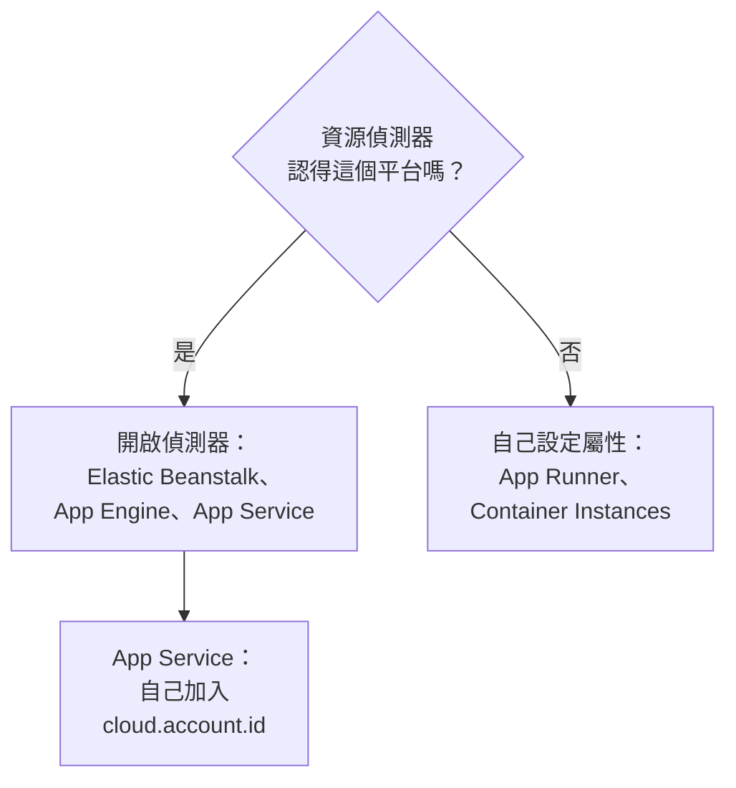

# 其他雲端平台

設定那些沒有專屬頁面的受控平台：AWS Elastic Beanstalk、AWS App Runner、Google App Engine、Azure App Service 與 Azure Container Instances。規則與每個平台都一樣：帶有受控 `cloud.platform`、`cloud.account.id` 與 `cloud.region` 的遙測資料，會依平台、帳戶與區域進入一個 **Cloud Environment**，而執行個體識別會讓每個執行中的執行個體在 **執行個體** 下各占一列。

:::cards
- [AWS Elastic Beanstalk](#aws-elastic-beanstalk): 每個執行個體上的 Collector，搭配 Beanstalk 與 EC2 偵測器。
- [AWS App Runner](#aws-app-runner): 手動設定的屬性，以及來自 Secrets Manager 的權杖。
- [Google App Engine](#google-app-engine): GCP 偵測器，設定寫在 `app.yaml` 中。
- [Azure App Service](#azure-app-service): Azure 偵測器、Key Vault 參照，以及手動設定的訂用帳戶。
- [Azure Container Instances](#azure-container-instances): 手動設定的屬性，權杖以安全變數傳入。
:::

## 每個平台需要什麼

這些平台的差別在於由誰設定 `cloud.*` 屬性，以及這些設定位於雲端主控台的什麼位置：



| 平台 | `cloud.platform` | `cloud.*` 由誰填入 | 執行個體識別 |
| ------------------------- | --------------------------- | ------------------------------------------------------------------------------------------ | ----------------------------------------------------------- |
| AWS Elastic Beanstalk | `aws_elastic_beanstalk` | Collector 的 `elastic_beanstalk` 與 `ec2` 偵測器；Node.js 的 `aws` | `host.id`（刪除部署的 `service.instance.id`） |
| AWS App Runner | `aws_app_runner` | 你自己（沒有偵測器） | `host.name` |
| Google App Engine | `gcp_app_engine` | `gcp` 偵測器（Collector 與每個 SDK 中的） | `faas.instance` |
| Azure App Service | `azure_app_service` | Collector 的 `azureappservice`，Node.js 與 .NET 的 `azure` 偵測器；`cloud.account.id` 由你設定 | `service.instance.id`，其次是 `host.id` |
| Azure Container Instances | `azure_container_instances` | 你自己（沒有偵測器） | `host.name` |

下面每一節都需要一個來自 **專案設定 → 遙測與 APM → 擷取金鑰** 的 **伺服器** 擷取金鑰，以及一個以 OpenTelemetry SDK 檢測的應用程式。如果你自行託管 OneUptime，請把 `https://oneuptime.com/otlp` 換成 `https://YOUR-ONEUPTIME-HOST/otlp`。

> [!IMPORTANT]
> 在所有這些平台上，權杖都屬於機密。每一節都會指出該平台的機密存放區。寫在一般環境變數中的權杖，任何能讀取應用程式設定的人都讀得到。

## AWS Elastic Beanstalk

`cloud.platform`：`aws_elastic_beanstalk`。Beanstalk 偵測器會讀取執行個體上的 `/var/elasticbeanstalk/xray/environment.conf`，並設定 `cloud.platform`、`service.instance.id`、`service.version` 與環境名稱。它不知道帳戶與區域，因此要搭配知道這兩者、而且也會設定 `host.id` 的 EC2 偵測器。

在每個執行個體上執行一個 OpenTelemetry Collector，設定如下：

```yaml title="config.yaml"
receivers:
  otlp:
    protocols:
      http:
        endpoint: 0.0.0.0:4318
      grpc:
        endpoint: 0.0.0.0:4317
processors:
  # elastic_beanstalk sets cloud.platform and service.instance.id; ec2 adds
  # cloud.account.id, cloud.region and host.id. The first detector to set an
  # attribute wins, so elastic_beanstalk comes first.
  resourcedetection:
    detectors: [env, elastic_beanstalk, ec2]
    timeout: 5s
  # The Beanstalk detector's service.instance.id is the deployment ID, shared
  # by every instance of a deployment: drop it, so that ec2's host.id names
  # each instance.
  resource:
    attributes:
      - key: service.instance.id
        action: delete
  batch: {}
exporters:
  otlphttp/oneuptime:
    endpoint: https://oneuptime.com/otlp
    headers:
      x-oneuptime-token: ${env:ONEUPTIME_TOKEN}
service:
  pipelines:
    traces:
      receivers: [otlp]
      processors: [resourcedetection, resource, batch]
      exporters: [otlphttp/oneuptime]
    metrics:
      receivers: [otlp]
      processors: [resourcedetection, resource, batch]
      exporters: [otlphttp/oneuptime]
    logs:
      receivers: [otlp]
      processors: [resourcedetection, resource, batch]
      exporters: [otlphttp/oneuptime]
```

:::steps
1. 將權杖儲存到 Secrets Manager：`aws secretsmanager create-secret --name oneuptime/ingestion-token --secret-string "YOUR_TELEMETRY_INGESTION_TOKEN"`。Beanstalk 的環境屬性存放在環境設定中，而不是機密存放區中，因此請改為在平台掛鉤中透過執行個體設定檔讀取該機密。執行個體設定檔需要對該機密擁有 `secretsmanager:GetSecretValue`。
2. 透過 `.platform/hooks/postdeploy/`（或 `.ebextensions`）中的指令碼安裝 Collector：使用 `otelcol-contrib` 套件與上面的設定，並把機密以 `ONEUPTIME_TOKEN` 放入它的環境。
3. **AWS Console → Elastic Beanstalk → Environments → your environment → Configuration**。
4. 在 **Updates, monitoring, and logging** 類別中按一下 **Edit**，捲動到 **Environment properties**。加入 `OTEL_SERVICE_NAME`、設為 `http://localhost:4318` 的 `OTEL_EXPORTER_OTLP_ENDPOINT`，以及設為 `http/protobuf` 的 `OTEL_EXPORTER_OTLP_PROTOCOL`。
5. 按一下 **Apply**。Beanstalk 會以新的屬性重新啟動應用程式。
:::

Node.js 應用程式可以不用 Collector：SDK 的偵測器已包含 Beanstalk 與 EC2。將 `OTEL_EXPORTER_OTLP_ENDPOINT` 設為 `https://oneuptime.com/otlp`，將 `OTEL_EXPORTER_OTLP_HEADERS` 設為 `x-oneuptime-token=YOUR_TELEMETRY_INGESTION_TOKEN`，並設定 `OTEL_NODE_RESOURCE_DETECTORS=env,host,os,aws`。這時權杖會位於環境屬性中。之後請檢查某筆追蹤的資源屬性：如果 `cloud.platform` 顯示為 `aws_ec2`，表示你的 SDK 版本讓 EC2 偵測器勝出，使用 Collector 才是可靠的做法。

**網路：** 私有子網路中的執行個體需要 NAT 閘道，執行個體的安全性群組必須允許透過 TCP 443 輸出到 OneUptime 主機。

## AWS App Runner

`cloud.platform`：`aws_app_runner`。沒有偵測器，因此需要你自己設定屬性。App Runner 可以把 Secrets Manager（或 SSM Parameter Store）中的機密放入環境變數。

```bash
OTEL_SERVICE_NAME=checkout-api
OTEL_EXPORTER_OTLP_ENDPOINT=https://oneuptime.com/otlp
OTEL_EXPORTER_OTLP_PROTOCOL=http/protobuf
# From Secrets Manager: the secret holds the whole header.
OTEL_EXPORTER_OTLP_HEADERS=x-oneuptime-token=YOUR_TELEMETRY_INGESTION_TOKEN
OTEL_RESOURCE_ATTRIBUTES=cloud.provider=aws,cloud.platform=aws_app_runner,cloud.region=us-east-1,cloud.account.id=123456789012
OTEL_NODE_RESOURCE_DETECTORS=env,host,os
```

請把區域與帳戶 ID 換成你自己的。`host` 偵測器會提供 `host.name`，也就是容器的主機名稱，它在每個 App Runner 執行個體上都不同，OneUptime 會用它為執行個體命名。

:::steps
1. 將完整的標頭儲存到 Secrets Manager：`aws secretsmanager create-secret --name oneuptime/otlp-headers --secret-string "x-oneuptime-token=YOUR_TELEMETRY_INGESTION_TOKEN"`。App Runner 會把機密的值原封不動放入變數。
2. **AWS Console → App Runner → Services → your service → Configuration → Configure service**（在 **Configuration** 分頁中按一下 **Edit**）。
3. 在 **Environment variables** 下，為上面每個一般值按一下 **Add environment variable**。
4. 加入 `OTEL_EXPORTER_OTLP_HEADERS`，選擇 **Source: Secrets Manager** 並填入機密的 ARN。在 **Security → Instance role** 下選擇一個對該機密擁有 `secretsmanager:GetSecretValue` 的角色：是執行個體角色，而不是拉取映像檔的存取角色。
5. 按一下 **Save changes**。App Runner 會部署新版本。
:::

**網路：** 沒有 VPC 連接器的服務可以直接連上網際網路。使用 **Outgoing network traffic: Custom VPC** 時，輸出流量會經過你的 VPC，這時 VPC 需要 NAT 閘道，以及允許透過 TCP 443 連到 OneUptime 主機的安全性群組輸出規則。

## Google App Engine

`cloud.platform`：`gcp_app_engine`。GCP 偵測器會根據 `GAE_SERVICE`、`GAE_VERSION`、`GAE_INSTANCE` 與中繼資料伺服器辨識 App Engine 標準環境與彈性環境。它會設定 `cloud.account.id`（專案）、`cloud.region`、`faas.name`、`faas.version` 與 `faas.instance`。與 Cloud Run 一樣，`faas.name` 會讓每個 App Engine 服務也出現在 **無伺服器函式** 下，而環境則彙整專案與區域。

| 語言 | 開啟 GCP 偵測器 |
| -------- | ------------------------------------------------------------------------------------------------------------------- |
| Node.js | `OTEL_NODE_RESOURCE_DETECTORS=env,host,os,gcp` |
| Python | `pip install opentelemetry-resourcedetector-gcp`，然後設定 `OTEL_EXPERIMENTAL_RESOURCE_DETECTORS=gcp_resource_detector` |
| Java | `-Dotel.resource.providers.gcp.enabled=true` |
| Go | `go.opentelemetry.io/contrib/detectors/gcp` → `gcp.NewDetector()` |
| .NET | `OpenTelemetry.Resources.Gcp` → `.AddGcpDetector()` |

App Engine 的主控台中沒有環境變數編輯器：環境變數寫在 `app.yaml` 中。

```yaml title="app.yaml"
runtime: nodejs22
env_variables:
  OTEL_SERVICE_NAME: checkout-api
  OTEL_EXPORTER_OTLP_ENDPOINT: https://oneuptime.com/otlp
  OTEL_EXPORTER_OTLP_PROTOCOL: http/protobuf
  OTEL_NODE_RESOURCE_DETECTORS: env,host,os,gcp
  # Do not commit the real value. Template it in CI, or read the secret at
  # start-up with the Secret Manager client instead.
  OTEL_EXPORTER_OTLP_HEADERS: x-oneuptime-token=YOUR_TELEMETRY_INGESTION_TOKEN
```

:::steps
1. 將完整的標頭儲存到 Secret Manager：`printf '%s' "x-oneuptime-token=YOUR_TELEMETRY_INGESTION_TOKEN" | gcloud secrets create oneuptime-otlp-headers --data-file=-`。為 App Engine 服務帳戶（`my-project@appspot.gserviceaccount.com`）授予對它的 `roles/secretmanager.secretAccessor`。
2. 在部署管線中把機密寫入 `app.yaml`，並在提交的檔案中保留預留位置。也可以在啟動時讀取 `projects/PROJECT_ID/secrets/oneuptime-otlp-headers/versions/latest`，並在程式碼中傳給匯出器的 `headers` 選項。
3. 以 `gcloud app deploy` 部署。在主控台中，**App Engine → Versions** 會顯示新版本，**App Engine → Services** 會顯示將出現在 **無伺服器函式** 下的服務。
:::

**網路：** App Engine 標準環境可以直接連上網際網路。彈性環境的執行個體位於 VPC 中：如果子網路沒有外部 IP，它們需要 Cloud NAT，以及允許透過 TCP 443 連到 OneUptime 主機的輸出防火牆規則。

## Azure App Service

`cloud.platform`：`azure_app_service`。Node.js 與 .NET 的 Azure 偵測器，以及 Collector 的 `azureappservice` 偵測器，會讀取 App Service 設定的 `WEBSITE_*` 變數。它們會填入 `cloud.platform`、`cloud.region`、`service.instance.id`（來自 `WEBSITE_INSTANCE_ID`）、`deployment.environment`（部署位置）與 `host.id`。它們都不會設定 `cloud.account.id`：請自己加入訂用帳戶 ID，否則環境金鑰中的帳戶區段會是空的。

```bash
OTEL_SERVICE_NAME=checkout-api
OTEL_EXPORTER_OTLP_ENDPOINT=https://oneuptime.com/otlp
OTEL_EXPORTER_OTLP_PROTOCOL=http/protobuf
# The Key Vault reference, which resolves to the whole header.
OTEL_EXPORTER_OTLP_HEADERS=@Microsoft.KeyVault(SecretUri=https://my-vault.vault.azure.net/secrets/oneuptime-otlp-headers/)
OTEL_RESOURCE_ATTRIBUTES=cloud.account.id=00000000-0000-0000-0000-000000000000
# Node.js:
OTEL_NODE_RESOURCE_DETECTORS=env,host,os,azure
```

SDK 偵測器把平台寫成帶點號的 `azure.app_service`；OneUptime 收到時會把它改寫為 `azure_app_service`。在 .NET 中加入 `OpenTelemetry.Resources.Azure` 並呼叫 `.ConfigureResource(r => r.AddAzureAppServiceDetector())`。其他語言需要把 `cloud.provider=azure,cloud.platform=azure_app_service,cloud.region=<region>` 加入 `OTEL_RESOURCE_ATTRIBUTES`，並在程式碼中從 `WEBSITE_INSTANCE_ID` 取得 `service.instance.id`。

:::steps
1. 開啟應用程式的系統指派受控識別（**Settings → Identity**），並授予它對該保存庫的 **Key Vault Secrets User**。將完整的標頭 `x-oneuptime-token=YOUR_TELEMETRY_INGESTION_TOKEN` 儲存為機密 `oneuptime-otlp-headers`。
2. **Azure portal → App Services → your app → Settings → Environment variables**（舊版入口網站中為 **Configuration → Application settings**）。
3. 透過 **+ Add** 加入上面的每個變數。`OTEL_EXPORTER_OTLP_HEADERS` 的值就是 Key Vault 參照。
4. 按一下 **Apply**，然後按一下 **Confirm**：應用程式會以新設定重新啟動。部署位置有各自的設定：如果只應由一個部署位置傳送遙測資料，請把權杖標記為 **deployment slot setting**。
:::

**網路：** 除非開啟了 **VNet integration** 並啟用 **Route All**，否則 App Service 可以直接連上網際網路。開啟後，VNet 需要 NAT 閘道，或一條通往允許 TCP 443 連到 OneUptime 主機的防火牆的路由。

## Azure Container Instances

`cloud.platform`：`azure_container_instances`。沒有偵測器，因此需要你自己設定屬性。容器群組的環境變數在建立時就固定了：修改任何一個都表示要重新建立群組。請用 `--secure-environment-variables` 傳入權杖，這樣 `az container show` 就不會傳回它：

```bash
az container create \
  --resource-group my-rg \
  --name checkout-api \
  --image myregistry.azurecr.io/checkout-api:1.4.2 \
  --location eastus \
  --environment-variables \
    OTEL_SERVICE_NAME=checkout-api \
    OTEL_EXPORTER_OTLP_ENDPOINT=https://oneuptime.com/otlp \
    OTEL_EXPORTER_OTLP_PROTOCOL=http/protobuf \
    "OTEL_RESOURCE_ATTRIBUTES=cloud.provider=azure,cloud.platform=azure_container_instances,cloud.region=eastus,cloud.account.id=00000000-0000-0000-0000-000000000000" \
    OTEL_NODE_RESOURCE_DETECTORS=env,host,os \
  --secure-environment-variables \
    "OTEL_EXPORTER_OTLP_HEADERS=x-oneuptime-token=YOUR_TELEMETRY_INGESTION_TOKEN"
```

`host` 偵測器的 `host.name`，也就是容器群組的主機名稱，會成為執行個體的名稱。sidecar Collector 在這裡同樣適用，因為容器群組會像 ECS 任務一樣執行多個容器：請使用 [Azure Container Apps](/docs/telemetry/cloud-azure-container-apps) 中 `detectors: [env]` 加上 `OTEL_RESOURCE_ATTRIBUTES` 的做法。如果它傳送帶有群組識別的 `container.cpu.utilization` 與 `container.memory.usage`，**CPU** 與 **記憶體** 圖格也會由它填入。

:::steps
1. **Azure portal → Container Instances → + Create**。填寫 **Basics** 分頁：資源群組、名稱、區域與映像檔。
2. 在 **Advanced** 分頁的 **Environment variables** 下加入每個變數。對於 `OTEL_EXPORTER_OTLP_HEADERS`，請將 **Mark as secure** 設為 **Yes**，這樣入口網站與 API 都不會顯示它的值。
3. 按一下 **Review + create**，然後按一下 **Create**。之後若要修改變數，請刪除群組再重新建立。
:::

**網路：** 帶有公用 IP 的容器群組可以直接連上網際網路。位於 VNet 子網路中的群組只能透過 VNet 的路由輸出：請加入 NAT 閘道，或在防火牆或 NSG 上允許透過 TCP 443 連到 OneUptime 主機。

## 檢查連線

不論設定的是哪個平台，都先檢查權杖，然後再尋找環境：

```bash
curl -i https://oneuptime.com/otlp/v1/validate \
  -H "x-oneuptime-token: YOUR_TELEMETRY_INGESTION_TOKEN"
```

回傳 `200` 且 `"valid": true` 表示權杖已被接受。`401` 表示權杖未知、已撤銷、已停用或已過期。在第一個 span、日誌或指標送達後的 1 分鐘內，環境就會出現在 **雲端 → All Environments** 中，並以平台、區域與帳戶命名。

## 疑難排解

:::details Beanstalk 執行個體出現在主機下
EC2 偵測器的 `cloud.platform=aws_ec2` 勝出了。第一個設定某個屬性的偵測器會勝出，因此請在 `detectors` 中把 `elastic_beanstalk` 放在 `ec2` 前面。沒有 Collector 時，Node.js SDK 也可能偏向 EC2 偵測器：請執行 Collector。
:::

:::details 所有 Beanstalk 執行個體共用執行個體下的同一列
Beanstalk 偵測器的 `service.instance.id` 是部署 ID，同一次部署的所有執行個體共用它，而且它會在 `host.id` 之前被讀取。請在每個管線中保留刪除它的 `resource` 處理器。
:::

:::details App Service 應用程式收到 401
Key Vault 參照沒有解析成功，因此 App Service 把字面上的文字 `@Microsoft.KeyVault(...)` 當作標頭傳了出去。請為應用程式的受控識別授予對該保存庫的 **Key Vault Secrets User**，並確認機密中存放的是完整的標頭 `x-oneuptime-token=...`。
:::

:::details App Service 環境的帳戶區段是空的
App Service 的偵測器都不會設定 `cloud.account.id`。請在每個應用程式的 `OTEL_RESOURCE_ATTRIBUTES` 中加入訂用帳戶 ID：帶有和沒有這個值的遙測資料會進入兩個環境。
:::

:::details 修改 Container Instances 變數後沒有效果
容器群組的環境變數在建立時就固定了。請刪除群組，再以新的值重新建立。
:::

其餘問題請參閱 [雲端疑難排解](/docs/telemetry/cloud-troubleshooting)，特別是環境出現在 **主機** 下、只出現在 **無伺服器函式** 下（沒有 GCP 偵測器的 App Engine），或出現兩次（部分部署設定了 `cloud.account.id`，部分沒有）的情況。

## 後續步驟

:::cards
- [雲端環境](/docs/telemetry/cloud-environments): 環境與執行個體是如何識別的。
- [雲端疑難排解](/docs/telemetry/cloud-troubleshooting): 所有平台共有的故障。
- [無伺服器函式](/docs/telemetry/serverless-functions): Lambda、Cloud Functions 與 Azure Functions。
- [雲端資源(IaaS 與 PaaS)](/docs/telemetry/cloud-resources): 來自雲端本身監控的、應用程式周邊的資源。
:::
