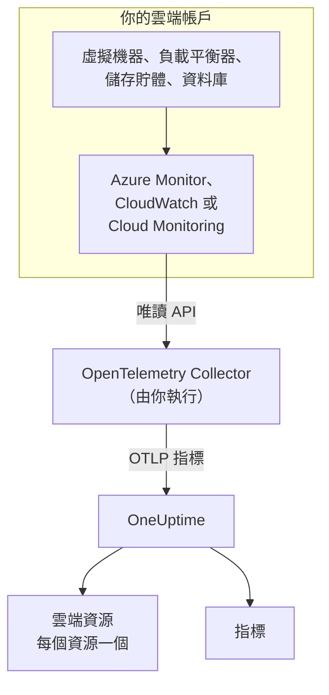
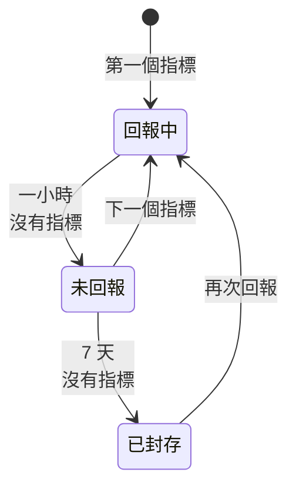

# 雲端資源(IaaS 與 PaaS)

**Cloud Resources** 會列出你的 AWS、Azure 與 Google Cloud 帳戶中的 IaaS 與 PaaS 資源：虛擬機器、磁碟、負載平衡器、儲存貯體、受控資料庫、快取、佇列、API 閘道等等。每個資源都有自己的頁面，顯示它的類型、區域與帳戶、提供者為它指派的 ID、提供者發布的關於它的每個指標，並且可以像 OneUptime 中的其他資源一樣設定擁有者與標籤。你可以在 **雲端 → 所有資源** 下找到它們。

:::cards
- [連接 Azure](#連接-azure): 從 Azure Monitor 讀取訂用帳戶中的每個資源。
- [連接 AWS](#連接-aws): 輪詢 CloudWatch，或透過 Amazon Data Firehose 串流傳輸。
- [連接 Google Cloud](#連接-google-cloud): 從 Cloud Monitoring 讀取專案的服務。
- [如何識別資源](#如何識別資源): 依提供者列出 OneUptime 能辨識的每種資源類型。
:::

## 運作方式



- **提供者已經在測量你的資源。** Azure Monitor、Amazon CloudWatch 與 Google Cloud Monitoring 會發布它們為你執行的每個資源的指標。
- **由你執行的 Collector 讀取這些指標。** 一個對該監控服務擁有唯讀權限的 OpenTelemetry Collector 會把指標匯出到 OneUptime。資源上不需要安裝任何東西，OneUptime 也從不持有你的雲端認證：認證由在你的環境中執行的 Collector 持有。
- **每個資源會隨它的第一個指標出現。** OneUptime 會從每個資料點判斷它屬於哪個資源，並在第一次看到該資源時建立雲端資源。

雲端資源只是你的雲端會出現的幾個地方之一：

| 你執行的內容 | 出現的位置 | 方式 |
| --- | --- | --- |
| ECS、Cloud Run、Container Apps、App Service 等上的容器 | **雲端 → All Environments** | 工作負載本身的遙測資料，依其 `cloud.platform` 區分。請參閱 [雲端環境](/docs/telemetry/cloud-environments) |
| 提供者監控的任何 IaaS 或 PaaS 資源 | **雲端 → 所有資源** | 由 Collector 讀取的提供者監控 API：也就是本頁 |
| 裝有 OpenTelemetry Collector 的虛擬機器 | **主機** | 主機本身的指標與日誌。請參閱 [主機 OpenTelemetry Collector](/docs/telemetry/host-otel-collector) |
| 你的應用程式使用的佇列與主題 | **Queues** | span，以及相同的雲端指標。請參閱 [佇列](/docs/telemetry/queues) |

一個資源可能出現在多個地方。裝有 Collector 的虛擬機器是一台 **主機**，而它的平台指標（Hypervisor 看到的 CPU 點數、磁碟與網路）又讓它成為一個 **雲端資源**。SQS 佇列既是 **Queue**，也是 **雲端資源**。每個檢視顯示的是其資料來源所知道的內容。

## 開始之前

- **擷取金鑰。** 在 **專案設定 → 遙測與 APM → 擷取金鑰** 中建立一個 **伺服器** 金鑰。下面的 Collector 會從環境變數 `ONEUPTIME_TOKEN` 讀取它，而不是從設定檔讀取。
- **執行 OpenTelemetry Collector 的地方**：使用 `otelcol-contrib` 發行版本（映像檔 `otel/opentelemetry-collector-contrib`），並且能夠對外連到你的雲端提供者與 OneUptime。一台小型 VM、一個容器或你的 Kubernetes 叢集都可以，一個 Collector 就能讀取多個帳戶與提供者。
- **對提供者監控 API 的讀取權限。** 下面每個提供者的第一個步驟會建立它。

> [!TIP]
> 同樣的步驟也在儀表板中，並已填好你的權杖：在第一個資源送達之前位於 **雲端 → 所有資源**，之後位於每個資源的 **文件** 分頁，該分頁會開啟該資源所屬提供者的說明。

如果你自行託管 OneUptime，請把 `https://oneuptime.com/otlp` 換成 `https://YOUR-ONEUPTIME-HOST/otlp`。

## 連接 Azure

`azure_monitor` 接收器會列出訂用帳戶中的資源，並每分鐘讀取一次它們的平台指標。如果沒有 `services` 清單，它會讀取所有資源類型，因此訂用帳戶中的每個資源都會成為雲端資源。

:::steps
### 建立 Monitoring Reader 服務主體

**Monitoring Reader** 可以讀取指標並列出資源，但無法變更任何內容：

```bash
az ad sp create-for-rbac \
  --name oneuptime-cloud-collector \
  --role "Monitoring Reader" \
  --scopes /subscriptions/<SUBSCRIPTION_ID>
```

它會印出 `appId`（用戶端 ID）、`password`（用戶端密碼）與 `tenant`。在更多訂用帳戶上將這個角色授予同一個服務主體，就能用同一個 Collector 讀取這些訂用帳戶。

### 設定 Azure Monitor 接收器

將以下內容儲存為 `config.yaml`：

```yaml
extensions:
  azure_auth:
    service_principal:
      tenant_id: ${env:AZURE_TENANT_ID}
      client_id: ${env:AZURE_CLIENT_ID}
      client_secret: ${env:AZURE_CLIENT_SECRET}

receivers:
  azure_monitor:
    subscription_ids: ["${env:AZURE_SUBSCRIPTION_ID}"]
    auth:
      authenticator: azure_auth
    collection_interval: 60s
    # No `services` list: every resource type in the subscription.
    # Series Azure returns per metric and resource (default 10).
    maximum_number_of_records_per_resource: 50

processors:
  batch: {}

exporters:
  otlphttp/oneuptime:
    endpoint: https://oneuptime.com/otlp
    headers:
      x-oneuptime-token: ${env:ONEUPTIME_TOKEN}

service:
  extensions: [azure_auth]
  pipelines:
    metrics:
      receivers: [azure_monitor]
      processors: [batch]
      exporters: [otlphttp/oneuptime]
```

### 執行 Azure Collector

```bash
docker run -d --name oneuptime-cloud-collector --restart unless-stopped \
  -e ONEUPTIME_TOKEN=YOUR_TELEMETRY_INGESTION_TOKEN \
  -e AZURE_TENANT_ID=<TENANT> \
  -e AZURE_CLIENT_ID=<APP_ID> \
  -e AZURE_CLIENT_SECRET=<PASSWORD> \
  -e AZURE_SUBSCRIPTION_ID=<SUBSCRIPTION_ID> \
  -v "$(pwd)/config.yaml:/etc/otelcol-contrib/config.yaml" \
  otel/opentelemetry-collector-contrib:latest
```

幾分鐘內，資源就會出現在 **雲端 → 所有資源** 下。
:::

`azure_monitor` 接收器的選項：

| 選項 | 作用 |
| --- | --- |
| `resource_groups`, `services`, `resource_tags` | 縮小讀取範圍：資源群組、Resource Manager 類型（`Microsoft.Compute/virtualMachines`）或資源必須帶有的標記的清單 |
| `metrics` | 把每種資源類型限制為你列出的指標與彙總。一旦列出某個類型，就只會讀取該類型列出的指標 |
| `discover_subscriptions: true` | 讀取服務主體看得到的每個訂用帳戶，而不是 `subscription_ids` |
| `maximum_number_of_records_per_resource` | Azure 每個指標與資源傳回的序列數（預設 10）。當某個指標依取值很多的維度拆分時，請調高此值 |
| `use_batch_api: true` | 適用於大型訂用帳戶。接收器會針對每個資源與每批 20 個指標呼叫一次 Resource Manager，而 Resource Manager 每小時只允許約 12,000 次讀取；批次 API 每次呼叫可從 Azure Monitor 資料平面讀取最多 50 個資源，其限制高得多 |
| `cache_resources` | 接收器列出資源的間隔（以秒為單位）：預設每天一次。在 Collector 啟動後建立的資源最多可能需要一天才會出現；重新啟動 Collector 即可立即列出它們 |

## 連接 AWS

CloudWatch 指標會透過以下兩種方式之一送達 OneUptime：

| | Polling | Metric Streams |
| --- | --- | --- |
| 方式 | Collector 的 `aws_cloudwatch` 接收器向 CloudWatch 查詢 | CloudWatch 透過 Amazon Data Firehose 推送到 Collector 的 `awsfirehose` 接收器 |
| AWS 端需要什麼 | 只需要認證 | 每個區域一個 Firehose 串流與一個指標串流 |
| AWS 必須能連到 Collector | 否 | 是，透過 443 連接埠的 HTTPS |
| 延遲 | 10 到 20 分鐘 | 幾分鐘 |
| 適合 | 大多數帳戶 | 大型帳戶 |

### 使用 aws_cloudwatch 接收器輪詢

:::steps
#### 允許 Collector 讀取 CloudWatch

將下列政策附加到 Collector 執行時使用的角色（EC2 執行個體設定檔、ECS 任務角色、EKS 服務帳戶），或附加到你提供其存取金鑰的 IAM 使用者：

```json
{
  "Version": "2012-10-17",
  "Statement": [
    {
      "Effect": "Allow",
      "Action": [
        "cloudwatch:ListMetrics",
        "cloudwatch:GetMetricData",
        "sts:GetCallerIdentity"
      ],
      "Resource": "*"
    }
  ]
}
```

`sts:GetCallerIdentity` 讓接收器能回報帳戶 ID，而每個資源的 ARN 都需要它。

#### 設定 CloudWatch 接收器

一個接收器讀取一個區域中的一個命名空間，因此請為你需要的每個命名空間與區域各加入一個。這個範例會讀取常用的命名空間；請將其儲存為 `config.yaml`：

```yaml
receivers:
  aws_cloudwatch/ec2:
    region: ${env:AWS_REGION}
    metrics:
      collection_interval: 5m
      period: 5m
      delay: 10m
      discovery:
        filters:
          namespace: AWS/EC2
        # Metrics read per scrape, at most. Each costs 4 GetMetricData queries.
        limit: 1000
  aws_cloudwatch/ebs:
    region: ${env:AWS_REGION}
    metrics:
      collection_interval: 5m
      period: 5m
      delay: 10m
      discovery:
        filters:
          namespace: AWS/EBS
        # Metrics read per scrape, at most. Each costs 4 GetMetricData queries.
        limit: 1000
  aws_cloudwatch/applicationelb:
    region: ${env:AWS_REGION}
    metrics:
      collection_interval: 5m
      period: 5m
      delay: 10m
      discovery:
        filters:
          namespace: AWS/ApplicationELB
        # Metrics read per scrape, at most. Each costs 4 GetMetricData queries.
        limit: 1000
  aws_cloudwatch/rds:
    region: ${env:AWS_REGION}
    metrics:
      collection_interval: 5m
      period: 5m
      delay: 10m
      discovery:
        filters:
          namespace: AWS/RDS
        # Metrics read per scrape, at most. Each costs 4 GetMetricData queries.
        limit: 1000
  aws_cloudwatch/lambda:
    region: ${env:AWS_REGION}
    metrics:
      collection_interval: 5m
      period: 5m
      delay: 10m
      discovery:
        filters:
          namespace: AWS/Lambda
        # Metrics read per scrape, at most. Each costs 4 GetMetricData queries.
        limit: 1000
  aws_cloudwatch/dynamodb:
    region: ${env:AWS_REGION}
    metrics:
      collection_interval: 5m
      period: 5m
      delay: 10m
      discovery:
        filters:
          namespace: AWS/DynamoDB
        # Metrics read per scrape, at most. Each costs 4 GetMetricData queries.
        limit: 1000

processors:
  batch: {}

exporters:
  otlphttp/oneuptime:
    endpoint: https://oneuptime.com/otlp
    headers:
      x-oneuptime-token: ${env:ONEUPTIME_TOKEN}

service:
  pipelines:
    metrics:
      receivers: [aws_cloudwatch/ec2, aws_cloudwatch/ebs, aws_cloudwatch/applicationelb, aws_cloudwatch/rds, aws_cloudwatch/lambda, aws_cloudwatch/dynamodb]
      processors: [batch]
      exporters: [otlphttp/oneuptime]
```

#### 執行 CloudWatch Collector

```bash
docker run -d --name oneuptime-cloud-collector --restart unless-stopped \
  -e ONEUPTIME_TOKEN=YOUR_TELEMETRY_INGESTION_TOKEN \
  -e AWS_REGION=us-east-1 \
  -e AWS_ACCESS_KEY_ID=<ACCESS_KEY_ID> \
  -e AWS_SECRET_ACCESS_KEY=<SECRET_ACCESS_KEY> \
  -v "$(pwd)/config.yaml:/etc/otelcol-contrib/config.yaml" \
  otel/opentelemetry-collector-contrib:latest
```

在擁有該角色的 EC2 執行個體、ECS 任務或 EKS Pod 上，請省略這兩個金鑰變數。
:::

- **不要設定 `stats`。** 這樣每個指標會以每個期間一份摘要的方式讀取：四個統計值、四個 `GetMetricData` 查詢，而 AWS 會依要求的每個指標對 `GetMetricData` 計費。`discovery.limit` 會限制接收器每次擷取讀取的指標數（請務必設定：接收器本身的預設值是 100），較長的 `collection_interval` 則會降低讀取頻率。
- **資料會延遲送達。** `delay` 會等待 CloudWatch 發布一個期間，因此資料點會在其測量時間之後 10 到 20 分鐘送達，資源大約二十分鐘內出現。

### 使用 CloudWatch Metric Streams 串流傳輸

:::steps
#### 設定 Firehose 接收器

Collector 需要一張與其位址相符的憑證：Firehose 只會傳遞到 443 連接埠上的 `https://`。將以下內容儲存為 `config.yaml`：

```yaml
extensions:
  awscloudwatchmetricstreams_encoding:
    format: opentelemetry1.0

receivers:
  awsfirehose:
    # Firehose delivers to HTTPS on port 443 only: expose this port as
    # 443, for example behind a load balancer.
    endpoint: 0.0.0.0:4433
    encoding: awscloudwatchmetricstreams_encoding
    access_key: ${env:FIREHOSE_ACCESS_KEY}
    tls:
      cert_file: /etc/otelcol-contrib/tls/server.crt
      key_file: /etc/otelcol-contrib/tls/server.key

processors:
  batch: {}

exporters:
  otlphttp/oneuptime:
    endpoint: https://oneuptime.com/otlp
    headers:
      x-oneuptime-token: ${env:ONEUPTIME_TOKEN}

service:
  extensions: [awscloudwatchmetricstreams_encoding]
  pipelines:
    metrics:
      receivers: [awsfirehose]
      processors: [batch]
      exporters: [otlphttp/oneuptime]
```

#### 執行 Firehose Collector

```bash
docker run -d --name oneuptime-cloud-collector --restart unless-stopped \
  -e ONEUPTIME_TOKEN=YOUR_TELEMETRY_INGESTION_TOKEN \
  -e FIREHOSE_ACCESS_KEY=<A_LONG_RANDOM_SECRET> \
  -p 4433:4433 \
  -v "$(pwd)/tls:/etc/otelcol-contrib/tls:ro" \
  -v "$(pwd)/config.yaml:/etc/otelcol-contrib/config.yaml" \
  otel/opentelemetry-collector-contrib:latest
```

憑證及其金鑰放在 `tls/` 中，名稱為 `server.crt` 與 `server.key`。把 4433 連接埠發布在某個於 443 回應的元件後方，例如負載平衡器。

#### 建立 Firehose 串流與指標串流

1. **Amazon Data Firehose → Create Firehose stream**：來源選 **Direct PUT**，目的地選 **HTTP Endpoint**。端點 URL 是 Collector 的 `https://` 位址；存取金鑰是 `FIREHOSE_ACCESS_KEY`。為傳遞失敗的資料選擇或建立一個 S3 儲存貯體。
2. **CloudWatch → Metrics → Streams → Create metric stream**：要包含的命名空間（或全部）、Firehose 串流，以及輸出格式 **OpenTelemetry 1.0**。
3. 在每個區域重複操作：一個指標串流只承載它所在區域的指標。
:::

AWS 會依指標串流傳遞的每次指標更新計費，另加 Firehose 的資料費用，因此只包含你需要的命名空間。**JSON** 格式（編碼擴充功能上的 `format: json`）的串流也能識別相同的資源，但還會把每個命名空間寫入 `service.name`，因此每個命名空間也會出現在 **服務** 下：請優先使用 **OpenTelemetry 1.0**。

## 連接 Google Cloud

`googlecloudmonitoring` 接收器會針對一個專案，讀取其 `metrics_list` 中列出的指標類型。

:::steps
### 建立 Monitoring Viewer 服務帳戶

**Monitoring Viewer** 可以讀取指標，但無法變更任何內容：

```bash
gcloud iam service-accounts create oneuptime-cloud-collector \
  --project <PROJECT_ID>

gcloud projects add-iam-policy-binding <PROJECT_ID> \
  --member "serviceAccount:oneuptime-cloud-collector@<PROJECT_ID>.iam.gserviceaccount.com" \
  --role roles/monitoring.viewer

gcloud iam service-accounts keys create key.json \
  --iam-account oneuptime-cloud-collector@<PROJECT_ID>.iam.gserviceaccount.com
```

如果在 Google Cloud 上執行 Collector，請以這個服務帳戶的身分執行，而不是建立金鑰。

### 設定 Cloud Monitoring 接收器

每個篩選器會讀取一個服務的所有指標類型。將以下內容儲存為 `config.yaml`：

```yaml
receivers:
  googlecloudmonitoring:
    project_id: ${env:GCP_PROJECT_ID}
    collection_interval: 2m
    # Only the metric types these filters list are read.
    metrics_list:
      - metric_descriptor_filter: 'metric.type = starts_with("compute.googleapis.com/")'
      - metric_descriptor_filter: 'metric.type = starts_with("cloudsql.googleapis.com/")'
      - metric_descriptor_filter: 'metric.type = starts_with("loadbalancing.googleapis.com/")'
      - metric_descriptor_filter: 'metric.type = starts_with("storage.googleapis.com/")'
      - metric_descriptor_filter: 'metric.type = starts_with("redis.googleapis.com/")'
      - metric_descriptor_filter: 'metric.type = starts_with("run.googleapis.com/")'

processors:
  batch: {}

exporters:
  otlphttp/oneuptime:
    endpoint: https://oneuptime.com/otlp
    headers:
      x-oneuptime-token: ${env:ONEUPTIME_TOKEN}

service:
  pipelines:
    metrics:
      receivers: [googlecloudmonitoring]
      processors: [batch]
      exporters: [otlphttp/oneuptime]
```

### 執行 Google Cloud Collector

```bash
docker run -d --name oneuptime-cloud-collector --restart unless-stopped \
  -e ONEUPTIME_TOKEN=YOUR_TELEMETRY_INGESTION_TOKEN \
  -e GCP_PROJECT_ID=<PROJECT_ID> \
  -e GOOGLE_APPLICATION_CREDENTIALS=/etc/otelcol-contrib/key.json \
  -v "$(pwd)/key.json:/etc/otelcol-contrib/key.json:ro" \
  -v "$(pwd)/config.yaml:/etc/otelcol-contrib/config.yaml" \
  otel/opentelemetry-collector-contrib:latest
```
:::

- **清單會在 Collector 啟動時讀取：** 變更後請重新啟動它。`metric_name: compute.googleapis.com/instance/cpu/utilization` 只會讀取一個類型，而不是某個服務的所有類型。
- **一個接收器讀取一個專案：** 每個專案各加入一個接收器。
- **讀取有成本也有配額。** 每個指標類型在每個收集間隔內都會產生一次 Cloud Monitoring API 讀取。在 API 的每月免費額度內，讀取 Google Cloud 本身的指標是免費的；較長的 `collection_interval` 可以讓大型專案保持在該額度內，以及每分鐘配額內。

## 讓管線遠離資源偵測

> [!WARNING]
> 不要在讀取雲端監控的管線中加入 `resourcedetection` 處理器。它會把 Collector 所在機器自己的 `host.name` 與 `os.type` 標記到每個資料點上，OneUptime 接著也會把你的雲端指標歸檔到 **主機** 中那台機器的名下。同時監控自身主機的 Collector 應該在另一個管線中完成這項工作。

## 如何識別資源

這些接收器發出的每個資料點都指向一個資源，OneUptime 會把雲端資源與該資源的識別碼關聯，而不是與可以變更的名稱關聯。識別碼的比較不區分大小寫，因此以兩種寫法回報的資源仍是同一個資源。

### Azure

每個資料點都帶有其資源的 Azure 資源 ID（`azuremonitor.resource_id`），因此接收器讀取的每個資源都會成為雲端資源：下面列出的類型使用易讀的名稱，其他類型使用其 Resource Manager 類型。資源 ID、區域、訂用帳戶與資源群組都會顯示在資源上。

:::details 使用易讀名稱的 Azure 資源類型
| 資源類型 | 顯示為 | 模型 |
| --- | --- | --- |
| `Microsoft.Compute/virtualMachines` | Virtual Machine | IaaS |
| `Microsoft.Compute/virtualMachineScaleSets` | Virtual Machine Scale Set | IaaS |
| `Microsoft.Compute/disks` | Managed Disk | IaaS |
| `Microsoft.Network/loadBalancers` | Load Balancer | IaaS |
| `Microsoft.Network/applicationGateways` | Application Gateway | IaaS |
| `Microsoft.Network/publicIPAddresses` | Public IP Address | IaaS |
| `Microsoft.Network/natGateways` | NAT Gateway | IaaS |
| `Microsoft.Network/virtualNetworkGateways` | Virtual Network Gateway | IaaS |
| `Microsoft.Network/expressRouteCircuits` | ExpressRoute Circuit | IaaS |
| `Microsoft.Network/azureFirewalls` | Azure Firewall | IaaS |
| `Microsoft.Network/frontdoors` | Front Door (classic) | IaaS |
| `Microsoft.Cdn/profiles` | Front Door and CDN Profile | IaaS |
| `Microsoft.Network/trafficmanagerprofiles` | Traffic Manager Profile | IaaS |
| `Microsoft.Network/networkInterfaces` | Network Interface | IaaS |
| `Microsoft.Network/virtualNetworks` | Virtual Network | IaaS |
| `Microsoft.Network/privateEndpoints` | Private Endpoint | IaaS |
| `Microsoft.Network/dnszones` | DNS Zone | IaaS |
| `Microsoft.Network/bastionHosts` | Bastion | IaaS |
| `Microsoft.Storage/storageAccounts` | Storage Account | IaaS |
| `Microsoft.RecoveryServices/vaults` | Recovery Services Vault | PaaS |
| `Microsoft.Web/sites` | App Service or Function App | PaaS |
| `Microsoft.Web/serverfarms` | App Service Plan | PaaS |
| `Microsoft.Web/staticSites` | Static Web App | PaaS |
| `Microsoft.App/containerApps` | Container App | PaaS |
| `Microsoft.App/managedEnvironments` | Container Apps Environment | PaaS |
| `Microsoft.ContainerInstance/containerGroups` | Container Instance | PaaS |
| `Microsoft.ContainerService/managedClusters` | AKS Cluster | PaaS |
| `Microsoft.ContainerRegistry/registries` | Container Registry | PaaS |
| `Microsoft.SignalRService/SignalR` | SignalR Service | PaaS |
| `Microsoft.Sql/servers/databases` | SQL Database | PaaS |
| `Microsoft.Sql/servers/elasticpools` | SQL Elastic Pool | PaaS |
| `Microsoft.Sql/managedInstances` | SQL Managed Instance | PaaS |
| `Microsoft.DBforPostgreSQL/flexibleServers` | PostgreSQL Flexible Server | PaaS |
| `Microsoft.DBforMySQL/flexibleServers` | MySQL Flexible Server | PaaS |
| `Microsoft.DocumentDB/databaseAccounts` | Cosmos DB Account | PaaS |
| `Microsoft.Cache/redis` | Azure Cache for Redis | PaaS |
| `Microsoft.Cache/redisEnterprise` | Azure Managed Redis | PaaS |
| `Microsoft.ServiceBus/namespaces` | Service Bus Namespace | PaaS |
| `Microsoft.EventHub/namespaces` | Event Hubs Namespace | PaaS |
| `Microsoft.EventGrid/topics` | Event Grid Topic | PaaS |
| `Microsoft.EventGrid/systemTopics` | Event Grid System Topic | PaaS |
| `Microsoft.EventGrid/namespaces` | Event Grid Namespace | PaaS |
| `Microsoft.ApiManagement/service` | API Management | PaaS |
| `Microsoft.Logic/workflows` | Logic App | PaaS |
| `Microsoft.DataFactory/factories` | Data Factory | PaaS |
| `Microsoft.Synapse/workspaces` | Synapse Workspace | PaaS |
| `Microsoft.Kusto/clusters` | Data Explorer Cluster | PaaS |
| `Microsoft.StreamAnalytics/streamingjobs` | Stream Analytics Job | PaaS |
| `Microsoft.CognitiveServices/accounts` | Azure AI Services or OpenAI | PaaS |
| `Microsoft.Search/searchServices` | AI Search Service | PaaS |
| `Microsoft.MachineLearningServices/workspaces` | Machine Learning Workspace | PaaS |
| `Microsoft.KeyVault/vaults` | Key Vault | PaaS |
| `Microsoft.Insights/components` | Application Insights | PaaS |
| `Microsoft.OperationalInsights/workspaces` | Log Analytics Workspace | PaaS |
| `Microsoft.Automation/automationAccounts` | Automation Account | PaaS |
| `Microsoft.Devices/IotHubs` | IoT Hub | PaaS |
:::

### AWS

CloudWatch 指標會透過一個取決於命名空間的維度指出其資源。帶有 **識別依據** 中所列維度的資料點屬於該資源，並連同其帳戶與區域。額外的維度只會縮小序列的範圍，不會改變資源（Application Load Balancer 依目標群組拆分的序列屬於該負載平衡器）。依其他維度彙總的資料點（`InstanceType`、`DatabaseClass`、整個帳戶的總量）不會指向任何資源，也不會被探索到。未列出的命名空間同樣不會被探索到：它的指標仍會送達 **指標**。

如果指標能完整提供資源的 ARN，資源就以 ARN 顯示；如果不能（Auto Scaling 群組的 ARN 中帶有任何指標都不會回報的 UUID），則以其命名空間與維度顯示。

:::details CloudWatch 命名空間及識別資源的維度
| 命名空間 | 識別依據 | 顯示為 | 資源類型 | 模型 |
| --- | --- | --- | --- | --- |
| `AWS/EC2` | `InstanceId` | EC2 Instance | `AWS::EC2::Instance` | IaaS |
| `AWS/EC2` | `AutoScalingGroupName` (without `InstanceId`) | Auto Scaling Group | `AWS::AutoScaling::AutoScalingGroup` | IaaS |
| `AWS/AutoScaling` | `AutoScalingGroupName` | Auto Scaling Group | `AWS::AutoScaling::AutoScalingGroup` | IaaS |
| `AWS/EBS` | `VolumeId` | EBS Volume | `AWS::EC2::Volume` | IaaS |
| `AWS/ELB` | `LoadBalancerName` | Classic Load Balancer | `AWS::ElasticLoadBalancing::LoadBalancer` | IaaS |
| `AWS/ApplicationELB` | `LoadBalancer` | Elastic Load Balancer (ALB, NLB, GWLB) | `AWS::ElasticLoadBalancingV2::LoadBalancer` | IaaS |
| `AWS/NetworkELB` | `LoadBalancer` | Elastic Load Balancer (ALB, NLB, GWLB) | `AWS::ElasticLoadBalancingV2::LoadBalancer` | IaaS |
| `AWS/GatewayELB` | `LoadBalancer` | Elastic Load Balancer (ALB, NLB, GWLB) | `AWS::ElasticLoadBalancingV2::LoadBalancer` | IaaS |
| `AWS/NATGateway` | `NatGatewayId` | NAT Gateway | `AWS::EC2::NatGateway` | IaaS |
| `AWS/TransitGateway` | `TransitGateway` | Transit Gateway | `AWS::EC2::TransitGateway` | IaaS |
| `AWS/VPN` | `VpnId` | Site-to-Site VPN Connection | `AWS::EC2::VPNConnection` | IaaS |
| `AWS/DX` | `ConnectionId` | Direct Connect Connection | `AWS::DirectConnect::Connection` | IaaS |
| `AWS/CloudFront` | `DistributionId` | CloudFront Distribution | `AWS::CloudFront::Distribution` | IaaS |
| `AWS/GlobalAccelerator` | `Accelerator` (without `Listener`, `EndpointGroup`) | Global Accelerator | `AWS::GlobalAccelerator::Accelerator` | IaaS |
| `AWS/Route53` | `HealthCheckId` | Route 53 Health Check | `AWS::Route53::HealthCheck` | IaaS |
| `AWS/NetworkFirewall` | `FirewallName` | Network Firewall | `AWS::NetworkFirewall::Firewall` | IaaS |
| `AWS/WAFV2` | `WebACL` (without `Rule`, `RuleGroup`) | WAF Web ACL | `AWS::WAFv2::WebACL` | PaaS |
| `AWS/S3` | `BucketName` | S3 Bucket | `AWS::S3::Bucket` | IaaS |
| `AWS/EFS` | `FileSystemId` | EFS File System | `AWS::EFS::FileSystem` | IaaS |
| `AWS/FSx` | `FileSystemId` | FSx File System | `AWS::FSx::FileSystem` | IaaS |
| `AWS/ECS` | `ClusterName` + `ServiceName` | ECS Service | `AWS::ECS::Service` | PaaS |
| `AWS/ECS` | `ClusterName` (without `ServiceName`) | ECS Cluster | `AWS::ECS::Cluster` | PaaS |
| `AWS/AppRunner` | `ServiceName` | App Runner Service | `AWS::AppRunner::Service` | PaaS |
| `AWS/ElasticBeanstalk` | `EnvironmentName` | Elastic Beanstalk Environment | `AWS::ElasticBeanstalk::Environment` | PaaS |
| `AWS/Lambda` | `FunctionName` | Lambda Function | `AWS::Lambda::Function` | PaaS |
| `AWS/States` | `StateMachineArn` | Step Functions State Machine | `AWS::StepFunctions::StateMachine` | PaaS |
| `AWS/RDS` | `DBInstanceIdentifier` | RDS DB Instance | `AWS::RDS::DBInstance` | PaaS |
| `AWS/RDS` | `DBClusterIdentifier` (without `DBInstanceIdentifier`) | Aurora / RDS DB Cluster | `AWS::RDS::DBCluster` | PaaS |
| `AWS/DocDB` | `DBInstanceIdentifier` | DocumentDB Instance | `AWS::DocDB::DBInstance` | PaaS |
| `AWS/DocDB` | `DBClusterIdentifier` (without `DBInstanceIdentifier`) | DocumentDB Cluster | `AWS::DocDB::DBCluster` | PaaS |
| `AWS/Neptune` | `DBInstanceIdentifier` | Neptune Instance | `AWS::Neptune::DBInstance` | PaaS |
| `AWS/Neptune` | `DBClusterIdentifier` (without `DBInstanceIdentifier`) | Neptune Cluster | `AWS::Neptune::DBCluster` | PaaS |
| `AWS/DynamoDB` | `TableName` | DynamoDB Table | `AWS::DynamoDB::Table` | PaaS |
| `AWS/ElastiCache` | `CacheClusterId` | ElastiCache Cluster | `AWS::ElastiCache::CacheCluster` | PaaS |
| `AWS/ElastiCache` | `ReplicationGroupId` (without `CacheClusterId`) | ElastiCache Replication Group | `AWS::ElastiCache::ReplicationGroup` | PaaS |
| `AWS/ElastiCache` | `clusterId` (without `CacheClusterId`) | ElastiCache Serverless Cache | `AWS::ElastiCache::ServerlessCache` | PaaS |
| `AWS/MemoryDB` | `ClusterName` | MemoryDB Cluster | `AWS::MemoryDB::Cluster` | PaaS |
| `AWS/Redshift` | `ClusterIdentifier` | Redshift Cluster | `AWS::Redshift::Cluster` | PaaS |
| `AWS/ES` | `DomainName` | OpenSearch Domain | `AWS::OpenSearchService::Domain` | PaaS |
| `AWS/SQS` | `QueueName` | SQS Queue | `AWS::SQS::Queue` | PaaS |
| `AWS/SNS` | `TopicName` | SNS Topic | `AWS::SNS::Topic` | PaaS |
| `AWS/Kinesis` | `StreamName` | Kinesis Data Stream | `AWS::Kinesis::Stream` | PaaS |
| `AWS/Firehose` | `DeliveryStreamName` | Data Firehose Stream | `AWS::KinesisFirehose::DeliveryStream` | PaaS |
| `AWS/AmazonMQ` | `Broker` | Amazon MQ Broker | `AWS::AmazonMQ::Broker` | PaaS |
| `AWS/Kafka` | `Cluster Name` | MSK Cluster | `AWS::MSK::Cluster` | PaaS |
| `AWS/Events` | `RuleName` | EventBridge Rule | `AWS::Events::Rule` | PaaS |
| `AWS/ApiGateway` | `ApiName` | API Gateway REST API | `AWS::ApiGateway::RestApi` | PaaS |
| `AWS/ApiGateway` | `ApiId` (without `ApiName`) | API Gateway HTTP or WebSocket API | `AWS::ApiGatewayV2::Api` | PaaS |
| `AWS/AppSync` | `GraphQLAPIId` | AppSync GraphQL API | `AWS::AppSync::GraphQLApi` | PaaS |
| `AWS/CertificateManager` | `CertificateArn` | ACM Certificate | `AWS::CertificateManager::Certificate` | PaaS |
| `AWS/KMS` | `KeyId` | KMS Key | `AWS::KMS::Key` | PaaS |
| `AWS/Cognito` | `UserPool` | Cognito User Pool | `AWS::Cognito::UserPool` | PaaS |
| `AWS/SageMaker` | `EndpointName` | SageMaker Endpoint | `AWS::SageMaker::Endpoint` | PaaS |
| `AWS/Logs` | `LogGroupName` | CloudWatch Log Group | `AWS::Logs::LogGroup` | PaaS |
:::

### Google Cloud

Cloud Monitoring 會用類型與標籤指出每個指標的受監控資源。下面所列類型的資料點屬於由所列標籤識別的那個資源；資源的其他標籤及其中繼資料標籤永遠不會把它拆開。Kubernetes 類型（`k8s_container`、`k8s_pod`、…）交由 [Kubernetes](/docs/telemetry/kubernetes-agent) 產品處理。

:::details Cloud Monitoring 資源類型及識別它們的標籤
| 受監控資源類型 | 識別依據 | 顯示為 | 模型 |
| --- | --- | --- | --- |
| `gce_instance` | `project_id`, `zone`, `instance_id` | Compute Engine VM Instance | IaaS |
| `instance_group` | `project_id`, `location`, `instance_group_id` | Instance Group | IaaS |
| `gcs_bucket` | `project_id`, `bucket_name` | Cloud Storage Bucket | IaaS |
| `filestore_instance` | `project_id`, `location`, `instance_name` | Filestore Instance | IaaS |
| `https_lb_rule` | `project_id`, `url_map_name` | External Application Load Balancer | IaaS |
| `internal_http_lb_rule` | `project_id`, `region`, `url_map_name` | Internal Application Load Balancer | IaaS |
| `vpn_gateway` | `project_id`, `region`, `gateway_id` | Cloud VPN Gateway | IaaS |
| `nat_gateway` | `project_id`, `region`, `router_id`, `gateway_name` | Cloud NAT Gateway | IaaS |
| `gce_router` | `project_id`, `region`, `router_id` | Cloud Router | IaaS |
| `cloudsql_database` | `project_id`, `database_id` | Cloud SQL Instance | PaaS |
| `alloydb.googleapis.com/Instance` | `resource_container`, `location`, `cluster_id`, `instance_id` | AlloyDB Instance | PaaS |
| `redis_instance` | `project_id`, `region`, `instance_id` | Memorystore for Redis Instance | PaaS |
| `spanner_instance` | `project_id`, `instance_id` | Spanner Instance | PaaS |
| `bigtable_table` | `project_id`, `instance` | Bigtable Instance | PaaS |
| `bigquery_dataset` | `project_id`, `dataset_id` | BigQuery Dataset | PaaS |
| `cloud_function` | `project_id`, `region`, `function_name` | Cloud Run Function | PaaS |
| `cloud_run_revision` | `project_id`, `location`, `service_name` | Cloud Run Service | PaaS |
| `cloud_run_job` | `project_id`, `location`, `job_name` | Cloud Run Job | PaaS |
| `gae_app` | `project_id`, `module_id` | App Engine Service | PaaS |
| `pubsub_topic` | `project_id`, `topic_id` | Pub/Sub Topic | PaaS |
| `pubsub_subscription` | `project_id`, `subscription_id` | Pub/Sub Subscription | PaaS |
| `cloud_tasks_queue` | `project_id`, `location`, `queue_id` | Cloud Tasks Queue | PaaS |
| `cloud_composer_environment` | `project_id`, `location`, `environment_name` | Cloud Composer Environment | PaaS |
| `dataproc_cluster` | `project_id`, `region`, `cluster_name` | Dataproc Cluster | PaaS |
| `aiplatform.googleapis.com/Endpoint` | `resource_container`, `location`, `endpoint_id` | Vertex AI Endpoint | PaaS |
:::

### 名稱

資源以其提供者對它的稱呼命名（`vm-prod-01`、`checkout`、`orders`）。名稱在專案內是唯一的，但提供者的名稱不是：兩個訂用帳戶可能各有一個 `web-01`，一個 App Service 方案與它的應用程式可能都叫 `checkout`。因此，名稱已被使用的資源會依序加上其類型、資源群組或區域、帳戶來命名：`web-01 (Virtual Machine, rg-prod)`。你可以在任何資源的 **設定** 分頁中重新命名它：指標是依識別碼而不是依名稱比對的。

## 狀態、封存與限制



- **回報中** 表示提供者在過去一小時內傳送過關於該資源的指標；一小時沒有指標後會顯示 **未回報**。有些資源天生就很安靜，例如沒有人呼叫過的 Key Vault，或 CloudWatch 每天只發布一次儲存指標的儲存貯體，它們會在下一個資料點送達時恢復。
- **連續 7 天沒有任何指標** 的資源會被自動封存：例如被 Auto Scaling 群組取代的執行個體、已刪除的磁碟區、已經不存在的儲存貯體。它會在 **雲端 → 進階 → 已封存** 下保留其標籤、擁有者與歷程記錄，並在再次回報時自動還原。你自己封存的資源會一直保持封存；在它安靜期間還原的資源會留在清單中，直到它回報為止。
- 刪除一個提供者仍在回報的資源不會生效：它會根據下一批指標再次被探索到。請改為封存它。
- 當一個專案擁有 **5,000** 個線上（未封存）資源時，探索流程會停止建立資源並記錄警告；已封存的資源不計入。

自行託管的安裝可以透過應用程式上的環境變數變更這些值：

| 變數 | 預設值 | 意義 |
| --- | --- | --- |
| `CLOUD_RESOURCE_AUTO_ARCHIVE_DAYS` | `7` | 資源被封存前沒有指標的天數（至少 1） |
| `CLOUD_RESOURCE_AUTO_CREATE_BUDGET` | `5000` | 在探索流程停止建立更多資源之前，一個專案可以擁有的線上資源數（`0` 表示關閉探索） |

## 針對資源設定警示

:::steps
1. 開啟資源及其 **指標** 分頁，其中列出提供者回報的關於該資源的每個指標。
2. 開啟一個指標，在指標瀏覽器中以圖表檢視它，圖表已依該資源篩選。
3. 按一下 **從此檢視建立監測器**：監測器會監看這個資源的這個指標。
:::

> [!IMPORTANT]
> 雲端監控會在測量時間之後幾分鐘才發布每個數值：依上面方式輪詢的 CloudWatch 為 10 到 20 分鐘，Azure Monitor 與 Cloud Monitoring 為幾分鐘。數值會依其測量時間儲存。請為根據這些指標的監測器設定比該延遲更長的時間範圍（CloudWatch 為 30 分鐘，其他為 15 分鐘），否則它看不到資料，永遠不會觸發。

## 資產清冊與規則

- **資產清冊：** 雲端資源會以 **雲端資源** 項目列在 [資產清冊](/docs/inventory/overview) 中，提供者的 ID 為 `cloud.resource.id`，類型為 `cloud.resource.type`。AI 代理程式的資源工具也會列出它們。
- **規則：** **雲端 → 設定 → 標籤規則** 與 **擁有者規則** 對它們的作用與對雲端環境的作用相同。

## 疑難排解

### 沒有出現任何資源

1. 檢查權杖：`curl -i https://oneuptime.com/otlp/v1/validate -H "x-oneuptime-token: YOUR_TELEMETRY_INGESTION_TOKEN"` 必須回傳 `200` 並帶有 `"valid": true`。
2. 查看 Collector 的日誌（`docker logs oneuptime-cloud-collector`）。授權錯誤會指出缺少的權限：`AuthorizationFailed`（Azure：訂用帳戶上的 **Monitoring Reader**）、`cloudwatch:GetMetricData` 上的 `AccessDenied`（AWS：上面的政策）、`PermissionDenied`（Google Cloud：**Monitoring Viewer**）。
3. 在 **指標** 中尋找提供者的指標（`azure_…`、`amazonaws.com/aws/…`、`compute.googleapis.com/…`）。如果指標存在但沒有資源，表示資料點沒有指向 OneUptime 能辨識的資源：可能是上面沒有列出的 AWS 命名空間或 Google Cloud 類型，也可能是依資源以外的維度彙總的資料點。
4. 等待延遲的資料：依上面方式輪詢的 CloudWatch 會落後 10 到 20 分鐘。

### 缺少某個資源

- **Azure：** 接收器每天列出一次資源；重新啟動 Collector 可以立即列出新資源。在 Azure Monitor 中沒有平台指標的資源類型沒有可回報的內容。
- **AWS：** 每個接收器讀取一個區域中的一個命名空間，`discovery.limit` 會限制它讀取的指標數：帳戶中的指標更多時請調高。
- **Google Cloud：** `metrics_list` 中必須包含該資源的服務。
- **所有提供者：** 已達上限的專案在部分資源被封存之前不會建立新資源。請參閱 [狀態、封存與限制](#狀態封存與限制)。

### 同一個資源出現兩次

一個 AWS 資源如果一次帶著帳戶 ID、一次沒有帳戶 ID 被讀取，就會成為兩個資源：輪詢接收器只有在可以呼叫 `sts:GetCallerIdentity` 時才會回報帳戶。請為每個 Collector 授予這個權限，並封存沒有帳戶的那個副本。

### 我的雲端指標出現在某台主機下

管線中有 `resourcedetection` 處理器。請參閱 [讓管線遠離資源偵測](#讓管線遠離資源偵測)。

## 限制

- **只有指標。** 提供者的監控 API 不會發布關於資源的日誌或追蹤。請用 OpenTelemetry 從你的工作負載傳送它們。
- **探索依賴指標。** 提供者沒有發布指標的資源，或 Collector 沒有讀取的資源，都不會被探索到。
- **沒有專屬的保留期設定。** 資源指標的保留時間與其 Collector 傳送的其他指標相同。
- **輪詢需要花錢**，而且會計入雲端 API 的限制：請參閱上面每個提供者的說明。

## 後續步驟

:::cards
- [雲端環境](/docs/telemetry/cloud-environments): 你在 ECS、Cloud Run 與 Container Apps 上的容器，來自它們本身的遙測資料。
- [佇列](/docs/telemetry/queues): SQS、Service Bus 與 Pub/Sub，使用相同的雲端指標。
- [標籤與擁有者規則](/docs/configuration/label-and-owner-rules): 在探索到資源時為其加上標籤並指派擁有者。
- [資產清冊](/docs/inventory/overview): 在一份清單中檢視每台主機、每個裝置與每個雲端資源。
:::
