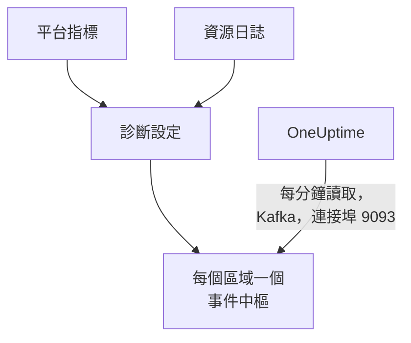

# 串流 Azure Monitor 指標和日誌

已連線的 Azure 訂用帳戶可以把 Azure Monitor 指標和資源日誌串流到 OneUptime。診斷設定把它們傳送到你訂用帳戶中的事件中樞，OneUptime 每分鐘讀取這些事件中樞：關鍵指標會在 Azure Monitor 取得後幾分鐘內抵達，不必等連線的下一次讀取；資源日誌則以 OneUptime 日誌的形式抵達，每筆都歸檔在它所涉及的資源下。在 Azure Cloud Shell 中執行一個指令即可完成設定，無需執行任何東西。

:::cards
- [運作方式](#運作方式): 診斷設定傳送到每個區域的事件中樞，由 OneUptime 讀取。
- [設定串流](#設定串流): 選擇要串流的內容，開啟讀取，再執行一個指令。
- [抵達的內容](#抵達的內容): 指標抵達它們所衡量的資源，日誌抵達它們來自的資源。
- [指令建立的內容](#指令建立的內容): 指令在你的訂用帳戶中建立的每個資源和每項權限。
- [停止串流](#停止串流): 停止讀取，然後刪除指令建立的內容。
:::

## 運作方式



- **每個區域一個事件中樞。** 診斷設定只能傳送到資源所在區域的事件中樞，因此指令會在你的資源所在的每個區域建立一個 Event Hubs 命名空間，全部放在同一個資源群組中，並把每個資源的診斷設定指向其所在區域的事件中樞。
- **由 OneUptime 讀取。** Azure Monitor 只會傳送到事件中樞、儲存體帳戶或 Log Analytics 工作區，從不傳送到你的位址：由 OneUptime 讀取的事件中樞，是你無需執行任何東西的方式。OneUptime 以連線自己的應用程式身分登入，該應用程式只能讀取這些事件中樞。
- **讀取會把串流的指標交給串流。** 當串流在某個區域傳送某種資源類型的關鍵指標時，連線的讀取會停止寫入這些指標，因此不會有資料點被計算兩次。讀取會繼續找出資源、它們的狀態和變更，並在 15 分鐘沒有事件後重新接手這些指標。
- **OneUptime 無法讀取時也不會遺失任何資料。** 事件會在事件中樞裡等待 OneUptime 讀取，只要事件中樞仍保留著它們；OneUptime 會記住每個分割區讀到哪裡，從停下的地方繼續。

## 開始之前

- **一個已連線的 Azure 訂用帳戶。** 先在 **雲端 → 連線** 中連線：請參閱 [連線雲端帳戶](/docs/telemetry/cloud-accounts)。
- **專案擁有者或管理員。** 只有他們可以開啟讀取和停止串流。
- **Azure Cloud Shell**，以訂用帳戶的 **Owner** 身分登入，或以同時是 **User Access Administrator** 的 **Contributor** 身分登入：指令會建立資源群組和角色指派，並變更診斷設定。
- **在自行託管的 OneUptime 上，能連到 Azure 的出口。** OneUptime 透過連接埠 9093 在 `<namespace>.servicebus.windows.net` 讀取每個命名空間，命名空間接受來自網際網路的連線。

## 設定串流

:::steps
### 開啟串流對話方塊

前往 **雲端 → 連線**，在 Azure 訂用帳戶所在列選擇 **串流指標和日誌**。

### 選擇要串流的內容

**指標** 每分鐘串流每個資源的每個關鍵指標：也就是 OneUptime 為每個資源繪製圖表並據以評估它的指標。**指標和日誌** 再加上每個資源自己的日誌，也就是 Azure 為它保留的每個類別；**日誌** 只串流資源日誌。

### 開啟讀取

選擇 **開啟讀取**。OneUptime 每分鐘尋找一次事件中樞，並一直等到指令建立它們。

### 在 Azure Cloud Shell 中執行指令

複製指令，在 Azure Cloud Shell 中執行並等待完成。它會列出建立了事件中樞的每個區域、傳送到這些事件中樞的資源數量，以及它略過的資源和 Azure 提供的原因。

### 等待第一批事件

對話方塊每隔幾秒詢問一次抵達了什麼。Azure 會在指令完成後幾分鐘內開始傳送；之後對話方塊會說明什麼從哪裡抵達，連線所在列會顯示 **串流中**。
:::

**更多欄位** 包含其餘內容：

| 欄位 | 作用 |
| --- | --- |
| **訂用帳戶** | 要串流的訂用帳戶：起初是連線讀取的訂用帳戶。第一個訂用帳戶中存放事件中樞，OneUptime 在那裡讀取它們。最多 50 個 |
| **以其他方式設定** | 指令使用的名稱，用來透過 Terraform 或入口網站設定 |

如果連線尚未讀取任何訂用帳戶，或讀取的訂用帳戶超過 50 個，對話方塊會改為在步驟之前詢問 **訂用帳戶**。

如果第一個訂用帳戶不是 OneUptime 讀取事件中樞的那個訂用帳戶，對話方塊會提示：執行指令前請選擇 **改為在那裡讀取**。

## 抵達的內容

| 內容 | 抵達位置 |
| --- | --- |
| 關鍵指標 | 抵達它們所衡量的雲端資源，與連線的讀取寫入的是同一組序列 |
| 資源日誌 | 抵達日誌瀏覽器中連線的遙測服務下，訂用帳戶、區域和類別作為屬性 |
| OneUptime 認得的資源的日誌 | 也會抵達該資源：它在雲端中的頁面會多出一個 **日誌** 索引標籤 |

串流傳送的是連線每分鐘讀取的關鍵指標。連線以較粗粒度讀取的指標，例如儲存體帳戶的已用容量，仍由讀取負責。日誌依資源的 ARM ID 歸檔在該資源下，以 `cloud.resource_id` 攜帶，並把類別、作業、結果和屬性保留為屬性，例如 `azure.category`。

虛擬機器、擴展集、磁碟、網路介面、虛擬網路、私人端點、NAT 閘道、DNS 區域和 App Service 方案不會傳送自己的資源日誌，因此它們的頁面沒有 **日誌** 索引標籤。儲存體帳戶的日誌是其各項服務的日誌，容器應用程式的日誌是其環境的日誌。

## 指令建立的內容

資源群組名為 `oneuptime-stream-` 加上連線 ID 的前 8 個字元。它不會讓 OneUptime 存取你的資源：連線的應用程式只能讀取事件中樞，僅此而已。

| 資源 | 可以做什麼 |
| --- | --- |
| 第一個訂用帳戶中的資源群組 `oneuptime-stream-<suffix>` | 存放事件中樞，並以 `oneuptime-connection` 標籤標記連線的 ID |
| 每個區域一個 Event Hubs 命名空間 `oneuptime-<suffix>-<region>`，標準層，1 個輸送量單位 | 接收其所在區域的診斷設定傳送的內容 |
| 每個命名空間中的事件中樞 `oneuptime`，2 個分割區 | 保存事件，直到 OneUptime 讀取它們 |
| 授予連線應用程式的 **Azure Event Hubs Data Receiver** 角色，僅作用於該資源群組 | 讓應用程式讀取事件中樞，別無其他 |
| 每個資源上的診斷設定 `OneUptime-<suffix>` | 把資源的指標、日誌或兩者傳送到其所在區域的事件中樞 |

全域區域的資源（例如 Front Door）會傳送到第一個區域的事件中樞。Azure 只保留指標或只保留日誌的資源，會依其已有的內容設定；已經有 5 個診斷設定（Azure 允許的上限）的資源會被略過。Azure 會按小時對每個命名空間的輸送量單位計費，並對診斷設定傳送的事件計費。

## 停止串流

:::steps
### 停止讀取

在 **雲端 → 連線** 中訂用帳戶所在列選擇 **停止串流**。OneUptime 會立即停止讀取事件中樞，連線會重新依排程讀取其所有指標。已讀取的內容會保留。

### 刪除指令建立的內容

在刪除之前，事件中樞和診斷設定會一直保留在 Azure 中，並由 Azure 計費。對話方塊會顯示指令：它會刪除每個資源的診斷設定，然後刪除資源群組，無論資源群組位於哪個訂用帳戶。

```bash
oneuptime_stream_stop() {
  local SUB ID N=0
  for SUB in '11111111-aaaa-4aaa-8aaa-111111111111' '22222222-bbbb-4bbb-8bbb-222222222222'; do
    while IFS= read -r ID; do
      if [ -z "$ID" ]; then continue; fi
      az monitor diagnostic-settings delete --name OneUptime-6f1c3a2e --resource "$ID" --output none 2> /dev/null &
      N=$((N + 1))
      if [ $((N % 4)) -eq 0 ]; then wait; fi
    done < <(az resource list --subscription "$SUB" --query "[].id" --output tsv)
  done
  wait
  for SUB in '11111111-aaaa-4aaa-8aaa-111111111111' '22222222-bbbb-4bbb-8bbb-222222222222'; do
    if [ "$(az group exists --subscription "$SUB" --name oneuptime-stream-6f1c3a2e 2> /dev/null)" = true ]; then
      az group delete --subscription "$SUB" --name oneuptime-stream-6f1c3a2e --yes --no-wait && echo "Deleting oneuptime-stream-6f1c3a2e in $SUB."
    fi
  done
}
oneuptime_stream_stop
```
:::

若要變更串流的內容，請再次開啟 **串流指標和日誌**，選擇要串流的內容並執行新指令：它會更新第一次執行建立的內容，不會重複建立任何東西。

## 以其他方式設定

用 Terraform 或入口網站，以這些名稱建立指令所建立的內容：

| 設定 | 值 |
| --- | --- |
| 資源群組 | `oneuptime-stream-<suffix>`，位於 OneUptime 讀取事件中樞的訂用帳戶中 |
| Event Hubs 命名空間 | `oneuptime-<suffix>-<region>`，每個有待串流資源的區域一個 |
| 事件中樞 | `oneuptime`，位於每個命名空間中 |
| 診斷設定 | 每個資源上的 `OneUptime-<suffix>`，傳送到其所在區域的事件中樞，使用命名空間的 `RootManageSharedAccessKey` 規則 |
| 角色 | 授予連線應用程式的 **Azure Event Hubs Data Receiver**，作用於資源群組 |

然後開啟讀取，並把該訂用帳戶放在 **訂用帳戶** 的第一位。

## 疑難排解

:::details 對話方塊一直在等待第一批事件
檢查指令是否已完成，並已提示某個區域的事件中樞已就緒：`az eventhubs namespace list --resource-group oneuptime-stream-6f1c3a2e` 會列出命名空間。診斷設定只傳送 Azure Monitor 擁有的內容，因此什麼都不做的資源傳送得很少。新角色可能需要幾分鐘才會生效：在那之前，讀取看不到事件。
:::

:::details 連線顯示串流失敗
對話方塊和該列的工具提示會說明原因。如果應用程式無權讀取事件中樞，請再次執行指令：它會重新為應用程式授予角色。如果 OneUptime 無法連到它們，請檢查命名空間是否接受來自網際網路的連線，以及自行託管的 OneUptime 能否連到連接埠 9093。
:::

:::details 指令略過了一些資源
它會列出這些資源，每個都附上 Azure 提供的原因。沒有診斷設定的資源類型不會傳送任何內容；已經有 5 個診斷設定的資源需要先刪除其中一個。然後再次執行指令。
:::

## 後續步驟

:::cards
- [連線雲端帳戶](/docs/telemetry/cloud-accounts): 連線讀取什麼，以及多久讀取一次。
- [串流 Google Cloud 日誌](/docs/telemetry/cloud-streaming-google-cloud): Google Cloud 專案的日誌，透過 Pub/Sub 推送。
- [串流 CloudWatch 指標和日誌](/docs/telemetry/cloud-streaming): AWS 帳戶的指標和日誌，由 Amazon Data Firehose 傳送。
- [日誌瀏覽器](/docs/telemetry/logs-explorer): 搜尋和篩選串流傳送的內容。
:::
