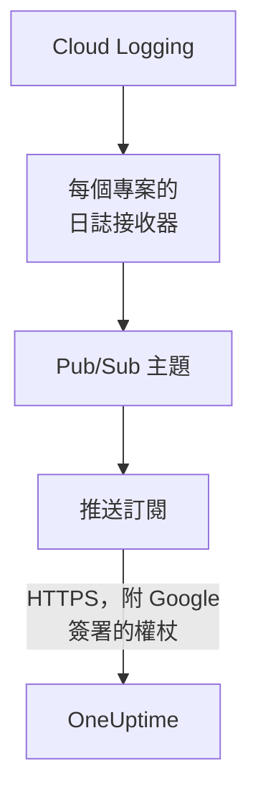

# 串流 Google Cloud 日誌

已連線的 Google Cloud 專案可以在日誌寫入時就把它們串流到 OneUptime。Cloud Logging 透過日誌接收器把日誌轉送到一個 Pub/Sub 主題，主題的推送訂閱會在一分鐘內把每筆項目傳送到 OneUptime，作為 OneUptime 日誌歸檔在它所涉及的資源下。在 Google Cloud Shell 中執行一個指令即可完成設定，無需執行任何東西。Cloud Monitoring 沒有可推送指標的匯出功能，因此連線仍依排程讀取指標。

:::cards
- [運作方式](#運作方式): 每個專案一個日誌接收器、一個主題及其推送訂閱。
- [設定串流](#設定串流): 選擇哪些日誌，建立串流金鑰，再執行一個指令。
- [抵達的內容](#抵達的內容): 日誌抵達它們來自的資源。
- [指令建立的內容](#指令建立的內容): 指令在你的專案中建立的每個資源和每項權限。
- [停止串流](#停止串流): 停用金鑰，然後刪除指令建立的內容。
:::

## 運作方式



- **每個專案一個日誌接收器。** 每個專案的接收器會把符合其篩選器的項目轉送到同一個 Pub/Sub 主題，該主題位於連線自己的服務帳戶所屬的專案中。
- **每次推送兩項檢查。** Pub/Sub 為一個專門用於推送的服務帳戶簽署 OpenID Connect 權杖，權杖的受眾 (audience) 是連線的串流金鑰。只有在 Google 為該服務帳戶簽署了權杖，且金鑰是連線的金鑰之一時，OneUptime 才會接受推送。金鑰指明連線，也就指明了專案：推送中的任何內容都無法決定它寫入哪裡。OneUptime 只保存金鑰的 SHA-256。
- **OneUptime 無法接受時也不會遺失任何資料。** Pub/Sub 會重新推送遭拒的項目，兩次嘗試之間等待 10 秒到最多 10 分鐘，並保留它一天。

## 開始之前

- **一個已連線的 Google Cloud 專案。** 先在 **雲端 → 連線** 中連線：請參閱 [連線雲端帳戶](/docs/telemetry/cloud-accounts)。
- **專案擁有者或管理員。** 只有他們可以建立串流金鑰和停止串流。
- **Google Cloud Shell**，以專案的 **Owner** 身分登入，或以可在這些專案中建立服務帳戶、Pub/Sub 主題和日誌接收器的人員身分登入。
- **在自行託管的 OneUptime 上，需要 HTTPS 位址。** Pub/Sub 只會推送到 `https://` 位址，憑證須受 Google 信任，而且該位址必須能從 Google Cloud 連到。

## 設定串流

:::steps
### 開啟串流對話方塊

前往 **雲端 → 連線**，在 Google Cloud 專案所在列選擇 **串流日誌**。

### 選擇哪些日誌

**警告和錯誤** 串流嚴重性為 `WARNING` 或以上的每筆項目：只有出問題的部分，而非每個請求。**所有日誌** 串流 Data Access 稽核日誌以外的每筆項目，這些稽核日誌記錄每次讀取，可能超過專案寫入的其他所有內容。**自訂篩選器** 串流符合 Cloud Logging 查詢的項目，查詢寫在 **篩選器** 欄位中。

### 建立串流金鑰

選擇 **建立串流金鑰**。金鑰只會在這一次、在指令中顯示：OneUptime 只保存它的 SHA-256。

### 在 Google Cloud Shell 中執行指令

複製指令，在 Google Cloud Shell 中執行並等待完成。它會列出設定了接收器的每個專案，並在 Google 拒絕的第一個步驟停下，附上 Google 提供的原因。

### 等待第一次推送

對話方塊每隔幾秒詢問一次抵達了什麼。專案寫入篩選器接受的項目後，Pub/Sub 會在一分鐘內推送它；之後對話方塊會說明什麼從哪裡抵達，連線所在列會顯示 **串流中**。
:::

**更多欄位** 包含其餘內容：

| 欄位 | 作用 |
| --- | --- |
| **專案** | 要串流日誌的專案：起初是連線讀取的專案。主題會建立在連線的服務帳戶所屬的專案中。最多 100 個 |
| **以其他方式設定** | 推送端點、推送服務帳戶和金鑰，用來透過 Terraform 或主控台設定 |

## 抵達的內容

| 內容 | 抵達位置 |
| --- | --- |
| 日誌 | 抵達日誌瀏覽器中連線的遙測服務下，專案、區域和日誌名稱作為屬性 |
| OneUptime 認得的資源的日誌 | 也會抵達該資源：它在雲端中的頁面會多出一個 **日誌** 索引標籤 |

每筆日誌都會保留其項目精確到奈秒的時間、嚴重性、追蹤和 span，以及採用 OpenTelemetry 語意慣例名稱的 HTTP 請求。當它的受監控資源是 OneUptime 讀取其指標的一種類型時，例如虛擬機器 (`gce_instance`)、Cloud Run 服務 (`cloud_run_revision`) 或 Cloud SQL 執行個體 (`cloudsql_database`)，日誌就會歸檔在該資源下，並以 `cloud.resource_id` 攜帶資源的 ID。外部負載平衡器的請求日誌寫在 `http_load_balancer` 下，但會歸檔在其網址對應，也就是其指標所落的 `https_lb_rule` 下。

執行個體群組的日誌是其虛擬機器的日誌，因此它的頁面沒有 **日誌** 索引標籤。其他類型的項目照樣會串流，歸在其專案下。

## 指令建立的內容

它建立的資源以連線 ID 的前 8 個字元命名。它不會讓 OneUptime 存取你的專案：項目只會向外流出。

| 資源 | 可以做什麼 |
| --- | --- |
| 連線的服務帳戶所屬專案中的服務帳戶 `oneuptime-push-<suffix>` | 沒有任何角色：Pub/Sub 為它簽署推送的權杖 |
| 授予 Pub/Sub 服務代理的 **Service Account OpenID Connect Identity Token Creator** 角色，僅作用於該服務帳戶 | 讓 Pub/Sub 建立這些權杖，別無其他 |
| Pub/Sub 主題 `oneuptime-stream-<suffix>` | 存放接收器轉送過來的項目 |
| 其推送訂閱 `oneuptime-stream-<suffix>-push` | 以 60 秒的確認期限把每筆項目推送到 OneUptime，並把無法推送的內容保留一天 |
| 每個專案中的日誌接收器 `oneuptime-stream-<suffix>` | 把符合其篩選器的項目轉送到主題 |
| 授予每個接收器寫入者的 **Pub/Sub Publisher** 角色，僅作用於主題 | 讓接收器發布到主題，別無其他 |

如果主題所屬專案的 Pub/Sub 和 Cloud Logging API 處於關閉狀態，指令會開啟它們。Google 會依傳送的日誌收取 Pub/Sub 費用：只串流你需要的日誌。

## 停止串流

:::steps
### 停用金鑰

在 **雲端 → 連線** 中專案所在列選擇 **停止串流**。連線的所有串流金鑰會立即失效，OneUptime 會拒絕 Pub/Sub 推送的內容。已傳送的內容會保留。

### 刪除指令建立的內容

在刪除之前，接收器、主題及其推送訂閱會一直保留在 Google Cloud 中，Pub/Sub 也會繼續推送。對話方塊會顯示針對連線所讀取專案的指令：

```bash
for SOURCE in 'acme-prod' 'acme-data'; do
  gcloud logging sinks delete oneuptime-stream-6f1c3a2e --project "$SOURCE" --quiet
done
gcloud pubsub subscriptions delete oneuptime-stream-6f1c3a2e-push --project 'acme-prod' --quiet
gcloud pubsub topics delete oneuptime-stream-6f1c3a2e --project 'acme-prod' --quiet
gcloud iam service-accounts delete 'oneuptime-push-6f1c3a2e@acme-prod.iam.gserviceaccount.com' --project 'acme-prod' --quiet
```
:::

若要變更串流哪些日誌，請再次開啟 **串流日誌**，選擇 **建立新金鑰** 並執行新指令。被取代的金鑰在 24 小時內仍然有效，因此在訂閱更新期間不會有推送遭拒。最多 3 個被取代的金鑰可同時有效。

## 以其他方式設定

為 Pub/Sub 主題新增使用這些值的推送訂閱，並允許 Pub/Sub 服務代理為推送服務帳戶建立權杖：

| 設定 | 值 |
| --- | --- |
| 推送端點 | `https://oneuptime.com/telemetry/gcp-pubsub/v1/logs` |
| 驗證 | 為 `oneuptime-push-<suffix>@<project>.iam.gserviceaccount.com` 簽署的 OpenID Connect 權杖 |
| 受眾 (audience) | 串流金鑰 |
| 酬載 | 包裝格式，即 Pub/Sub 預設的傳送方式 |
| 確認期限 | 60 秒 |
| 訊息保留期間 | 1 天 |

然後用日誌接收器把每個專案的日誌轉送到該主題，並為每個接收器的寫入者授予該主題上的 **Pub/Sub Publisher**。在自行託管的 OneUptime 上，請把 `https://oneuptime.com` 換成你的 OneUptime 的 HTTPS 位址。

OneUptime 會依 Pub/Sub 期望的方式回應每次推送：

| 回應 | 何時 | Pub/Sub 的處理 |
| --- | --- | --- |
| `204` | 項目已被接受，或先前已被接受，或該訊息不是日誌項目 | 繼續 |
| `400` | 不是 OneUptime 能讀取的 Pub/Sub 推送 | 重新推送，每次等待更久，持續一天 |
| `401` | 權杖不是 Google 為推送服務帳戶簽署的，或其受眾不是連線的金鑰 | 重新推送，每次等待更久，持續一天 |
| `402` | 無法為該專案的遙測資料計費 | 重新推送，每次等待更久，持續一天 |
| `403` | 連線已關閉，或專案無法接收遙測資料 | 重新推送，每次等待更久，持續一天 |
| `413` | 請求超過 1 MiB，或其項目超過 512 KiB | 重新推送，每次等待更久，持續一天 |
| `429` | 連線的訂閱在一分鐘內推送了超過 12,000 筆項目 | 重新推送，每次等待更久，持續一天 |
| `503` | OneUptime 當時無法檢查權杖或無法把項目放入佇列 | 重新推送，每次等待更久，持續一天 |

## 疑難排解

:::details 對話方塊一直在等待第一次推送
檢查指令是否在沒有中斷的情況下完成，以及專案是否寫入了篩選器接受的項目：選擇 **警告和錯誤** 時，安靜的專案什麼也不會傳送。`gcloud pubsub subscriptions describe oneuptime-stream-6f1c3a2e-push --project acme-prod` 會顯示訂閱的端點。在自行託管的 OneUptime 上，請檢查 Google Cloud 能否透過 HTTPS 連到其位址。
:::

:::details 連線顯示串流遭拒
對話方塊和該列的工具提示會說明原因。金鑰錯誤表示訂閱使用已失效的金鑰推送：請建立新金鑰並再次執行指令。未針對推送服務帳戶簽署的推送，表示訂閱以另一個帳戶簽署，或 Pub/Sub 無權為該帳戶簽署：請再次執行指令。
:::

:::details 資源的日誌沒有顯示在其頁面上
頁面顯示的是 Cloud Logging 歸檔在該資源的受監控資源下、帶有與其指標相同標籤的日誌。工作負載寫在其他資源下的日誌（例如容器的日誌）只會在其專案下串流。
:::

## 後續步驟

:::cards
- [連線雲端帳戶](/docs/telemetry/cloud-accounts): 連線讀取什麼，以及多久讀取一次。
- [串流 Azure Monitor 指標和日誌](/docs/telemetry/cloud-streaming-azure): Azure 訂用帳戶的指標和日誌，從事件中樞讀取。
- [串流 CloudWatch 指標和日誌](/docs/telemetry/cloud-streaming): AWS 帳戶的指標和日誌，由 Amazon Data Firehose 傳送。
- [日誌瀏覽器](/docs/telemetry/logs-explorer): 搜尋和篩選串流傳送的內容。
:::
