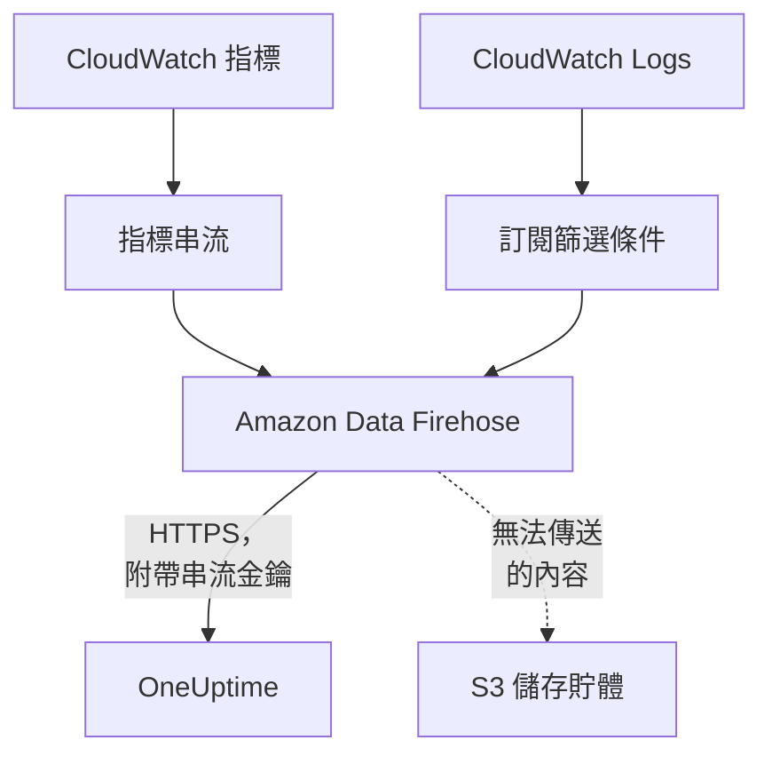

# 串流 CloudWatch 指標和日誌

已連線的 AWS 帳戶可以透過 Amazon Data Firehose 將其 CloudWatch 指標和日誌串流到 OneUptime。如此一來，指標會在 CloudWatch 取得後幾分鐘內抵達，而不必等連線的下一次讀取；CloudWatch Logs 會以 OneUptime 日誌的形式抵達，每一筆都歸入它所涉及的資源。只要在 AWS CloudShell 中執行一個指令即可完成設定，不需要執行任何程式。

:::cards
- [運作方式](#運作方式): 每個區域中的指標串流和日誌訂閱，由 Firehose 傳送。
- [設定串流](#設定串流): 選擇要串流的內容，建立串流金鑰並執行一個指令。
- [抵達的內容](#抵達的內容): 指標落在其量測的資源上，日誌落在其來源的資源上。
- [堆疊建立的內容](#堆疊建立的內容): 指令在你的帳戶中建立的每個資源和每項權限。
- [停止串流](#停止串流): 先停用金鑰，再刪除堆疊。
:::

## 運作方式



- **每個區域一個堆疊。** 指令會在你要串流的每個區域部署一個 CloudFormation 堆疊。堆疊中的指標串流和日誌訂閱篩選條件把所有內容交給兩個 Firehose 串流，再由 Firehose 透過 HTTPS 傳送到 OneUptime。
- **串流金鑰表明資料屬於誰。** Firehose 每次傳送都會附上連線的串流金鑰。金鑰指出連線，進而指出專案：傳送中的任何內容都無法決定它被寫到哪裡。OneUptime 只保存金鑰的 SHA-256。
- **讀取把已串流的指標交給串流。** 當某個串流正在傳送某個區域的一個命名空間時，連線的讀取就不再寫入該命名空間的指標，因此不會有資料點被計算兩次。讀取仍會繼續找出資源及其健康狀態和變更，並在 15 分鐘沒有傳送後重新接手該命名空間。
- **OneUptime 無法接收時也不會遺失任何內容。** Firehose 會在最長一小時內重新傳送遭拒的批次，之後將其在堆疊的 S3 儲存貯體中保留 30 天。

## 開始之前

- **一個已連線的 AWS 帳戶。** 先在 **雲端 → 連線** 中連線：請參閱[連線雲端帳戶](/docs/telemetry/cloud-accounts)。
- **專案擁有者或管理員。** 只有他們可以建立串流金鑰並停止串流。
- **該帳戶中的 AWS CloudShell**，以可以建立 CloudFormation 堆疊和 IAM 角色的使用者身分登入。
- **自行託管的 OneUptime 需要一個 HTTPS 位址。** Firehose 只會傳送到連接埠 443 上的 `https://` 位址，需要 AWS 信任的憑證，而且該位址必須能從 AWS 存取。

## 設定串流

:::steps
### 開啟串流對話方塊

前往 **雲端 → 連線**，在 AWS 帳戶所在列選擇 **串流指標和日誌**。

### 選擇要串流的內容

**指標** 每分鐘串流每個資源的每個關鍵指標：也就是 OneUptime 繪製圖表並評估每個資源所依據的指標。**指標和日誌** 會加上 CloudWatch Logs，**日誌** 則只串流 CloudWatch Logs。

對於日誌，請在 **日誌群組** 中每行填寫一個，可以是旁邊 **地區** 中的名稱，也可以是位於其本身區域的 ARN；或者選擇 **帳戶的所有日誌群組，包括新建立的**。一個指令最多以名稱訂閱 50 個日誌群組，最多涵蓋 10 個區域。

### 建立串流金鑰

選擇 **建立串流金鑰**。金鑰只會在指令中顯示這一次：OneUptime 只保存它的 SHA-256。

### 在 AWS CloudShell 中執行指令

複製指令，在 AWS CloudShell 中執行並等待它完成。指令會把範本寫入 `oneuptime-stream.json`，並把金鑰當作不會再次顯示的參數，在每個區域中部署它。

### 等待第一次傳送

對話方塊每隔幾秒詢問一次抵達了什麼。指令完成後幾分鐘內 Firehose 就會傳送；接著對話方塊會說明什麼內容從哪裡抵達，連線所在列會顯示 **串流中**。
:::

**更多欄位** 中包含其餘設定：

| 欄位 | 作用 |
| --- | --- |
| **所有指標，而不只是關鍵指標** | 串流 CloudWatch 中該帳戶的所有指標，包括你的自訂指標。AWS 依串流傳送的每次指標更新計費，因此費用可能高出許多倍 |
| **區域** | 從哪裡串流：一開始是連線找到資源的區域。留空時，指令會從 AWS CloudShell 本身所在的區域串流。最多 30 個 |
| **以其他方式設定** | 指標和日誌的端點以及金鑰，用於透過 Terraform 或主控台設定串流 |

**下載範本** 會儲存指令所部署的範本，方便你以自己的方式部署。

## 抵達的內容

| 內容 | 落在哪裡 |
| --- | --- |
| 指標 | 落在其量測的雲端資源上，名稱和屬性與連線的讀取所賦予的相同 |
| 日誌 | 落在日誌瀏覽器中，歸於連線的遙測服務之下，並以帳戶、區域和日誌群組作為屬性 |
| AWS 以資源命名的日誌群組中的日誌 | 也會落在該資源上：該資源在雲端中的頁面會多出一個 **日誌** 分頁 |

當 AWS 以某個資源為日誌群組命名時，該日誌群組會歸入這個資源：

| 日誌群組 | 資源類型 |
| --- | --- |
| `/aws/lambda/<function>` | `AWS::Lambda::Function` |
| `/aws/rds/instance/<instance>/<log>` | `AWS::RDS::DBInstance` |
| `/aws/rds/cluster/<cluster>/<log>` | `AWS::RDS::DBCluster` |
| `/aws/docdb/<cluster>/<log>` | `AWS::DocDB::DBCluster` |
| `/aws/neptune/<cluster>/<log>` | `AWS::Neptune::DBCluster` |
| `/aws/redshift/cluster/<cluster>/<log>` | `AWS::Redshift::Cluster` |
| `/aws/OpenSearchService/domains/<domain>/<log>` | `AWS::OpenSearchService::Domain` |
| `/aws/aes/domains/<domain>/<log>` | `AWS::OpenSearchService::Domain` |
| `/aws/apprunner/<service>/<service-id>/<log>` | `AWS::AppRunner::Service` |
| `/aws/elasticbeanstalk/<environment>/<log>` | `AWS::ElasticBeanstalk::Environment` |
| `/aws/ecs/containerinsights/<cluster>/performance` | `AWS::ECS::Cluster` |

每筆日誌都以 `cloud.resource_id` 攜帶資源的 ID，Lambda 函式的日誌還攜帶 `faas.name`，因此它們也會顯示在 Serverless 中的該函式上。其他名稱的日誌群組同樣會被串流，歸於其帳戶和區域之下。日誌的嚴重性就是其訊息中依 Lambda 的寫法註明的嚴重性。

## 堆疊建立的內容

堆疊名稱為 `OneUptimeStream-` 加上連線 ID 的前 8 個字元。它不會給予 OneUptime 任何存取你帳戶的權限：資料只會向外流出。

| 資源 | 允許做什麼 |
| --- | --- |
| 一個 OpenTelemetry 1.0 格式的 CloudWatch 指標串流 | 只能把記錄寫入指標的 Firehose 串流 |
| 日誌訂閱篩選條件，或一個針對所有日誌群組的帳戶層級訂閱政策 | 只能把記錄寫入日誌的 Firehose 串流 |
| 兩個 Firehose 串流，`OneUptime-<suffix>-metrics` 和 `OneUptime-<suffix>-logs` | 以 GZIP、1 MiB 或 60 秒的緩衝區以及一小時的重試傳送到 OneUptime，並把無法傳送的內容寫入儲存貯體 |
| 一個存放無法傳送內容的 S3 儲存貯體 | 封鎖公開存取、加密、30 天後清空，刪除堆疊時保留 |
| 一個日誌群組 `/aws/kinesisfirehose/OneUptime-<suffix>` | 存放 Firehose 本身的傳送錯誤，且從不被串流 |
| 三個 IAM 角色 | 每個角色只信任此帳戶的一個 AWS 服務，並且只允許上面各列所說的操作 |

AWS 依指標串流傳送的每次指標更新計費，並依 Firehose 傳送的資料量計費。請只串流你需要的指標和日誌群組。

## 停止串流

:::steps
### 停用金鑰

在 **雲端 → 連線** 中該帳戶所在列，選擇 **停止串流**。連線的所有串流金鑰會立即失效，OneUptime 會拒絕串流傳送的內容，連線會重新依排程讀取所有指標。串流已傳送的內容會保留。

### 刪除堆疊

在刪除其堆疊之前，這些串流會留在 AWS 中並由 AWS 計費。對話方塊會顯示針對連線找到資源之區域的指令：

```bash
for REGION in us-east-1 eu-west-1; do
  aws cloudformation delete-stack --region "$REGION" --stack-name OneUptimeStream-6f1c3a2e
done
```
:::

要變更堆疊串流的內容，請再次開啟 **串流指標和日誌**，選擇 **建立新金鑰** 並執行新的指令。被取代的金鑰在 24 小時內仍然有效，因此堆疊更新期間不會有傳送遭拒。同時最多有 3 個被取代的金鑰有效。

## 以其他方式設定

為每個 Firehose 串流設定使用這些值的 HTTP 端點目的地，並將指標串流的輸出格式設為 OpenTelemetry 1.0：

| 設定 | 值 |
| --- | --- |
| 指標端點 | `https://oneuptime.com/telemetry/aws-firehose/v1/metrics` |
| 日誌端點 | `https://oneuptime.com/telemetry/aws-firehose/v1/logs` |
| 存取金鑰 | 串流金鑰，以 `X-Amz-Firehose-Access-Key` 傳送 |
| 內容編碼 | `GZIP` |
| 緩衝區 | 1 MiB 或 60 秒 |
| 重試時間 | 3600 秒，並搭配一個存放無法傳送內容的 S3 儲存貯體 |

在自行託管的 OneUptime 上，請把 `https://oneuptime.com` 換成你的 OneUptime 的 HTTPS 位址。指標端點也接受 JSON 格式的指標串流。

OneUptime 會依照 Firehose 預期的方式回應每次傳送：

| 回應 | 何時 | Firehose 的做法 |
| --- | --- | --- |
| `200` | 傳送已被接收，或之前已被接收 | 繼續 |
| `400` | 不是 OneUptime 能讀取的 Firehose 傳送，例如超過 10,000 筆記錄的傳送 | 在最長一小時內重新傳送 |
| `401` | 金鑰不是該連線的金鑰之一 | 在最長一小時內重新傳送 |
| `402` | 無法為該專案的遙測計費 | 在最長一小時內重新傳送 |
| `403` | 連線已關閉，或專案無法接收遙測 | 在最長一小時內重新傳送 |
| `413` | 請求大於 4 MiB，或解壓縮後超過 32 MiB | 保留在儲存貯體中 |
| `429` | 連線的串流在一分鐘內傳送了超過 600 次 | 稍後重新傳送 |

## 疑難排解

:::details 對話方塊一直在等待第一次傳送
檢查指令是否在每個區域都已無錯誤地完成：`aws cloudformation describe-stacks --stack-name OneUptimeStream-6f1c3a2e` 會顯示堆疊的狀態。指標串流只傳送 CloudWatch 中已有的指標，因此沒有資源的區域什麼也不會傳送。在自行託管的 OneUptime 上，請檢查 AWS 能否透過連接埠 443 上的 HTTPS 連到其位址。
:::

:::details 連線顯示串流遭拒
對話方塊和該列的工具提示會說明原因。金鑰錯誤表示堆疊正在使用已失效的金鑰執行：請建立新金鑰並重新執行指令。Firehose 會繼續傳送它保留的內容，金鑰正確後就會被接收。
:::

:::details Lambda 函式的日誌沒有顯示在其頁面上
頁面顯示的是以函式命名的日誌群組 `/aws/lambda/<function>` 中的日誌。寫入其他名稱日誌群組的函式，其日誌只會歸於其帳戶和區域之下進行串流。
:::

## 後續步驟

:::cards
- [連線雲端帳戶](/docs/telemetry/cloud-accounts): 連線讀取哪些內容，以及多久讀取一次。
- [雲端資源(IaaS 與 PaaS)](/docs/telemetry/cloud-resources): OneUptime 辨識的每種資源類型。
- [日誌瀏覽器](/docs/telemetry/logs-explorer): 搜尋和篩選串流傳送的內容。
:::
