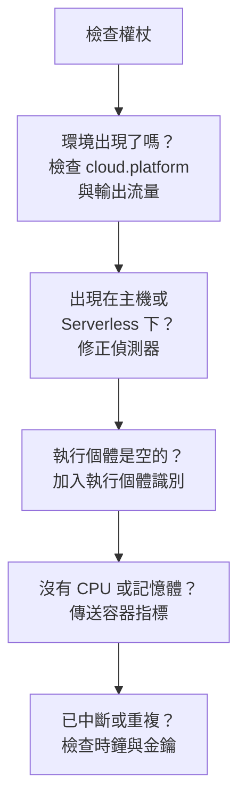

# 雲端疑難排解

找出雲端環境為什麼缺少、歸檔到錯誤的位置、是空的或出現重複。各節依這些問題發生的順序排列，每一節排除一層原因，所以請由上往下逐一檢查。只屬於某個平台的故障列在該平台頁面的最後：[AWS ECS / Fargate](/docs/telemetry/cloud-aws-ecs)、[Google Cloud Run](/docs/telemetry/cloud-gcp-cloud-run)、[Azure Container Apps](/docs/telemetry/cloud-azure-container-apps) 與 [其他雲端平台](/docs/telemetry/cloud-other-platforms)。



## 先檢查權杖

這是最省事的檢查，少了它，下面的一切都無法運作：

```bash
curl -i https://oneuptime.com/otlp/v1/validate \
  -H "x-oneuptime-token: YOUR_TELEMETRY_INGESTION_TOKEN"
```

| 回應 | 意義 |
| ------------------------- | -------------------------------------------------------------------------------------------------------------------------- |
| `200`, `"valid": true` | 權杖已被接受。它的 `keyType` 應為 `Server`：從 Collector 或後端服務傳送時，`Browser` 金鑰會被拒絕。 |
| `401`, `"valid": false` | 權杖缺少、未知、已撤銷、已停用或已過期，回應中的 `message` 會說明是哪一種。請在 **專案設定 → 遙測與 APM → 擷取金鑰** 中建立新金鑰，然後重新部署。 |

如果你自行託管 OneUptime，請使用 `https://YOUR-ONEUPTIME-HOST/otlp/v1/validate`。可以的話，請在任務、執行個體或複本內部執行檢查（ECS Exec、`az containerapp exec`）：這能證明工作負載本身可以連到 OneUptime，而不只是你的筆記型電腦。

## 環境沒有出現

第一個請求送出 1 分鐘後，**雲端 → All Environments** 下仍然什麼都沒有。請依序檢查以下三點。

**`cloud.platform` 缺少，或不是受控值。** 只有當資源帶有下列其中一個值時，OneUptime 才會把遙測資料歸檔到雲端環境下：`aws_ecs`、`aws_elastic_beanstalk`、`aws_app_runner`、`gcp_cloud_run`、`gcp_app_engine`、`azure_container_apps`、`azure_container_instances` 或 `azure_app_service`。常見原因：

- SDK 中關閉了資源偵測器（`OTEL_NODE_RESOURCE_DETECTORS`、`OTEL_EXPERIMENTAL_RESOURCE_DETECTORS`、`-Dotel.resource.providers.<cloud>.enabled=true`）。
- Collector 的管線略過了 `resourcedetection` 處理器。
- 在沒有偵測器的平台上，`OTEL_RESOURCE_ATTRIBUTES` 有拼字錯誤。

Node.js 與 .NET 的 Azure 偵測器寫入的是 `azure.container_apps`、`azure.app_service` 與 `azure.functions`；OneUptime 會把它們改寫為帶底線的值，所以它們同樣有效。若要查看遙測資料帶有什麼，請在 **服務** 下開啟該服務，從 **追蹤** 分頁開啟它的一筆追蹤，然後查看資源屬性。如果其中沒有 `cloud.platform`，問題就全在這裡。

**權杖錯誤。** 權杖檢查回傳了 `401`。Collector 會把它記錄為 `Permanent error: ... 401`。SDK 只會記錄一次就停止重試，這是正確的 OTLP 行為，但很容易被忽略。

**輸出流量被封鎖。** Collector 記錄了 `connection refused`、`context deadline exceeded`、`i/o timeout` 或 DNS 錯誤：

- **ECS 與 Fargate：** 私有子網路需要 NAT 閘道或 `assignPublicIp=ENABLED`，安全性群組必須允許 TCP 443 輸出。
- **Cloud Run：** **VPC egress: All traffic** 需要 Cloud NAT。
- **Container Apps：** 通往防火牆的使用者定義路由必須允許 OneUptime 主機。
- **所有平台：** 位於私人 DNS 名稱後方的自行託管 OneUptime，必須能從工作負載的網路解析。

## 它出現在主機下

資源帶有虛擬機器的平台值（`aws_ec2`、`gcp_compute_engine` 或 `azure_vm`），因此 OneUptime 把它歸檔到 **主機** 下：這對虛擬機器是對的，對受控運算則是錯的。虛擬機器的偵測器勝過了受控平台的偵測器：在 Collector 中設定了 `detectors: [ec2, elastic_beanstalk]`，而第一個設定 `cloud.platform` 的偵測器勝出；或 SDK 的順序偏向 EC2 偵測器。請把 `elastic_beanstalk` 放在前面，或自己在 `OTEL_RESOURCE_ATTRIBUTES` 中設定 `cloud.platform`，並只保留 `env` 偵測器。

## 它只出現在無伺服器函式下

資源帶有 `faas.name`，但沒有受控的 `cloud.platform`。GCP 偵測器執行時，Cloud Run 與 App Engine 會同時設定兩者。如果你手動設定了 `faas.name`，或 Collector 丟棄了 SDK 偵測器設定的資源屬性，就只滿足了無伺服器一側的條件。請開啟偵測器，或自己設定 `cloud.platform=gcp_cloud_run`（或 `gcp_app_engine`）、`cloud.account.id` 與 `cloud.region`。

> [!NOTE]
> 在 Cloud Run 與 App Engine 上，服務本來就應該同時出現在兩個地方：環境彙整專案與區域，而 **無伺服器函式** 顯示單一服務。

## 執行個體是空的

環境已經存在，但它的 **執行個體** 分頁中什麼都沒有：遙測資料沒有帶執行個體識別。OneUptime 會用它找到的下列第一個資源屬性為執行個體命名：

1. `aws.ecs.task.id`
2. `aws.ecs.task.arn`（縮短為任務 ID）
3. `faas.instance`
4. `azure.container_app.instance.id`
5. `service.instance.id`
6. `container.id`
7. `host.id`
8. `host.name`

平台自己的識別排在 `service.instance.id` 之前，因此 SDK 為每個程序產生的 ID（Node.js SDK 預設就是如此）不會把任務與它的 sidecar 的 CPU 與記憶體拆開。各平台由誰設定識別：

| 平台 | 由誰設定識別 |
| ----------------------------------------- | ------------------------------------------------------------------------------------------------------------------------------------------------ |
| ECS | `ecs` 偵測器設定任務 ARN |
| Cloud Run, App Engine | `gcp` 偵測器設定 `faas.instance` |
| Container Apps | Collector 的 `azurecontainerapps` 偵測器設定複本 ID；或根據 `CONTAINER_APP_REPLICA_NAME` 設定 `service.instance.id`，或執行主機偵測器 |
| App Runner, Container Instances | 主機偵測器的 `host.name` |
| App Service, Elastic Beanstalk | 平台的偵測器設定 `service.instance.id`；在 Beanstalk 上請刪除它，讓 `host.id` 為每個執行個體命名 |

在第一個帶有該屬性的訊號送達後的 1 分鐘內，執行個體就會出現。

## CPU 與記憶體是空的

執行個體已經列出，但概覽中的 **CPU** 與 **記憶體** 圖格，以及 **執行個體** 中的 CPU 與記憶體欄位都是空的。這些資料來自指標而不是追蹤：也就是 `container.cpu.utilization` 與 `container.memory.usage`（或 `container.memory.usage.total`）資料點，其資源帶有與追蹤相同的執行個體識別以及 `cloud.platform`。

- **在 ECS 上**，sidecar Collector 中的 `awsecscontainermetrics` 接收器會以 `ecs.task.cpu.utilized` 與 `ecs.task.memory.utilized` 的形式提供它們。請把它保留在 `metrics` 管線中，並在同一個管線中保留 `resourcedetection`，否則指標送達時不會帶有 `cloud.platform`，而會被歸檔到別處。
- **在 Cloud Run、Container Apps 與其他平台上**，平台不會向 sidecar 公開容器的使用量。除非你自己傳送這些指標，否則圖格會保持空白：請改為查看請求圖格。
- **使用 SDK direct 時**，沒有任何東西會傳送容器指標，因此圖格是空的屬於正常現象。

## 環境顯示已中斷

當一個環境 15 分鐘內沒有收到任何遙測資料時，會顯示 **已中斷**，下一個 span、日誌或指標會讓它恢復。OneUptime 本身停機或追趕積壓資料的時間不計入。在遙測資料持續流入時，最後一次出現的時間最多可能延遲五分鐘，這就是門檻設為 15 的原因。

- **忙碌的環境顯示已中斷：** 匯出器停止了。請在 Collector 日誌中尋找上面提到的 `401` 與輸出流量錯誤。
- **夜間縮減到零的預備環境** 會一直顯示已中斷，直到早上第一個請求到來，這是正確的。

執行個體有兩個時鐘：

- **Stale：** 如果任務、執行個體或複本在過去 15 分鐘內沒有回報，**執行個體** 分頁會將其標示為 **Stale**，概覽只會把其餘的計為線上。
- **刪除：** 清理作業會刪除在 `CLOUD_INSTANCE_STALE_MINUTES`（預設 15，最少 10）內未出現的執行個體列，這段時間從環境本身最後一次收到遙測資料起算，因此 Collector 中斷只會凍結這個時鐘，而不會清空最後已知的任務清單。無伺服器函式使用 `SERVERLESS_INSTANCE_STALE_MINUTES`。提高門檻會讓列保留得更久，但不會改變它們變成 **Stale** 的時間。

## 應該只有一個環境卻出現兩個

環境金鑰是 `cloud.platform|cloud.account.id|cloud.region`，會逐字元比較。如果有些工作負載設定了 `cloud.account.id` 而其他沒有，一個寫 `eastus` 而另一個寫 `East US`，或一個 Collector 執行了 `ecs` 偵測器而另一個沒有，你就會並排看到 `aws_ecs|123456789012|us-east-1` 與 `aws_ecs||us-east-1`。

開啟每個環境的 **概覽**：它的 **環境金鑰** 會顯示哪一部分不同。請修正缺少該值的工作負載。帶有空白部分的環境將不再收到遙測資料，你可以將其封存。

## 手動建立的環境始終無法比對

擷取流程只依金鑰比對環境，而金鑰必須正好是 `platform|account|region`，例如 `aws_ecs|123456789012|us-east-1`：也就是與遙測資料帶有的完全相同的平台值、帳戶 ID 與區域。建立表單（**雲端 → All Environments** 下的 **建立雲端資源**）會用 **雲端平台**、**雲端帳戶 ID** 與 **雲端區域** 欄位建立金鑰，因此這三個值必須與遙測資料逐字元一致。如果不一致，擷取流程就會用它算出的金鑰建立第二個環境，而你建立的環境會保持空白。請封存手動建立的環境，讓擷取流程建立正確的環境，或以修正後的值重新建立。

## 仍然無法解決

在尋求協助之前，請收集以下資訊：

- 工作負載中一筆真實 span 或日誌記錄的資源屬性。Collector 的 `debug` 匯出器可以印出它們，你也可以在 **服務** 下開啟該服務的一筆追蹤。
- 在工作負載內部執行 `/otlp/v1/validate` 檢查所得到的回應。
- Collector 日誌的最後 50 行，或開啟 `OTEL_LOG_LEVEL=debug` 後 SDK 的診斷日誌。
- 每個已出現環境的 **環境金鑰**。

接著聯絡 support@oneuptime.com，或在 [GitHub](https://github.com/OneUptime/oneuptime) 上建立 issue。

## 後續步驟

:::cards
- [雲端環境](/docs/telemetry/cloud-environments): 環境與執行個體是如何識別的。
- [AWS ECS / Fargate](/docs/telemetry/cloud-aws-ecs): ECS 的設定，附上完整的任務定義。
- [OpenTelemetry](/docs/telemetry/open-telemetry): 端點、限制，以及每種回應的意義。
:::
