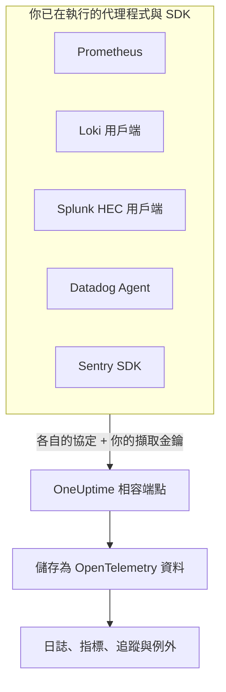

# Prometheus, Loki, Splunk, Datadog & Sentry

已經在執行 Prometheus、Loki 用戶端、Splunk 轉送器、Datadog Agent 或 Sentry SDK？繼續使用它們即可。OneUptime 會在這些工具原本就使用的路徑上，接收它們各自傳送的資料，並將其儲存為 OpenTelemetry 資料。試用 OneUptime 只需更換 URL 與金鑰，不必重新檢測；你的捨棄過濾器、清理規則、日誌管道、資料保留與擷取預算，也會像對待其他資料一樣套用到這些資料上。

:::cards
- [Prometheus remote write](#prometheus-remote-write): 來自 Prometheus、Grafana Alloy 或任何 remote write 傳送端的指標。
- [Loki](#loki): 來自 Promtail、Grafana Alloy、Fluent Bit 或 Vector 的日誌。
- [Splunk HTTP Event Collector](#splunk-http-event-collector): 來自任何 HEC 用戶端的日誌與指標事件。
- [Datadog Agent](#datadog-agent): 來自 Datadog Agent 的指標與日誌。
- [Sentry SDK](#sentry-sdk): 來自任何 Sentry SDK 的錯誤、交易與日誌。
:::

## 運作方式



每個端點都以其工具自己的方式回應：Prometheus 與 Loki 得到 `204`，HEC 得到 `{"text": "Success", "code": 0}`，Datadog 得到 `202`，Sentry 得到事件 ID，因此工具會像以往一樣回報成功與失敗。之後，這些資料的處理方式與來自 OpenTelemetry SDK 的資料完全相同。

## 開始之前

- **一個 OneUptime 專案**：在 OneUptime Cloud 上，遙測資料依擷取的 GB 計費，而且 Free 方案的專案必須先新增付款方式才能傳送遙測資料。
- **遙測擷取金鑰**：在 **產品 → 專案設定 → 遙測與 APM → 擷取金鑰** 下建立一個 **伺服器** 金鑰，並複製它的 **密鑰金鑰**。每個工具都會在傳送自身憑證的位置傳送它。瀏覽器應用程式的 Sentry DSN 則要改用一個 **瀏覽器** 金鑰，並在其中設定你網站的來源。
- **你的主機**：範例使用 `oneuptime.com`。如果你自行託管 OneUptime，請使用你自己的主機。

> [!TIP]
> 日誌、指標、追蹤與例外的設定指南分頁，在它自己的傳送方式中列出了這些工具，並已填好你的主機與你選擇的金鑰。

## 端點

| 工具 | 指向的位址 | 金鑰放在哪裡 |
| --- | --- | --- |
| Prometheus remote write | `https://oneuptime.com/telemetry/prometheus/api/v1/write` | Bearer 權杖，或以金鑰作為密碼的 Basic 驗證。 |
| Loki | `https://oneuptime.com/telemetry/loki/api/v1/push` | 以金鑰作為密碼的 Basic 驗證，或 Bearer 權杖。 |
| Splunk HTTP Event Collector | `https://oneuptime.com/telemetry/services/collector` | HEC 權杖：`Authorization: Splunk <key>`。 |
| Datadog Agent | `https://oneuptime.com/telemetry/datadog` | API 金鑰：`DD-API-KEY`。 |
| Sentry SDK | DSN `https://<key>@oneuptime.com/telemetry/sentry/1` | DSN 的公開金鑰。 |

每個端點也都接受放在 `x-oneuptime-token` 標頭中的金鑰，而 `x-oneuptime-service-name` 標頭用來指定所傳送的全部資料所屬的服務。金鑰可以寫成不含連字號的 32 個十六進位字元；Sentry DSN 與 Datadog API 金鑰必須這樣寫。

## Prometheus remote write

將 OneUptime 新增為 remote write 目標。Prometheus 會像現在一樣繼續抓取，並將每個樣本的副本傳送過來：

```yaml title="prometheus.yml"
remote_write:
  - url: https://oneuptime.com/telemetry/prometheus/api/v1/write
    authorization:
      credentials: YOUR_TELEMETRY_KEY
```

使用 Grafana Alloy 時，新增一個 `prometheus.remote_write` 元件，並將抓取結果轉送給它：

```text title="config.alloy"
prometheus.remote_write "oneuptime" {
  endpoint {
    url          = "https://oneuptime.com/telemetry/prometheus/api/v1/write"
    bearer_token = "YOUR_TELEMETRY_KEY"
  }
}
```

remote write 1.0 與 2.0 都可以接受，並且與所有傳送端的傳送方式一樣，經過 snappy 壓縮。

### 序列會變成什麼

- **名稱與標籤保持不變。** `http_requests_total{job="checkout", code="500"}` 會成為帶有屬性 `job` 與 `code` 的指標 `http_requests_total`，因此從 Grafana 移過來的查詢也能找到它。
- **job 就是服務。** 依照 OpenTelemetry 對 Prometheus 的對應規則，每個 `job` 成為一個服務，每個 `instance` 成為該服務的執行個體。
- **類型會保留。** 計數器，以及直方圖的區間與計數，都是累積總和，因此它們的速率能正確繪製成圖表。類型來自傳送端附帶的中繼資料；沒有中繼資料時，名稱以 `_total` 結尾的是計數器，帶有 `le` 標籤的 `_bucket` 是直方圖的區間。
- **原生直方圖** 會變成指數直方圖，具有自訂區間的原生直方圖會變成直方圖。
- **不保留：** 過時標記（staleness marker）以及其他 NaN 或無限大樣本、計數器的 `_created` 序列，以及 exemplar。

## Loki

OneUptime 在 Loki 自己的路徑上接收 Loki 的 push API，格式可以是 JSON，也可以是 Promtail 與 Grafana Alloy 傳送的 snappy 壓縮 protobuf。將它新增為一個用戶端：

```yaml title="promtail.yaml"
clients:
  - url: https://oneuptime.com/telemetry/loki/api/v1/push
    bearer_token: YOUR_TELEMETRY_KEY
```

Fluent Bit 的 `loki` 輸出需要分開填寫主機與路徑：

```text title="fluent-bit.conf"
[OUTPUT]
    Name         loki
    Match        *
    Host         oneuptime.com
    Port         443
    Tls          On
    Uri          /telemetry/loki/api/v1/push
    Http_User    oneuptime
    Http_Passwd  YOUR_TELEMETRY_KEY
    Labels       job=fluent-bit
```

### 日誌串流會變成什麼

- **每個項目都是一筆日誌**，帶有精確到奈秒的自身時間戳記，並以該行作為內文。
- **標籤與結構化中繼資料都是屬性**，名稱與在 Loki 中的相同。
- **服務** 取串流所帶有的 `service_name`、`service`、`app`、`application`、`name`、`app_kubernetes_io_name`、`container`、`container_name`、`component`、`workload` 與 `job` 中排在最前面的一個，與 Loki 的尋找方式相同。`host` 或 `hostname` 標籤指定主機。
- **等級** 來自 `level`、`detected_level` 或 `severity` 標籤或中繼資料，否則來自 logfmt 的 `level=` 或 JSON 行的 `level` 欄位。
- **追蹤脈絡：** 結構化中繼資料中的 `trace_id` 與 `span_id` 會將日誌連結到它的追蹤。

## Splunk HTTP Event Collector

將 OneUptime 當作 HTTP Event Collector 使用，並以你的擷取金鑰作為 HEC 權杖。Splunk 的 Docker 記錄驅動程式會自行加上路徑，所以只需填寫主機：

```bash
docker run \
  --log-driver=splunk \
  --log-opt splunk-url=https://oneuptime.com \
  --log-opt splunk-token=YOUR_TELEMETRY_KEY \
  --log-opt splunk-format=json \
  your-image
```

其他任何 HEC 用戶端都會 POST 到 `/services/collector/event` 或 `/services/collector/raw`。傳送一個事件：

```bash
curl https://oneuptime.com/telemetry/services/collector/event \
  -H "Authorization: Splunk YOUR_TELEMETRY_KEY" \
  -d '{"event": "Payment failed for order 42", "sourcetype": "app", "fields": {"service": "checkout"}}'
```

回應 `200` 並帶有 `{"text": "Success", "code": 0}`，表示事件已被接受。此端點也會以 HEC 自己的代碼回應：`No data`（5）、附帶無效事件編號的 `Invalid data format`（6），以及 `Event field is required`（12）；而且不需權杖即可回應 `GET /services/collector/health`。

### 事件會變成什麼

- **一筆日誌**，以其 `time` 作為時間戳記。字串事件本身就是內文；物件事件的 `message`、`msg`、`log`、`line` 或 `text` 是內文，其他欄位是屬性。
- **中繼資料會保留：** `host` 是主機，`source`、`sourcetype` 與 `index` 分別保存為 `com.splunk.source`、`com.splunk.sourcetype` 與 `com.splunk.index`。事件中缺少的部分，由查詢字串中的 `host`、`source`、`sourcetype` 與 `index` 補上。
- **欄位都是屬性。** `service.name` 欄位指定服務，日誌的 `service` 欄位也一樣。
- **指標事件**（`"event": "metric"`，帶有 `metric_name` 與 `_value`，或 `metric_name:<name>` 欄位）會儲存為指標，絕不會儲存為日誌。
- **不提供：** 索引子確認（indexer acknowledgement）。要求它的用戶端不會得到 `ackId`。

## Datadog Agent

將 Agent 的指標與日誌指向 OneUptime，並以你的擷取金鑰作為它的 API 金鑰：

```yaml title="datadog.yaml"
api_key: YOUR_TELEMETRY_KEY_WITHOUT_HYPHENS
dd_url: https://oneuptime.com/telemetry/datadog
logs_enabled: true
logs_config:
  use_http: true
  logs_dd_url: oneuptime.com:443
apm_config:
  enabled: false
process_config:
  process_collection:
    enabled: false
```

Agent 會在 `dd_url` 後加上自己的路徑，並將日誌傳送到 `logs_dd_url` 所指定主機與連接埠上的 `/api/v2/logs`。只有對帶有 `DD-API-KEY` 標頭的請求，OneUptime 才會在根路徑上回應這些路徑。修改後重新啟動 Agent；當 OneUptime 接受該 API 金鑰時，`datadog-agent status` 會顯示它有效。

### Agent 的資料會變成什麼

- **指標** 保留名稱。Gauge 仍為 Gauge，Count 變為 Sum，Rate 變為其每秒值的 Gauge。
- **分佈**（distribution）會變為帶有計數、總和、最小值與最大值的摘要（summary）。
- **服務檢查** 會變成以該檢查命名的指標，其值為檢查的狀態：0 表示 OK，1 表示警告，2 表示嚴重，3 表示未知。
- **日誌** 保留訊息、狀態、主機與服務，其餘欄位作為屬性保留。
- **標籤都是屬性**，`service`、`env` 與 `version` 標籤分別指定服務、其環境與其版本。
- **尚未讀取：** APM 追蹤、處理程序、容器、網路資料與效能剖析資料。請像上面那樣在 `datadog.yaml` 中將它們關閉。

Datadog 的 HTTP API 用戶端（向 `/api/v2/logs` 傳送 POST 的日誌程式庫、傳送序列的指令碼）也可以帶上 `DD-API-KEY` 標頭，傳送到同一個端點。

## Sentry SDK

在你設定 Sentry 的地方替換 DSN。其餘的 Sentry 程式碼保持不變：

```javascript
Sentry.init({
  dsn: "https://YOUR_TELEMETRY_KEY_WITHOUT_HYPHENS@oneuptime.com/telemetry/sentry/1",
  release: "checkout@1.4.2",
  environment: "production",
});
```

```python
sentry_sdk.init(
    dsn="https://YOUR_TELEMETRY_KEY_WITHOUT_HYPHENS@oneuptime.com/telemetry/sentry/1",
    release="checkout@1.4.2",
    environment="production",
)
```

DSN 結尾的 `1` 是 Sentry SDK 所要求的，不會被讀取。瀏覽器應用程式的 DSN 是公開的，所以那裡請使用一個 **瀏覽器** 擷取金鑰，並在其中設定你網站的來源。

### 信封會變成什麼

- **錯誤** 會出現在「例外」中，帶有它們的堆疊追蹤與導致它們的例外，並像其他例外一樣分組。每個錯誤都是其追蹤上的一個 span，位於當時處於作用中的 span 之下。
- **交易** 及其 span 會出現在「追蹤」中。
- **Sentry 日誌** 以及用 `capture_message` 捕捉的訊息會出現在「日誌」中。
- **服務** 取 `service` 標籤，否則取發行版本名稱中 `@` 之前的部分：`checkout@1.4.2` 即 `checkout`。發行版本即服務版本，環境也會保留。
- **不保留：** 工作階段、重播、附件、效能剖析資料與 check-in。SDK 仍會傳送它們；OneUptime 接受後將其捨棄。

## 限制與擷取預算

- **請求大小**：OneUptime 的輸入端在 `/telemetry` 下接受最大 4 MB 的請求，每個內文解壓縮後最多 64 MB。
- **擷取預算**：Prometheus remote write 與 Loki 在讀取內文之前，就會對照指標或日誌預算進行檢查，預算用完時以 `403` 拒絕。HEC 批次、Datadog 承載或 Sentry 信封可能帶有多種訊號，因此每種訊號會在儲存時計入它自己的預算，並在該預算用完時遭到捨棄。

## 疑難排解

### 每個請求都以 401 遭到拒絕

金鑰沒有出現在端點尋找它的位置，或者它不是這個專案的金鑰。對照[端點](#端點)表檢查工具的憑證設定，並確認該金鑰沒有被關閉或過期。

### Sentry SDK 顯示 DSN 無效

Sentry SDK 會拒絕金鑰中含有連字號的 DSN。請將金鑰寫成不含連字號的 32 個十六進位字元。

### Datadog 指標有送達，但日誌沒有

檢查 `logs_config.use_http` 是否為 `true`，以及 `logs_config.logs_dd_url` 是否為主機與連接埠，而不是 URL。未設定 `use_http` 時，Agent 會透過 TCP 傳送日誌。

### Prometheus 回報 415

傳送端要求了 OneUptime 不讀取的 remote write 協定。請傳送 remote write 1.0 或 2.0。
