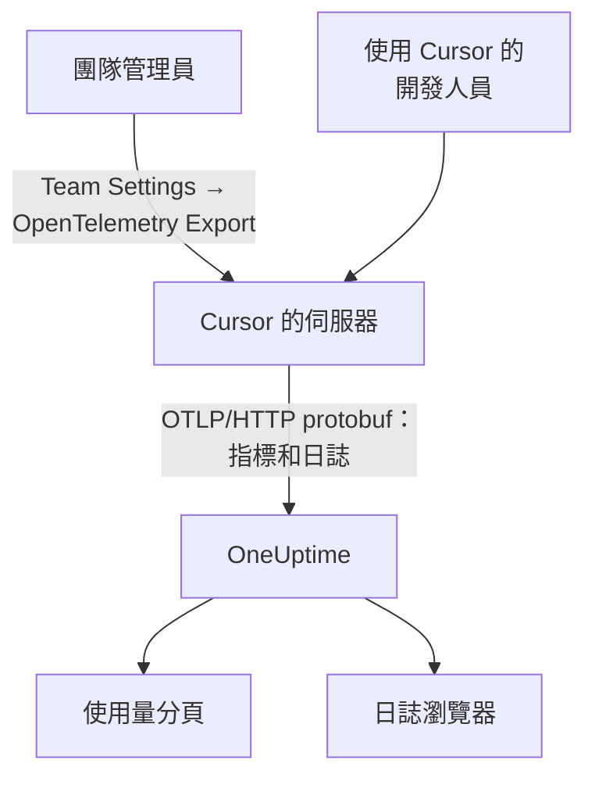

# Cursor

Cursor 會從 Cursor 自己的伺服器匯出團隊的遙測。團隊管理員在 Cursor 儀表板中把 OneUptime 新增為目的地一次，整個團隊的 token、估算成本和工具呼叫就會抵達：不需要在開發人員機器上安裝或設定任何東西。

:::cards
- [開始設定](#開始設定): 在 OneUptime 中建立金鑰，在 Cursor 中建立目的地。
- [你能得到什麼](#你能得到什麼得不到什麼): 指標和日誌；沒有追蹤。
- [誰花了什麼](#員工歸屬): 人員會以 Cursor 使用者 ID 的形式抵達。
- [疑難排解](#疑難排解): 什麼都沒有抵達時要檢查什麼。
:::

## 運作方式



## 開始之前

- **Cursor 的 Enterprise 方案。** 其他方案中沒有 OpenTelemetry Export 畫面。
- **Cursor 能從網際網路存取的端點。** 是 Cursor 主動連線到你，而且從一組固定的位址發起連線。OneUptime Cloud 不需要其他操作；位於防火牆後方的自行託管 OneUptime 必須允許 Cursor 在其 [OpenTelemetry Export](https://cursor.com/docs/enterprise/opentelemetry-export) 頁面上列出的輸出位址。

## 開始設定

:::steps
### 建立擷取金鑰

在 OneUptime 中開啟 **專案設定 → 遙測與 APM → 擷取金鑰** ，按一下 **建立擷取金鑰** 並複製金鑰。你的 OTLP 基礎 URL 是 `https://oneuptime.com/otlp`；如果你自行託管 OneUptime，則是 `https://YOUR-ONEUPTIME-HOST/otlp`。

### 在 Cursor 中建立目的地

在 Cursor 的網頁儀表板中，以團隊管理員身分開啟 **Team Settings → OpenTelemetry Export** 並建立目的地：

| 欄位 | 值 |
| --- | --- |
| Endpoint (base URL) | `https://oneuptime.com/otlp` |
| Header name | `x-oneuptime-token` |
| Header value | `YOUR_INGESTION_TOKEN` |

輸入基礎 URL 時不要加上 `/v1`：Cursor 會自行附加 `/v1/metrics` 和 `/v1/logs`，而 `https://oneuptime.com/otlp/v1` 會傳送到 `/otlp/v1/v1/metrics`，那裡什麼也收不到。

### 測試並啟用

按一下 **Test connection** 檢查 URL 和標頭，然後按一下 **Enable** 。匯出大約一分鐘內就會開始；之後對標頭的修改大約 30 秒生效。

### 確認資料已抵達

使用 Cursor 一兩分鐘，然後在 OneUptime 中開啟 **日誌** ，依服務名稱 `cursor` 篩選：帶有 token 數的 `cursor.api.request` 記錄表示金鑰和 URL 都正確。
:::

Cursor 只使用以 HTTP 傳輸、二進位 protobuf 格式的 OTLP（不支援 gRPC，也不支援 JSON），OneUptime 可以直接接受。它會加密儲存標頭，而且每個團隊只會傳送到一個目的地：如果要同時傳送到 OneUptime 和其他地方，請在前面放一個 Collector。

## 你能得到什麼，得不到什麼

| 訊號 | 來自 Cursor |
| --- | --- |
| 指標：token、估算成本、工具呼叫 | 是，以差異值形式 |
| 日誌事件：要求、錯誤、更正、技能、勾點、外掛程式、雲端代理程式 | 是 |
| 提示和回答文字 | 只有開啟 `conversation_content` 系列時才有 |
| 追蹤 | 否 |
| 啟用目的地之前的任何資料 | 否 |

因此在 OneUptime 中，Cursor 會依 `cursor.token.usage` 和 `cursor.cost.usage` 顯示在 **產品 → AI / LLM** 的 **使用量** 分頁上，但絕不會出現在由追蹤建構的 **呼叫** 或 **對話** 中。逐筆要求的詳細資訊是 **日誌** 瀏覽器中的 `cursor.api.request` 事件。

### 系列

每種訊號以及每個遙測系列，在 Cursor 的設定中都有自己的開關：

| 系列 | 涵蓋內容 |
| --- | --- |
| `model_usage` | `cursor.token.usage`、`cursor.cost.usage`，以及 `cursor.api.request`、`cursor.api.error` 和 `cursor.api.correction` 事件 |
| `tool_calls` | `cursor.tool.calls` |
| `skills_hooks_plugins` | 技能、勾點和外掛程式事件 |
| `cloud_agents` | `cursor.cloud_agent.*` 事件 |
| `grok_bot_agent_actions` | `cursor.grok_bot.*` 事件；需要 Action Recording |
| `conversation_content` | 訊息文字，以及 MCP 工具的輸入和輸出；預設關閉 |

除了 `conversation_content`，所有系列一開始都是開啟的。Cursor 之後新增的系列也會預設開啟，除非你關閉 `auto_enable_new_families`。

## 指標和事件

三個指標都是差異值加總：

| 指標 | 單位 | 屬性 |
| --- | --- | --- |
| `cursor.token.usage` | `{token}` | `cursor.token.type`：`input`、`output`、`cache_read`、`cache_creation`；`cursor.model.name`；`cursor.api.status`：`success`、`errored`、`aborted`；`cursor.api.billable` |
| `cursor.cost.usage` | `USD` | `cursor.model.name` |
| `cursor.tool.calls` | `{call}` | `cursor.tool.kind`：`builtin`、`mcp`；`cursor.tool.name`；`cursor.tool.status`：`success`、`failure`、`aborted`；`cursor.mcp.server.name` |

資料點不帶任何對話 ID 或要求 ID，因此指標中沒有依工作階段的成本。`cursor.model.name` 是要求的模型，路由後的選擇會被合併：依模型的細分中有一列名為 `Auto`，無法拆分到 Cursor 實際路由到的各個模型。

你最常用的日誌事件是 `cursor.api.request`：每個要求一筆，包含輸入、輸出和快取的 token 數、模型，以及是否計費。`cursor.api.error` 會記錄失敗的要求（不含錯誤訊息），`cursor.api.correction` 會稍後抵達，說明某個要求最終沒有計費。Cursor 的 [格式參考](https://cursor.com/docs/enterprise/opentelemetry-export/wire) 列出了每個事件和屬性。

每筆記錄都帶有下列資源屬性：

| 屬性 | 意義 |
| --- | --- |
| `service.name` | 一律為 `cursor`：在 **日誌** 和 **指標** 瀏覽器中依它篩選 |
| `cursor.team.id` | 你的團隊，一個整數；一律存在 |
| `cursor.user.id` | 人員，一個在團隊範圍內有效的整數；選用 |
| `cursor.surface` | 活動的來源，例如 `desktop`、`cli`、`cloud_agent` 或 `bugbot` |
| `cursor.entrypoint` | 活動的開始方式，例如 `desktop`、`cli`、`web`、`api` 或 `github_pr` |

## 員工歸屬

**Cursor 用 `cursor.user.id` 指明一個人，這是一個只有 Cursor 才能轉換成姓名的整數，而且雲端代理程式經常省略它。** OneUptime 會把它讀取為員工，把 `cursor.team.id` 讀取為團隊，因此 **使用量** 分頁不需要設定就能為人員和團隊排名，但人員會顯示為整數。

- 兩者都以資源屬性（`resource.cursor.user.id`、`resource.cursor.team.id`）的形式抵達，OneUptime 會讀取它們。
- Cursor 也可以傳送 `cursor.user.email`，但 OneUptime 還不會讀取它，因此對 Cursor 而言，員工電子郵件欄會保持空白。
- `gen_ai.user`、`llm.user` 和 LiteLLM 的終端使用者 ID 絕不會被讀取為員工：它們指的是你的客戶，而不是你的員工。請參閱 [員工和團隊歸屬](/docs/telemetry/ai-coding-assistants#員工和團隊歸屬)。

### Cursor 在使用量分頁上的顯示位置

Cursor 傳送指標而不傳送 GenAI span，而指標只用來補充 span： **如果同一個專案接收帶有成本的 GenAI span，Cursor 的支出就不會顯示。** 請把 Cursor 傳送到單獨的專案。請參閱 [span 優先，指標補充](/docs/telemetry/ai-llm-observability#span-優先指標補充)。

| 細分 | 對 Cursor 而言 |
| --- | --- |
| **員工** | 是，依 `cursor.user.id` |
| **團隊** | 是，依 `cursor.team.id` |
| **模型** | 是，依 `cursor.model.name` |
| **提供者** | 否：Cursor 從不說明是哪個提供者處理了呼叫 |
| **應用程式 / 服務** | 否：Cursor 的指標不屬於任何 OneUptime 服務 |

Cursor 的資料列只攜帶成本：其呼叫和 token 儲存格顯示 `—`，因為 `cursor.cost.usage` 沒有逐次呼叫的細節。`cursor.token.usage` 仍會為表格上方的 token 總數提供資料（它的 `input` 和 `output` 類型；不計快取 token），你也可以在儀表板上依 `cursor.token.type` 繪製它。

:::details 把 Cursor 使用者 ID 轉換成人員
姓名和計費金額位於 Cursor 的 Admin API 中，OneUptime 不會呼叫它：如有需要，請自行呼叫。它僅限 Enterprise，位址為 `https://api.cursor.com`，使用管理員 API 金鑰作為使用者名稱，密碼留空：

```bash
curl -u YOUR_API_KEY: https://api.cursor.com/teams/members
```

`GET /teams/members` 會列出每位成員的電子郵件和姓名。`POST /teams/filtered-usage-events` 會傳回依事件的計費使用量；把其中的 `chargedCents` 加總即可得到支出。它的 `conversationId` 與 Cursor 日誌事件上的 `cursor.conversation.id` 一致，當兩邊都帶有它時，就能把一個人和一筆計費金額關聯到你已經看到的工作階段。Cursor 並未說明整數 `cursor.user.id` 與 Admin API 的使用者 ID 是否相同，因此在據此向任何人收費之前，請先在你自己的團隊中確認。
:::

## Cursor 的傳遞方式

這些規則會改變你在圖表中看到的內容，因此在回報資料缺口之前請先了解它們：

- **指標最多傳送一次。** 失敗的匯出不會重試，因此失敗後出現短暫缺口是正常的：請不要因為 Cursor 指標中的缺口而呼叫任何人。
- **日誌至少傳送一次**，依 `cursor.event.id` 去除重複，並在大約 7 天內自動重試。
- **沒有順序保證。** `cursor.api.correction` 會在它所更正的要求之後抵達：請依記錄的時間戳記排序，而不是依抵達順序。
- **不會回填。** 啟用目的地之前的資料不會抵達，而處於故障狀態的目的地會遺失 Cursor 未能傳送的資料。
- **停用或刪除目的地會捨棄傳輸中的資料。** 若要更換擷取金鑰，請編輯目的地的標頭，而不是刪除後重新建立。

## 成本是估算，不是帳單

Cursor 將 `cursor.cost.usage` 描述為盡力而為的估算。它不區分方案內含的使用量和隨需計費的使用量；使用你自己的模型金鑰時，它只反映 Cursor 的 token 費率，而不是你的提供者的帳單；而且之後抵達的 `cursor.api.correction` 可能會撤回已經計入的使用量。請把它當作趨勢來看。如需與帳單一致的數字，請把 Cursor Admin API 中的 `chargedCents` 加總。

## 疑難排解

:::details 什麼都沒有抵達
在 Cursor 中再次執行 **Test connection** 。請確認基礎 URL 沒有以 `/v1` 結尾、標頭名稱為 `x-oneuptime-token` 且其值正是金鑰，以及 `model_usage` 系列已開啟。匯出會在你啟用目的地後大約一分鐘開始。
:::

:::details 自行託管的 OneUptime 什麼都沒收到
Cursor 會從自己的伺服器發起連線：你的 OTLP 端點必須能透過公用 DNS 名稱從網際網路存取，並在防火牆中允許 Cursor 的輸出位址。
:::

:::details 日誌抵達了，但使用量分頁沒有顯示 Cursor 的支出
該專案還接收帶有成本的 GenAI span，因此不會讀取 Cursor 的指標。請把 Cursor 傳送到單獨的專案，並使用它自己的擷取金鑰。
:::

:::details 人員顯示為數字
那就是 `cursor.user.id`：這是 OneUptime 目前從 Cursor 讀取的唯一人員 ID。請用 Cursor 的 Admin API 把它對應到姓名。
:::

## 後續步驟

:::cards
- [AI 程式設計助理](/docs/telemetry/ai-coding-assistants): 支出如何在所有程式設計助理之間歸屬。
- [AI 閘道](/docs/telemetry/ai-gateways): 為你自己的應用程式發起的模型呼叫提供完整的追蹤和提示。
- [指標監控](/docs/monitor/metrics-monitor): 針對 `cursor.cost.usage`、`cursor.token.usage` 或 `cursor.tool.calls` 設定警示。
:::
