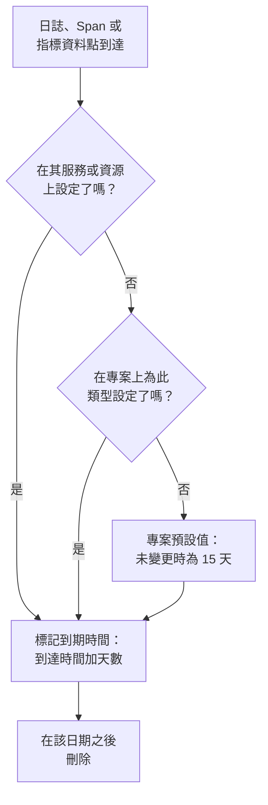

# 資料保留

OneUptime 會把你的日誌、追蹤、指標和效能剖析資料保留一定天數，然後刪除：除非你變更，否則為 15 天。本頁說明這個天數如何決定、如何為整個專案變更它，以及如何讓部分遙測比其餘遙測保留得更久或更短。

:::cards
- [遙測保留多長時間](#遙測保留多長時間): OneUptime 讀取設定的順序。
- [變更專案的保留期](#變更專案的保留期): 為你的所有遙測設定一個天數。
- [讓部分遙測保留更久或更短](#讓部分遙測保留更久或更短): 依類型、嚴重程度、狀態或服務。
- [保留的成本](#保留的成本): OneUptime Cloud 上的計費，自行託管時的磁碟。
:::

## 遙測保留多長時間

每筆日誌、Span、指標資料點和效能剖析樣本都在到達時取得其保留期。OneUptime 計算要保留多少天，標記它的到期日期，並在該日期之後刪除它。最具體的設定優先：

具體來說，OneUptime 依以下順序讀取這些設定，第一個已設定的設定起決定作用：

| 順序 | 設定 | 設定位置 |
| --- | --- | --- |
| 1 | 針對某個服務或資源，某個日誌嚴重程度或 Span 狀態的天數 | 其 **設定** 頁面上的 **依遙測類型的保留時間** |
| 2 | 針對某個服務或資源，某種遙測類型的天數 | 同一張卡片 |
| 3 | 來自某個服務或資源的所有內容的天數 | 同一頁面上的 **遙測資料保留** |
| 4 | 針對專案，某個日誌嚴重程度或 Span 狀態的天數 | **資料保留** 上的 **依遙測類型的保留時間** |
| 5 | 針對專案，某種遙測類型的天數 | 同一張卡片 |
| 6 | 其他所有內容的天數 | **資料保留** 上的 **預設保留期（天）** |

- **設定 1 到 5 是保留期覆寫。** 它們屬於 [企業版](/docs/self-hosted/enterprise)，以及 OneUptime Cloud 上的 Scale 方案。沒有它們時，每筆記錄都依專案預設值保留。
- **變更適用於新的遙測。** 記錄會保留它被標記的日期：較短的保留期不會讓它更早被刪除，較長的保留期也不會讓它保留得更久。新記錄會在大約五分鐘內遵循變更。
- **例外跟隨其來源。** 例外的保留時間與它所在的 Span 或日誌相同。Session Replay 有自己的保留期：請參閱 [有自己保留期的其他資料](#有自己保留期的其他資料)。

## 開始之前

- **能夠修改專案的角色。** Project Owner 或 Project Admin 可以變更專案的保留期。服務或資源的保留期需要能夠修改其其他設定的角色。
- **覆寫需要企業版或 Scale 方案。** 自行託管的安裝需要 Enterprise 授權，OneUptime Cloud 專案需要 Scale 或更高方案。專案的預設保留期在所有版本和方案中都有。

## 變更專案的保留期

:::steps
### 開啟資料保留

前往 **專案設定 → 遙測與 APM → 資料保留**。側邊選單中的 **遙測與 APM** 預設為收合：點選它即可展開。**遙測資料保留** 卡片會顯示 **預設保留期（天）**。

### 設定天數

點選 **Edit Retention Settings**，輸入天數（至少為 1），然後點選 **儲存變更**。
:::

新的天數適用於此後到達且沒有自己覆寫的每筆記錄。

## 讓部分遙測保留更久或更短

覆寫讓你需要的內容保留更久，其餘內容保留更短：例如錯誤日誌保留一季，偵錯日誌保留幾天。

### 針對整個專案

在預設值下方，**依遙測類型的保留時間** 卡片會為每種遙測類型設定天數。點選 **Edit Overrides**，填寫需要的欄位，其餘留空：

| 類型 | 欄位 |
| --- | --- |
| 日誌 | **Logs default (days)**，以及每個日誌嚴重程度各一個欄位 |
| 追蹤 | **Traces default (days)**，以及每個 Span 狀態各一個欄位：錯誤、確定和未設定 |
| 指標 | **Metrics default (days)** |
| 效能剖析 | **Profiles default (days)** |

留空的欄位會回退到上述順序中的下一個設定，因此沒有自己天數的嚴重程度會依日誌預設值保留其日誌。

### 針對某個服務或資源

開啟服務或資源的 **設定** 頁面。它的 **遙測資料保留** 卡片包含 **遙測資料保留時間（天）**，這是它傳送的所有內容的一個天數；它的 **依遙測類型的保留時間** 卡片擁有與專案相同的欄位。將欄位留空即可使用專案的設定。

服務、主機、Kubernetes 叢集、Docker 和 Podman 主機、Docker Swarm、Proxmox 和 Ceph 叢集、儲存陣列、vCenter、資料庫、無伺服器函式、雲端資源、RUM 應用程式和 IoT 裝置群都有這些卡片。服務的 **設定** 頁面請參閱 [服務目錄](/docs/telemetry/services#變更服務)。

### 當方案或授權不再包含覆寫時

- **在自行託管的安裝上，** 一旦 Enterprise 試用期或寬限期在沒有授權的情況下結束，覆寫就不再生效。新的遙測依專案預設值保留，卡片變為唯讀，你設定的內容不會被刪除：啟用授權後，它們會重新生效。請參閱 [企業版](/docs/self-hosted/enterprise#授權到期或缺少時)。
- **在 OneUptime Cloud 上，** 試用期間設定並保留下來的覆寫在低於 Scale 的方案中仍然生效。它的頁面會在升級卡片下方顯示它，並提供在所有方案中都可用的 **移除覆寫** 按鈕。再次設定覆寫需要 Scale 方案。

## 有自己保留期的其他資料

| 資料 | 保留時間 | 變更位置 |
| --- | --- | --- |
| Session Replay | 未變更時為 7 天 | RUM 應用程式的重播政策：請參閱 [管理應用程式](/docs/rum/applications#工作階段重播保留)。 |
| 監測器日誌，每次檢查一列 | 未變更時為 1 天 | 在自行託管的安裝上，Admin Dashboard 中的 **監測器日誌保留期（天）** |
| 監測器指標，以及 SLO 記錄的指標 | 未變更時為 30 天 | 在自行託管的安裝上，Admin Dashboard 中的 **監測器指標保留期（天）** |

## 保留的成本

- **在 OneUptime Cloud 上，** 遙測依擷取的 GB 計費，每 GB 的價格包含 15 天的保留期。較長的保留期依比例收取更多費用：30 天每 GB 的費用是 15 天的兩倍。較短的保留期依比例收取較少費用，但不足 7 天的保留期按 7 天計費。**專案設定 → 帳單與發票 → 使用歷程** 會依日顯示每個服務傳送了多少資料以及保留多長時間。
- **自行託管時，** 遙測存放在 ClickHouse 中，保留期會成倍增加其磁碟用量。請參閱 [規模與容量規劃](/docs/installation/sizing#保留期及其對儲存空間的影響)。

你不需要的遙測如果從不儲存，就不會產生任何費用：[捨棄過濾器與清理規則](/docs/telemetry/drop-filters-and-scrub-rules) 會在它到達時將其捨棄。

## 疑難排解

:::details 我縮短了保留期，但舊資料仍然存在
記錄會保留它到達時被標記的到期日期。變更之前儲存的記錄會在各自的日期被刪除，只有新記錄才遵循新的保留期。
:::

:::details 覆寫卡片顯示升級提示
保留期覆寫在自行託管的安裝上需要企業版，在 OneUptime Cloud 上需要 Scale 方案。在此之前，所有內容都依專案預設值保留。
:::

:::details 資料到期一天後磁碟空間才回來
到期的記錄一旦到期，就不再出現在搜尋、圖表和清單中。在磁碟上，日誌和指標會在之後的第一個午夜被刪除，因此它們的空間最多要一天後才會回來。
:::

## 後續步驟

:::cards
- [擷取金鑰](/docs/telemetry/ingestion-keys): 把遙測傳送到你的專案。
- [捨棄過濾器與清理規則](/docs/telemetry/drop-filters-and-scrub-rules): 只保留你需要的遙測。
- [服務目錄](/docs/telemetry/services): 設定服務自己的保留期。
- [企業版](/docs/self-hosted/enterprise): 保留期覆寫包含在哪些版本中。
:::
