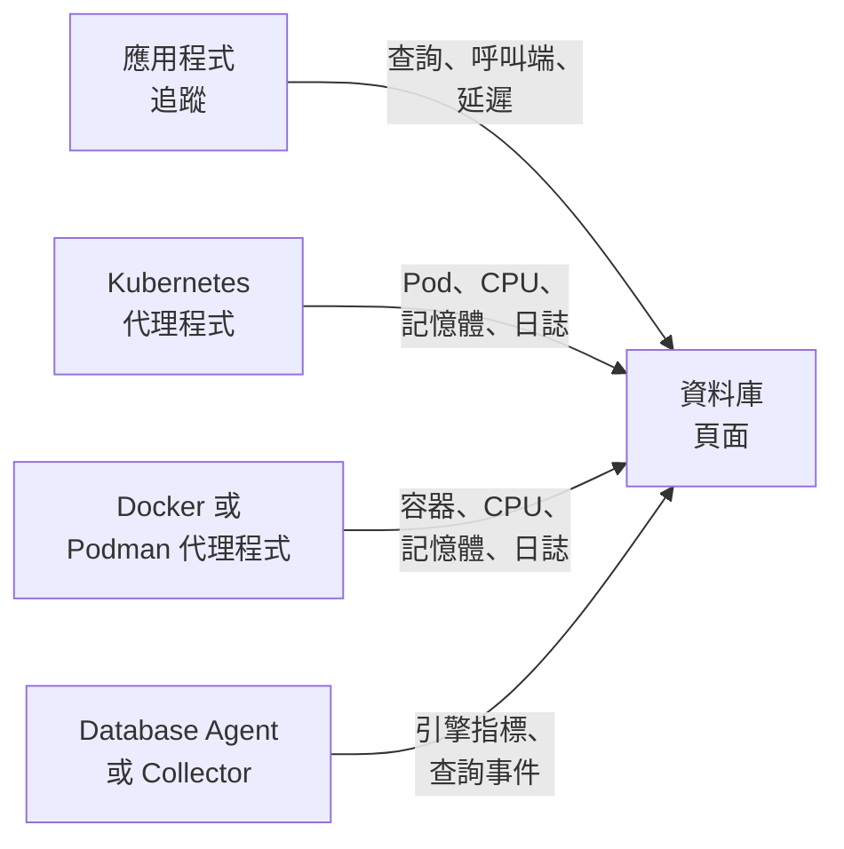

# 資料庫

**Databases** 為你的專案執行或連線的每台資料庫伺服器提供專屬頁面：誰在呼叫它、呼叫有多快、它在哪裡執行、引擎本身的健康指標、它的日誌和追蹤、與它關聯的事件、警示和排定維護，以及為其引擎建議的警示監控器。與其他所有資源一樣，資料庫也有標籤、擁有者、標籤和擁有者規則、依資料庫設定的保留期以及封存。在 **產品 → 資源 → 資料庫** 下開啟它們。

:::cards
- [Database Agent](#database-agent): PostgreSQL、MySQL、SQL Server、Oracle、Redis、MongoDB、Elasticsearch 和 Memcached 的引擎指標。
- [如何偵測資料庫](#如何偵測資料庫): 來自追蹤、Kubernetes、Docker、Podman 和 Collector。
- [資料庫的警示](#資料庫的警示): 建議的監控器，以及你自己建立的監控器。
- [疑難排解](#疑難排解): 一個診斷指令碼，以及常見問題。
:::

## 運作方式

大多數資料庫會自動出現。OneUptime 最多從四個來源組成每個資料庫，每個來源提供的內容各不相同：

| 來源 | 需要你提供什麼 | 為資料庫頁面新增什麼 |
| --- | --- | --- |
| **應用程式追蹤** | 已檢測的應用程式（OpenTelemetry） | 來自應用程式的查詢：呼叫速率、錯誤、延遲，以及呼叫它的服務 |
| **Kubernetes** | [OneUptime Kubernetes 代理程式](/docs/telemetry/kubernetes-agent) | 執行位置：Pod、CPU 和記憶體，以及 Pod 的日誌 |
| **Docker / Podman** | [Docker 代理程式](/docs/telemetry/docker-host) 或 [Podman 代理程式](/docs/telemetry/podman-host) | 執行位置：容器、容器的 CPU 和記憶體，以及容器的日誌 |
| **Database Agent**（一個 OpenTelemetry Collector） | [Database Agent](#database-agent) 或你自己的 Collector | **Engine metrics**：連線、輸送量、快取命中率、鎖定、複寫延遲、記憶體，視引擎提供的範圍而定（請參閱 [收集的內容](#收集的內容)），以及選用的查詢樣本、熱門查詢和引擎的日誌檔 |



引擎指標只來自與資料庫本身通訊的 Collector（對於受控雲端資料庫，則是與其供應商的監控 API 通訊的 Collector）。追蹤和容器清單會告訴 OneUptime 資料庫存在以及它的使用方式，但不會告訴它資料庫內部的運作狀況；每個資料庫上的 **Engine metrics** 狀態會顯示這部分是否已連線。

你也可以手動新增資料庫：在 **Databases → 建立資料庫** 中填入引擎、位址和連接埠。如需完全不需要代理程式、以探測器為基礎的健康檢查，請參閱 [資料庫健康狀態監控](/docs/monitor/database-health-monitor)。

## 支援的資料庫

OneUptime 依名稱識別下列引擎：它會把檢測寫入 `db.system.name`（或舊的 `db.system`）的值正規化為第二欄中的值，顯示引擎名稱，在 span 或位址沒有連接埠時使用引擎的預設連接埠，識別它的容器映像檔和 Helm chart，並知道它的引擎指標從哪裡來。未列出的引擎在所有依位址識別資料庫的地方同樣可用，只是會以你的 span 回報的原始名稱顯示，而且永遠不會僅憑追蹤建立。

**系列** 是存取分支（fork）或協定相容引擎時所經由的引擎：用戶端程式庫無法區分 MariaDB 和 MySQL，也無法區分 Valkey 和 Redis，因此 span 回報的是 `mysql` 或 `redis`，而容器映像檔、Helm chart 或 Database Agent 會提供分支的名稱。兩者會落在同一個資料庫上；一旦資料庫的容器映像檔，或至少與其目前引擎背後的來源同樣可靠的來源提供了更具體的引擎，資料庫就會顯示該引擎（請參閱 [資料庫顯示哪個引擎](#資料庫顯示哪個引擎)）。

**從追蹤建立** 表示僅憑用戶端 span 是否會建立該引擎的資料庫（請參閱 [從應用程式追蹤](#從應用程式追蹤)）：透過供應商的共用 API 主機存取的受控服務，以及在應用程式處理序內執行的引擎，永遠不會被建立。**Engine metrics** 表示引擎本身健康指標的來源：Database Agent 設定、你新增到自己 Collector 中的 collector-contrib 接收器、引擎本身的 Prometheus 端點（`:port/path`，以 Collector 的 `prometheus` 接收器抓取）、雲端供應商的監控 API，或無內建來源。每個資料庫的 **文件** 分頁會把這些變成該資料庫可直接使用的 Collector 設定。

| 引擎 | `db.system.name` | 預設連接埠 | 系列 | 從追蹤建立 | Engine metrics |
| --- | --- | --- | --- | --- | --- |
| Actian Ingres | `actian.ingres` | — | — | 是 | 無內建 |
| Actian Zen (Pervasive PSQL) | `pervasive` | 1583 | — | 是 | 無內建 |
| Aerospike | `aerospike` | 3000 | — | 是 | `aerospike` 接收器 |
| Amazon DocumentDB | `aws.documentdb` | 27017 | MongoDB | 是 | `awsfirehose` 接收器（雲端監控） |
| Amazon DynamoDB | `aws.dynamodb` | 443 | — | 否（雲端 API） | `awsfirehose` 接收器（雲端監控） |
| Amazon Neptune | `aws.neptune` | 8182 | — | 是 | `awsfirehose` 接收器（雲端監控） |
| Amazon Redshift | `aws.redshift` | 5439 | PostgreSQL | 是 | `awsfirehose` 接收器（雲端監控） |
| Apache Derby | `derby` | 1527 | — | 否（處理序內） | 無（處理序內） |
| Apache Doris | `doris` | 9030 | MySQL | 是 | Prometheus, `:8030/metrics` |
| Apache Druid | `druid` | 8888 | — | 是 | 無內建 |
| Apache Geode | `geode` | 10334 | — | 是 | 無內建 |
| Apache HBase | `hbase` | — | — | 是 | 無內建 |
| Apache Hive | `hive` | 10000 | — | 是 | 無內建 |
| Apache Ignite | `ignite` | 10800 | — | 是 | 無內建 |
| Apache Impala | `impala` | 21050 | — | 是 | 無內建 |
| Apache Pinot | `pinot` | 8099 | — | 是 | 無內建 |
| Apache Solr | `solr` | 8983 | — | 是 | 無內建 |
| ArangoDB | `arangodb` | 8529 | — | 是 | Prometheus, `:8529/_admin/metrics/v2` |
| Azure Cosmos DB | `azure.cosmosdb` | 443 | — | 否（雲端 API） | `azure_monitor` 接收器（雲端監控） |
| Cassandra | `cassandra` | 9042 | — | 是 | 無內建 |
| Chroma | `chroma` | 8000 | — | 是 | 無內建 |
| Claris FileMaker | `filemaker` | 2399 | — | 是 | 無內建 |
| ClickHouse | `clickhouse` | 9000 | — | 是 | Prometheus, `:9363/metrics` |
| Cloud Bigtable | `gcp.bigtable` | 443 | — | 否（雲端 API） | `googlecloudmonitoring` 接收器（雲端監控） |
| Cloud Firestore | `gcp.firestore` | 443 | — | 否（雲端 API） | `googlecloudmonitoring` 接收器（雲端監控） |
| Cloud Spanner | `gcp.spanner` | 443 | — | 否（雲端 API） | `google_cloud_spanner` 接收器 |
| CockroachDB | `cockroachdb` | 26257 | PostgreSQL | 是 | Prometheus, `:8080/_status/vars` |
| Couchbase | `couchbase` | 11210 | — | 是 | Prometheus, `:8091/metrics` |
| CouchDB | `couchdb` | 5984 | — | 是 | `couchdb` 接收器 |
| Databricks | `databricks` | 443 | — | 是 | 無內建 |
| Dragonfly | `dragonfly` | 6379 | Redis | 是 | Database Agent（`redis` 接收器） |
| DuckDB | `duckdb` | — | — | 否（處理序內） | 無（處理序內） |
| Elasticsearch | `elasticsearch` | 9200 | — | 是 | Database Agent（`elasticsearch` 接收器） |
| etcd | `etcd` | 2379 | — | 是 | Prometheus, `:2379/metrics` |
| FerretDB | `ferretdb` | 27017 | MongoDB | 是 | Prometheus, `:8088/debug/metrics` |
| Firebird | `firebirdsql` | 3050 | — | 是 | 無內建 |
| FoundationDB | `foundationdb` | 4500 | — | 是 | 無內建 |
| Google BigQuery | `bigquery` | 443 | — | 否（雲端 API） | `googlecloudmonitoring` 接收器（雲端監控） |
| Greenplum | `greenplum` | 5432 | PostgreSQL | 是 | 無內建 |
| H2 | `h2database` | 9092 | — | 否（處理序內） | 無（處理序內） |
| Hazelcast | `hazelcast` | 5701 | — | 是 | 無內建 |
| HyperSQL | `hsqldb` | 9001 | — | 否（處理序內） | 無（處理序內） |
| IBM Db2 | `ibm.db2` | 50000 | — | 是 | 無內建 |
| IBM Informix | `ibm.informix` | 9088 | — | 是 | 無內建 |
| IBM Netezza | `ibm.netezza` | 5480 | — | 是 | 無內建 |
| InfluxDB | `influxdb` | 8086 | — | 是 | Prometheus, `:8086/metrics` |
| InstantDB | `instantdb` | — | — | 否（處理序內） | 無（處理序內） |
| InterBase | `interbase` | 3050 | Firebird | 是 | 無內建 |
| InterSystems IRIS / Caché | `intersystems.cache` | 1972 | — | 是 | Prometheus, `:52773/api/monitor/metrics` |
| KeyDB | `keydb` | 6379 | Redis | 是 | Database Agent（`redis` 接收器） |
| MariaDB | `mariadb` | 3306 | MySQL | 是 | Database Agent（`mysql` 接收器） |
| Meilisearch | `meilisearch` | 7700 | — | 是 | Prometheus, `:7700/metrics` |
| Memcached | `memcached` | 11211 | — | 是 | Database Agent（`memcached` 接收器） |
| Milvus | `milvus` | 19530 | — | 是 | Prometheus, `:9091/metrics` |
| MongoDB | `mongodb` | 27017 | — | 是 | Database Agent（`mongodb` 接收器） |
| MySQL | `mysql` | 3306 | — | 是 | Database Agent（`mysql` 接收器） |
| Neo4j | `neo4j` | 7687 | — | 是 | Prometheus, `:2004/metrics` |
| OceanBase | `oceanbase` | 2881 | MySQL | 是 | 無內建 |
| OpenSearch | `opensearch` | 9200 | Elasticsearch | 是 | Database Agent（`elasticsearch` 接收器） |
| Oracle | `oracle.db` | 1521 | — | 是 | Database Agent（`oracledb` 接收器） |
| Pinecone | `pinecone` | 443 | — | 否（雲端 API） | 無內建 |
| PostgreSQL | `postgresql` | 5432 | — | 是 | Database Agent（`postgresql` 接收器） |
| Presto | `presto` | 8080 | — | 是 | 無內建 |
| Progress OpenEdge | `progress` | — | — | 是 | 無內建 |
| Qdrant | `qdrant` | 6333 | — | 是 | Prometheus, `:6333/metrics` |
| QuestDB | `questdb` | 8812 | PostgreSQL | 是 | Prometheus, `:9003/metrics` |
| RavenDB | `ravendb` | 8080 | — | 是 | 無內建 |
| Redis | `redis` | 6379 | — | 是 | Database Agent（`redis` 接收器） |
| Riak KV | `riak` | 8087 | — | 是 | `riak` 接收器 |
| SAP ASE (Sybase) | `sybase` | 5000 | — | 是 | 無內建 |
| SAP HANA | `sap.hana` | 30015 | — | 是 | `saphana` 接收器 |
| SAP MaxDB | `sap.maxdb` | 7210 | — | 是 | 無內建 |
| ScyllaDB | `scylladb` | 9042 | Cassandra | 是 | Prometheus, `:9180/metrics` |
| SingleStore | `singlestore` | 3306 | MySQL | 是 | Prometheus, `:9104/metrics` |
| Snowflake | `snowflake` | 443 | — | 是 | `snowflake` 接收器 |
| Software AG Adabas | `softwareag.adabas` | — | — | 是 | 無內建 |
| SQL Server | `microsoft.sql_server` | 1433 | — | 是 | Database Agent（`sqlserver` 接收器） |
| SQLite | `sqlite` | — | — | 否（處理序內） | 無（處理序內） |
| StarRocks | `starrocks` | 9030 | MySQL | 是 | Prometheus, `:8030/metrics` |
| SurrealDB | `surrealdb` | 8000 | — | 是 | 無內建 |
| Teradata | `teradata` | 1025 | — | 是 | 無內建 |
| TiDB | `tidb` | 4000 | MySQL | 是 | Prometheus, `:10080/metrics` |
| Trino | `trino` | 8080 | — | 是 | Prometheus, `:8080/metrics` |
| Typesense | `typesense` | 8108 | — | 是 | 無內建 |
| Valkey | `valkey` | 6379 | Redis | 是 | Database Agent（`redis` 接收器） |
| Vertica | `vertica` | 5433 | — | 是 | 無內建 |
| Vitess | `vitess` | 3306 | MySQL | 是 | Prometheus, `:15000/metrics` |
| Weaviate | `weaviate` | 8080 | — | 是 | Prometheus, `:2112/metrics` |
| YugabyteDB | `yugabytedb` | 5433 | PostgreSQL | 是 | Prometheus, `:9000/prometheus-metrics` |

也接受其他常見寫法：`postgres` 和 `pg`、`mssql` 和 `sqlserver`、`oracle`、`mongo`、`scylla`、`dragonflydb`、`memsql`，以及 OpenTelemetry 用過的所有舊版 `db.system` 值（`db2`、`hanadb`、`cosmosdb`、`dynamodb`、`spanner`、`redshift`、`informix`、`maxdb`、`cache`、`h2`、`firebird`、`edb`、`cloudscape`、…）。使用某個引擎協定的受控服務（Amazon RDS 和 Aurora、Azure Database、Cloud SQL、AlloyDB、Neon、Supabase、PlanetScale、ElastiCache、Memorystore、MongoDB Atlas）就視為該引擎。

## 如何偵測資料庫

每個資料庫都會記住建立它的來源（**Discovered from** 欄），它的 **動態** 中的第一筆會說明是什麼找到了它：Kubernetes 工作負載及其叢集、Docker 或 Podman 容器（或 Compose、Swarm 服務）及其主機、應用程式呼叫的端點，或回報它的 Database Agent（含版本）或 Collector。只要描述的是同一個端點，後來的來源就會補充到同一個資料庫，而不是再建立一個（請參閱 [端點](#端點和唯一擁有者規則)）。

### 從應用程式追蹤

OneUptime 每 10 分鐘彙總一次你的應用程式在過去 15 分鐘內傳送、帶有 `db.system.name`（或舊的 `db.system`）的 CLIENT span。伺服器取自 `server.address`（或舊的 `net.peer.name`，其次是 `network.peer.address` / `net.sock.peer.addr`），連接埠取自 `server.port`（或 `net.peer.port`、`network.peer.port`、`net.sock.peer.port`）；span 沒有連接埠時，假定為引擎的預設連接埠。引擎名稱會被正規化（請參閱 [支援的資料庫](#支援的資料庫)），因此 `postgres`、`pg` 和 `postgresql` 是同一個引擎，`mssql` 和 `microsoft.sql_server` 也是；`mariadb` 和 `mysql` 是同一系列中的兩個引擎。

只有在下列條件全部成立時，才會從追蹤 **建立** 資料庫；其他情況仍會計入已存在的資料庫，只是永遠不會建立新的資料庫：

- 位址在整個專案中指向唯一的一台伺服器：是 DNS 名稱，而不是 IP 常值，也不是只在一台機器上或一個網路內才能解析的名稱，除非呼叫端的 Kubernetes 叢集對其加以限定（請參閱 [端點](#端點和唯一擁有者規則)）；
- 連接埠是伺服器監聽的連接埠。作業系統從 32768 以上為連線的用戶端一側分配連接埠（Linux 的預設暫時連接埠範圍從這裡開始；Windows 和 macOS 使用 49152–65535），因此 32768 以上的連接埠永遠不會建立資料庫，除非它是該引擎本身的預設連接埠（IBM Db2 的 50000）。eBPF 檢測（包括 Kubernetes 代理程式的檢測）可能在長時間連線中途加入並把兩端對調。這時 span 會把用戶端自己的連接埠回報為伺服器連接埠，如果沒有這條規則，每個連線都會變成一個單獨的資料庫；
- 引擎是 OneUptime 知道且有獨立位址的引擎：請參閱 [支援的資料庫](#支援的資料庫) 中的 **從追蹤建立** 欄。所有客戶共用主機的雲端 API（DynamoDB、BigQuery、Spanner、Firestore、Bigtable、Cosmos DB、Pinecone）、在應用程式內部執行的引擎（SQLite、DuckDB、H2、HyperSQL、Derby）以及 OneUptime 不認識的引擎，永遠不會從追蹤建立；請手動新增它們；
- 該端點在一次執行所查看的 15 分鐘視窗內至少收到 10 個查詢，這樣一次性指令碼就不會建立資料庫。用戶端程式庫的連線管理 span（node-postgres 的 `pg.connect` 和 `pg-pool.connect`、`redis-connect`、`connect`、…）不是查詢：它們既不計入這裡，也不計入資料庫的 **Queries**；
- 專案未超出其 [自動建立額度](#自動建立額度)。

每個傳往資料庫的 CLIENT span 在擷取時也會被標記上它的端點，因此一旦某個資料庫擁有了某個端點，**Queries from applications** 區段和 **追蹤** 分頁就會顯示對它的每一次呼叫，包括資料庫建立之前的呼叫。帶有 `server.address` 的 `db.client.*` 指標（例如 `db.client.operation.duration`）也以同樣的方式標記。

**叢集和主機清單。** 列出多台主機的連線字串（`m1:27017,m2:27017,m3:27017`）是一個資料庫，無論用戶端以什麼順序列出它們。MongoDB Atlas 成員（`cluster0-shard-00-01.ab1cd.mongodb.net`）會成為一個以其叢集命名的資料庫（`cluster0.ab1cd.mongodb.net`），看到的每個成員都會成為它的一個端點。單獨回報 Cassandra 環、Redis Cluster、Elasticsearch 叢集的每個成員或 ElastiCache 節點的驅動程式，仍然會為每個成員產生一個資料庫：這些主機名稱中沒有任何資訊說明它們屬於哪個叢集。保留一個，並把其他的 [合併](#端點和唯一擁有者規則) 到它上面。

### 從 Kubernetes

OneUptime 每 5 分鐘查看一次每個已連線 Kubernetes 叢集中的 Pod，並識別資料庫工作負載：

1. **先看 operator 和 chart 標籤**：CloudNativePG、Zalando（Spilo）、Crunchy PGO、Bitnami chart、ECK、Altinity ClickHouse、cass-operator、Percona、Oracle MySQL operator 和 Vitess operator（它的 `vtgate` Pod 就是資料庫；`vttablet`、`vtctld`、`vtorc` 和 `vtbackup` 是它的組成部分，而不是成員）。一個 operator 叢集成為一個資料庫。Vitess 叢集自己的 vtgate Service 名稱經過雜湊處理，因此如果應用程式透過它連線，請在資料庫的 **端點** 分頁上新增它。
2. **否則看容器映像檔**，依映像檔名稱精確比對：[支援的資料庫](#支援的資料庫) 中每個提供映像檔的引擎的官方映像檔、Bitnami 映像檔（包括遷移後的 `bitnamilegacy` 和 `bitnamisecure` 存放庫）以及 Red Hat / OpenShift 映像檔（`postgres`、`bitnami/postgresql`、`rhel9/postgresql-16`、`mysql`、`mariadb`、`mssql/server`、`gvenzl/oracle-free`、`redis`、`valkey/valkey`、`mongo`、`cockroachdb/cockroach`、`pingcap/tidb`、`clickhouse/clickhouse-server`、`qdrant/qdrant`、…）。分支會被識別為它自己：`mariadb` 映像檔是 MariaDB，`valkey/valkey` 映像檔是 Valkey。匯出工具、operator、管理介面、連線集區（pgbouncer、pgpool、ProxySQL、HAProxy、Cloud SQL Proxy）和備份工具都不是資料庫。同時執行應用程式容器的 Pod 也不會被視為資料庫（帶有資料庫 sidecar 的應用程式仍然是應用程式），不過，如果 StatefulSet 的資料庫容器宣告了引擎的預設連接埠，它可以多帶一個 OneUptime 不認得的容器（例如日誌傳送器）。

資料庫映像檔並不會讓一個 Pod 成為資料庫伺服器，但只有明確的證據才能讓它被判定為別的東西。如果容器的程式是用戶端或傾印工具（`psql`、`redis-cli`、`mongosh`、`pg_dump`、`mysql`）、保持運作的命令（`sleep infinity`、`tail -f /dev/null`）或互動式 shell（或者它的 `sh -c` 指令碼只執行這類工具、shell 內建命令和 `echo`、`cp` 之類的簡單公用程式），那就是一次用戶端或偵錯執行，而不是資料庫；Redis 或 Valkey Sentinel（`redis-sentinel`、`redis-server --sentinel`）也是如此。在啟動器之後也同樣適用：`env`（及其 `NAME=value` 設定）、`nohup`、`setsid`、`tini`、`dumb-init` 以及映像檔的 `docker-entrypoint.sh` 會被看穿，直到它們啟動的程式，指令碼中的 `exec`、`env` 和 `nohup` 也是如此，因此 `env PGPASSWORD=… psql` 和 `tini -- redis-cli` 是用戶端執行，而 `tini -- docker-entrypoint.sh postgres` 是伺服器，`docker-entrypoint.sh -c max_connections=200`（映像檔自己的伺服器帶一個旗標啟動）也是伺服器。接著還會啟動其他東西的指令碼（`sleep 5 && exec redis-server`、`bash -ecx 'exec cockroach start …'`）、指令碼檔案（`sh /start.sh`）、在程式之前接收自身引數的包裝程式（`gosu postgres …`、`timeout 30 …`），或長到無法讀取的指令碼，都會被視為可能的伺服器。已結束的 Pod、批次作業，以及沒有宣告連接埠的一次性 `kubectl run` Pod 也都不是資料庫。

資料庫會在它的某個 Pod 處於 Ready 狀態約 10 分鐘後出現（如果只是 sidecar 讓 Pod 無法變成 Ready，則改為看已就緒的資料庫容器）。處於當機循環的 Pod 每次重新啟動都會重新變成 Ready，因此永遠不會成為資料庫，CI 作業或執行一分鐘就當機的 Pod 也不會。資料庫一旦建立，每次執行都會重新整理。

Pod 依其 StatefulSet、Deployment 或 operator 叢集分組，因此一個有三個成員的 StatefulSet 是一個有三個成員的資料庫。其頁面上的 **執行個體** 計算資料庫容器正在執行的 Pod：不包括在 `CrashLoopBackOff` 或 `ImagePullBackOff` 中等待的 Pod，也不包括已終止的 Pod，即使 Kubernetes 仍可能把這樣的 Pod 回報為 Running；縮減到零的工作負載顯示 0，並保留其頁面，直到 [自動封存](#生命週期封存和保留) 將其撤下。反向連結同樣有效：工作負載的 StatefulSet 或 Deployment 頁面，以及它的每個 Pod 的頁面，都會透過 **Open database** 連結指出它執行的資料庫，包括名稱與資料庫不同的 StatefulSet 或 Deployment（Bitnami 為 `shop-redis` 建立的 `shop-redis-master`，Percona 為 `cluster1` 建立的 `cluster1-pxc`）；而 operator 標示為某個叢集一部分的連線集區或備份工作負載，會說明它屬於該資料庫的叢集。

Kubernetes 代理程式不回報 Service 物件，因此資料庫的 Service 名稱來自 chart 和 operator 遵循的慣例：所屬 StatefulSet 或 Deployment 的名稱、StatefulSet 的 headless Service（以及它背後的每個成員，`<pod>.<headless-service>`），以及各 operator 的 Proxy 和連線集區 Service：Percona XtraDB Cluster 的 HAProxy 和 ProxySQL、Percona Server for MySQL 的 router 和 HAProxy、Percona Server for MongoDB 的 mongos、Crunchy 的 pgBouncer，以及 Zalando 和 CloudNativePG 的連線集區。每一個都會成為由叢集限定的端點（`postgres.prod.svc.cluster.local:5432@my-cluster`），因此兩個叢集中的同一個名稱仍是兩個資料庫。在專案只有一個叢集期間，未限定的 `postgres.prod.svc.cluster.local:5432` 也會被新增，並在第二個叢集出現約 2 小時後再次釋出。其他名稱的 Service 請在資料庫的 **端點** 分頁上新增。

遙測經過 Kubernetes 代理程式的應用程式會帶上它的命名空間和叢集，因此它的呼叫會依其 Pod 的解析器的方式解讀：`postgres`（來自同一命名空間）、`postgres.prod`（命名空間 `prod` 中的 Service `postgres`）、`postgres.prod.svc` 和完整名稱都會比對到該資料庫，呼叫端自己命名空間中的 StatefulSet 成員 `mongo-0.mongo-headless` 也是如此。

OneUptime 讀取 Pod 中繼資料、標籤、映像檔、宣告的連接埠，以及容器命令列執行的內容（程式名稱、shell 的旗標，以及其指令碼執行了哪些常見的用戶端、保持運作和 shell 命令；其他命令只會被記為無法識別），從不讀取環境變數、引數值、指令碼文字或祕密。

### 從 Docker 和 Podman

每 5 分鐘，每個已連線的 Docker 或 Podman 主機上的容器會以同樣的方式依映像檔分類，然後依其名稱以及 Compose、Swarm 和 Testcontainers 標籤分組和篩選，從不依它們執行的命令（請參閱下文）。同一個 Compose 服務（依 Compose 的專案和服務標籤）或同一個 Swarm 服務的容器是一個有多個成員的資料庫，其工作負載就是該服務（`Compose service/<project>-<service>`、`Swarm service/<service>`）。其他任何容器都以其確切名稱（`Container/<name>`）成為單獨的資料庫，因此 `redis-6379` 和 `redis-6380` 仍是兩個。Testcontainers、`docker compose run` 一次性執行、kubelet 在 Docker 節點上執行的容器（Kubernetes 偵測會把它們當作 Pod 找到）以及執行不到 10 分鐘的容器，永遠不會成為資料庫。容器的存在時間就是它的執行時間，因此已經執行了這麼久的容器會在安裝代理程式後的第一次執行中成為資料庫。**執行個體** 計算正在執行的容器，每個容器的頁面都會連結回它的資料庫（**Open database**）。以同一名稱註冊了兩次的主機只讀取一次，使用最近看到的那次註冊。

一旦代理程式的 `otel-collector-config.yaml` 複製了這些標籤（`container_labels_to_metric_labels`），代理程式就會隨每個容器的指標一起傳送它們。舊版 Docker 或 Podman 代理程式不會這樣做：請更新它，否則每個容器都會成為單獨的資料庫，包括 Testcontainers 執行和一次性執行。

與 Kubernetes 不同，容器的命令列從不讀取（代理程式不會傳送它，因為其中可能含有祕密），因此以資料庫映像檔長時間執行的用戶端或偵錯容器（`sleep infinity`、`psql` 或 `redis-cli` 迴圈）在執行 10 分鐘後就會成為資料庫。封存它即可將其移除：由人員封存的資料庫會保持封存狀態。如果不管它，它會在容器停止 7 天後被 [自動封存](#生命週期封存和保留)。

容器名稱只在一個 Docker 網路內解析，因此這些資料庫 **不會** 自動取得端點；它們的頁面顯示容器本身的指標和日誌。若要關聯你的應用程式傳送的查詢，請在 [端點](#端點和唯一擁有者規則) 分頁上新增它們使用的位址。

若要取得引擎指標，請從資料庫自己的 **文件** 分頁安裝 [Database Agent](#database-agent)：其安裝命令和 `.env` 帶有預先填好的 `DATABASE_SERVER_ID`，因此代理程式的資料會進入這個資料庫。不帶它安裝的代理程式會改為依其 `DATABASE_SERVER_ADDRESS` 比對，而容器資料庫並不擁有這個位址：如果是 DNS 名稱，伺服器會被註冊為第二個資料庫（一個頁面有容器，另一個頁面有引擎指標；請參閱 [一台伺服器出現兩個資料庫](#一台伺服器出現兩個資料庫)），如果是私人 IP 或容器名稱，則不會關聯到任何東西。

### 從 Database Agent 或你自己的 Collector

當引擎指標或日誌來自 Collector 的資料庫接收器時，OneUptime 會在擷取的那一刻把它們比對到資料庫：如果資料帶有 `oneuptime.database.server.id`（代理程式的 `DATABASE_SERVER_ID`），就直接依 id 比對，否則依資料指明的端點（`server.address` / `server.port`）比對：

- 依 id 關聯的資料會進入該資料庫並顯示在其頁面上（且只顯示在那裡），無論它回報的是什麼位址：私人 IP、叢集本機名稱、另一個資料庫擁有的位址，或根本沒有位址。如果它回報的位址在整個專案中指向唯一的一台伺服器且尚不屬於任何資料庫，該位址會作為端點新增到這個資料庫，這樣傳往該位址的應用程式追蹤也會進入這裡；
- 否則，資料庫已擁有的端點會把資料關聯到該資料庫，無論該資料庫是由什麼建立的；
- 否則會 **建立** 一個資料庫，但只從在整個專案中代表唯一一台伺服器的名稱建立（DNS 名稱、公用 IP，或資料以其 Kubernetes 叢集 `k8s.cluster.name` 限定過的叢集本機名稱、`.internal` 或 `.local` 名稱；Database Agent 從不設定該叢集屬性），而且只針對可以自行建立的引擎（[支援的資料庫](#支援的資料庫) 中的 **從追蹤建立** 欄：絕不是共用雲端 API、處理序內引擎或未知引擎）。私人 IP 和連結本機 IP、單一標籤名稱（`db`）以及未限定的叢集本機名稱（`postgres.prod.svc.cluster.local`）、`.internal` 或 `.local` 名稱，在每個網路中都可能指向不同的伺服器；Pod 的 IP 每次重新啟動都會改變；而由 Collector 自己的命名空間補全的單一標籤名稱，可能是一個 Service，也可能是 Collector 自己的 Pod。指明這些名稱之一的資料只會進入已經把它當作端點的資料庫：對於 Service 名稱，就是在 Kubernetes 中偵測到的工作負載。請手動建立該資料庫（**Databases → 建立資料庫**，相同的位址和連接埠），或以 `DATABASE_SERVER_ID` 把代理程式關聯到它。在有 Kubernetes 叢集的專案中，不帶叢集的叢集本機 Service 名稱會被拒絕：請將資料庫建立為 `postgres.prod.svc.cluster.local:5432@my-cluster`，然後在它的 **端點** 分頁上新增未限定的 `postgres.prod.svc.cluster.local:5432`（也就是代理程式回報的名稱）；
- 完全沒有指明伺服器的接收器批次會被忽略（請參閱 [使用你自己的 OpenTelemetry Collector](#使用你自己的-opentelemetry-collector)）。

Collector 建立的資料庫與其他所有偵測到的資料庫一樣計入 [自動建立額度](#自動建立額度)；你手動建立並以 `DATABASE_SERVER_ID` 關聯的資料庫永遠不需要建立。請參閱 [Database Agent](#database-agent)。

### 資料庫顯示哪個引擎

當來源對資料庫的引擎意見不一致時，證據較強的一方勝出：人員設定的引擎，其次是 Collector 或 Database Agent（引擎自行回報），其次是容器映像檔或 Helm chart，最後是用戶端 span；PostgreSQL 驅動程式即使在連線 CockroachDB 時也會回報 `postgresql`。只有當某個來源的證據強於決定目前引擎的證據時，它才會把資料庫移到另一個引擎系列；人員設定的引擎永遠不會被偵測過程變更。在同一系列內，當提供分支名稱的來源至少與決定目前引擎的來源同樣可靠，或者它是容器映像檔時，分支會細化引擎：span 回報 `redis`，映像檔回報 `valkey`，資料庫就顯示 Valkey，即使 Collector 的 `redis` 接收器回報的是 `redis`，因為該接收器無法區分兩者。僅憑應用程式追蹤永遠不會細化由映像檔或 Collector 決定的引擎：用戶端回報的是它所使用的協定，MariaDB Connector/J 連線 MySQL 伺服器時也會回報 `mariadb`。當 Collector 在 `db.system.name` 中設定分支名稱時（Database Agent 會根據 `DATABASE_SYSTEM` 這樣做），或者批次的 `db.system.version` 指明了分支時，Collector 就提供了分支：帶有分支名稱的版本字串（`8.0.11-TiDB-v7.5.1`），或只有該分支發布過的主要版本號；MySQL 沒有 10.x 或 11.x，因此帶有 `11.4.13`（`mysql` 接收器為 MariaDB 11.4 回報的純數字）的 `mysql` 就是 MariaDB（請參閱 [使用你自己的 OpenTelemetry Collector](#使用你自己的-opentelemetry-collector)）。只有指明其系列引擎的容器映像檔才能撤銷分支，而且僅在提供分支名稱的只有應用程式追蹤時才會撤銷；指明系列的 Collector 或追蹤永遠不會撤銷分支。映像檔換成同一系列分支（`redis` 換成 `valkey`）的 Kubernetes 工作負載仍是同一個資料庫。

### 自動建立額度

只有在專案中作用中、未封存的已偵測資料庫少於 500 個時，追蹤、Kubernetes、Docker、Podman 和 Collector 才會自行建立資料庫（`DATABASE_SERVER_AUTO_CREATE_BUDGET`，請參閱 [自行託管調整](#自行託管調整)）。你手動建立的資料庫永遠不計入，也永遠不會被阻擋；已封存的資料庫不計入，因此 [自動封存](#生命週期封存和保留) 會釋出額度；已存在的資料庫會繼續被比對和更新。達到額度後，新端點的 Collector 資料不會建立任何東西（只會進入已存在的資料庫），OneUptime 每個專案每 10 分鐘最多記錄一次警告。

## Database Agent

OneUptime Database Agent 是一個預先設定好的 OpenTelemetry Collector，適用於 **PostgreSQL**、**MySQL / MariaDB**、**SQL Server**、**Oracle**、**Redis / Valkey / KeyDB / Dragonfly**、**MongoDB**、**Elasticsearch / OpenSearch** 和 **Memcached**。它只由設定組成：一個標準的 `otel/opentelemetry-collector-contrib` 容器，執行 Collector 針對你的引擎的原生接收器，設定會為每個批次加上資料庫的身分識別，並透過 OTLP 傳送到 OneUptime。資料庫伺服器上不會安裝任何東西。同一個 `docker-compose.yml` 也會在 Collector 旁邊執行 [資料庫 AI 代理程式](#ai-代理程式)，供 OneUptime AI 使用。對於 [支援的資料庫](#支援的資料庫) 中的其他引擎，請參閱 [使用你自己的 OpenTelemetry Collector](#使用你自己的-opentelemetry-collector)；每個資料庫的 **文件** 分頁都有對應的設定。

**一個代理程式監控一台資料庫伺服器。** 代理程式傳送的所有內容都會加上身分識別，因此每台伺服器執行一個代理程式（一個安裝目錄）；如果希望複本有自己的頁面，就為每個複本各執行一個。

代理程式位於 [DatabaseAgent 目錄](https://github.com/OneUptime/oneuptime/tree/master/agents/DatabaseAgent)：`docker-compose.yml`、每個接收器一份 Collector 設定（`configs/postgresql.yaml`、`configs/mysql.yaml`、`configs/sqlserver.yaml`、`configs/oracledb.yaml`、`configs/redis.yaml`、`configs/mongodb.yaml`、`configs/elasticsearch.yaml`、`configs/memcached.yaml`）、`install.sh`、`troubleshoot.sh` 和一個 systemd 單元。分支或相容的替代品會執行其系列的設定，並回報自己的名稱：`DATABASE_SYSTEM=mariadb` 會執行 `configs/mysql.yaml`，資料庫顯示為 MariaDB。

### 開始之前

- Docker Engine 20.10 或更新版本，搭配 Docker Compose v2 外掛程式，所在機器要能連到資料庫的連接埠（或一個 Kubernetes 叢集：請參閱 [Kubernetes](#kubernetes)）。
- 一個能在資料庫上建立監控使用者並授予下列統計權限的登入帳戶。
- 一把擷取金鑰。在 **專案設定 → 遙測與 APM → 擷取金鑰** 下建立一把並複製其值。

:::steps
### 建立監控使用者

為代理程式提供它自己的、對引擎統計資料有讀取權限的登入帳戶：絕不使用系統管理員帳戶，也絕不使用應用程式的登入帳戶。如果你已經為 [資料庫健康狀態監控](/docs/monitor/database-health-monitor#建立監控使用者) 建立了監控使用者，它在 PostgreSQL、MySQL 和 SQL Server 上的授權同樣適用於代理程式。

:::tabs
@tab PostgreSQL
```sql
CREATE USER oneuptime_monitor WITH PASSWORD 'a-strong-password';
GRANT pg_monitor TO oneuptime_monitor;
```

`pg_monitor` 是一個內建角色（PostgreSQL 10 及更新版本），授予對統計和監控檢視的讀取權限，不授予對你的資料表的任何存取權限。它不是選用的：沒有它，`pg_stat_activity` 不會失敗，而是只傳回代理程式自己的工作階段，因此在一台實際上已滿的伺服器上，連線數會顯示為 `1`。接收器會連線每個資料庫以讀取各資料庫的統計資料，因此該使用者還需要每個資料庫上的 `CONNECT` 權限（`PUBLIC` 預設就有）。PostgreSQL 接收器沒有密碼就拒絕啟動。

熱門查詢（`DATABASE_QUERY_EVENTS=true`）也會讀取 `pg_stat_statements`：以 `shared_preload_libraries = 'pg_stat_statements'` 載入它（需要重新啟動），並在每個受監控的資料庫中建立它：

```sql
CREATE EXTENSION IF NOT EXISTS pg_stat_statements;
```

熱門查詢的執行計畫需要對查詢涉及的資料表有 `SELECT` 權限，而 `pg_monitor` 不授予該權限；如果需要執行計畫，請依結構描述授予（`GRANT SELECT ON ALL TABLES IN SCHEMA app TO oneuptime_monitor`）。沒有它，熱門查詢仍會到達，只是執行計畫為空，Collector 會為每個查詢記錄 `failed to explain`；診斷指令碼會把這回報為警告，而不是缺少授權。

在無法使用 `pg_monitor` 的受控服務上，`pg_read_all_stats` 涵蓋同樣的檢視。代理程式已經會略過 Amazon RDS、Azure、Cloud SQL 和 AlloyDB 中任何客戶登入帳戶都無法開啟的內部資料庫。
@tab MySQL / MariaDB
```sql
CREATE USER 'oneuptime_monitor'@'%' IDENTIFIED BY 'a-strong-password';
GRANT PROCESS, REPLICATION CLIENT ON *.* TO 'oneuptime_monitor'@'%';
GRANT SELECT ON performance_schema.* TO 'oneuptime_monitor'@'%';
```

`PROCESS` 和 `REPLICATION CLIENT` 涵蓋全域狀態計數器、InnoDB 狀態和複本狀態；會讀取 `performance_schema`（自 MySQL 5.6 起預設開啟）以取得查詢樣本和熱門查詢。MariaDB 10.5.9 及更新版本把複本狀態拆分成獨立的權限，因此在那裡還要執行 `GRANT SLAVE MONITOR ON *.* TO 'oneuptime_monitor'@'%';`。對於 MariaDB 伺服器，請設定 `DATABASE_SYSTEM=mariadb`：同一份設定就能監控它，資料庫會顯示為 MariaDB。這是可靠的方式。以 `mysql` 安裝、連線 MariaDB 10 或更新版本的代理程式也會憑版本號（`11.4.13`；MySQL 從未發布過 10.x 或 11.x）被識別為 MariaDB，但 MariaDB 5.5 會維持為 MySQL。
@tab SQL Server
```sql
CREATE LOGIN oneuptime_monitor WITH PASSWORD = 'a-strong-password';
GRANT VIEW SERVER STATE TO oneuptime_monitor;
GRANT VIEW ANY DEFINITION TO oneuptime_monitor;
```

`VIEW SERVER STATE`（在 SQL Server 2022 及更新版本上，`VIEW SERVER PERFORMANCE STATE` 就足夠了）讀取所有指標所依據的動態管理檢視，不授予對你資料的存取權限。接收器把登入資訊放進連線字串時不加引號，因此使用者名稱和密碼不能包含分號（`;`）或雙引號（`"`），也不能以空格開頭或結尾；`install.sh` 會拒絕它們。驅動程式會自行與伺服器協商加密，因此 TLS 變數不適用。

對於具名執行個體（`sql1.corp\INST01`），請把 `DATABASE_ENDPOINT` 指向該執行個體自己的 TCP 連接埠，而不是預設執行個體的 1433，後者連到的是預設執行個體。SQL Server 組態管理員會顯示該連接埠（執行個體的 TCP/IP 通訊協定，IPAll），也可以在該執行個體上執行 `SELECT local_tcp_port FROM sys.dm_exec_connections WHERE session_id = @@SPID;`。`install.sh` 會拒絕 `host\instance`，並要求提供 `host:port`。
@tab Oracle
```sql
-- In the pluggable database the agent connects to, e.g. ALTER SESSION SET CONTAINER = FREEPDB1;
CREATE USER oneuptime_monitor IDENTIFIED BY "a-strong-password";
GRANT CREATE SESSION TO oneuptime_monitor;
GRANT SELECT_CATALOG_ROLE TO oneuptime_monitor;
```

`SELECT_CATALOG_ROLE` 讀取指標、查詢樣本和熱門查詢所依據的 `V$` 和 `DBA_` 檢視，不授予對你的資料表的存取權限。`DATABASE_ORACLE_SERVICE` 指定代理程式連線的服務（`FREEPDB1`、`ORCLPDB1`、…）。
@tab Redis / Valkey / KeyDB / Dragonfly
```text
ACL SETUSER oneuptime_monitor on >a-strong-password -@all +info +ping
```

接收器只執行 `INFO`。以 `ACL SAVE`（或 `redis.conf` / 你的 ACL 檔案中的 `user` 行）永久保存該使用者。在只以 `requirepass` 保護的伺服器上，將 `DATABASE_USERNAME` 留空並設定 `DATABASE_PASSWORD`；在沒有驗證的伺服器上，兩者都留空。對於這些伺服器，請將 `DATABASE_SYSTEM` 設定為 `valkey`、`keydb` 或 `dragonfly`。接收器從 `INFO` 的 `redis_version` 讀取版本，Valkey 將其固定為 `7.2.4`（它分支出來時的 Redis 版本），Dragonfly 則將其設定為它所模擬的 Redis 版本。OneUptime 對它們會忽略該值，因此 Valkey 或 Dragonfly 資料庫在由 Kubernetes、Docker 或 Podman 執行時顯示其容器映像檔的版本，僅有代理程式時不顯示版本。
@tab MongoDB
```js
db.getSiblingDB("admin").createUser({
  user: "oneuptime_monitor",
  pwd: "a-strong-password",
  roles: [{ role: "clusterMonitor", db: "admin" }],
});
```

`clusterMonitor` 涵蓋所有指標。熱門查詢的執行計畫還需要為每個受監控的資料庫授予 `{ role: "read", db: "<database>" }`；沒有它，熱門查詢仍會到達，只是執行計畫為空。代理程式只連線一個成員（`direct_connection`），因此請為複本集的每個成員各執行一個代理程式。
@tab Elasticsearch / OpenSearch
```text
POST /_security/role/oneuptime_monitor
{ "cluster": ["monitor"], "indices": [{ "names": ["*"], "privileges": ["monitor"] }] }

POST /_security/user/oneuptime_monitor
{ "password": "a-strong-password", "roles": ["oneuptime_monitor"] }
```

`monitor` 權限讀取節點、叢集和索引的統計資料，不讀取文件。在啟用安全性外掛程式的 OpenSearch 上，請改為授予叢集權限 `cluster_monitor` 和對 `*` 的索引權限 `indices_monitor`；在沒有安全性功能的叢集上，將 `DATABASE_USERNAME` 和 `DATABASE_PASSWORD` 留空。一個代理程式透過一個端點（一個 URL：`http://search.internal:9200`，TLS 用 `https://`）監控整個叢集。對於 OpenSearch 叢集，請設定 `DATABASE_SYSTEM=opensearch`。
@tab Memcached
Memcached 沒有使用者：接收器透過文字通訊協定執行 `stats`，因此請將 `DATABASE_USERNAME` 和 `DATABASE_PASSWORD` 留空。以 SASL 驗證（`-S`）啟動的伺服器無法用這種方式監控。
:::

### 安裝並啟動代理程式

:::tabs
@tab install.sh
下載安裝指令碼，並在將要裝載代理程式的機器上執行它：

```bash
curl -sSL https://raw.githubusercontent.com/OneUptime/oneuptime/master/agents/DatabaseAgent/install.sh -o install.sh
bash install.sh
```

指令碼會詢問你的 OneUptime URL 和擷取金鑰、引擎、要連線的端點和監控認證資訊（密碼輸入時不回顯）；對於 [AI 代理程式](#ai-代理程式) 支援的引擎，還會詢問它是否可以套用修正，如果可以，再詢問它專用的登入帳戶。它會把 `docker-compose.yml` 和對應的 `configs/<receiver>.yaml`（儲存為 `otel-collector-config.yaml`）下載到 `/opt/oneuptime-database-agent`，寫入權限為 `0600` 的 `.env` 檔案並啟動代理程式。當端點只在這台機器上有意義時（`localhost`、`host.docker.internal`），它還會詢問你的應用程式使用的主機名稱，因為該名稱就是資料庫的身分識別；當該名稱只在一個網路內解析時（私人或連結本機 IP、單一標籤名稱、叢集本機名稱、`.internal` 或 `.local` 名稱），它會詢問該資料庫在 OneUptime 中的 id（`DATABASE_SERVER_ID`），因為這樣的名稱永遠不會自行建立資料庫。

每個提示都可以用同名的匯出變數來回答，`INSTALL_DIR` 用於選擇目錄，例如為第二個資料庫使用 `INSTALL_DIR=/opt/oneuptime-database-agent-orders bash install.sh`。重新執行指令碼會重複使用現有 `.env` 中的所有值（請參閱 [升級和解除安裝](#升級和解除安裝)）。

密碼中可以使用任何字元，只有 SQL Server 連線字串無法承載的少數字元除外（請參閱 [建立監控使用者](#建立監控使用者) 中的 SQL Server 分頁）。Collector 會對它讀取的值中的 `$` 再展開一次（`$$` 變成 `$`，`${NAME}` 變成另一個變數），因此指令碼除了為 Docker Compose 為值加上引號外，還會把 `DATABASE_USERNAME` 和 `DATABASE_PASSWORD` 中的每個 `$` 寫成兩個。
@tab Docker Compose
從 [DatabaseAgent 目錄](https://github.com/OneUptime/oneuptime/tree/master/agents/DatabaseAgent) 把 `docker-compose.yml` 和你的引擎對應的設定下載到同一個資料夾，並把設定儲存為 `otel-collector-config.yaml`：

```bash
curl -fsSL https://raw.githubusercontent.com/OneUptime/oneuptime/master/agents/DatabaseAgent/docker-compose.yml -o docker-compose.yml
curl -fsSL https://raw.githubusercontent.com/OneUptime/oneuptime/master/agents/DatabaseAgent/configs/postgresql.yaml -o otel-collector-config.yaml
```

在它們旁邊建立一個 `.env` 檔案（`chmod 600 .env`，因為其中保存著密碼）：

```bash
# DATABASE_USERNAME and DATABASE_PASSWORD are escaped for the collector: every $ is written as $$.
ONEUPTIME_URL=YOUR_ONEUPTIME_URL
ONEUPTIME_TELEMETRY_INGESTION_KEY=YOUR_TELEMETRY_INGESTION_KEY
DATABASE_SYSTEM=postgresql
DATABASE_ENDPOINT=db.example.com:5432
DATABASE_ENDPOINT_HOST=db.example.com
DATABASE_ENDPOINT_PORT=5432
DATABASE_ORACLE_SERVICE=
DATABASE_SERVER_ADDRESS=db.example.com
DATABASE_SERVER_PORT=5432
DATABASE_USERNAME=oneuptime_monitor
DATABASE_PASSWORD='a-strong-password'
DATABASE_TLS_INSECURE=true
DATABASE_TLS_INSECURE_SKIP_VERIFY=false
DATABASE_COLLECTION_INTERVAL=30s
DATABASE_QUERY_EVENTS=false
DATABASE_SERVER_ID=
```

以單引號括住密碼，並把其中的每個 `$` 寫成 `$$`。第一行以 `install.sh` 寫入的 `.env` 中的原話說明了這一點；在此資料夾（`INSTALL_DIR`）上重新執行的 `install.sh` 也會以同樣的方式讀取該檔案。啟動它：

```bash
docker compose up -d
```
:::

### 在 OneUptime 中找到資料庫

第一次收集後，資料庫會出現在 **Databases** 下；如果 OneUptime 已經從相同位址的追蹤或容器中偵測到它，它的 **Engine metrics** 狀態會變成已連線。對於私人 IP 或只在你的網路內解析的名稱（`db.prod.internal`、叢集本機名稱），請先建立資料庫或設定 `DATABASE_SERVER_ID`（請參閱 [從 Database Agent 或你自己的 Collector](#從-database-agent-或你自己的-collector)）。
:::

### 環境變數

| 變數 | 必要 | 說明 |
| --- | --- | --- |
| `ONEUPTIME_URL` | 是 | 你的 OneUptime 執行個體 URL（例如 `https://oneuptime.com` 或你的自行託管主機） |
| `ONEUPTIME_TELEMETRY_INGESTION_KEY` | 是 | 來自 **專案設定 → 遙測與 APM → 擷取金鑰** 的擷取金鑰 |
| `DATABASE_SYSTEM` | 是 | 引擎，標記為 `db.system.name`：`postgresql`、`mysql`、`mariadb`、`redis`、`valkey`、`keydb`、`dragonfly`、`mongodb`、`microsoft.sql_server`、`oracle.db`、`elasticsearch`、`opensearch` 或 `memcached`。`install.sh` 接受常見寫法並下載對應的設定 |
| `DATABASE_ENDPOINT` | 是 | 代理程式連線的 `host:port`。代理程式在資料庫所在機器上執行時，使用 `host.docker.internal:<port>`（如果被拒絕，請參閱 [疑難排解](#疑難排解)）。對於 Elasticsearch / OpenSearch 是一個 URL：`http://host:9200`，TLS 用 `https://` |
| `DATABASE_ENDPOINT_HOST` | SQL Server | 單獨的 `DATABASE_ENDPOINT` 主機部分；SQL Server 接收器分別接收主機和連接埠。由 `install.sh` 寫入 |
| `DATABASE_ENDPOINT_PORT` | SQL Server | 單獨的 `DATABASE_ENDPOINT` 連接埠部分。由 `install.sh` 寫入 |
| `DATABASE_ORACLE_SERVICE` | Oracle | 要連線的 Oracle 服務，例如 `FREEPDB1` 或 `ORCLPDB1` |
| `DATABASE_SERVER_ADDRESS` | 是 | 資料庫的身分識別，標記為 `server.address`：你的 **應用程式** 連到它時使用的主機名稱。絕不能是 `localhost`；OneUptime 會忽略只在一台機器上有意義的位址。只在一個網路內解析的名稱（私人 IP、單一標籤名稱、叢集本機名稱、`.internal` 或 `.local` 名稱）只會進入已經把它當作端點的資料庫。請保持它穩定；變更它會註冊第二個資料庫 |
| `DATABASE_SERVER_PORT` | 是 | 你的應用程式使用的連接埠，標記為 `server.port` |
| `DATABASE_USERNAME` | PostgreSQL、MySQL、SQL Server、Oracle | 監控使用者。對於沒有驗證的 Redis、MongoDB 和 Elasticsearch 伺服器為選用；Memcached 不使用 |
| `DATABASE_PASSWORD` | PostgreSQL、SQL Server、Oracle | 它的密碼。在 `.env` 中以單引號括住，並把每個 `$` 寫成 `$$`（`install.sh` 會替你完成這兩件事） |
| `DATABASE_TLS_INSECURE` | 否 | `true`（預設）不使用 TLS 連線；`false` 開啟 TLS |
| `DATABASE_TLS_INSECURE_SKIP_VERIFY` | 否 | `true` 接受 Collector 映像檔不信任的憑證（自我簽署、私人 CA）。預設為 `false` |
| `DATABASE_COLLECTION_INTERVAL` | 否 | 讀取引擎統計資料的頻率。預設為 `30s` |
| `DATABASE_QUERY_EVENTS` | 否 | `true` 會把查詢樣本和熱門查詢作為日誌傳送（PostgreSQL、MySQL、MongoDB、SQL Server 和 Oracle）。其中包含查詢文字。預設為 `false` |
| `DATABASE_SERVER_ID` | 否 | OneUptime 已顯示的資料庫的 id（它的 **文件** 分頁上已預先填好）。這樣資料會直接進入該資料庫並顯示在其頁面上，無論它回報什麼位址（或沒有位址）；這是在 Kubernetes 中和私人 IP 的建議做法。它必須是擷取金鑰所屬專案中的資料庫 |

### 收集的內容

| 引擎 | 接收器 | 代理程式額外開啟的項目（上游預設關閉） | 查詢事件 |
| --- | --- | --- | --- |
| PostgreSQL | `postgresql`：連線數與 `max_connections` 的對照、認可和復原、區塊讀取、資料庫和資料表的大小、資料列作業、複寫位元組延遲、WAL 存在時間、檢查點、vacuum | `postgresql.blks_hit` / `postgresql.blks_read`（快取命中率）、`postgresql.deadlocks`、`postgresql.temp_files`、`postgresql.tup_*`（資料列輸送量）、`postgresql.database.locks`、`postgresql.wal.delay`（複寫時間延遲） | 查詢樣本（`pg_stat_activity`）、熱門查詢（`pg_stat_statements`） |
| MySQL / MariaDB | `mysql`：執行緒和連線、緩衝集區使用量和讀取、資料列鎖定和資料表鎖定、handler、資料列作業（僅 MySQL）、運作時間 | `mysql.query.count`、`mysql.query.slow.count`、`mysql.commands`、`mysql.connection.count`、`mysql.connection.errors`、`mysql.max_used_connections`、`mysql.replica.time_behind_source`、`mysql.client.network.io` | 查詢樣本、熱門查詢（`performance_schema`） |
| SQL Server | `sqlserver`：使用者連線、批次要求、編譯、緩衝區快取命中率、頁面預期壽命、鎖定等候 | `sqlserver.deadlock.rate`、`sqlserver.processes.blocked`、`sqlserver.memory.grants.pending.count`、`sqlserver.cpu.utilization`、`sqlserver.database.io`、`sqlserver.database.latency`、`sqlserver.availability_group.database_replica.secondary_lag` | 查詢樣本、熱門查詢（動態管理檢視） |
| Oracle | `oracledb`：工作階段、執行、認可和復原、剖析、邏輯讀取和實體讀取、CPU 時間、PGA、資料表空間大小（連線到可插式資料庫時不回報處理程序數，也不回報工作階段或處理程序上限） | `oracledb.db.time`、`oracledb.tablespace.utilization`、`oracledb.sga.usage`、`oracledb.sga.limit` | 查詢樣本、熱門查詢（`V$SESSION`、`V$SQL`） |
| Redis / Valkey / KeyDB / Dragonfly | `redis`：用戶端、每秒命令數、鍵空間命中和未命中、記憶體、收回、到期、複寫位移、運作時間 | `redis.maxmemory`、`redis.role`、`redis.replication.replica_offset`、`redis.cmd.latency` | — |
| MongoDB | `mongodb`：連線、作業及其耗時、快取作業、記憶體、資料、儲存和索引大小、資料指標、工作階段 | `mongodb.uptime`、`mongodb.operation.latency.time`、`mongodb.page_faults`、`mongodb.lock.deadlock.count`、`mongodb.active.reads`、`mongodb.active.writes` | 查詢樣本（`$currentOp`）、熱門查詢（profiler 或 `getLog`） |
| Elasticsearch / OpenSearch | `elasticsearch`：叢集健康狀態、分片和待處理工作、每個節點的文件、作業及其耗時、執行緒集區、快取、磁碟、JVM 堆積和 GC、每個索引的大小和作業 | `jvm.memory.heap.utilization`、`elasticsearch.process.cpu.usage`、`elasticsearch.node.operations.current` | — |
| Memcached | `memcached`：連線、命令、命中和未命中、收回、項目、位元組、網路、執行緒、CPU（預設全部開啟） | — | — |

PostgreSQL 接收器的 `postgresqlreceiver.preciselagmetrics` 功能閘道預設開啟，它把複寫時間延遲記錄為 `postgresql.wal.delay` 而不是 `postgresql.wal.lag`，而該指標在上游預設關閉，所以代理程式開啟了它。每份設定都在註解中列出了更多選用指標；可以用同樣的方式開啟其中任何一個。資料庫概覽中的 **Engine metrics** 區段會為本表中的每個引擎繪製一組精選指標（對於 Elasticsearch / OpenSearch：叢集健康狀態、節點、未指派的分片、待處理工作、JVM 堆積、可用磁碟、搜尋和索引；對於 Memcached：連線、記憶體、項目、get 命中和未命中、命令和收回），**指標** 分頁則包含所有指標。在那裡，概覽中繪製的指標會顯示概覽的值（其序列以同樣的方式合併，計數器以每秒速率顯示），並附有說明方式的標題（_total of series_、_per second, all series_）；其他每一列顯示其序列的平均值，在你依屬性篩選清單時，每一列也都顯示平均值。MariaDB 把 `mysql.buffer_pool.limit` 回報為緩衝集區的頁數，而不是接收器宣告的位元組數，因此在 MariaDB 資料庫上，該列及其圖表的單位是頁。MariaDB 沒有 `Innodb_rows_*` 狀態計數器，因此接收器不會為它傳送 `mysql.row_operations`，MariaDB 的概覽中也沒有 **Row operations** 圖表；它的資料列讀寫會顯示在 **Handler operations** 中。

資料庫的 **版本** 來自接收器（如果接收器回報了版本）：`db.system.version`（MySQL / MariaDB、MongoDB）、`redis.version`（Redis、KeyDB）、`oracle.db.version`（Oracle）和 `elasticsearch.node.version`（Elasticsearch / OpenSearch）。PostgreSQL、SQL Server 和 Memcached 接收器不回報版本，因此僅有代理程式時，這些資料庫不顯示版本；同時在 Kubernetes、Docker 或 Podman 中執行的資料庫會顯示其容器映像檔的版本。

查詢樣本和熱門查詢會出現在資料庫的 **日誌** 分頁中，以查詢文字作為訊息。接收器傳送它們時本文為空，查詢位於 `db.query.text` 中；設定中的 `transform/query_event_body` 處理器會把它複製到本文並保留該屬性，並為沒有查詢文字的事件設定其事件名稱（`db.server.query_sample`、`db.server.top_query`）。

每個批次都帶有 `db.system.name`（來自 `DATABASE_SYSTEM`）、`server.address`、`server.port`、`oneuptime.database.agent` 和 `oneuptime.agent.version`，設定了 `DATABASE_SERVER_ID` 時還帶有 `oneuptime.database.server.id`。設定會刪除 `service.name`，因此資料永遠不會註冊出一個幽靈服務；SQL Server 和 Oracle 的設定會關閉其接收器的 `host.name`（資料庫機器的名稱）；而且所有設定都沒有 `resourcedetection` 處理器，因此不會有機器頂替資料庫的身分識別。

### 選用：傳送資料庫的日誌檔

PostgreSQL、MySQL、Redis 和 MongoDB 的設定中有一個被註解掉的 `filelog` 接收器。取消註解，把它新增到 `logs` 管線，並在 `docker-compose.yml` 中把引擎的日誌目錄掛接到 `/var/log/database`（例如 `- /var/log/postgresql:/var/log/database:ro`）。Collector 以非 root 使用者執行，因此這些檔案必須能讓它讀取。`resource` 處理器會加上同樣的身分識別，因此這些日誌行會進入資料庫的 **日誌** 分頁。

### 以 systemd 服務執行

```bash
sudo cp /opt/oneuptime-database-agent/systemd/oneuptime-database-agent.service /etc/systemd/system/
sudo systemctl daemon-reload
sudo systemctl enable --now oneuptime-database-agent
```

該單元假定使用 `/opt/oneuptime-database-agent`（安裝指令碼的預設值）。對於第二個資料庫，請以新名稱複製它並修改 `WorkingDirectory`。

### 升級和解除安裝

重新執行 `install.sh`：它會重複使用現有 `.env` 中的所有值，以目前版本取代 `docker-compose.yml`、`otel-collector-config.yaml` 和 systemd 單元，並重新建立代理程式的容器，讓新設定生效。你編輯過的檔案（`network_mode: host`、`filelog` 接收器及其掛接、額外的指標）會以 `<file>.bak.<timestamp>` 的形式保留在新檔案旁邊，指令碼會在最後列出它，方便你重新套用修改。對 `.env` 或 `otel-collector-config.yaml` 的任何修改都要用 `docker compose up -d --force-recreate` 套用：Collector 只在啟動時讀取設定，而當只有設定檔變更時，一般的 `docker compose up -d` 不會動到正在執行的容器。指令碼會在 `.agent-files.sha256` 中記錄它安裝的內容，因此沒有人編輯過的檔案會直接被取代而不保留副本，無論新版本改動多大；在沒有該記錄的目錄（你手動設定的目錄）中，每個與新版本不同的檔案都會被保留，因為它可能包含修改。若要移除代理程式，請執行 `cd /opt/oneuptime-database-agent && docker compose down`，然後刪除監控使用者（以及 AI 代理程式專用的登入帳戶，如果你建立過）。

代理程式會把其檔案所固定的 Collector 版本回報為它的 **Agent version**。當該版本低於此 OneUptime 版本所固定的版本時，資料庫的 **概覽** 上會在它旁邊顯示一個警告標誌。選取它即可查看升級方法：透過安裝指令碼、使用 Docker Compose，或者對於 Kubernetes 中的資料庫，使用設定指南中的 Deployment。

## AI 代理程式

Database Agent 的 `docker-compose.yml` 也會執行 **資料庫 AI 代理程式**，也就是 `oneuptime-database-ai-agent` 服務（映像檔 `oneuptime/resource-ai-agent:release`）。當 OneUptime AI 調查此資料庫上的事件或警示時，它會向代理程式要求診斷資訊（`db sessions --limit 20`、`db long-queries --min-seconds 30`、`db locks`、`db replication`、`db settings work_mem`），並且只在你允許時套用修正：取消一個正在執行的查詢或結束一個工作階段。`db` 不是 SQL：每個命令都是固定目錄中的一個作業，由代理程式透過引擎自己的驅動程式在唯讀工作階段中執行，每個陳述式都有時間限制。OneUptime AI 從不撰寫 SQL、Redis 命令或 MongoDB shell 程式碼，傳回的查詢文字中每個常值都會被取代為 `?`。

- **AI 調查預設為開啟。** 代理程式連線後，OneUptime AI 會用它來調查此資料庫上的事件和警示，資料庫的 **概覽** 會顯示代理程式的狀態。若要停止，請在代理程式執行的位置設定 `ONEUPTIME_AI_INVESTIGATION=false`（AI 代理程式頁面上 **AI 可以執行的操作** 下的 **變更** 會顯示方法），或不安裝代理程式。
- 它支援 PostgreSQL、MySQL（以及 MariaDB 和 Percona Server）、Redis（以及 Valkey、KeyDB 和 Dragonfly）和 MongoDB。對於 SQL Server、Oracle、Elasticsearch / OpenSearch 和 Memcached，它不執行任何東西，並在資料庫的 **人工智慧 → AI 代理程式** 頁面上說明這一點。
- 它註冊為 Collector 所回報的資料庫（`DATABASE_SERVER_ID`，或 `DATABASE_SYSTEM`、`DATABASE_SERVER_ADDRESS` 和 `DATABASE_SERVER_PORT`），並使用同一個 `.env` 中 Collector 的監控登入帳戶連線 `DATABASE_ENDPOINT`。**登入帳戶就是硬性邊界**：監控登入帳戶只能讀取，別無他用。
- 除非你設定 `ONEUPTIME_AI_ALLOW_WRITES=true`，否則它是 **唯讀** 的。修正需要一個 AI 代理程式專用、可以向其他工作階段傳送訊號的登入帳戶（PostgreSQL 上的 `pg_signal_backend`、MySQL 8 上的 `CONNECTION_ADMIN` 權限、Redis ACL 使用者的 `+client|kill`、MongoDB 上的 `killop` 動作），在同一個 `.env` 中設定為 `ONEUPTIME_AI_DATABASE_USERNAME` / `ONEUPTIME_AI_DATABASE_PASSWORD`，這樣 Collector 的登入帳戶仍保持唯讀（代理程式的 README 列出了這些授權，其他資源的授權請參閱 [認證資訊和最低權限](/docs/ai/infrastructure-ai-agents#憑證與最小權限)）。它從不結束自己的工作階段。同一個 `.env` 中的 `ONEUPTIME_AI_FIXES` 決定修正如何執行：`ask-for-approval`（每個修正都由人員核准）、`automatic` 或 `bypass-approval`；AI 代理程式頁面會以唯讀方式顯示它（[由代理程式設定的 AI 可以執行的操作](/docs/ai/infrastructure-ai-agents#ai-可以做什麼由代理程式設定)）。
- 它以 UID 1000 執行，沒有任何 capabilities。如果你不使用 OneUptime AI，請從 `docker-compose.yml` 中刪除 `oneuptime-database-ai-agent` 服務。

它自己的變數位於同一個 `.env` 中（compose 檔案只把它們傳給 AI 代理程式；變更任何一個後請執行 `docker compose up -d`）：

| 變數 | 預設值 | 說明 |
| --- | --- | --- |
| `ONEUPTIME_AI_INVESTIGATION` | `true` | `false` 會讓 OneUptime AI 在調查時連唯讀診斷都不執行 |
| `ONEUPTIME_AI_FIXES` | 設定了 `ONEUPTIME_AI_ALLOW_WRITES=true` 時為 `ask-for-approval`，否則為 `off` | 修正的執行方式：`off`、`ask-for-approval`、`automatic` 或 `bypass-approval`。除 `off` 外的任何模式還需要 `ONEUPTIME_AI_ALLOW_WRITES=true`。資料庫的 AI 代理程式頁面會以唯讀方式顯示這兩項 |
| `ONEUPTIME_AI_ALLOW_WRITES` | `false` | `true` 允許它套用修正；其他任何值都讓它保持唯讀 |
| `ONEUPTIME_AI_WRITE_TARGETS` | 任何工作階段 | 修正可以觸及的 `session:<id>` glob，以逗號分隔 |
| `ONEUPTIME_AI_PROTECTED_TARGETS` | — | 修正永遠不會觸及的 `session:<id>` glob，以逗號分隔 |
| `ONEUPTIME_AI_DATABASE_USERNAME` | 監控登入帳戶 | AI 代理程式專用的登入帳戶，只要這兩項中任何一項已設定，就會取代 `DATABASE_USERNAME` / `DATABASE_PASSWORD` 使用。照原樣寫入：與 Collector 的登入帳戶不同，其中的 `$` 不需要寫成兩個 |
| `ONEUPTIME_AI_DATABASE_PASSWORD` | — | 該登入帳戶的密碼；請以單引號括住 |
| `ONEUPTIME_AI_DATABASE_NAME` | `postgres` / `admin` | PostgreSQL：代理程式連線的資料庫。MongoDB：該登入帳戶的驗證資料庫 |
| `ONEUPTIME_AI_DATABASE_CA_FILE` | — | 掛接到容器中的 PEM CA 憑證組合（請參閱 `oneuptime-database-ai-agent` 中被註解掉的 `volumes`），在 `DATABASE_TLS_INSECURE=false` 時用來驗證伺服器憑證 |
| `ONEUPTIME_AI_AGENT_RESOURCE_NAME` | Collector 的身分識別 | 將 AI 代理程式註冊為與 Collector 不同的資料庫：它在 OneUptime 中的 id，或 `<engine>\|<address>:<port>`。請留空 |
| `LOG_LEVEL` | `info` | AI 代理程式的日誌層級：`debug`、`info`、`warn` 或 `error` |

它可以執行什麼、修正如何運作以及如何排解它的問題：[Infrastructure AI Agents](/docs/ai/infrastructure-ai-agents#資料庫伺服器)。

## Kubernetes

在裝有 OneUptime Kubernetes 代理程式的叢集中執行的資料庫，會連同其 Pod、資源使用量和日誌一起被 [自動偵測](#從-kubernetes)。引擎指標需要在它們旁邊執行 Database Agent：在資料庫的命名空間中把它當作一個小型 Deployment 執行，並透過 id 關聯到已偵測的資料庫。

已偵測資料庫在應用程式內的 **文件** 分頁會為該資料庫轉譯預先填好的此資訊清單：命名空間、引擎、位址和 id。手動操作：

:::steps
### 把設定和祕密放入命名空間

把引擎的設定放進 ConfigMap，把祕密放進 Secret（把密碼中的每個 `$` 寫成 `$$`，因為 Collector 會展開它）：

```bash
curl -fsSL https://raw.githubusercontent.com/OneUptime/oneuptime/master/agents/DatabaseAgent/configs/postgresql.yaml -o config.yaml
kubectl -n prod create configmap oneuptime-database-agent --from-file=config.yaml=config.yaml
kubectl -n prod create secret generic oneuptime-database-agent \
  --from-literal=ONEUPTIME_TELEMETRY_INGESTION_KEY='YOUR_TELEMETRY_INGESTION_KEY' \
  --from-literal=DATABASE_PASSWORD='a-strong-password'
```

### 套用 Deployment

```yaml
apiVersion: apps/v1
kind: Deployment
metadata:
  name: oneuptime-database-agent
  namespace: prod
spec:
  replicas: 1
  selector:
    matchLabels:
      app.kubernetes.io/name: oneuptime-database-agent
  template:
    metadata:
      labels:
        app.kubernetes.io/name: oneuptime-database-agent
    spec:
      containers:
        - name: otel-collector
          image: otel/opentelemetry-collector-contrib:0.161.0
          env:
            - name: ONEUPTIME_URL
              value: "YOUR_ONEUPTIME_URL"
            - name: ONEUPTIME_TELEMETRY_INGESTION_KEY
              valueFrom:
                secretKeyRef:
                  name: oneuptime-database-agent
                  key: ONEUPTIME_TELEMETRY_INGESTION_KEY
            - name: DATABASE_SYSTEM
              value: "postgresql"
            - name: DATABASE_ENDPOINT
              value: "postgres.prod.svc.cluster.local:5432"
            - name: DATABASE_ENDPOINT_HOST
              value: "postgres.prod.svc.cluster.local"
            - name: DATABASE_ENDPOINT_PORT
              value: "5432"
            - name: DATABASE_ORACLE_SERVICE
              value: ""
            - name: DATABASE_SERVER_ADDRESS
              value: "postgres.prod.svc.cluster.local"
            - name: DATABASE_SERVER_PORT
              value: "5432"
            - name: DATABASE_USERNAME
              value: "oneuptime_monitor"
            - name: DATABASE_PASSWORD
              valueFrom:
                secretKeyRef:
                  name: oneuptime-database-agent
                  key: DATABASE_PASSWORD
            - name: DATABASE_TLS_INSECURE
              value: "true"
            - name: DATABASE_TLS_INSECURE_SKIP_VERIFY
              value: "false"
            - name: DATABASE_COLLECTION_INTERVAL
              value: "30s"
            - name: DATABASE_QUERY_EVENTS
              value: "false"
            - name: DATABASE_SERVER_ID
              value: "YOUR_DATABASE_ID"
          volumeMounts:
            - name: config
              mountPath: /etc/otelcol-contrib
              readOnly: true
          resources:
            requests:
              cpu: 50m
              memory: 64Mi
            limits:
              memory: 320Mi
      volumes:
        - name: config
          configMap:
            name: oneuptime-database-agent
```
:::

有兩個值會把指標關聯到 OneUptime 已偵測的資料庫：

- `DATABASE_SERVER_ID`：來自資料庫 **文件** 分頁的 id。叢集本機名稱只在一個叢集內唯一，因此永遠不會自行建立資料庫；id 會把資料直接關聯到已偵測的資料庫，即使專案有多個叢集，資料也會顯示在該資料庫的頁面上。沒有它，資料只會進入已經把一般的 `<service>.<namespace>.svc.cluster.local:<port>` 當作端點的資料庫，而 OneUptime 只在專案恰好有一個叢集時才會自動新增該端點。
- `DATABASE_SERVER_ADDRESS`：Service 的完整名稱 `<service>.<namespace>.svc.cluster.local`，同時讓 `DATABASE_ENDPOINT` 指向同一個 Service。如需每個成員的指標，請為每個成員執行一個代理程式，把這兩項都設定為該 Pod 的 headless 名稱（`<pod>.<headless-service>.<namespace>.svc.cluster.local`），並使用相同的 `DATABASE_SERVER_ID`：這樣成員的序列會依 `server.address` 區分開來。

代理程式從不設定 `k8s.cluster.name`。OneUptime 會把該屬性當作 Kubernetes 代理程式自身的心跳來讀取，因此 Database Agent 如果設定它，會讓叢集一直看起來處於連線狀態，或因為拼字錯誤而註冊一個新叢集。

Collector 映像檔會把 ConfigMap 掛接到其預設命令已經讀取的路徑上，因此不需要 `args`。它本身不會被偵測為資料庫：Collector 會被識別為基礎架構。

## 使用你自己的 OpenTelemetry Collector

如果你已經在執行 Collector，請把接收器新增到其中一個，而不是執行代理程式。OneUptime 能識別來自 collector-contrib 的 `postgresql`、`mysql`、`sqlserver`、`oracledb`、`redis`、`mongodb`、`mongodbatlas`、`elasticsearch`、`memcached`、`couchdb`、`riak`、`saphana`、`snowflake`、`aerospike` 和 `googlecloudspanner` 接收器的資料（目前的 Collector 把 Atlas 和 Spanner 接收器設定為 `mongodb_atlas` 和 `google_cloud_spanner`），以及來自任何同時帶有 `db.system.name`（或舊的 `db.system`）和 `server.address` 的資源的資料（例如你自己加上標記、對引擎本身指標端點的 Prometheus 抓取）。每個資料庫的 **文件** 分頁都會為其引擎轉譯完整的 Collector 設定：接收器或 Prometheus 抓取、身分識別標記、匯出工具和管線。有三條規則：

1. **每個批次都必須指明伺服器。** OneUptime 依序讀取 `server.address` / `server.port`、`service.instance.id` 中的 `host:port`、`mysql.instance.endpoint`、`mongodb_atlas.host.name` / `mongodb_atlas.process.port`，然後是 `saphana.host`（使用 SAP HANA 的預設連接埠 30015）；無法識別任何東西的值（`unknown`、容器 id、Pod 自己的名稱）視為缺少。不回報其中任何一項的接收器（未開啟 `resource_attributes.server.address` 和 `server.port` 的 Redis、Memcached、Elasticsearch、CouchDB、Snowflake、Riak、Aerospike 和 Cloud Spanner）會被忽略，直到你像代理程式設定那樣以 `resource` 處理器標記 `server.address` 和 `server.port`（或標記 `oneuptime.database.server.id`）。`saphana` 接收器的批次依 HANA 自己的主機名稱關聯；當該主機名稱是單一標籤名稱（這種名稱只會進入已經擁有它的資料庫，永遠不會建立資料庫），或不是你的應用程式使用的位址時，仍然要標記 `server.address` 和 `server.port`（或 id）。每個管線只放一個接收器執行個體，否則標記會把它們合併在一起。指向分支的接收器回報的是其系列：在預設設定下，`mysql` 接收器對 MariaDB 和 TiDB 回報 `mysql`，`redis` 接收器對 Valkey 回報 `redis`。`mysql` 接收器在開啟其 `resource_attributes.db.system.name`（預設關閉）後會自己指明 MariaDB：此時它回報 `mariadb`。包含伺服器本身版本字串的 `db.system.version` 在指明 MariaDB、TiDB、Vitess 或 OceanBase 時也會細化引擎（`8.0.11-TiDB-v7.5.1` 就是 TiDB）。`mysql` 接收器在那裡只回報數字（`11.4.13`，從不是 `11.4.13-MariaDB`）；由於 MySQL 從未發布過 10.x 或 11.x，這仍能指明 MariaDB 10 及更新版本，但無法指明 MariaDB 5.5，也無法指明版本號與 MySQL 相同的 TiDB、Vitess 或 OceanBase。在 `db.system.name` 中標記分支名稱，是讓它以自身身分顯示的可靠方式；Database Agent 就是這樣做的，依據是 `DATABASE_SYSTEM`。
2. **不要在資源上保留 `service.name`。** 帶有 `service.name` 的資料會優先路由到該服務。Prometheus 接收器一定會設定它（設為作業名稱），因此請在 `resource` 處理器中刪除它，同時刪除抓取目標 `service.instance.id`。
3. **指明你的應用程式所使用的伺服器名稱。** 回送端點（`localhost:5432`）不指明任何伺服器。只有對直接在虛擬機器或實體主機上執行的 Collector（`resourcedetection` 的 `system` 偵測器回報了 `os.type`，且沒有任何資訊表明它是容器、Pod 或無伺服器工作），OneUptime 才會退而使用 Collector 機器的 `host.name`；在其他任何地方，該批次都會被忽略。無論哪種情況，以應用程式使用的名稱標記 `server.address` 都更可靠，也正是它把引擎指標和應用程式追蹤關聯起來。請像代理程式設定那樣，為資料庫接收器提供獨立的管線：無論如何，接收器的資料都屬於它的資料庫（請參閱 [指標落在主機上](#指標落在主機上或出現了一個新服務)），但標記資料庫身分識別的 `resource` 處理器會標記其管線中的每個資源，包括主機指標。

若要把接收器關聯到 OneUptime 已顯示的資料庫（無論其位址為何），還需要以該資料庫的 id 標記 `oneuptime.database.server.id`（它的 **文件** 分頁上有這個 id）。Collector 從環境中讀取的值會再展開一次，因此請把密碼中的每個 `$` 寫成 `$$`。

如果你開啟了接收器的查詢事件（`db.server.query_sample`、`db.server.top_query`），請像代理程式設定那樣把查詢文字複製到日誌本文中：接收器會讓本文保持為空，**日誌** 分頁會把每個事件的訊息顯示為 `{}`：

```yaml
processors:
  transform/query_event_body:
    error_mode: ignore
    log_statements:
      - set(log.body, log.attributes["db.query.text"]) where (log.body == nil or log.body == "") and log.attributes["db.query.text"] != nil and log.attributes["db.query.text"] != ""
      - set(log.body, log.event_name) where (log.body == nil or log.body == "") and log.event_name != ""
```

把它新增到 `logs` 管線中，放在 `batch` 之前。

## 端點和唯一擁有者規則

端點是資料庫在其上回應的 `host:port`。資料庫的 **端點** 分頁會列出它們：主要端點（建立資料庫所依據的端點，無法移除）以及所有別名。所有指明端點的東西（span、`db.client.*` 指標、接收器批次、Database Health 或 SQL Query 監控器）都會歸屬到擁有該端點的資料庫，因此正是端點把追蹤、Kubernetes、引擎指標和警示串連到同一個頁面上。

- **唯一擁有者。** 一個端點在一個專案中最多屬於一個資料庫。新增另一個資料庫已擁有的別名會被拒絕，如果你能看到那個資料庫，還會顯示它的名稱。
- **新增或移除別名屬於編輯。** 這需要編輯該資料庫的權限（依標籤或擁有者限定範圍的編輯權限只涵蓋它所能觸及的資料庫），而且主要端點永遠無法移除。以這種方式新增或移除的每個別名都會記錄到資料庫的 **動態** 中，註明端點和變更者；偵測過程自身的端點變更則不會記錄。
- **合併實為同一台伺服器的兩個資料庫。** 記下你不保留的那個資料庫的端點，刪除它，然後立即把這些端點作為別名新增到另一個資料庫上。刪除會釋出被刪除資料庫的所有端點，包括主要端點；封存則不會，已封存的資料庫會保留其端點。新增別名後，所有指明這些端點的東西都會進入你保留的資料庫，因此被刪除的資料庫不會再回來。
- **標準形式。** 端點以小寫形式儲存並帶有連接埠（未提供時為引擎的預設連接埠），IPv6 放在方括號中。Kubernetes 名稱會展開為 `<service>.<namespace>.svc.cluster.local`，只在一個網路內解析的名稱會在已知叢集時以叢集為後綴（`postgres.prod.svc.cluster.local:5432@my-cluster`）。列出多台主機的連線字串是一個端點，無論其中主機的順序為何。
- **SQL Server 具名執行個體。** 同一台主機上的兩個具名執行個體是兩個資料庫。指明執行個體但未指明連接埠的位址（`sql1.corp\INST01`，或 span 的 `db.mssql.instance_name`，或 `instance|database` 形式的 `db.namespace` 中的執行個體部分）會成為不帶連接埠的端點 `sql1.corp\inst01`。已知連接埠本身就能識別執行個體，因此 `sql1.corp:14330` 不需要執行個體名稱，而預設執行個體 `MSSQLSERVER` 則根本不算執行個體。如果有些應用程式指明執行個體、有些應用程式指明連接埠，請依上述方法合併這兩個資料庫。
- **僅本機有效的名稱永遠不會識別資料庫。** `localhost`、`127.0.0.1`、`::1`、`host.docker.internal`、`host.containers.internal`、其他所有 `*.docker.internal` 名稱，以及 minikube、k3d、Lima、OrbStack 和 Rancher Desktop 的 `host.<tool>.internal` 名稱，對每個呼叫端指向的都是不同的地方，通常是 localhost 上的 sidecar Proxy，例如 Cloud SQL Auth Proxy 或 pgbouncer。對它們的呼叫不會歸屬到任何資料庫，它們也不能被新增為別名。
- **只在一個網路內解析的名稱**（單一標籤名稱如 `postgres`、叢集本機名稱、`.internal`、`.local`、`.home.arpa` 或 `.localdomain` 名稱、私人 IP 如 `10/8`、`172.16/12`、`192.168/16`、`100.64/10`、`fc00::/7`）在呼叫端於 Kubernetes 中執行時，會以呼叫端的叢集加以限定。沒有叢集時（來自虛擬機器、筆記型電腦、無伺服器函式或 Database Agent 的呼叫），它們會被記錄在 span 和接收器資料上，但永遠不會建立資料庫：它們只會關聯到已經擁有完全相同端點的資料庫，也就是你以該位址建立的資料庫，或因為該名稱在你的專案中確實唯一而把它新增為別名的資料庫。連結本機位址（`169.254/16`、`fe80::/10`）即使來自 Pod 也永遠不會建立資料庫：每條網路連結都有自己的連結本機位址。
- **來自 Kubernetes 的呼叫帶有其叢集。** 遙測經過 Kubernetes 代理程式的應用程式會回報其命名空間和叢集，因此它的呼叫會依其 Pod 的解析器的方式解讀（`postgres` 是它自己命名空間中的 Service，`postgres.prod` 是命名空間 `prod` 中的 Service `postgres`），只在叢集內解析的名稱會附帶叢集記錄下來。從虛擬機器呼叫的兩段式名稱是一般的 DNS 名稱。
- **自行指明叢集。** 當你輸入端點時（你建立的資料庫的位址，或其端點分頁上的別名），對於只在一個叢集或網路內解析的名稱，請在 `@` 之後寫上叢集：`postgres.prod.svc.cluster.local:5432@my-cluster` 或 `postgres.prod:5432@my-cluster`，使用安裝 Kubernetes 代理程式時所用的叢集名稱；否則來自該叢集的呼叫不會與它相符。在 Kubernetes 中偵測到的資料庫上，不帶叢集輸入的名稱會採用資料庫自己的叢集。在各處解析結果都相同的名稱（`db.example.com@prod`）上不允許使用限定詞，單一標籤名稱需要先加上命名空間（`postgres.prod@prod`，而不是 `postgres@prod`），而且 `user@host`（`admin@10.0.0.5:5432`）會被拒絕：資料庫使用者不應出現在端點中。
- **與引擎無關。** 端點不帶引擎資訊，因此協定相容的引擎會合併：應用程式透過 PostgreSQL 驅動程式存取的 CockroachDB 或 YugabyteDB 叢集、透過 MySQL 驅動程式存取的 MariaDB 伺服器，或用戶端回報為 Elasticsearch 的 OpenSearch 叢集，仍會落在其資料庫上；一旦映像檔、chart 或代理程式指明了具體引擎，資料庫就會顯示該引擎。
- **偵測到的端點會轉移。** **Added by** 欄顯示端點是由人員新增還是由偵測過程新增。偵測過程維護它自己的端點：Kubernetes Service 名稱會在工作負載不再產生它約 2 小時後被釋出（Service 被重新命名，或專案有了第二個叢集後的未限定形式）；當工作負載被取代時（Deployment 遷移為 StatefulSet、映像檔被識別為另一個引擎），一旦舊工作負載一小時未被看到，舊資料庫的端點就會轉移到新資料庫。它們也會從應用程式追蹤在工作負載被偵測之前建立的未經改動的重複資料庫上移走，也就是過去 30 天內無人重新命名、新增描述、加上標籤、指定擁有者、關聯到事件、警示或排定維護、新增端點、變更保留期或從封存中還原的資料庫。人員新增的端點永遠不會被轉移或釋出。**Last Matched** 最多每小時重新整理一次；對於 Kubernetes Service 名稱，它表示工作負載最後一次產生該名稱的時間。

資料庫名稱預設為引擎加端點（`PostgreSQL db.example.com:5432`）；對於從容器中偵測到的資料庫，則為引擎加其工作負載：在 Kubernetes 中是 `<namespace>/<workload>`（`PostgreSQL data/postgres`），在 Docker 或 Podman 上是容器名稱、其 Compose 服務（`<project>-<service>`）或其 Swarm 服務。名稱可以隨意修改；名稱不是身分識別。這個預設值讓依名稱的標籤和擁有者規則變得簡單：名稱模式 `^PostgreSQL` 符合所有 PostgreSQL 資料庫，`^MariaDB` 符合所有 MariaDB 資料庫。

## 資料庫的警示

資料庫的 **警示** 和 **事件** 分頁顯示指明它的監控器所開啟的內容。當資料庫處於進行中的排定維護時段內時，這些監控器不會開啟新的事件或警示，除非它們還指明了時段之外的資源。它們的狀態仍會更新，它們在時段之前開啟的內容也仍會解決。與其他資源一樣，資料庫也可以手動關聯到事件、警示和排定維護：從資料庫自己的 **事件**、**警示** 或 **排定維護** 分頁建立時，會預先選好該資料庫。

### 建議的監控器

資料庫的 **建議** 分頁會為下列引擎提供針對其引擎的現成指標監控器（連線數接近上限、複寫延遲、記憶體和快取壓力、被封鎖的工作階段、資料表空間已滿、叢集健康狀態、重新啟動，以及在引擎指標停止到達時觸發的 **Engine Metrics Stopped** 檢查）：PostgreSQL、MySQL、MariaDB、SQL Server、Oracle、Redis、Valkey、KeyDB、Dragonfly、Memcached、MongoDB、CouchDB、Elasticsearch 和 OpenSearch。它們讀取引擎的 Collector 接收器回報的指標，因此一旦其中某個指標在過去 30 天內帶著資料庫的 `oneuptime.database.server.id` 到達，就會提供這些監控器（資料庫的日誌、另一個接收器（例如 MongoDB Atlas 叢集的 `mongodbatlas` 接收器）或匯出工具都不算，在此之前，該分頁會說明它為什麼是空的），而且每一個都依資料庫的 `oneuptime.database.server.id` 篩選。分頁旁邊的徽章會計算尚未建立的監控器數量。

接收器的文件列出的是它能夠回報的內容，而不是每種部署實際會到達的內容，因此 SQL Server 和 Oracle 的監控器只讀取已觀察到從 Database Agent 本身設定到達的指標。這就是為什麼 SQL Server 沒有交易記錄或鎖定等候時間監控器（只有 Windows 效能計數器會回報它們，而代理程式是直接連線的），Oracle 也沒有工作階段或處理程序上限的監控器（連線到可插式資料庫時不會回報它們）。

### 你自己建立的監控器

你自己建立的監控器在指明資料庫時，會把其警示和事件關聯到該資料庫：

- **依 id。** 針對引擎指標的 **指標** 監控器，或針對其查詢事件和日誌檔的 **日誌** 監控器，依 `oneuptime.database.server.id`（資料庫 **文件** 分頁上的 id）篩選。若要以一個監控器監控多個資料庫，請改為依 `oneuptime.database.server.id` 將查詢分組：這樣每個序列都會關聯到它自己的資料庫，而且只會被該資料庫的排定維護靜音。
- **依端點。** **Database Health** 和 **SQL Query** 監控器會關聯到端點包含它們所連線的主機和連接埠的資料庫（對於 SQL Server 具名執行個體 `host\instance`，是它的主機和執行個體：驅動程式會忽略具名執行個體的連接埠，並向 SQL Browser 查詢執行個體自己的連接埠），依 `server.address` 篩選的指標監控器和 **追蹤** 監控器也是如此：搭配 `server.port`，否則使用 `db.system.name` 篩選條件或接收器指標（`postgresql.backends`）所指明的引擎的預設連接埠。針對傳往 `orders-db.example.com` 的失敗呼叫的追蹤監控器屬於該資料庫。位址的解讀方式與 span 的位址相同，因此叢集本機名稱旁邊的 `k8s.namespace.name` 或 `k8s.cluster.name` 篩選條件會補全並限定它；探測器不帶叢集，因此只有當資料庫同時擁有該名稱的未限定形式時（只有一個 Kubernetes 叢集的專案），它才會符合只在一個叢集內解析的名稱。

最快的建立方式是直接從圖表建立：從資料庫的 **指標** 分頁開啟的圖表帶有 **Create monitor**，它會針對該指標開啟一個新的指標監控器（沿用圖表的彙總方式、屬性篩選條件和時間範圍），並依資料庫的 `oneuptime.database.server.id` 篩選，因此它從一開始就屬於該資料庫。圖表跨序列加總的精選量測（每個資料庫的連線數、每個複本集成員一個代理程式）會成為依每個序列發出警示的監控器（監控器無法把序列相加），而圖表顯示其序列最大值或最小值的量測則以 Max 或 Min 讀取；按鈕下方的一行文字會說明這一點。對於累積計數器（圖表顯示其速率，而監控器沒有速率）以及不帶資料庫 id 的指標（呼叫它的應用程式發出的 `db.client.*` 指標，或它所執行的 Pod 和容器的 CPU 和記憶體），該按鈕會停用並說明原因。這些請改為在指標瀏覽器中建立。

依 `server.address` 分組不會關聯任何東西：請依 `oneuptime.database.server.id` 分組。圖表在依 `oneuptime.database.server.id` 篩選時會疊加顯示資料庫的事件和警示，依 `oneuptime.database.server.name` 篩選時則不會，後者是根據資料產生的顯示名稱，而不是資料庫自己的名稱。

### 針對什麼設定警示

帶臨界值的量測（連線數與其上限的對照、記憶體、複寫延遲、快取命中率、被封鎖的工作階段），或同一次抓取中兩個量測的比值。累積計數器（慢查詢、死結、被拒絕的連線、收回）只會增加，而監控器沒有速率函式，因此對其原始值設定的臨界值只會觸發一次且永不恢復；**指標** 分頁仍會把它繪製為速率。若要對這類計數器設定警示，請在 Collector 中以 `cumulativetodelta` 處理器把它轉換為差值：這樣每個點都是相對上一個點的增量，再對監控器視窗內的 Sum 設定臨界值。在代理程式的 `otel-collector-config.yaml` 中新增該處理器，並把它放在 `metrics` 管線中 `batch` 之前：

```yaml
processors:
  cumulativetodelta/alerting:
    include:
      metrics:
        - postgresql.deadlocks
        - postgresql.rollbacks
      match_type: strict

service:
  pipelines:
    metrics:
      processors: [memory_limiter, resource, transform/optional_identity, cumulativetodelta/alerting, batch]
```

只列出你要設定警示的計數器：從那以後，資料庫的圖表會依間隔顯示這些指標。升級會取代設定，並把你編輯過的副本保留在它旁邊（請參閱 [升級和解除安裝](#升級和解除安裝)），因此升級後請重新套用修改。

SQL Server 的 `sqlserver.*.rate` 指標（批次要求、編譯、鎖定等候、死結）其實是偽裝的計數器：透過代理程式的直接連線，它們帶的是伺服器啟動以來計數器的總數，而不是每秒速率（只有 Windows 效能計數器會回報速率），而且 `cumulativetodelta` 不會處理它們，因為接收器把它們回報為量測。請改為對 SQL Server 的時間點值設定警示：被封鎖的工作階段、待處理的記憶體授與、頁面預期壽命、緩衝區快取命中率。

如需不需要任何代理程式即可檢查資料庫的探測器，請參閱 [資料庫健康狀態監控](/docs/monitor/database-health-monitor)。

## 生命週期、封存和保留

- **最近出現** 由每個來源更新，資料庫標題列中的狀態標記會讀取它：只要有來源在過去 30 分鐘內看到過該資料庫，就顯示 _最近出現過_，之後顯示 _近期未出現_，在任何來源看到它之前顯示 _從未出現_。它不反映引擎指標的情況，引擎指標有自己的狀態。
- **Engine metrics** 在 Collector 資料持續到達時顯示 _已連線_，當曾經回報過的 Collector 停止 15 分鐘後顯示 _已中斷_，當從未有 Database Agent 或 Collector 回報過時顯示 _未連線_。這 15 分鐘是下限：在資料流動期間，OneUptime 大約每 5 分鐘才記錄一次 Collector 的心跳，因此它會從最後一次記錄的心跳起再額外等待 7 分鐘，並且每 5 分鐘檢查一次；停止的 Collector 會在其最後一個資料點之後 15 到大約 27 分鐘之間顯示 _已中斷_。清單的 **Engine metrics** 篩選器提供全部三種狀態。
- **封存以移除。** 刪除已偵測的資料庫只能讓它消失到某個來源再次看到它為止：下一個 span 或 Pod 會把它當作新資料庫帶回來。若要永久移除，請 **封存** 它：已封存的資料庫會保留其端點，因此所有與這些端點相符的東西都會繼續關聯到已封存的資料庫，而不會建立新的資料庫。
- **為用戶端連接埠建立的資料庫。** 應用程式追蹤為 32768 以上連接埠（引擎的預設連接埠除外）建立的資料庫，如果沒有人對它進行過投入、重新命名、新增描述、封存或還原，就會被刪除而不是封存。偵測過程不再建立這類資料庫（請參閱 [每個連線一個資料庫](#每個連線一個資料庫各自位於不同的高位連接埠)），被刪除的資料庫也不會再回來。
- **自動封存。** 已偵測的資料庫如果 7 天內沒有任何來源看到，就會被自動封存，除非有人對它進行過投入：人員新增的標籤或擁有者、事件、警示或排定維護、人員新增的端點，或保留期設定。由標籤或擁有者規則或 `oneuptime.label.*` 屬性自動附加的標籤和擁有者不算數（否則一條萬用規則會讓每個資料庫永遠保留），直到有人在資料庫上儲存它們。如果 Kubernetes 叢集或 Docker、Podman 主機本身已經沉寂，那麼在它沉寂期間，其資料庫不會被封存：只有當資料庫在其叢集或主機沉寂之前很久就已不再出現時，才會被視為未被看到。
- **還原。** 自動封存的資料庫一旦再次被某個來源看到，就會自動還原，但 Kubernetes、Docker 或 Podman 工作負載的資料庫除外，它們只能由其工作負載或 Collector 帶回來：仍然指明其 Service 的應用程式追蹤既不會還原它，也不算作看到了它（它的 **最近出現** 不會變動）。你建立的資料庫以及由人員封存的資料庫，永遠不會被偵測過程封存或還原。由人員還原的資料庫即使沒有任何東西看到它，也會保持還原狀態 30 天（如果封存時段更長，則保持封存時段的時長）；從下一次被看到起，7 天規則重新適用。
- **保留。** 資料庫 **設定** 分頁上的保留期設定適用於 Collector 或代理程式從資料庫本身收集的遙測資料：引擎指標、查詢事件和它的日誌檔，包括與主機或 Kubernetes 指標共用一個 Collector 的資料庫接收器的資料。沒有設定時，適用專案的預設值。應用程式追蹤遵循傳送它們的服務的保留期，容器日誌和指標遵循其叢集或主機的保留期。

## 自行託管調整

自行託管的安裝可以透過 OneUptime 應用程式上的下列環境變數調整偵測過程：

| 變數 | 預設值 | 控制的內容 |
| --- | --- | --- |
| `DATABASE_SERVER_MIN_CALLS` | `10` | 在每次 10 分鐘執行所查看的 15 分鐘視窗內，一個端點需要收到多少個查詢，追蹤才會為它建立資料庫（`pg.connect` 之類的連線 span 不計入） |
| `DATABASE_SERVER_AUTO_CREATE_BUDGET` | `500` | 在追蹤、Kubernetes、Docker、Podman 和 Collector 停止建立新資料庫之前，一個專案可以擁有的作用中且未封存的已偵測資料庫數量。只有手動建立的資料庫不受此限制；`0` 關閉自動建立 |
| `DATABASE_SERVER_AUTO_ARCHIVE_DAYS` | `7` | 未經改動的已偵測資料庫在多少天未被看到後被封存（最少 1） |
| `DATABASE_SERVER_COLLECTOR_STALE_MINUTES` | `15` | Collector 沉默多少分鐘後 Engine metrics 顯示已中斷（最少 10）：距離最後的資料至少這麼久，而且最多再多約 12 分鐘（請參閱 [生命週期](#生命週期封存和保留)） |

## 疑難排解

### 先執行診斷指令碼

```bash
curl -sSL https://raw.githubusercontent.com/OneUptime/oneuptime/master/agents/DatabaseAgent/troubleshoot.sh -o troubleshoot.sh
bash troubleshoot.sh    # add -d <dir> if you installed outside /opt/oneuptime-database-agent
```

它會檢查容器、`.env` 中的身分識別、從代理程式自身網路到資料庫的 TCP 可達性、Collector 日誌中的登入、權限和 TLS 錯誤（並指出它在那裡發現的其他接收器錯誤），以及擷取金鑰。金鑰檢查很重要：OneUptime 的 OTLP 端點會以 `401`（對已停用的金鑰或瀏覽器金鑰則為 `422`）拒絕錯誤的金鑰，而 Collector 會捨棄它無法傳遞的每個批次，每個批次只記錄一行 `Exporting failed`，很容易淹沒在接收器的輸出中。指令碼會呼叫 `GET <url>/otlp/v1/validate`，它會直接傳回 `200` 或 `401`。它從一個固定版本的 curl 映像檔執行探測，並透過 stdin 把金鑰交給它，從不放在命令列上。

### 代理程式在執行，但沒有出現資料庫

- `DATABASE_SERVER_ADDRESS` 是 `localhost`、`127.0.0.1` 或 `host.docker.internal`：僅本機有效的位址會被忽略。請使用你的應用程式所使用的名稱。
- 它是私人 IP、單一標籤名稱或叢集本機名稱（`*.svc.cluster.local`）：這類名稱永遠不會自行建立資料庫。請以該位址和連接埠手動建立資料庫，或設定 `DATABASE_SERVER_ID`。在有 Kubernetes 叢集的專案中，請帶上叢集建立叢集本機 Service 名稱（`postgres.prod.svc.cluster.local:5432@my-cluster`），因為那裡會拒絕未限定的名稱，然後在資料庫的 **端點** 分頁上新增代理程式回報的未限定名稱。
- `DATABASE_SERVER_ID` 不是擷取金鑰所屬專案中某個資料庫的 id。
- 擷取金鑰錯誤：請執行診斷指令碼。
- 你自己的 Collector 傳送的接收器批次沒有 `server.address`：**未指明其伺服器的接收器批次會被忽略**。開啟 `resource_attributes.server.address` / `server.port`（Redis），或以 `resource` 處理器標記這兩項（Memcached、Elasticsearch、CouchDB、Snowflake、Riak、Aerospike、Cloud Spanner）。你自己標記的資源需要在 `server.address` 旁邊帶上 `db.system.name`（或舊的 `db.system`）。
- 你自己的 Collector 的批次只以單一標籤名稱指明伺服器（例如 SAP HANA 自己的主機名稱），這種名稱永遠不會建立資料庫。請以應用程式使用的名稱標記 `server.address` / `server.port`，或標記 `oneuptime.database.server.id`。

### Collector 無法連線到資料庫

在代理程式的容器內，`localhost` 指的是容器本身。請使用 `host.docker.internal:<port>`（compose 檔案在 Linux 上也會把它對應到主機），並讓資料庫同時監聽 Docker 橋接器位址；或取消註解 `docker-compose.yml` 中的 `network_mode: host` 並使用 `localhost:<port>`。對於遠端伺服器，請檢查 DNS、防火牆以及伺服器自己的允許清單（`pg_hba.conf`、`bind-address`、`bind`、`net.bindIp`）。

### Collector 日誌中的登入、權限或 TLS 錯誤

- `password authentication failed`、`Access denied for user`、`Login failed for user`、`ORA-01017`、`WRONGPASS`、`Authentication failed`：請檢查認證資訊。Collector 會對其中的 `$` 再展開一次，因此在 `.env` 或 Kubernetes Secret 中，每個 `$` 都必須寫成 `$$`（`install.sh` 會這樣做）。在 `.env` 中，包含 `#`、空格或引號的密碼要加上引號。在 SQL Server 上，包含 `;` 或 `"`，或前後帶有空格的登入帳戶一定會失敗：其連線字串無法承載這些字元（請參閱 [建立監控使用者](#建立監控使用者) 中的 SQL Server 分頁）。
- 連線數一直是 `1`、`permission denied`、`Access denied; you need … privilege(s)`（MySQL / MariaDB 錯誤 1227：`PROCESS`，或在 MariaDB 10.5.9 及更新版本上為 `SLAVE MONITOR`）、`NOPERM`、`not authorized`、`VIEW SERVER STATE`、`ORA-00942`：監控使用者缺少相應授權，請參閱 [建立監控使用者](#建立監控使用者)。
- `ORA-12514` 或 `ORA-12505`：Oracle 接聽程式有回應（因此連線檢查會通過），但不認識 `DATABASE_ORACLE_SERVICE` 指定的服務；在資料庫主機上執行 `lsnrctl services` 可以列出它認識的服務。
- `ORA-28000` 或 `ORA-28001`：Oracle 監控使用者已被鎖定，或其密碼已過期。
- PostgreSQL 熱門查詢上的 `failed to explain` 並不是缺少授權：執行計畫需要對你的資料表有 `SELECT` 權限，而 `pg_monitor` 刻意不授予該權限。指標和熱門查詢不受影響，只是執行計畫為空。
- `SSL is not enabled on the server`：請設定 `DATABASE_TLS_INSECURE=true`。對於要求 TLS 的伺服器：設定 `DATABASE_TLS_INSECURE=false`，如果映像檔不信任其憑證，再加上 `DATABASE_TLS_INSECURE_SKIP_VERIFY=true`。對於 Elasticsearch / OpenSearch，由 `DATABASE_ENDPOINT` 中的 `http://` 或 `https://` 決定。
- `pg_stat_statements` 錯誤：建立該擴充功能，或設定 `DATABASE_QUERY_EVENTS=false`。
- 對於其他任何接收器錯誤，診斷指令碼會依資料庫驅動程式的原始措辭印出出現最頻繁的那一個（密碼已遮蔽）。

### 指標落在主機上，或出現了一個新服務

只有當批次指明了資料庫的伺服器，或帶有其 `oneuptime.database.server.id` 時，OneUptime 才會把該批次歸屬到資料庫。否則會依批次的其他屬性歸屬：當 `resourcedetection` 新增了 `host.name` 時歸屬到 Collector 的主機，當它帶有 `service.name` 時歸屬到服務，而且後者甚至優先於資料庫的身分識別。請標記 `server.address` / `server.port`（請參閱 [使用你自己的 OpenTelemetry Collector](#使用你自己的-opentelemetry-collector)），並在 `resource` 處理器中刪除 `service.name`。

即使資料庫接收器與主機或 Kubernetes 指標共用一個 Collector（以及一個管線），它的資料也屬於資料庫：每個接收器都會產出自己的資源，因此新增到主機指標或 Kubernetes 代理程式管線中的 PostgreSQL 接收器會歸屬到它的資料庫，而不是主機或叢集，它既不會註冊清單主機，也不會以心跳讓主機保持在線。只有本身也帶有 `system.*` 或 `process.*` 指標的單一資源才會保持為主機。在資料庫存在之前以這種方式設定的 Collector，現在會把這些資料傳送到資料庫（在位址允許時會自動建立），因此：

- 資料庫的保留期適用於這些資料（在資料庫的 **設定** 分頁上設定），在你設定之前，適用專案的預設值，而不是主機或叢集的保留期；
- 它們的資料列帶有 `oneuptime.database.server.id` 而不是 `oneuptime.host.id`：依 `oneuptime.host.id` 將這類指標分組的監控器或儀表板，應改為依 `oneuptime.database.server.id` 篩選或分組。

### 一台伺服器出現兩個資料庫

各來源對它的命名不同：一處是 IP，另一處是 DNS 名稱；兩個 DNS 名稱；一個 SQL Server 執行個體，一處依執行個體名稱、另一處依連接埠指明；或驅動程式單獨回報的叢集成員（Cassandra、Redis Cluster、Elasticsearch、ElastiCache）。刪除你不保留的那個，並把它的端點作為別名新增到另一個上（請參閱 [端點](#端點和唯一擁有者規則)）。以 `DATABASE_SERVER_ID` 把代理程式指向資料庫可以避免引擎指標出現這個問題，特別是對於從 Docker 或 Podman 容器中偵測到的資料庫，因為它沒有可供代理程式位址比對的端點：請從該資料庫的 **文件** 分頁安裝代理程式，那裡已經預先填好了 id。

### 每個連線一個資料庫，各自位於不同的高位連接埠

許多主機相同、連接埠為 32768 以上且各不相同的資料庫，例如 `Redis my-worker.default.svc.cluster.local:46600`、`…:46482` 和 `…:60538`，全部由 **應用程式追蹤** 找到，它們並不是資料庫，而是每個連線的用戶端那一端。在連線中途加入的 eBPF 檢測把連線的兩端對調了，因此每個 span 都把呼叫端工作負載及其暫時連接埠當作伺服器。偵測過程不再為這類連接埠建立資料庫（請參閱 [從應用程式追蹤](#從應用程式追蹤)）。之前建立的這類資料庫會在 5 分鐘內被刪除，除非有人對其中某個進行過重新命名、新增描述、加上標籤、指定擁有者、封存或還原，把它關聯到事件、警示或排定維護，為它新增了端點或變更了它的保留期。這些請你自行刪除。

### 我的應用程式使用的資料庫沒有被建立

它很可能不符合 [建立原則](#從應用程式追蹤)：IP 位址、僅本機有效的名稱或單一標籤名稱、從 Kubernetes 外部呼叫的只在一個網路內解析的名稱（`.internal` 或 `.local` 名稱、叢集本機名稱）、不是引擎預設連接埠的 32768 以上連接埠（例如隨機發布的 Docker 連接埠）、過去 15 分鐘內少於 10 個查詢（`pg.connect` 和 `pg-pool.connect` 之類的連線 span 不計入）、永遠不會從追蹤建立的引擎（共用雲端 API、處理序內引擎或 OneUptime 不認識的引擎），或專案的 [自動建立額度](#自動建立額度)。請以你的應用程式使用的位址手動建立它：它的 **Queries from applications** 區段會以已儲存的 span 填入。

### Kubernetes 資料庫沒有被偵測到

叢集必須已連線（Kubernetes 代理程式正在執行），而且資料庫的某個 Pod 必須已處於 Ready 狀態約 10 分鐘；處於 `CrashLoopBackOff` 的 Pod 每次重新啟動都會重新變成 Ready。同時執行應用程式容器的 Pod、資料庫映像檔的用戶端或偵錯執行（直接執行、透過 `sh -c`，或在 `env`、`nohup`、`tini`、`dumb-init` 或 `docker-entrypoint.sh` 之後）、沒有宣告連接埠的 `kubectl run` Pod、OneUptime 不認得的映像檔，或連線集區，都不是資料庫。請手動建立它，並把它的 Service 名稱作為附帶叢集的端點（`postgres.prod.svc.cluster.local:5432@my-cluster`）新增，這樣來自叢集中應用程式的呼叫就能相符。

### Queries from applications 為空

span 缺少 `db.system.name` / `db.system` 或 `server.address`，或使用的位址不是資料庫的端點之一：比較 **端點** 分頁與 **追蹤** 瀏覽器中某個 span 上的 `server.address`，並新增缺少的別名。

### Engine metrics 顯示已中斷或未連線

_未連線_：從未有 Database Agent 或 Collector 為該資料庫回報過資料，請從它的 **文件** 分頁安裝代理程式。_已中斷_：曾經有過回報，但至少 15 分鐘沒有傳送任何資料（請參閱 [生命週期](#生命週期封存和保留)），請在它執行的地方執行 [診斷指令碼](#先執行診斷指令碼)。一旦引擎接收器本身的指標到達，建議的監控器就會出現在 **建議** 分頁上。

### 監控器的警示沒有顯示在資料庫上

該監控器沒有指明資料庫。請依 `oneuptime.database.server.id` 篩選或分組指標或日誌監控器，或檢查 Database Health、SQL Query、指標或追蹤監控器所指明的主機和連接埠，是否與 **端點** 分頁列出的完全一致，是資料庫的端點之一（請參閱 [你自己建立的監控器](#你自己建立的監控器)）。

## 後續步驟

:::cards
- [指標監控](/docs/monitor/metrics-monitor): 對資料庫的引擎指標設定警示，並依其 `oneuptime.database.server.id` 篩選。
- [資料庫健康狀態監控](/docs/monitor/database-health-monitor): 不需要代理程式，從探測器檢查 PostgreSQL、MySQL 或 SQL Server。
- [OpenTelemetry](/docs/telemetry/open-telemetry): 為你的應用程式加上檢測，讓它們的資料庫呼叫填入 **Queries from applications**。
- [Infrastructure AI Agents](/docs/ai/infrastructure-ai-agents): 資料庫 AI 代理程式可以執行什麼，以及修正如何運作。
:::
