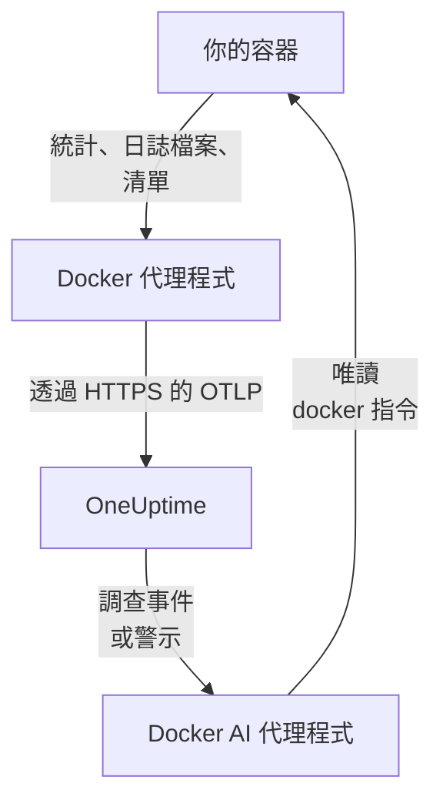

# Docker 代理程式

OneUptime Docker 代理程式是你在 Docker 主機上執行的一個容器。它會讀取主機上每個容器的統計資料和日誌檔案，並將其傳送到 OneUptime，主機會連同其容器、指標和日誌一起出現在那裡。第二個容器 Docker AI 代理程式讓 OneUptime AI 能夠調查該主機。[Docker 監控](/docs/monitor/docker-monitor) 會根據代理程式傳送的資料發出警示。

:::cards
- [安裝代理程式](#安裝代理程式): 兩個容器，使用 `docker run` 或 Docker Compose。
- [代理程式收集的內容](#代理程式收集的內容): 每個容器的指標、日誌和清單。
- [容器日誌需要 json-file](#容器日誌需要-json-file-日誌驅動程式): 檢查並切換容器的日誌驅動程式。
- [疑難排解](#疑難排解): 重新啟動迴圈、缺少指標、缺少日誌。
:::

## 運作方式

該代理程式是一個內建 OneUptime 設定的 OpenTelemetry Collector。它會透過 Docker 通訊端每 30 秒讀取一次每個容器的統計資料，並每 5 分鐘列出一次所有容器、映像檔、網路和磁碟區。它會追蹤容器的日誌檔案，並使用你提供的擷取金鑰，透過 OTLP 將所有內容傳送到你的 OneUptime URL。



主機會隨其第一批資料，以你在 `DOCKER_HOST_NAME` 中指定的名稱自行註冊。AI 代理程式是選用的：不安裝它，Collector 也照常運作。

## 開始之前

- Docker Engine 20.10 或更新版本，以及主機上的 root 權限：代理程式會讀取 `/var/run/docker.sock`。
- 如果使用 Docker Compose 安裝，則需要 Docker Compose v2（`docker compose` 指令）。
- 一把擷取金鑰。在 **專案設定 → 遙測與 APM → 擷取金鑰** 下建立一把並複製其值。
- 從主機到你的 OneUptime URL 的輸出 HTTPS。
- 對於容器日誌，需要容器使用 Docker 的 `json-file` 日誌驅動程式，這是 Docker 的預設驅動程式。請參閱 [容器日誌需要 json-file 日誌驅動程式](#容器日誌需要-json-file-日誌驅動程式)。

## 安裝代理程式

:::steps
### 啟動代理程式

將 `YOUR_ONEUPTIME_URL` 替換為你的 OneUptime URL，將 `YOUR_TELEMETRY_INGESTION_TOKEN` 替換為擷取金鑰，將 `my-docker-host` 替換為此主機的名稱，例如 `prod-docker-01`。主機會以這個名稱出現在 OneUptime 中，所以請保持不變：新名稱會註冊一台新主機。

:::tabs
@tab Docker CLI
```bash
docker run -d \
  --name oneuptime-docker-agent \
  --user 0:0 \
  --restart unless-stopped \
  -v /var/run/docker.sock:/var/run/docker.sock:ro \
  -v /var/lib/docker/containers:/var/lib/docker/containers:ro \
  -e ONEUPTIME_URL="YOUR_ONEUPTIME_URL" \
  -e ONEUPTIME_SERVICE_TOKEN="YOUR_TELEMETRY_INGESTION_TOKEN" \
  -e DOCKER_HOST_NAME="my-docker-host" \
  oneuptime/docker-agent:release
```

然後使用相同的值在它旁邊啟動 [AI 代理程式](#ai-代理程式)。**AI 調查預設為開啟。** 當 OneUptime AI 調查此主機上的事件或警示時，它會透過 AI 代理程式執行唯讀的 `docker` 指令，而且除非你允許修正，否則不會變更任何東西。若要在不啟用 AI 調查的情況下安裝，請略過這個指令。

```bash
docker run -d \
  --name oneuptime-docker-ai-agent \
  --user 0:0 \
  --restart unless-stopped \
  --read-only --tmpfs /tmp \
  -v /var/run/docker.sock:/var/run/docker.sock:ro \
  -e ONEUPTIME_URL="YOUR_ONEUPTIME_URL" \
  -e ONEUPTIME_SERVICE_TOKEN="YOUR_TELEMETRY_INGESTION_TOKEN" \
  -e ONEUPTIME_AI_AGENT_RESOURCE_TYPE=docker \
  -e DOCKER_HOST_NAME="my-docker-host" \
  oneuptime/resource-ai-agent:release
```
@tab Docker Compose
將以下內容儲存為主機上某個資料夾中的 `docker-compose.yml`。第二個服務是 [AI 代理程式](#ai-代理程式)：移除它即可在不啟用 AI 調查的情況下執行 Collector。

```yaml title="docker-compose.yml"
services:
  oneuptime-docker-agent:
    image: oneuptime/docker-agent:release
    container_name: oneuptime-docker-agent
    user: "0:0"
    restart: unless-stopped
    volumes:
      - /var/run/docker.sock:/var/run/docker.sock:ro
      - /var/lib/docker/containers:/var/lib/docker/containers:ro
    environment:
      - ONEUPTIME_URL=YOUR_ONEUPTIME_URL
      - ONEUPTIME_SERVICE_TOKEN=YOUR_TELEMETRY_INGESTION_TOKEN
      - DOCKER_HOST_NAME=my-docker-host
    logging:
      driver: json-file
      options:
        max-size: "10m"
        max-file: "3"
  oneuptime-docker-ai-agent:
    image: oneuptime/resource-ai-agent:release
    container_name: oneuptime-docker-ai-agent
    user: "0:0"
    restart: unless-stopped
    read_only: true
    tmpfs:
      - /tmp
    volumes:
      - /var/run/docker.sock:/var/run/docker.sock:ro
    environment:
      - ONEUPTIME_URL=YOUR_ONEUPTIME_URL
      - ONEUPTIME_SERVICE_TOKEN=YOUR_TELEMETRY_INGESTION_TOKEN
      - ONEUPTIME_AI_AGENT_RESOURCE_TYPE=docker
      - DOCKER_HOST_NAME=my-docker-host
```

在該資料夾中啟動它：

```bash
docker compose up -d
```
:::

### 檢查代理程式是否正在執行

```bash
docker ps --filter name=oneuptime-docker-agent
docker logs -f oneuptime-docker-agent
```

Collector 啟動後，日誌中應出現這一行：

```text
Everything is ready. Begin running and processing data.
```

### 在 OneUptime 中找到主機

開啟 **產品 → 基礎設施 → Docker → 所有主機**。大約一分鐘內，主機會以其 `DOCKER_HOST_NAME` 出現，並帶有其容器、指標和日誌。AI 代理程式會在主機的 **AI 代理程式** 頁面上以及其 **概覽** 底部顯示為已連線。
:::

## 環境變數

| 變數 | 必要 | 說明 |
| --- | --- | --- |
| `ONEUPTIME_URL` | 是 | 你的 OneUptime URL，例如 `https://oneuptime.com` 或你的自行託管執行個體。如果執行個體只支援 HTTP，請使用 `http://` 及其連接埠。 |
| `ONEUPTIME_SERVICE_TOKEN` | 是 | 來自 **專案設定 → 遙測與 APM → 擷取金鑰** 的擷取金鑰。 |
| `DOCKER_HOST_NAME` | 否 | 主機在 OneUptime 中的名稱。預設為 `docker-host`，因此請為每台主機設定自己的名稱。 |
| `DOCKER_API_VERSION` | 否 | 代理程式使用的 Docker Engine API 版本。預設為 `1.44`。在較舊的常駐程式上請調低它，或將其設為空值，讓它與常駐程式協商（請參閱 [疑難排解](#疑難排解)）。 |

若要變更某個值，請移除代理程式並重新執行其指令（Docker CLI），或編輯 `docker-compose.yml` 並執行 `docker compose up -d`（Docker Compose）。

## 代理程式收集的內容

| 資料 | 內容 |
| --- | --- |
| 容器指標 | 每個容器每 30 秒一次：CPU（用量、百分比、節流）、記憶體（用量、限制、百分比）、網路和區塊 I/O、執行時間、重新啟動次數和處理程序數。 |
| 容器日誌 | 每個容器的 stdout 和 stderr，來自其 `json-file` 日誌檔案。 |
| 清單 | 處於任何狀態的每個容器，以及每個映像檔、網路和磁碟區，每 5 分鐘一次。 |

每個容器的指標和日誌都會歸入一個以該容器命名的服務下。每一行日誌的嚴重性取自它所寫明的等級，例如 `[ERROR]`、`level=warn` 或 `{"level":"info"}`；沒有寫明等級的行則採用其所在串流的嚴重性：stderr 為 `ERROR`，stdout 為 `INFO`。以空白或右括號開頭的行會併入前一行，因此堆疊追蹤會以單一記錄送達。代理程式自身的日誌不會被收集。

[Docker 監控](/docs/monitor/docker-monitor#收集的指標) 列出了每個指標及其意義。

## 容器日誌需要 json-file 日誌驅動程式

代理程式會追蹤 `/var/lib/docker/containers/*/*-json.log`，也就是 Docker 的 `json-file` 日誌驅動程式寫入的檔案。使用其他驅動程式的容器不會留下可讀取的檔案：`local` 會寫入二進位檔，而 `journald`、`syslog`、`fluentd` 和 `gelf` 會將日誌傳送到別處。這類容器的指標仍會送達，但日誌不會。

檢查某個容器的日誌驅動程式，以及常駐程式的預設驅動程式：

```bash
docker inspect <container> --format '{{.HostConfig.LogConfig.Type}}'
docker info --format '{{.LoggingDriver}}'
```

將某個 Compose 服務切換為帶輪替的 `json-file`：

```yaml
services:
  my-app:
    image: my-app:latest
    logging:
      driver: "json-file"
      options:
        max-size: "100m"
        max-file: "5"
```

或在 `/etc/docker/daemon.json` 中將其設為之後建立的所有容器的預設驅動程式：

```json title="/etc/docker/daemon.json"
{
  "log-driver": "json-file",
  "log-opts": {
    "max-size": "100m",
    "max-file": "5"
  }
}
```

然後重新啟動 Docker 並重新建立容器。容器會一直使用建立時的日誌驅動程式，因此只重新啟動它是不夠的。

## 升級代理程式

當代理程式比你的 OneUptime 舊時，主機 **概覽** 上的 **代理程式版本** 旁邊會出現警告標誌。選取該標誌即可看到這些指令。

:::tabs
@tab Docker CLI
```bash
docker pull oneuptime/docker-agent:release
docker pull oneuptime/resource-ai-agent:release
docker rm -f oneuptime-docker-agent oneuptime-docker-ai-agent
```

然後再次執行 [啟動代理程式](#啟動代理程式) 中的兩個 `docker run` 指令。
@tab Docker Compose
```bash
docker compose pull
docker compose up -d
```
:::

`release` 標籤一律指向最新的發行版本。若要固定版本，請使用 `oneuptime/docker-agent:<version>`，例如 `oneuptime/docker-agent:10.0.31`。同一個映像檔也以 `ghcr.io/oneuptime/docker-agent:release` 發布在 GitHub Container Registry 上。

## 解除安裝代理程式

:::tabs
@tab Docker CLI
```bash
docker rm -f oneuptime-docker-agent
docker rm -f oneuptime-docker-ai-agent
```
@tab Docker Compose
```bash
docker compose down
```
:::

主機會連同它傳送過的資料一起保留在 OneUptime 中。如果不再需要，請透過其選單中的 **刪除主機** 將其刪除。

## AI 代理程式

上面的指令和 Compose 檔案、Docker 代理程式的 `install.sh`，以及其 [DockerAgent 目錄](https://github.com/OneUptime/oneuptime/tree/master/agents/DockerAgent) 中的 `docker-compose.yml`，都會執行 **Docker AI 代理程式**：第二個容器 `oneuptime-docker-ai-agent`（映像檔 `oneuptime/resource-ai-agent:release`），它會在 OneUptime AI 調查此主機上的事件或警示時，執行 OneUptime AI 要求的唯讀 `docker` 指令——`docker ps -a`、`docker logs --tail 200 web`、`docker container inspect web`、`docker stats --no-stream`——而且只有在你允許時才會套用修正，例如重新啟動指定的容器。它會讀取與 Collector 相同的 `ONEUPTIME_URL`、`ONEUPTIME_SERVICE_TOKEN` 和 `DOCKER_HOST_NAME`，因此它服務的正是這台主機，並會出現在 OneUptime 中該主機的 **AI 代理程式** 頁面上。

- **AI 調查預設為開啟。** 代理程式連線後，OneUptime AI 會用它來調查該主機上的事件和警示，主機的 **概覽** 會顯示代理程式的狀態。若要停止，請在代理程式執行的位置設定 `ONEUPTIME_AI_INVESTIGATION=false`（AI 代理程式頁面上 **AI 可以執行的操作** 下的 **變更** 會顯示方法），或不安裝代理程式。
- 除非你以 `ONEUPTIME_AI_ALLOW_WRITES=true` 啟動它，否則它是唯讀的；`ONEUPTIME_AI_WRITE_TARGETS`（例如 `web-*,api-*`）會限制修正可以觸及哪些容器。啟動時也要帶上 `ONEUPTIME_AI_FIXES`，以指定修正的執行方式——`ask-for-approval`（由人逐一核准）、`automatic` 或 `bypass-approval`——AI 代理程式頁面會以唯讀方式顯示它（[由代理程式設定的 AI 可以執行的操作](/docs/ai/infrastructure-ai-agents#what-ai-may-do-set-by-the-agent)）。
- 它會以 root 身分執行並掛載 Docker 通訊端，因為該通訊端屬於 root——而無論是否為 `:ro`，能夠使用該通訊端的人就等同這台主機上的 root。代理程式的指令原則就是界限：它從不執行 `exec`、`run`、`rm` 或 `prune`，也從不變更它自己、Collector 或 `ONEUPTIME_AI_PROTECTED_TARGETS`（容器名稱萬用字元）中的任何內容。`docker inspect` 輸出中的環境變數值會在任何內容離開主機之前被遮罩。
- `install.sh --no-ai-agent` 會略過它；`docker rm -f oneuptime-docker-ai-agent` 會移除它。升級方式與 Collector 相同：`docker pull oneuptime/resource-ai-agent:release`，移除它，然後再次啟動。

它可以執行什麼、修正如何運作以及如何疑難排解，請參閱 [Infrastructure AI Agents](/docs/ai/infrastructure-ai-agents#docker-and-podman-hosts)。

## 疑難排解

:::details 代理程式因 "client version is too new" 而不斷重新啟動
代理程式的日誌顯示：

```text
Error: cannot start pipelines: failed to start "docker_stats" receiver:
Error response from daemon: client version 1.44 is too new.
Maximum supported API version is 1.41
```

常駐程式會拒絕比其自身上限更新的用戶端，因此接收器永遠無法啟動，Collector 也隨之結束。找出常駐程式的上限：

```bash
docker version --format '{{ .Server.APIVersion }}'
```

然後在 `docker run` 中加入 `-e DOCKER_API_VERSION=1.41`（或你得到的值），或在 Compose 中設定 `DOCKER_API_VERSION`。較新的常駐程式仍然支援較舊的 API 版本，因此該設定在升級後依然有效。

不想查這個數字？將 `DOCKER_API_VERSION` 設為空字串。代理程式接著會與常駐程式協商版本（一次 `HEAD /_ping`，然後使用常駐程式自己的上限），這對新舊常駐程式都適用：

```bash
docker run -d ... -e DOCKER_API_VERSION= ...
```
:::

:::details Docker 通訊端權限遭拒
代理程式必須以 root 身分執行才能讀取 `/var/run/docker.sock`。請檢查你的 `docker run` 指令中是否有 `--user 0:0`，或 Compose 中是否有 `user: "0:0"`。
:::

:::details 主機顯示為已中斷
1. 檢查代理程式是否正在執行：`docker ps --filter name=oneuptime-docker-agent`
2. 在它的日誌中尋找錯誤：`docker logs oneuptime-docker-agent 2>&1 | grep -i error`
3. 檢查 `ONEUPTIME_URL` 和 `ONEUPTIME_SERVICE_TOKEN`：金鑰必須是有效且未被停用的擷取金鑰。
4. 檢查主機能否透過網路連線到你的 OneUptime URL。
:::

:::details 沒有出現指標
1. 檢查 Docker 通訊端是否已掛載到代理程式中。它的映像檔沒有 shell，因此請從一個共用其掛載的暫用容器中查看：`docker run --rm --volumes-from oneuptime-docker-agent alpine:3.19 ls -la /var/run/docker.sock`
2. 在它的日誌中尋找匯出錯誤：`docker logs oneuptime-docker-agent 2>&1 | tail -100`
3. 檢查擷取金鑰是否有效且未過期。
:::

:::details 指標有送達，但沒有容器日誌
你的容器很可能使用的是 `json-file` 以外的日誌驅動程式。檢查代理程式監看的是哪些檔案，以及某個容器使用的是哪個驅動程式：

```bash
docker logs oneuptime-docker-agent 2>&1 | grep -E "Started watching file|no files match"
docker inspect <container> --format '{{.HostConfig.LogConfig.Type}}'
```

如果代理程式回報 `no files match the configured criteria`，請依照 [容器日誌需要 json-file 日誌驅動程式](#容器日誌需要-json-file-日誌驅動程式) 中所示，將容器切換為 `json-file` 並重新建立它們。
:::

:::details 日誌出現在另一台主機下，或主機名稱為 docker-host
主機的名稱來自 `DOCKER_HOST_NAME`。不帶它啟動的代理程式會回報 `docker-host`，因此以這種方式設定的每台主機看起來都像同一台；之後再變更名稱，OneUptime 會註冊第二台主機，新資料接著會歸入它。請在每台主機上將 `DOCKER_HOST_NAME` 設定為它自己的名稱，並重新建立代理程式。若要檢查代理程式回報的名稱：

```bash
docker inspect oneuptime-docker-agent --format '{{range .Config.Env}}{{println .}}{{end}}' | grep DOCKER_HOST_NAME
```
:::

## 後續步驟

:::cards
- [Docker 監控](/docs/monitor/docker-monitor): 針對容器的 CPU、記憶體和重新啟動發出警示。
- [資料庫](/docs/telemetry/databases): 主機上的資料庫容器會被探索到，並擁有自己的頁面。
- [Kubernetes 代理程式](/docs/telemetry/kubernetes-agent): 改為監控 Kubernetes 叢集。
- [主機 OpenTelemetry Collector](/docs/telemetry/host-otel-collector): 監控機器本身：CPU、磁碟、處理程序和日誌。
:::
