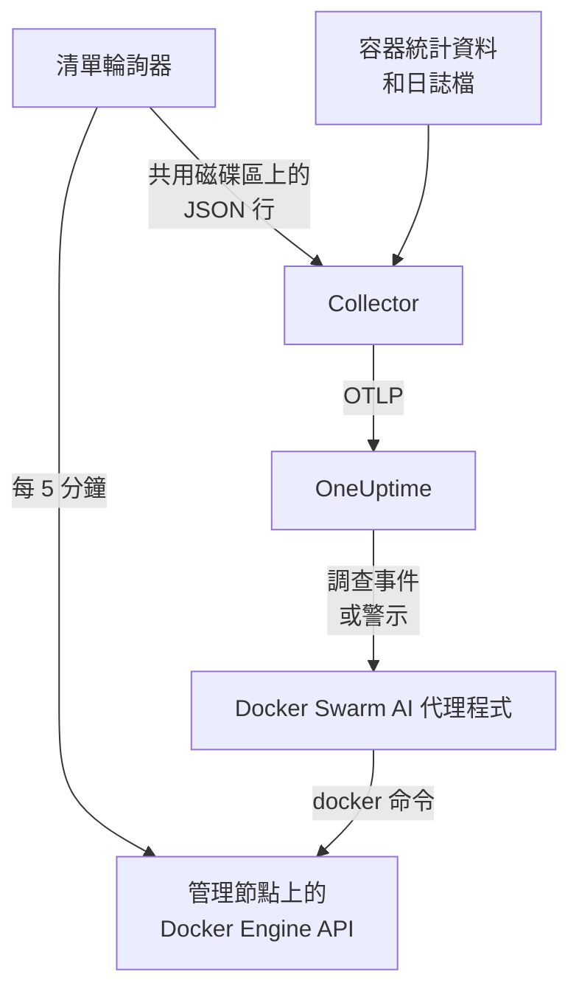

# Docker Swarm 代理程式

OneUptime Docker Swarm 代理程式會監控 Docker Swarm 叢集：它的節點、服務、工作、堆疊、overlay 網路、密碼、設定和磁碟區，以及每個容器的指標和日誌。你在 swarm 管理節點上用 Docker Compose 執行它，叢集就會連同這些內容一起出現在 OneUptime 中。[Docker Swarm 監控](/docs/monitor/docker-swarm-monitor) 會根據收到的資料發出警示。

:::cards
- [安裝代理程式](#安裝代理程式): 在管理節點上使用安裝指令碼或 Docker Compose。
- [代理程式收集的內容](#代理程式收集的內容): 清單、叢集計數，以及容器指標和日誌。
- [AI 代理程式](#ai-代理程式): 讓 OneUptime AI 在調查時讀取 swarm。
- [疑難排解](#疑難排解): 一個診斷指令碼，以及常見問題。
:::

## 運作方式

代理程式是三個容器，全部定義在一個 `docker-compose.yml` 中：

1. **Collector**：一個 OpenTelemetry Collector，會讀取 `docker_stats` 取得每個容器的指標、追蹤容器的日誌檔，並追蹤清單快照檔案。它會為所有資料加上你的叢集名稱（`docker.swarm.cluster.name`），並透過 OTLP 傳送到 OneUptime。
2. **清單輪詢器**：一個以 `curl` 和 `jq` 組成的小型 sidecar 容器，每 5 分鐘走訪一次 swarm 管理節點的 API（`/nodes`、`/services`、`/tasks`、`/networks`、`/secrets`、`/configs`、`/volumes`），並根據服務標籤 `com.docker.stack.namespace` 推斷出堆疊。它會為每個物件寫入一行 JSON，由 Collector 轉送。
3. **AI 代理程式**：`oneuptime-docker-swarm-ai-agent`，會在 OneUptime AI 調查此叢集上的事件或警示時，執行它要求的 `docker` 命令。除非你允許修正，否則它是唯讀的（請參閱 [AI 代理程式](#ai-代理程式)）。



叢集會隨其第一批資料，以你設定的叢集名稱自行註冊。

## 開始之前

- 一個用來執行代理程式的 swarm **管理** 節點：清單輪詢器和 AI 代理程式呼叫的 API 端點只有管理節點才會回應。
- Docker Engine 20.10 或更新版本，搭配 Docker Compose v2 外掛程式。
- 一把擷取金鑰。在 **專案設定 → 遙測與 APM → 擷取金鑰** 下建立一把並複製其值。
- 從節點到你的 OneUptime URL 的輸出 HTTPS。

### 在哪裡執行代理程式

請在管理節點上執行它。Collector 回報的是它所在節點的容器，因此若要取得所有節點的容器指標，請在每個節點上執行 Collector，並且都使用相同的 `DOCKER_SWARM_CLUSTER_NAME`；清單輪詢器和 AI 代理程式只需在一個管理節點上執行。`install.sh` 在非管理節點上不會安裝 AI 代理程式（並會移除先前在那裡安裝的 AI 代理程式）。即使在工作節點上啟動了 AI 代理程式，它也永遠不會為叢集註冊：它會一直等到所在節點成為管理節點，因此無法取代管理節點上的 AI 代理程式。要以 swarm 堆疊而不是 Compose 部署代理程式嗎？請用限制條件 `node.role == manager` 讓清單輪詢器和 AI 代理程式留在管理節點上。

## 安裝代理程式

:::steps
### 安裝並啟動代理程式

:::tabs
@tab install.sh
下載安裝指令碼並在管理節點上執行：

```bash
curl -sSL https://raw.githubusercontent.com/OneUptime/oneuptime/master/agents/DockerSwarmAgent/install.sh -o install.sh
sh install.sh
```

指令碼會詢問你的 OneUptime URL、擷取金鑰和叢集名稱。它會安裝到 `/opt/oneuptime-docker-swarm-agent`，寫入一個只有擁有者能讀取的 `.env` 檔案，並啟動全部三個容器。加上 `--no-ai-agent` 即可不安裝 AI 代理程式。
@tab Docker Compose
從 [DockerSwarmAgent 目錄](https://github.com/OneUptime/oneuptime/tree/master/agents/DockerSwarmAgent) 下載 `docker-compose.yml`、`otel-collector-config.yaml` 和 `inventory-snapshot.sh` 到管理節點上的一個新資料夾中：

```bash
curl -fsSL https://raw.githubusercontent.com/OneUptime/oneuptime/master/agents/DockerSwarmAgent/docker-compose.yml -o docker-compose.yml
curl -fsSL https://raw.githubusercontent.com/OneUptime/oneuptime/master/agents/DockerSwarmAgent/otel-collector-config.yaml -o otel-collector-config.yaml
curl -fsSL https://raw.githubusercontent.com/OneUptime/oneuptime/master/agents/DockerSwarmAgent/inventory-snapshot.sh -o inventory-snapshot.sh
chmod +x inventory-snapshot.sh
```

在它們旁邊建立一個 `.env` 檔案。它存放著擷取金鑰，因此請用 `chmod 600 .env` 保持其私密：

```bash title=".env"
ONEUPTIME_URL=https://oneuptime.com
ONEUPTIME_SERVICE_TOKEN=your-telemetry-ingestion-key
DOCKER_SWARM_CLUSTER_NAME=my-swarm
```

啟動代理程式：

```bash
docker compose up -d
```
:::

### 檢查代理程式是否正在執行

```bash
docker compose ps
docker compose logs --tail 50 oneuptime-docker-swarm-agent oneuptime-docker-swarm-inventory
```

`docker compose ps` 會列出三個容器：Collector（`oneuptime-docker-swarm-agent`）、清單輪詢器（`oneuptime-docker-swarm-inventory`）和 AI 代理程式（`oneuptime-docker-swarm-ai-agent`）。

### 在 OneUptime 中找到叢集

開啟 **產品 → 基礎設施 → Docker Swarm → 所有叢集**。叢集會在幾分鐘內出現，在第一次清單快照之後的 5 分鐘內，其 **節點**、**服務**、**任務**、**Stacks**、**網路**、**密鑰**、**Configs** 和 **磁碟區** 頁面會填入內容。
:::

## 環境變數

安裝指令碼會將前三個寫入 `/opt/oneuptime-docker-swarm-agent/.env`；Docker Compose 安裝則會從 `docker-compose.yml` 旁邊的 `.env` 中讀取它們。在那裡新增或變更其中任何一個，然後在該資料夾中執行 `docker compose up -d`。

| 變數 | 必要 | 說明 |
| --- | --- | --- |
| `ONEUPTIME_URL` | 是 | 你的 OneUptime URL，例如 `https://oneuptime.com` 或你的自行託管執行個體。如果執行個體只支援 HTTP，請使用 `http://` 及其連接埠。 |
| `ONEUPTIME_SERVICE_TOKEN` | 是 | 來自 **專案設定 → 遙測與 APM → 擷取金鑰** 的擷取金鑰。 |
| `DOCKER_SWARM_CLUSTER_NAME` | 是 | 叢集在 OneUptime 中的名稱，也是匯合每個節點資料的鍵：會作為 `docker.swarm.cluster.name` 資源屬性加到所有資料上。請保持不變：之後變更它會註冊另一個叢集。預設為 `docker-swarm`。 |
| `DOCKER_INVENTORY_INTERVAL_SECONDS` | 否 | 清單輪詢器拍攝快照的頻率，單位為秒。預設為 `300`。 |
| `DOCKER_API_VERSION` | 否 | Collector 和清單輪詢器使用的 Docker Engine API 版本。預設為 `1.44`；留空則與常駐程式協商（請參閱 [疑難排解](#疑難排解)）。除非你指定一個版本，否則 AI 代理程式會自行協商。 |

AI 代理程式自己的設定請見 [AI 代理程式](#ai-代理程式)。

## 代理程式收集的內容

| 訊號 | 來源 | 顯示位置 |
| --- | --- | --- |
| 節點、服務、工作、堆疊、網路、密碼、設定和磁碟區 | 清單輪詢器，來自 swarm 管理節點的 API | 叢集的清單頁和詳細資料頁 |
| 叢集計數（就緒的節點、執行中的工作、服務、堆疊等） | 同一個快照 | 概覽中的卡片和側邊選單上的徽章 |
| 容器的 CPU、記憶體、處理程序數和運作時間 | `docker_stats` 接收器 | **指標** 頁面 |
| 容器的 stdout 和 stderr 日誌 | `filelog` 接收器 | **日誌** 頁面 |

### 它與 Docker 代理程式有何不同

[Docker 代理程式](/docs/telemetry/docker-host) 為單一主機建立模型，並加上 `host.name` 和 `container.runtime=docker`。Docker Swarm 代理程式刻意只加上 `docker.swarm.cluster.name`：這樣 OneUptime 會將資料歸到 swarm 叢集下，而不是把每個節點註冊為獨立的主機。

## 用專案標籤標記叢集

以 `oneuptime.label.` 開頭的資源屬性會成為叢集上的專案標籤：`oneuptime.label.<dimension>=<value>` 就是標籤 `<dimension>:<value>`。在 `otel-collector-config.yaml` 的 `resource` 處理器中，緊鄰 `docker.swarm.cluster.name` 新增這些屬性：

```yaml
processors:
  resource:
    attributes:
      # ...existing attributes...
      - key: oneuptime.label.team
        value: platform
        action: upsert
      - key: oneuptime.label.env
        value: production
        action: upsert
```

Collector 只在啟動時讀取其設定：請執行 `docker compose restart oneuptime-docker-swarm-agent`。之後叢集會顯示標籤 `team:platform` 和 `env:production`。標籤比對不區分大小寫，因此現有的 `Production` 標籤會被重複使用而不是重複建立，而且代理程式絕不會移除別人在 OneUptime 中新增的標籤。

## 以 systemd 服務執行

若要讓代理程式隨節點啟動，並在失敗時重新啟動，請安裝它的 systemd 單元。它假設代理程式位於 `/opt/oneuptime-docker-swarm-agent`，也就是安裝指令碼放置它的位置：

```bash
sudo curl -fsSL https://raw.githubusercontent.com/OneUptime/oneuptime/master/agents/DockerSwarmAgent/systemd/oneuptime-docker-swarm-agent.service -o /etc/systemd/system/oneuptime-docker-swarm-agent.service
sudo systemctl daemon-reload
sudo systemctl enable --now oneuptime-docker-swarm-agent
```

## 升級代理程式

代理程式會回報它執行的 Collector 版本。當該版本早於此 OneUptime 版本固定的版本時，叢集的 **概覽** 頁面上代理程式版本旁會出現一個警告標誌。選取它即可查看這些命令。

在管理節點上再次執行安裝指令碼，並用相同的 URL、金鑰和叢集名稱回答它的問題。它會下載最新的檔案、提取映像檔並重新啟動代理程式：

```bash
curl -sSL https://raw.githubusercontent.com/OneUptime/oneuptime/master/agents/DockerSwarmAgent/install.sh -o install.sh
sh install.sh
```

指令碼會根據你的回答重新寫入 `.env`。它只保留 AI 代理程式的目標清單和 AI 可以執行的操作（`ONEUPTIME_AI_INVESTIGATION`、`ONEUPTIME_AI_FIXES`）：請把你自己設定的任何變數加回去，例如 `DOCKER_API_VERSION`。開啟過 AI 修正嗎？請以 `ONEUPTIME_AI_ALLOW_WRITES=true sh install.sh` 執行它，讓修正保持開啟。之前沒有安裝 AI 代理程式嗎？請再次傳入 `--no-ai-agent`。

若使用 Docker Compose，請在代理程式的資料夾中重新下載這三個檔案（然後重新做一次你對 `docker-compose.yml` 所做的任何修改），再提取映像檔並重新啟動：

```bash
docker compose pull
docker compose up -d
```

Collector 版本固定在這些檔案中，因此只提取映像檔並不能讓代理程式升級。

## 解除安裝代理程式

```bash
cd /opt/oneuptime-docker-swarm-agent
docker compose down
```

## AI 代理程式

swarm 的 `docker-compose.yml`（以及 `install.sh`）也會執行 **Docker Swarm AI 代理程式**：第三個容器 `oneuptime-docker-swarm-ai-agent`（映像檔 `oneuptime/resource-ai-agent:release`），會在 OneUptime AI 調查此叢集上的事件或警示時，執行它要求的唯讀 `docker` 命令——`docker node ls`、`docker service ps web --no-trunc`、`docker service logs --tail 200 web`——並且只在你允許時套用修正，例如對指定服務進行滾動重新啟動。它讀取與 Collector 相同的 `ONEUPTIME_URL`、`ONEUPTIME_SERVICE_TOKEN` 和 `DOCKER_SWARM_CLUSTER_NAME`，因此服務的正是這個叢集，並顯示在 OneUptime 中該叢集的 **人工智慧 → AI 代理程式** 頁面上。

- **AI 調查預設為開啟。** 代理程式連線後，OneUptime AI 會用它來調查該叢集上的事件和警示，叢集的 **概覽** 會顯示代理程式的狀態。若要停止，請在代理程式執行的位置設定 `ONEUPTIME_AI_INVESTIGATION=false`（AI 代理程式頁面上 **AI 可以執行的操作** 下的 **變更** 會顯示方法），或不安裝代理程式。
- 和清單輪詢器一樣，它 **必須在管理節點上執行**：節點、服務和工作命令只在管理節點上可用。在工作節點上，它什麼也不執行，並且在節點成為管理節點之前不會為叢集註冊（它的 `/status` 會說明原因）。每個叢集執行一個。
- 除非你在 `.env` 中設定 `ONEUPTIME_AI_ALLOW_WRITES=true` 並執行 `docker compose up -d`（或帶上該變數執行 `install.sh`；安裝程式會將其環境中的 `ONEUPTIME_AI_ALLOW_WRITES`、`ONEUPTIME_AI_INVESTIGATION`、`ONEUPTIME_AI_FIXES`、`ONEUPTIME_AI_WRITE_TARGETS` 和 `ONEUPTIME_AI_PROTECTED_TARGETS` 寫入 `.env`，再次執行時，除非你傳入該變數（即使為空），否則後四個變數會保留 `.env` 中已有的值），否則它是 **唯讀** 的；`ONEUPTIME_AI_WRITE_TARGETS`（服務和節點名稱的萬用字元模式，例如 `web_*,api_*`）會限制修正可以觸及的範圍。同一個 `.env` 中的 `ONEUPTIME_AI_FIXES` 決定修正如何執行——`ask-for-approval`（由人逐一核准）、`automatic` 或 `bypass-approval`——AI 代理程式頁面會以唯讀方式顯示它（[AI 可以執行的操作，由代理程式設定](/docs/ai/infrastructure-ai-agents#what-ai-may-do-set-by-the-agent)）。無論處於哪種模式，清空節點一律需要人工核准。
- 它以 root 身分執行並掛載了 Docker 通訊端，因為該通訊端歸 root 所有——而在管理節點上，能使用該通訊端的人就能控制整個 swarm，無論是否帶 `:ro`。真正的限制是代理程式的命令原則：它絕不建立或移除服務或堆疊，絕不觸碰密碼或設定，也絕不變更它自己、Collector、清單輪詢器或 `ONEUPTIME_AI_PROTECTED_TARGETS`（服務和節點名稱的萬用字元模式）中的任何內容。
- `install.sh --no-ai-agent` 會不安裝它；也可以從 `docker-compose.yml` 中刪除 `oneuptime-docker-swarm-ai-agent` 服務。

它可以執行什麼、修正如何運作以及如何排解它的問題：[Infrastructure AI Agents](/docs/ai/infrastructure-ai-agents#docker-swarm-clusters)。

## 疑難排解

:::details 先執行診斷指令碼
代理程式隨附一個指令碼 [`troubleshoot.sh`](https://github.com/OneUptime/oneuptime/blob/master/agents/DockerSwarmAgent/troubleshoot.sh)，它會檢查整條鏈路：各個容器、清單輪詢器是否在管理節點上（`docker node ls`）、快照檔案、加到所有資料上的叢集名稱、權杖的格式、Collector 自身的指標，以及 OneUptime 是否接受擷取金鑰。最後一項檢查最重要。OneUptime 會以 `401` 拒絕錯誤的金鑰（已停用的金鑰或瀏覽器金鑰為 `422`），而 Collector 只會每個批次記錄一行 `Exporting failed`，很容易被忽略。該指令碼會要求 `GET <url>/otlp/v1/validate`，直接得到 `200`（有效）或 `401`（無效）。請在管理節點上執行它：

```bash
curl -sSL https://raw.githubusercontent.com/OneUptime/oneuptime/master/agents/DockerSwarmAgent/troubleshoot.sh -o troubleshoot.sh
bash troubleshoot.sh    # add -d <dir> if you installed outside /opt/oneuptime-docker-swarm-agent
```
:::

:::details 叢集始終沒有出現
先執行診斷指令碼。否則，請閱讀 Collector 的日誌（`docker compose logs oneuptime-docker-swarm-agent`），檢查 `.env` 中的 `ONEUPTIME_SERVICE_TOKEN` 和 `ONEUPTIME_URL` 是否正確，以及節點能否連到你的 OneUptime URL。
:::

:::details 沒有出現清單
檢查清單輪詢器是否在管理節點上執行：`docker node ls` 必須能在那裡成功執行。然後在它的日誌中尋找 `failed to emit ...` 行：`docker compose logs oneuptime-docker-swarm-inventory`。
:::

:::details 叢集變為已中斷連線
當 OneUptime 在 15 分鐘內沒有從叢集收到任何資料時，叢集會變為已中斷連線；OneUptime 每 5 分鐘檢查一次，而且它自身未在接收資料的時間不計入。請確保 Collector 容器持續執行：`docker compose ps` 會顯示它。
:::

:::details Collector 以 "client version is too new" 結束
Collector 的日誌顯示：

```text
Error: cannot start pipelines: failed to start "docker_stats" receiver:
Error response from daemon: client version 1.44 is too new.
Maximum supported API version is 1.41
```

常駐程式支援的最高 API 版本低於預設的 `1.44`（Docker Engine 20.10 最高為 `1.41`），因此 `docker_stats` 接收器無法啟動，容器會不斷重新啟動。查出常駐程式支援的最高版本：

```bash
docker version --format '{{ .Server.APIVersion }}'
```

在 `.env` 中將 `DOCKER_API_VERSION` 設為該值，並在執行代理程式的每個節點上執行 `docker compose up -d`。較新的常駐程式仍然支援較舊的 API 版本，因此升級 Docker 後該設定仍然有效。或者設定 `DOCKER_API_VERSION=`（留空），讓 Collector 與常駐程式協商版本，而不是固定一個版本。
:::

:::details 叢集以錯誤的名稱出現
叢集的名稱來自 `DOCKER_SWARM_CLUSTER_NAME`。在 `.env` 中變更它並執行 `docker compose up -d`：新名稱會註冊一個新叢集，而不是重新命名舊叢集。
:::

## 後續步驟

:::cards
- [Docker Swarm 監控](/docs/monitor/docker-swarm-monitor): 針對節點、服務、工作和容器發出警示。
- [Infrastructure AI Agents](/docs/ai/infrastructure-ai-agents): Docker Swarm AI 代理程式可以執行什麼，以及修正如何運作。
- [Docker 代理程式](/docs/telemetry/docker-host): 改為監控單一 Docker 主機。
:::
