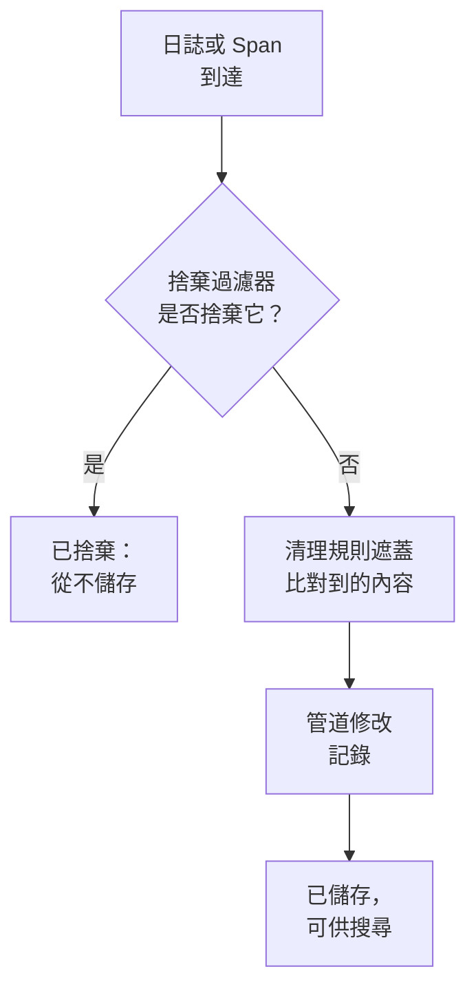

# 捨棄過濾器與清理規則

捨棄過濾器和清理規則在你的日誌和 Span 到達時就對其起作用，早於任何儲存。捨棄過濾器會丟掉你永遠用不到的記錄，或者只保留其中的一部分樣本。清理規則會遮蓋個人資料和機密，例如電子郵件地址、卡號和密碼，讓它們永遠不會進入你的儲存空間。

:::cards
- [它們在哪裡執行](#它們在哪裡執行): 在管道之前，在儲存之前。
- [捨棄或取樣記錄](#捨棄或取樣記錄): 比對記錄，然後捨棄它們或保留一部分。
- [清理敏感資料](#清理敏感資料): 對模式找到的內容進行編修、遮罩或雜湊處理。
- [查看過濾器捨棄了什麼](#查看過濾器捨棄了什麼): 每個過濾器上的計數。
:::

## 它們在哪裡執行

日誌的規則位於 **日誌 → 設定**，Span 的規則位於 **追蹤 → 設定**。記錄到達時，OneUptime 依以下順序執行它們：



- **它們只作用於新記錄。** 你建立或修改的規則適用於大約一分鐘後到達的記錄。已經儲存的記錄不會改變。
- **被捨棄的記錄就沒有了。** 任何搜尋、圖表、監測器或記錄規則都看不到它，也不會從它產生例外。在 OneUptime Cloud 上，它也不會計費。
- **每個清單依順序執行。** 拖曳清單中的列即可變更順序。只有已啟用的過濾器和規則才會執行。

日誌捨棄過濾器和清理規則同樣適用於來自 OpenTelemetry、Syslog、Fluent Bit 和 Fluentd 的日誌。[日誌管道](/docs/telemetry/log-pipelines) 介紹了它們之後的步驟。

## 開始之前

- **正在到達的日誌或 Span。** 請參閱 [OpenTelemetry](/docs/telemetry/open-telemetry)。
- **能夠修改遙測設定的角色。** Project Owner 或 Project Admin，或者擁有你所修改內容之權限（例如 Create Log Drop Filter 或 Create Trace Scrub Rule）的自訂角色。Telemetry 角色可以檢視過濾器和規則，但不能修改它們。

## 捨棄或取樣記錄

:::steps
### 開啟捨棄過濾器

前往 **日誌 → 設定 → 捨棄過濾器**；若是 Span，前往 **追蹤 → 設定 → 捨棄過濾器**。

### 比對記錄

點選 **建立日誌 捨棄 過濾器**；若是 Span，點選 **建立追蹤 捨棄 過濾器**。在 **比對** 步驟中為過濾器指定 **名稱**，然後建立它的 **篩選查詢**：為每個條件指定欄位、運算子和值，並選擇必須符合 **所有條件** 還是 **任一條件**。點選 **下一步**。

### 選擇操作

在 **操作** 步驟中，保留 **捨棄** 以丟掉每筆符合的記錄，或者選擇 **範例** 並輸入要保留的 **取樣百分比**，範圍為 1 到 99。然後建立過濾器。
:::

過濾器會在一分鐘內開始捨棄。若要先儲存而暫不捨棄任何內容，請在建立之前關閉 **進階** 下方的 **已啟用**。

> [!WARNING]
> 被捨棄的記錄無法找回。請讓過濾器的查詢盡量精確，並在建立後留意它的 **Dropped** 計數。

過濾器可以檢查以下欄位，也可以透過 **Custom Attribute...** 檢查任意屬性：

| 記錄 | 欄位 |
| --- | --- |
| 日誌 | **嚴重程度**、**日誌內文**、**服務 ID** |
| Span | **Span 名稱**、**Span 種類**、**狀態**、**狀態訊息**、**服務 ID**、**有例外**、**為根 Span** |

| 運算子 | 符合 |
| --- | --- |
| **等於** | 完全相同的值，區分大小寫：`Debug` 符合，`DEBUG` 不符合。 |
| **不等於** | 除完全相同的值之外的任何值。 |
| **包含** | 欄位中任意位置出現的該值，不區分大小寫。值中的 `%` 是萬用字元。 |
| **是其中之一** | 以逗號分隔的精確值清單中的任意一個。 |

**Preview query** 會顯示這些條件組成的查詢。下面這個查詢會捨棄健康檢查的偵錯日誌行：

```text
severityText = 'Debug' AND body LIKE 'healthcheck'
```

取樣逐筆記錄決定：當 **取樣百分比** 為 10 時，大約每十筆符合的記錄保留一筆。過濾器依清單順序執行，第一個捨棄某筆記錄的過濾器說了算；被樣本保留的記錄會繼續進入下一個過濾器。

## 清理敏感資料

:::steps
### 開啟清理規則

前往 **日誌 → 設定 → 清理規則**；若是 Span，前往 **追蹤 → 設定 → 清理規則**。

### 選擇要尋找的內容

點選 **建立日誌 清理 規則**；若是 Span，點選 **建立追蹤 清理 規則**。然後選擇一個 **模式類型**。在你輸入自己的名稱之前，規則會以它命名，例如 **清除電子郵件地址**。若選擇 **自訂 Regex**，還要輸入 **自訂正規表示式模式**。

### 選擇清理方式

在 **進階** 下方選擇 **清除動作** 和 **要清除的欄位**，或者保持原樣：新規則會把每個符合項目替換為 `[REDACTED]`，無論它位於記錄中的什麼位置。然後建立規則。
:::

| 模式類型 | 它尋找的內容 |
| --- | --- |
| **電子郵件地址** | 電子郵件地址，例如 `jane@example.com` |
| **信用卡號碼** | 四位一組的十六位數字，例如 `4111 1111 1111 1111` |
| **SSN（社會安全號碼）** | 美國社會安全號碼，例如 `123-45-6789` |
| **電話號碼** | 北美電話號碼，例如 `555-123-4567` |
| **IP 位址** | IPv4 位址，例如 `192.168.1.1` |
| **Sensitive Attribute Keys** | 鍵看起來像機密的任何屬性的完整值，例如 `password`、`token`、`api_key`、`authorization` 或 `cookie` |
| **自訂 Regex** | 你自己的規則運算式，不帶斜線或旗標，並區分大小寫進行比對 |

| 清除動作 | 符合項目會變成什麼 |
| --- | --- |
| **編修** | `[REDACTED]`，即預設值 |
| **遮罩** | 大部分被隱藏：電子郵件地址保留首字母和網域結尾，卡號、電話號碼或社會安全號碼保留最後四位，自訂符合項目或機密值保留第一個和最後一個字元。IP 位址會被完全隱藏。 |
| **雜湊** | 該值的簡短雜湊，同一個值每次都相同，因此仍然可以統計重複次數 |

例如，一條 **電子郵件地址** 規則會把下面這筆日誌內文：

```text
Payment failed for jane@example.com
```

依據它的 **清除動作** 儲存為以下形式之一：

```text
Redact: Payment failed for [REDACTED]
Mask:   Payment failed for j***@***.com
Hash:   Payment failed for [HASHED:8c87b489]
```

對於日誌規則，**要清除的欄位** 為 **兩者（本文與屬性）**，除非你選擇 **僅本文** 或 **僅屬性**；對於 Span 規則，它為 **全部（名稱、屬性與事件）**，除非你選擇 **僅 Span 名稱**、**僅屬性** 或 **僅事件屬性**。**Sensitive Attribute Keys** 規則一律清理屬性值，因為它讀取的是屬性鍵。

- **例外來自清理後的記錄。** 在日誌中發現的例外在清理之後才產生，清理 Span 事件的規則也會清理記錄在這些事件上的例外。
- **Session Replay 也會被清理。** 除了錄製器在瀏覽器中進行的遮罩之外，日誌清理規則也會作用於 Session Replay 錄製內容。
- **規則依清單順序執行。** 每條規則看到的是前面的規則處理後的內容。
- **自訂模式所用的時間與記錄長度成正比。** 無論怎麼寫，它都保留 JavaScript 的語法與結果，包括先行斷言和後行斷言。反向參照（例如 `\1`）無法這樣執行：含有反向參照的規則在儲存時會被拒絕，大到無法執行的模式也一樣。如果要找出所有比對需要一遍又一遍地重讀一個很長的值，規則會清理整個值。專案的捨棄過濾器、清理規則和管道也為它傳送的每一批資料共用一份工作額度，與這批資料的大小成正比：當它們的模式需要更多工作時，自訂清理規則會清理整個值，而無法得出結果的過濾器不會套用於該記錄。

## 查看過濾器捨棄了什麼

**捨棄過濾器** 清單會顯示每個過濾器的 **Dropped** 計數，以及它最後一次捨棄的時間 **Last Dropped**。**Nothing dropped yet** 表示它從未符合過。過濾器自己的頁面會在 **活動** 下方顯示同樣的資訊，並在捨棄後一分鐘內更新。它的 **篩選條件** 卡片會顯示它比對的內容，你可以在那裡修改條件。

## 疑難排解

:::details 捨棄過濾器什麼都沒有捨棄
**等於**、**不等於** 和 **是其中之一** 比較的是精確文字，包含大小寫。嚴重程度寫作 `Information` 和 `Warning`，而不是 `INFO` 或 `WARN`。請檢查過濾器是否已啟用，並在修改後等待一分鐘。
:::

:::details 我預期的日誌不見了
查看每個捨棄過濾器的 **Dropped** 計數和 **Last Dropped** 時間。關閉你懷疑的那個過濾器的 **已啟用**，之後的日誌就會重新到達。
:::

:::details 自訂清理規則顯示不會清除任何內容
它的模式為空，或者不是有效的規則運算式，或者無法執行（例如含有 `\1` 這樣的反向參照），因此它不會清理任何內容。編輯該規則，為它指定一個至少符合一個字元的模式。
:::

:::details 舊記錄仍然顯示新規則要清理的資料
清理規則在記錄到達時起作用。在規則之前儲存的記錄會保留原有內容，直到其保留期結束。請參閱 [資料保留](/docs/telemetry/data-retention)。
:::

## 後續步驟

:::cards
- [日誌管道](/docs/telemetry/log-pipelines): 剖析並豐富你保留的日誌。
- [日誌瀏覽器](/docs/telemetry/logs-explorer): 搜尋已儲存的內容。
- [追蹤瀏覽器](/docs/telemetry/traces-explorer): 追蹤你保留的 Span。
- [資料保留](/docs/telemetry/data-retention): 決定它們保留多長時間。
:::
